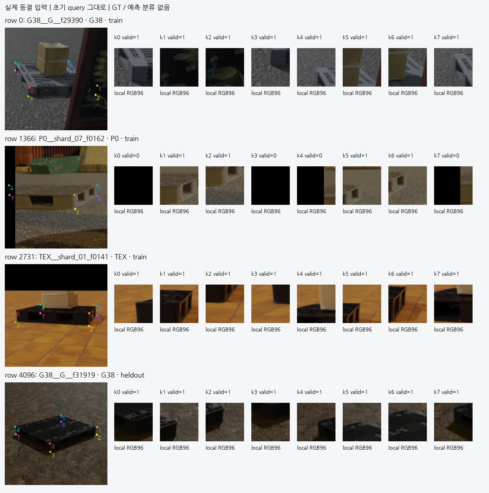
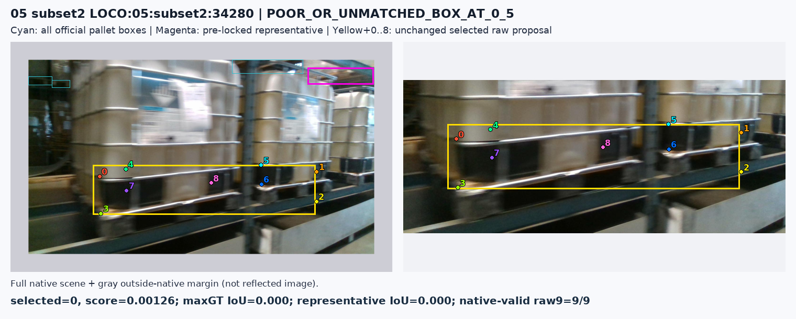

# V74 source 입력과 대응 준비

원문: [query_visibility_loco_native_context_20261023_v74/RESULTS_KO.html](../../archive/task-2/pallet-keypoint-visibility/query_visibility_loco_native_context_20261023_v74/RESULTS_KO.html)

원 HTML SHA256: `04da930c661699eb3db0329c0fbe0c49d54d6dbadcb6f869a33712cb9ec58872`

원 img ordinal 1–2 / 2. 원 순서 유지; 이미지 pixel decode/모델/평가 재실행 없음.

## 원 이미지 1

원문 직전 heading

```text
큰 문맥과 8점 배치를 포함한 실제 입력
```



## 원 이미지 2

원문 직전 heading

```text
LOCO 공개 실사에서 확인한 두 가지 한계
```


