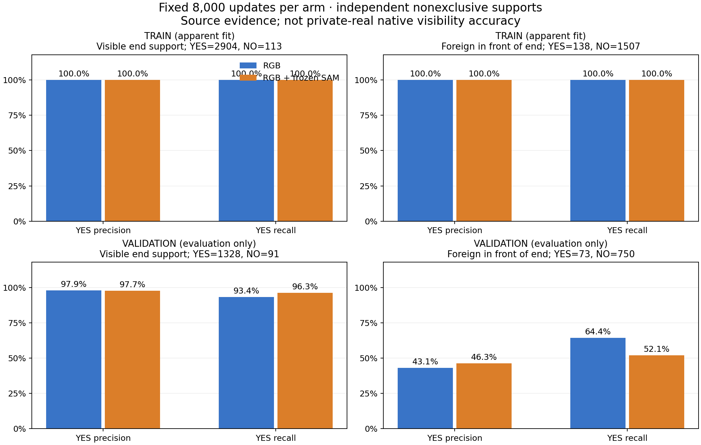

# V181 고정 crop RGB/SAM 비교

원문: [query_visibility_local_support_raw_head_20261024_v181/provenance/BEFORE_REPORT_LEGEND_LAYOUT_REPAIR/ROOT_READOUT_KO.html](../../archive/task-2/pallet-keypoint-visibility/query_visibility_local_support_raw_head_20261024_v181/provenance/BEFORE_REPORT_LEGEND_LAYOUT_REPAIR/ROOT_READOUT_KO.html)

원 HTML SHA256: `2374809602f2e8f5cab62c352601e24b0b1caf754d91393a4ccc330fe265037a`

원 img ordinal 1–1 / 1. 원 순서 유지; 이미지 pixel decode/모델/평가 재실행 없음.

## 원 이미지 1

원문 직전 heading

```text
해당 부위가 보이는 증거와 외부 물체의 앞 가림
```

원 alt

```text
소스 학습 및 검증에서 두 모델의 부위 보임과 외부 앞 가림 precision recall
```

경로 대응 참고: 보존 HTML의 상대 src를 원 상위 폴더들에 대입했을 때 C manifest에서 유일하게 일치한 파일입니다. 원 HTML은 바꾸지 않았으며, 과거 HTML 작성 시점의 별도 이미지 bytes까지 인증했다는 뜻은 아닙니다. 원 경로·대응 근거·현재 source SHA는 추가 manifest에 남겼습니다.


