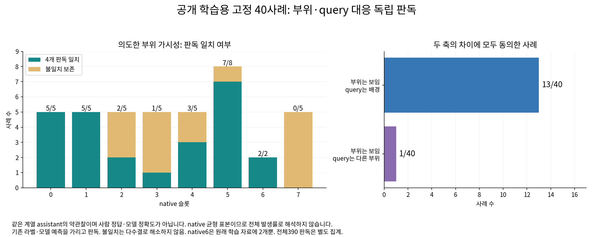
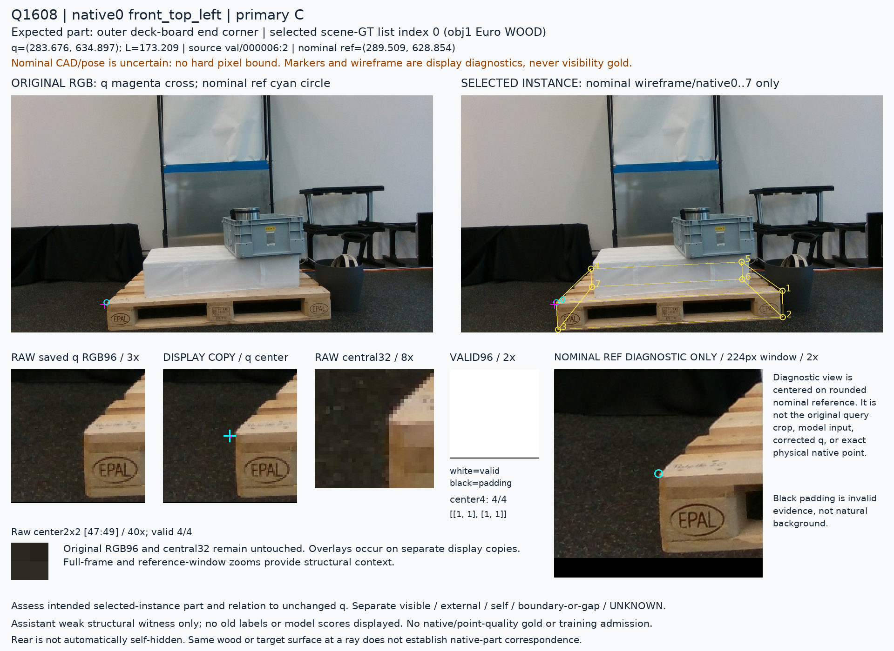
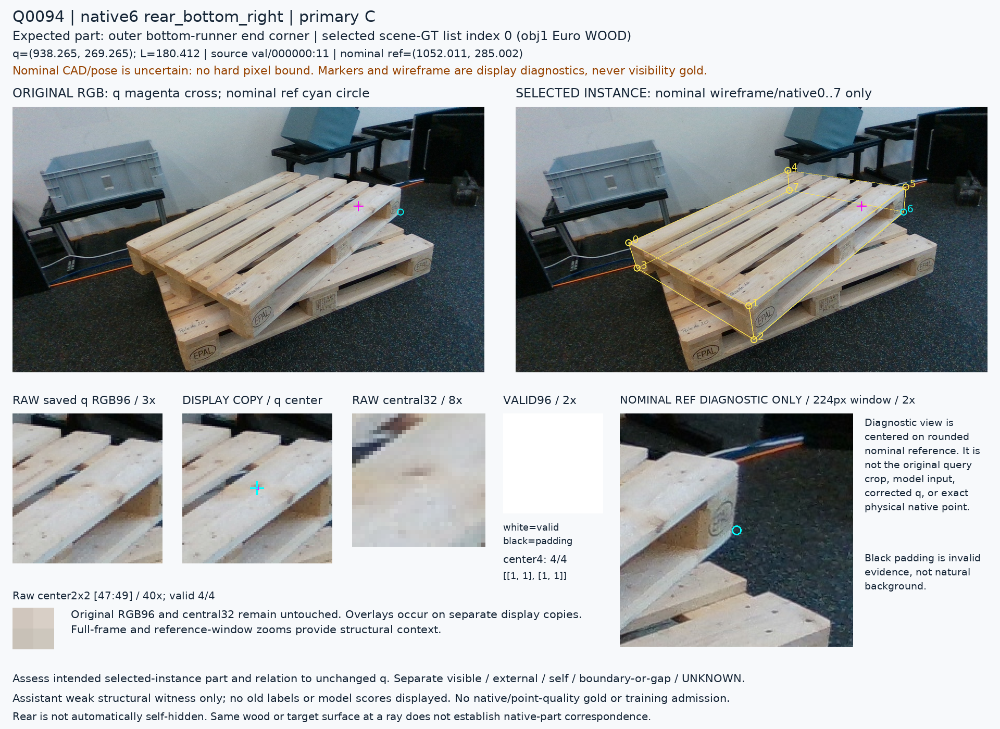
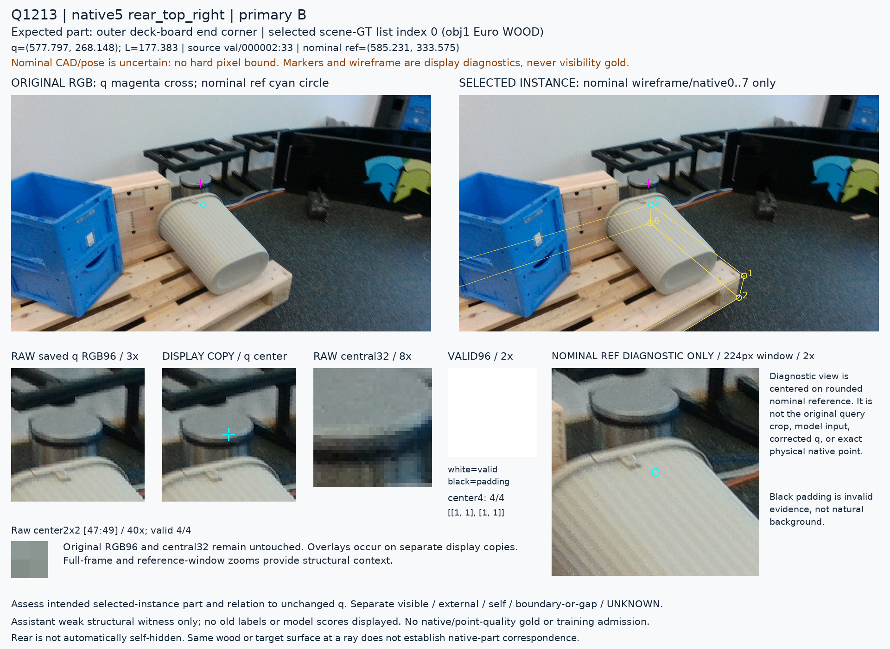
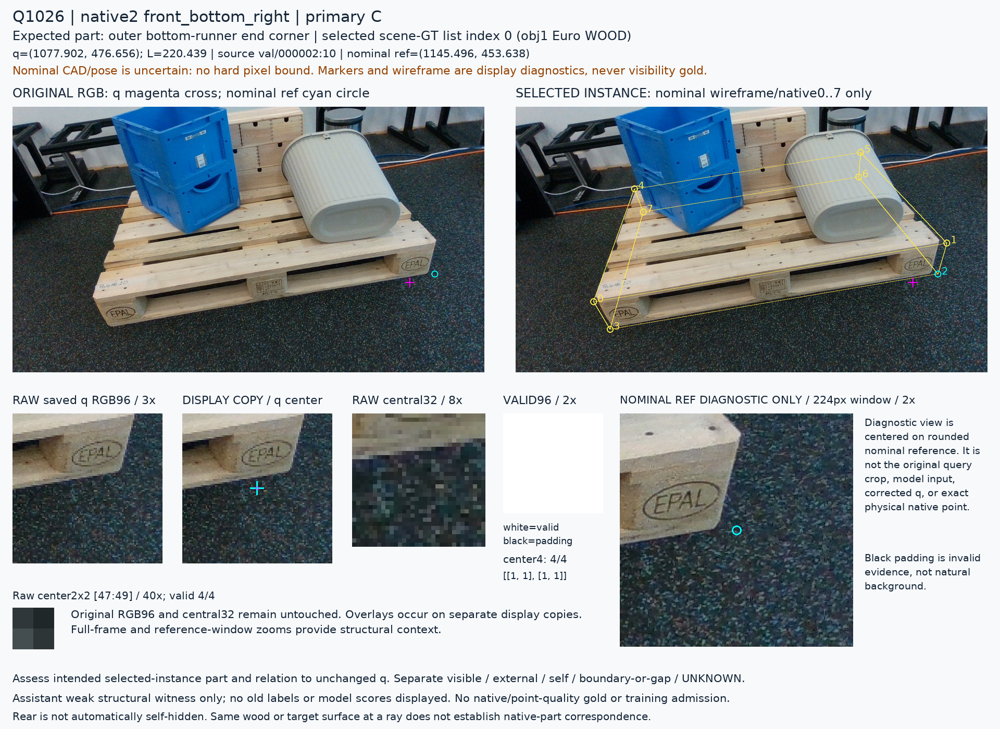

# V163 공개 TRAIN · 40사례 판독

원문: [query_visibility_train_native_part_witness_20261024_v163/join_observations/CROSS40_PREVIEW_KO.html](../../archive/task-2/pallet-keypoint-visibility/query_visibility_train_native_part_witness_20261024_v163/join_observations/CROSS40_PREVIEW_KO.html)

원 HTML SHA256: `62de6768708fc5d7a3b3f1f9b4fa6276940c7f0c7e262cdd3a2b92ac734d46cd`

원 img ordinal 1–5 / 5. 원 순서 유지; 이미지 pixel decode/모델/평가 재실행 없음.

## 원 이미지 1

원문 직전 heading

```text
V163 · 공개 학습용 자료의 부위와 query를 분리해 보기
```

원 alt

```text
native별 가시성 판독 일치와 query 관계 차이
```



## 원 이미지 2

원문 직전 heading

```text
Q1608 · native0
```

원 alt

```text
Q1608 원본과 고정 query crop
```



## 원 이미지 3

원문 직전 heading

```text
Q0094 · native6
```

원 alt

```text
Q0094 원본과 고정 query crop
```



## 원 이미지 4

원문 직전 heading

```text
Q1213 · native5
```

원 alt

```text
Q1213 원본과 고정 query crop
```



## 원 이미지 5

원문 직전 heading

```text
Q1026 · native2
```

원 alt

```text
Q1026 원본과 고정 query crop
```


