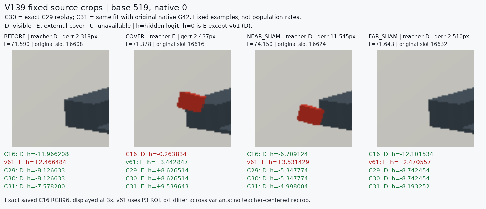
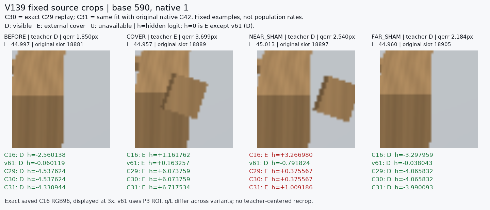

# V139 fixed saved crop comparison

원문: [query_visibility_broad_source_geometry_control_20261024_v139/saved_geometry_control_visual_report_v1/INDEX.html](../../archive/task-2/pallet-keypoint-visibility/query_visibility_broad_source_geometry_control_20261024_v139/saved_geometry_control_visual_report_v1/INDEX.html)

원 HTML SHA256: `554b1ca869f96fbd26eb94275e867b185c3428c69269eb82a347ccbd5d82fdfa`

원 img ordinal 1–2 / 2. 원 순서 유지; 이미지 pixel decode/모델/평가 재실행 없음.

## 원 이미지 1

원문 직전 heading

```text
Base 519 / native 0
```



## 원 이미지 2

원문 직전 heading

```text
Base 590 / native 1
```


