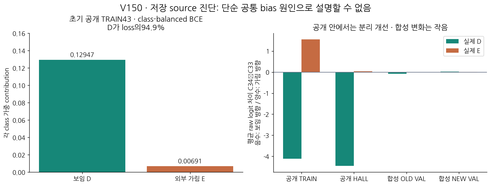
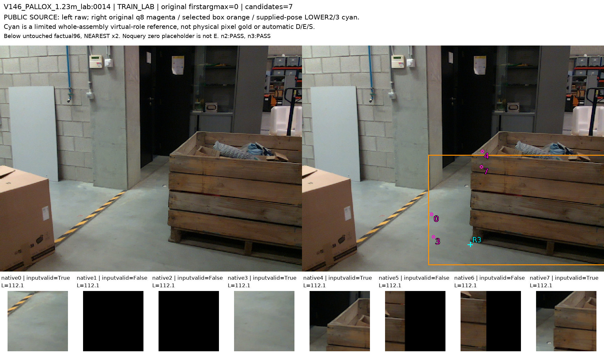

# V150 source 목표·학습 신호 진단

원문: [query_visibility_public_native_saved_mechanism_20261024_v150/provenance/BEFORE_PLOT_MINUS_FONT_REPAIR/ROOT_READOUT_KO.html](../../archive/task-2/pallet-keypoint-visibility/query_visibility_public_native_saved_mechanism_20261024_v150/provenance/BEFORE_PLOT_MINUS_FONT_REPAIR/ROOT_READOUT_KO.html)

원 HTML SHA256: `3c0fd92963e0d92d3976de491a995e3d2fe857a49182344407c4922ff21c3aac`

원 img ordinal 1–2 / 2. 원 순서 유지; 이미지 pixel decode/모델/평가 재실행 없음.

## 원 이미지 1

원문 직전 heading

```text
V150 · 공개 학습 신호와 crop 목표를 대조했습니다
```

원 alt

```text
공개 초기 loss와 공개/합성 클래스별 logit 변화
```



## 원 이미지 2

원문 직전 heading

```text
실제로 crop이 바닥인 D 사례
```

원 alt

```text
원공개 프레임17, 원query와 원96crop 및 별도하부참조
```


