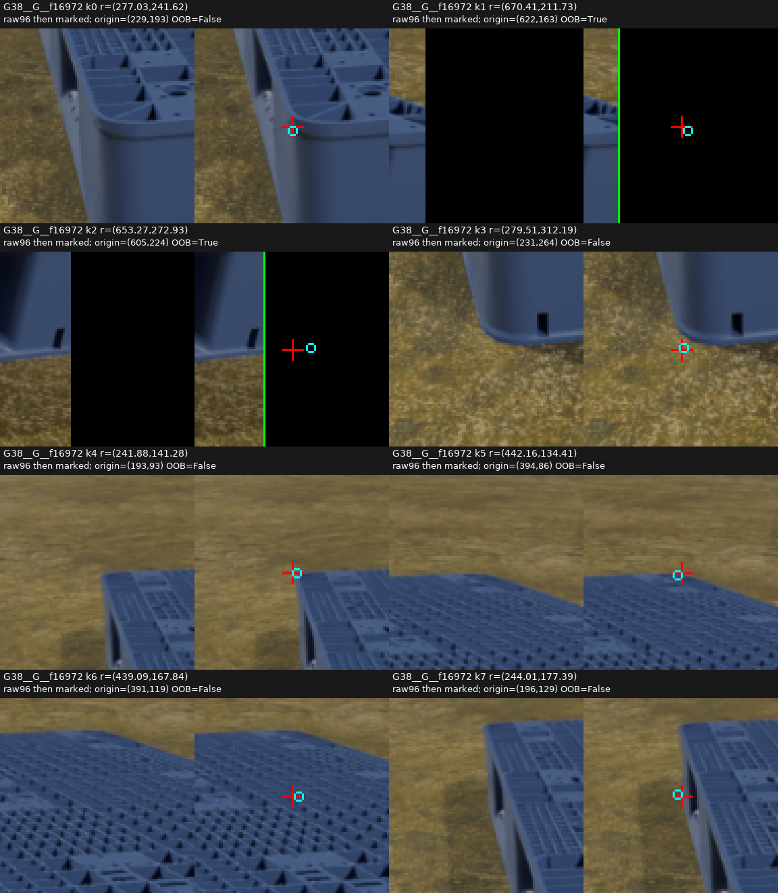
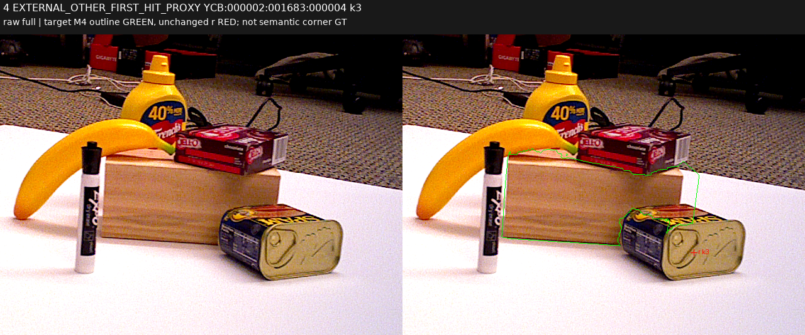
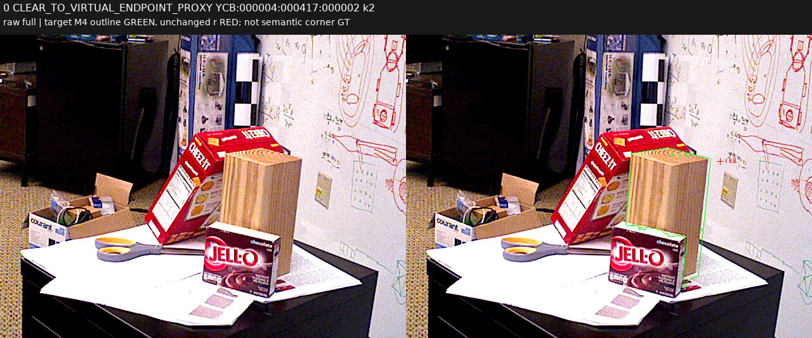

# 공개 실사 가림 진단 · 외부 ray head

원문: [query_visibility_external_ray_head_20261023_v88/root_qa/QA_RENDER_ONLY.html](../../archive/task-2/pallet-keypoint-visibility/query_visibility_external_ray_head_20261023_v88/root_qa/QA_RENDER_ONLY.html)

원 HTML SHA256: `3557c1b677343a17b7782e9c3980bb1ce42b9803011617b0b656991cfee6aed0`

원 img ordinal 1–3 / 3. 원 순서 유지; 이미지 pixel decode/모델/평가 재실행 없음.

## 원 이미지 1

원문 직전 heading

```text
좌표가 맞아도 정의 때문에 판정이 달라집니다
```

원 alt

```text
합성 실제 원본 crop. 각 슬롯은 raw / 표시본 순서. 빨강 r, 청록 초기 q. k3·k4 주변 단서와 픽셀 소속 차이, k6의 보이는 윗면과 뒤 기준점 구분.
```

원 HTML caption

```text
합성 실제 원본 crop. 각 슬롯은 raw / 표시본 순서. 빨강 r, 청록 초기 q. k3·k4 주변 단서와 픽셀 소속 차이, k6의 보이는 윗면과 뒤 기준점 구분.
```



## 원 이미지 2

원문 직전 heading

```text
공개 실사에서 외부 가림과 clear의 차이
```

원 alt

```text
대상은 녹색 윤곽의 목재 block. 고정 r는 앞의 별도 캔 금속면에 놓임: foreign first hit 근거.
```

원 HTML caption

```text
대상은 녹색 윤곽의 목재 block. 고정 r는 앞의 별도 캔 금속면에 놓임: foreign first hit 근거.
```



## 원 이미지 3

원문 직전 heading

```text
공개 실사에서 외부 가림과 clear의 차이
```

원 alt

```text
고정 r는 목재 옆 배경에 놓임. ray가 비어 있다는 라벨은 물리 모서리가 보인다는 라벨과 다름.
```

원 HTML caption

```text
고정 r는 목재 옆 배경에 놓임. ray가 비어 있다는 라벨은 물리 모서리가 보인다는 라벨과 다름.
```


