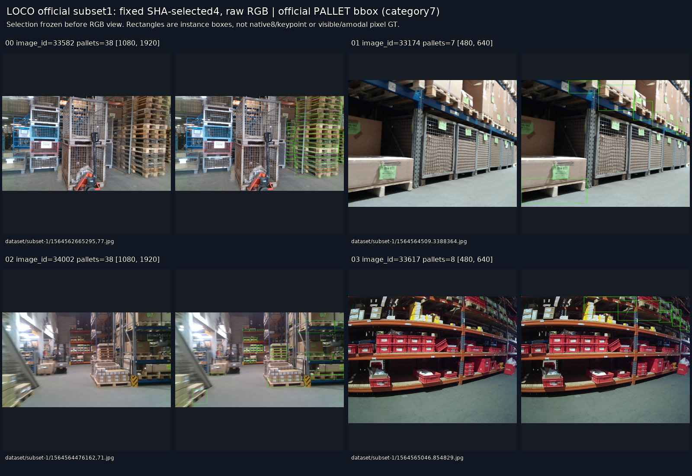
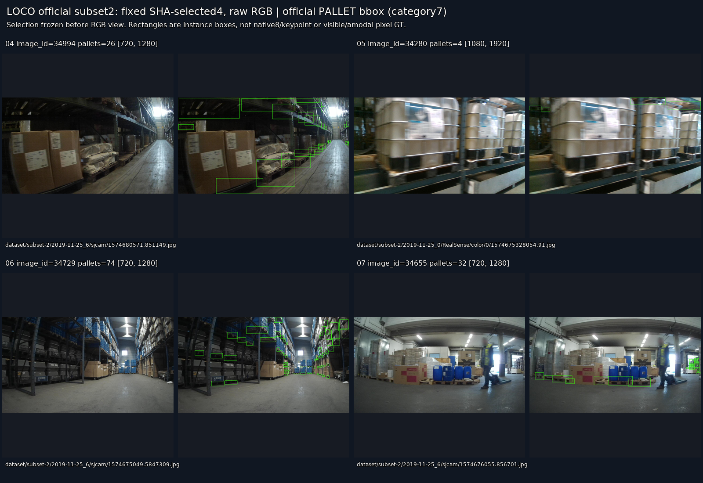
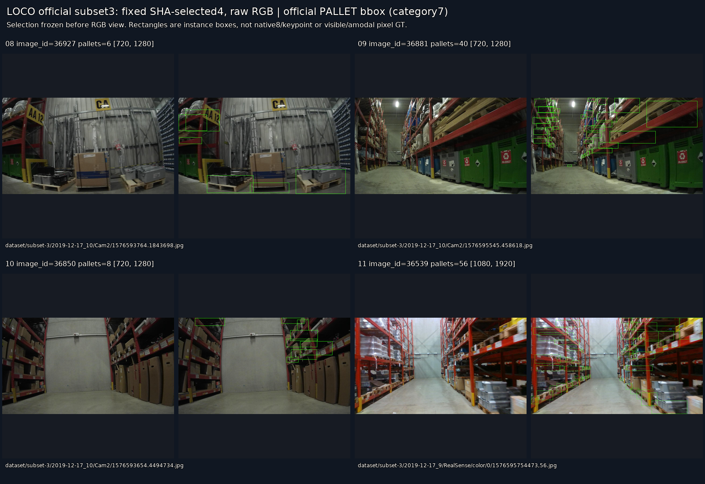
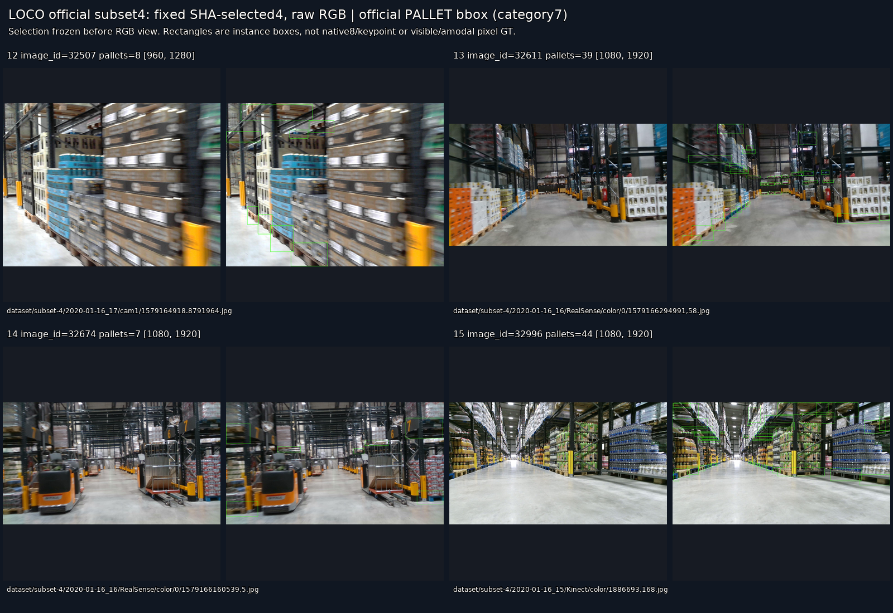
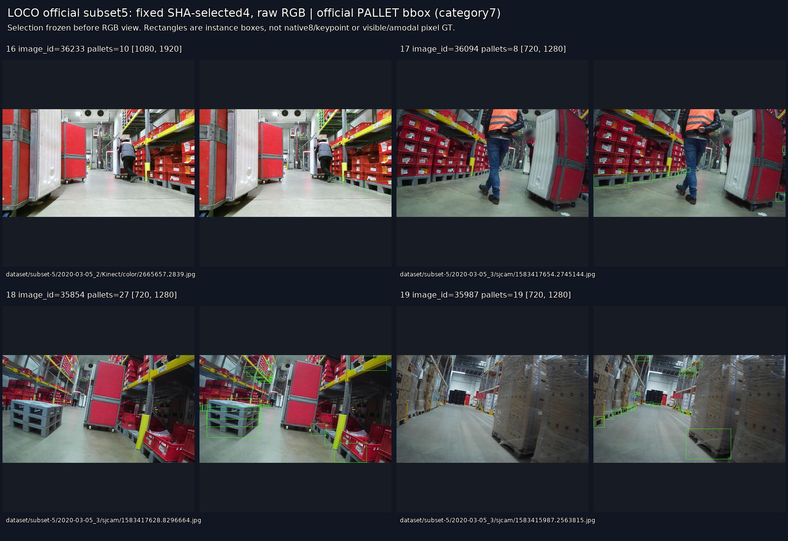

# LOCO 실제 공개 실사 반입

원문: [query_visibility_public_pallet_loco_20261023_v73/data/intake/INTAKE_RESULTS_KO.html](../../archive/task-2/pallet-keypoint-visibility/query_visibility_public_pallet_loco_20261023_v73/data/intake/INTAKE_RESULTS_KO.html)

원 HTML SHA256: `d64309a4db2e7264a37a074e8b755b3404a30577c0035d582dfd7ca29bd989a2`

원 img ordinal 1–5 / 5. 원 순서 유지; 이미지 pixel decode/모델/평가 재실행 없음.

## 원 이미지 1

원문 직전 heading

```text
고정 subset1: 원본 / 공식 bbox
```



## 원 이미지 2

원문 직전 heading

```text
고정 subset2: 원본 / 공식 bbox
```



## 원 이미지 3

원문 직전 heading

```text
고정 subset3: 원본 / 공식 bbox
```



## 원 이미지 4

원문 직전 heading

```text
고정 subset4: 원본 / 공식 bbox
```



## 원 이미지 5

원문 직전 heading

```text
고정 subset5: 원본 / 공식 bbox
```


