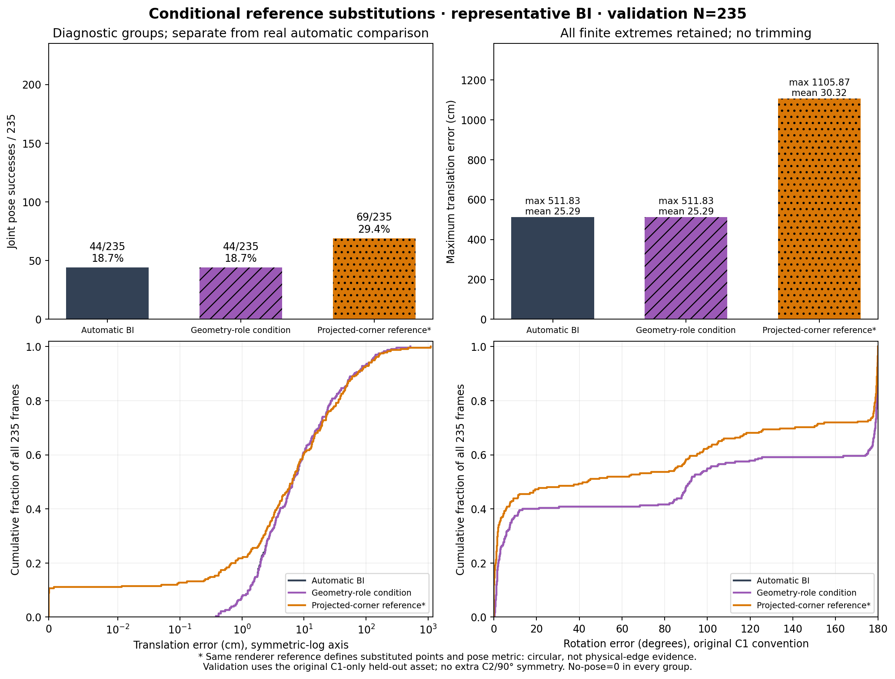

# 대표 BI의 조건부 참조 입력 진단

합성 validation235에서 상태 조건만 바꾸면 성공은44→44였고, 가상 투영 코너 좌표를 넣으면44→69였다. 후자는25회복·0손상이지만 위치 평균과 최대 오차가 악화했다. 자동 COMMON–BI 실사 성능표와 분리한 추가 학습 없는 입력 교체 진단이다. 대표 seed는20261018로 고정했다.

| 입력 | 성공/N | 위치 cm 평균±표본SD | 최대 cm | 회전 ° 평균±표본SD | 수락 / fallback |
|---|---:|---:|---:|---:|---:|
| 자동 대표 BI | 44/235 | 25.289 ± 53.664 | 511.834 | 92.076 ± 79.343 | 120 / 115 |
| 기하 역할 조건 참조 | 44/235 | 25.291 ± 53.663 | 511.834 | 92.076 ± 79.343 | 120 / 115 |
| 가상 투영 코너 좌표 참조 | 69/235 | 30.322 ± 88.777 | 1105.873 | 73.996 ± 76.502 | 103 / 132 |

모든 행은 같은235장이며 no-pose는0이다. 위치≤5cm AND 원 회전≤5°가 공동 성공이고 SD는ddof=1이다. 유한 극단값을 제외하거나 잘라내지 않았다. validation은 early stopping에 사용한 개발자료이며 독립 시험이 아니다. 전체 합성 계약의 원 asset별 C1/C2를 유지했고, 이번235장은 C1인 woodpallet_block_jtoastie_ccby.glb만 포함한다. 이 자산에 C2나90° 대칭을 추가하지 않았다. 원 renderer R을 정규직교화하지 않았다.

상태 진단은 정답 투영 직육면체의 원 projected-hull 규칙으로 만든 GEOMETRIC_ROLE_REFERENCE를 scorer의 두 조건값에만 넣었다. 가시 집합V·영상/후보·기하·후보별 covariance·source ID·부분선·후단 자동 상태는 고정했다. 실제 재료 코너의 가시성을 인증한 참조가 아니다.78장에서 적용 가능한 scorer 태그가 달라졌지만 실제 선택 관측은3장에서만 바뀌었고232장은 정확히 같은 관측 packet이었다. 회복0·손상0이다.

관측 진단은 자동 대표 BI가 선택한 유효 full point의 XY만 같은 whole-object 대응의 가상 참조로 바꿨다.171장은 좌표 교체 대상이 있었고64장은 동일 packet이었다. covariance·source ID·미관측·부분선 원장은 보존했다.25회복·0손상으로 성공은+10.638%p였지만 위치 평균은25.289→30.322cm, 최대는511.834→1105.873cm다.21장은 참조 코너가 영상 밖에 있어 고정 canvas 검사가 거부했으며 분모와 fallback에 남겼다. 부분선을 완전점으로 바꾸지 않았다. 같은 renderer GT에서 관측과 평가 자세를 만들기 때문에 회복은 순환적이거나 자명할 수 있으며 물리 정확도 증거가 아니다.

실사 물리 관측 참조는 CAL46+TEST49의 원95장까지 실제 역추적했다.760개 migrated corner의 source는 모두unknown이었다.95개 원본 migration source hash는 모두 정확히 일치했고,95개 모두 manual_kps와 객체 단위gt_source=manual은 있지만9개 bool의 per-point extrapolated_mask는0개다. 원 migration 코드는 이 구분 정보가 있어야 manual_click과 extrapolated/PnP fallback을 나눈다. 사람의 DIRECT_VISIBLE 판정이나 정수 좌표라는 추정으로 unknown 좌표를 직접 클릭 정답으로 승격하지 않았다. 따라서 인증된 물리점 교체 subset은0장/0점으로NA다. 독립적인 B/I 주석과 물리 선 소속 주석도 없어 두 실사 참조 진단은NA다. 기존 좌표가 틀렸다는 판정은 아니다.

실제 진단은 새 pose optimizer 호출452회, 추가 fit/백본 forward0회였다. 숫자 계산 process wall32.37초(user32.03초/system0.36초)이며 함수 내부31.154초는 그 안에 포함되므로 합산하지 않는다. 원본 ancestry 검사는 별도 metadata process다. 모든235×3의 작은 스칼라 원수치와 상태는 [DIAGNOSTIC_ROWS.csv.gz](DIAGNOSTIC_ROWS.csv.gz), 출처·검산·비용은 [DIAGNOSTIC_SUMMARY_PUBLIC.json](DIAGNOSTIC_SUMMARY_PUBLIC.json)에 있다.

숫자를 생성한 diagnostics source SHA는 `39443569c4480b0e742b7dba196e665e99e99a7bdf0c6abc1cefbb69317856ac`이며 원본 snapshot을 보존했다. 그 뒤 추가한 원본 provenance 감사와 게시 코드에 대해 기존 모든 함수의 AST가 정확히 같음을 검사했다. 새 학습이나 자세 재계산 없이 source 확장 사실과 두 SHA를 공개 JSON에 구분했다.

그림의 모든 패널은 같은235장이다. 위치 누적분포는0과 전체 극단값을 포함하도록 symmetric-log 축을 쓰며, 원수치는 CSV에 보존한다. 이 진단은 후보/관측/불확실성·고정 가시 집합·초기화·솔버의 병목을 함께 드러내며, 입력 교체의 개선을 자동 B/I 조건의 인과 기여나 달성 가능한 물리 상한으로 해석하지 않는다.
