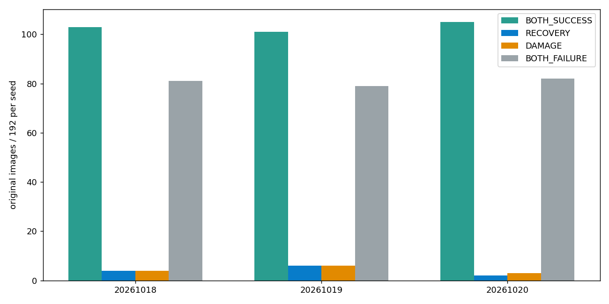

# B·I 조건부 국소 관측 보정

**결론: B/I 조건의 추가 가치 미확보.** PRIMARY192에서 BI의 COMMON 대비 회복/손상은 seed별4/4,6/6,2/3이었다. 6fit과 실제 자세 계산·독립 검산을 완료했고 모든 실패를 보존했다. 운영 기본값은 바꾸지 않았다.

[한국어 보고서](REPORT_KO.md) · [모든 결과](FULL_RESULTS.md) · [전체192장 갤러리](gallery/index.html) · [전체 수치 CSV](COMPARISON_ALL_ARMS.csv) · [paired](PAIRED_RESULTS.md) · [관측](OBSERVATION_RESULTS.md) · [진단](DIAGNOSTIC_RESULTS.md) · [재현](REPRODUCE.md)

같은 정보·후단에서 점수망의 명시적 B/I 조건 추가 효과를 검사한 고정6fit 실험이다. 성공할 때까지 설정을 바꾸지 않았다. N0·기존 E0/H1·두 PoseFix는 별도 frozen 전체 시스템 비교다.

[정보·후단 비교](METHODS_AND_INFORMATION.md) · [고정 출력 원인 분해](CAUSE_DECOMPOSITION.md) · [6fit 원 곡선](TRAINING_CURVES.csv) · [검산](VERIFICATION.json)
