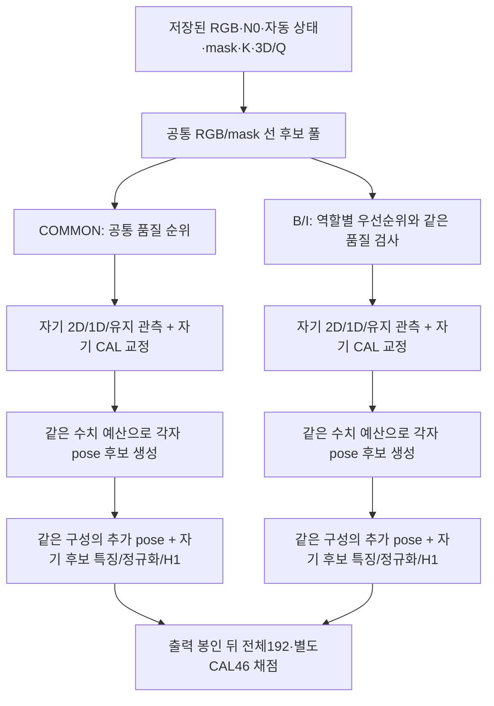

# 이번 캠페인의 실제 방법

이 문서는 성능을 주장하는 결과표가 아니라, 동결된 실행 코드가 무엇을 하는지 설명한다. 최종 채택 판단은 `FINAL_REPORT_KO.md`와 전량 평가표를 따른다. 기존 운영 경로는 자동으로 바꾸지 않는다.

## 상태와 관측

B는 배경과 닿는 외곽 역할, I는 물체 내부에 놓이는 접합 역할이다. 이것은 영상에서 지지가 몇 방향으로 보이는지, 다른 물체에 가렸는지, 물리 대응이 맞는지와 다른 속성이다. B를 무조건 선으로, I를 무조건 점으로 사용하지 않는다.

S는 자기 가림이다. 초기 등록 자세의 기하로 정하며, S 좌표를 영상에서 새로 찾거나 회귀하거나 PnP의 측정점으로 사용하지 않는다. 화면에 그리는 S는 모델 투영이다. O(외부 가림), T(화면 밖), U(불확정)는 기존 영역 제약을 유지한다. 현재 자동 상태가 실제 가림의 정답이라는 보장은 없다.

초기 검출기 좌표와 N3·SubPix·F의 저장된 출력 N0가 이번 캠페인의 공통 초기 입력이다. 각 실험은 같은 RGB, 카메라 K, native 3D 형상, 등록 Q와 초기 자세를 사용한다. N3 또는 SubPix 제거의 효용을 이번 실험만으로 새로 판정하지 않는다.

## 최종 F의 공정한 비교

두 군이 먼저 동일한 영상 단서 풀을 만든다. 초기 기하가 제안한 native 이웃 방향을 따라 RGB gradient와 자동 tight/full mask의 전이선을 찾고, 같은 선 적합·교점·불확실성 검사를 적용한다. 실제 사용한 픽셀 source가 중복되면 별칭을 보존하면서 중복 관측을 제거한다. S/O/T/U에는 새 영상 단서를 질의하지 않는다.

| 항목 | COMMON | B/I |
|---|---|---|
| RGB·mask·탐색 범위·후보 선·준입 기준 | 동일 | 동일 |
| 후보 교점/선의 채택 | 공통 정규화 지지·일관성·불확실성 점수 | B는 tight mask→full mask→RGB, I는 RGB→tight mask→full mask 우선순위 후 같은 점수 |
| 서로 다른 두 이웃 방향의 유효 교점 | 2D 점과 조건부 covariance | 동일 |
| 유효 교점 없이 한 방향의 지지만 존재 | 1D normal 관측 | 동일 |
| 새 유효 선도 없음 | N0 원래 검출점 유지, 선언된 fallback noise | 동일 |
| 새 2D 관측의 총오차 교정 | 자기 CAL46로 pooled floor 적합 | 자기 CAL46로 같은 pooled 규칙 적합 |
| 후단 B/I 요약 특징·H1·추가 pose·예산 | 동일 | 동일 |

한 방향 지지는 선의 수직 방향만 제약한다. 해당 코너의 과거 2D 좌표와 tangent 구간은 감사·표시 자료로 보존하지만, 새 backend의 측정·초기화·prior·보호 제약에 넣지 않는다. fallback의 6.5px² normal noise는 실측 총오차 교정이 아니다. CAL로 교정한 것은 full 2D 관측이다.

이 비교는 관측 생성·채택 정책의 효과다. 양 군에 후단 역할 특징이 남으므로 모든 B/I 정보를 제거한 ablation은 아니다. 가상 직육면체 코너의 영상 교점이 실제 재료 접합이라는 물리 인증도 아니다.

## 후보 생성과 선택

S1은 기존 D1의 모든 실제 후보를 보존하고 PF+SubPix 두 anchor의 완성 pose를 추가한다. PF 좌표로 기존 8개 점을 단순 교체하는 실험이 아니다. 회전의 유효성·양의 깊이·원 생산기 가용성으로 추가 action을 준입하며, 참조 성공 여부로 통과시키지 않는다. bank가 바뀌면 기존 후보까지 상대 gap·요약 특징과 자기 train normalizer·H1을 다시 만든다.

S2와 F는 **새 matched fullnormal backend**를 사용한다. 원 D1의 수치 예산·점/normal·영역/outline primitive를 재사용하되 revoked 2D의 seed/guard를 제거한 새로운 경로다. 원120과 완전 동일한 adapter가 아니다. P1과 WD0의 시작·방문 endpoint, 양 W/D 가족의 결과를 보존하고 G10 가족의 readout을 사용한다. 이 backend에서 G13은 이미 normal을 포함한 G10 결과의 명시적 alias이며 추가 solve로 세지 않는다. 서로 다른 목적함수의 숫자를 직접 빼지 않는다.

이 backend의 H1 입력 길이는188을 유지하지만 기존 B profile·edge energy와 해당 두 gap은 양 군 모두 명시적 missing mask로 표시한다. 신뢰도가 높은 0비용으로 대체한 것이 아니다. 원 archived 2D를 다시 질의하지 않기 위한 변화이며, 여기서 AB 점수는 A로 줄어든다. 원120과의 성능 차이에 이 특징 계약의 변화도 포함된다.

S3는 등록된 structured proxy의 비공면 재료 edge와 자동 가시 구간을 영상 지지에 연결해 별도의 실제 3D support를 제안한다. native 8개 가상 코너에 임의로 끼워 넣지 않는다. 현재 instance·축·owner의 독립 물리 인증은 없으며 owner oracle은 NA다.

원래 factor의 raw pixel support가 없는 경우에는 상관을 알 수 없는 `UNKNOWN_NO_OLD_RAW_SUPPORT`로 보존한다. generic support가 없을 때도 상관은 미확정이다. source ID와 8px 중첩 검사는 기록된 중복을 줄이는 규칙이며, 남은 관측의 물리적 독립성을 인증하지 않는다.

S4_PL은 원 point/typed normal과 pose에 따라 갱신한 native outline을 추가 보정한다. proxy 렌더를 쓰지 않는다. S4_CONTOUR은 자동 proxy 가시 윤곽과 mask를 정합한다. S4_IMAGE는 전체 원영상의 grayscale DIS 대응과 렌더 depth를 연결해 object 3D/관측 2D를 복원하고 PnP refinement 뒤 다시 렌더한다. DeepIM 재현이라고 부르지 않는다. 각 군은 같은 최대2개 초기 자세·최대4회 갱신을 사용하며 실패·중간 pose·fallback도 보존한다.

각 H1은 자기 후보 분포에서 원 합성 train768/validation235를 사용한다. 구조188→64→64→1, 세 초기화 seed20261018/19/20, AdamW·최대50epoch·patience5와 자기 validation loss 최소 checkpoint를 유지한다. 대표는 seed20261018이다. 세 seed는 같은192장을 반복한 H1 초기화이며 독립576장이 아니다.

최종 F는 선택된 앞 단계의 출력을 그대로 재평가하는 군이 아니다. F의 관측·CAL·fullnormal 후보는 양 군이 각자 새로 만들고, 합성 validation으로 선택된 구성은 공통으로 추가할 후보를 정한다. S1이면 PF 두 완성 action, S2이면 추가 action 없음, S3/S4이면 PF 두 action과 선택된 한 군의 완성 제안을 두 F군 모두에 같은 순서·준입으로 추가한다. 따라서 앞 단계의 validation 성능을 F의 성능으로 옮겨 쓰지 않는다. 이 mapping은 F의 선택·학습 전에 별도 계약으로 고정했다.

최종 보고서의 “auxiliary 구성 S2_CP”는 선택된 전체 구성을 가리킨다. 실제 추가 action 목록은 빈 목록이며 PF·재료·S4 action은 없다.

실제 선택은 S2_CP였다. 자기 합성 validation235에서 성공은 세 seed 모두48장이었고, 성공 중앙값48로 동률인 군들 중 validation loss 중앙값0.1178573473이 가장 낮았다. wall 시간에 의한 재동률 판정은 사용되지 않았다. 따라서 이번 F 양 군에는 PF 또는 재료·S4 추가 action이 들어가지 않는다. 각자의 관측과 CAL 교정, fullnormal 은행과 H1을 사용하는 비교이며, PRIMARY에서 가장 높은 PL을 사후 선택한 결과가 아니다.

## 참조와 결론의 범위

PRIMARY192=TEST49+REMAINDER143은 반복 개발에 노출된 자료다. CAL46은 교정과 별도 집계에만 사용하고, 생산 입력에 per-frame GT pose·box·mask·가시성을 주지 않는다. 새 실사 독립 검증은 0장이다. 최종 구성의 순위는 사전 등록한 자기 합성 validation 규칙으로 정하며, PRIMARY에서 가장 높은 군을 골라 쓰지 않는다. 다만 사전 등록한 ‘S1–S4가 모두 원120을 넘지 못하면 기존 경로로 돌아간다’는 fallback 여부에는 PRIMARY 결과를 사용한다. 현재 완료된 PL이 대표123장이므로 이 fallback은 발동하지 않는다.

공동 성공은 한 반환 pose의 T≤5cm와 R≤5°다. 전체 분모·모든 실패·fallback·큰 오류를 보존하고 C2만 적용한다. 후보가 존재하는 사후 상한, 실제 준입, H1의 실제 선택을 분리한다. 평균·표본분산/SD·분위수·tail과 회복/손상, 6촬영군 및 bootstrap을 함께 해석한다.

코드 근거: `f_observer.cue_pool/choose/intervention_table`, `calibration.fit/apply_selection`, `fullnormal_backend`, `s1_union.union_frame`, `material_support`, `render_refine`, `heads`, `f_finish.choose/finish`. 정확한 소스·입력·환경 SHA와 실행 argv는 각 단계의 private seal 및 공개 재현 색인에 연결한다.

