<!-- generated by pallet_boundary_action_repair_v1.build_report; preserve source receipts -->

# 팔레트 B 기하 수리·L 행동 학습 개발 평가

PRIMARY192의 사전 대표 D1/H1/MLP(seed20261018)는 120/192 성공이며 기존 E0는 114장이다. N0 대비 회복 21장·손상 9장이다. 위치 평균은 12.073cm, N0는 11.306cm(짝 차이 +0.767cm)이므로 성공 수와 연속오차의 손익을 함께 본다. B full/local은 각각 97/109장 성공이며 기하 지지 수리가 정확도 우위를 뜻하지 않는다. 이는 반복 개발 자료의 결과이며 독립 실사 test는0, 운영 기본값 교체는 보류한다.

전체 PRIMARY192(TEST49+REMAINDER143), 별도 CAL46. 고정 대표 seed 20261018; 등록 37개 군과 모든3seed를 보존했다. 성공은 같은 최종 자세의 위치≤5cm AND 회전≤5°다. 독립 실사 test는0이며 운영 기본값·논문은 변경하지 않았다.

| 경로 | 전체 n | 성공 | 성공률 | no-pose | T>50cm | T>100cm | R>45° |
| --- | --- | --- | --- | --- | --- | --- | --- |
| R0 | 192 | 66 | 34.375% | 0 | 10 | 6 | 29 |
| N0 | 192 | 108 | 56.250% | 0 | 8 | 5 | 20 |
| E0 | 192 | 114 | 59.375% | 0 | 15 | 3 | 26 |
| POSEFIX_RAW | 192 | 80 | 41.667% | 0 | 12 | 5 | 23 |
| POSEFIX_SUBPIX_PF_ANCHOR | 192 | 112 | 58.333% | 0 | 10 | 3 | 20 |
| POSEFIX_SUBPIX_YOLO_ANCHOR | 192 | 111 | 57.812% | 0 | 9 | 2 | 20 |
| LEGACY_L_HEAD_s20261018 | 192 | 115 | 59.896% | 0 | 8 | 5 | 20 |
| LEGACY_B_FIXED_BANK | 192 | 112 | 58.333% | 0 | 16 | 4 | 36 |
| LEGACY_B_FULL | 192 | 92 | 47.917% | 0 | 24 | 9 | 41 |
| LEGACY_EDGE | 192 | 55 | 28.646% | 0 | 50 | 19 | 60 |
| LEGACY_AB_FULL | 192 | 91 | 47.396% | 0 | 21 | 7 | 37 |
| B_FINITE_BANK | 192 | 110 | 57.292% | 0 | 15 | 4 | 29 |
| B_FINITE_FULL | 192 | 97 | 50.521% | 0 | 24 | 8 | 42 |
| B_FINITE_LOCAL | 192 | 109 | 56.771% | 0 | 9 | 6 | 20 |
| EDGE_FINITE_FULL | 192 | 92 | 47.917% | 0 | 25 | 10 | 49 |
| D0_H0_MLP_s20261018 | 192 | 114 | 59.375% | 0 | 8 | 5 | 21 |
| D0_H1_MLP_s20261018 | 192 | 116 | 60.417% | 0 | 11 | 6 | 27 |
| D1_H0_MLP_s20261018 | 192 | 110 | 57.292% | 0 | 8 | 5 | 20 |
| D1_H1_MLP_s20261018 | 192 | 120 | 62.500% | 0 | 9 | 5 | 21 |
| D1_H1_ROLE_AFFINE_s20261018 | 192 | 114 | 59.375% | 0 | 8 | 5 | 20 |
| D1_H1_PAIR_MLP_s20261018 | 192 | 117 | 60.938% | 0 | 6 | 5 | 16 |
| D1_H1_PAIR_ROLE_AFFINE_s20261018 | 192 | 118 | 61.458% | 0 | 8 | 5 | 20 |
| E0_REGENERATED | 192 | 114 | 59.375% | 0 | 15 | 3 | 26 |

[전체 보고서](FINAL_REPORT_KO.md) · [모든 군 CSV](COMPARISON_ALL_ARMS.csv) · [행별 오차](ROW_METRICS.csv.gz) · [짝 비교](PAIRED_TRANSITIONS.csv.gz) · [H1 all-failure 원행](H1_ALL_FAILURE_ROWS.csv) · [H1 연속오차 진단](H1_ALL_FAILURE_SUMMARY.json) · [판정](FINAL_DECISION.json) · [재현](REPRODUCE.md)

[B 구현·기술 노트](B_METHOD_AND_TECHNICAL_NOTES.md) · [L 방법](METHOD_L.md) · [L 결과 해석](L_ACTION_RESULTS.md) · [데이터 절차 검산](DATA_PIPELINE_PARITY.md) · [입력·데이터 계약](INPUT_AND_DATA_CONTRACT.md) · [방법·출처](METHODS_AND_SOURCES.md) · [연구 코드](../../../scripts/research/pallet_boundary_action_repair_v1/)

그림은 실제 저장 결과에서 계산했다. 파일 생성은 실제 픽셀 검토를 뜻하지 않으며 [검토 원장](VISUAL_REVIEW.json)을 함께 확인한다.

### 동일 분모 공동 성공

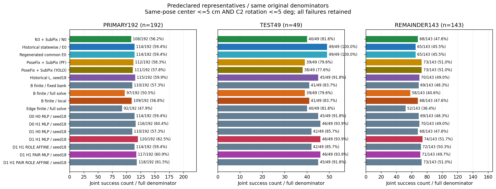

[그림 데이터 CSV](figures/joint_success.csv)

### 위치 오차 전체 누적분포

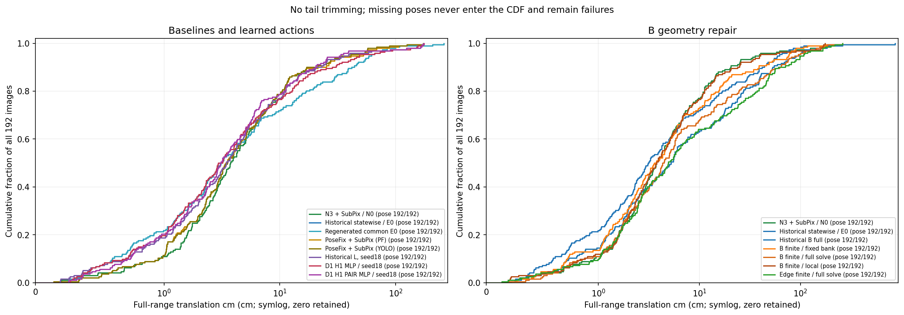

[그림 데이터 CSV](figures/translation_cdf.csv)

### 회전 오차 전체 누적분포

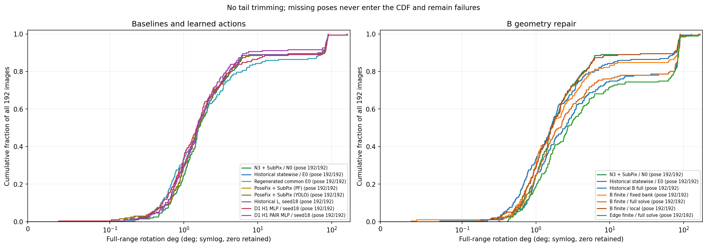

[그림 데이터 CSV](figures/rotation_cdf.csv)

### 짝지은 회복·손상

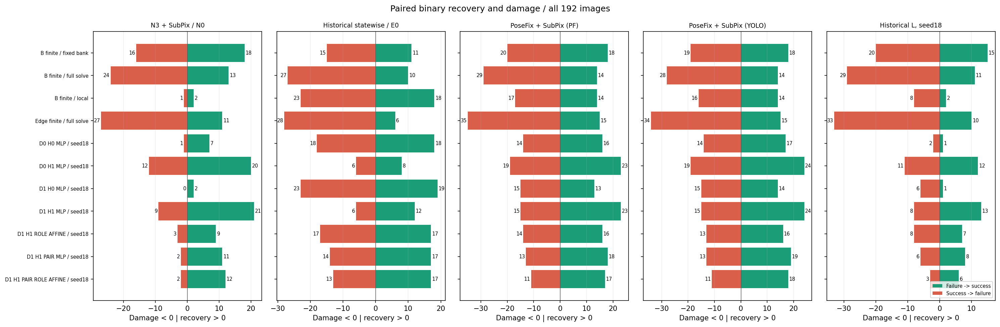

[그림 데이터 CSV](figures/paired_recovery_damage.csv)

### 실제 출력 출처

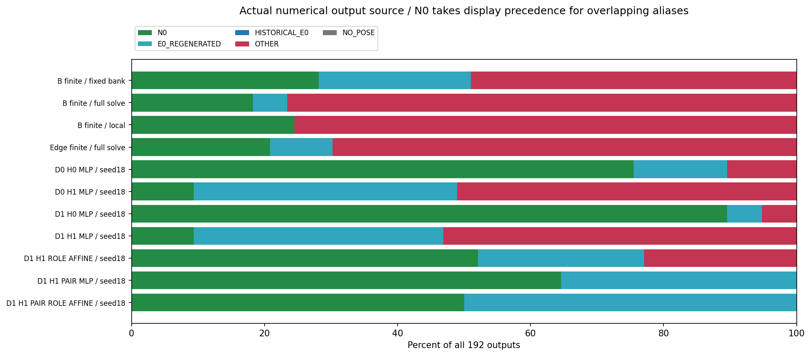

[그림 데이터 CSV](figures/actual_action_sources.csv)

### 동일 bank 2×2·pair 대조

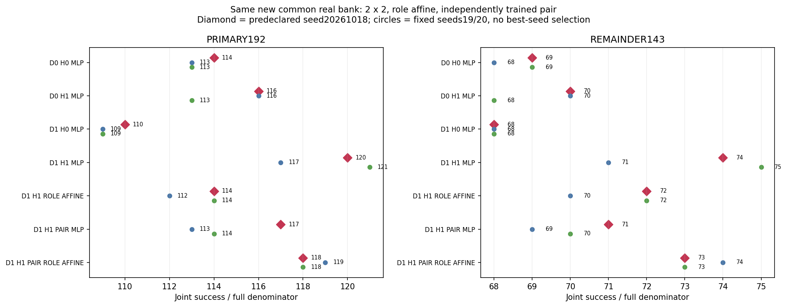

[그림 데이터 CSV](figures/same_bank_2x2_pair.csv)

### 모든 seed 학습 곡선

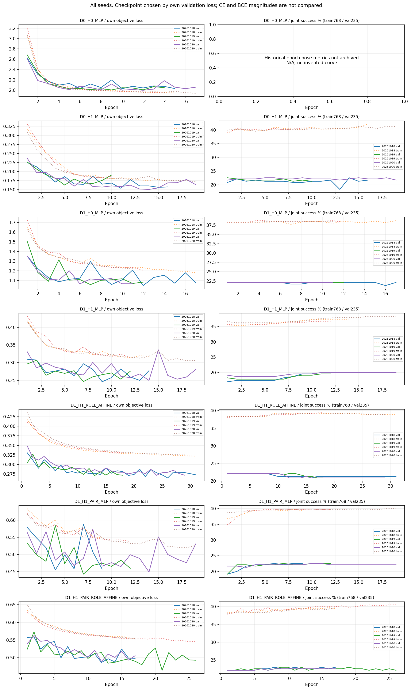

[그림 데이터 CSV](figures/training_curves_all_seeds.csv)

### 실제 영상·기하 갤러리

[PRIMARY192 전체 갤러리](gallery/index.html) · [이전 최악3장 회귀](gallery/regression/index.html). GitHub blob에서는 HTML이 실행되지 않습니다. 저장소를 내려받아 상대경로 asset을 보존한 채 `gallery/index.html`을 브라우저로 여세요. 아래 PNG는 GitHub에서 바로 확인할 수 있습니다. 공개 권리 미확정 RGB는 수치·기하도와 비공개 사유로 대신합니다.

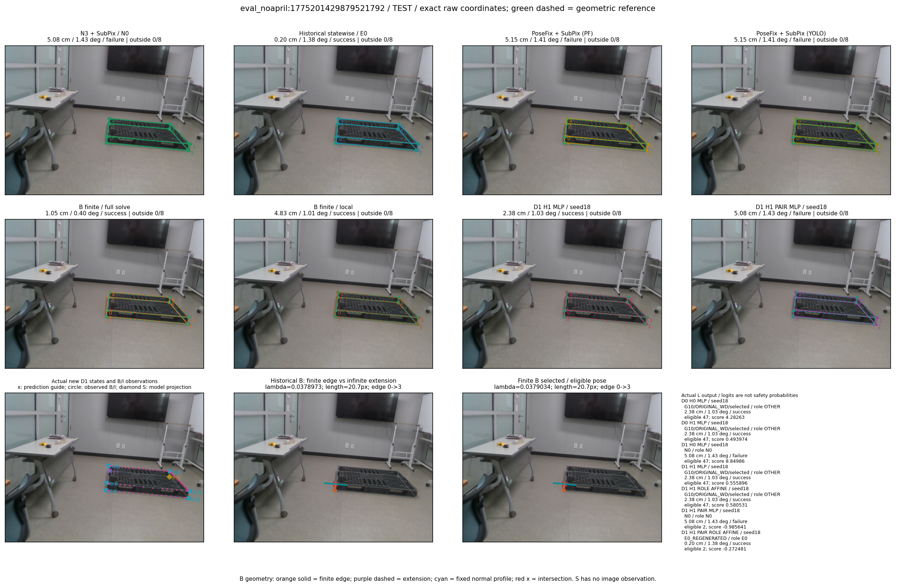

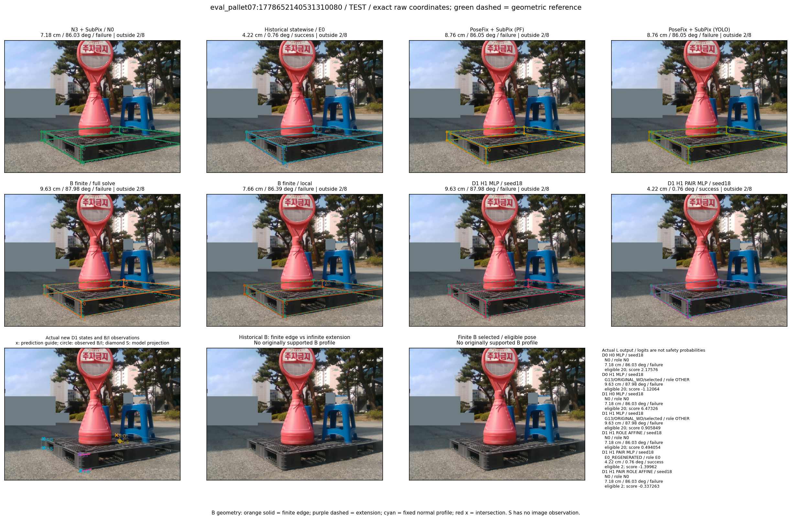

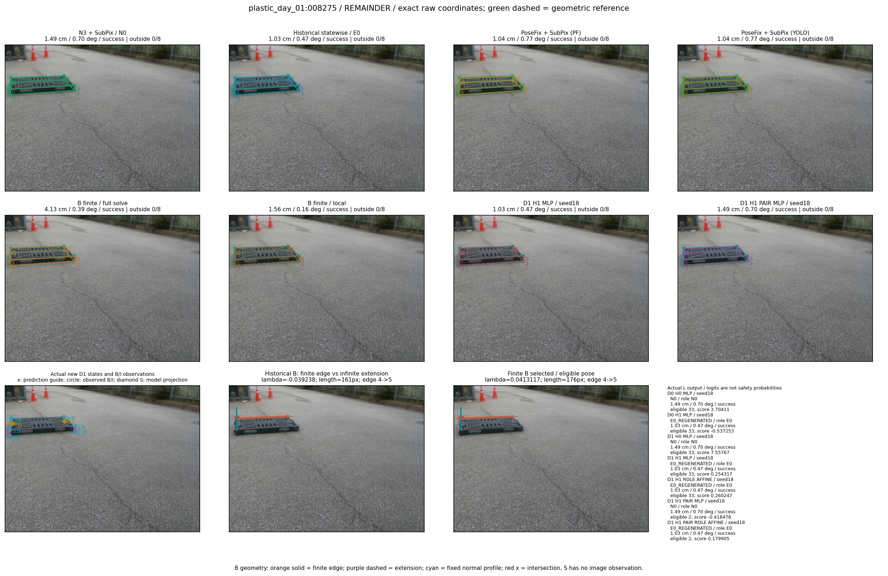

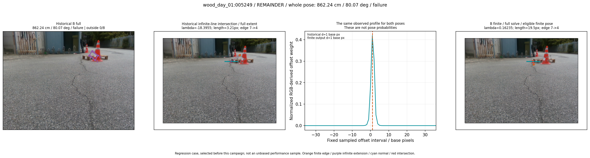

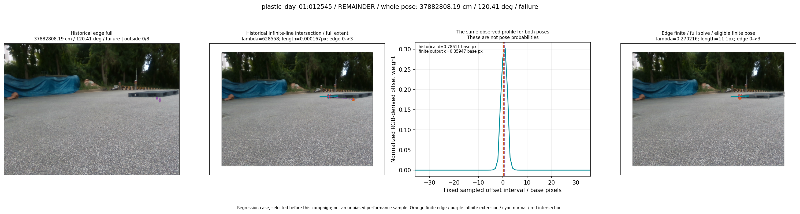

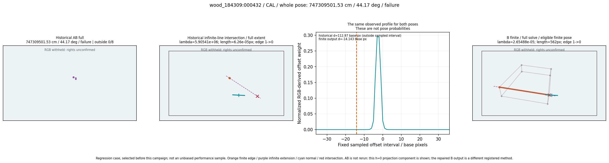

B 원 독립 v1 산술 FAIL6,132건을 보존하며 v2의 표현 차이 설명을 전체 raw numeric PASS로 바꾸지 않는다. 기하 지지와 material owner 인증은 다르며 실제 owner·독립 실측6D GT는 UNVERIFIED다.

**권고:** 다음 수정 한 가지는 고정된 실제 행동에 대해 N0 대비 위치·회전의 연속 손상을 구분하는 H1 상대위험 정렬 목표를 실험하는 것이다. 모든 행동이 실패한 41장에서 대표 H1의 평균 손상이 N0 대비 +5.00cm/+2.25도였다는 근거다. 이는 아직 학습·검증하지 않은 다음 실험이며, 현재 N3·SubPix와 운영 기본값은 유지한다.

게시 상태: NOT_PUBLISHED_YET; 결과 commit: N/A; 실제 원격 main SHA: N/A. 기존 원기록·운영·논문은 보존한다.
