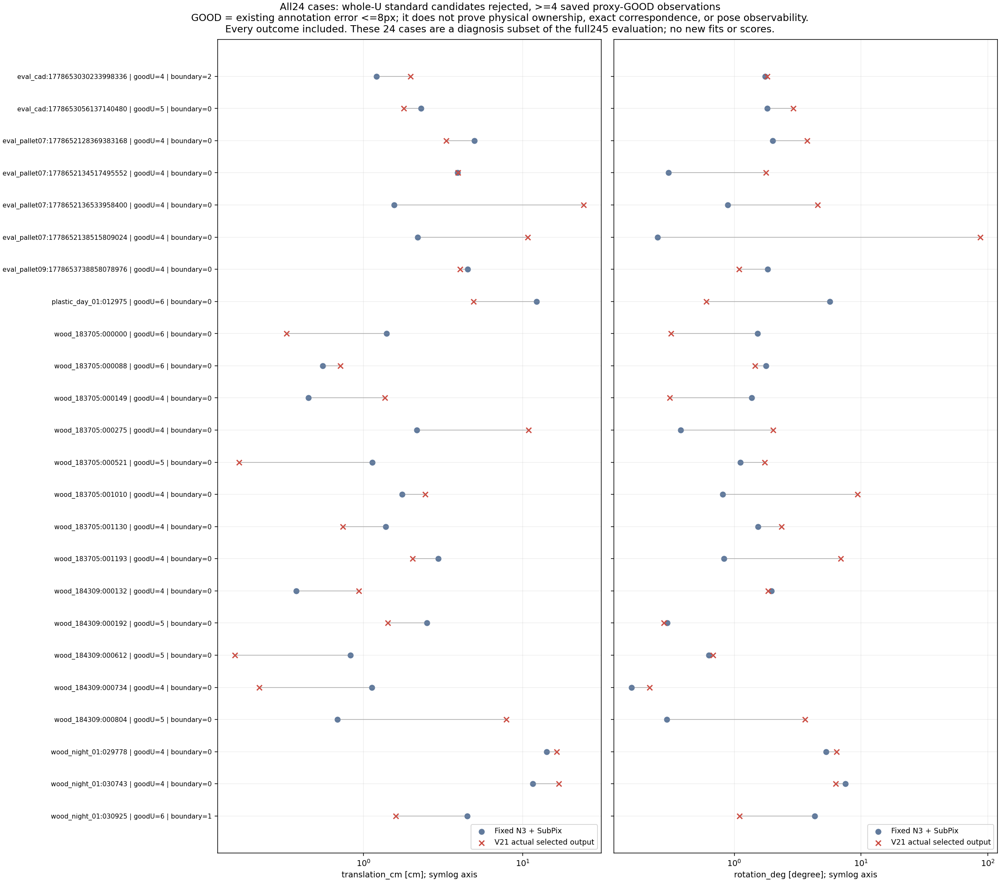

“가림 판단이 일부 틀려도 다른 유효 대응점으로 자세를 구하고 자기 가림 코너를 재투영했을 때, 기존 단순 대조보다 실제 위치·회전이 좋아졌는가?”

**전체 쉬움153+중간92=245장에서는 아직 그렇다고 확인하지 못했다.** V21의 평균 위치는 N3와 거의 같고 회전은 더 나쁘며, 같은 관측의 일반 PnP보다 위치·회전 모두 나쁘다. 이번에는 성능을 다시 실험하지 않고, 이미 저장된 실패 양상을 실제 코드와 연결해 원인을 좁혔다. 기존 독립 실측 자세가 없는 평가 참조는 `GEOMETRIC_PROXY`다. 이 수치를 독립 물리 R,t나 실제 경계 소유권 정답으로 표현하지 않는다. 어려움74장은 이번 245장에 포함하지 않았다.

현재 문제는 **자기 가림 좌표가 fit에 남는 문제보다, 서로 일관되게 틀린 관측을 합의로 승인하는 문제**에 가깝다. 네 개의 참조상 좋은 점에서 출발해도 재적합 때 틀린 점이 들어갈 수 있고, inlier 수와 영상 잔차가 더 좋아져도 실제 자세 오차가 커질 수 있다. 이 원행은 가림 분류기나 추가 학습이 필요하다는 증거로 일반화할 수 없다.

| 단계 | 실제 의미 | 확인 결과 |
|---|---|---|
| 코너 정의 | 같은 native 코너에 incident한 서로 다른 두 의미상 경계선의 교점 | 합성 조건부 CAL348에서는 wire 교점과 native annotation이 일치했다. 실사의 선택 선 소유권은 별도 미검증이다. |
| 경계 선택과 LOO | H∪{k}를 제외한 관측으로 k의 후보를 검증 | 수치 제외 계약은 맞다. 남은 점으로 구한 검증 자세 자체가 틀리면 보정점도 잘못 승인할 수 있다. |
| 강건 PnP | 모든 유한 4점 가설 생성 → 전체 U 합의 → 실제 inlier 재적합 → count/SSE 순위 | 좋은 4점 가설의 누락은 확인되지 않았다. 좋은 점에서 시작한 후보도 BAD를 재적합에 포함할 수 있다. |
| 자기 가림 재투영 | 최종 NEW R,t가 있으면 H의 초기 XY를 한 번 대체 | fit과 score에 H 초기 XY를 넣지 않고, 재투영점을 다시 fit하지 않는다. 잘못된 자세를 재투영으로 고칠 수 있다는 증거는 없다. |

코너의 수학적 교점 정의와 영상에서 그 코너에 속하는 선을 찾는 문제는 다르다. 메쉬에 가상 cuboid 꼭짓점이 직접 존재하지 않는다는 이유만으로 교점 정의를 오류라고 판정하지 않았다. 두 선의 3D 의미와 소유권이 맞아야 교점이 같은 native 코너의 대응이 된다. [관측 decoder](../../../scripts/research/pallet_boundary_corner_refiner_20261010_v2/observations.py#L153), [조건부 정의 검사](../pallet_corner_mechanism_audit_20261010_v1/RESULT_KO.md).

**59장 추적 결과.** 이 집합은 V22의 `ALL_STANDARD_CANDIDATES_REJECTED` ID를 그대로 사용했다. 이는 V21 전체 245장 중 whole-U 표준 후보가 모두 gate에서 거절된 59장이다. 최종 강건 출력도 모두 실패했다는 뜻이 아니다. 55장은 새 자세, 4장은 기존 N3 반환이었다. 59장 밖의 186장도 기존 전체 평가에 그대로 남아 있다.

여기서 GOOD는 기존 annotation에 대한 입력 오차 ≤8px, BAD는 >8px다. GOOD는 정확한 무오차 대응이나 충분한 배치의 증명이 아니다. 사람 가시 상태가 UNKNOWN인 대응은 따로 유지했다.

| 저장 원행에서 확인한 조건 | 장수 |
|---|---:|
| U에 GOOD가 네 개 미만 | 35 |
| U에 GOOD가 네 개 이상, 알려진 가시 상태에서도 네 개 이상 | 24 |
| 그 24장에서 GOOD만으로 만든 모든 4-ID subset 요청이 기록됨 | 24 |
| 그 24장에서 유효 표준 root가 하나 이상 반환됨 | 24 |
| GOOD 4-ID root에서 시작한 재적합 후보가 하나 이상 승인됨 | 22 |
| 저장 best가 GOOD 4-ID root에서 출발함 | 8 |
| 승인 최종 fit에 알려진 GOOD가 네 개 이상 | 17 |
| U에 UNKNOWN 품질 대응이 존재 | 3 |
| 새 경계 보정점을 하나 이상 채택 | 6 |

`GOOD 4-ID root에서 출발한 재적합`은 최종 fit도 GOOD 네 개만 사용했다는 뜻이 아니다. 코드는 그 root의 전체 U 잔차에서 inlier를 골라 재적합한다. 따라서 BAD가 fit과 최종 inlier에 들어갈 수 있다. 실제 NEW 55장 가운데 48장의 fit과 최종 inlier에는 proxy BAD가 하나 이상 남았다. 이는 실제 물리 경계를 잘못 소유한 비율이 아니라 기존 참조 좌표에 대한 사후 진단이다. [전체 U score→fit 코드](../../../scripts/research/pallet_factor_subset_consensus_20261011_v15/solver.py#L241).

| GOOD 수 | N3보다 위치·회전 모두 개선 | 모두 악화 | 혼합 또는 같음 | 합계 |
|---|---:|---:|---:|---:|
| 네 개 미만 | 5 | 12 | 18 | 35 |
| 네 개 이상 | 5 | 8 | 11 | 24 |

마스크가 알려진 점에서 맞았던 43장도 모두 개선8/모두 악화14/혼합21이었다. 마스크가 틀렸던 16장은 모두 개선2/모두 악화6/혼합8이었다. 마스크 일치만으로 프레임을 성공시키거나 실패시키지 않았다.

**구체적인 선택 실패.** `eval_pallet07:1778652138515809024`는 H=[6], 경계점 채택0, U=[0,1,2,3,4,5,7]이다. GOOD는 [0,1,3,7], BAD는 [2,4,5]였다. GOOD 입력의 참조 오차도 각각 7.527/1.873/5.467/7.647px여서 무오차 대응이 아니다.

| 후보 | 차원 | 실제 fit와 최종 inlier | 합의 수 | 전체 U truncated SSE px² |
|---|---:|---|---:|---:|
| GOOD [0,1,3,7] root에서 출발한 candidate5 | 0 | [0,1,3,4,7] | 5 | 239.763942 |
| 같은 GOOD root의 다른 치수 가설 candidate26 | 1 | [0,1,3,4,7] | 5 | 245.795770 |
| 실제 선택 candidate8 | 0 | [0,1,2,3,4,7] | 6 | 212.479365 |

선택 후보는 BAD 2와4를 포함했지만 합의 수가 많고 잔차도 낮아 승리했다. 최종 오차는 N3의 **2.188809cm / 0.454581°**에서 **10.716346cm / 86.942401°**로 커졌다. 이 사례는 dim0 선택이므로 dim1의 `R_cf @ Q` 변환 오류로 설명할 수 없다. 다른 후보의 실제 T/R 오차는 이번에 새로 계산하지 않았으므로, GOOD root 후보가 실제로 더 정확했다고 주장하지 않는다.

GOOD가 네 개 이상인데 두 자세 지표가 모두 나빠진 8장의 전체 기록은 다음과 같다. 성능 주장용 대표 표본이 아니라, 위 24장 집합의 악화 양상을 빠짐없이 보여주는 표다.

| ID | GOOD U | 경계 채택 | N3 T cm / R ° | V21 T cm / R ° |
|---|---:|---:|---|---|
| eval_cad:1778653030233998336 | 4 | 2 | 1.208023 / 1.751102 | 1.965777 / 1.821656 |
| eval_pallet07:1778652134517495552 | 4 | 0 | 3.895991 / 0.534157 | 3.911807 / 1.778330 |
| eval_pallet07:1778652136533958400 | 4 | 0 | 1.558210 / 0.953463 | 24.074359 / 4.553924 |
| eval_pallet07:1778652138515809024 | 4 | 0 | 2.188809 / 0.454581 | 10.716346 / 86.942401 |
| wood_183705:000275 | 4 | 0 | 2.159471 / 0.620479 | 10.863147 / 2.026395 |
| wood_183705:001010 | 4 | 0 | 1.743405 / 0.917236 | 2.438514 / 9.368374 |
| wood_184309:000804 | 5 | 0 | 0.852595 / 0.520740 | 7.874307 / 3.624552 |
| wood_night_01:029778 | 4 | 0 | 14.085643 / 5.287534 | 16.297818 / 6.404554 |

8장 중 7장은 경계 좌표를 전혀 바꾸지 않았다. 따라서 이 악화 전체를 새 경계 head나 LOO의 잘못된 좌표 교체로 설명할 수 없다. `wood_183705:001010`의 GOOD [0,1,4,5]는 모델에서 같은 y평면에 있는 네 점이다. 두 치수에서 반환된 IPPE root 네 개가 모두 초기 합의 점수에서 4점 미만으로 걸러졌다. `wood_183705:001193`도 GOOD 네 개의 root 세 개는 4점 미만, 한 개는 재적합 뒤 inlier가 불안정해 거절됐다. 반면 `wood_184309:000804`는 최종 fit [0,3,4,7]이 모두 GOOD였어도 자세가 악화했다. 점 수·오차·배치를 함께 봐야 한다.

아래 그림은 GOOD가 네 개 이상인 **24장 전부**의 저장 T/R이다. 개선·악화·혼합 결과를 모두 포함한다. 전체245 성능은 [기존 전체 보고서와 원영상9개](../pallet_whole_u_closure_20261011_v21/RESULT_KO.md)를 사용한다.



[확대 가능한 SVG](ALL24_SAVED_ERRORS.svg) · [24개 ID와 그림 검산](PLOT_CHECKS.json) · [ROOT 실제 그림 검토](ROOT_VISUAL_REVIEW.json).

**LOO의 효과와 한계.** 전체245장에서 채택한 경계점은 85장에 걸친 133개다. 이 중 참조 2D 오차가 N3보다 낮아진 것은 80개, 높아진 것은 53개였다. 133개 중 ≤8px는120개, >8px는13개다. **13개는 전체 채택수가 아니다.** 원 LOO 승인133개와 실제 채택133개는 일치했고, 자기 가림 H의 좌표는 채택하지 않았다. 이 80/53 현상은 기존 V4 보고서에도 기록돼 있으며 새 성능 실험 결과가 아니다. [133개 선택 원행](SELECTED_BOUNDARY_ROWS.jsonl)에는 두 LOO 잔차, 후보와 N3의 참조 오차, 실제 fit/inlier 여부를 그대로 보존했다.

즉 LOO는 k와 H가 자기 검증에 수치적으로 들어가는 경로를 차단하지만, 나머지 관측의 정확도나 경계 소유권을 보증하지 않는다. H는 고정 N3 초기 자세의 판정이고 경계 제안은 고정 Base의 feature/role에 의존하므로 완전한 통계적 독립도 주장하지 않는다. [LOO 제외와 선택 코드](../../../scripts/research/pallet_cornerwise_independent_20261010_v4/selection.py#L132), [최종 H 제외·재투영 코드](../../../scripts/research/pallet_factor_subset_consensus_20261011_v15/solver.py#L328).

**이미 수정한 것과 이번에 확인하지 못한 것.** 실제 대응이 있던 2,164 query를 ray 교차 수치 실패만으로 no_match로 감독한 별도 head 오류는 실제 메쉬·깊이의 POSITIVE/NONE/IGNORE로 수정됐다. 원 감사 시점에는 수정 후 학습이 없었고, 이후 별도 승인된 동일량3×3,000=9,000 업데이트가 완료됐다. 원 IMAGE_ROLE 0/319는 수정 전 모델의 역사 결과이며 이번 결과가 아니다. 이번 실행은 학습0/새RGB0/새PnP0/새자세평가0/threshold변경0이다. main N3를 고쳤다고 표현하지 않는다.

과도한 same-support veto의 제거와 관측 접선 기준의 부분 선 목적함수 수정도 이미 완료됐다. 이번 감사는 새 q 순서·단위·cache·회전축 버그를 발견하지 않았다. 원4점 proposals가 없고 whole-U roots는 있으나 모두 거절되는 경우 실패 사유가 generation failure로 잘못 표기될 수 있는 소스 조건은 발견했지만, **현재245장에서는 그 조건이0장**이었다. 이를 현재 자세 악화의 확정 원인으로 쓰거나 이미 완료한 수정을 반복하지 않았다.

CAL348은 모델이 구성한 incident-pair의 지원 query가 모두 source POS인 조건부 행 집합이다. 모든 source 코너, 잘못 선택한 support, 누락한 대응, 실사 소유권까지 검증한 oracle가 아니다. 옛 SOURCE_CEILING은 수정 전 targets와 옛2-query decoder, 미보존 predicted initial H를 사용하므로 현재 calibrated ≥3-query/LOO 경로의 상한으로 사용하지 않았다. P0 외부 가림·비가림 방해물·저대비 네 통제 변형도 계속 미검증이다.

**남은 문제를 확인할 최소 실험의 목적.** 새로운 학습을 늘리기 전에, 같은 관측·K·치수·H·backend의 no-mask/예측-mask/oracle 대조를 한 고정 실험에서 비교해야 가림 판단의 필요성을 분리할 수 있다. 현재 다른 backend의 역사 no-mask 결과로 그 필요성을 증명할 수 없다. 또 수정 감독의 source TEST128에서 정답 wire support의 교점, 모델 교점, 누락/NONE/IGNORE를 전 코너 기준으로 분리해야 조건부348의 작은 정의 오차를 모델 성능 상한으로 오해하지 않을 수 있다. 실제 물리 소유권과 독립 R,t가 없는 부분은 이 실험을 해도 자동으로 검증되지 않는다. 이번 읽기 전용 감사에서는 이 추가 성능 실험이나 학습을 시작하지 않았다.

검증자는 [59개 원행](ROWS.jsonl.gz)의 `all_proxy_good_four_ID_generation → proposals → refit_attempts → refit_candidates → selected_candidate`를 `proposal_index`로 연결하고, `pools`의 GOOD/BAD/UNKNOWN 및 `cornerwise_LOO_records`를 확인할 수 있다. [입력 SHA와 실행 범위](PROTOCOL.json), [완료 집계](SUMMARY.json), [ID·라벨·H 제외·모든 GOOD4 요청 검산](CHECKS.json), [경계 선택·상태 표기 감사](BOUNDARY_STATE_SUMMARY.json), [그 검산](BOUNDARY_STATE_CHECKS.json)을 함께 공개한다. 첫 감사 보조 코드의 LOO counter 라벨 오류도 원본과 [수정 사유](initial_label_review/REVIEW.json)를 남겼다. 이는 자세 solver나 성능 원행을 고친 오류가 아니다.

저장소 root에서 아래 명령으로 새 원행의 ID·품질 분할·모든 GOOD4 요청·실제 fit/inlier·133개 경계 선택·그림 SHA를 검산할 수 있다. 이 명령은 표준 라이브러리만 사용하고, 원본245 upstream 재생이나 물리 정답 검증을 했다고 주장하지 않는다. 전체 upstream 복원과 통계 검산은 [기존 공개 reader](../pallet_whole_u_closure_20261011_v21/PUBLIC_READER_KO.md)의 범위를 따른다. 실제 실행 결과는 [공개 형식 원행 검산](PUBLIC_DERIVED_CHECKS.json)에 기록한다.

```bash
python3 -I -S -B scripts/research/pallet_consensus_cause_audit_20261011_v23/check_saved_public.py _docs/experiments/pallet_consensus_cause_audit_20261011_v23
```

**성능 목표는 아직 미달이다.** 완료된 감사와 수정 완료를 정확도 개선 완료로 바꾸지 않는다. 전용 브랜치의 이번 추가 자료는 저장 결과의 원인 추적이며, main이나 원본 영상·가중치·사용자 변경을 수정하는 작업이 아니다.
