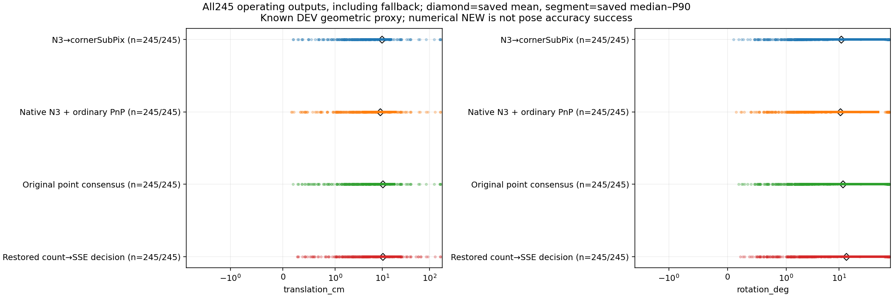
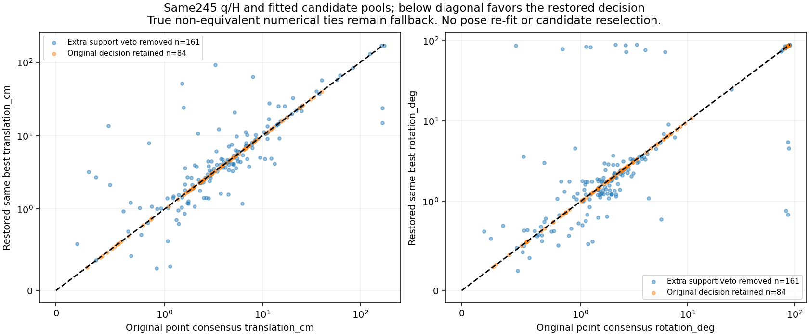
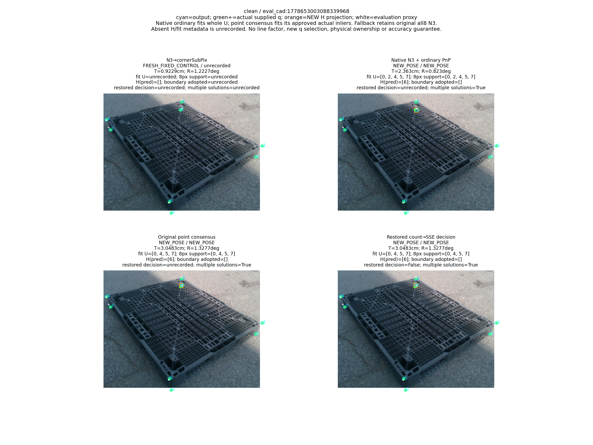
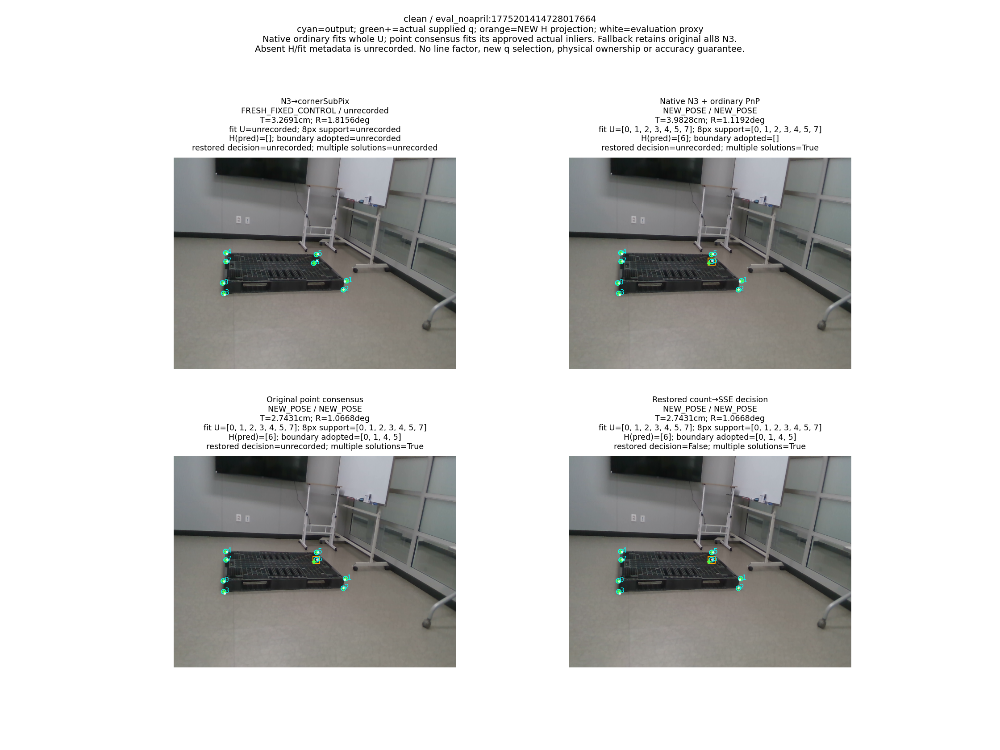
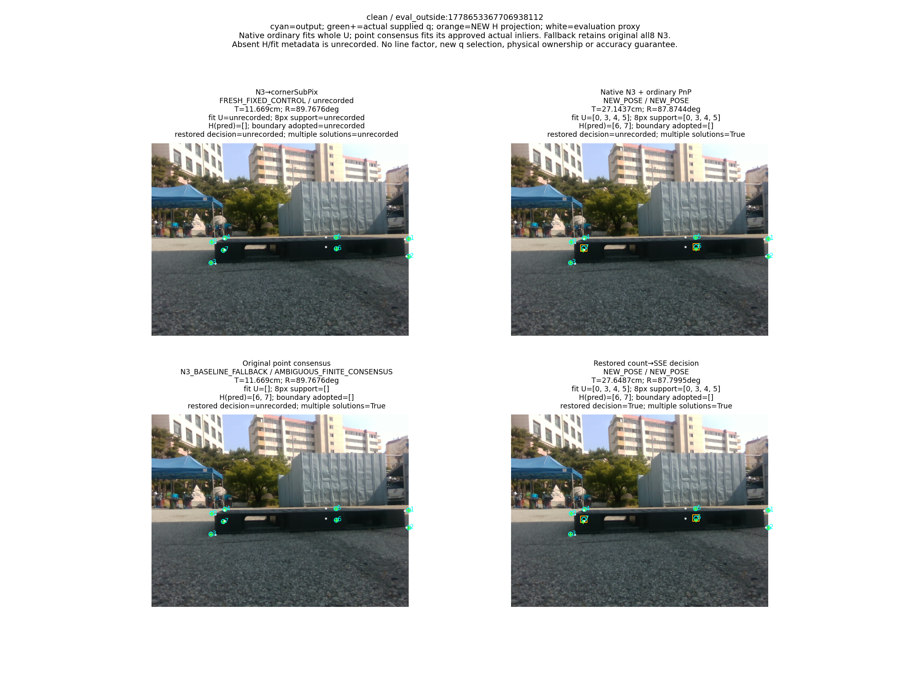
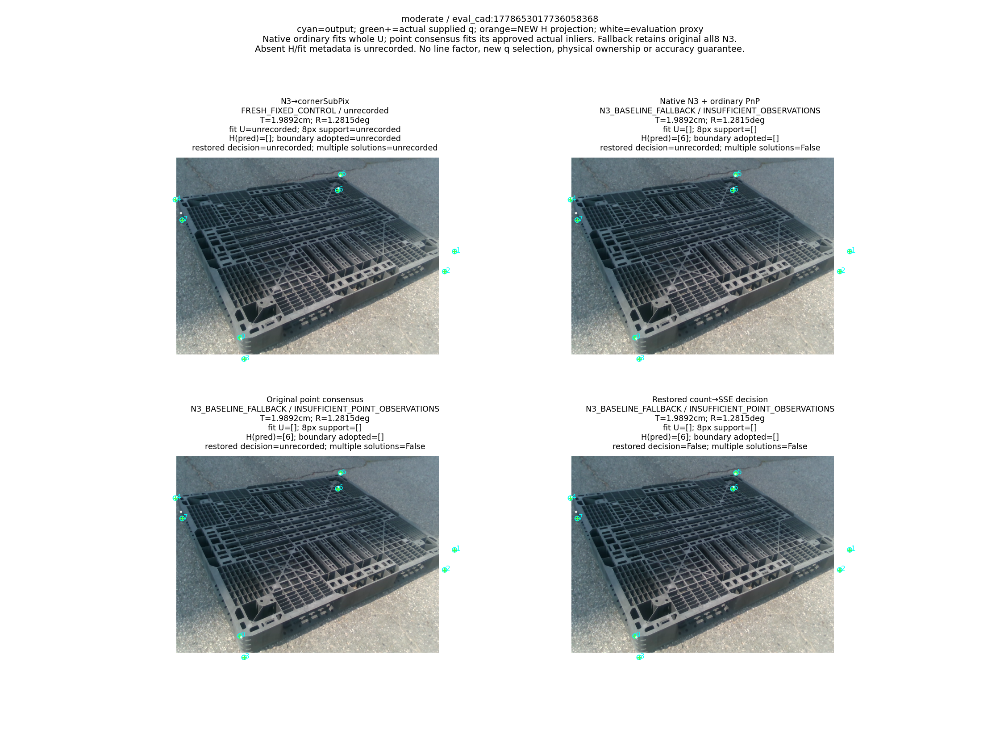
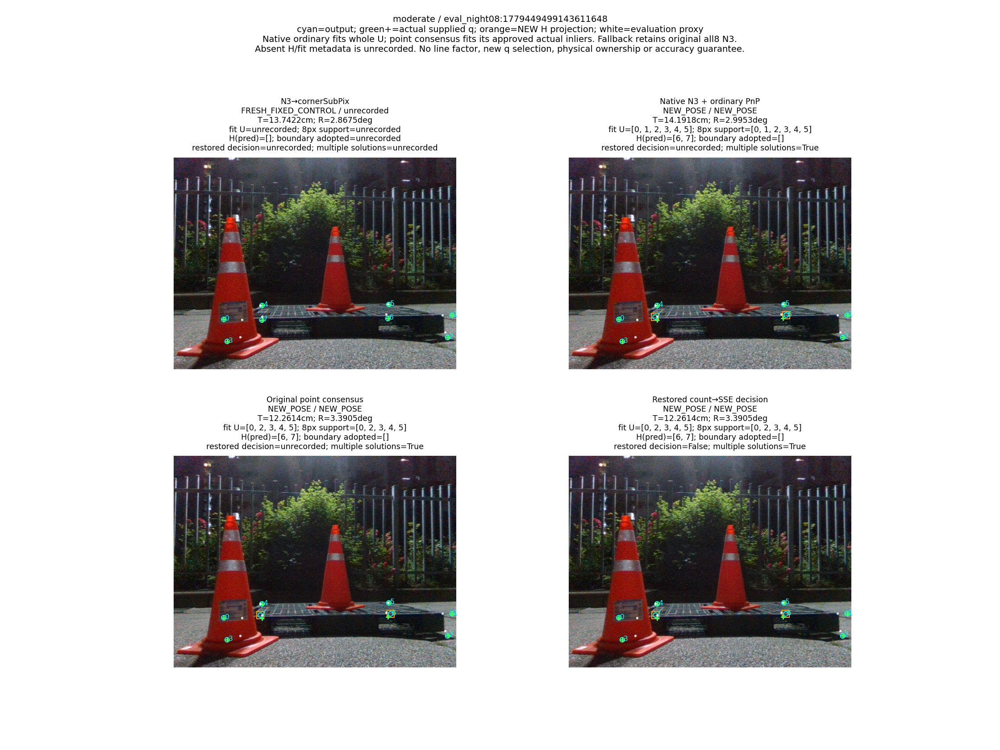
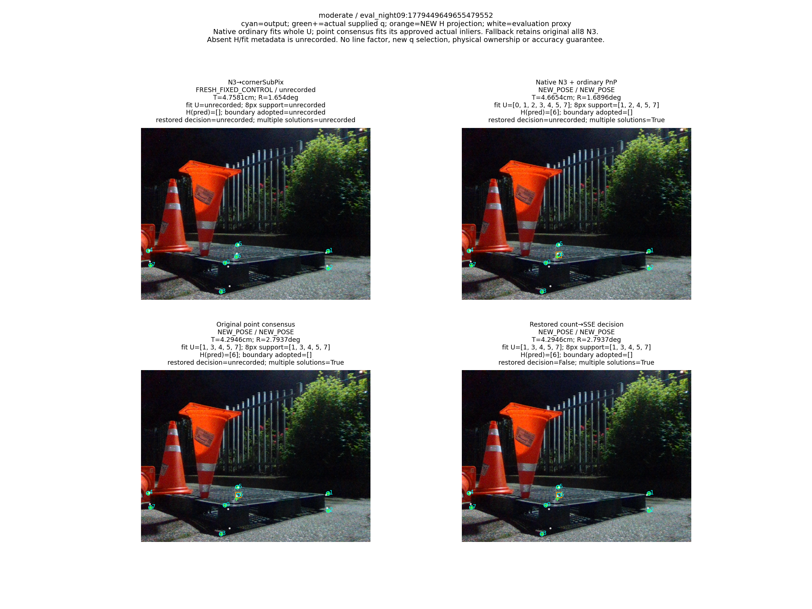

# V18: 같은 q의 합의 결정 복원과 실제 자세 결과

“가림 판단이 일부 틀려도 다른 유효 대응점으로 자세를 구하고 자기 가림 코너를 재투영했을 때, 기존 단순 대조보다 실제 위치·회전이 좋아졌는가?”

전체 245장의 저장된 양축 평균 판정: N3 대비 위치·회전 평균이 모두 개선됐다고 확인하지 못했다; 단순 native ordinary 대비 두 평균이 모두 개선됐다고 확인하지 못했다. 가림 오판 자체를 실패 조건으로 쓰지 않았다. 이는 Clean153·Moderate92의 알려진 DEV GEOMETRIC_PROXY 평가이며, 독립 물리 실측·미관측 실사 성능을 인증하지 않는다.


```json
{
  "primary_both_T_R_means_better_than_N3_on_full245": false,
  "primary_both_T_R_means_better_than_original_on_full245": false,
  "primary_both_T_R_means_better_than_native_standard_on_full245": false,
  "primary_both_T_R_means_better_than_hybrid_standard_on_full245": false
}
```

N3와 native ordinary, 같은 q의 ORIGINAL을 각각 대조한다. RESTORED−ORIGINAL은 동일 관측·동일 후보에서 추가 veto를 제거한 결정 효과다. V17 HYBRID−NATIVE의 같은 ordinary backend 비교가 학습 q의 별도 대조이며, backend가 다른 RESTORED−NATIVE를 head 단독 효과로 해석하지 않는다.

## 1. 무엇을 정의했고 어디가 잘못됐는가

새 head의 표적은 query normal과 의도한 semantic physical wire의 대응 위치 또는 NONE이다. 수치 ray miss를 NONE으로 잘못 감독한 2,164 query는 별도 브랜치의 [옛 targets():91–94](../../../scripts/research/pallet_observation_refiner_20261009_v1/training.py) 문제이며 main N3→cornerSubPix 문제가 아니다. [mesh/wire POSITIVE·IGNORE 준비:98–110](../../../scripts/research/pallet_kp_supervision_gate_20261010_v1/full_source_prepare.py)와 [depth로 인증한 NONE:109](../../../scripts/research/pallet_kp_supervision_repair_20261010_v1/recover_front_none_v3.py) 및 CPU gradient 검사를 완료했다. 최초 읽기 전용 감사 당시 재학습은 없었고, 이후 승인된 수정 감독 3조건×3,000=9,000 update는 [별도 역사 결과](../pallet_kp_corrected_supervision_20261010_v1/RESULT_KO.md)다. 이번 새 학습·RGB·seed는 0이다. 수정 전 IMAGE_ROLE 0/319를 수정 후 결과로 쓰지 않는다.

q는 임의 ray hit를 corner로 넣지 않고, [서로 다른 incident edge의 TLS 두 선 교점](../../../scripts/research/pallet_boundary_corner_refiner_20261010_v2/observations.py)으로 만든다. source의 owned-wire 감독과 실사 decoder의 physical ownership은 다르며 후자는 UNKNOWN이다. 역할 특성은 Base 초기 자세의 projected hull이고, source role parity는 과거 pose witness 또는 실사 ownership을 인증하지 않는다.

이번 실제 오류는 같은 point consensus support의 다른 비용 해를 모두 ambiguity로 거부한 추가 veto였다. 161 frame의 이 veto만 원래 inlier 수→truncated SSE 결정으로 복원했다. 실제 수치 tie 1개와 대응/실제 관측 기하 부족 4개는 fallback으로 남았다. 후보·refit·q·H·head·CAL·8px·rank/weak/depth threshold는 바꾸지 않았다. [결정 복원 코드](../../../scripts/research/pallet_consensus_decision_repair_20261011_v18/solver.py) / [METHOD_CONTRACT_KO.md](METHOD_CONTRACT_KO.md) / [245 결정 원행](CONTROL_LEDGERS.jsonl.gz)

기존 H∪k LOO는 H와 시험 코너 k의 초기 좌표를 제외한 다른 관측으로 native와 q의 엄격한 개선을 시험한다. 남은 유효 대응으로 finite 4점 subset 합의와 실제 inlier geometry를 확인한다. 마스크 불일치만으로 frame을 거부하지 않는다. 승인 NEW에서는 H 초기 XY를 최종 fit에서 빼고 새 R,t로 한 번 재투영해 교체한다. 재투영점을 다시 PnP 관측으로 넣지 않는다. fallback은 이미 계산된 원래 all8 N3 출력을 유지하며 새 H 제외 fit/NEW로 세지 않는다. 가림을 완벽하게 분류해야 성공한다는 조건은 없다.

V16 원 scalar CLI는 isolated environment의 ast 누락으로 raw decode/Audit 이전 실패했고 [FIRST_SCALAR_ENVIRONMENT_FAILURE.json](../pallet_hybrid_factor_subset_consensus_20261011_v16/FIRST_SCALAR_ENVIRONMENT_FAILURE.json)를 보존했다. 환경만 보완한 READY의 full 검사 198,134,007 predicates 중 564 FAIL도 [TRACE_VALIDATION_CHECKS.json](../pallet_hybrid_factor_subset_consensus_20261011_v16/TRACE_VALIDATION_CHECKS.json)에 보존했다. 모두 line 경로이며 point-only failure는 0이라는 저장 분리 증거를 사용했다. [FAILURE_WITNESS_SUMMARY.json](../pallet_hybrid_factor_subset_consensus_20261011_v16/FAILURE_WITNESS_SUMMARY.json)는 21 context/15 frame, hinge364와 unmapped column-norm200을 구분한다. 승인 selected NEW/best의 해당 실패는 0이지만 전체 기하 PASS로 바꾸지 않는다. 새 검사는 paired point decision/output만 인증하고 원 parent point J 검사 수를 별도로 주장하지 않는다.

## 2. 산출률과 전체 운용 결과


|층|방법|전체|산출|NEW|fallback|완전 실패|fixed|T mean cm|R mean deg|ADDsym mean cm|
|---|---|---|---|---|---|---|---|---|---|---|
|combined|BASE|245|245|0|0|0|245|12.188351368308584|14.232844378136992|22.431945806117554|
|combined|N3_SUBPIX|245|245|0|0|0|245|9.754548028679153|10.914841863166323|17.028646667097725|
|combined|HYBRID_STANDARD_PNP|245|245|244|1|0|0|9.207153885736464|10.613463948751368|16.43968649819084|
|combined|NATIVE_STANDARD_PNP|245|245|244|1|0|0|8.951574173959987|10.61763914609911|16.21154786029048|
|combined|HYBRID_POINT_CONSENSUS_ORIGINAL|245|245|79|166|0|0|10.05503053164391|11.715323669869344|17.868503089664262|
|combined|HYBRID_POINT_CONSENSUS_RESTORED|245|245|240|5|0|0|10.19473418899381|13.639332540977922|19.646391027436795|
|easy|BASE|153|153|0|0|0|153|12.846348362759484|10.628204608338502|17.93860487754294|
|easy|N3_SUBPIX|153|153|0|0|0|153|10.107072506393136|7.584578376689015|12.915132447282565|
|easy|HYBRID_STANDARD_PNP|153|153|153|0|0|0|8.429226656804744|6.468994812647887|11.008250749784743|
|easy|NATIVE_STANDARD_PNP|153|153|153|0|0|0|8.283471071855557|6.466523899060526|10.884012479374642|
|easy|HYBRID_POINT_CONSENSUS_ORIGINAL|153|153|49|104|0|0|10.394241352738023|8.202899498936047|13.4931503762354|
|easy|HYBRID_POINT_CONSENSUS_RESTORED|153|153|152|1|0|0|9.29150872342711|8.177492819401836|12.58663177800136|
|medium|BASE|92|92|0|0|0|92|11.094073757971767|20.227517038780135|29.904567132986195|
|medium|N3_SUBPIX|92|92|0|0|0|92|9.168284495089601|16.45321483524272|23.86959966309468|
|medium|HYBRID_STANDARD_PNP|92|92|91|1|0|0|10.500880690372911|17.50589631640172|25.472400297170555|
|medium|NATIVE_STANDARD_PNP|92|92|91|1|0|0|10.062658680720613|17.521124285195885|25.0714708307266|
|medium|HYBRID_POINT_CONSENSUS_ORIGINAL|92|92|30|62|0|0|9.490908187867833|17.55663778022581|25.144904884823127|
|medium|HYBRID_POINT_CONSENSUS_RESTORED|92|92|88|4|0|0|11.696837408903642|22.722609469251196|31.387077605302242|


큰 오차 frame을 삭제하지 않았다. operational 전체와 NEW·fallback 분포를 모두 남기며, 공통 산출/PRIMARY NEW/both NEW의 paired ID는 [METRICS.json](METRICS.json)에 있다. NEW는 수치 출력 상태이며 정확한 자세라는 뜻이 아니다.

## 3. 전체 분포 162개: 원행에서 계산된 972개 수치


|층|방법|출력집합|오차|n|mean|sample_variance|sample_std|median|P90|max|단위|
|---|---|---|---|---|---|---|---|---|---|---|---|
|combined|BASE|operational|translation_cm|245|12.188351368308584|538.5790668295168|23.207306324291856|6.010803220063387|23.191871672208148|183.07850477473974|cm|
|combined|BASE|operational|rotation_deg|245|14.232844378136992|851.3841553068099|29.178487885886238|1.839738412238616|82.81063875160255|90.00917492050102|degree|
|combined|BASE|operational|ADDsym_cm|245|22.431945806117554|1506.0022047443758|38.80724423022557|6.405062242563096|110.03653211262429|188.9915223699912|cm|
|combined|BASE|new_pose|translation_cm|0|None|None|None|None|None|None|cm|
|combined|BASE|new_pose|rotation_deg|0|None|None|None|None|None|None|degree|
|combined|BASE|new_pose|ADDsym_cm|0|None|None|None|None|None|None|cm|
|combined|BASE|fallback|translation_cm|0|None|None|None|None|None|None|cm|
|combined|BASE|fallback|rotation_deg|0|None|None|None|None|None|None|degree|
|combined|BASE|fallback|ADDsym_cm|0|None|None|None|None|None|None|cm|
|combined|N3_SUBPIX|operational|translation_cm|245|9.754548028679153|575.9360241353828|23.99866713247598|3.5973495042103814|15.085014302122275|174.7568271983788|cm|
|combined|N3_SUBPIX|operational|rotation_deg|245|10.914841863166323|665.1806009914171|25.79109538176727|1.6659926895050734|76.09532476401336|89.77763362360415|degree|
|combined|N3_SUBPIX|operational|ADDsym_cm|245|17.028646667097725|1298.8108704540255|36.039018722129846|3.9369354820060027|68.43149389306842|180.98844156077627|cm|
|combined|N3_SUBPIX|new_pose|translation_cm|0|None|None|None|None|None|None|cm|
|combined|N3_SUBPIX|new_pose|rotation_deg|0|None|None|None|None|None|None|degree|
|combined|N3_SUBPIX|new_pose|ADDsym_cm|0|None|None|None|None|None|None|cm|
|combined|N3_SUBPIX|fallback|translation_cm|0|None|None|None|None|None|None|cm|
|combined|N3_SUBPIX|fallback|rotation_deg|0|None|None|None|None|None|None|degree|
|combined|N3_SUBPIX|fallback|ADDsym_cm|0|None|None|None|None|None|None|cm|
|combined|HYBRID_STANDARD_PNP|operational|translation_cm|245|9.207153885736464|411.8100580727087|20.293103707237805|3.833791005398134|18.961934042295727|169.89322333069043|cm|
|combined|HYBRID_STANDARD_PNP|operational|rotation_deg|245|10.613463948751368|638.2719103010627|25.26404382320975|1.6895907031155688|54.711582265606815|89.7738646552605|degree|
|combined|HYBRID_STANDARD_PNP|operational|ADDsym_cm|245|16.43968649819084|1158.9757509712856|34.04373291769405|4.01117015219868|66.939841321056|176.47060504649227|cm|
|combined|HYBRID_STANDARD_PNP|new_pose|translation_cm|244|9.23673558901487|413.2894734838971|20.32952221484551|3.8411095519577856|19.183412745390072|169.89322333069043|cm|
|combined|HYBRID_STANDARD_PNP|new_pose|rotation_deg|244|10.651709524802452|640.5387015123858|25.308866065321574|1.6937021466307582|59.64592634743124|89.7738646552605|degree|
|combined|HYBRID_STANDARD_PNP|new_pose|ADDsym_cm|244|16.497443114966835|1162.9245576625558|34.10167968975364|4.018225526693788|66.99358335928339|176.47060504649227|cm|
|combined|HYBRID_STANDARD_PNP|fallback|translation_cm|1|1.9892182858052287|None|None|1.9892182858052287|1.9892182858052287|1.9892182858052287|cm|
|combined|HYBRID_STANDARD_PNP|fallback|rotation_deg|1|1.2815433922869333|None|None|1.2815433922869333|1.2815433922869333|1.2815433922869333|degree|
|combined|HYBRID_STANDARD_PNP|fallback|ADDsym_cm|1|2.3470720048489007|None|None|2.3470720048489007|2.3470720048489007|2.3470720048489007|cm|
|combined|NATIVE_STANDARD_PNP|operational|translation_cm|245|8.951574173959987|405.1480689491959|20.12829026393439|3.833791005398134|18.961934042295727|169.89322333069043|cm|
|combined|NATIVE_STANDARD_PNP|operational|rotation_deg|245|10.61763914609911|638.2455219476201|25.26352156663081|1.6251166578679208|54.711582265606815|89.79172246250954|degree|
|combined|NATIVE_STANDARD_PNP|operational|ADDsym_cm|245|16.21154786029048|1155.3669344682799|33.990688937829425|4.030611805010867|66.939841321056|176.47060504649227|cm|
|combined|NATIVE_STANDARD_PNP|new_pose|translation_cm|244|8.980108419403244|406.61504427373944|20.16469797129973|3.8411095519577856|19.183412745390072|169.89322333069043|cm|
|combined|NATIVE_STANDARD_PNP|new_pose|rotation_deg|244|10.655901833614735|640.5118824986852|25.308336225415633|1.640135543146926|59.64592634743124|89.79172246250954|degree|
|combined|NATIVE_STANDARD_PNP|new_pose|ADDsym_cm|244|16.268369482648847|1159.3272449279955|34.04889491493073|4.033399559723552|66.99358335928339|176.47060504649227|cm|
|combined|NATIVE_STANDARD_PNP|fallback|translation_cm|1|1.9892182858052287|None|None|1.9892182858052287|1.9892182858052287|1.9892182858052287|cm|
|combined|NATIVE_STANDARD_PNP|fallback|rotation_deg|1|1.2815433922869333|None|None|1.2815433922869333|1.2815433922869333|1.2815433922869333|degree|
|combined|NATIVE_STANDARD_PNP|fallback|ADDsym_cm|1|2.3470720048489007|None|None|2.3470720048489007|2.3470720048489007|2.3470720048489007|cm|
|combined|HYBRID_POINT_CONSENSUS_ORIGINAL|operational|translation_cm|245|10.05503053164391|577.9466160223861|24.040520294336105|3.779219410265064|17.785347244340855|174.7568271983788|cm|
|combined|HYBRID_POINT_CONSENSUS_ORIGINAL|operational|rotation_deg|245|11.715323669869344|704.7276596671373|26.546707134165196|1.8956479074184998|80.72195784287736|89.77763362360415|degree|
|combined|HYBRID_POINT_CONSENSUS_ORIGINAL|operational|ADDsym_cm|245|17.868503089664262|1344.650085187756|36.66947075139967|4.213645136355802|71.288129764174|180.98844156077627|cm|
|combined|HYBRID_POINT_CONSENSUS_ORIGINAL|new_pose|translation_cm|79|6.471866859675024|62.19279621671503|7.886240943359201|3.6411549526680465|15.743923657060519|40.05460371835214|cm|
|combined|HYBRID_POINT_CONSENSUS_ORIGINAL|new_pose|rotation_deg|79|12.16486609334252|711.5035600784859|26.67402406984154|2.361774723542757|81.04011349731557|88.60257339298103|degree|
|combined|HYBRID_POINT_CONSENSUS_ORIGINAL|new_pose|ADDsym_cm|79|14.073045707483582|741.0736592587076|27.22266811425191|4.1265179322214935|68.64982253053917|120.13718650738315|cm|
|combined|HYBRID_POINT_CONSENSUS_ORIGINAL|fallback|translation_cm|166|11.760271074327898|816.18756359547|28.56899654512685|3.9189380778045426|20.15762149340815|174.7568271983788|cm|
|combined|HYBRID_POINT_CONSENSUS_ORIGINAL|fallback|rotation_deg|166|11.501384805686326|705.6527787682851|26.564125785884336|1.7091018494395773|79.16083717984849|89.77763362360415|degree|
|combined|HYBRID_POINT_CONSENSUS_ORIGINAL|fallback|ADDsym_cm|166|19.674774976364702|1627.9469485564587|40.34782458270159|4.286278349860863|95.29718858565818|180.98844156077627|cm|
|combined|HYBRID_POINT_CONSENSUS_RESTORED|operational|translation_cm|245|10.19473418899381|435.9790518695227|20.88011139504583|4.022035860009537|23.89893802504458|169.9482512071582|cm|
|combined|HYBRID_POINT_CONSENSUS_RESTORED|operational|rotation_deg|245|13.639332540977922|818.762647715128|28.614028861995788|1.8407813566013058|82.4214587475194|90.10142903233576|degree|
|combined|HYBRID_POINT_CONSENSUS_RESTORED|operational|ADDsym_cm|245|19.646391027436795|1337.9205466162177|36.57759623890309|4.252522316050203|74.0688172324972|176.52332591837003|cm|
|combined|HYBRID_POINT_CONSENSUS_RESTORED|new_pose|translation_cm|240|10.372381525036076|443.53609830818493|21.060296728873148|4.0473996990971255|23.92361317873899|169.9482512071582|cm|
|combined|HYBRID_POINT_CONSENSUS_RESTORED|new_pose|rotation_deg|240|13.901126364291423|832.5169358962675|28.853369576121736|1.8971052733210918|83.12308892945788|90.10142903233576|degree|
|combined|HYBRID_POINT_CONSENSUS_RESTORED|new_pose|ADDsym_cm|240|20.016170166348413|1359.1762683076915|36.86700785672322|4.464876808710642|76.15840223484165|176.52332591837003|cm|
|combined|HYBRID_POINT_CONSENSUS_RESTORED|fallback|translation_cm|5|1.667662058964994|0.6580766782616969|0.8112192541241221|1.9341254362949596|2.240190233463547|2.407504865235759|cm|
|combined|HYBRID_POINT_CONSENSUS_RESTORED|fallback|rotation_deg|5|1.0732290219298393|0.13873340101299164|0.3724693289560788|1.0687898771759754|1.4135443874154952|1.5015450508345363|degree|
|combined|HYBRID_POINT_CONSENSUS_RESTORED|fallback|ADDsym_cm|5|1.8969923596789087|0.3656741764839967|0.6047099937027639|1.9499276252496534|2.4063725350344534|2.4459062218248215|cm|
|easy|BASE|operational|translation_cm|153|12.846348362759484|790.4514324808421|28.114968121640153|4.668213987688899|19.836603231600556|183.07850477473974|cm|
|easy|BASE|operational|rotation_deg|153|10.628204608338502|616.6247942414432|24.83193094065468|1.715555635657884|50.873618630439076|89.4792849588053|degree|
|easy|BASE|operational|ADDsym_cm|153|17.93860487754294|1268.8858821312092|35.621424482061485|5.5161632734927135|53.33233728654386|188.9915223699912|cm|
|easy|BASE|new_pose|translation_cm|0|None|None|None|None|None|None|cm|
|easy|BASE|new_pose|rotation_deg|0|None|None|None|None|None|None|degree|
|easy|BASE|new_pose|ADDsym_cm|0|None|None|None|None|None|None|cm|
|easy|BASE|fallback|translation_cm|0|None|None|None|None|None|None|cm|
|easy|BASE|fallback|rotation_deg|0|None|None|None|None|None|None|degree|
|easy|BASE|fallback|ADDsym_cm|0|None|None|None|None|None|None|cm|
|easy|N3_SUBPIX|operational|translation_cm|153|10.107072506393136|859.7174702467877|29.320939109223424|2.6918845473520725|12.762645595341315|174.7568271983788|cm|
|easy|N3_SUBPIX|operational|rotation_deg|153|7.584578376689015|435.5445806846465|20.86970485379816|1.5416520299079417|5.923153455782191|89.76763723821307|degree|
|easy|N3_SUBPIX|operational|ADDsym_cm|153|12.915132447282565|1130.5845067555638|33.624165517608965|2.966195228583507|14.83116901630595|180.98844156077627|cm|
|easy|N3_SUBPIX|new_pose|translation_cm|0|None|None|None|None|None|None|cm|
|easy|N3_SUBPIX|new_pose|rotation_deg|0|None|None|None|None|None|None|degree|
|easy|N3_SUBPIX|new_pose|ADDsym_cm|0|None|None|None|None|None|None|cm|
|easy|N3_SUBPIX|fallback|translation_cm|0|None|None|None|None|None|None|cm|
|easy|N3_SUBPIX|fallback|rotation_deg|0|None|None|None|None|None|None|degree|
|easy|N3_SUBPIX|fallback|ADDsym_cm|0|None|None|None|None|None|None|cm|
|easy|HYBRID_STANDARD_PNP|operational|translation_cm|153|8.429226656804744|537.0200156654557|23.173692318347886|2.7737384667261553|13.132737807431784|169.89322333069043|cm|
|easy|HYBRID_STANDARD_PNP|operational|rotation_deg|153|6.468994812647887|349.3227745875358|18.69017855954126|1.4446440987210218|5.6585114616544905|88.50177257977313|degree|
|easy|HYBRID_STANDARD_PNP|operational|ADDsym_cm|153|11.008250749784743|786.1359698619823|28.038116375070246|3.0995737745137397|14.578469398220822|176.47060504649227|cm|
|easy|HYBRID_STANDARD_PNP|new_pose|translation_cm|153|8.429226656804744|537.0200156654557|23.173692318347886|2.7737384667261553|13.132737807431784|169.89322333069043|cm|
|easy|HYBRID_STANDARD_PNP|new_pose|rotation_deg|153|6.468994812647887|349.3227745875358|18.69017855954126|1.4446440987210218|5.6585114616544905|88.50177257977313|degree|
|easy|HYBRID_STANDARD_PNP|new_pose|ADDsym_cm|153|11.008250749784743|786.1359698619823|28.038116375070246|3.0995737745137397|14.578469398220822|176.47060504649227|cm|
|easy|HYBRID_STANDARD_PNP|fallback|translation_cm|0|None|None|None|None|None|None|cm|
|easy|HYBRID_STANDARD_PNP|fallback|rotation_deg|0|None|None|None|None|None|None|degree|
|easy|HYBRID_STANDARD_PNP|fallback|ADDsym_cm|0|None|None|None|None|None|None|cm|
|easy|NATIVE_STANDARD_PNP|operational|translation_cm|153|8.283471071855557|538.3961922074925|23.203365967193047|2.7636728929599297|13.132737807431784|169.89322333069043|cm|
|easy|NATIVE_STANDARD_PNP|operational|rotation_deg|153|6.466523899060526|349.285491597594|18.68918113769552|1.3906174634895643|5.6585114616544905|88.50177257977313|degree|
|easy|NATIVE_STANDARD_PNP|operational|ADDsym_cm|153|10.884012479374642|787.8140857022238|28.068026038576775|3.001498132178273|14.578469398220822|176.47060504649227|cm|
|easy|NATIVE_STANDARD_PNP|new_pose|translation_cm|153|8.283471071855557|538.3961922074925|23.203365967193047|2.7636728929599297|13.132737807431784|169.89322333069043|cm|
|easy|NATIVE_STANDARD_PNP|new_pose|rotation_deg|153|6.466523899060526|349.285491597594|18.68918113769552|1.3906174634895643|5.6585114616544905|88.50177257977313|degree|
|easy|NATIVE_STANDARD_PNP|new_pose|ADDsym_cm|153|10.884012479374642|787.8140857022238|28.068026038576775|3.001498132178273|14.578469398220822|176.47060504649227|cm|
|easy|NATIVE_STANDARD_PNP|fallback|translation_cm|0|None|None|None|None|None|None|cm|
|easy|NATIVE_STANDARD_PNP|fallback|rotation_deg|0|None|None|None|None|None|None|degree|
|easy|NATIVE_STANDARD_PNP|fallback|ADDsym_cm|0|None|None|None|None|None|None|cm|
|easy|HYBRID_POINT_CONSENSUS_ORIGINAL|operational|translation_cm|153|10.394241352738023|860.238599829493|29.32982440843267|2.880210619783908|14.256234533841981|174.7568271983788|cm|
|easy|HYBRID_POINT_CONSENSUS_ORIGINAL|operational|rotation_deg|153|8.202899498936047|474.6403272827578|21.786241697060966|1.5895173575589052|7.424468773290128|89.76763723821307|degree|
|easy|HYBRID_POINT_CONSENSUS_ORIGINAL|operational|ADDsym_cm|153|13.4931503762354|1151.7494880610036|33.93743490691369|3.2649316243003956|16.294656184609313|180.98844156077627|cm|
|easy|HYBRID_POINT_CONSENSUS_ORIGINAL|new_pose|translation_cm|49|4.682339499303444|29.697816973895332|5.449570347641668|2.5969591184750866|12.411839821228112|25.925116848702167|cm|
|easy|HYBRID_POINT_CONSENSUS_ORIGINAL|new_pose|rotation_deg|49|7.633623742290399|413.63256101165075|20.33795862449451|2.026394563313589|8.165581198471706|87.51610402071441|degree|
|easy|HYBRID_POINT_CONSENSUS_ORIGINAL|new_pose|ADDsym_cm|49|8.309245807206606|267.11632668449494|16.34369378948636|3.2649316243003956|12.807642845792424|71.19221553939194|cm|
|easy|HYBRID_POINT_CONSENSUS_ORIGINAL|fallback|translation_cm|104|13.085425879837008|1232.8047507808783|35.11131941099449|2.9160664238545344|14.751444554260447|174.7568271983788|cm|
|easy|HYBRID_POINT_CONSENSUS_ORIGINAL|fallback|rotation_deg|104|8.471115961201782|507.4524794330705|22.526705916158058|1.5379317563962684|6.3536791205963965|89.76763723821307|degree|
|easy|HYBRID_POINT_CONSENSUS_ORIGINAL|fallback|ADDsym_cm|104|15.935566952027811|1556.3802580006634|39.45098551368094|3.241726273213164|22.590342848585045|180.98844156077627|cm|
|easy|HYBRID_POINT_CONSENSUS_RESTORED|operational|translation_cm|153|9.29150872342711|560.8143139126591|23.681518403866317|3.004470549016578|16.159344551876078|169.9482512071582|cm|
|easy|HYBRID_POINT_CONSENSUS_RESTORED|operational|rotation_deg|153|8.177492819401836|472.5092369914914|21.737277589235763|1.662679586451505|7.681457945490692|89.31805542262327|degree|
|easy|HYBRID_POINT_CONSENSUS_RESTORED|operational|ADDsym_cm|153|12.58663177800136|865.9356944616733|29.42678532326753|3.358459163043675|20.9003199195624|176.52332591837003|cm|
|easy|HYBRID_POINT_CONSENSUS_RESTORED|new_pose|translation_cm|152|9.339912560842453|564.1674735119601|23.752209865862167|3.0068324799445953|16.228581367678665|169.9482512071582|cm|
|easy|HYBRID_POINT_CONSENSUS_RESTORED|new_pose|rotation_deg|152|8.227976834628766|475.2459135675139|21.800135631860503|1.696657552058783|7.773170509270362|89.31805542262327|degree|
|easy|HYBRID_POINT_CONSENSUS_RESTORED|new_pose|ADDsym_cm|152|12.656610094795779|870.9161704919755|29.51128886531348|3.3666222111325657|21.386012646545385|176.52332591837003|cm|
|easy|HYBRID_POINT_CONSENSUS_RESTORED|fallback|translation_cm|1|1.9341254362949596|None|None|1.9341254362949596|1.9341254362949596|1.9341254362949596|cm|
|easy|HYBRID_POINT_CONSENSUS_RESTORED|fallback|rotation_deg|1|0.5039225049083683|None|None|0.5039225049083683|0.5039225049083683|0.5039225049083683|degree|
|easy|HYBRID_POINT_CONSENSUS_RESTORED|fallback|ADDsym_cm|1|1.9499276252496534|None|None|1.9499276252496534|1.9499276252496534|1.9499276252496534|cm|
|medium|BASE|operational|translation_cm|92|11.094073757971767|121.84908661025794|11.038527375073993|7.851389680650634|26.036088792108245|60.431861873972714|cm|
|medium|BASE|operational|rotation_deg|92|20.227517038780135|1194.6884557987921|34.564265590328866|1.9987798847057285|86.1592126325831|90.00917492050102|degree|
|medium|BASE|operational|ADDsym_cm|92|29.904567132986195|1828.2143982088248|42.757623860649986|8.14224175976533|116.22280336782391|121.23894804412103|cm|
|medium|BASE|new_pose|translation_cm|0|None|None|None|None|None|None|cm|
|medium|BASE|new_pose|rotation_deg|0|None|None|None|None|None|None|degree|
|medium|BASE|new_pose|ADDsym_cm|0|None|None|None|None|None|None|cm|
|medium|BASE|fallback|translation_cm|0|None|None|None|None|None|None|cm|
|medium|BASE|fallback|rotation_deg|0|None|None|None|None|None|None|degree|
|medium|BASE|fallback|ADDsym_cm|0|None|None|None|None|None|None|cm|
|medium|N3_SUBPIX|operational|translation_cm|92|9.168284495089601|107.69999682699179|10.377860898421783|5.220474363250011|23.637317402450154|61.92360473915919|cm|
|medium|N3_SUBPIX|operational|rotation_deg|92|16.45321483524272|1006.4005633341411|31.723816972964354|1.981300412332817|85.51015694788309|89.77763362360415|degree|
|medium|N3_SUBPIX|operational|ADDsym_cm|92|23.86959966309468|1518.31450323667|38.96555534361944|5.436086461145542|112.13137378003826|121.34476566792532|cm|
|medium|N3_SUBPIX|new_pose|translation_cm|0|None|None|None|None|None|None|cm|
|medium|N3_SUBPIX|new_pose|rotation_deg|0|None|None|None|None|None|None|degree|
|medium|N3_SUBPIX|new_pose|ADDsym_cm|0|None|None|None|None|None|None|cm|
|medium|N3_SUBPIX|fallback|translation_cm|0|None|None|None|None|None|None|cm|
|medium|N3_SUBPIX|fallback|rotation_deg|0|None|None|None|None|None|None|degree|
|medium|N3_SUBPIX|fallback|ADDsym_cm|0|None|None|None|None|None|None|cm|
|medium|HYBRID_STANDARD_PNP|operational|translation_cm|92|10.500880690372911|204.4839295395705|14.299787744563572|4.9173006906801975|24.174339477890623|92.07825076302261|cm|
|medium|HYBRID_STANDARD_PNP|operational|rotation_deg|92|17.50589631640172|1051.019158650044|32.41942563726328|2.014381648042667|85.91110941584948|89.7738646552605|degree|
|medium|HYBRID_STANDARD_PNP|operational|ADDsym_cm|92|25.472400297170555|1662.3908536583738|40.7724276154655|5.47287559827952|113.53662428837377|137.23432180464718|cm|
|medium|HYBRID_STANDARD_PNP|new_pose|translation_cm|91|10.594415442071456|205.94214505535598|14.35068448037779|4.992123399407588|24.206686782018874|92.07825076302261|cm|
|medium|HYBRID_STANDARD_PNP|new_pose|rotation_deg|91|17.68418590897441|1059.740235289724|32.553651642937446|2.0163977839045706|86.01392110786547|89.7738646552605|degree|
|medium|HYBRID_STANDARD_PNP|new_pose|ADDsym_cm|91|25.726524783899368|1674.8545573566853|40.9249869560967|5.5524643428900164|114.03769585859496|137.23432180464718|cm|
|medium|HYBRID_STANDARD_PNP|fallback|translation_cm|1|1.9892182858052287|None|None|1.9892182858052287|1.9892182858052287|1.9892182858052287|cm|
|medium|HYBRID_STANDARD_PNP|fallback|rotation_deg|1|1.2815433922869333|None|None|1.2815433922869333|1.2815433922869333|1.2815433922869333|degree|
|medium|HYBRID_STANDARD_PNP|fallback|ADDsym_cm|1|2.3470720048489007|None|None|2.3470720048489007|2.3470720048489007|2.3470720048489007|cm|
|medium|NATIVE_STANDARD_PNP|operational|translation_cm|92|10.062658680720613|185.0334005678741|13.602698282615627|4.805310042326136|24.03199182662523|92.07825076302261|cm|
|medium|NATIVE_STANDARD_PNP|operational|rotation_deg|92|17.521124285195885|1050.7638224156685|32.41548738513226|2.0379616688347344|85.91110941584948|89.79172246250954|degree|
|medium|NATIVE_STANDARD_PNP|operational|ADDsym_cm|92|25.0714708307266|1654.9165986232017|40.680666152648016|5.461603234484565|113.54220078104109|137.23432180464718|cm|
|medium|NATIVE_STANDARD_PNP|new_pose|translation_cm|91|10.151377805939463|186.3571415921883|13.651268863815858|4.842477981952807|24.048522725057328|92.07825076302261|cm|
|medium|NATIVE_STANDARD_PNP|new_pose|rotation_deg|91|17.699581218084997|1059.4765087383435|32.54960074622027|2.0595255537648978|86.01392110786547|89.79172246250954|degree|
|medium|NATIVE_STANDARD_PNP|new_pose|ADDsym_cm|91|25.321189499142843|1667.5037496233158|40.835079890007755|5.5299196153001065|114.03769585859496|137.23432180464718|cm|
|medium|NATIVE_STANDARD_PNP|fallback|translation_cm|1|1.9892182858052287|None|None|1.9892182858052287|1.9892182858052287|1.9892182858052287|cm|
|medium|NATIVE_STANDARD_PNP|fallback|rotation_deg|1|1.2815433922869333|None|None|1.2815433922869333|1.2815433922869333|1.2815433922869333|degree|
|medium|NATIVE_STANDARD_PNP|fallback|ADDsym_cm|1|2.3470720048489007|None|None|2.3470720048489007|2.3470720048489007|2.3470720048489007|cm|
|medium|HYBRID_POINT_CONSENSUS_ORIGINAL|operational|translation_cm|92|9.490908187867833|112.26181117075792|10.595367439157451|5.486964608940843|23.870401999137425|61.92360473915919|cm|
|medium|HYBRID_POINT_CONSENSUS_ORIGINAL|operational|rotation_deg|92|17.55663778022581|1041.555075366495|32.27313240710444|2.1168404279707564|85.92927589361457|89.77763362360415|degree|
|medium|HYBRID_POINT_CONSENSUS_ORIGINAL|operational|ADDsym_cm|92|25.144904884823127|1595.9195234903343|39.948961482000186|5.925835199724277|112.65347690328831|121.34476566792532|cm|
|medium|HYBRID_POINT_CONSENSUS_ORIGINAL|new_pose|translation_cm|30|9.394761548281938|103.87329271840677|10.191824798258983|6.452989705461006|25.006236451800493|40.05460371835214|cm|
|medium|HYBRID_POINT_CONSENSUS_ORIGINAL|new_pose|rotation_deg|30|19.565895266727658|1137.7097264775612|33.729952956942604|2.95699417995101|86.09036021956638|88.60257339298103|degree|
|medium|HYBRID_POINT_CONSENSUS_ORIGINAL|new_pose|ADDsym_cm|30|23.48725221126932|1403.2929359729167|37.460551730759605|6.5795137015970475|79.16535175573117|120.13718650738315|cm|
|medium|HYBRID_POINT_CONSENSUS_ORIGINAL|fallback|translation_cm|62|9.537430755409392|118.08340676655811|10.866618920646758|5.396580259296506|21.910030971177243|61.92360473915919|cm|
|medium|HYBRID_POINT_CONSENSUS_ORIGINAL|fallback|rotation_deg|62|16.584416415789427|1009.9707054006385|31.780036271229122|2.061495846784953|83.03308133024652|89.77763362360415|degree|
|medium|HYBRID_POINT_CONSENSUS_ORIGINAL|fallback|ADDsym_cm|62|25.94699488815562|1711.65343481423|41.37213355405097|5.482266146253556|112.86489864874696|121.34476566792532|cm|
|medium|HYBRID_POINT_CONSENSUS_RESTORED|operational|translation_cm|92|11.696837408903642|228.60123253633975|15.119564561730597|6.159331862182418|25.056568678498838|92.08306740834603|cm|
|medium|HYBRID_POINT_CONSENSUS_RESTORED|operational|rotation_deg|92|22.722609469251196|1272.5482236395549|35.67279388609133|2.427880773734963|86.89031463609365|90.10142903233576|degree|
|medium|HYBRID_POINT_CONSENSUS_RESTORED|operational|ADDsym_cm|92|31.387077605302242|1917.8375247669762|43.79312188879638|6.8776635018589225|116.02546691042821|137.2360523422634|cm|
|medium|HYBRID_POINT_CONSENSUS_RESTORED|new_pose|translation_cm|88|12.155737008643241|234.1831814942814|15.303044843895655|6.452989705461006|26.903357323613044|92.08306740834603|cm|
|medium|HYBRID_POINT_CONSENSUS_RESTORED|new_pose|rotation_deg|88|23.70020282461783|1308.820971122142|36.17763081134725|2.554809110213187|87.12165191391428|90.10142903233576|degree|
|medium|HYBRID_POINT_CONSENSUS_RESTORED|new_pose|ADDsym_cm|88|32.7281375626666|1964.1575785960072|44.31881743228273|7.645768899520967|116.51229393491896|137.2360523422634|cm|
|medium|HYBRID_POINT_CONSENSUS_RESTORED|fallback|translation_cm|4|1.6010462146325026|0.847851099574724|0.9207883033437838|1.8551054569777365|2.2820188914066|2.407504865235759|cm|
|medium|HYBRID_POINT_CONSENSUS_RESTORED|fallback|rotation_deg|4|1.2155556511852068|0.049932072049356284|0.2234548546112979|1.1751666347314544|1.4355445532702553|1.5015450508345363|degree|
|medium|HYBRID_POINT_CONSENSUS_RESTORED|fallback|ADDsym_cm|4|1.8837585432862225|0.48639800933656013|0.6974224038103165|2.0834211594633905|2.416255956732045|2.4459062218248215|cm|


분산·표준편차는 표본 ddof=1이다. None은 빈 집합/표본 부족이며 0으로 채우지 않는다. [독립 972 수치 검산](VERIFICATION.json) / [원집계 CSV](METRICS.csv)

## 4. 45 paired 집합과 135 CI

앞−뒤의 음수는 개선이다. 기존 13 session의 고정 10,000 bootstrap draw를 재사용했고 새 draw/seed는 0이다. 특정 평균 개선을 모든 난이도·median·P90·모든 CI 개선으로 확대하지 않는다.


|층|대조|paired 집합|분모|공통 n|candidate NEW|comparator NEW|오차|평균 차|95% CI|빈 resample|비어 있지 않은 resample|
|---|---|---|---|---|---|---|---|---|---|---|---|
|combined|HYBRID_POINT_CONSENSUS_RESTORED_minus_HYBRID_POINT_CONSENSUS_ORIGINAL|common_operational|245|245|240|79|translation_cm|0.1397036573498992|[-1.5962626766700407,1.8550760084316569]|0|10000|
|combined|HYBRID_POINT_CONSENSUS_RESTORED_minus_HYBRID_POINT_CONSENSUS_ORIGINAL|common_operational|245|245|240|79|rotation_deg|1.9240088711085765|[-0.26566443529482614,5.245891722341752]|0|10000|
|combined|HYBRID_POINT_CONSENSUS_RESTORED_minus_HYBRID_POINT_CONSENSUS_ORIGINAL|common_operational|245|245|240|79|ADDsym_cm|1.7778879377725325|[-0.9535262223645881,5.416621399397845]|0|10000|
|combined|HYBRID_POINT_CONSENSUS_RESTORED_minus_HYBRID_POINT_CONSENSUS_ORIGINAL|candidate_new_pose|245|240|240|79|translation_cm|0.14261415021135543|[-1.6120056714324305,1.8967827440176348]|0|10000|
|combined|HYBRID_POINT_CONSENSUS_RESTORED_minus_HYBRID_POINT_CONSENSUS_ORIGINAL|candidate_new_pose|245|240|240|79|rotation_deg|1.9640923892566717|[-0.26611127993496697,5.573760207357276]|0|10000|
|combined|HYBRID_POINT_CONSENSUS_RESTORED_minus_HYBRID_POINT_CONSENSUS_ORIGINAL|candidate_new_pose|245|240|240|79|ADDsym_cm|1.8149272698094603|[-0.9590836342687696,5.705759906748083]|0|10000|
|combined|HYBRID_POINT_CONSENSUS_RESTORED_minus_HYBRID_POINT_CONSENSUS_ORIGINAL|both_new_pose|245|79|79|79|translation_cm|0.0|[0.0,0.0]|0|10000|
|combined|HYBRID_POINT_CONSENSUS_RESTORED_minus_HYBRID_POINT_CONSENSUS_ORIGINAL|both_new_pose|245|79|79|79|rotation_deg|0.0|[0.0,0.0]|0|10000|
|combined|HYBRID_POINT_CONSENSUS_RESTORED_minus_HYBRID_POINT_CONSENSUS_ORIGINAL|both_new_pose|245|79|79|79|ADDsym_cm|0.0|[0.0,0.0]|0|10000|
|combined|HYBRID_POINT_CONSENSUS_RESTORED_minus_N3_SUBPIX|common_operational|245|245|240|0|translation_cm|0.44018616031465463|[-1.388459727060662,2.265740525153332]|0|10000|
|combined|HYBRID_POINT_CONSENSUS_RESTORED_minus_N3_SUBPIX|common_operational|245|245|240|0|rotation_deg|2.7244906778115974|[0.0710202343206889,7.0948404143088935]|0|10000|
|combined|HYBRID_POINT_CONSENSUS_RESTORED_minus_N3_SUBPIX|common_operational|245|245|240|0|ADDsym_cm|2.6177443603390693|[-0.5272718080424984,7.195788854152961]|0|10000|
|combined|HYBRID_POINT_CONSENSUS_RESTORED_minus_N3_SUBPIX|candidate_new_pose|245|240|240|0|translation_cm|0.44935670532120997|[-1.4045047888937172,2.3399265774544245]|0|10000|
|combined|HYBRID_POINT_CONSENSUS_RESTORED_minus_N3_SUBPIX|candidate_new_pose|245|240|240|0|rotation_deg|2.7812509002660053|[0.07154479843908,7.517929901349672]|0|10000|
|combined|HYBRID_POINT_CONSENSUS_RESTORED_minus_N3_SUBPIX|candidate_new_pose|245|240|240|0|ADDsym_cm|2.6722807011794667|[-0.5275716653708035,7.580736736404608]|0|10000|
|combined|HYBRID_POINT_CONSENSUS_RESTORED_minus_N3_SUBPIX|both_new_pose|245|0|0|0|translation_cm|None|None|10000|0|
|combined|HYBRID_POINT_CONSENSUS_RESTORED_minus_N3_SUBPIX|both_new_pose|245|0|0|0|rotation_deg|None|None|10000|0|
|combined|HYBRID_POINT_CONSENSUS_RESTORED_minus_N3_SUBPIX|both_new_pose|245|0|0|0|ADDsym_cm|None|None|10000|0|
|combined|HYBRID_POINT_CONSENSUS_RESTORED_minus_NATIVE_STANDARD_PNP|common_operational|245|245|240|244|translation_cm|1.2431600150338236|[0.62803236263605,1.8351460703541251]|0|10000|
|combined|HYBRID_POINT_CONSENSUS_RESTORED_minus_NATIVE_STANDARD_PNP|common_operational|245|245|240|244|rotation_deg|3.02169339487881|[0.7133693788931678,6.8631814545501575]|0|10000|
|combined|HYBRID_POINT_CONSENSUS_RESTORED_minus_NATIVE_STANDARD_PNP|common_operational|245|245|240|244|ADDsym_cm|3.434843167146315|[1.157205858446102,6.856994551366433]|0|10000|
|combined|HYBRID_POINT_CONSENSUS_RESTORED_minus_NATIVE_STANDARD_PNP|candidate_new_pose|245|240|240|240|translation_cm|1.2617603244541626|[0.630417319793546,1.8891800301373107]|0|10000|
|combined|HYBRID_POINT_CONSENSUS_RESTORED_minus_NATIVE_STANDARD_PNP|candidate_new_pose|245|240|240|240|rotation_deg|3.0910791513216442|[0.7134261834420363,7.2826384323439575]|0|10000|
|combined|HYBRID_POINT_CONSENSUS_RESTORED_minus_NATIVE_STANDARD_PNP|candidate_new_pose|245|240|240|240|ADDsym_cm|3.500453422365411|[1.162148915718272,7.23810319010821]|0|10000|
|combined|HYBRID_POINT_CONSENSUS_RESTORED_minus_NATIVE_STANDARD_PNP|both_new_pose|245|240|240|240|translation_cm|1.2617603244541626|[0.630417319793546,1.8891800301373107]|0|10000|
|combined|HYBRID_POINT_CONSENSUS_RESTORED_minus_NATIVE_STANDARD_PNP|both_new_pose|245|240|240|240|rotation_deg|3.0910791513216442|[0.7134261834420363,7.2826384323439575]|0|10000|
|combined|HYBRID_POINT_CONSENSUS_RESTORED_minus_NATIVE_STANDARD_PNP|both_new_pose|245|240|240|240|ADDsym_cm|3.500453422365411|[1.162148915718272,7.23810319010821]|0|10000|
|combined|HYBRID_POINT_CONSENSUS_RESTORED_minus_HYBRID_STANDARD_PNP|common_operational|245|245|240|244|translation_cm|0.9875803032573458|[0.44277129915128,1.6634446245871466]|0|10000|
|combined|HYBRID_POINT_CONSENSUS_RESTORED_minus_HYBRID_STANDARD_PNP|common_operational|245|245|240|244|rotation_deg|3.0258685922265527|[0.7260122266717185,6.852647122208452]|0|10000|
|combined|HYBRID_POINT_CONSENSUS_RESTORED_minus_HYBRID_STANDARD_PNP|common_operational|245|245|240|244|ADDsym_cm|3.206704529245949|[0.9245084119531582,6.767424458795084]|0|10000|
|combined|HYBRID_POINT_CONSENSUS_RESTORED_minus_HYBRID_STANDARD_PNP|candidate_new_pose|245|240|240|240|translation_cm|1.0008560353490084|[0.44461708030090563,1.7182200726967456]|0|10000|
|combined|HYBRID_POINT_CONSENSUS_RESTORED_minus_HYBRID_STANDARD_PNP|candidate_new_pose|245|240|240|240|rotation_deg|3.095341331947465|[0.7260122266717185,7.278940867644765]|0|10000|
|combined|HYBRID_POINT_CONSENSUS_RESTORED_minus_HYBRID_STANDARD_PNP|candidate_new_pose|245|240|240|240|ADDsym_cm|3.2675618961754536|[0.9269156354056677,7.137072259912991]|0|10000|
|combined|HYBRID_POINT_CONSENSUS_RESTORED_minus_HYBRID_STANDARD_PNP|both_new_pose|245|240|240|240|translation_cm|1.0008560353490084|[0.44461708030090563,1.7182200726967456]|0|10000|
|combined|HYBRID_POINT_CONSENSUS_RESTORED_minus_HYBRID_STANDARD_PNP|both_new_pose|245|240|240|240|rotation_deg|3.095341331947465|[0.7260122266717185,7.278940867644765]|0|10000|
|combined|HYBRID_POINT_CONSENSUS_RESTORED_minus_HYBRID_STANDARD_PNP|both_new_pose|245|240|240|240|ADDsym_cm|3.2675618961754536|[0.9269156354056677,7.137072259912991]|0|10000|
|combined|HYBRID_POINT_CONSENSUS_ORIGINAL_minus_N3_SUBPIX|common_operational|245|245|79|0|translation_cm|0.3004825029647554|[0.005950111532102215,0.7584162084631293]|0|10000|
|combined|HYBRID_POINT_CONSENSUS_ORIGINAL_minus_N3_SUBPIX|common_operational|245|245|79|0|rotation_deg|0.8004818067030206|[0.055501601721245526,2.174775392070763]|0|10000|
|combined|HYBRID_POINT_CONSENSUS_ORIGINAL_minus_N3_SUBPIX|common_operational|245|245|79|0|ADDsym_cm|0.8398564225665369|[0.02916464049120176,2.400742214884767]|0|10000|
|combined|HYBRID_POINT_CONSENSUS_ORIGINAL_minus_N3_SUBPIX|candidate_new_pose|245|79|79|0|translation_cm|0.9318761167894315|[0.02063692739248601,1.972835812272734]|0|10000|
|combined|HYBRID_POINT_CONSENSUS_ORIGINAL_minus_N3_SUBPIX|candidate_new_pose|245|79|79|0|rotation_deg|2.4825068688891148|[0.1969347169171627,5.689548736291749]|0|10000|
|combined|HYBRID_POINT_CONSENSUS_ORIGINAL_minus_N3_SUBPIX|candidate_new_pose|245|79|79|0|ADDsym_cm|2.604618019351918|[0.0950746326075416,6.512813103718142]|0|10000|
|combined|HYBRID_POINT_CONSENSUS_ORIGINAL_minus_N3_SUBPIX|both_new_pose|245|0|0|0|translation_cm|None|None|10000|0|
|combined|HYBRID_POINT_CONSENSUS_ORIGINAL_minus_N3_SUBPIX|both_new_pose|245|0|0|0|rotation_deg|None|None|10000|0|
|combined|HYBRID_POINT_CONSENSUS_ORIGINAL_minus_N3_SUBPIX|both_new_pose|245|0|0|0|ADDsym_cm|None|None|10000|0|
|easy|HYBRID_POINT_CONSENSUS_RESTORED_minus_HYBRID_POINT_CONSENSUS_ORIGINAL|common_operational|153|153|152|49|translation_cm|-1.1027326293109114|[-3.427555449784618,0.7600776174861352]|0|10000|
|easy|HYBRID_POINT_CONSENSUS_RESTORED_minus_HYBRID_POINT_CONSENSUS_ORIGINAL|common_operational|153|153|152|49|rotation_deg|-0.02540667953421128|[-1.287391332719419,1.7842685386001778]|0|10000|
|easy|HYBRID_POINT_CONSENSUS_RESTORED_minus_HYBRID_POINT_CONSENSUS_ORIGINAL|common_operational|153|153|152|49|ADDsym_cm|-0.9065185982340394|[-3.3690635331602037,1.458288001486276]|0|10000|
|easy|HYBRID_POINT_CONSENSUS_RESTORED_minus_HYBRID_POINT_CONSENSUS_ORIGINAL|candidate_new_pose|153|152|152|49|translation_cm|-1.1099874492405886|[-3.441800812522798,0.7682513641287665]|0|10000|
|easy|HYBRID_POINT_CONSENSUS_RESTORED_minus_HYBRID_POINT_CONSENSUS_ORIGINAL|candidate_new_pose|153|152|152|49|rotation_deg|-0.0255738287416732|[-1.287391332719419,1.8250248346039286]|0|10000|
|easy|HYBRID_POINT_CONSENSUS_RESTORED_minus_HYBRID_POINT_CONSENSUS_ORIGINAL|candidate_new_pose|153|152|152|49|ADDsym_cm|-0.912482536380316|[-3.3710991748733057,1.4907301755948994]|0|10000|
|easy|HYBRID_POINT_CONSENSUS_RESTORED_minus_HYBRID_POINT_CONSENSUS_ORIGINAL|both_new_pose|153|49|49|49|translation_cm|0.0|[0.0,0.0]|0|10000|
|easy|HYBRID_POINT_CONSENSUS_RESTORED_minus_HYBRID_POINT_CONSENSUS_ORIGINAL|both_new_pose|153|49|49|49|rotation_deg|0.0|[0.0,0.0]|0|10000|
|easy|HYBRID_POINT_CONSENSUS_RESTORED_minus_HYBRID_POINT_CONSENSUS_ORIGINAL|both_new_pose|153|49|49|49|ADDsym_cm|0.0|[0.0,0.0]|0|10000|
|easy|HYBRID_POINT_CONSENSUS_RESTORED_minus_N3_SUBPIX|common_operational|153|153|152|0|translation_cm|-0.8155637829660242|[-3.261957668490492,1.3341810777603222]|0|10000|
|easy|HYBRID_POINT_CONSENSUS_RESTORED_minus_N3_SUBPIX|common_operational|153|153|152|0|rotation_deg|0.5929144427128207|[-1.25031345217014,3.887940558923137]|0|10000|
|easy|HYBRID_POINT_CONSENSUS_RESTORED_minus_N3_SUBPIX|common_operational|153|153|152|0|ADDsym_cm|-0.3285006692812034|[-3.207225383143404,3.1774634527028254]|0|10000|
|easy|HYBRID_POINT_CONSENSUS_RESTORED_minus_N3_SUBPIX|candidate_new_pose|153|152|152|0|translation_cm|-0.820929334169748|[-3.2684786904970196,1.3591747129727045]|0|10000|
|easy|HYBRID_POINT_CONSENSUS_RESTORED_minus_N3_SUBPIX|candidate_new_pose|153|152|152|0|rotation_deg|0.596815195625405|[-1.25031345217014,3.975301854446451]|0|10000|
|easy|HYBRID_POINT_CONSENSUS_RESTORED_minus_N3_SUBPIX|candidate_new_pose|153|152|152|0|ADDsym_cm|-0.33066185789489555|[-3.209093791379387,3.2511398312211837]|0|10000|
|easy|HYBRID_POINT_CONSENSUS_RESTORED_minus_N3_SUBPIX|both_new_pose|153|0|0|0|translation_cm|None|None|10000|0|
|easy|HYBRID_POINT_CONSENSUS_RESTORED_minus_N3_SUBPIX|both_new_pose|153|0|0|0|rotation_deg|None|None|10000|0|
|easy|HYBRID_POINT_CONSENSUS_RESTORED_minus_N3_SUBPIX|both_new_pose|153|0|0|0|ADDsym_cm|None|None|10000|0|
|easy|HYBRID_POINT_CONSENSUS_RESTORED_minus_NATIVE_STANDARD_PNP|common_operational|153|153|152|153|translation_cm|1.0080376515715548|[0.24136496777413902,1.5561141274355026]|0|10000|
|easy|HYBRID_POINT_CONSENSUS_RESTORED_minus_NATIVE_STANDARD_PNP|common_operational|153|153|152|153|rotation_deg|1.710968920341308|[0.013920110732318127,4.293628120861863]|0|10000|
|easy|HYBRID_POINT_CONSENSUS_RESTORED_minus_NATIVE_STANDARD_PNP|common_operational|153|153|152|153|ADDsym_cm|1.7026192986267192|[0.15126758579311989,3.7550184220175464]|0|10000|
|easy|HYBRID_POINT_CONSENSUS_RESTORED_minus_NATIVE_STANDARD_PNP|candidate_new_pose|153|152|152|152|translation_cm|1.0150203462762395|[0.24258851937489778,1.5851195811942802]|0|10000|
|easy|HYBRID_POINT_CONSENSUS_RESTORED_minus_NATIVE_STANDARD_PNP|candidate_new_pose|153|152|152|152|rotation_deg|1.7278914219298729|[0.013920110732318127,4.41478339791127]|0|10000|
|easy|HYBRID_POINT_CONSENSUS_RESTORED_minus_NATIVE_STANDARD_PNP|candidate_new_pose|153|152|152|152|ADDsym_cm|1.7147124011425385|[0.15126758579311989,3.838652247652204]|0|10000|
|easy|HYBRID_POINT_CONSENSUS_RESTORED_minus_NATIVE_STANDARD_PNP|both_new_pose|153|152|152|152|translation_cm|1.0150203462762395|[0.24258851937489778,1.5851195811942802]|0|10000|
|easy|HYBRID_POINT_CONSENSUS_RESTORED_minus_NATIVE_STANDARD_PNP|both_new_pose|153|152|152|152|rotation_deg|1.7278914219298729|[0.013920110732318127,4.41478339791127]|0|10000|
|easy|HYBRID_POINT_CONSENSUS_RESTORED_minus_NATIVE_STANDARD_PNP|both_new_pose|153|152|152|152|ADDsym_cm|1.7147124011425385|[0.15126758579311989,3.838652247652204]|0|10000|
|easy|HYBRID_POINT_CONSENSUS_RESTORED_minus_HYBRID_STANDARD_PNP|common_operational|153|153|152|153|translation_cm|0.8622820666223672|[0.11311344380544046,1.4729740761580628]|0|10000|
|easy|HYBRID_POINT_CONSENSUS_RESTORED_minus_HYBRID_STANDARD_PNP|common_operational|153|153|152|153|rotation_deg|1.708498006753946|[0.028539907454653544,4.278895539601093]|0|10000|
|easy|HYBRID_POINT_CONSENSUS_RESTORED_minus_HYBRID_STANDARD_PNP|common_operational|153|153|152|153|ADDsym_cm|1.5783810282166169|[0.09195256765036376,3.69199113248318]|0|10000|
|easy|HYBRID_POINT_CONSENSUS_RESTORED_minus_HYBRID_STANDARD_PNP|candidate_new_pose|153|152|152|152|translation_cm|0.8683058430050179|[0.11311344380544046,1.4986086994908305]|0|10000|
|easy|HYBRID_POINT_CONSENSUS_RESTORED_minus_HYBRID_STANDARD_PNP|candidate_new_pose|153|152|152|152|rotation_deg|1.7254042523320676|[0.028539907454653544,4.401147909551497]|0|10000|
|easy|HYBRID_POINT_CONSENSUS_RESTORED_minus_HYBRID_STANDARD_PNP|candidate_new_pose|153|152|152|152|ADDsym_cm|1.5896567736902643|[0.09195256765036376,3.7847468047163773]|0|10000|
|easy|HYBRID_POINT_CONSENSUS_RESTORED_minus_HYBRID_STANDARD_PNP|both_new_pose|153|152|152|152|translation_cm|0.8683058430050179|[0.11311344380544046,1.4986086994908305]|0|10000|
|easy|HYBRID_POINT_CONSENSUS_RESTORED_minus_HYBRID_STANDARD_PNP|both_new_pose|153|152|152|152|rotation_deg|1.7254042523320676|[0.028539907454653544,4.401147909551497]|0|10000|
|easy|HYBRID_POINT_CONSENSUS_RESTORED_minus_HYBRID_STANDARD_PNP|both_new_pose|153|152|152|152|ADDsym_cm|1.5896567736902643|[0.09195256765036376,3.7847468047163773]|0|10000|
|easy|HYBRID_POINT_CONSENSUS_ORIGINAL_minus_N3_SUBPIX|common_operational|153|153|49|0|translation_cm|0.28716884634488726|[-0.06228130585222045,0.7465655688197195]|0|10000|
|easy|HYBRID_POINT_CONSENSUS_ORIGINAL_minus_N3_SUBPIX|common_operational|153|153|49|0|rotation_deg|0.618321122247032|[-0.06100356940384053,2.154529474510123]|0|10000|
|easy|HYBRID_POINT_CONSENSUS_ORIGINAL_minus_N3_SUBPIX|common_operational|153|153|49|0|ADDsym_cm|0.5780179289528359|[-0.05462569943338257,1.8666041006126517]|0|10000|
|easy|HYBRID_POINT_CONSENSUS_ORIGINAL_minus_N3_SUBPIX|candidate_new_pose|153|49|49|0|translation_cm|0.8966700712401582|[-0.2063094244824132,1.776850623045459]|0|10000|
|easy|HYBRID_POINT_CONSENSUS_ORIGINAL_minus_N3_SUBPIX|candidate_new_pose|153|49|49|0|rotation_deg|1.9306761572203242|[-0.19077533002300756,4.9962497963186285]|0|10000|
|easy|HYBRID_POINT_CONSENSUS_ORIGINAL_minus_N3_SUBPIX|candidate_new_pose|153|49|49|0|ADDsym_cm|1.8048314924445692|[-0.17949324436416933,4.329728639085878]|0|10000|
|easy|HYBRID_POINT_CONSENSUS_ORIGINAL_minus_N3_SUBPIX|both_new_pose|153|0|0|0|translation_cm|None|None|10000|0|
|easy|HYBRID_POINT_CONSENSUS_ORIGINAL_minus_N3_SUBPIX|both_new_pose|153|0|0|0|rotation_deg|None|None|10000|0|
|easy|HYBRID_POINT_CONSENSUS_ORIGINAL_minus_N3_SUBPIX|both_new_pose|153|0|0|0|ADDsym_cm|None|None|10000|0|
|medium|HYBRID_POINT_CONSENSUS_RESTORED_minus_HYBRID_POINT_CONSENSUS_ORIGINAL|common_operational|92|92|88|30|translation_cm|2.2059292210358126|[0.5569476712485988,4.651610194629249]|0|10000|
|medium|HYBRID_POINT_CONSENSUS_RESTORED_minus_HYBRID_POINT_CONSENSUS_ORIGINAL|common_operational|92|92|88|30|rotation_deg|5.165971689025386|[0.9636082489618626,11.445190435591403]|0|10000|
|medium|HYBRID_POINT_CONSENSUS_RESTORED_minus_HYBRID_POINT_CONSENSUS_ORIGINAL|common_operational|92|92|88|30|ADDsym_cm|6.242172720479115|[1.6189250935999149,12.651880254391068]|0|10000|
|medium|HYBRID_POINT_CONSENSUS_RESTORED_minus_HYBRID_POINT_CONSENSUS_ORIGINAL|candidate_new_pose|92|88|88|30|translation_cm|2.306198731082895|[0.5855420853620028,4.930549378437641]|0|10000|
|medium|HYBRID_POINT_CONSENSUS_RESTORED_minus_HYBRID_POINT_CONSENSUS_ORIGINAL|candidate_new_pose|92|88|88|30|rotation_deg|5.400788583981086|[0.9731603093092246,13.071173088255744]|0|10000|
|medium|HYBRID_POINT_CONSENSUS_RESTORED_minus_HYBRID_POINT_CONSENSUS_ORIGINAL|candidate_new_pose|92|88|88|30|ADDsym_cm|6.525907844137256|[1.6261722331590294,14.21173690151586]|0|10000|
|medium|HYBRID_POINT_CONSENSUS_RESTORED_minus_HYBRID_POINT_CONSENSUS_ORIGINAL|both_new_pose|92|30|30|30|translation_cm|0.0|[0.0,0.0]|0|10000|
|medium|HYBRID_POINT_CONSENSUS_RESTORED_minus_HYBRID_POINT_CONSENSUS_ORIGINAL|both_new_pose|92|30|30|30|rotation_deg|0.0|[0.0,0.0]|0|10000|
|medium|HYBRID_POINT_CONSENSUS_RESTORED_minus_HYBRID_POINT_CONSENSUS_ORIGINAL|both_new_pose|92|30|30|30|ADDsym_cm|0.0|[0.0,0.0]|0|10000|
|medium|HYBRID_POINT_CONSENSUS_RESTORED_minus_N3_SUBPIX|common_operational|92|92|88|0|translation_cm|2.528552913814045|[0.7749602757101723,5.328620982917825]|0|10000|
|medium|HYBRID_POINT_CONSENSUS_RESTORED_minus_N3_SUBPIX|common_operational|92|92|88|0|rotation_deg|6.269394634008475|[1.8250221589960727,13.27237489871727]|0|10000|
|medium|HYBRID_POINT_CONSENSUS_RESTORED_minus_N3_SUBPIX|common_operational|92|92|88|0|ADDsym_cm|7.517477942207567|[2.585602872290302,15.094783447289307]|0|10000|
|medium|HYBRID_POINT_CONSENSUS_RESTORED_minus_N3_SUBPIX|candidate_new_pose|92|88|88|0|translation_cm|2.6434871371692283|[0.8010509074648282,5.674094428496482]|0|10000|
|medium|HYBRID_POINT_CONSENSUS_RESTORED_minus_N3_SUBPIX|candidate_new_pose|92|88|88|0|rotation_deg|6.554367117372497|[1.839463544325618,15.116442962464376]|0|10000|
|medium|HYBRID_POINT_CONSENSUS_RESTORED_minus_N3_SUBPIX|candidate_new_pose|92|88|88|0|ADDsym_cm|7.859181485035183|[2.6121582584139555,16.86352620576029]|0|10000|
|medium|HYBRID_POINT_CONSENSUS_RESTORED_minus_N3_SUBPIX|both_new_pose|92|0|0|0|translation_cm|None|None|10000|0|
|medium|HYBRID_POINT_CONSENSUS_RESTORED_minus_N3_SUBPIX|both_new_pose|92|0|0|0|rotation_deg|None|None|10000|0|
|medium|HYBRID_POINT_CONSENSUS_RESTORED_minus_N3_SUBPIX|both_new_pose|92|0|0|0|ADDsym_cm|None|None|10000|0|
|medium|HYBRID_POINT_CONSENSUS_RESTORED_minus_NATIVE_STANDARD_PNP|common_operational|92|92|88|91|translation_cm|1.6341787281830316|[0.5811915330351605,3.4553913748505165]|0|10000|
|medium|HYBRID_POINT_CONSENSUS_RESTORED_minus_NATIVE_STANDARD_PNP|common_operational|92|92|88|91|rotation_deg|5.201485184055308|[0.9662443428465189,12.154171499846504]|0|10000|
|medium|HYBRID_POINT_CONSENSUS_RESTORED_minus_NATIVE_STANDARD_PNP|common_operational|92|92|88|91|ADDsym_cm|6.315606774575643|[1.7848318014878648,13.630899492908357]|0|10000|
|medium|HYBRID_POINT_CONSENSUS_RESTORED_minus_NATIVE_STANDARD_PNP|candidate_new_pose|92|88|88|88|translation_cm|1.6879475594887579|[0.5805918164856935,3.7178162352828963]|0|10000|
|medium|HYBRID_POINT_CONSENSUS_RESTORED_minus_NATIVE_STANDARD_PNP|candidate_new_pose|92|88|88|88|rotation_deg|5.445676138452885|[0.9681726520896168,13.849237561280525]|0|10000|
|medium|HYBRID_POINT_CONSENSUS_RESTORED_minus_NATIVE_STANDARD_PNP|candidate_new_pose|92|88|88|88|ADDsym_cm|6.584915186295827|[1.7924560952450728,15.14733532630571]|0|10000|
|medium|HYBRID_POINT_CONSENSUS_RESTORED_minus_NATIVE_STANDARD_PNP|both_new_pose|92|88|88|88|translation_cm|1.6879475594887579|[0.5805918164856935,3.7178162352828963]|0|10000|
|medium|HYBRID_POINT_CONSENSUS_RESTORED_minus_NATIVE_STANDARD_PNP|both_new_pose|92|88|88|88|rotation_deg|5.445676138452885|[0.9681726520896168,13.849237561280525]|0|10000|
|medium|HYBRID_POINT_CONSENSUS_RESTORED_minus_NATIVE_STANDARD_PNP|both_new_pose|92|88|88|88|ADDsym_cm|6.584915186295827|[1.7924560952450728,15.14733532630571]|0|10000|
|medium|HYBRID_POINT_CONSENSUS_RESTORED_minus_HYBRID_STANDARD_PNP|common_operational|92|92|88|91|translation_cm|1.195956718530734|[0.16228306206757737,3.140979014435709]|0|10000|
|medium|HYBRID_POINT_CONSENSUS_RESTORED_minus_HYBRID_STANDARD_PNP|common_operational|92|92|88|91|rotation_deg|5.216713152849475|[0.9825211377648377,12.167330373119647]|0|10000|
|medium|HYBRID_POINT_CONSENSUS_RESTORED_minus_HYBRID_STANDARD_PNP|common_operational|92|92|88|91|ADDsym_cm|5.914677308131686|[1.3217472774081418,13.291608691824717]|0|10000|
|medium|HYBRID_POINT_CONSENSUS_RESTORED_minus_HYBRID_STANDARD_PNP|candidate_new_pose|92|88|88|88|translation_cm|1.2298063675795374|[0.1429755649711941,3.3750076971803424]|0|10000|
|medium|HYBRID_POINT_CONSENSUS_RESTORED_minus_HYBRID_STANDARD_PNP|candidate_new_pose|92|88|88|88|rotation_deg|5.461596287646787|[0.9885981161175595,13.85945652656614]|0|10000|
|medium|HYBRID_POINT_CONSENSUS_RESTORED_minus_HYBRID_STANDARD_PNP|candidate_new_pose|92|88|88|88|ADDsym_cm|6.165761653195327|[1.3274531710549742,14.892091419456941]|0|10000|
|medium|HYBRID_POINT_CONSENSUS_RESTORED_minus_HYBRID_STANDARD_PNP|both_new_pose|92|88|88|88|translation_cm|1.2298063675795374|[0.1429755649711941,3.3750076971803424]|0|10000|
|medium|HYBRID_POINT_CONSENSUS_RESTORED_minus_HYBRID_STANDARD_PNP|both_new_pose|92|88|88|88|rotation_deg|5.461596287646787|[0.9885981161175595,13.85945652656614]|0|10000|
|medium|HYBRID_POINT_CONSENSUS_RESTORED_minus_HYBRID_STANDARD_PNP|both_new_pose|92|88|88|88|ADDsym_cm|6.165761653195327|[1.3274531710549742,14.892091419456941]|0|10000|
|medium|HYBRID_POINT_CONSENSUS_ORIGINAL_minus_N3_SUBPIX|common_operational|92|92|30|0|translation_cm|0.32262369277823183|[-0.12258268839378796,1.3875584069250722]|0|10000|
|medium|HYBRID_POINT_CONSENSUS_ORIGINAL_minus_N3_SUBPIX|common_operational|92|92|30|0|rotation_deg|1.1034229449830888|[0.13091490415457896,3.856594498121053]|0|10000|
|medium|HYBRID_POINT_CONSENSUS_ORIGINAL_minus_N3_SUBPIX|common_operational|92|92|30|0|ADDsym_cm|1.2753052217284526|[-0.03660209210630902,5.031247751256184]|0|10000|
|medium|HYBRID_POINT_CONSENSUS_ORIGINAL_minus_N3_SUBPIX|candidate_new_pose|92|30|30|0|translation_cm|0.989379324519911|[-0.3835675521306106,3.7917975889346067]|0|10000|
|medium|HYBRID_POINT_CONSENSUS_ORIGINAL_minus_N3_SUBPIX|candidate_new_pose|92|30|30|0|rotation_deg|3.383830364614805|[0.4379646879540545,10.566729300506468]|0|10000|
|medium|HYBRID_POINT_CONSENSUS_ORIGINAL_minus_N3_SUBPIX|candidate_new_pose|92|30|30|0|ADDsym_cm|3.910936013300588|[-0.11378308516848928,13.771168144421269]|0|10000|
|medium|HYBRID_POINT_CONSENSUS_ORIGINAL_minus_N3_SUBPIX|both_new_pose|92|0|0|0|translation_cm|None|None|10000|0|
|medium|HYBRID_POINT_CONSENSUS_ORIGINAL_minus_N3_SUBPIX|both_new_pose|92|0|0|0|rotation_deg|None|None|10000|0|
|medium|HYBRID_POINT_CONSENSUS_ORIGINAL_minus_N3_SUBPIX|both_new_pose|92|0|0|0|ADDsym_cm|None|None|10000|0|


## 5. 마스크와 자세, 가시점 손상과 숨은 점을 분리

현재 score의 semantic known은 UNKNOWN/UNANNOTATED를 제외한다. 기존 V7 adapter의 legacy known은 UNKNOWN을 포함할 수 있으며 원 legacy audit도 보존했다. 이 정의 차이는 [490 진단 원행](POSTHOC_ROWS.jsonl.gz)의 mask_definition_provenance에 있다. 마스크 분류는 자세 성공 gate가 아니다. 아래 producer 진단은 독립 972/135 검산 범위와 구분하며 이 builder가 다시 계산하지 않았다.


|층|방법|mask__pose vs N3|n|NEW|fallback|
|---|---|---|---|---|---|
|combined|HYBRID_POINT_CONSENSUS_ORIGINAL|WRONG_ON_KNOWN__BOTH_BETTER|4|4|0|
|combined|HYBRID_POINT_CONSENSUS_ORIGINAL|WRONG_ON_KNOWN__BOTH_WORSE|9|9|0|
|combined|HYBRID_POINT_CONSENSUS_ORIGINAL|WRONG_ON_KNOWN__MIXED_OR_UNCHANGED|48|9|39|
|combined|HYBRID_POINT_CONSENSUS_ORIGINAL|WRONG_ON_KNOWN__POSE_UNAVAILABLE|0|0|0|
|combined|HYBRID_POINT_CONSENSUS_ORIGINAL|MATCHES_ON_KNOWN__BOTH_BETTER|8|8|0|
|combined|HYBRID_POINT_CONSENSUS_ORIGINAL|MATCHES_ON_KNOWN__BOTH_WORSE|20|20|0|
|combined|HYBRID_POINT_CONSENSUS_ORIGINAL|MATCHES_ON_KNOWN__MIXED_OR_UNCHANGED|156|29|127|
|combined|HYBRID_POINT_CONSENSUS_ORIGINAL|MATCHES_ON_KNOWN__POSE_UNAVAILABLE|0|0|0|
|combined|HYBRID_POINT_CONSENSUS_ORIGINAL|MASK_NOT_APPLIED__BOTH_BETTER|0|0|0|
|combined|HYBRID_POINT_CONSENSUS_ORIGINAL|MASK_NOT_APPLIED__BOTH_WORSE|0|0|0|
|combined|HYBRID_POINT_CONSENSUS_ORIGINAL|MASK_NOT_APPLIED__MIXED_OR_UNCHANGED|0|0|0|
|combined|HYBRID_POINT_CONSENSUS_ORIGINAL|MASK_NOT_APPLIED__POSE_UNAVAILABLE|0|0|0|
|combined|HYBRID_POINT_CONSENSUS_ORIGINAL|NO_KNOWN_VISIBILITY__BOTH_BETTER|0|0|0|
|combined|HYBRID_POINT_CONSENSUS_ORIGINAL|NO_KNOWN_VISIBILITY__BOTH_WORSE|0|0|0|
|combined|HYBRID_POINT_CONSENSUS_ORIGINAL|NO_KNOWN_VISIBILITY__MIXED_OR_UNCHANGED|0|0|0|
|combined|HYBRID_POINT_CONSENSUS_ORIGINAL|NO_KNOWN_VISIBILITY__POSE_UNAVAILABLE|0|0|0|
|combined|HYBRID_POINT_CONSENSUS_RESTORED|WRONG_ON_KNOWN__BOTH_BETTER|13|13|0|
|combined|HYBRID_POINT_CONSENSUS_RESTORED|WRONG_ON_KNOWN__BOTH_WORSE|22|22|0|
|combined|HYBRID_POINT_CONSENSUS_RESTORED|WRONG_ON_KNOWN__MIXED_OR_UNCHANGED|26|24|2|
|combined|HYBRID_POINT_CONSENSUS_RESTORED|WRONG_ON_KNOWN__POSE_UNAVAILABLE|0|0|0|
|combined|HYBRID_POINT_CONSENSUS_RESTORED|MATCHES_ON_KNOWN__BOTH_BETTER|42|42|0|
|combined|HYBRID_POINT_CONSENSUS_RESTORED|MATCHES_ON_KNOWN__BOTH_WORSE|52|52|0|
|combined|HYBRID_POINT_CONSENSUS_RESTORED|MATCHES_ON_KNOWN__MIXED_OR_UNCHANGED|90|87|3|
|combined|HYBRID_POINT_CONSENSUS_RESTORED|MATCHES_ON_KNOWN__POSE_UNAVAILABLE|0|0|0|
|combined|HYBRID_POINT_CONSENSUS_RESTORED|MASK_NOT_APPLIED__BOTH_BETTER|0|0|0|
|combined|HYBRID_POINT_CONSENSUS_RESTORED|MASK_NOT_APPLIED__BOTH_WORSE|0|0|0|
|combined|HYBRID_POINT_CONSENSUS_RESTORED|MASK_NOT_APPLIED__MIXED_OR_UNCHANGED|0|0|0|
|combined|HYBRID_POINT_CONSENSUS_RESTORED|MASK_NOT_APPLIED__POSE_UNAVAILABLE|0|0|0|
|combined|HYBRID_POINT_CONSENSUS_RESTORED|NO_KNOWN_VISIBILITY__BOTH_BETTER|0|0|0|
|combined|HYBRID_POINT_CONSENSUS_RESTORED|NO_KNOWN_VISIBILITY__BOTH_WORSE|0|0|0|
|combined|HYBRID_POINT_CONSENSUS_RESTORED|NO_KNOWN_VISIBILITY__MIXED_OR_UNCHANGED|0|0|0|
|combined|HYBRID_POINT_CONSENSUS_RESTORED|NO_KNOWN_VISIBILITY__POSE_UNAVAILABLE|0|0|0|
|easy|HYBRID_POINT_CONSENSUS_ORIGINAL|WRONG_ON_KNOWN__BOTH_BETTER|2|2|0|
|easy|HYBRID_POINT_CONSENSUS_ORIGINAL|WRONG_ON_KNOWN__BOTH_WORSE|7|7|0|
|easy|HYBRID_POINT_CONSENSUS_ORIGINAL|WRONG_ON_KNOWN__MIXED_OR_UNCHANGED|25|7|18|
|easy|HYBRID_POINT_CONSENSUS_ORIGINAL|WRONG_ON_KNOWN__POSE_UNAVAILABLE|0|0|0|
|easy|HYBRID_POINT_CONSENSUS_ORIGINAL|MATCHES_ON_KNOWN__BOTH_BETTER|5|5|0|
|easy|HYBRID_POINT_CONSENSUS_ORIGINAL|MATCHES_ON_KNOWN__BOTH_WORSE|9|9|0|
|easy|HYBRID_POINT_CONSENSUS_ORIGINAL|MATCHES_ON_KNOWN__MIXED_OR_UNCHANGED|105|19|86|
|easy|HYBRID_POINT_CONSENSUS_ORIGINAL|MATCHES_ON_KNOWN__POSE_UNAVAILABLE|0|0|0|
|easy|HYBRID_POINT_CONSENSUS_ORIGINAL|MASK_NOT_APPLIED__BOTH_BETTER|0|0|0|
|easy|HYBRID_POINT_CONSENSUS_ORIGINAL|MASK_NOT_APPLIED__BOTH_WORSE|0|0|0|
|easy|HYBRID_POINT_CONSENSUS_ORIGINAL|MASK_NOT_APPLIED__MIXED_OR_UNCHANGED|0|0|0|
|easy|HYBRID_POINT_CONSENSUS_ORIGINAL|MASK_NOT_APPLIED__POSE_UNAVAILABLE|0|0|0|
|easy|HYBRID_POINT_CONSENSUS_ORIGINAL|NO_KNOWN_VISIBILITY__BOTH_BETTER|0|0|0|
|easy|HYBRID_POINT_CONSENSUS_ORIGINAL|NO_KNOWN_VISIBILITY__BOTH_WORSE|0|0|0|
|easy|HYBRID_POINT_CONSENSUS_ORIGINAL|NO_KNOWN_VISIBILITY__MIXED_OR_UNCHANGED|0|0|0|
|easy|HYBRID_POINT_CONSENSUS_ORIGINAL|NO_KNOWN_VISIBILITY__POSE_UNAVAILABLE|0|0|0|
|easy|HYBRID_POINT_CONSENSUS_RESTORED|WRONG_ON_KNOWN__BOTH_BETTER|7|7|0|
|easy|HYBRID_POINT_CONSENSUS_RESTORED|WRONG_ON_KNOWN__BOTH_WORSE|13|13|0|
|easy|HYBRID_POINT_CONSENSUS_RESTORED|WRONG_ON_KNOWN__MIXED_OR_UNCHANGED|14|14|0|
|easy|HYBRID_POINT_CONSENSUS_RESTORED|WRONG_ON_KNOWN__POSE_UNAVAILABLE|0|0|0|
|easy|HYBRID_POINT_CONSENSUS_RESTORED|MATCHES_ON_KNOWN__BOTH_BETTER|27|27|0|
|easy|HYBRID_POINT_CONSENSUS_RESTORED|MATCHES_ON_KNOWN__BOTH_WORSE|30|30|0|
|easy|HYBRID_POINT_CONSENSUS_RESTORED|MATCHES_ON_KNOWN__MIXED_OR_UNCHANGED|62|61|1|
|easy|HYBRID_POINT_CONSENSUS_RESTORED|MATCHES_ON_KNOWN__POSE_UNAVAILABLE|0|0|0|
|easy|HYBRID_POINT_CONSENSUS_RESTORED|MASK_NOT_APPLIED__BOTH_BETTER|0|0|0|
|easy|HYBRID_POINT_CONSENSUS_RESTORED|MASK_NOT_APPLIED__BOTH_WORSE|0|0|0|
|easy|HYBRID_POINT_CONSENSUS_RESTORED|MASK_NOT_APPLIED__MIXED_OR_UNCHANGED|0|0|0|
|easy|HYBRID_POINT_CONSENSUS_RESTORED|MASK_NOT_APPLIED__POSE_UNAVAILABLE|0|0|0|
|easy|HYBRID_POINT_CONSENSUS_RESTORED|NO_KNOWN_VISIBILITY__BOTH_BETTER|0|0|0|
|easy|HYBRID_POINT_CONSENSUS_RESTORED|NO_KNOWN_VISIBILITY__BOTH_WORSE|0|0|0|
|easy|HYBRID_POINT_CONSENSUS_RESTORED|NO_KNOWN_VISIBILITY__MIXED_OR_UNCHANGED|0|0|0|
|easy|HYBRID_POINT_CONSENSUS_RESTORED|NO_KNOWN_VISIBILITY__POSE_UNAVAILABLE|0|0|0|
|medium|HYBRID_POINT_CONSENSUS_ORIGINAL|WRONG_ON_KNOWN__BOTH_BETTER|2|2|0|
|medium|HYBRID_POINT_CONSENSUS_ORIGINAL|WRONG_ON_KNOWN__BOTH_WORSE|2|2|0|
|medium|HYBRID_POINT_CONSENSUS_ORIGINAL|WRONG_ON_KNOWN__MIXED_OR_UNCHANGED|23|2|21|
|medium|HYBRID_POINT_CONSENSUS_ORIGINAL|WRONG_ON_KNOWN__POSE_UNAVAILABLE|0|0|0|
|medium|HYBRID_POINT_CONSENSUS_ORIGINAL|MATCHES_ON_KNOWN__BOTH_BETTER|3|3|0|
|medium|HYBRID_POINT_CONSENSUS_ORIGINAL|MATCHES_ON_KNOWN__BOTH_WORSE|11|11|0|
|medium|HYBRID_POINT_CONSENSUS_ORIGINAL|MATCHES_ON_KNOWN__MIXED_OR_UNCHANGED|51|10|41|
|medium|HYBRID_POINT_CONSENSUS_ORIGINAL|MATCHES_ON_KNOWN__POSE_UNAVAILABLE|0|0|0|
|medium|HYBRID_POINT_CONSENSUS_ORIGINAL|MASK_NOT_APPLIED__BOTH_BETTER|0|0|0|
|medium|HYBRID_POINT_CONSENSUS_ORIGINAL|MASK_NOT_APPLIED__BOTH_WORSE|0|0|0|
|medium|HYBRID_POINT_CONSENSUS_ORIGINAL|MASK_NOT_APPLIED__MIXED_OR_UNCHANGED|0|0|0|
|medium|HYBRID_POINT_CONSENSUS_ORIGINAL|MASK_NOT_APPLIED__POSE_UNAVAILABLE|0|0|0|
|medium|HYBRID_POINT_CONSENSUS_ORIGINAL|NO_KNOWN_VISIBILITY__BOTH_BETTER|0|0|0|
|medium|HYBRID_POINT_CONSENSUS_ORIGINAL|NO_KNOWN_VISIBILITY__BOTH_WORSE|0|0|0|
|medium|HYBRID_POINT_CONSENSUS_ORIGINAL|NO_KNOWN_VISIBILITY__MIXED_OR_UNCHANGED|0|0|0|
|medium|HYBRID_POINT_CONSENSUS_ORIGINAL|NO_KNOWN_VISIBILITY__POSE_UNAVAILABLE|0|0|0|
|medium|HYBRID_POINT_CONSENSUS_RESTORED|WRONG_ON_KNOWN__BOTH_BETTER|6|6|0|
|medium|HYBRID_POINT_CONSENSUS_RESTORED|WRONG_ON_KNOWN__BOTH_WORSE|9|9|0|
|medium|HYBRID_POINT_CONSENSUS_RESTORED|WRONG_ON_KNOWN__MIXED_OR_UNCHANGED|12|10|2|
|medium|HYBRID_POINT_CONSENSUS_RESTORED|WRONG_ON_KNOWN__POSE_UNAVAILABLE|0|0|0|
|medium|HYBRID_POINT_CONSENSUS_RESTORED|MATCHES_ON_KNOWN__BOTH_BETTER|15|15|0|
|medium|HYBRID_POINT_CONSENSUS_RESTORED|MATCHES_ON_KNOWN__BOTH_WORSE|22|22|0|
|medium|HYBRID_POINT_CONSENSUS_RESTORED|MATCHES_ON_KNOWN__MIXED_OR_UNCHANGED|28|26|2|
|medium|HYBRID_POINT_CONSENSUS_RESTORED|MATCHES_ON_KNOWN__POSE_UNAVAILABLE|0|0|0|
|medium|HYBRID_POINT_CONSENSUS_RESTORED|MASK_NOT_APPLIED__BOTH_BETTER|0|0|0|
|medium|HYBRID_POINT_CONSENSUS_RESTORED|MASK_NOT_APPLIED__BOTH_WORSE|0|0|0|
|medium|HYBRID_POINT_CONSENSUS_RESTORED|MASK_NOT_APPLIED__MIXED_OR_UNCHANGED|0|0|0|
|medium|HYBRID_POINT_CONSENSUS_RESTORED|MASK_NOT_APPLIED__POSE_UNAVAILABLE|0|0|0|
|medium|HYBRID_POINT_CONSENSUS_RESTORED|NO_KNOWN_VISIBILITY__BOTH_BETTER|0|0|0|
|medium|HYBRID_POINT_CONSENSUS_RESTORED|NO_KNOWN_VISIBILITY__BOTH_WORSE|0|0|0|
|medium|HYBRID_POINT_CONSENSUS_RESTORED|NO_KNOWN_VISIBILITY__MIXED_OR_UNCHANGED|0|0|0|
|medium|HYBRID_POINT_CONSENSUS_RESTORED|NO_KNOWN_VISIBILITY__POSE_UNAVAILABLE|0|0|0|


|층|방법|코너집합|좌표|n|mean|sample_variance|sample_std|median|P90|max|단위|DIRECT ≤5→>10 손상|
|---|---|---|---|---|---|---|---|---|---|---|---|---|
|combined|HYBRID_POINT_CONSENSUS_ORIGINAL|DIRECT_VISIBLE|N3|1503|19.853023651037|3580.8329182598645|59.84006114853046|4.4280440607544715|21.434210641657124|498.8323321808732|px|0|
|combined|HYBRID_POINT_CONSENSUS_ORIGINAL|DIRECT_VISIBLE|input|1503|19.83352887417372|3581.5587159500883|59.846125321110705|4.401487285451598|21.32859221313023|498.8323321808732|px|0|
|combined|HYBRID_POINT_CONSENSUS_ORIGINAL|DIRECT_VISIBLE|output|1503|19.843979074072518|3580.2720262717867|59.83537437228739|4.4126050319443255|21.32859221313023|498.8323321808732|px|0|
|combined|HYBRID_POINT_CONSENSUS_ORIGINAL|SELF_OCCLUDED|N3|335|19.65428204564917|2632.328826817118|51.30622600442482|7.06713621098236|26.523561830776252|470.4854786473229|px|해당 없음|
|combined|HYBRID_POINT_CONSENSUS_ORIGINAL|SELF_OCCLUDED|input|335|19.65428204564917|2632.328826817118|51.30622600442482|7.06713621098236|26.523561830776252|470.4854786473229|px|해당 없음|
|combined|HYBRID_POINT_CONSENSUS_ORIGINAL|SELF_OCCLUDED|output|335|19.794533994643558|2723.1844235481185|52.184139578497586|5.906015756735977|26.627995123704853|470.4854786473229|px|해당 없음|
|combined|HYBRID_POINT_CONSENSUS_ORIGINAL|ACTUALLY_REPROJECTED|N3|108|19.490230991647795|2139.625161376463|46.256082425735784|8.75295024946719|30.34840330948796|322.557705451249|px|해당 없음|
|combined|HYBRID_POINT_CONSENSUS_ORIGINAL|ACTUALLY_REPROJECTED|input|108|19.490230991647795|2139.625161376463|46.256082425735784|8.75295024946719|30.34840330948796|322.557705451249|px|해당 없음|
|combined|HYBRID_POINT_CONSENSUS_ORIGINAL|ACTUALLY_REPROJECTED|output|108|19.84377239862852|2412.8788701343065|49.12106340597999|5.45170634264891|30.981715486811243|312.22683039376966|px|해당 없음|
|combined|HYBRID_POINT_CONSENSUS_RESTORED|DIRECT_VISIBLE|N3|1503|19.853023651037|3580.8329182598645|59.84006114853046|4.4280440607544715|21.434210641657124|498.8323321808732|px|0|
|combined|HYBRID_POINT_CONSENSUS_RESTORED|DIRECT_VISIBLE|input|1503|19.83352887417372|3581.5587159500883|59.846125321110705|4.401487285451598|21.32859221313023|498.8323321808732|px|0|
|combined|HYBRID_POINT_CONSENSUS_RESTORED|DIRECT_VISIBLE|output|1503|19.9895715514279|3699.300344660681|60.8218738996151|4.400291370331489|21.32859221313023|502.9621113289667|px|0|
|combined|HYBRID_POINT_CONSENSUS_RESTORED|SELF_OCCLUDED|N3|335|19.65428204564917|2632.328826817118|51.30622600442482|7.06713621098236|26.523561830776252|470.4854786473229|px|해당 없음|
|combined|HYBRID_POINT_CONSENSUS_RESTORED|SELF_OCCLUDED|input|335|19.65428204564917|2632.328826817118|51.30622600442482|7.06713621098236|26.523561830776252|470.4854786473229|px|해당 없음|
|combined|HYBRID_POINT_CONSENSUS_RESTORED|SELF_OCCLUDED|output|335|20.32929334786957|2893.693815458901|53.7930647524279|4.566288251342208|33.2850097400525|470.4854786473229|px|해당 없음|
|combined|HYBRID_POINT_CONSENSUS_RESTORED|ACTUALLY_REPROJECTED|N3|293|19.031876714653993|2126.724032227611|46.11641825020251|7.06713621098236|26.605056812052325|350.0842996932899|px|해당 없음|
|combined|HYBRID_POINT_CONSENSUS_RESTORED|ACTUALLY_REPROJECTED|input|293|19.031876714653993|2126.724032227611|46.11641825020251|7.06713621098236|26.605056812052325|350.0842996932899|px|해당 없음|
|combined|HYBRID_POINT_CONSENSUS_RESTORED|ACTUALLY_REPROJECTED|output|293|20.553713285437453|3030.276474389868|55.04794704972991|4.352003246826628|38.7438127447363|502.9621113289667|px|해당 없음|
|easy|HYBRID_POINT_CONSENSUS_ORIGINAL|DIRECT_VISIBLE|N3|1000|14.523580965933517|2532.2121215206134|50.32109022587461|4.150628867564405|13.752123318850076|445.23623618558383|px|0|
|easy|HYBRID_POINT_CONSENSUS_ORIGINAL|DIRECT_VISIBLE|input|1000|14.49505020400264|2533.084433533687|50.32975693894902|4.0606693519383725|13.930303515007306|445.23623618558383|px|0|
|easy|HYBRID_POINT_CONSENSUS_ORIGINAL|DIRECT_VISIBLE|output|1000|14.511720688344393|2529.191798193797|50.29107076006432|4.111193806629876|13.886827051429469|445.23623618558383|px|0|
|easy|HYBRID_POINT_CONSENSUS_ORIGINAL|SELF_OCCLUDED|N3|222|13.997933839192722|1417.1901186420587|37.645585646155894|6.16068742193906|18.463458149490716|371.04296039790614|px|해당 없음|
|easy|HYBRID_POINT_CONSENSUS_ORIGINAL|SELF_OCCLUDED|input|222|13.997933839192722|1417.1901186420587|37.645585646155894|6.16068742193906|18.463458149490716|371.04296039790614|px|해당 없음|
|easy|HYBRID_POINT_CONSENSUS_ORIGINAL|SELF_OCCLUDED|output|222|14.249627959982266|1557.8681397817745|39.469838355151325|4.884195349622402|18.463458149490716|371.04296039790614|px|해당 없음|
|easy|HYBRID_POINT_CONSENSUS_ORIGINAL|ACTUALLY_REPROJECTED|N3|70|19.538362051099302|2211.883441692945|47.030664908046376|9.227086805432954|31.255114222204696|322.557705451249|px|해당 없음|
|easy|HYBRID_POINT_CONSENSUS_ORIGINAL|ACTUALLY_REPROJECTED|input|70|19.538362051099302|2211.883441692945|47.030664908046376|9.227086805432954|31.255114222204696|322.557705451249|px|해당 없음|
|easy|HYBRID_POINT_CONSENSUS_ORIGINAL|ACTUALLY_REPROJECTED|output|70|20.156428427237454|2608.5747429303788|51.074208196803|4.7370332288653705|25.850190649775747|312.22683039376966|px|해당 없음|
|easy|HYBRID_POINT_CONSENSUS_RESTORED|DIRECT_VISIBLE|N3|1000|14.523580965933517|2532.2121215206134|50.32109022587461|4.150628867564405|13.752123318850076|445.23623618558383|px|0|
|easy|HYBRID_POINT_CONSENSUS_RESTORED|DIRECT_VISIBLE|input|1000|14.49505020400264|2533.084433533687|50.32975693894902|4.0606693519383725|13.930303515007306|445.23623618558383|px|0|
|easy|HYBRID_POINT_CONSENSUS_RESTORED|DIRECT_VISIBLE|output|1000|14.563316004983728|2583.4323553403556|50.827476381779526|4.050666756801634|13.886827051429469|445.23623618558383|px|0|
|easy|HYBRID_POINT_CONSENSUS_RESTORED|SELF_OCCLUDED|N3|222|13.997933839192722|1417.1901186420587|37.645585646155894|6.16068742193906|18.463458149490716|371.04296039790614|px|해당 없음|
|easy|HYBRID_POINT_CONSENSUS_RESTORED|SELF_OCCLUDED|input|222|13.997933839192722|1417.1901186420587|37.645585646155894|6.16068742193906|18.463458149490716|371.04296039790614|px|해당 없음|
|easy|HYBRID_POINT_CONSENSUS_RESTORED|SELF_OCCLUDED|output|222|14.00418362479291|1652.3131089156495|40.64865445393795|3.717482317608478|18.633405784903193|371.04296039790614|px|해당 없음|
|easy|HYBRID_POINT_CONSENSUS_RESTORED|ACTUALLY_REPROJECTED|N3|195|14.020806615506714|1376.9269777204643|37.10696670061384|6.3414347130310045|18.23943054780865|322.557705451249|px|해당 없음|
|easy|HYBRID_POINT_CONSENSUS_RESTORED|ACTUALLY_REPROJECTED|input|195|14.020806615506714|1376.9269777204643|37.10696670061384|6.3414347130310045|18.23943054780865|322.557705451249|px|해당 없음|
|easy|HYBRID_POINT_CONSENSUS_RESTORED|ACTUALLY_REPROJECTED|output|195|14.378002786708407|1904.2683669877251|43.63792349536954|3.702696735118602|18.24746766667437|380.69158301452603|px|해당 없음|
|medium|HYBRID_POINT_CONSENSUS_ORIGINAL|DIRECT_VISIBLE|N3|503|30.448337140308336|5505.699319764235|74.20039972779281|5.364837354146124|101.99757931314895|498.8323321808732|px|0|
|medium|HYBRID_POINT_CONSENSUS_ORIGINAL|DIRECT_VISIBLE|input|503|30.446806548470107|5505.561217649747|74.19946911972987|5.330588287688782|101.99757931314895|498.8323321808732|px|0|
|medium|HYBRID_POINT_CONSENSUS_ORIGINAL|DIRECT_VISIBLE|output|503|30.44489037770696|5509.852986807347|74.22838397006463|5.364837354146124|101.99757931314895|498.8323321808732|px|0|
|medium|HYBRID_POINT_CONSENSUS_ORIGINAL|SELF_OCCLUDED|N3|113|30.766753743289268|4865.554007166791|69.75352325988122|8.426180916963826|84.99358277665483|470.4854786473229|px|해당 없음|
|medium|HYBRID_POINT_CONSENSUS_ORIGINAL|SELF_OCCLUDED|input|113|30.766753743289268|4865.554007166791|69.75352325988122|8.426180916963826|84.99358277665483|470.4854786473229|px|해당 없음|
|medium|HYBRID_POINT_CONSENSUS_ORIGINAL|SELF_OCCLUDED|output|113|30.688066204332106|4866.245789193982|69.75848184410253|8.055743895827671|83.47610181734233|470.4854786473229|px|해당 없음|
|medium|HYBRID_POINT_CONSENSUS_ORIGINAL|ACTUALLY_REPROJECTED|N3|38|19.401568513710824|2062.688484032885|45.416830404959846|8.020075581001986|26.69224953061511|276.33168259091025|px|해당 없음|
|medium|HYBRID_POINT_CONSENSUS_ORIGINAL|ACTUALLY_REPROJECTED|input|38|19.401568513710824|2062.688484032885|45.416830404959846|8.020075581001986|26.69224953061511|276.33168259091025|px|해당 없음|
|medium|HYBRID_POINT_CONSENSUS_ORIGINAL|ACTUALLY_REPROJECTED|output|38|19.267827082769962|2112.6198373637376|45.963244417292145|7.218270972459713|30.981715486811286|280.1412001173164|px|해당 없음|
|medium|HYBRID_POINT_CONSENSUS_RESTORED|DIRECT_VISIBLE|N3|503|30.448337140308336|5505.699319764235|74.20039972779281|5.364837354146124|101.99757931314895|498.8323321808732|px|0|
|medium|HYBRID_POINT_CONSENSUS_RESTORED|DIRECT_VISIBLE|input|503|30.446806548470107|5505.561217649747|74.19946911972987|5.330588287688782|101.99757931314895|498.8323321808732|px|0|
|medium|HYBRID_POINT_CONSENSUS_RESTORED|DIRECT_VISIBLE|output|503|30.77735593799684|5752.029224260055|75.8421335687496|5.330588287688782|102.49088955764192|502.9621113289667|px|0|
|medium|HYBRID_POINT_CONSENSUS_RESTORED|SELF_OCCLUDED|N3|113|30.766753743289268|4865.554007166791|69.75352325988122|8.426180916963826|84.99358277665483|470.4854786473229|px|해당 없음|
|medium|HYBRID_POINT_CONSENSUS_RESTORED|SELF_OCCLUDED|input|113|30.766753743289268|4865.554007166791|69.75352325988122|8.426180916963826|84.99358277665483|470.4854786473229|px|해당 없음|
|medium|HYBRID_POINT_CONSENSUS_RESTORED|SELF_OCCLUDED|output|113|32.75561510471042|5133.948732350115|71.65157871498796|6.442609905629704|91.94204475513979|470.4854786473229|px|해당 없음|
|medium|HYBRID_POINT_CONSENSUS_RESTORED|ACTUALLY_REPROJECTED|N3|98|29.00288354458991|3497.3166739877743|59.13811523871702|8.347429814434305|80.7606774834059|350.0842996932899|px|해당 없음|
|medium|HYBRID_POINT_CONSENSUS_RESTORED|ACTUALLY_REPROJECTED|input|98|29.00288354458991|3497.3166739877743|59.13811523871702|8.347429814434305|80.7606774834059|350.0842996932899|px|해당 없음|
|medium|HYBRID_POINT_CONSENSUS_RESTORED|ACTUALLY_REPROJECTED|output|98|32.84211682882687|5084.299050030853|71.30427091016956|5.775979492137578|99.96019369288575|502.9621113289667|px|해당 없음|


사람 SELF_OCCLUDED와 실제 NEW에서 재투영한 H는 분모가 다르다. 숨은 점 pixel 오차 개선만으로 T/R 개선을 주장하지 않는다. 
```json
{
  "combined": {
    "HYBRID_POINT_CONSENSUS_ORIGINAL": {
      "boundary_supply_counts": {
        "computed": 482,
        "admission_accepted": 447,
        "selected_including_H": 133,
        "selected_excluded_H": 0,
        "selected_nonhidden": 133,
        "accepted_NEW_fit": 38,
        "accepted_NEW_final_inlier": 39,
        "actually_displayed": 39
      },
      "adopted_boundary_quality": {
        "candidates": 133,
        "known_N3_comparisons": 133,
        "candidate_proxy_quality_counts": {
          "INCORRECT_OVER8PX": 13,
          "CORRECT_WITHIN8PX": 120
        },
        "candidate_error_px": {
          "n": 133,
          "mean": 3.8940734432824367,
          "sample_variance": 12.613322194148791,
          "sample_std": 3.551523925605569,
          "median": 2.7485717550707873,
          "P90": 7.513075354991883,
          "max": 19.32221102030878,
          "unit": "px"
        },
        "improved": 80,
        "worsened": 53,
        "unchanged": 0,
        "delta_error_px": {
          "n": 133,
          "mean": -0.2497538495852746,
          "sample_variance": 4.782011296643076,
          "sample_std": 2.1867810353675274,
          "median": -0.30562142622144783,
          "P90": 2.6545959574563938,
          "max": 6.8032817816329025,
          "unit": "px"
        },
        "reasons": {
          "HELDOUT_POSE_PREFERS_ACTUAL_BOUNDARY": 133
        }
      },
      "hidden_set_changed_frames": 5
    },
    "HYBRID_POINT_CONSENSUS_RESTORED": {
      "boundary_supply_counts": {
        "computed": 482,
        "admission_accepted": 447,
        "selected_including_H": 133,
        "selected_excluded_H": 0,
        "selected_nonhidden": 133,
        "accepted_NEW_fit": 132,
        "accepted_NEW_final_inlier": 133,
        "actually_displayed": 133
      },
      "adopted_boundary_quality": {
        "candidates": 133,
        "known_N3_comparisons": 133,
        "candidate_proxy_quality_counts": {
          "INCORRECT_OVER8PX": 13,
          "CORRECT_WITHIN8PX": 120
        },
        "candidate_error_px": {
          "n": 133,
          "mean": 3.8940734432824367,
          "sample_variance": 12.613322194148791,
          "sample_std": 3.551523925605569,
          "median": 2.7485717550707873,
          "P90": 7.513075354991883,
          "max": 19.32221102030878,
          "unit": "px"
        },
        "improved": 80,
        "worsened": 53,
        "unchanged": 0,
        "delta_error_px": {
          "n": 133,
          "mean": -0.2497538495852746,
          "sample_variance": 4.782011296643076,
          "sample_std": 2.1867810353675274,
          "median": -0.30562142622144783,
          "P90": 2.6545959574563938,
          "max": 6.8032817816329025,
          "unit": "px"
        },
        "reasons": {
          "HELDOUT_POSE_PREFERS_ACTUAL_BOUNDARY": 133
        }
      },
      "hidden_set_changed_frames": 11
    }
  },
  "easy": {
    "HYBRID_POINT_CONSENSUS_ORIGINAL": {
      "boundary_supply_counts": {
        "computed": 351,
        "admission_accepted": 337,
        "selected_including_H": 107,
        "selected_excluded_H": 0,
        "selected_nonhidden": 107,
        "accepted_NEW_fit": 31,
        "accepted_NEW_final_inlier": 32,
        "actually_displayed": 32
      },
      "adopted_boundary_quality": {
        "candidates": 107,
        "known_N3_comparisons": 107,
        "candidate_proxy_quality_counts": {
          "INCORRECT_OVER8PX": 11,
          "CORRECT_WITHIN8PX": 96
        },
        "candidate_error_px": {
          "n": 107,
          "mean": 3.8228112031791683,
          "sample_variance": 11.251545884789703,
          "sample_std": 3.354332405232031,
          "median": 2.750765150060429,
          "P90": 7.783457368308694,
          "max": 16.354684475147536,
          "unit": "px"
        },
        "improved": 66,
        "worsened": 41,
        "unchanged": 0,
        "delta_error_px": {
          "n": 107,
          "mean": -0.26664263486800266,
          "sample_variance": 5.259766725128491,
          "sample_std": 2.293418131333336,
          "median": -0.3501334221689969,
          "P90": 2.8473980741187432,
          "max": 6.8032817816329025,
          "unit": "px"
        },
        "reasons": {
          "HELDOUT_POSE_PREFERS_ACTUAL_BOUNDARY": 107
        }
      },
      "hidden_set_changed_frames": 5
    },
    "HYBRID_POINT_CONSENSUS_RESTORED": {
      "boundary_supply_counts": {
        "computed": 351,
        "admission_accepted": 337,
        "selected_including_H": 107,
        "selected_excluded_H": 0,
        "selected_nonhidden": 107,
        "accepted_NEW_fit": 106,
        "accepted_NEW_final_inlier": 107,
        "actually_displayed": 107
      },
      "adopted_boundary_quality": {
        "candidates": 107,
        "known_N3_comparisons": 107,
        "candidate_proxy_quality_counts": {
          "INCORRECT_OVER8PX": 11,
          "CORRECT_WITHIN8PX": 96
        },
        "candidate_error_px": {
          "n": 107,
          "mean": 3.8228112031791683,
          "sample_variance": 11.251545884789703,
          "sample_std": 3.354332405232031,
          "median": 2.750765150060429,
          "P90": 7.783457368308694,
          "max": 16.354684475147536,
          "unit": "px"
        },
        "improved": 66,
        "worsened": 41,
        "unchanged": 0,
        "delta_error_px": {
          "n": 107,
          "mean": -0.26664263486800266,
          "sample_variance": 5.259766725128491,
          "sample_std": 2.293418131333336,
          "median": -0.3501334221689969,
          "P90": 2.8473980741187432,
          "max": 6.8032817816329025,
          "unit": "px"
        },
        "reasons": {
          "HELDOUT_POSE_PREFERS_ACTUAL_BOUNDARY": 107
        }
      },
      "hidden_set_changed_frames": 8
    }
  },
  "medium": {
    "HYBRID_POINT_CONSENSUS_ORIGINAL": {
      "boundary_supply_counts": {
        "computed": 131,
        "admission_accepted": 110,
        "selected_including_H": 26,
        "selected_excluded_H": 0,
        "selected_nonhidden": 26,
        "accepted_NEW_fit": 7,
        "accepted_NEW_final_inlier": 7,
        "actually_displayed": 7
      },
      "adopted_boundary_quality": {
        "candidates": 26,
        "known_N3_comparisons": 26,
        "candidate_proxy_quality_counts": {
          "CORRECT_WITHIN8PX": 24,
          "INCORRECT_OVER8PX": 2
        },
        "candidate_error_px": {
          "n": 26,
          "mean": 4.1873449698612735,
          "sample_variance": 18.78060296438312,
          "sample_std": 4.333659304142762,
          "median": 2.503946815191003,
          "P90": 6.526943355949325,
          "max": 19.32221102030878,
          "unit": "px"
        },
        "improved": 14,
        "worsened": 12,
        "unchanged": 0,
        "delta_error_px": {
          "n": 26,
          "mean": -0.18025000246020167,
          "sample_variance": 2.941363926602405,
          "sample_std": 1.7150405029043498,
          "median": -0.11029770708502573,
          "P90": 2.5321930695632036,
          "max": 3.21728306254699,
          "unit": "px"
        },
        "reasons": {
          "HELDOUT_POSE_PREFERS_ACTUAL_BOUNDARY": 26
        }
      },
      "hidden_set_changed_frames": 0
    },
    "HYBRID_POINT_CONSENSUS_RESTORED": {
      "boundary_supply_counts": {
        "computed": 131,
        "admission_accepted": 110,
        "selected_including_H": 26,
        "selected_excluded_H": 0,
        "selected_nonhidden": 26,
        "accepted_NEW_fit": 26,
        "accepted_NEW_final_inlier": 26,
        "actually_displayed": 26
      },
      "adopted_boundary_quality": {
        "candidates": 26,
        "known_N3_comparisons": 26,
        "candidate_proxy_quality_counts": {
          "CORRECT_WITHIN8PX": 24,
          "INCORRECT_OVER8PX": 2
        },
        "candidate_error_px": {
          "n": 26,
          "mean": 4.1873449698612735,
          "sample_variance": 18.78060296438312,
          "sample_std": 4.333659304142762,
          "median": 2.503946815191003,
          "P90": 6.526943355949325,
          "max": 19.32221102030878,
          "unit": "px"
        },
        "improved": 14,
        "worsened": 12,
        "unchanged": 0,
        "delta_error_px": {
          "n": 26,
          "mean": -0.18025000246020167,
          "sample_variance": 2.941363926602405,
          "sample_std": 1.7150405029043498,
          "median": -0.11029770708502573,
          "P90": 2.5321930695632036,
          "max": 3.21728306254699,
          "unit": "px"
        },
        "reasons": {
          "HELDOUT_POSE_PREFERS_ACTUAL_BOUNDARY": 26
        }
      },
      "hidden_set_changed_frames": 3
    }
  }
}
```

## 6. 전체 실제 경로 비용

정확도 replay는 새 fit/projection/J/SVD 0이다. 아래 150회는 detector→N3→초기 자세→Base role feature→head→H∪k LOO→point consensus/actual geometry→복원 결정→H 재투영/metadata를 매번 실제 실행했다. 20 warmup 이후 26개 고정 RGB×5=130회와 13 session이다. 첫 예측 내부 detector 준비 1회를 포함한 forward 계수를 보존한다. 모델 로딩·26 image decode·반환 후 saved parity·로그/자원 snapshot은 clock 밖이며 GPU sync를 포함한다. 캐시 replay wall time을 latency로 쓰지 않았다. 원 candidate bank의 같은 호출 내부 공유는 실제 계수로 기록한다.


|단계|n|mean|sample variance|sample std|median|P90|maximum|단위|
|---|---|---|---|---|---|---|---|---|
|full|130|798.3190453923077|138270.0602141892|371.84682359029125|879.428843|1222.2403357|1521.381198|ms|
|detector|130|12.792334238461539|5.823053735423175|2.4131004403926446|12.6418785|16.2546521|21.784128|ms|
|N3_correction|130|4.3729738|0.5305205395952466|0.7283684092512844|4.080728000000001|5.384390400000001|7.086684|ms|
|initial_pose|130|1.4413306692307695|0.04137386672648664|0.20340567034005377|1.386132|1.6526200000000002|2.957267|ms|
|boundary_observation|130|8.408511646153846|2.8992145813270214|1.7027080141137003|8.0625835|10.34131|17.24513|ms|
|hybrid_selection_and_point_consensus|130|768.2720918307692|137553.75696978834|370.882403154677|850.1280805|1188.9853463000002|1490.6887|ms|
|final_pose_reprojection_and_metadata|130|0.15633551538461538|0.007973111400902861|0.08929228074645008|0.1141365|0.29036670000000014|0.602648|ms|
|return|130|2.875467692307692|2.5161186866073617|1.5862278167424002|2.6466760000000003|4.6624244000000035|8.091081|ms|


```json
{
  "actual_base_counts": {
    "detector_calls": 150,
    "N3_route_calls": 150,
    "initial_pose_calls": 150,
    "feature_initial_pose_calls": 150,
    "shared_feature_tensors": 150,
    "IMAGE_ROLE_head_calls": 150,
    "head_calls": 150,
    "LOO_pose_paths": 197,
    "IMAGE_ROLE_LOO_pose_paths": 197,
    "final_pose_paths": 150,
    "IMAGE_ROLE_CORNERWISE_HYBRID_final_pose_paths": 150
  },
  "actual_fresh_counts": {
    "fresh_predict_calls_started": 150,
    "HYBRID_POINT_CONSENSUS_RESTORED:started": 150,
    "fresh_hybrid_point_paths_started": 150,
    "fresh_hybrid_point_paths_complete": 150,
    "fresh_consensus_paths_started": 150,
    "fresh_consensus_paths_complete": 150,
    "reported_primary_views_from_single_consensus_solve": 150,
    "fresh_predict_calls_complete": 150,
    "HYBRID_POINT_CONSENSUS_RESTORED:complete": 150
  },
  "consensus_operation_counts": {
    "local_solve_calls": 150,
    "start_sources_examined": 150,
    "local_start_entries": 0,
    "local_optimizer_calls": 7163,
    "local_optimizer_completions": 7163,
    "local_start_cache_hits": 0,
    "optimizer_residual_calls": 34985,
    "optimizer_jacobian_calls": 34673,
    "optimizer_projectPoints_calls": 69658,
    "geometry_diagnostic_calls": 17253,
    "diagnostic_projectPoints_calls": 0,
    "candidate_Rodrigues_calls": 17253,
    "seed_Rodrigues_calls": 0,
    "candidate_validation_calls": 7163,
    "hidden_reprojection_assignments": 179,
    "proposal_start_entries": 0,
    "proposal_cache_hits": 0,
    "refit_start_entries": 7163,
    "refit_cache_hits": 0,
    "proposal_optimizer_calls": 0,
    "proposal_optimizer_returns": 0,
    "proposal_optimizer_exceptions": 0,
    "refit_optimizer_calls": 7163,
    "refit_optimizer_returns": 7163,
    "refit_optimizer_exceptions": 0,
    "local_optimizer_exceptions": 0,
    "finite_score_calls": 17253,
    "score_projectPoints_calls": 17253,
    "geometry_projectPoints_calls": 34506,
    "direct_four_ID_requests": 8612,
    "direct_point_roots": 10090,
    "direct_geometry_calls": 10090,
    "direct_geometry_failures": 0,
    "cached_empty_root_layout_diagnostic_calls": 12,
    "mixed_subset_requests": 0,
    "mixed_dimension_requests": 0,
    "whole_pool_proposal_scores": 10090,
    "inlier_refit_requests": 7163,
    "stable_incidence_guard_calls": 6849,
    "stable_incidence_geometry_calls": 6849,
    "stable_incidence_geometry_projection_entries": 13698
  },
  "direct_point_operation_counts": {
    "generic_calls": 0,
    "subset_generic_calls": 0,
    "standard_generic_calls": 0,
    "refit_generic_calls": 0,
    "lm_calls": 0,
    "subsets_considered": 0,
    "returned_solutions": 0,
    "invalid_solutions": 0,
    "generic_errors": 0,
    "geometry_rejected": 0,
    "generic_cache_hits": 8612,
    "generic_cache_misses": 0
  },
  "stable_incidence_operation_counts": {
    "stable_incidence_guard_calls": 6849,
    "stable_incidence_geometry_calls": 6849,
    "stable_incidence_geometry_projection_entries": 13698
  },
  "decision_counts": {
    "fresh_original_solver_calls": 150,
    "pure_output_decisions": 150,
    "restored": 79,
    "true_tie_retained": 0,
    "new_display_H_assignments": 96
  },
  "point_bank_capture_counts": {
    "observer_scopes_started": 150,
    "constructor_entries": 192,
    "constructor_returns": 192,
    "observer_scopes_restored": 150
  },
  "packet_compatibility_counts": {
    "calls": 150,
    "identical_fields_removed": 1200
  },
  "model_forwards": {
    "detector": 151,
    "N3": 150,
    "detector_internal_initialization_calls": 1
  },
  "model_forwards_after_loading": {
    "detector": 0,
    "N3": 0
  },
  "live_head_counts": {
    "entries": 150,
    "returns": 150
  },
  "live_cv_counts": {
    "cornerSubPix:entries": 1171,
    "cornerSubPix:returns": 1171,
    "solvePnP:entries": 450,
    "solvePnP:returns": 450,
    "solvePnPRefineLM:entries": 1611,
    "solvePnPRefineLM:returns": 1611,
    "Rodrigues:entries": 260186,
    "Rodrigues:returns": 260186,
    "projectPoints:entries": 136056,
    "projectPoints:returns": 136056,
    "solvePnPGeneric:entries": 25885,
    "solvePnPGeneric:returns": 25885
  },
  "live_optimizer_counts": {
    "entries": 7163,
    "residual_entries": 34985,
    "residual_returns": 34985,
    "jacobian_entries": 34673,
    "jacobian_returns": 34673,
    "returns": 7163,
    "success_reports": 7163
  },
  "live_SVD_counts": {
    "entries": 152446,
    "returns": 152446
  },
  "cleanup": {
    "instruments_entered": true,
    "instrument_restoration_errors": [],
    "instruments_restored": true,
    "opencv_threads_restored": true,
    "head_hooks_removed": true,
    "pipeline_closed": true,
    "environment_restored": true
  },
  "cleanup_errors": [],
  "all_recorded_resource_snapshots_quiet": true
}
```

실제 runtime checker predicates=677122; 150 rows/130 measured/8 blocks/56 slots. [RUNTIME_CHECKS.json](RUNTIME_CHECKS.json) / [150 전체 경로 원행](RUNTIME_ROWS.jsonl.gz) / [RUNTIME_CONTRACT_KO.md](RUNTIME_CONTRACT_KO.md)

## 7. 같은 사전 고정 영상 6개와 집계 그림 2개

이미지 선택은 새 오차를 보고 바꾸지 않았다. Root가 8 PNG와 24 case panel을 실제 열어 본 [ROOT_VISUAL_REVIEW.json](ROOT_VISUAL_REVIEW.json)를 보존했다. cyan=출력, green+=공급 q, orange=승인 NEW H 재투영, white=평가 proxy이다. unrecorded H/fit은 immutable baseline 기록 부재이며 빈 baseline fit/가림 없음 판정이 아니다. N3 패널의 H(pred)=[]도 fixed-row 기본 metadata이며 실제 예측 가림 없음 인증이 아니다; 해당 baseline의 가림 추정은 unrecorded다. 시각적으로 그럴듯한 재투영은 physical ownership/정확도 보증이 아니다.

















## 8. 검산·공개 재현·남은 한계


|증거|완료값|범위|
|---|---|---|
|[VALIDATION_CHECKS.json](VALIDATION_CHECKS.json)|626482|point-only 결정/output; full V16 FAIL 유지|
|[VERIFICATION.json](VERIFICATION.json)|{"saved_scored_rows_streamed":1470,"moment_scalars_checked":972,"distributions_checked":162,"nonempty_CI_slots":117,"metric_CI_slots_checked":135,"paired_delta_scalars_computed":16938,"nonempty_resampled_means_computed":1170000,"pair_groups_checked":45,"resample_denominators_computed":450000,"None_CI_slots":18}|1470 원 score/972 moment/135 CI|
|[PUBLIC_READER_CHECKS.json](PUBLIC_READER_CHECKS.json)|4 실제 PASS|copied V17/V18 저장 정확도·시간 검사; 새 하드웨어 측정 아님|


정답 R,t는 N3 예측이 아니라 [기존 주석 XY 이전](../../../scripts/paper/pose_metric_closure_v1/build_axis_review_manifest.py)와 [주석8점+K+등록 cuboid의 SQPnP/LM proxy 재구성](../../../scripts/paper/pose_metric_closure_v1/build_geometry_resolved_pose_gt.py)에서 왔다. 다만 주석에 PnP 채움이 섞일 수 있고 source/direct 클릭 tag를 GT builder가 모두 유지/필터하지 않으므로 독립 물리 실측·전점 독립 클릭을 보증하지 않는다. N3-phase는 corner 번호·human mask/pixel quality 정렬이며 R,t truth를 N3로 생성하는 경로가 아니다. known DEV라 unseen 성능을 주장하지 않는다.

가림 없는 robust PnP 대조는 [이전 frozen 같은 좌표/backend 진단](../pallet_cornerwise_independent_20261010_v4/RESULT_KO.md)를 유지했다. 이 조건을 이번 새 pair에서 다시 실행하지 않았고 과거 수치를 V18 수치처럼 붙이지 않는다. 새 가림 분류/큰 학습의 필요성을 이 결과만으로 주장하지 않는다. 최종 재투영은 얻은 R,t의 표시 교체이므로 그 자체가 이미 구한 R,t를 더 정확하게 만들었다는 독립 인과가 아니다.

이번 변화로 무엇이 좋아졌는지는 같은-q ORIGINAL paired 표로 판단한다. q/physical line ownership, condition/global uniqueness, Moderate·tail 손상, 충분한 inlier에도 틀린 pose가 가능한 문제는 이 평균 판정과 별개다. 같은 seed/threshold/model을 나쁜 성능에 맞춰 바꿔 반복하지 않았다. Severe74·새 촬영·수동 주석·새 RGB/학습·main 수정·force push는 수행하지 않았다.

공개 묶음의 [첫 freeze 실패](FIRST_PUBLIC_BUNDLE_FREEZE_FAILURE.json)와 [READY freeze 실패](FIRST_READY_PUBLIC_BUNDLE_FREEZE_FAILURE.json)는 own protocol·복사 target 생성 전이며 복사/새 수치·모델·GT·fit 호출 0으로 보존했다. 원 V2 [첫 CPU11 PASS 영수증](../pallet_boundary_corner_refiner_20261010_v2/PIPELINE_CHECKS.json)의 $.code와 $.checks_code 두 이전 소스 선언은 조사한 reachable Git path history에서 원 source가 없어 역사 metadata로 남겼으며, 첫 11 PASS를 현재 code로 새 재현했다고 주장하지 않는다. [FINAL 영수증](../pallet_boundary_corner_refiner_20261010_v2/PIPELINE_CHECKS_FINAL.json)과 현재 두 source는 별도로 그대로 결속한다. [공개 reader 입력 묶음 실행기](../../../scripts/research/pallet_consensus_decision_repair_20261011_v18/public_bundle_reader_closure.py)는 실제 reader4의 own protocol 필수 입력 집합을 권위로 삼아 현재 SHA를 엄격히 확인한다. 과거 보호 목록·영수증 JSON 자체의 byte는 보존하되, 그 안의 역사 선언을 현재 자산 의존성으로 재귀 해석하지 않는다. 두 실험 tree와 명시한 현재 source/kernel도 결속하며, 없는 파일이나 알 수 없는 origin을 일반적으로 무시하지 않는다. 원 bundle·READY source와 실패 영수증은 수정하지 않았다.

공개 byte bundle 529 files / 5073312474 bytes에서 V17/V18 저장 검사 4개를 실제 실행했다. [PUBLIC_READER_CHECKS.json](PUBLIC_READER_CHECKS.json)가 권위이며 private RGB/weights/원 annotation GT 복사 없이 saved reference를 보존했다. Git clone·새 하드웨어 측정이 아니다. 이 문서와 후기 reader proof는 bundle 뒤에 생성되어 앞선 복사본에 포함됐다고 주장하지 않는다. 전용 브랜치 게시 commit/remote 확인은 후속 실제 게시 영수증이 있어야 완료다.
