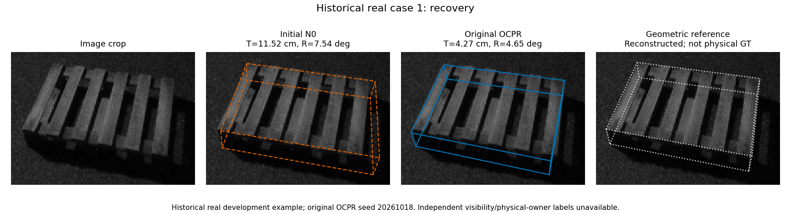
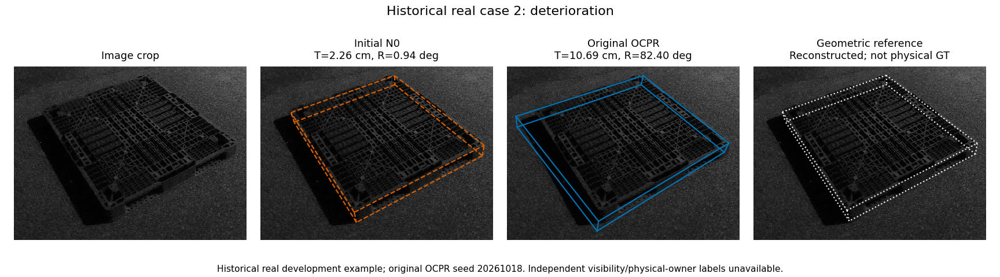
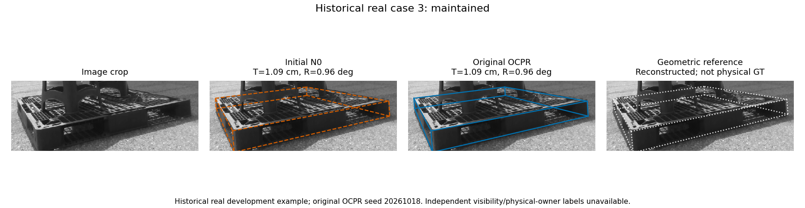

# v19–v37 development audit

**No new variant in this audit has passed its complete recorded adoption gate. No new PRIMARY192 result is claimed.** v37 completed feature construction and bank coverage scoring only: **TRAIN502→571/768, VAL153→175/235; head fits0, actual selection evaluation0**. A bank oracle diagnostic is not achieved method performance.

This separate audit directory adds evidence without replacing the paper, the original method, checkpoints or earlier negative results. Publication did not run any training or pose experiment.

Start with [summary.csv](summary.csv), [the implementation contracts](ESSENTIAL_CONTRACTS.md), [exact recorded gates](results/gates.json), and [paired transitions/common-output means](results/paired_comparisons.csv). [Reports v19–v37](reports/) explain each scope; [minimal scalar cases](results/minimal_cases.csv) identify three diagnostic transitions without RGB or private identities. File integrity and publication provenance are recorded in [MANIFEST.json](MANIFEST.json).

## Populations and interpretation

- Synthetic TRAIN768/VAL235 are repeatedly reused development data. Source assets are disjoint across these two splits, but background categories are shared and independent background assets were not established. Source physical C1/C2 and the derived C2 evaluation objective are distinct. The earlier v5 C2 target change was a task-objective experiment, not a code bug fix.
- Real238=PRIMARY192+CAL46; PRIMARY192=TEST49+REMAINDER143. CAL46 was already repeatedly used and is not an independent test. Only v19 and v24 in this audit reached CAL46. Neither passed its CAL gate. v19–v37 added no PRIMARY192 evaluations or independent holdout.
- Success uses the complete frame denominator, joint **T≤5cm and R≤5°**. Continuous errors are available-only; common-output paired means are separate. No damaged frame is removed. **v30 has235 frames but232 ROI poses**; its common232 N0 mean is13.855056cm/8.854275°, ROI25.304558cm/12.972897°. These are not full-population improvements.
- PRIMARY192 uses fixed C2 evaluation;90° remains incorrect, and non-square W/D is retained. Independent physical appearance C2/C4 subgroup labels are unavailable. Reconstructed real geometry is not independent physical-owner ground truth. DOPE's earlier192/146 distinction is unchanged and is not re-evaluated here.

## Incumbent preservation and the recorded gate are different questions

v5 is the frozen C2-binary reference. v24 is an unadopted expanded-bank comparator: it improved synthetic metrics but failed CAL rotation mean/P90. Later protocols sometimes require non-worsening against several **unadopted** comparators as well. This stronger multi-comparator gate is not the same as preserving a deployed incumbent or guaranteeing zero damage.

The historical decisions are reproduced, not relaxed. v31/v32/v33 observed synthetic recovery/damage vs v5 of **4/0,6/0,6/0**, respectively, yet all failed their full recorded gates. Zero observed damage does not guarantee preservation of unseen images: exact success membership is unavailable at inference. v34's label-perfect paired safety target is explicitly a **diagnostic, not an executable method or universal oracle bound**.

v26 passes its v5 synthetic comparison but fails v24. v28 FUSION fails against v5/v24; against its GEOMETRY ablation it fails only rotation maximum. See [exact per-comparator reasons](results/gates.json); no failure was converted into a pass.

## Figures and reproducibility

The figures below are newly rendered from the public scalar CSV, without source photographs or external visual assets:

- [Synthetic mean comparisons](figures/synthetic_means.svg)
- [Bank coverage, not achieved success](figures/bank_coverage.svg)
- [v30 common-output232 comparison](figures/v30_common232.svg)

Three user-authored historical real comparison panels are included after hash, privacy and metadata review. Other original photograph/overlay panels and synthetic rendered scenes remain excluded. See [IMAGE_RIGHTS.md](IMAGE_RIGHTS.md). No full original RGB, pose/reference tensors, masks, model weights, logits, user names, host identifiers, recording/session IDs, or private-path lookup tables are included. Derived per-frame results use consistent pseudonyms.

Verify the entire package and reproduce its65 aggregate groups,46 recorded gate comparisons, paired transitions and missing-output handling with Python standard library only:

```bash
python3 analysis/reproduce.py
```

To regenerate the numerical figures with an existing Matplotlib installation:

```bash
python3 analysis/plot_results.py --output figures_regenerated
```

This is independent **scalar audit reproduction**, not raw-image end-to-end reproduction. [REPRODUCTION.md](REPRODUCTION.md) lists omitted materials and historical commands. [Source snapshots](SOURCE_SNAPSHOTS.json) have privacy-only path normalization and are **not byte-identical executable replacements under historical source-hash seals**. Their original and published SHA256 are both retained. Do not disable seals or fabricate approvals.

Scientific base:`93c24d143fa3901de1fa127b3156e8250d81dba8`; local checkout HEAD:`7e92fdcefb0a37bdee0aef95d3e86c572e23b967`; publication parent observed:`f1a407f7ae63bfe041ec06a91b711ef947da4d68`. These provenance roles are distinct. [Essential contract links](ESSENTIAL_CONTRACTS.md) resolve to immutable, byte-verified scientific-base sources.

See [LICENSE_NOTES.md](LICENSE_NOTES.md). This directory does not grant rights to omitted third-party data or checkpoints.

## User-authored real comparison panels

These are historical **original OCPR** examples, not new v19–v37 real results. The geometric reference is reconstructed, not independent physical GT; visibility/physical-owner truth is unavailable. See [REAL_IMAGE_MANIFEST.json](REAL_IMAGE_MANIFEST.json).






