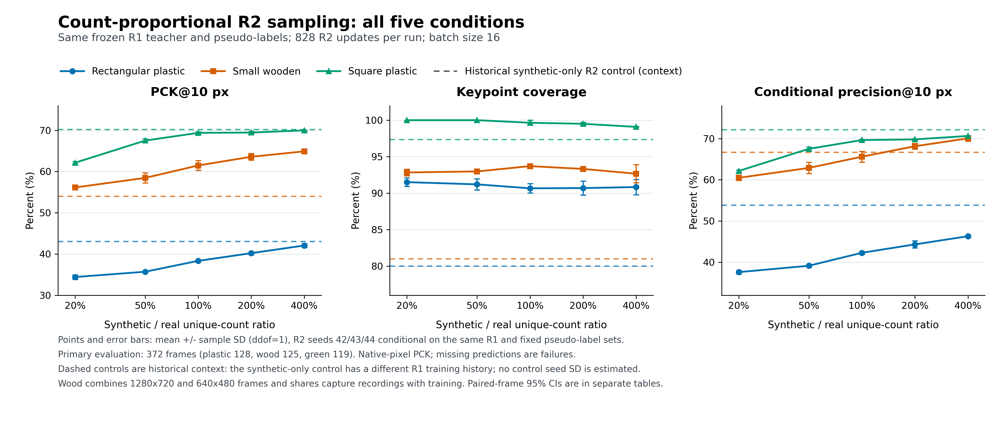

# 개수 비례 샘플링 최종 결과

[확인] 2026년 10월 28일 20:51 KST, 3종 × 5조건 × 3개 R2 seed의 **45회 학습과 평가가 모두 완료**됐다 (`FINAL_STATUS.json`, `reproducibility/CAMPAIGN_COMPLETION.json`). 모든 모델을 R2 828회 업데이트에서 평가했고 평가 결과로 체크포인트를 고르지 않았다.

아래 값은 평가 372장에 대한 **PCK@10 평균 ± R2 학습 seed 표본 표준편차(%, n=3, ddof=1)**다. 세 seed(42·43·44)는 동일한 R1 가중치·Adam 상태·의사레이블·부분집합에서 시작하므로 전체 자기학습 파이프라인 3회 반복으로 해석하지 않는다.

| 합성/실제 고유 개수 | 직사각형 플라스틱 | 소형 목재 | 정사각형 초록색 |
|---|---:|---:|---:|
| 20% (A) | 34.42 ± 0.57 | 56.14 ± 0.33 | 62.14 ± 0.28 |
| 50% (B) | 35.70 ± 0.12 | 58.46 ± 1.20 | 67.52 ± 0.43 |
| 100% (C) | 38.34 ± 0.16 | 61.47 ± 1.18 | 69.39 ± 0.27 |
| 200% (D) | 40.20 ± 0.35 | 63.59 ± 0.78 | 69.46 ± 0.28 |
| 400% (E) | 42.06 ± 0.48 | 64.90 ± 0.52 | 69.99 ± 0.11 |

[확인] 세 종류 모두 A→E 평균값이 증가했다. **합성 비중 증가로 성능이 하락한다는 가설은 이번 결과가 지지하지 않았다.** E와 C의 차이는 직사각형·목재에서 양수였고 초록색에서는 차이가 불명확했다. 이 곡선만으로 확증 편향의 원인을 입증하지는 못한다.

| 종류 | 비교 | ΔPCK@10 (%p) | 영상 단위 95% CI (%p) | 판정 |
|---|---|---:|---|---|
| PLASTIC | E − C | +3.72 | [2.10, 5.38] | 높았다 |
| PLASTIC | E − control_R2 | -0.98 | [-3.61, 1.69] | 차이 불명확 |
| WOOD | E − C | +3.43 | [1.70, 5.05] | 높았다 |
| WOOD | E − control_R2 | +10.90 | [7.34, 14.55] | 높았다 |
| GREEN | E − C | +0.60 | [-1.17, 2.30] | 차이 불명확 |
| GREEN | E − control_R2 | -0.21 | [-3.24, 2.80] | 차이 불명확 |

CI는 동일 영상을 두 모델에 대응시킨 bootstrap 10,000회, seed 20261026, percentile 95%다. 고정된 세 학습 seed를 조건으로 한 영상 표본 불확실성이며 새 학습 seed의 불확실성은 포함하지 않는다. **다중 비교 보정 없음.** 연속 프레임을 영상 단위로 뽑으므로 녹화 단위 일반화에 대한 CI가 아니다. 이전 shared synthetic control은 R1 학습 이력이 다르므로 문맥용 비교다.

## 평가와 실험 조건

직사각형 128장/985점, 목재 125장/963점(기존45+승인80), 초록색 119장/943점이다. 원본 화소 오차로 PCK@5/10/20을 계산하며 검출 누락은 실패다. 의미 채널0–7, 중심점 제외, 대칭 재정렬 없음. GREEN 수동600점 결과는 `GREEN_MANUAL_*` 표에 별도 저장했다. 목재는 해상도가 혼합되어 있고 추가80장은 적응 자료와 녹화가 같아 독립 녹화 평가가 아니다.

실제 고유 개수는 직사각형20장·목재550장·초록색550장으로 고정하고 합성 고유 개수를 20/50/100/200/400%로 바꿨다. 합친 풀을 연속 셔플 순회하며 배치16장, 828회 업데이트, 원래 증강과 분기별 마스크 정규화를 유지했다. 손실은 `2*(n_syn/16*원래_합성_평균손실+n_real/16*원래_실제_평균손실)`이다. 8+8 배치에서는 원래 합성·실제 평균손실 합과 동일하다. 노출량은 `results/EXPOSURE_SUMMARY.csv`에 있다.

이 실험은 이전 결과를 본 뒤 설계한 후속 탐색 분석이며 모든 조건을 보고했다. 초기 v1의 실제 전용 배치 Adam 카운터 검증 오류는 평가 전에 수정했다. 실제 gradient가 있는 파라미터의 업데이트만 검사하며 가짜 gradient나 카운터 보정은 사용하지 않았다. v1 기록은 보존됐고 v2 사전 검증58개가 통과했다.

## 산출물

`results/SEED_AGGREGATE_SUMMARY.csv`는 평균/seed SD, `MODEL_SUMMARY.csv`는 45개 모델별 수치, `PAIRED_CI_SEED_MEAN.csv`와 `PAIRED_CI_PER_SEED.csv`는 전체 비교의 CI다. `FRAME_ERRORS.csv`는 기존 파생 평가의 프레임별 점수이며 원시 정답을 포함하지 않는다. `RUN_STATUS.csv`, `CHECKPOINT_INVENTORY.csv`, `TRAINING_LOSS_HISTORY.csv`는 학습 완료·가중치 SHA·손실 기록이다. 훈련 손실과 평가 성능은 구분한다. 가중치 파일은 저장소에 넣지 않는다.

[확인] 이번 v2 학습·평가 기록에서 입력5,559개 전후 SHA 일치, 불일치0. 원시 기준점 정답 열람0·허용되지 않은 보호 FINAL 열람0 (`reproducibility/preflight/TRAINING_INPUT_HASHES_AFTER.json`, `results/COMPLETE.json`). 공개 준비 과정은 이미 허용된 파생 표·메타데이터만 읽었다.

앞서 공개한 [중간40/45 기록과 그림3-2](../pallet_dope_count_proportional_interim_20261028_v1/)는 시점 기록으로 보존한다. 기존 [ablation 및 8+8 고정 비율 실험](../pallet_dope_thesis_combined372_20261029_v1/)과 이번 실험을 구분한다.

## 비율별 성능 그래프

오차막대는 세 R2 seed의 표본 SD이며, 점선은 과거 합성 전용 대조군이다. 벡터 PDF도 같은 폴더에 있다.
