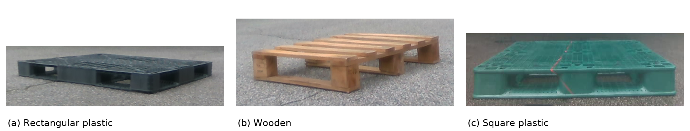

# 개수 비례 샘플링 중간 산출물 (2026-10-28T19:54 KST)

파렛트 3종×5개 자료 수 비율×3개 R2 학습 seed의 45회 중 **40회 학습 완료** 시점의 중간 기록이다. 학습은 계속 진행 중이며, 새 PCK·검출률·조건부 정밀도·학습 seed 간 SD·95% 신뢰구간은 아직 계산하지 않았다. 미계산 값은 빈칸/null이며 0점이 아니다. 이 폴더를 최종 성능 결과로 인용하면 안 된다.

| 종류 | 완료 / 계획 |
|---|---:|
| WOOD | 15 / 15 |
| GREEN | 15 / 15 |
| PLASTIC | 10 / 15 |

`results/RUN_STATUS.csv`는 미완료를 포함한 전체45조건, `EXPOSURE_SUMMARY.csv`는 실제 노출량, `CHECKPOINT_INVENTORY.csv`는 로컬 최종 모델 SHA, `TRAINING_LOSS_HISTORY.csv`는 완료 모델의 훈련 손실을 담는다. **훈련 손실은 평가 성능이 아니다.** 모델 가중치와 원시 정답은 이 커밋에 포함하지 않았다.

실제·합성 풀을 합쳐 셔플 순회하며, 각 배치16장에서 뽑힌 장수에 따라 `2*(n_syn/16*원래_합성_평균손실+n_real/16*원래_실제_평균손실)`을 사용한다. 기존 분기별 마스크 정규화는 유지한다. 3개 seed는 같은 R1·Adam·의사레이블·부분집합에서 시작한 R2 반복이다.

초기 구현에서 실제 영상만 있는 배치의 최종 affinity head에도 Adam counter가 증가한다고 잘못 검사했다. 첫 시도의49회 업데이트 기록을 보존하고, 표준 Adam 동작을 바꾸지 않은 채 파라미터별 실제 gradient 횟수 검증으로 수정했다. 수정된 v2는58개 검증을 통과했다. 평가 결과를 보고 조건을 바꾼 것은 아니다.

학습 완료 후 평가 대상은 동일한372장(PLASTIC128·WOOD125·GREEN119)이며, 추가 목재80장을 포함한다. GREEN 수동600점은 별도 보조 표다. 3seed SD와 영상 단위 paired bootstrap CI는 서로 다른 불확실성으로 구분해 보고한다.

## 그림3-2: 파렛트 외형

사진은 외형 소개용으로 사용자가 허용한 촬영·학습 RGB에서 골랐다. 일반 플라스틱과 목재는 같은 촬영 세션, 초록색은 같은 장소의 별도 세션이다. 원본3장은 바이트 그대로 보존했고, 모아보기는 명시된 영역 자르기·크기 조절·이름표만 적용했다. 출처는 `figures/figure3_2/SOURCES.csv`와 `PROVENANCE.json`에 있다.

기존 ablation 및 8+8 고정 개수 비율 결과는 [기존 통합372 결과](../pallet_dope_thesis_combined372_20261029_v1/)에 이미 공개되어 있다.
