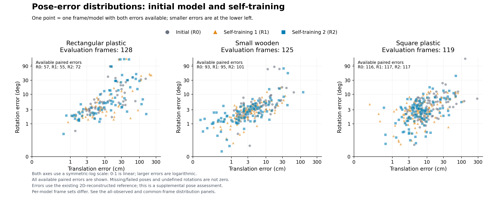
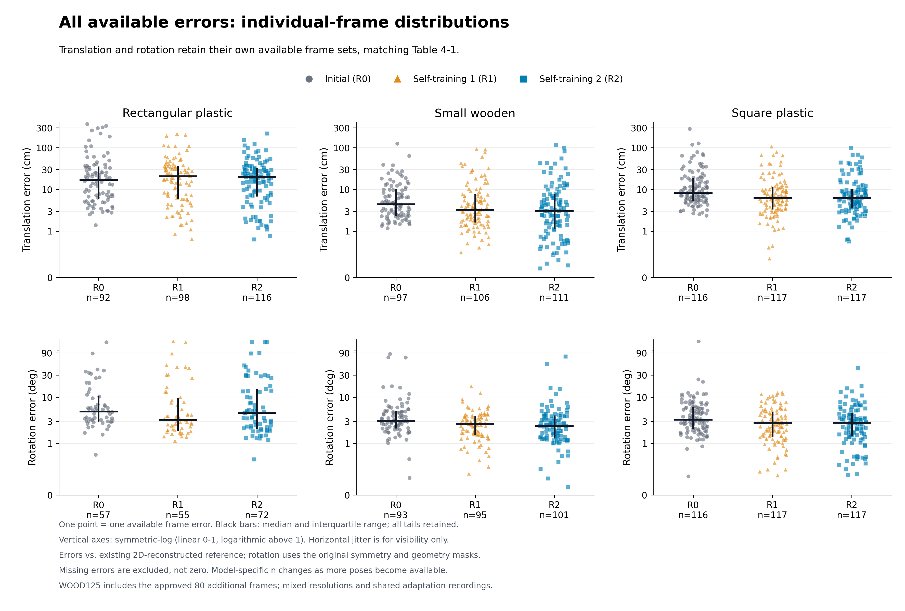
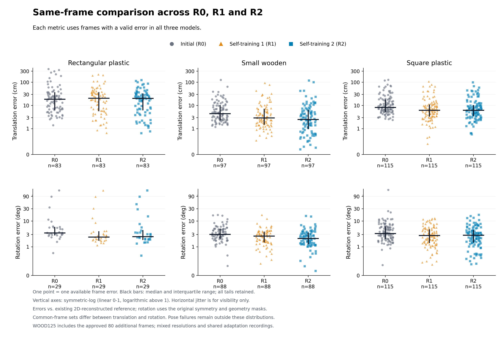

# 초기 모델·자기학습 1차·2차의 자세 오차 분포

[확인] 기존 본 실험의 평가372장(직사각형128·목재125·초록색119)에서 이미 계산된 프레임별 오차만 사용했다. 최근 개수 비례 샘플링 실험과 합성 전용 대조군은 이 그림에 포함하지 않았다. 새 학습·추론·원본 영상 및 원시 정답 열람은 없다.

회색은 초기R0, 주황은 자기학습R1, 파랑은 자기학습R2다. 산점도의 가로축은 이동 오차(cm), 세로축은 대칭을 고려한 회전 오차(도)이며 점 하나는 한 영상/모델이다. 왼쪽 아래일수록 오차가 작다. 산점도는 두 오차가 모두 있는 표본만 표시하므로 표4-1의 이동 오차 표본 수보다 작을 수 있다.

위 그림의 두 축은 0~1에서 선형, 그 이상에서 로그인 symlog 축이다. 꼬리를 제거하거나 오차 좌표에 jitter를 넣지 않았다. 전체 범위를 그대로 표시한 선형 축 그림도 제공한다.

## 표4-1과 같은 전체 관측 오차

이동/회전은 각 지표에 유효한 표본을 모두 사용한다. 검은 가로선은 중앙값, 세로선은 사분위 범위다. 범주 축의 작은 좌우 이동은 겹침을 줄이기 위한 고정 frame-ID 기반 표시이며 오차 값은 바꾸지 않았다. 평균과 중앙값의 차이 및 큰 오차의 꼬리가 관찰되지만, 두 군집이나 이봉 분포를 검증한 것은 아니다.

## 세 모델에서 모두 유효한 같은 영상 비교

새로 자세가 계산된 어려운 영상의 유입과 기존 영상의 오차 변화를 구분하기 위한 공통 표본 그림이다. 지표별 공통 프레임은 이동 P83/W97/G115, 회전 P29/W88/G115이며, 이동과 회전의 집합은 다르다. 특히 직사각형 회전은 전체128장 중 공통29장만 포함하므로 전체 성능을 대표한다고 해석하면 안 된다. 실패/누락/가설 불일치 NA는 0점으로 찍지 않았고 `data/COVERAGE.csv`에 표본 수를 기록했다.

이 지표의 참조 자세는 2D 기준점·등록 치수·K에서 재구성한 보조 참조이며 독립 실측6D 정답이 아니다. 기존 대칭·가설 마스크 규칙을 그대로 유지했다. 목재 추가80장의 K 품질 UNKNOWN, 자세 부호 UNCONFIRMED, 혼합 해상도와 적응 데이터와의 녹화 중복이라는 기존 한계도 유지된다.

`data/CASEWISE_ERRORS.csv`는 1,116개 영상×모델 행(실패/NA 포함), `DISTRIBUTION_SUMMARY.csv`는 전체/공통 표본의 평균·SD·중앙값·분위수, `COMMON_SUBSET_IDS.csv`는 공통 집합의 ID다. SD는 원 표와 같은 population SD(ddof=0)다. 원 표의 108개 통계와 대조하고 독립 수치 검증 및 PDF4페이지·개별 PNG3종 시각 검수를 통과했다. 초기 `COMPLETE.json`의 plot_review_pending 표시는 산출 직후 상태이며, 이후 `qa/VISUAL_QA.json`에서 검수가 완료됐다.

[기존 통합372 본 실험](../pallet_dope_thesis_combined372_20261029_v1/) · [전체 그림 PDF](figures/POSE_ERROR_DISTRIBUTIONS.pdf)
