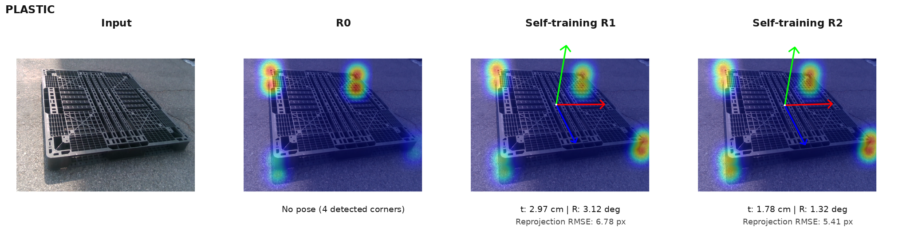
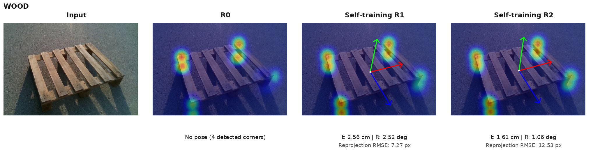
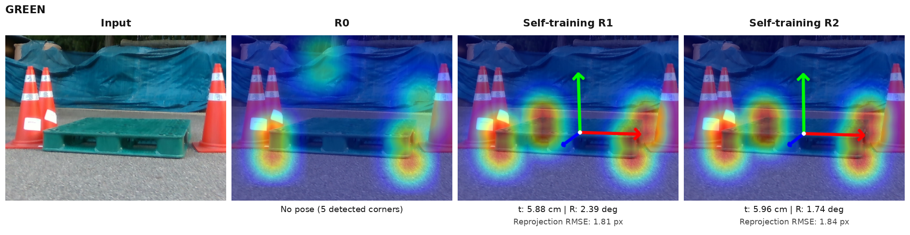
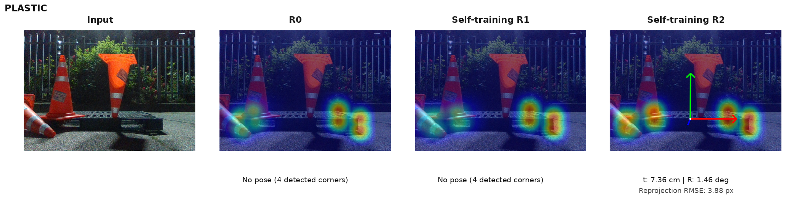
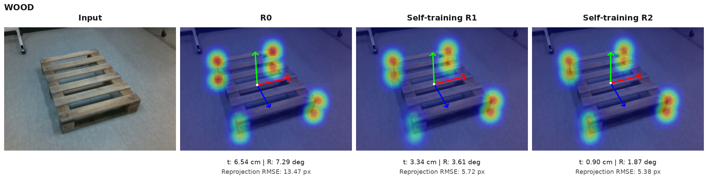
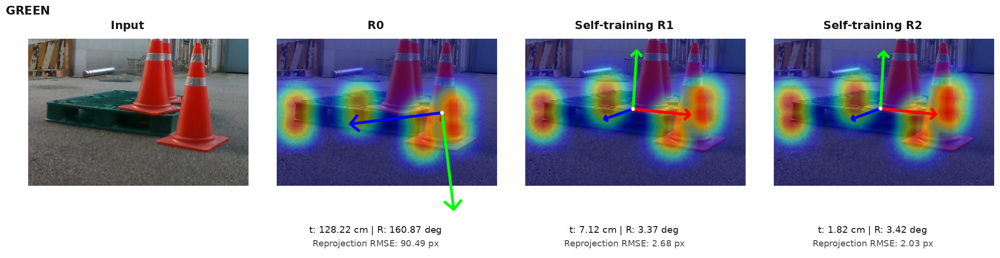

# DOPE 자기학습 자세 비교 — 6개 사례

사용자가 확인한 6개 사례의 **Input / R0 / R1 / R2** 이미지다.

- [`panels/`](panels/): 글자·수치·헤더 없는 개별 PNG **24장**. 각 사례에 `input.png`, `R0.png`, `R1.png`, `R2.png`가 있다. 모델 패널에는 heatmap과 실제 추정된 자세축을 유지했다.
- [`comparisons/`](comparisons/): 네 칸으로 나란히 배치한 비교 PNG **6장**.
- [`PANELS_24.zip`](PANELS_24.zip): 개별 PNG 24장만 담은 압축 파일.
- [`MANIFEST.json`](MANIFEST.json): 원본 영상 ID, 모델/가중치 SHA, 이미지 SHA, 크롭 및 자세 추정 상태.

기존 PNG 바이트를 그대로 복사했다. 새로운 학습·추론·PnP 계산은 수행하지 않았다. X축은 빨강, Y축(위)은 초록, Z축(앞)은 파랑이다. 자세 추정에 실제로 실패한 칸에는 축이 없다.

수치 오차는 기존 2D 기준점·등록 치수·K로 재구성한 참조 자세에 대한 값이며 독립 실측 6D 정답에 대한 값은 아니다. 선별된 정성 사례이며 전체 평균을 나타내지 않는다. 이전 Batch2 전체 heatmap 정합 게이트가 통과했다고 주장하지 않는다.

| 사례 | 종류 | 영상 ID | 비교 그림 |
|---|---|---|---|
| 01_PLASTIC | PLASTIC | eval_cad:1778653030233998336 | [PNG](comparisons/01_PLASTIC.png) |
| 02_WOOD | WOOD | wood_184309:000804 | [PNG](comparisons/02_WOOD.png) |
| 03_GREEN | GREEN | GREEN0918:027787 | [PNG](comparisons/03_GREEN.png) |
| 04_PLASTIC | PLASTIC | eval_night09:1779449602689248000 | [PNG](comparisons/04_PLASTIC.png) |
| 05_WOOD | WOOD | wood_183705:000521 | [PNG](comparisons/05_WOOD.png) |
| 06_GREEN | GREEN | GREEN0918:030563 | [PNG](comparisons/06_GREEN.png) |

### 01_PLASTIC · eval_cad:1778653030233998336

### 02_WOOD · wood_184309:000804

### 03_GREEN · GREEN0918:027787

### 04_PLASTIC · eval_night09:1779449602689248000

### 05_WOOD · wood_183705:000521

### 06_GREEN · GREEN0918:030563

