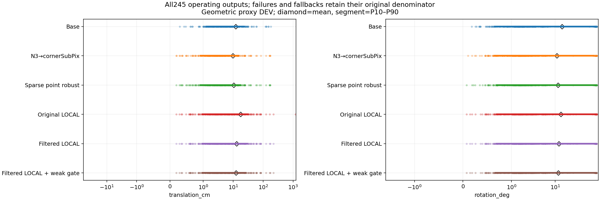
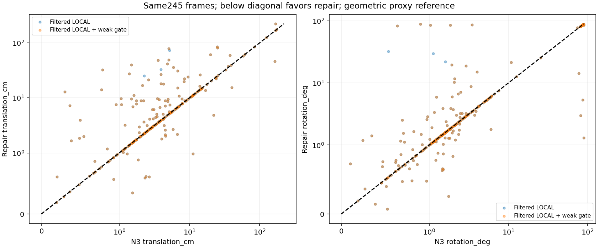

# V11 결과: 모순 선 제외와 약한 관측 gate

“가림 판단이 일부 틀려도 다른 유효 대응점으로 자세를 구하고 자기 가림 코너를 재투영했을 때, 기존 단순 대조보다 실제 위치·회전이 좋아졌는가?”

**아직 아니다.** 같은 쉬움153+중간92의 245장 전체 운용에서 SAFE의 위치 평균은 12.611230982495721cm, 회전은 11.787036654409325°다. N3→cornerSubPix의 9.754548028679153cm, 10.914841863166323°보다 둘 다 나쁘다. 다만 기존 LOCAL의 17.87901676799424cm, 13.415258792985208°와 비교하면 관측 선 필터와 약한 관측 거절이 실제 전체 운용 오차를 줄였다. 목표는 미해결이며 검산 완료나 NEW 산출을 목표 달성으로 보고하지 않는다.

현재 위치·회전·ADDsym은 기존 실사 영상에 대한 같은 N3-phase GEOMETRIC_PROXY 참조에서 계산했다. 독립적으로 측정한 물리 자세 GT나 처음 보는 test가 아니다. 기존 DEV 결과를 알고 원래 실패 원인에 맞춘 수정임을 [PROTOCOL](PROTOCOL.json)에 동결했다. 사용자 후속 요청대로 Severe74를 제외했고 245장을 삭제 없이 평가했다. 원래319장 실험과 그 실패는 [V9 이력](../pallet_sparse_local_line_20261010_v9/RESULT_KO.md)에 보존된다.

## 무엇을 바꾸었고 무엇을 그대로 썼는가

[pipeline.py](../../../scripts/research/pallet_endpoint_observability_repair_20261011_v11/pipeline.py)와 [METHOD_CONTRACT](METHOD_CONTRACT_KO.md): 같은 frozen IMAGE_ROLE의 sparse q와 코너에 소비되지 않은 실제 물리/CAL 선을 사용한다. V10의 native N3 endpoint LOO가 CONTRADICTED_REJECT라고 한 unused edge만 제외하고 SUPPORTED/UNKNOWN은 유지한다. 초기 H와 선 양 끝을 검증 PnP에서 제외하며 해당 선을 검증 fit에 넣지 않는다. 모든 마스크의 가설은 같은 native 좌표 bank에서 재사용했다. UNKNOWN은 no_match나 프레임 전체 실패가 아니다.

FILTER는 변경 없는 V9 LOCAL kernel로 필터 후 관측을 한 번 푼 rank-only 대조다. SAFE는 그 동일 선택 후보의 두 열 정규화 J에 기존 strict s_min < s_max×1e−4 조건을 적용해 약하면 WEAK_OBSERVABILITY로 새 update를 거절한다. 다른 후보 선택이나 두 번째 최적화가 없다. native N3는 endpoint 검증과 fallback/display에 쓰며 missing sparse q의 fit을 채우지 않는다. 초기 N3와 사용 가능한 sparse point 자세는 LOCAL 시작값일 뿐 잔차 prior가 아니다.

최종 fit에서 초기 자기 가림 H 좌표를 제외한다. 승인된 새 R,t가 있으면 H 초기 좌표를 재투영으로 교체하며 재투영점/선을 다시 독립 관측으로 fit하지 않는다. 같은 선에서 나온 점과 선을 중복 factor로 세지 않는다. SAFE가 거절한 후보는 원행에 남고 전체 운용에는 원 N3 fallback이 포함된다. rank6·작은 선 잔차·8px inlier·NEW가 대응의 물리 ownership이나 전역 유일해를 보증하지 않는다.

## 효과를 분리한 판정

|단계|확인된 효과|남은 한계|
|---|---|---|
|가림 분류|마스크 오판을 프레임 실패 조건으로 쓰지 않았고 H 제외/재투영 계약을 유지했다.|분류기를 새로 학습하거나 완벽한 분류를 증명하지 않았다. 같은 mask의 pose 개선/악화를 따로 집계했다.|
|관측 선택|FILTER−LOCAL의 전체245 T/R/ADD 평균 차이는 −4.777425960980426cm/−1.2963332519000048°/−5.8736723725843545cm이며 세 CI가0보다 작다.|native endpoint 검증 자세 자체도 틀린 합의일 수 있다. 실제 물리 line ownership의 인과 증명은 아니다.|
|강건 PnP와 LOCAL|동일 유한4점 강건 PnP를 endpoint LOO에 쓰고 실제 남은 sparse 점/선으로 LOCAL을 수행했다. POINT보다 NEW 산출은 많다.|SAFE−POINT 위치는 +2.1493810339093744cm로 나쁘다. LOCAL의 전역해/대응 정확성 문제는 해결되지 않았다. POINT와 LOCAL의 solver 차이를 선 단독 효과로 주장하지 않는다.|
|약한 관측 gate|FILTER의 NEW97개 중3개를 N3 fallback으로 돌려 SAFE NEW94개가 됐다. 전체 평균 T/R이 추가로 줄었다.|SAFE−FILTER CI의 상단은0이다. 강한 J도 잘못된 대응·나쁜 local branch를 막지 못한다.|
|재투영|승인 NEW에서만 실제 최종 R,t의 H 투영을 display에 반영했다.|숨은 코너 median 개선이 최종 자세 개선을 뜻하지 않는다. 직접 가시점 손상과 H 평균/P90를 별도로 보고한다.|

가림 없는 강건 PnP 대조는 [V7](../pallet_three_head_observation_20261010_v7/RESULT_KO.md), 동일 sparse 관측의 일반/강건·H/무마스크는 [V8](../pallet_same_observation_controls_20261010_v8/RESULT_KO.md)에 실제 있다. V8 sparse U가245장 모두 같아 H 제거 수0이었던 범위의 결과를 가림 판단기나 head 전체가 불필요하다는 주장으로 확대하지 않는다. 현재 V11은 그 대조의 재실험이 아니다.

## 산출률과 전체 운용

별칭 BASE/N3/POINT/LOCAL/FILTER/SAFE는 각각 Base, N3_SUBPIX, ROLE_BOUNDARY_H_ROBUST, ROLE_BOUNDARY_LOCAL_POINT_LINE, FILTERED_LOCAL, FILTERED_LOCAL_WEAK_SAFE다. BASE/N3는 고정 대조이며 새 자세0을 fallback/실패로 세지 않는다. 아래 수치는 [METRICS](METRICS.json)의 원행 집계 전사다.

|stratum|method|denominator|operational|NEW|fallback|no_pose|fixed|평균T cm|평균R °|평균ADD cm|
|---|---|---:|---:|---:|---:|---:|---:|---:|---:|---:|
|combined|BASE|245|245|0|0|0|245|12.188351368308584|14.232844378136992|22.431945806117554|
|combined|N3|245|245|0|0|0|245|9.754548028679153|10.914841863166323|17.028646667097725|
|combined|POINT|245|245|40|205|0|0|10.461849948586346|11.611525122485201|18.328032940838003|
|combined|LOCAL|245|245|115|130|0|0|17.87901676799424|13.415258792985208|26.64545714508252|
|combined|FILTER|245|245|97|148|0|0|13.101590807013814|12.1189255410852|20.771784772498165|
|combined|SAFE|245|245|94|151|0|0|12.611230982495721|11.787036654409325|20.23206129946827|
|easy|BASE|153|153|0|0|0|153|12.846348362759484|10.628204608338502|17.93860487754294|
|easy|N3|153|153|0|0|0|153|10.107072506393136|7.584578376689015|12.915132447282565|
|easy|POINT|153|153|37|116|0|0|11.267164662463289|8.696357041007952|15.024686291366251|
|easy|LOCAL|153|153|76|77|0|0|19.080348190580732|9.337368585359519|23.833929752896903|
|easy|FILTER|153|153|68|85|0|0|12.309665553873192|8.666527326166905|16.314355131917004|
|easy|SAFE|153|153|68|85|0|0|12.309665553873192|8.666527326166905|16.314355131917004|
|medium|BASE|92|92|0|0|0|92|11.094073757971767|20.227517038780135|29.904567132986195|
|medium|N3|92|92|0|0|0|92|9.168284495089601|16.45321483524272|23.86959966309468|
|medium|POINT|92|92|3|89|0|0|9.122576565725781|16.45957638842019|23.8216420426769|
|medium|LOCAL|92|92|39|53|0|0|15.881150380431924|20.196967507840974|31.321149438608597|
|medium|FILTER|92|92|29|63|0|0|14.418596934519423|17.860413876764543|28.18468406607336|
|medium|SAFE|92|92|26|66|0|0|13.112747401835364|16.97657934159509|26.747376991156788|

전 방법이245장 모두 자세를 출력했고 no_pose0이다. 큰 오차가 완전 실패로 빠져 평균이 낮아진 결과가 아니다. NEW 집합과 fallback 집합의 분포가 다르므로 전체 operational와 아래 고정 공통 산출집합을 함께 본다.

## 위치·회전·ADDsym의 전체 분포

각 cell의 순서는 **평균 / 표본분산 / SD / 중앙값 / P90 / 최대값**이며 줄바꿈으로 구분한다. T/ADD는 cm, R은 degree, 분산은 각 단위의 제곱이다. 표본분산 ddof=1, 빈 집합은 None이다. operational는 모든 실제 출력, new_pose는 새 자세, fallback은 기본 반환이다. n은 해당 분모다. 6방법×3난이도×3scope×3지표의162분포/972scalar를 [METRICS.csv](METRICS.csv)와 [독립 VERIFICATION](VERIFICATION.json)이 원행에서 확인했다.

|stratum|method|scope|n|T: mean/var/SD/median/P90/max|R: mean/var/SD/median/P90/max|ADD: mean/var/SD/median/P90/max|
|---|---|---|---:|---|---|---|
|combined|BASE|operational|245|12.188351368308584 538.5790668295168 23.207306324291856 6.010803220063387 23.191871672208148 183.07850477473974|14.232844378136992 851.3841553068099 29.178487885886238 1.839738412238616 82.81063875160255 90.00917492050102|22.431945806117554 1506.0022047443758 38.80724423022557 6.405062242563096 110.03653211262429 188.9915223699912|
|combined|BASE|new_pose|0|None None None None None None|None None None None None None|None None None None None None|
|combined|BASE|fallback|0|None None None None None None|None None None None None None|None None None None None None|
|combined|N3|operational|245|9.754548028679153 575.9360241353828 23.99866713247598 3.5973495042103814 15.085014302122275 174.7568271983788|10.914841863166323 665.1806009914171 25.79109538176727 1.6659926895050734 76.09532476401336 89.77763362360415|17.028646667097725 1298.8108704540255 36.039018722129846 3.9369354820060027 68.43149389306842 180.98844156077627|
|combined|N3|new_pose|0|None None None None None None|None None None None None None|None None None None None None|
|combined|N3|fallback|0|None None None None None None|None None None None None None|None None None None None None|
|combined|POINT|operational|245|10.461849948586346 587.3004341635357 24.234282208547786 4.176239832740652 17.382818033885187 174.7568271983788|11.611525122485201 711.8960908470923 26.681380977136328 1.6333214559488682 81.44737750526065 89.77763362360415|18.328032940838003 1379.54602789238 37.1422404802454 4.3464356418875205 71.971884900335 180.98844156077627|
|combined|POINT|new_pose|40|7.8406135004065005 149.39243027499649 12.222619615900532 4.198278192453509 15.787048160094342 75.86896691888866|5.390289662485843 362.9082709035157 19.05015146668172 0.9151553823740605 2.1612146562459174 88.84530231206573|11.71716153263252 705.5824343702529 26.56280170407958 4.331863071141569 15.848203453156412 131.2087137441212|
|combined|POINT|fallback|205|10.9733107189629 672.2869585782458 25.928497036624506 3.933521588275837 19.076598223013658 174.7568271983788|12.825424724436296 773.0342870860874 27.803494152463777 1.8738873917606569 81.87094598353711 89.77763362360415|19.617959069268338 1504.913086293246 38.79320928066207 4.3464356418875205 79.60585489521766 180.98844156077627|
|combined|LOCAL|operational|245|17.87901676799424 6371.130065221301 79.81935896273097 5.361944784094475 31.280809407982254 1204.8027435564068|13.415258792985208 774.2282019646461 27.824956459348613 1.8176433605042994 83.64724240084382 92.76801898557402|26.64545714508252 7133.570379790449 84.46046637208705 5.503800245804545 83.41437218959408 1206.0840052680007|
|combined|LOCAL|new_pose|115|28.38685794476606 12963.771720476745 113.85856015459156 8.964660636086656 44.52747564179746 1204.8027435564068|16.46926575311549 918.3190135840935 30.303778866406965 2.2344144729398563 84.77716309280791 92.76801898557402|39.27656413349201 13771.678486970253 117.35279496871922 8.997940526274286 116.76622273618204 1206.0840052680007|
|combined|LOCAL|fallback|130|8.583618803926868 408.95729640874407 20.22269261025208 3.114981817036182 14.510347480565105 167.92537200948746|10.713637251331493 637.2238359518152 25.24329289042567 1.6917143454203178 31.16810907943069 88.90488273671434|15.471785578412593 1054.5856132273725 32.474383954547505 3.6041734472556897 67.11097831904885 175.19609981909667|
|combined|FILTER|operational|245|13.101590807013814 674.0569532865975 25.962606827639583 5.077482656221402 29.480364063794788 221.7114377170665|12.1189255410852 690.9496248169272 26.285920657586395 1.7716803739059728 81.4592279688051 89.19567638483429|20.771784772498165 1424.4775152940085 37.74225106288718 5.327351694268689 77.43603820845316 221.73301702672737|
|combined|FILTER|new_pose|97|17.735027528894634 802.7809307899394 28.333388974669784 8.852792878602722 43.528021253486976 221.7114377170665|12.366758278024301 658.1459077100812 25.65435455648965 1.754756175619764 50.55730402341172 89.19567638483429|26.14044093373112 1661.889102444511 40.766274080966866 8.875915648938392 104.50346777910264 221.73301702672737|
|combined|FILTER|fallback|148|10.064811333889228 571.1265271562819 23.898253642395755 3.5006452172344242 14.804044247554664 174.7568271983788|11.9564946256589 717.0057052317735 26.77696221067232 1.7717349425309763 81.77906657267721 88.90488273671434|17.25313850466305 1247.6395334397075 35.32194124676201 4.009234558774463 69.95265094620171 180.98844156077627|
|combined|SAFE|operational|245|12.611230982495721 657.7500394796714 25.646637976149453 4.87572952562161 26.48631410773597 221.7114377170665|11.787036654409325 688.9156760010333 26.2472032034088 1.7051146974601479 81.4592279688051 89.19567638483429|20.23206129946827 1412.1410702120033 37.57846551167308 5.234756747508372 74.10183782006285 221.73301702672737|
|combined|SAFE|new_pose|94|16.902040120555103 791.4765426447154 28.133192898153517 8.227705879393717 40.99600027392694 221.7114377170665|11.861649548357926 670.3968632781575 25.89202315923106 1.6819739642094595 60.8413937146791 89.19567638483429|25.437296268933927 1682.9586009359252 41.0238784238634 8.469211504080516 110.23324010940364 221.73301702672737|
|combined|SAFE|fallback|151|9.940131254167362 560.5046818796759 23.674980081927753 3.5973495042103814 14.791693601166683 174.7568271983788|11.740588892613507 704.9844505794122 26.551543280559272 1.713089001419007 81.68718716181729 88.90488273671434|16.991716351588988 1226.099438799392 35.01570274604512 3.9696570561748814 69.19111350655429 180.98844156077627|
|easy|BASE|operational|153|12.846348362759484 790.4514324808421 28.114968121640153 4.668213987688899 19.836603231600556 183.07850477473974|10.628204608338502 616.6247942414432 24.83193094065468 1.715555635657884 50.873618630439076 89.4792849588053|17.93860487754294 1268.8858821312092 35.621424482061485 5.5161632734927135 53.33233728654386 188.9915223699912|
|easy|BASE|new_pose|0|None None None None None None|None None None None None None|None None None None None None|
|easy|BASE|fallback|0|None None None None None None|None None None None None None|None None None None None None|
|easy|N3|operational|153|10.107072506393136 859.7174702467877 29.320939109223424 2.6918845473520725 12.762645595341315 174.7568271983788|7.584578376689015 435.5445806846465 20.86970485379816 1.5416520299079417 5.923153455782191 89.76763723821307|12.915132447282565 1130.5845067555638 33.624165517608965 2.966195228583507 14.83116901630595 180.98844156077627|
|easy|N3|new_pose|0|None None None None None None|None None None None None None|None None None None None None|
|easy|N3|fallback|0|None None None None None None|None None None None None None|None None None None None None|
|easy|POINT|operational|153|11.267164662463289 882.6015432595791 29.70861059120031 3.184987415108408 14.525877097511145 174.7568271983788|8.696357041007952 517.599211831631 22.75080683913498 1.5319427498538003 7.363037795221227 89.76763723821307|15.024686291366251 1281.4567014655306 35.79743987306258 3.477928934480887 16.753890137882244 180.98844156077627|
|easy|POINT|new_pose|37|7.333612288238735 157.0024256679746 12.530060880457627 4.176239832740652 11.514123731860055 75.86896691888866|5.711039849322413 391.7191175270057 19.791895248485066 0.8717732935875406 2.145232517619408 88.84530231206573|11.520274817937006 762.5266668730836 27.613885399796306 4.239943742118908 11.58355229665832 131.2087137441212|
|easy|POINT|fallback|116|12.521832230103877 1110.8543153148435 33.32948117380232 2.9160664238545344 14.676581564814143 174.7568271983788|9.648570283183513 557.7240452821483 23.616181852326346 1.7613914001344706 11.730521185282882 89.76763723821307|16.142472709615234 1449.8359089768653 38.07671084766731 3.371502582008442 30.317303469199743 180.98844156077627|
|easy|LOCAL|operational|153|19.080348190580732 10015.419249959697 100.07706655353012 3.704090012694558 22.207926220214617 1204.8027435564068|9.337368585359519 520.04302572518 22.804451883901528 1.5840007670291094 18.030169712372505 89.19567638483429|23.833929752896903 10398.642701755147 101.9737353525659 4.153854029403211 45.61063819304124 1206.0840052680007|
|easy|LOCAL|new_pose|76|29.554358160880437 19444.408601912823 139.44320923556236 6.702009155482294 35.0238931724154 1204.8027435564068|10.757826115848916 602.948353649056 24.555006692099596 1.6066306586686239 20.578097485997645 89.19567638483429|35.85262994032487 19871.913594301826 140.9677750207537 7.1624744390197925 59.3030657627982 1206.0840052680007|
|easy|LOCAL|fallback|77|8.742364323791413 624.2923486592016 24.98584296475109 2.4978545868963478 13.37683866765037 167.92537200948746|7.9353585552660855 441.0620334693783 21.001476935429526 1.5840007670291094 7.00182017006499 88.12951624655447|11.971316580890093 899.8220111528459 29.99703337253279 2.92808114470051 14.58326558549212 175.19609981909667|
|easy|FILTER|operational|153|12.309665553873192 891.1641234076338 29.852372157127377 3.674541584070933 20.991195816403902 221.7114377170665|8.666527326166905 477.64566708876663 21.855106201727015 1.5578363920277918 14.598966519367698 89.19567638483429|16.314355131917004 1266.5124898318666 35.588094776650614 4.130544001752923 41.96080989598764 221.73301702672737|
|easy|FILTER|new_pose|68|13.948213048258541 865.8721860831978 29.425706212140394 6.165073192593926 33.94653818653858 221.7114377170665|7.840682330059876 410.5469237597156 20.261957550042286 1.4390529719957303 16.19119663771151 89.19567638483429|18.828467248289567 1342.9776978899624 36.646660119169965 6.197168229640846 43.33880756144029 221.73301702672737|
|easy|FILTER|fallback|85|10.99882755836491 918.0343587200481 30.299081813151503 2.7945889993585964 14.264361713247553 174.7568271983788|9.327203323052528 535.8573602712135 23.1485930516568 1.6132188796614957 10.603607498226992 88.12951624655447|14.303065438818955 1211.389663147767 34.805023533216676 3.0151800978820495 15.18983648214664 180.98844156077627|
|easy|SAFE|operational|153|12.309665553873192 891.1641234076338 29.852372157127377 3.674541584070933 20.991195816403902 221.7114377170665|8.666527326166905 477.64566708876663 21.855106201727015 1.5578363920277918 14.598966519367698 89.19567638483429|16.314355131917004 1266.5124898318666 35.588094776650614 4.130544001752923 41.96080989598764 221.73301702672737|
|easy|SAFE|new_pose|68|13.948213048258541 865.8721860831978 29.425706212140394 6.165073192593926 33.94653818653858 221.7114377170665|7.840682330059876 410.5469237597156 20.261957550042286 1.4390529719957303 16.19119663771151 89.19567638483429|18.828467248289567 1342.9776978899624 36.646660119169965 6.197168229640846 43.33880756144029 221.73301702672737|
|easy|SAFE|fallback|85|10.99882755836491 918.0343587200481 30.299081813151503 2.7945889993585964 14.264361713247553 174.7568271983788|9.327203323052528 535.8573602712135 23.1485930516568 1.6132188796614957 10.603607498226992 88.12951624655447|14.303065438818955 1211.389663147767 34.805023533216676 3.0151800978820495 15.18983648214664 180.98844156077627|
|medium|BASE|operational|92|11.094073757971767 121.84908661025794 11.038527375073993 7.851389680650634 26.036088792108245 60.431861873972714|20.227517038780135 1194.6884557987921 34.564265590328866 1.9987798847057285 86.1592126325831 90.00917492050102|29.904567132986195 1828.2143982088248 42.757623860649986 8.14224175976533 116.22280336782391 121.23894804412103|
|medium|BASE|new_pose|0|None None None None None None|None None None None None None|None None None None None None|
|medium|BASE|fallback|0|None None None None None None|None None None None None None|None None None None None None|
|medium|N3|operational|92|9.168284495089601 107.69999682699179 10.377860898421783 5.220474363250011 23.637317402450154 61.92360473915919|16.45321483524272 1006.4005633341411 31.723816972964354 1.981300412332817 85.51015694788309 89.77763362360415|23.86959966309468 1518.31450323667 38.96555534361944 5.436086461145542 112.13137378003826 121.34476566792532|
|medium|N3|new_pose|0|None None None None None None|None None None None None None|None None None None None None|
|medium|N3|fallback|0|None None None None None None|None None None None None None|None None None None None None|
|medium|POINT|operational|92|9.122576565725781 97.60032860408691 9.879287859157001 5.3906640255800795 21.910030971177253 61.92360473915919|16.45957638842019 1006.2088935479889 31.72079591605464 2.0263434498509794 85.51015694788309 89.77763362360415|23.8216420426769 1509.6892841105898 38.85472022947263 5.57461113208822 112.13137378003826 121.34476566792532|
|medium|POINT|new_pose|3|14.093628450475592 23.70300515112484 4.868573215134475 15.735608179346922 17.49025552883261 17.928917366204033|1.434370691501493 0.38993215137805937 0.6244454751041594 1.3718001223174878 1.9445567257241172 2.0877458765757746|14.14543101387722 23.815586493273646 4.88012156541962 15.800485228320483 17.546330836904467 17.982792239050465|
|medium|POINT|fallback|89|8.95501301904882 99.51807864651663 9.9758748311372 5.2413619383596055 22.427971155559224 61.92360473915919|16.966043996181494 1032.5469282943604 32.133268247944535 2.043990600654579 85.78982410123665 89.77763362360415|24.14780645937801 1557.315209025878 39.46283326151175 5.460732046702568 112.70867171184092 121.34476566792532|
|medium|LOCAL|operational|92|15.881150380431924 347.51632418784794 18.641789725985216 8.861720450912603 36.990924955641596 81.81758585102403|20.196967507840974 1132.8533054628865 33.65788622987021 2.4130814960069937 85.98056702319597 92.76801898557402|31.321149438608597 1722.8214499639603 41.50688436830642 8.990367871409887 116.91087117225864 126.88147329691115|
|medium|LOCAL|new_pose|39|26.111729318491886 506.1543809778471 22.497875032496893 20.288142920262302 61.87857232614424 81.81758585102403|27.59925068727599 1372.549835701734 37.04793969577437 3.624330415489985 87.01922661289221 92.76801898557402|45.94884615094592 2025.015807083683 45.0001756339204 27.02333982113271 119.9461307888489 126.88147329691115|
|medium|LOCAL|fallback|53|8.352988520350072 102.0098700091247 10.099993564806104 5.431215734498538 17.255508137387515 61.92360473915919|14.750004413539731 908.1407772614893 30.135374184859383 2.1267952113444473 82.91756694518398 88.90488273671434|20.55737261254905 1256.5542132995984 35.4479084474613 5.842834946270226 83.10254656766051 118.7610894834284|
|medium|FILTER|operational|92|14.418596934519423 316.01562739885594 17.776828384131292 7.62344519335308 32.753223196922335 81.81758585102403|17.860413876764543 1001.4637423953266 31.645911938121273 2.1816048286278367 85.60810272313616 88.98128037208312|28.18468406607336 1615.024268175903 40.187364533842015 8.226814306903062 116.44773979696731 126.88147329691115|
|medium|FILTER|new_pose|29|26.61445458693789 563.9976007440847 23.748633660572658 18.165457253559474 63.49046277916181 81.81758585102403|22.979626018078825 1107.7143800999852 33.28234336851877 3.8808113775143074 85.35381139548198 88.98128037208312|43.28575854097341 2050.04768901051 45.277452324645104 22.56974933377561 118.49370005755331 126.88147329691115|
|medium|FILTER|fallback|63|8.804630713564894 107.52440396785138 10.369397473713281 5.431215734498538 19.837874699581114 61.92360473915919|15.503951145048447 951.7319437663488 30.85015305904249 2.1267952113444473 85.15353732832776 88.90488273671434|21.233395815722535 1288.8460698020763 35.900502361416564 5.842834946270226 83.75868348276474 120.0293380773351|
|medium|SAFE|operational|92|13.112747401835364 274.69240738087296 16.5738470905482 6.968405679661902 30.556968162377423 81.81758585102403|16.97657934159509 1005.7774674441112 31.713994820017724 2.1168404279707564 85.60810272313616 88.98128037208312|26.747376991156788 1602.18543980672 40.02730867553701 7.350604532609591 116.44773979696731 126.88147329691115|
|medium|SAFE|new_pose|26|24.62743400194612 537.9540441931844 23.193836340570837 17.187133994394408 60.253474706260775 81.81758585102403|22.378025350060515 1234.6152068678605 35.137091610830005 3.1271150344898926 85.6024195180253 88.98128037208312|42.72192601523457 2231.916593465589 47.24316451578566 18.735277524579292 120.69607927956369 126.88147329691115|
|medium|SAFE|fallback|66|8.576658741185675 103.73610999387189 10.185092537324925 5.3906640255800795 19.057211543335725 61.92360473915919|14.84873697462386 916.9688339234357 30.28149325782062 2.095233476232246 84.40168422344573 88.90488273671434|20.454372830156448 1242.344508703666 35.24690778924679 5.57461113208822 80.62946904557968 120.0293380773351|

## 같은 영상의 쌍 비교와 95% CI

앞 방법−뒤 방법이므로 음수는 개선이다. 공통 operational는 양쪽 실제 출력, candidate_new_pose는 앞 방법이 NEW인 공통 출력, both_new_pose는 양쪽 NEW인 공통 영상이다. 기존13세션의 고정10000 bootstrap draw만 재사용했다. paired IDs는 METRICS 각 그룹에 전부 있고 empty resample은 분모와 따로 기록된다.45그룹/135CI 슬롯을 모두 아래 전사했다.126개 nonempty/9개 None이며 새 draw/seed0이다. 각 지표 cell은 **평균 차이 / [95% CI하단,상단]**이다.

|stratum|contrast|scope|paired n|전체분모|앞NEW|뒤NEW|bootstrap nonempty/empty|ΔT/CI|ΔR/CI|ΔADD/CI|
|---|---|---|---:|---:|---:|---:|---|---|---|---|
|combined|FILTER−LOCAL|common_operational|245|245|97|115|10000/0|-4.777425960980426 [-10.927734264631813, -0.3651540963565255]|-1.2963332519000048 [-2.8007834176918625, -0.3142694388101377]|-5.8736723725843545 [-12.225407557942614, -0.9408259964045831]|
|combined|FILTER−LOCAL|candidate_new_pose|97|245|97|97|10000/0|0.20600449404609752 [-0.008348206455047273, 0.7872308719967189]|-0.5739929768100911 [-2.2296129667059916, 0.005088147583622749]|-0.8025634541437556 [-3.1179913675928526, 0.016368454233004627]|
|combined|FILTER−LOCAL|both_new_pose|97|245|97|97|10000/0|0.20600449404609752 [-0.008348206455047273, 0.7872308719967189]|-0.5739929768100911 [-2.2296129667059916, 0.005088147583622749]|-0.8025634541437556 [-3.1179913675928526, 0.016368454233004627]|
|combined|SAFE−FILTER|common_operational|245|245|94|97|10000/0|-0.49035982451809573 [-1.1645587808000881, 0.0]|-0.33188888667587657 [-0.9437244819116508, 0.0]|-0.5397234730298957 [-1.2842612991181723, 0.0]|
|combined|SAFE−FILTER|candidate_new_pose|94|245|94|94|10000/0|0.0 [0.0, 0.0]|0.0 [0.0, 0.0]|0.0 [0.0, 0.0]|
|combined|SAFE−FILTER|both_new_pose|94|245|94|94|10000/0|0.0 [0.0, 0.0]|0.0 [0.0, 0.0]|0.0 [0.0, 0.0]|
|combined|SAFE−LOCAL|common_operational|245|245|94|115|10000/0|-5.267785785498521 [-11.213476564686962, -0.9614443051592183]|-1.6282221385758815 [-3.391842449890305, -0.48620722106569364]|-6.413395845614251 [-12.560498443842755, -1.4831862078663833]|
|combined|SAFE−LOCAL|candidate_new_pose|94|245|94|94|10000/0|0.07984513775552941 [-0.00843994498752032, 0.31735803734876694]|0.01945019575690826 [-0.000561021731463871, 0.07525822247523932]|0.07867489242883069 [-0.0075451518073592246, 0.3121150354175448]|
|combined|SAFE−LOCAL|both_new_pose|94|245|94|94|10000/0|0.07984513775552941 [-0.00843994498752032, 0.31735803734876694]|0.01945019575690826 [-0.000561021731463871, 0.07525822247523932]|0.07867489242883069 [-0.0075451518073592246, 0.3121150354175448]|
|combined|SAFE−POINT|common_operational|245|245|94|40|10000/0|2.1493810339093744 [1.1579940632679608, 3.4733303071893036]|0.17551153192412552 [-1.5968137239576607, 2.157739610776491]|1.9040283586302675 [-0.322148049423041, 4.483810401247268]|
|combined|SAFE−POINT|candidate_new_pose|94|245|94|39|10000/0|5.591524002736009 [3.585375383470179, 7.746364329393879]|0.4607377359631765 [-3.8701427582913492, 5.741951441991533]|4.9541608480813455 [-0.7976260792937644, 11.453685220284715]|
|combined|SAFE−POINT|both_new_pose|39|245|39|39|9997/3|-1.436634102160884 [-2.4534026605908568, 0.08552470849353962]|-2.2388472536978177 [-3.8758953739858537, 0.030510598085846885]|-2.8498583527677286 [-4.904970850255458, 0.08174628821578425]|
|combined|SAFE−N3|common_operational|245|245|94|0|10000/0|2.856682953816567 [1.0507280504112668, 5.1619359136964915]|0.8721947912430018 [-1.3094650065173723, 3.05733577442588]|3.2034146323705457 [-0.1790712819383954, 7.0392230680066925]|
|combined|SAFE−N3|candidate_new_pose|94|245|94|0|10000/0|7.4456098264367965 [3.3443983514003346, 11.129346469845414]|2.273273658026973 [-3.362909993835135, 7.416997917251077]|8.349325371604083 [-0.47359836606389544, 16.12882637366294]|
|combined|SAFE−N3|both_new_pose|0|245|0|0|0/10000|None None|None None|None None|
|easy|FILTER−LOCAL|common_operational|153|153|68|76|10000/0|-6.770682636707544 [-16.320801956902944, -0.006242928033328939]|-0.670841259192613 [-2.351284081056858, 0.0010153844841551713]|-7.519574620979901 [-17.436049150727914, -0.005641054452976439]|
|easy|FILTER−LOCAL|candidate_new_pose|68|153|68|68|10000/0|-0.005647316131355508 [-0.020483218988150094, 0.0]|0.002655999134005069 [0.0, 0.009633498573260227]|-0.005102864816008706 [-0.018508455178007574, 0.0]|
|easy|FILTER−LOCAL|both_new_pose|68|153|68|68|10000/0|-0.005647316131355508 [-0.020483218988150094, 0.0]|0.002655999134005069 [0.0, 0.009633498573260227]|-0.005102864816008706 [-0.018508455178007574, 0.0]|
|easy|SAFE−FILTER|common_operational|153|153|68|68|10000/0|0.0 [0.0, 0.0]|0.0 [0.0, 0.0]|0.0 [0.0, 0.0]|
|easy|SAFE−FILTER|candidate_new_pose|68|153|68|68|10000/0|0.0 [0.0, 0.0]|0.0 [0.0, 0.0]|0.0 [0.0, 0.0]|
|easy|SAFE−FILTER|both_new_pose|68|153|68|68|10000/0|0.0 [0.0, 0.0]|0.0 [0.0, 0.0]|0.0 [0.0, 0.0]|
|easy|SAFE−LOCAL|common_operational|153|153|68|76|10000/0|-6.770682636707544 [-16.320801956902944, -0.006242928033328939]|-0.670841259192613 [-2.351284081056858, 0.0010153844841551713]|-7.519574620979901 [-17.436049150727914, -0.005641054452976439]|
|easy|SAFE−LOCAL|candidate_new_pose|68|153|68|68|10000/0|-0.005647316131355508 [-0.020483218988150094, 0.0]|0.002655999134005069 [0.0, 0.009633498573260227]|-0.005102864816008706 [-0.018508455178007574, 0.0]|
|easy|SAFE−LOCAL|both_new_pose|68|153|68|68|10000/0|-0.005647316131355508 [-0.020483218988150094, 0.0]|0.002655999134005069 [0.0, 0.009633498573260227]|-0.005102864816008706 [-0.018508455178007574, 0.0]|
|easy|SAFE−POINT|common_operational|153|153|68|37|10000/0|1.0425008914099014 [0.49384199059510603, 1.8829398263502557]|-0.029829714841046198 [-0.7508727824125638, 0.8479063592295704]|1.2896688405507546 [0.7051818621589564, 2.0870421901738228]|
|easy|SAFE−POINT|candidate_new_pose|68|153|68|36|10000/0|2.330993225516221 [1.073494108371384, 4.268097172613345]|-0.06257241928753282 [-1.913305616803423, 2.120147460152728]|2.890051536169064 [1.7269250438199104, 4.515660737547559]|
|easy|SAFE−POINT|both_new_pose|36|153|36|36|9997/3|-1.5538320517519812 [-2.7228954123206806, 0.09035285387799544]|-2.4258703289784624 [-4.285925529322977, 0.03391919004768307]|-3.0848614012332 [-5.432669404832079, 0.08760019264677225]|
|easy|SAFE−N3|common_operational|153|153|68|0|10000/0|2.202593047480055 [0.6743720033799884, 4.173430408631332]|1.0819489494778916 [-0.6598376482342676, 3.3437457381892273]|3.3992226846344407 [0.7837037350488315, 7.358506348709046]|
|easy|SAFE−N3|candidate_new_pose|68|153|68|0|10000/0|4.955834356830123 [1.895477314093077, 7.557334242568996]|2.434385136325256 [-1.7797633253878566, 6.177871530880423]|7.648251040427492 [2.156082748364925, 13.4820893282394]|
|easy|SAFE−N3|both_new_pose|0|153|0|0|0/10000|None None|None None|None None|
|medium|FILTER−LOCAL|common_operational|92|92|29|39|10000/0|-1.4625534459125025 [-3.5552435946557095, -0.10086779696753495]|-2.3365536310764283 [-4.905489916491042, -0.03320934809303906]|-3.1364653725352407 [-5.967592013944579, -0.8990661639709795]|
|medium|FILTER−LOCAL|candidate_new_pose|29|92|29|29|10000/0|0.702291497220815 [0.0, 2.146182941058312]|-1.926135403161765 [-6.036420365055275, 0.0]|-2.672471042912265 [-8.433059425188327, 0.05041394385363178]|
|medium|FILTER−LOCAL|both_new_pose|29|92|29|29|10000/0|0.702291497220815 [0.0, 2.146182941058312]|-1.926135403161765 [-6.036420365055275, 0.0]|-2.672471042912265 [-8.433059425188327, 0.05041394385363178]|
|medium|SAFE−FILTER|common_operational|92|92|26|29|10000/0|-1.3058495326840593 [-2.863669764469223, 0.0]|-0.883834535169454 [-2.0905972856396686, 0.0]|-1.43730707491657 [-3.1580787068110117, 0.0]|
|medium|SAFE−FILTER|candidate_new_pose|26|92|26|26|10000/0|0.0 [0.0, 0.0]|0.0 [0.0, 0.0]|0.0 [0.0, 0.0]|
|medium|SAFE−FILTER|both_new_pose|26|92|26|26|10000/0|0.0 [0.0, 0.0]|0.0 [0.0, 0.0]|0.0 [0.0, 0.0]|
|medium|SAFE−LOCAL|common_operational|92|92|26|39|10000/0|-2.7684029785965616 [-4.7301680431340625, -1.0578842184263437]|-3.2203881662458826 [-6.126094413442045, -0.5841775925875623]|-4.57377244745181 [-7.951804378608756, -1.7105533670893394]|
|medium|SAFE−LOCAL|candidate_new_pose|26|92|26|26|10000/0|0.30344078638276695 [0.0, 1.0291112609237543]|0.06337347923219352 [-0.002157775890245658, 0.2393945066586036]|0.29778594983841067 [0.0, 1.0100355396786076]|
|medium|SAFE−LOCAL|both_new_pose|26|92|26|26|10000/0|0.30344078638276695 [0.0, 1.0291112609237543]|0.06337347923219352 [-0.002157775890245658, 0.2393945066586036]|0.29778594983841067 [0.0, 1.0100355396786076]|
|medium|SAFE−POINT|common_operational|92|92|26|3|10000/0|3.9901708361095847 [1.660916828312614, 6.605522585896312]|0.5170029531749003 [-3.6937526370628517, 5.652173154165792]|2.9257349484798927 [-2.1458948167411855, 9.430323277724629]|
|medium|SAFE−POINT|candidate_new_pose|26|92|26|3|10000/0|14.119066035464686 [8.298652103747054, 23.127286952195554]|1.8293950650804165 [-9.491971802331378, 22.376527489481592]|10.352600586928851 [-5.689348852788142, 36.90710085120657]|
|medium|SAFE−POINT|both_new_pose|3|92|3|3|8817/1183|-0.03025870706771509 [-0.3450571766772086, 0.12714052773703166]|0.005429649669917806 [-0.003601075143304211, 0.009945012076528814]|-0.029821771182072965 [-0.34458897439556857, 0.12756183042467484]|
|medium|SAFE−N3|common_operational|92|92|26|0|10000/0|3.944462906745766 [1.1766895934378774, 7.0602610484576065]|0.5233645063523702 [-3.693731666966194, 5.661049012119432]|2.8777773280621117 [-2.2632419865155233, 9.5195586597687]|
|medium|SAFE−N3|candidate_new_pose|26|92|26|0|10000/0|13.957330285408094 [5.9721984657638565, 24.891792481396443]|1.8519051763237715 [-9.48037904581292, 22.413102019095152]|10.182904391604394 [-6.170447632592979, 37.030423792076036]|
|medium|SAFE−N3|both_new_pose|0|92|0|0|0/10000|None None|None None|None None|

SAFE−N3 전체245 위치 차이 +2.856682953816567cm의 CI [1.0507280504112668, 5.1619359136964915]는0보다 크다. 회전 차이 +0.8721947912430018°의 CI [−1.3094650065173723, 3.05733577442588]는0을 포함한다. SAFE−LOCAL는 위치/회전/ADD CI가 모두 음수지만 기존 단순 대조를 이긴 것은 아니다.

## 가림 오판과 실제 자세, 직접 가시점과 H

사람 SELF_OCCLUDED와 예측 초기 H의 차이는 UNKNOWN/UNANNOTATED를 제외한 의미상 known에서 판단한다. 마스크가 틀려도 다른 유효 관측으로 NEW를 허용하며 아래 pose 양호/악화와 독립적으로 기록한다. BOTH_BETTER/WORSE는 N3 대비 T와R이 모두 감소/증가한 경우이며 mixed에는 같은 fallback도 포함한다. 원 V9 mask_applied=False 표시 오류를 그대로 복사하지 않았고 현재 실제 H 계약을 [evaluation.py](../../../scripts/research/pallet_endpoint_observability_repair_20261011_v11/evaluation.py)에 명시했다. 전체 ID는 [POSTHOC 원행](POSTHOC_ROWS.jsonl.gz)과 METRICS diagnostics에 남는다.

|method|known mask|T/R outcome|n|NEW|fallback|
|---|---|---|---:|---:|---:|
|FILTER|WRONG_ON_KNOWN|BOTH_BETTER|3|3|0|
|FILTER|WRONG_ON_KNOWN|BOTH_WORSE|13|13|0|
|FILTER|WRONG_ON_KNOWN|MIXED_OR_UNCHANGED|45|7|38|
|FILTER|MATCHES_ON_KNOWN|BOTH_BETTER|11|11|0|
|FILTER|MATCHES_ON_KNOWN|BOTH_WORSE|35|35|0|
|FILTER|MATCHES_ON_KNOWN|MIXED_OR_UNCHANGED|138|28|110|
|SAFE|WRONG_ON_KNOWN|BOTH_BETTER|3|3|0|
|SAFE|WRONG_ON_KNOWN|BOTH_WORSE|13|13|0|
|SAFE|WRONG_ON_KNOWN|MIXED_OR_UNCHANGED|45|7|38|
|SAFE|MATCHES_ON_KNOWN|BOTH_BETTER|11|11|0|
|SAFE|MATCHES_ON_KNOWN|BOTH_WORSE|32|32|0|
|SAFE|MATCHES_ON_KNOWN|MIXED_OR_UNCHANGED|141|28|113|

SAFE에서는 마스크가 틀렸지만 T/R이 모두 좋아진3장과 마스크가 맞았지만 모두 나빠진32장이 별도로 존재한다. 마스크 정확도가 최종 자세 성능을 대신하지 않는다. 초기와 최종 H가 달라진 프레임은 FILTER6/SAFE3이며 이 차이만으로 frame 실패로 처리하지 않았다.

|method|corner group|n|N3 평균px|출력 평균px|N3 중앙px|출력 중앙px|N3 P90px|출력 P90px|
|---|---|---:|---:|---:|---:|---:|---:|---:|
|FILTER|DIRECT_VISIBLE|1503|19.853023651037|19.90140796091863|4.4280440607544715|4.477874407175581|21.434210641657124|21.434210641657124|
|FILTER|SELF_OCCLUDED|335|19.65428204564917|21.555839401031776|7.06713621098236|6.513049018119238|26.523561830776252|34.7138946906094|
|FILTER|ACTUALLY_REPROJECTED|122|11.078981349544607|15.979950034424379|5.42781100575058|3.8135306426850404|17.890728272472174|51.5609893374889|
|SAFE|DIRECT_VISIBLE|1503|19.853023651037|19.904217562297763|4.4280440607544715|4.477874407175581|21.434210641657124|21.434210641657124|
|SAFE|SELF_OCCLUDED|335|19.65428204564917|20.01896790785063|7.06713621098236|6.513049018119238|26.523561830776252|27.40554300839994|
|SAFE|ACTUALLY_REPROJECTED|118|11.13300818752494|11.836959283623655|5.13938012755542|3.742707521765574|18.113503204247635|21.15808872609772|

직접 가시1503코너에서 N3≤5px→출력>10px 손상은 FILTER2/SAFE1점이다. SAFE에서 실제 재투영한 H는118점이며 전체 사람 SELF335점과 분모가 다르다. H median 5.13938012755542→3.742707521765574px는 낮아졌으나 평균11.13300818752494→11.836959283623655px와 P90 18.113503204247635→21.15808872609772px는 나빠졌다. 이를 자세 개선으로 주장하지 않는다. 채택 boundary447개 중 proxy 기준8px 이내365/밖82, SAFE의 실제 NEW fit238개 중 최종 inlier236개다. 이 proxy 분류는 실제 경계 ownership의 정답 인증이 아니다.

## 남은 실패의 구체적인 원행

기존12m 사례 wood_night_01:031426는 V9의 점0/선[2,4,9] LOCAL NEW에서 T1204.8027435564068cm였다. 이번 FILTER/SAFE는 모두 INSUFFICIENT_LOCAL_FACTORS의 N3 fallback이다. 필터로 관측이 부족해진 상태를 NEW라고 부르지 않았다. [V10 원인 자료](../pallet_unused_line_endpoint_audit_20261011_v10/RESULT_KO.md)는 저장된 observed-J condition47816625.59283317과 작은 선 RMS에도 전역/물리 정확성이 보장되지 않았음을 설명한다.

새 SAFE의 최대 T221.7114377170665cm는 wood_night_01:031344의 NEW다. 점 fit[]/선 fit[0,2,4,9], 초기 H[6], weak gate=False였고 회전5.30925733921601°, ADDsym221.73301702672737cm였다. full-rank 및 약한 관측 gate를 통과해도 실제 위치는 틀릴 수 있다. 이 사례는 [PREDICTIONS 원행](PREDICTIONS.jsonl.gz)의 같은 ID에서 대응/후보/초기화/soft cost/J를 검토할 수 있다. 이 증거만으로 특정 선 ownership이 틀렸다고 단정하지 않는다.

## 이미지와 재현 가능한 증거

그림은 실행 전 고정된 기존6case와 모든245장의 저장 원행으로 만들었다. 새 성능을 보고 case를 선택하지 않았다. [FIGURE_PROTOCOL](FIGURE_PROTOCOL.json), [FIGURE_BINDINGS](FIGURE_BINDINGS.json), [FIGURE_CASE_ROWS](FIGURE_CASE_ROWS.jsonl.gz)에 8PNG/36panel의 원행·영상SHA·좌표·fit/inlier/H·NEW/fallback 근거가 있다. [VISUAL_REVIEW](VISUAL_REVIEW.json)는 root가 실제로 8개 PNG를 모두 열어 36개 case panel과 2개 집계 그림의 제목·범례·NEW/fallback·H/선 표식을 확인한 기록이다. sparse cyan의 낮은 대비, 빈 symlog 음수 축 여백, 원 좌표 일부의 영상 밖 표시는 한계로 남겼다. 시각 검토는 물리 ownership이나 자세 정답을 인증하지 않는다.

[case01](figures/case_01.png) · [case02](figures/case_02.png) · [case03](figures/case_03.png) · [case04](figures/case_04.png) · [case05](figures/case_05.png) · [case06](figures/case_06.png). case는 같은 순서의6방법을 비교하며 H 재투영은 관측과 별도 표식이다. LOCAL/NEW 표시가 정답 보증이라는 해석을 피한다.

기하 원행은 [GEOMETRY_SEALED](GEOMETRY_SEALED.jsonl.gz)490개, 공유1fit ledger는 [CONTROL_LEDGERS](CONTROL_LEDGERS.jsonl.gz)245개다. [CONTROL_RECEIPT](CONTROL_RECEIPT.json)는245회 solver/390회 SciPy/382개 success report/5096residual/4291J/13987projectPoints/1606Rodrigues, 초기PnP·N3·head·GT·새학습·RGB0을 실제로 기록한다. wall66.79112413711846s는 저장 관측 replay의 작업시간이며 배포 latency가 아니다.

원 [VALIDATION_CHECKS](VALIDATION_CHECKS.json)는95검사 후 optional best_candidate가 없는 대응 부족 상태를 직접 참조해 KeyError로 중단했다. failed predicate0이지만 complete=False/passed=False이며 그대로 보존했다. [validation_review.py](../../../scripts/research/pallet_endpoint_observability_repair_20261011_v11/validation_review.py)는 이 AST 접근 한 개만 .get으로 보완한 별도 동결 검사다. [REVIEW_VALIDATION_CHECKS](REVIEW_VALIDATION_CHECKS.json)는394452검사/실패0, 최대차2.9103830456733704e−11로 성공했다. 모델·기하·solver·원행·임계값은 바뀌지 않았다. [SCORING_AUTHORITY_SUPPLEMENT](SCORING_AUTHORITY_SUPPLEMENT.json)이 그 실제 PASS 이후 scoring을 승인했다.

[독립 통계 검산](VERIFICATION.json)은1470저장행/162분포/972scalar/45paired그룹/135CI를 확인했다. exact2434/numeric1359, 최대차1.8189894035458565e−12, 126nonempty/9None, 450000분모/1256433nonempty 재표본평균/12132paired delta를 기존 draw로 계산했다. 새 truth/fit/모델/seed0이다. corner·boundary·mask 조건부 통계는 생산자의 저장 집계이며 이972/135 독립 검산이 그 모든 조건부 moment까지 다시 인증했다는 주장은 하지 않는다.

## 전체 경로 비용과 공개 완료 상태

[RUNTIME_CONTRACT](RUNTIME_CONTRACT_KO.md)와 [runtime.py](../../../scripts/research/pallet_endpoint_observability_repair_20261011_v11/runtime.py)는 SAFE만 기존13세션26장으로20warmup+130측정의 fresh150call을 실행한다. 검출기/N3/초기 자세/Base 역할 특징/head/새 point 강건 PnP/native endpoint LOO/filtered LOCAL/weak gate/H 재투영과 반환 metadata를 전부 synchronized t0–t1 안에 둔다. 저장 좌표나 자세는 반환 후 parity에만 쓴다. 동일1fit의 두 view 조립도 실제 predict 비용으로 포함한다.

원 [RUNTIME_RECEIPT](RUNTIME_RECEIPT.json)는 frame packet의 id 중복 TypeError로 첫 반환 전 중단했다. 26장 decode와 Base/N3/IMAGE_ROLE 각1회, sparse point/filtered LOCAL 각1회(관측 부족으로 optimizer0)를 실제 수행했지만 완료/serialized0행이며 공식 latency는 없다. 원 코드·프로토콜·[중단 capture](INTERRUPTED_RUNTIME_PACKET.json)·빈 prefix를 보존했다.

별도 [metadata 검토](RUNTIME_REVIEW_CONTRACT_KO.md)는 동일 값의 예약 packet key만 제거하고 원 packet 함수를 호출했다. [두 번째 실패](runtime_review/RUNTIME_RECEIPT.json)는 자세 반환/serialized1행 뒤 detector 계수 guard에서 중단했으며 공식 통계는 None이다. 모델 로딩 직후 forward는 detector/N3 모두0이다. 첫 예측 warmup 내부에서 Ultralytics 준비 forward1회가 추가되어 그 호출만 detector2/N3 1이었다. 이를 로딩 비용으로 설명하지 않는다.

[forward 검토 계약](RUNTIME_FORWARD_REVIEW_CONTRACT_KO.md)은 첫 warmup만 detector2, 나머지149회1/N3항상1로 계수 검사 한 개를 보완했다. 수학·solver·시계·20warmup+130측정 순서는 그대로다. [실제 성공 receipt](runtime_forward_review/RUNTIME_RECEIPT.json)는150반환/150원행, 공식130측정, detector151/N3150/내부준비1을 기록한다. [시간 원행](runtime_forward_review/RUNTIME_ROWS.jsonl.gz)은 캐시 재생이 아닌 매 호출 fresh 전체 predict이며 첫 준비 비용은 원래 warmup 구간 안에 포함된다.

아래는 receipt의 저장 timing 전사다. 단위 ms, 표본분산 ms², ddof=1이며 full은 실제 t0–t1이다. stage의 저장 비용을 합쳐 latency를 새로 만든 값이 아니다. 모델 로딩·26장 decode·로그·반환 후 parity·자원 probe는 시간 구간 밖이다.

|stage|n|mean ms|표본분산 ms²|SD ms|중앙 ms|P90 ms|최대 ms|
|---|---:|---:|---:|---:|---:|---:|---:|
|full|130|149.6915392153846|1980.997470871659|44.50839775673417|140.40693|229.74461220000003|257.246631|
|detector|130|11.452043884615385|2.2891581427089713|1.5129964119947448|11.194948499999999|13.1669222|18.8077|
|N3_correction|130|4.348289238461539|0.5818947623126327|0.7628202686823632|4.045497|5.401400200000001|7.507054|
|initial_pose|130|1.4326985615384615|0.04976085393844967|0.22307140995306787|1.344264|1.8138975000000002|2.700981|
|boundary_observation|130|9.138072530769232|64.83928581208458|8.05228450888843|7.8452145|10.600807000000001|72.623275|
|endpoint_validation_and_filtered_local|130|122.83131956923079|1924.030084414909|43.86376733039365|113.79587950000001|204.77580480000003|231.449785|
|final_pose_reprojection_and_metadata|130|0.11195258461538461|0.003738607359655576|0.0611441522932126|0.0947285|0.1851115|0.384073|
|return|130|0.37716284615384615|0.040162531464472274|0.2004059167401808|0.34073549999999997|0.6486788000000001|1.412605|

환경은 RTX3080, Python3.10.20/torch2.1.1+cu118/CUDA11.8/OpenCV4.9.0/SciPy1.12.0, batch1, torch4/CV1 thread다. actual fresh sparse point150/filtered LOCAL150/native endpoint314, SciPy212반환·success206·residual2692·J2245, live ROLE head150을 기록했다. Generic17890/LM1396/PnP450/project8329/Rodrigues91794/SubPix1171도 실제 전체 경로에 포함됐다. 같은1fit의 두 view metadata300개를 조립했다. GPU peak201842176B이며 [자원 기록](runtime_forward_review/RUNTIME_RESOURCES.json)의 모든 probe가 quiet이고 cleanup 오류0이었다. probe 사이의 순간 경합까지 인증한 것은 아니다.

[독립 runtime 검산](FORWARD_RUNTIME_CHECKS.json)은 자체 동결 후 실제33905검사/실패0, 150원행/130측정/8summary·56 n/moment값, 최대차2.2737367544323206e−13을 확인했다. 원 clock·pose·primitive 검사를 유지하고 앞의 두 실패를 byte-bound했다. 저장 clock/counter/pose parity 일치의 검산이며 하드웨어 진위·물리 대응·전역해 증명은 아니다. 원 runtime checker는 실행하지 않았고 새 별도 checker만 실제1회 동결/실행했다.

정확도·기하·통계·전체 경로 비용과 그림 검토는 완료됐다. 공개 원행 inspector·실제 fresh 복원·최종 보호·정상 branch push/remote SHA 일치는 게시 receipt가 추가될 때 확정한다. 이 문서 작성 시 게시 완료를 주장하지 않으며 main 변경/자동 merge/force push는 없다.

기존 targets 오류는 별도 새 경계 head의 [training.py:91](../../../scripts/research/pallet_observation_refiner_20261009_v1/training.py#L91)가 ray 수치 miss를 no_match로 감독한2164query였고 main N3 문제가 아니었다. 실제 mesh/wire/depth와 POSITIVE/NONE/IGNORE 준비·CPU gradient, 후속 수정 감독3×3000=9000update는 [이전 corrected 학습](../pallet_kp_corrected_supervision_20261010_v1/RESULT_KO.md)에 이미 완료됐다. 그 이후 이 V11의 새 학습0과 구감독 IMAGE_ROLE0/319를 구분한다. 역할 재생 일치는 과거 미보존 pose/hull의 동일성이나 실제 line ownership의 인증이 아니다.

남은 문제는 sparse 관측의 물리 대응·기하 조건·LOCAL 해의 정확성이 단순 N3 대조를 이기지 못한다는 것이다. 이미 수정한 감독이나 self-H 재투영 계약을 다시 원인으로 돌리지 않는다. 이후 변경은 현재 실패 원행을 근거로 별도 계약을 먼저 동결한 최소 검증으로 분리해야 하며 성능을 보고 threshold/seed를 반복 조정하지 않는다.

[후속 공개 자료 검토·fresh 복원·게시 권위](PUBLIC_REVIEW_KO.md)는 이 결과 snapshot과 별도 기록이다. 실제 완료 receipt가 생기기 전에는 해당 단계를 완료로 해석하지 않는다.
