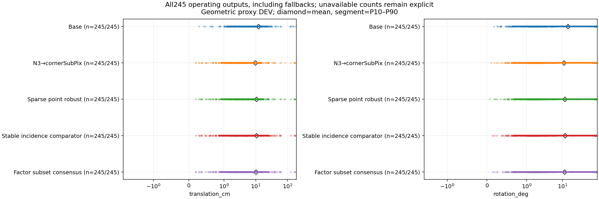
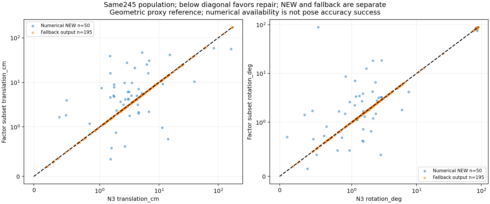
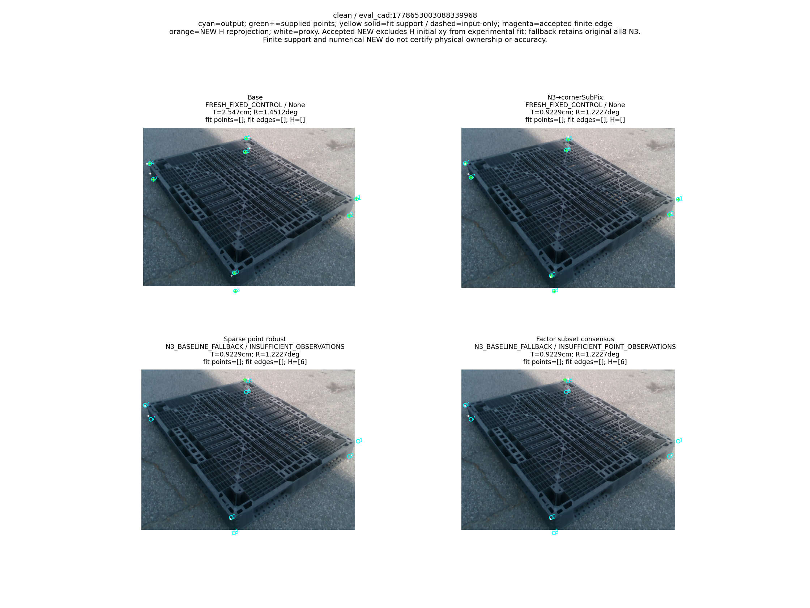
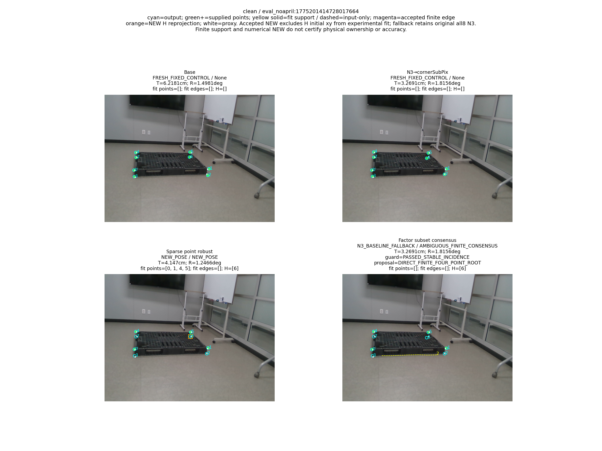
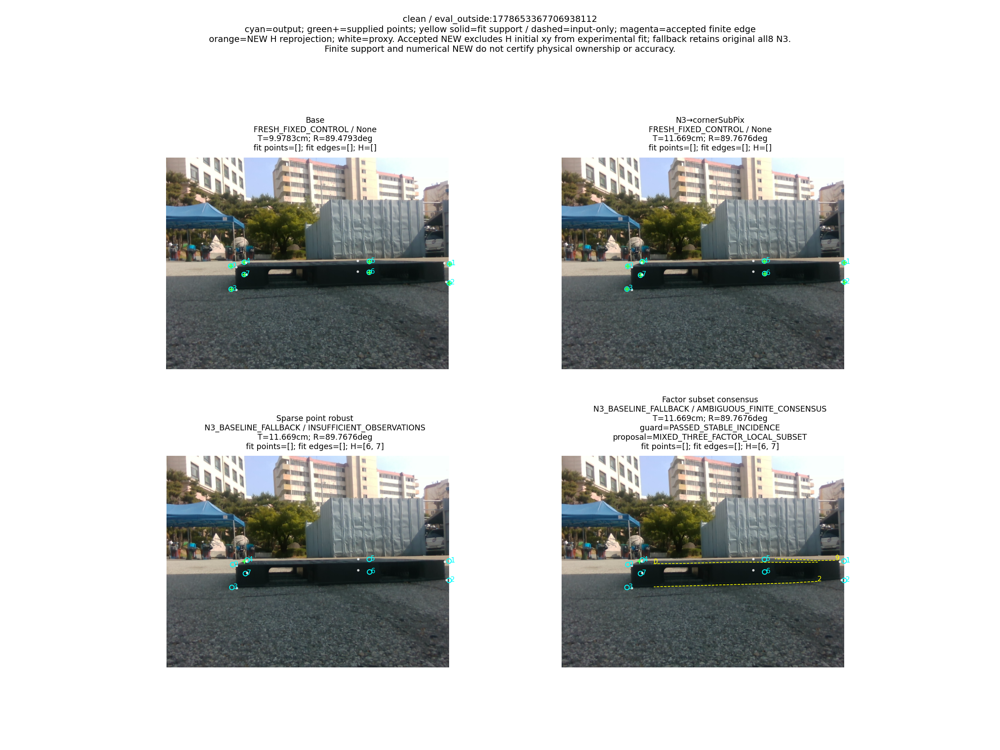
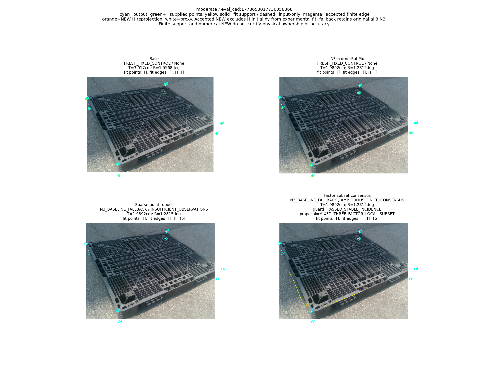
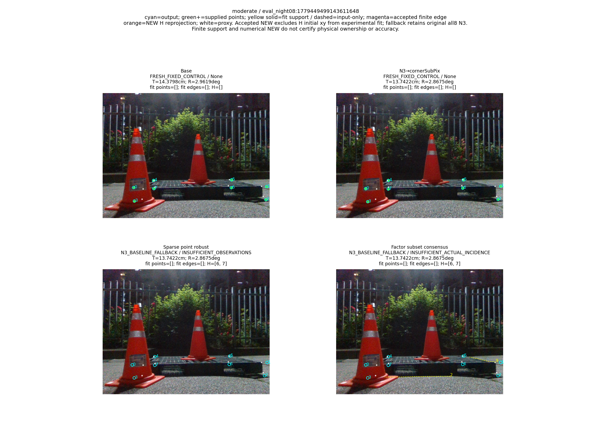
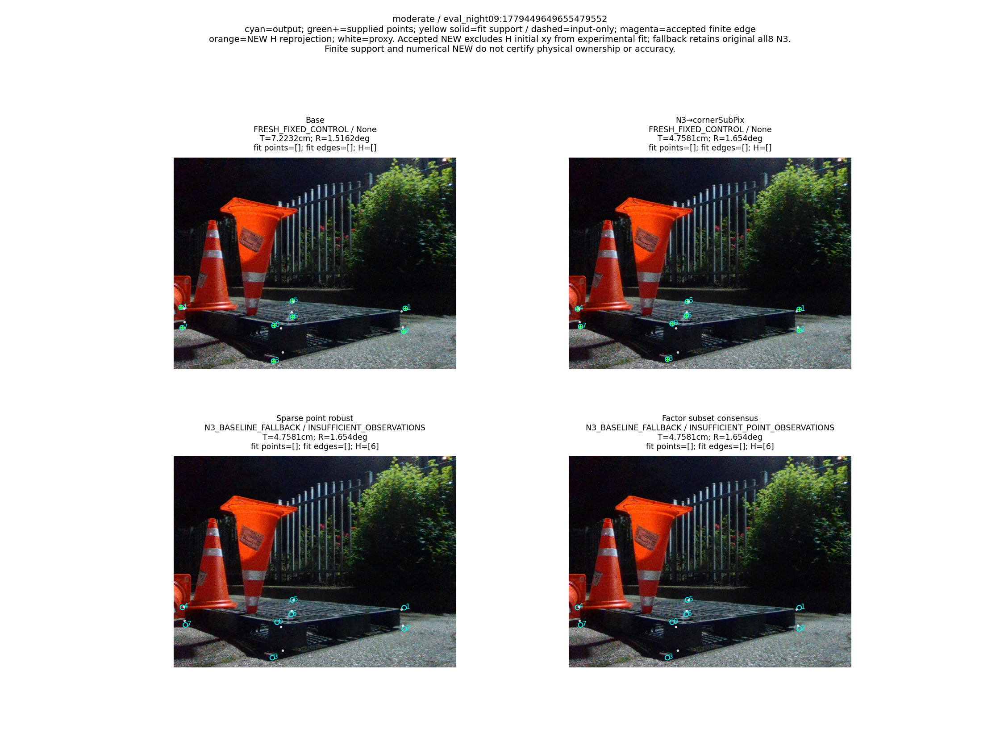

“가림 판단이 일부 틀려도 다른 유효 대응점으로 자세를 구하고 자기 가림 코너를 재투영했을 때, 기존 단순 대조보다 실제 위치·회전이 좋아졌는가?”

**전체 쉬움153·중간92의245장에서는 N3→cornerSubPix보다 위치·회전 평균이 모두 좋아지지 않았다.** V15의 전체 운용 평균은 T=10.065714713805312cm/R=11.51370306863193°/ADDsym=17.820328530896433cm이고, N3는9.754548028679153cm/10.914841863166323°/17.028646667097725cm다. NEW50·기본 N3 반환195·완전 pose 실패0을 포함한 결과다. 일부 마스크 오류가 있어도 자세가 좋아진 사례는 있었지만, 목표를 달성했다고 보고하지 않는다.

# V15: factor 부분집합 후보·전체 finite 합의의 실제 평가

BASE만 대조하면 위치·회전 평균은 둘 다 낮아졌고, 같은245장 POINT·STABLE보다 두 평균도 낮았다. 그러나 고정 N3→cornerSubPix 대조보다 두 평균이 높아 최상위 목표는 충족하지 못했다. 이 차이를 새 가림 판단기·재투영 단독의 인과 효과라고 분해해서 주장하지 않는다.

평가 기준은 기존 N3-phase **GEOMETRIC_PROXY known DEV**이며 독립 물리 실측 pose GT나 unseen 평가가 아니다. 저장 [METRICS](METRICS.json), [1225행 점수의 생성 영수증](SCORING_RECEIPT.json), [독립 ENVELOPE_VERIFICATION](ENVELOPE_VERIFICATION.json)이 수치의 권위다. 새245행과 보존된 POINT245·STABLE245·BASE/N3 490행을 함께 유지했다. Severe74는 사용자의 범위 변경에 따라 제외했으며 과거 전체319행은 보존했다. 아래 수치는 저장 scalar의 전사이고 이 문서를 쓰면서 pose/GT/통계/CI/시간을 다시 계산하지 않았다.

pose R,t의 reference는 N3 예측을 정답으로 되먹인 값이 아니다. 기존 annotation의 유한 corner XY+K+registered W/D 양가설을 표준 SQPnP+LM에 적합해 만든 이상적 cuboid GEOMETRIC_PROXY다. 외부 readonly source의 build_axis_review_manifest.py:126–146 / build_geometry_resolved_pose_gt.py:102–139와 immutable frame.truth 변환 경로가 그 provenance다. annotation에는 PnP로 채운 좌표도 있을 수 있고 XY 추출에서 source/direct-visibility 태그를 필터하지 않아 전점 독립 사람 클릭·독립 물리 실측을 보장하지 않는다. N3-phase는 사람 mask/native XY 품질 진단의 고정 corner permutation 정렬이며 pose truth 생성과 별개다. 이 제한을 source-specific 이전278장 provenance count에서 현재245장 count로 일반화하지 않는다.

## 무엇을 바꿨고 무엇은 아직 안 풀렸나

[방법 계약](METHOD_CONTRACT_KO.md), [solver.py](../../../scripts/research/pallet_factor_subset_consensus_20261011_v15/solver.py#L138), [pipeline.py](../../../scripts/research/pallet_factor_subset_consensus_20261011_v15/pipeline.py#L34)를 대조했다. head·CAL·sparse q·초기 H·원영상·감독은 같은 것을 유지했다. 원4-ID 표준 PnP가 실제 반환한 유효 raw root를 point-only의 선택 결과가 available/AMBIGUOUS인지와 무관하게 proposal로 보존하고, 같은 q/K/치수/4-ID bank를 재사용한다. 최대8점의 유한4점 부분집합 경로를 유지하며, 세 점만의 P3P 주 경로는 추가하지 않았다.

실제 point 하나 또는 소비되지 않은 실제 edge 하나를 한 factor로 보고, line이 적어도 하나인 모든3-factor 부분집합을 고정 순서로 검사했다. mixed LOCAL은 초기 N3 physical pose를 시작값으로만 쓰며 residual prior를 넣지 않는다. point-selected pose로 mixed 후보를 거르거나 새3D 점 ID를 만들지 않는다. 각 proposal을 같은 전체 U+retained edge의8px finite consensus로 평가하고 실제 inlier pool에 한 번 refit한다. query 수와 무관하게 한 edge가 한 표이며, 같은 선에서 만든 점과 선은 중복 관측으로 세지 않는다. 모든 mixed 수학적 root를 찾았다는 보장은 없다.

[후보별 incidence 검사](../../../scripts/research/pallet_factor_subset_consensus_20261011_v15/solver.py#L279)는 longitudinal hinge를 관측성 등식으로 세지 않고 실제 fit의 point+line-normal J에 기존 rank/weak 조건을 적용한다. 성능을 보고 새 threshold·seed를 고른 것이 아니다. 동일 consensus를 설명하는 비동일 accepted branch는 [AMBIGUOUS](../../../scripts/research/pallet_factor_subset_consensus_20261011_v15/solver.py#L323)로 반환한다. rank/consensus 통과는 실제 물리 edge ownership·전역 유일해·pose 정확도를 증명하지 않는다.

|요소|이번 확인|과장하지 않을 결론|
|---|---|---|
|가림 판단|H·endpoint 차이를 기록하고 일부 오류가 있어도 남은 관측으로 계속 계산했다.|가림을 완벽하게 분류해야 한다는 성공 조건을 쓰지 않았다. 이번 표만으로 새 가림 분류기의 필요성을 증명하지 않는다.|
|관측 선택|같은 sparse q와 소비되지 않은 실제 line만 사용했다. 공급447개 중 최종 NEW fit/inlier에는130개 q가 들어갔다.|edge ID는 의미에서 상속되므로 실사 물리 ownership은 여전히 UNKNOWN이다.|
|강건 후보/합의|부분집합/root 보존·전체 pool 합의·inlier refit을 실제 실행했다.|마스크가 잘못돼도 성공하는 사례는 있지만, 전체 N3 T/R은 낮추지 못했다.|
|관측성 검사|hinge 방향을 제외한 normal-only 실제 fit 검사 후 후보를 고른다.|weak/관측 부족 typed fallback을 성공으로 세지 않는다.|
|재투영|승인된 NEW에서 H63개 좌표를 최종 R,t의 재투영으로 교체했다.|H pixel 중앙값 개선을 전체 pose 개선으로 바꾸어 말하지 않는다.|

## 자기 가림을 무시하는 범위와 LOO

H 초기2D와 center는 승인된 NEW의 가설·합의·최종 실험 fit에서 제외한다. 새 R,t가 있으면 H 좌표를 재투영으로 **대체**하고, 이 점을 다시 독립 관측으로 PnP에 넣지 않는다. 일부 H 오판이나 재추정 후 H 변화 때문에 frame 전체를 실패시키지 않는다. 새 자세를 구하지 못한195장은 이전 all8 N3 출력/기본 pose를 반환하며 NEW가 아니다. 따라서 fallback의 원 N3 fit를 H-excluded 새 fit라고 부르지 않는다.

기존 native endpoint LOO는 H∪검사 endpoint를 제외한 native 대응의 강건 가설로 해당 선을 확인한다. CONTRADICTED 선만 제외하고 UNVERIFIED/UNKNOWN은 유지한다. 최종 SUBSET fit에는 빠진 native 좌표를 채워 넣지 않는다. LOO가 없는 상태에서 멈춘 것이 아니다. [이전 동일 sparse 관측 대조](../pallet_same_observation_controls_20261010_v8/RESULT_KO.md)는 H/no-H 강건 경로와 일반 해법을 구분했고, 이번 V15는 POINT·STABLE 대조를 그대로 보존했다. 마스크 없는 강건 PnP 대조의 기존 결과를 새 boundary head의 독립 필요성으로 확대하지 않는다.

## 산출 상태와 전체 운용 결과

BASE/N3는 고정 대조(FRESH_FIXED_CONTROL)이며 새 실험 pose/fallback 집계와 구분한다. operational은 실제 반환 pose 전체, new_pose는 승인 NEW만, fallback은 기존 N3 반환만이다. 큰 오차를 제거해서 평균이 좋아 보이지 않도록 같은245장을 남겼다. NEW 평균만으로 전체 운용 결과를 대신하지 않는다.

|stratum|method|전체분모|산출|NEW|기본 N3 반환|pose 없음|고정 대조|원 상태|
|---|---|---:|---:|---:|---:|---:|---:|---|
|combined|BASE|245|245|0|0|0|245|{"FRESH_FIXED_CONTROL": 245}|
|combined|N3|245|245|0|0|0|245|{"FRESH_FIXED_CONTROL": 245}|
|combined|POINT|245|245|40|205|0|0|{"N3_BASELINE_FALLBACK": 205, "NEW_POSE": 40}|
|combined|STABLE|245|245|73|172|0|0|{"N3_BASELINE_FALLBACK": 172, "NEW_POSE": 73}|
|combined|SUBSET|245|245|50|195|0|0|{"N3_BASELINE_FALLBACK": 195, "NEW_POSE": 50}|
|easy|BASE|153|153|0|0|0|153|{"FRESH_FIXED_CONTROL": 153}|
|easy|N3|153|153|0|0|0|153|{"FRESH_FIXED_CONTROL": 153}|
|easy|POINT|153|153|37|116|0|0|{"N3_BASELINE_FALLBACK": 116, "NEW_POSE": 37}|
|easy|STABLE|153|153|51|102|0|0|{"N3_BASELINE_FALLBACK": 102, "NEW_POSE": 51}|
|easy|SUBSET|153|153|35|118|0|0|{"N3_BASELINE_FALLBACK": 118, "NEW_POSE": 35}|
|medium|BASE|92|92|0|0|0|92|{"FRESH_FIXED_CONTROL": 92}|
|medium|N3|92|92|0|0|0|92|{"FRESH_FIXED_CONTROL": 92}|
|medium|POINT|92|92|3|89|0|0|{"N3_BASELINE_FALLBACK": 89, "NEW_POSE": 3}|
|medium|STABLE|92|92|22|70|0|0|{"N3_BASELINE_FALLBACK": 70, "NEW_POSE": 22}|
|medium|SUBSET|92|92|15|77|0|0|{"N3_BASELINE_FALLBACK": 77, "NEW_POSE": 15}|

typed solver state를 실제 운용 fallback과 분리했다. [전체 geometry](GEOMETRY_SEALED.jsonl.gz)/[245 ledger](CONTROL_LEDGERS.jsonl.gz)의 각 frame에는 공급 U·배치·최종 fit/inlier IDs·line factor·후보/대안/ambiguity·H·실제 R,t가 함께 저장돼 있다.

|stratum|NEW_POSE|AMBIGUOUS_FINITE_CONSENSUS|INSUFFICIENT_POINT_OBSERVATIONS|INSUFFICIENT_ACTUAL_INCIDENCE|INSUFFICIENT_ACTUAL_INLIER_GEOMETRY|WEAK_OBSERVABILITY|
|---|---:|---:|---:|---:|---:|---:|
|combined|50|85|56|49|4|1|
|easy|35|56|38|22|2|0|
|medium|15|29|18|27|2|1|

## 원행에서 만든 전체810 moment scalar

각 T/R/ADD 셀의6줄은 **평균 / 표본 분산(ddof=1) / 표준편차 / 중앙값 / P90 / 최대** 순서다. 분산 단위는 cm² 또는 degree²이고 나머지는 cm/degree다. None은 빈 집합으로0이나 성공값이 아니다. 5방법×3stratum×3output scope×3metric=135분포·810값을 모두 전사했다. 전체 SUBSET 최대 T174.7568271983788cm/R89.85477655741667°/ADD180.98844156077627cm도 남겼다.

|stratum|method|output scope|n|T cm:6 moment|R °:6 moment|ADDsym cm:6 moment|
|---|---|---|---:|---|---|---|
|combined|BASE|operational|245|12.188351368308584 538.5790668295168 23.207306324291856 6.010803220063387 23.191871672208148 183.07850477473974|14.232844378136992 851.3841553068099 29.178487885886238 1.839738412238616 82.81063875160255 90.00917492050102|22.431945806117554 1506.0022047443758 38.80724423022557 6.405062242563096 110.03653211262429 188.9915223699912|
|combined|BASE|new_pose|0|None None None None None None|None None None None None None|None None None None None None|
|combined|BASE|fallback|0|None None None None None None|None None None None None None|None None None None None None|
|combined|N3|operational|245|9.754548028679153 575.9360241353828 23.99866713247598 3.5973495042103814 15.085014302122275 174.7568271983788|10.914841863166323 665.1806009914171 25.79109538176727 1.6659926895050734 76.09532476401336 89.77763362360415|17.028646667097725 1298.8108704540255 36.039018722129846 3.9369354820060027 68.43149389306842 180.98844156077627|
|combined|N3|new_pose|0|None None None None None None|None None None None None None|None None None None None None|
|combined|N3|fallback|0|None None None None None None|None None None None None None|None None None None None None|
|combined|POINT|operational|245|10.461849948586346 587.3004341635357 24.234282208547786 4.176239832740652 17.382818033885187 174.7568271983788|11.611525122485201 711.8960908470923 26.681380977136328 1.6333214559488682 81.44737750526065 89.77763362360415|18.328032940838003 1379.54602789238 37.1422404802454 4.3464356418875205 71.971884900335 180.98844156077627|
|combined|POINT|new_pose|40|7.8406135004065005 149.39243027499649 12.222619615900532 4.198278192453509 15.787048160094342 75.86896691888866|5.390289662485843 362.9082709035157 19.05015146668172 0.9151553823740605 2.1612146562459174 88.84530231206573|11.71716153263252 705.5824343702529 26.56280170407958 4.331863071141569 15.848203453156412 131.2087137441212|
|combined|POINT|fallback|205|10.9733107189629 672.2869585782458 25.928497036624506 3.933521588275837 19.076598223013658 174.7568271983788|12.825424724436296 773.0342870860874 27.803494152463777 1.8738873917606569 81.87094598353711 89.77763362360415|19.617959069268338 1504.913086293246 38.79320928066207 4.3464356418875205 79.60585489521766 180.98844156077627|
|combined|STABLE|operational|245|10.529132872230429 484.3925283564288 22.008919290969942 4.289797824008631 23.853368129758834 174.7568271983788|11.934935026928532 705.5163459132011 26.561557671062914 1.7592677191829955 79.55212757973612 89.85477655741667|18.68400203211673 1279.389658218392 35.76855683723334 4.676131762947054 70.71418838584906 180.98844156077627|
|combined|STABLE|new_pose|73|10.665704454950596 172.22747258886153 13.123546494330773 5.0524242865889395 27.477160440640574 58.808570451534315|12.0271163621272 680.309249760572 26.082738540279315 1.7166125837978385 64.89852254612617 89.85477655741667|19.595740713686343 1077.8301885702924 32.83032422274097 5.327351682116227 63.41346772739715 121.26173934829643|
|combined|STABLE|fallback|172|10.471169351657338 618.6518095379134 24.872712146806858 3.967202394543679 19.736844193057138 174.7568271983788|11.895811553268633 720.250519525264 26.837483479739006 1.765474046544484 80.72599877939918 89.76763723821307|18.297043173078464 1371.2331328364685 37.03016517430713 4.338557332457684 71.47572582549648 180.98844156077627|
|combined|SUBSET|operational|245|10.065714713805312 485.2440776305338 22.028256345669618 4.00088320081152 21.754480787902942 174.7568271983788|11.51370306863193 684.3886183766323 26.1608222037579 1.7592677191829955 76.50965387978673 89.85477655741667|17.820328530896433 1248.7227888444431 35.337271949663055 4.339668804515432 68.4886536256538 180.98844156077627|
|combined|SUBSET|new_pose|50|11.040339543595394 212.23605271825787 14.568323606999463 5.036238239629233 31.762872434474744 58.808570451534315|12.866240794769114 723.5160142742826 26.89825299669632 1.8183019311698545 76.13568090296249 89.85477655741667|19.780121477823535 1109.6466910909508 33.31135979048214 5.2805150663889595 68.87781966253407 121.26173934829643|
|combined|SUBSET|fallback|195|9.815810911295035 556.3933791657947 23.58799226652821 3.7321341664467744 17.382818033885187 174.7568271983788|11.166898523468552 677.4413245251583 26.027703020534837 1.713089001419007 76.09532476401336 89.77763362360415|17.31781751886384 1289.0432593710802 35.9032485907763 4.213645136355802 68.43149389306842 180.98844156077627|
|easy|BASE|operational|153|12.846348362759484 790.4514324808421 28.114968121640153 4.668213987688899 19.836603231600556 183.07850477473974|10.628204608338502 616.6247942414432 24.83193094065468 1.715555635657884 50.873618630439076 89.4792849588053|17.93860487754294 1268.8858821312092 35.621424482061485 5.5161632734927135 53.33233728654386 188.9915223699912|
|easy|BASE|new_pose|0|None None None None None None|None None None None None None|None None None None None None|
|easy|BASE|fallback|0|None None None None None None|None None None None None None|None None None None None None|
|easy|N3|operational|153|10.107072506393136 859.7174702467877 29.320939109223424 2.6918845473520725 12.762645595341315 174.7568271983788|7.584578376689015 435.5445806846465 20.86970485379816 1.5416520299079417 5.923153455782191 89.76763723821307|12.915132447282565 1130.5845067555638 33.624165517608965 2.966195228583507 14.83116901630595 180.98844156077627|
|easy|N3|new_pose|0|None None None None None None|None None None None None None|None None None None None None|
|easy|N3|fallback|0|None None None None None None|None None None None None None|None None None None None None|
|easy|POINT|operational|153|11.267164662463289 882.6015432595791 29.70861059120031 3.184987415108408 14.525877097511145 174.7568271983788|8.696357041007952 517.599211831631 22.75080683913498 1.5319427498538003 7.363037795221227 89.76763723821307|15.024686291366251 1281.4567014655306 35.79743987306258 3.477928934480887 16.753890137882244 180.98844156077627|
|easy|POINT|new_pose|37|7.333612288238735 157.0024256679746 12.530060880457627 4.176239832740652 11.514123731860055 75.86896691888866|5.711039849322413 391.7191175270057 19.791895248485066 0.8717732935875406 2.145232517619408 88.84530231206573|11.520274817937006 762.5266668730836 27.613885399796306 4.239943742118908 11.58355229665832 131.2087137441212|
|easy|POINT|fallback|116|12.521832230103877 1110.8543153148435 33.32948117380232 2.9160664238545344 14.676581564814143 174.7568271983788|9.648570283183513 557.7240452821483 23.616181852326346 1.7613914001344706 11.730521185282882 89.76763723821307|16.142472709615234 1449.8359089768653 38.07671084766731 3.371502582008442 30.317303469199743 180.98844156077627|
|easy|STABLE|operational|153|10.134244348693345 699.1800278903338 26.442012553705776 3.184987415108408 14.745648786625669 174.7568271983788|7.867103499873267 432.98424680341554 20.808273518084473 1.5416520299079417 8.298722266932497 89.76763723821307|13.187470284591923 972.4922642958596 31.184808229262202 3.6361720283519916 19.271815493988004 180.98844156077627|
|easy|STABLE|new_pose|51|7.8926440975413525 151.84056294351748 12.322360282978154 4.133976018438608 16.770940468409005 58.808570451534315|5.893791906430985 257.2259583285745 16.03826544014578 1.4558053460607492 8.708510469976485 87.4508730206245|10.090143909125038 387.8406743270931 19.693670920554478 4.227952731093996 17.322193066452822 114.21176975526856|
|easy|STABLE|fallback|102|11.255044474269338 973.256842160184 31.197064640125742 2.859373890043633 14.543673312986373 174.7568271983788|8.85375929659441 521.3308887263582 22.83267151969647 1.5767466627687396 6.544961403471305 89.76763723821307|14.736133472325363 1264.2860694048468 35.55680060698441 3.2372155434655987 24.223884861557114 180.98844156077627|
|easy|SUBSET|operational|153|9.82505363572096 699.5614091584494 26.449223224103374 3.157956161623099 14.323934543478435 174.7568271983788|7.7749363492393195 431.7911531787284 20.779585009781318 1.5578363920277918 8.298722266932497 89.76763723821307|12.84018007423842 974.5752880178441 31.218188416656147 3.508478867117651 16.5676193723668 180.98844156077627|
|easy|SUBSET|new_pose|35|8.897109831235408 202.96299605544107 14.246508205712763 4.179866735185519 20.426835350095814 58.808570451534315|7.25920570175149 359.5632803356075 18.962153894945782 1.4937547314889323 11.09622777211954 87.4508744981213|11.692371274526751 543.636037785892 23.31600389830753 4.653920738314217 22.10763353389447 114.21176975526856|
|easy|SUBSET|fallback|118|10.10029120484803 849.5172253132754 29.14647878069108 2.7685458830090353 14.17500246790123 174.7568271983788|7.927907304002659 456.36780602474687 21.36276681576492 1.5636644752680808 5.9711145548465785 89.76763723821307|13.18063183686476 1107.6241892654011 33.28098840577607 2.9469198915207198 15.804303295326596 180.98844156077627|
|medium|BASE|operational|92|11.094073757971767 121.84908661025794 11.038527375073993 7.851389680650634 26.036088792108245 60.431861873972714|20.227517038780135 1194.6884557987921 34.564265590328866 1.9987798847057285 86.1592126325831 90.00917492050102|29.904567132986195 1828.2143982088248 42.757623860649986 8.14224175976533 116.22280336782391 121.23894804412103|
|medium|BASE|new_pose|0|None None None None None None|None None None None None None|None None None None None None|
|medium|BASE|fallback|0|None None None None None None|None None None None None None|None None None None None None|
|medium|N3|operational|92|9.168284495089601 107.69999682699179 10.377860898421783 5.220474363250011 23.637317402450154 61.92360473915919|16.45321483524272 1006.4005633341411 31.723816972964354 1.981300412332817 85.51015694788309 89.77763362360415|23.86959966309468 1518.31450323667 38.96555534361944 5.436086461145542 112.13137378003826 121.34476566792532|
|medium|N3|new_pose|0|None None None None None None|None None None None None None|None None None None None None|
|medium|N3|fallback|0|None None None None None None|None None None None None None|None None None None None None|
|medium|POINT|operational|92|9.122576565725781 97.60032860408691 9.879287859157001 5.3906640255800795 21.910030971177253 61.92360473915919|16.45957638842019 1006.2088935479889 31.72079591605464 2.0263434498509794 85.51015694788309 89.77763362360415|23.8216420426769 1509.6892841105898 38.85472022947263 5.57461113208822 112.13137378003826 121.34476566792532|
|medium|POINT|new_pose|3|14.093628450475592 23.70300515112484 4.868573215134475 15.735608179346922 17.49025552883261 17.928917366204033|1.434370691501493 0.38993215137805937 0.6244454751041594 1.3718001223174878 1.9445567257241172 2.0877458765757746|14.14543101387722 23.815586493273646 4.88012156541962 15.800485228320483 17.546330836904467 17.982792239050465|
|medium|POINT|fallback|89|8.95501301904882 99.51807864651663 9.9758748311372 5.2413619383596055 22.427971155559224 61.92360473915919|16.966043996181494 1032.5469282943604 32.133268247944535 2.043990600654579 85.78982410123665 89.77763362360415|24.14780645937801 1557.315209025878 39.46283326151175 5.460732046702568 112.70867171184092 121.34476566792532|
|medium|STABLE|operational|92|11.185849655938851 130.25139394470594 11.412773280176292 6.968405679661902 25.47180764141698 61.92360473915919|18.699915718661742 1094.3986424500276 33.081696486879686 2.1816048286278367 85.60810464768034 89.85477655741667|27.824973307891685 1670.7973727614533 40.87538834997722 7.127330832033114 116.57392997450592 121.34476566792532|
|medium|STABLE|new_pose|22|17.094162556217476 167.0007242795345 12.922876006506234 15.719615278156482 30.828692923689516 46.81144825213606|26.245277600332063 1416.906312171836 37.641816005233274 3.8869878733376355 85.16596163109497 89.85477655741667|41.631442396987545 2043.8560804138792 45.20902653689724 19.052532550602862 117.02491586665015 121.26173934829643|
|medium|STABLE|fallback|70|9.32895131585128 106.32633461900642 10.311466172131217 5.3906640255800795 23.81729564829813 61.92360473915919|16.32851627013678 988.2475614909199 31.436405034464737 2.064073513475077 85.72229841640953 89.24640958476445|23.485797308461557 1501.5939550179583 38.750405869073916 5.57461113208822 107.87008046711621 121.34476566792532|
|medium|SUBSET|operational|92|10.465944550184721 132.33651002757512 11.503760690642652 5.574486566271523 24.947733126121918 61.92360473915919|17.731434678056598 1051.2432839333028 32.42288210405273 2.105188259605937 85.58597438621369 89.85477655741667|26.10253194251248 1609.3131766758286 40.1162457948875 5.9035345010536195 113.39295088334903 121.34476566792532|
|medium|SUBSET|new_pose|15|16.041208872435355 211.63743790354718 14.547764017317135 10.430906051529506 37.396125040277944 46.81144825213606|25.9493226784769 1397.090586120754 37.377674969435354 3.8931749401986497 84.82055366526974 89.85477655741667|38.651538618849365 2018.4069419853392 44.92668407511664 16.289687237050888 115.60157244040438 121.26173934829643|
|medium|SUBSET|fallback|77|9.379854097798235 112.13968523245198 10.589602694740345 5.361944784094475 23.838939137174552 61.92360473915919|16.130547405247448 985.441140786705 31.391736823353767 2.043990600654579 85.92487547089088 89.77763362360415|23.657920252316977 1517.9931136176936 38.96143110330643 5.503800245804545 109.468065459462 121.34476566792532|

## 공통 산출집합·NEW 공통집합·81 CI

앞 SUBSET−뒤 대조이며 음수일 때 오차가 낮다. common_operational은 두 방법이 반환한 같은 frame, candidate_new_pose는 그 중 SUBSET NEW, both_new_pose는 두 방법이 모두 NEW인 frame이다. 전체 운용에서 N3 대비 T Δ=0.31116668512615736cm, R Δ=0.5988612054656065°다. 회전 CI [0.0440474959452262,1.6895200135258028]은0 위에 있고, 위치 CI [-1.1268419540787,1.6976042335471957]은0을 포함한다. 효과의 크기·불확실성과 단순 평균 verdict를 구분한다.

기존13세션10,000 session-bootstrap draw를 재사용했고 새 seed/draw0이다. 아래27 paired group의81 CI를 모두 남겼으며 empty resample·None을 채우지 않았다.

|stratum|contrast|scope|전체분모|paired n|SUBSET NEW|대조 NEW|비어 있지 않은 resample|빈 resample|T Δ;CI cm|R Δ;CI °|ADD Δ;CI cm|
|---|---|---|---:|---:|---:|---:|---:|---:|---|---|---|
|combined|SUBSET−N3|common_operational|245|245|50|0|10000|0|0.31116668512615736; [-1.1268419540787, 1.6976042335471957]|0.5988612054656065; [0.0440474959452262, 1.6895200135258028]|0.791681863798709; [-0.5906076339652286, 2.7150959873358054]|
|combined|SUBSET−N3|candidate_new_pose|245|50|50|0|10000|0|1.5247167571181712; [-5.580912687017215, 8.262387375750656]|2.934419906781472; [0.2522094774249155, 8.152008160715356]|3.8792411326136738; [-2.911947416564826, 13.15666434746414]|
|combined|SUBSET−N3|both_new_pose|245|0|0|0|0|10000|None; None|None; None|None; None|
|combined|SUBSET−POINT|common_operational|245|245|50|40|10000|0|-0.39613523478103496; [-1.451635905443142, 1.1905785989643507]|-0.09782205385326986; [-1.568761638539279, 1.5138075244926577]|-0.5077044099415695; [-2.643248803389421, 2.1371928185235545]|
|combined|SUBSET−POINT|candidate_new_pose|245|50|50|17|10000|0|1.3538762672489335; [-5.718062190854979, 8.050680320486537]|2.994145520772601; [0.3078783501732808, 8.2103986228095]|3.731360547036346; [-3.0329054361798073, 13.079699164064529]|
|combined|SUBSET−POINT|both_new_pose|245|17|17|17|9991|9|0.04221873958547424; [-0.16487618720631148, 0.22789858204354277]|0.016038869807314005; [-0.018275749034393052, 0.04825886403393724]|0.03912491709980116; [-0.16019421013471202, 0.21958806205576212]|
|combined|SUBSET−STABLE|common_operational|245|245|50|73|10000|0|-0.4634181584251199; [-1.0648304445547847, 0.03895315170099935]|-0.4212319582966012; [-1.5461091410767231, -0.020855905314905204]|-0.8636735012202986; [-2.5136986429326704, -0.04828804833324056]|
|combined|SUBSET−STABLE|candidate_new_pose|245|50|50|47|10000|0|0.07245731306144082; [-0.17922765556422005, 0.2751244446590496]|0.0054871852015826094; [-0.06994508090546091, 0.07410402342064369]|0.07563723583567947; [-0.14407343576518586, 0.2763978235693187]|
|combined|SUBSET−STABLE|both_new_pose|245|47|47|47|10000|0|0.0016514495433177984; [-2.3637811323256646e-07, 0.005679614256849314]|-0.004672178073005428; [-0.01606785772118977, 9.762988795685088e-08]|-0.0008822192673782092; [-0.003034014879929248, 2.629858166925441e-07]|
|easy|SUBSET−N3|common_operational|153|153|35|0|10000|0|-0.2820188706721736; [-1.6175753059672737, 1.2523089454232883]|0.1903579725503064; [-0.13276629616075503, 0.5674652501862798]|-0.0749523730441447; [-1.2376055082994444, 1.3511641629863511]|
|easy|SUBSET−N3|candidate_new_pose|153|35|35|0|9999|1|-1.2328253489383592; [-7.753010430201451, 4.618020144071857]|0.8321362800056251; [-0.7779758790313812, 2.087970576287687]|-0.32764894502154684; [-5.9659795222782215, 4.860880008556005]|
|easy|SUBSET−N3|both_new_pose|153|0|0|0|0|10000|None; None|None; None|None; None|
|easy|SUBSET−POINT|common_operational|153|153|35|37|10000|0|-1.442111026742327; [-3.347317238582669, 1.0713327497137377]|-0.9214206917686313; [-3.077979949069606, 0.5731516082373245]|-2.184506217127831; [-5.777360341964152, 1.224588391269499]|
|easy|SUBSET−POINT|candidate_new_pose|153|35|35|17|9999|1|-1.4768831916086984; [-8.03565829967507, 4.584029452643577]|0.9174585857072387; [-0.6649045189717401, 2.1594513146320993]|-0.5389069244177288; [-6.165278809487884, 4.813461611311533]|
|easy|SUBSET−POINT|both_new_pose|153|17|17|17|9991|9|0.04221873958547424; [-0.16487618720631148, 0.22789858204354277]|0.016038869807314005; [-0.018275749034393052, 0.04825886403393724]|0.03912491709980116; [-0.16019421013471202, 0.21958806205576212]|
|easy|SUBSET−STABLE|common_operational|153|153|35|51|10000|0|-0.3091907129723824; [-0.8239283865363656, 0.08026472078782025]|-0.09216715063394737; [-0.28176218832151023, 0.009517456941224384]|-0.34729021035350255; [-0.8413106132462789, 0.04967149654298384]|
|easy|SUBSET−STABLE|candidate_new_pose|153|35|35|33|9999|1|0.17130601748433494; [-0.009470885479219149, 0.4218102620227187]|0.007492212710038856; [-0.09596834041913915, 0.10828149980600217]|0.15877546501513534; [-0.0359864706088802, 0.41658980516148236]|
|easy|SUBSET−STABLE|both_new_pose|153|33|33|33|9999|1|0.0023519403487271937; [-4.058749145018081e-07, 0.008029695117547165]|-0.006654349260960548; [-0.02271665468808396, 5.988892266134416e-08]|-0.0012566236622843995; [-0.00428958241600347, 1.0253667851282177e-08]|
|medium|SUBSET−N3|common_operational|92|92|15|0|10000|0|1.297660055095121; [-0.6969291481768806, 3.2969818790030745]|1.2782198428138773; [0.07590763844962209, 3.438842242845379]|2.232932279417802; [-0.13730898831768049, 5.2460641859212815]|
|medium|SUBSET−N3|candidate_new_pose|92|15|15|0|9996|4|7.958981671250075; [-5.124089022534433, 20.596609871032843]|7.839748369258447; [0.6063727444154475, 20.090566933540707]|13.695317980429188; [-1.1455917134150762, 30.128442714559927]|
|medium|SUBSET−N3|both_new_pose|92|0|0|0|0|10000|None; None|None; None|None; None|
|medium|SUBSET−POINT|common_operational|92|92|15|3|10000|0|1.34336798445894; [-0.0061802717691271415, 2.7416167180065814]|1.2718582896364072; [0.06935079107742927, 3.4280869014507336]|2.280889899835583; [0.31344221781236076, 5.144139609364458]|
|medium|SUBSET−POINT|candidate_new_pose|92|15|15|0|9996|4|7.958981671250075; [-5.124089022534433, 20.596609871032843]|7.839748369258447; [0.6063727444154475, 20.090566933540707]|13.695317980429188; [-1.1455917134150762, 30.128442714559927]|
|medium|SUBSET−POINT|both_new_pose|92|0|0|0|0|10000|None; None|None; None|None; None|
|medium|SUBSET−STABLE|common_operational|92|92|15|22|10000|0|-0.719905105754129; [-1.8580743505411286, 0.312290008085328]|-0.9684810406051451; [-3.7756690242614286, -0.008550729330371957]|-1.7224413653792094; [-5.567150337895614, 0.19289187679527425]|
|medium|SUBSET−STABLE|candidate_new_pose|92|15|15|14|9996|4|-0.15818966392531214; [-0.5932122812912153, 7.575063961953984e-07]|0.0008087876818513676; [0.0, 0.003032668215770168]|-0.11835196558305094; [-0.4438209466452766, 7.823336985911634e-07]|
|medium|SUBSET−STABLE|both_new_pose|92|14|14|14|9996|4|2.9264485279512087e-07; [-2.3085746647666383e-08, 8.927753955160053e-07]|8.258431735289459e-08; [-5.158549735521471e-09, 2.5106916260294755e-07]|3.0537775781119034e-07; [-9.182244298244768e-09, 9.220361447681569e-07]|

## 마스크가 틀려도 자세가 좋아진 경우 / 맞아도 나빠진 경우

기존 사람 known 상태와 예측 H 차이의 진단이며 실제 T/R outcome과 별도다. BOTH_BETTER/BOTH_WORSE는 N3와 같은 frame의 위치·회전이 둘 다 개선/악화된 경우다. MIXED_OR_UNCHANGED에는 fallback의 같은 pose도 포함한다. 이 집계의 mask marker는 H를 제외한 실험 **시도**를 설명하며 fallback all8 N3를 새 masked fit로 인증하지 않는다. 재추정 H가 달라진4frame은 따로 기록했고 자동 frame 실패로 쓰지 않았다.

마스크가 known 사람 상태와 다른데도 BOTH_BETTER인3frame은 모두 NEW였고, 맞는데 BOTH_WORSE인17frame도 모두 NEW였다. 분류 오류 개수만으로 pose 성공/실패를 대신할 수 없다는 사례다. 실사 physical ownership 인과는 여기서 확인되지 않았다. 원 ID 목록과 각 frame의 mask/fit/inlier/score는 [POSTHOC_ROWS](POSTHOC_ROWS.jsonl.gz)와 [METRICS](METRICS.json)에 남아 있다.

|stratum|mask와 pose outcome|n|NEW|fallback|
|---|---|---:|---:|---:|
|combined|WRONG_ON_KNOWN__BOTH_BETTER|3|3|0|
|combined|WRONG_ON_KNOWN__BOTH_WORSE|7|7|0|
|combined|WRONG_ON_KNOWN__MIXED_OR_UNCHANGED|51|4|47|
|combined|WRONG_ON_KNOWN__POSE_UNAVAILABLE|0|0|0|
|combined|MATCHES_ON_KNOWN__BOTH_BETTER|7|7|0|
|combined|MATCHES_ON_KNOWN__BOTH_WORSE|17|17|0|
|combined|MATCHES_ON_KNOWN__MIXED_OR_UNCHANGED|160|12|148|
|combined|MATCHES_ON_KNOWN__POSE_UNAVAILABLE|0|0|0|
|combined|MASK_NOT_APPLIED__BOTH_BETTER|0|0|0|
|combined|MASK_NOT_APPLIED__BOTH_WORSE|0|0|0|
|combined|MASK_NOT_APPLIED__MIXED_OR_UNCHANGED|0|0|0|
|combined|MASK_NOT_APPLIED__POSE_UNAVAILABLE|0|0|0|
|combined|NO_KNOWN_VISIBILITY__BOTH_BETTER|0|0|0|
|combined|NO_KNOWN_VISIBILITY__BOTH_WORSE|0|0|0|
|combined|NO_KNOWN_VISIBILITY__MIXED_OR_UNCHANGED|0|0|0|
|combined|NO_KNOWN_VISIBILITY__POSE_UNAVAILABLE|0|0|0|
|easy|WRONG_ON_KNOWN__BOTH_BETTER|2|2|0|
|easy|WRONG_ON_KNOWN__BOTH_WORSE|6|6|0|
|easy|WRONG_ON_KNOWN__MIXED_OR_UNCHANGED|26|3|23|
|easy|WRONG_ON_KNOWN__POSE_UNAVAILABLE|0|0|0|
|easy|MATCHES_ON_KNOWN__BOTH_BETTER|6|6|0|
|easy|MATCHES_ON_KNOWN__BOTH_WORSE|9|9|0|
|easy|MATCHES_ON_KNOWN__MIXED_OR_UNCHANGED|104|9|95|
|easy|MATCHES_ON_KNOWN__POSE_UNAVAILABLE|0|0|0|
|easy|MASK_NOT_APPLIED__BOTH_BETTER|0|0|0|
|easy|MASK_NOT_APPLIED__BOTH_WORSE|0|0|0|
|easy|MASK_NOT_APPLIED__MIXED_OR_UNCHANGED|0|0|0|
|easy|MASK_NOT_APPLIED__POSE_UNAVAILABLE|0|0|0|
|easy|NO_KNOWN_VISIBILITY__BOTH_BETTER|0|0|0|
|easy|NO_KNOWN_VISIBILITY__BOTH_WORSE|0|0|0|
|easy|NO_KNOWN_VISIBILITY__MIXED_OR_UNCHANGED|0|0|0|
|easy|NO_KNOWN_VISIBILITY__POSE_UNAVAILABLE|0|0|0|
|medium|WRONG_ON_KNOWN__BOTH_BETTER|1|1|0|
|medium|WRONG_ON_KNOWN__BOTH_WORSE|1|1|0|
|medium|WRONG_ON_KNOWN__MIXED_OR_UNCHANGED|25|1|24|
|medium|WRONG_ON_KNOWN__POSE_UNAVAILABLE|0|0|0|
|medium|MATCHES_ON_KNOWN__BOTH_BETTER|1|1|0|
|medium|MATCHES_ON_KNOWN__BOTH_WORSE|8|8|0|
|medium|MATCHES_ON_KNOWN__MIXED_OR_UNCHANGED|56|3|53|
|medium|MATCHES_ON_KNOWN__POSE_UNAVAILABLE|0|0|0|
|medium|MASK_NOT_APPLIED__BOTH_BETTER|0|0|0|
|medium|MASK_NOT_APPLIED__BOTH_WORSE|0|0|0|
|medium|MASK_NOT_APPLIED__MIXED_OR_UNCHANGED|0|0|0|
|medium|MASK_NOT_APPLIED__POSE_UNAVAILABLE|0|0|0|
|medium|NO_KNOWN_VISIBILITY__BOTH_BETTER|0|0|0|
|medium|NO_KNOWN_VISIBILITY__BOTH_WORSE|0|0|0|
|medium|NO_KNOWN_VISIBILITY__MIXED_OR_UNCHANGED|0|0|0|
|medium|NO_KNOWN_VISIBILITY__POSE_UNAVAILABLE|0|0|0|

## 직접 가시점 손상과 숨은 점 재투영

직접 가시점·사람 SELF_OCCLUDED·실제 교체된 H를 서로 다른 집합으로 본다. input은 공급 q가 있는 일부 코너만이므로 전체 N3와 평균을 직접 비교해 개선이라고 말하지 않는다. 같은 전체 직접 가시1503개의 출력 평균은 N3 19.853023651037px→SUBSET 19.89607031746835px이고, 원 오차≤5px에서 출력>10px로 손상된 코너는3개다. 실제 H63개의 pixel 평균은7.274476032915819px→8.187343258748255px, 중앙값은6.3414347130310045px→4.05797824988532px다. 중앙값만 좋아졌다는 사실은 최종 T/R 개선이 아니다.

각 셀은 평균/표본 분산/SD/중앙/P90/최대 px다. damage는 DIRECT_VISIBLE에서만 측정된 별도 값이며 다른 category에 새 damage 숫자를 만들지 않았다.

|stratum|corner category|source|n|px:6 moment|direct damage|
|---|---|---|---:|---|---|
|combined|DIRECT_VISIBLE|N3|1503|19.853023651037 3580.8329182598645 59.84006114853046 4.4280440607544715 21.434210641657124 498.8323321808732|3|
|combined|DIRECT_VISIBLE|input|438|11.426930345210229 1465.9060246732006 38.28715221419844 3.5898567784249114 13.044645675587315 366.09397007771366|3|
|combined|DIRECT_VISIBLE|output|1503|19.89607031746835 3580.0758584002224 59.83373511991561 4.4280440607544715 21.434210641657124 498.8323321808732|3|
|combined|SELF_OCCLUDED|N3|335|19.65428204564917 2632.328826817118 51.30622600442482 7.06713621098236 26.523561830776252 470.4854786473229|not_measured|
|combined|SELF_OCCLUDED|input|0|None None None None None None|not_measured|
|combined|SELF_OCCLUDED|output|335|19.842818585043958 2645.0560433212786 51.43010833472236 6.737523979796291 26.82563713171614 470.4854786473229|not_measured|
|combined|ACTUALLY_REPROJECTED|N3|63|7.274476032915819 32.05170214363577 5.661422272153507 6.3414347130310045 14.330300282578323 30.18925891180735|not_measured|
|combined|ACTUALLY_REPROJECTED|input|0|None None None None None None|not_measured|
|combined|ACTUALLY_REPROJECTED|output|63|8.187343258748255 124.60855561396767 11.162820235673763 4.05797824988532 18.915656045756418 65.11778115148276|not_measured|
|easy|DIRECT_VISIBLE|N3|1000|14.523580965933517 2532.2121215206134 50.32109022587461 4.150628867564405 13.752123318850076 445.23623618558383|2|
|easy|DIRECT_VISIBLE|input|337|7.594663825812957 618.4035230290601 24.867720503276132 3.499034596243577 11.487938513202382 337.0879908815907|2|
|easy|DIRECT_VISIBLE|output|1000|14.577229834663079 2531.867535465777 50.31766623628104 4.150628867564405 14.178742661090459 445.23623618558383|2|
|easy|SELF_OCCLUDED|N3|222|13.997933839192722 1417.1901186420587 37.645585646155894 6.16068742193906 18.463458149490716 371.04296039790614|not_measured|
|easy|SELF_OCCLUDED|input|0|None None None None None None|not_measured|
|easy|SELF_OCCLUDED|output|222|13.84341590141908 1421.0460439347112 37.69676436956773 5.686251606704511 19.34035875274688 371.04296039790614|not_measured|
|easy|ACTUALLY_REPROJECTED|N3|47|6.457333706383356 22.835187687116285 4.778617759050863 4.722135874405197 12.912159608239607 20.066804609170084|not_measured|
|easy|ACTUALLY_REPROJECTED|input|0|None None None None None None|not_measured|
|easy|ACTUALLY_REPROJECTED|output|47|5.727483021580199 29.68505109260915 5.448398947636742 3.413424514561391 14.379590711205086 23.29193870757974|not_measured|
|medium|DIRECT_VISIBLE|N3|503|30.448337140308336 5505.699319764235 74.20039972779281 5.364837354146124 101.99757931314895 498.8323321808732|1|
|medium|DIRECT_VISIBLE|input|101|24.213799820822903 4113.541700450939 64.13689811996632 4.333304443672908 57.495582108862834 366.09397007771366|1|
|medium|DIRECT_VISIBLE|output|503|30.470305869765117 5504.7919027390835 74.19428483878717 5.39415428801354 101.99757931314895 498.8323321808732|1|
|medium|SELF_OCCLUDED|N3|113|30.766753743289268 4865.554007166791 69.75352325988122 8.426180916963826 84.99358277665483 470.4854786473229|not_measured|
|medium|SELF_OCCLUDED|input|0|None None None None None None|not_measured|
|medium|SELF_OCCLUDED|output|113|31.629255715705213 4872.403237542806 69.80260193963264 8.425600454253365 84.99358277665483 470.4854786473229|not_measured|
|medium|ACTUALLY_REPROJECTED|N3|16|9.674831617104926 54.21444493761281 7.363045900822078 7.755415921989536 16.660883268995534 30.18925891180735|not_measured|
|medium|ACTUALLY_REPROJECTED|input|0|None None None None None None|not_measured|
|medium|ACTUALLY_REPROJECTED|output|16|15.41318270542942 349.3614082865157 18.691212060391262 6.955208281252514 41.47827202934772 65.11778115148276|not_measured|

공급 point의 정확도와 actual fit도 구분했다. combined에서 계산482/채택447/NEW fit130/최종 point inlier130/실제 표시130이다. 채택447에는 기존8px proxy 기준 bad82개가 있었고, 최종 NEW 표시130에도 bad18개가 남았다. 강건 합의가 일부 bad를 줄였다는 집계와 실제 pose 성능은 별개이며 bad18개를 물리적으로 틀린 edge라고 확정하지 않는다. 원행에는 correct 대응 수·배치·실제 inlier·line factor가 있어, bad1/2가 남거나 correct1/2가 빠지는 양상을 숫자와 geometry로 다시 확인할 수 있다. 이번 보고서에서는 새 인위적 corruption 실험을 실행했다고 주장하지 않는다.

|stratum|boundary 단계|후보|proxy correct≤8px|proxy bad>8px|N3보다 pixel 개선|악화|같음|오차 px:6 moment|
|---|---|---:|---:|---:|---:|---:|---:|---|
|combined|all_candidate_boundary_quality|482|382|100|209|273|0|12.463424138687492 1487.2608352528437 38.565020877121846 3.9146628746939256 15.515751298299927 366.09397007771366|
|combined|adopted_boundary_quality|447|365|82|192|255|0|12.360362378956706 1578.6696471181647 39.73247597517885 3.627348363027637 14.165124495518677 366.09397007771366|
|combined|displayed_boundary_quality|130|112|18|64|66|0|4.696565782785139 16.454771332213042 4.056448117776566 3.2120625637207025 10.460511914089311 20.75056636109717|
|easy|all_candidate_boundary_quality|351|291|60|151|200|0|7.843354833259605 604.6758989660335 24.59015857952188 3.5618957175141497 12.212384064760647 337.0879908815907|
|easy|adopted_boundary_quality|337|285|52|144|193|0|7.594663825812957 618.4035230290601 24.867720503276132 3.499034596243577 11.487938513202382 337.0879908815907|
|easy|displayed_boundary_quality|107|92|15|54|53|0|4.775993722347834 17.108925074885 4.136293639828415 3.3345667113908255 10.73087288350443 20.75056636109717|
|medium|all_candidate_boundary_quality|131|91|40|58|73|0|24.842388460864505 3662.8423898871497 60.521420917615195 4.830302053442742 86.2727598457598 366.09397007771366|
|medium|adopted_boundary_quality|110|80|30|48|62|0|26.960729764497092 4267.893526147012 65.32911698582043 4.416066302100352 89.65392458502627 366.09397007771366|
|medium|displayed_boundary_quality|23|20|3|10|13|0|4.327053194384772 13.877454220799395 3.7252455249015997 2.7779271217173127 9.880067074032683 14.161774894955526|

## 실행량·독립 검산·실패 시도의 보존

[CONTROL_RECEIPT](CONTROL_RECEIPT.json)는 실제 geometry1회245행/245ledger·cleanup 후 봉인을 기록한다. Generic142회·유효 raw roots218개, mixed subset451개·치수 요청902개, proposal1011개·refit827개, optimizer1729entry/1729return/0exception, SVD12078entry/12078return/0exception이었다. 74.9553043670021초 replay wall은 배포 latency가 아니다. [CPU_CHECKS](CPU_CHECKS.json)의12test PASS는 자연 numeric root/잘못된1·2점/line 이상치·ambiguity와 주입 fixture를 구분한다. 새 실사·감독·학습·RGB·seed는0이다.

|단계|실제 결과와 영수증|제한·보존|
|---|---|---|
|독립 geometry|[VALIDATION_CHECKS](VALIDATION_CHECKS.json):3015455검사/0FAIL PASS|저장 numerical witness·기하·계수 검산이며 실제 정답/전역유일해/ownership 인증이 아니다.|
|점수|[SCORING_RECEIPT](SCORING_RECEIPT.json):봉인·cleanup·독립 PASS 뒤 실제245행|원 N3-phase proxy scorer의 local import만 isolated dispatch, 실제 GT/fit를 score 전에 섞지 않았다.|
|원 statistics verifier freeze|[STATISTICS_METADATA_FIRST_FAILURE](STATISTICS_METADATA_FIRST_FAILURE.json):TARGETS external metadata를 public path로 잘못 취급해 FAIL|own protocol/STARTED/통계 산술 전에 실패, 새GT/model/fit/seed0. 원 verify.py를 보존했다.|
|첫 public-binding review run|[REVIEW_ENVELOPE_FIRST_FAILURE](REVIEW_ENVELOPE_FIRST_FAILURE.json):STARTED.inputs를 요구한 writer의 KeyError FAIL|성공한 freeze는 보존했고 STARTED/통계 산술 전 실패했다. 원 review를 고치거나 FAIL을 PASS로 바꾸지 않았다.|
|세 번째 verifier 시도|[ENVELOPE_PROTOCOL](ENVELOPE_STATISTICS_PROTOCOL.json)/[ENVELOPE_STARTED](ENVELOPE_STATISTICS_STARTED.json)/[ENVELOPE_VERIFICATION](ENVELOPE_VERIFICATION.json):실제 PASS|두 앞선 실패를 보존하고 external-origin 분류1곳·누락 STARTED envelope1곳만 별도 권위로 수정했다. statistic formula 변경0.|

ENVELOPE actual counts는1225 saved row/135분포810moment/27paired group81CI(69nonempty·12None),5694 paired delta/689886 nonempty bootstrap mean/270000 resample denominator다. 1891exact·1029numeric 검사, 최대 차이4.547473508864641e-13이었다. 기존 draw 재사용·새 production/GT/fit/model/seed0이며 외부 asset byte 선언은 현재 asset 검증으로 둔갑시키지 않았다. 두 metadata/시작봉투 오류를 실제 pose 오류나 반복 성능 tuning으로 해석하지 않는다.

## 실제 전체 경로 처리시간

[runtime.py](../../../scripts/research/pallet_factor_subset_consensus_20261011_v15/runtime.py), [deployment.py](../../../scripts/research/pallet_factor_subset_consensus_20261011_v15/deployment.py), [RUNTIME_CONTRACT](RUNTIME_CONTRACT_KO.md)의 같은26장·13세션20warmup+5×26=150 fresh 호출을 실제 완료했다. detector/N3/초기 pose/Base 역할 feature/head/새 강건 point solve/native endpoint LOO/부분집합 finite proposal·refit/stable incidence/H 재투영·metadata를 GPU sync t0–t1 안에서 측정했다. 원RGB26장 decode·model loading·로그·반환 후 saved26 geometry parity·resource/protection probe는 밖이다. cache replay나 이전 측정값의 합이 아니다.

[RUNTIME_RECEIPT](RUNTIME_RECEIPT.json)/[150 timing 원행](RUNTIME_ROWS.jsonl.gz)/[RUNTIME_RESOURCES](RUNTIME_RESOURCES.json)가 실제 fresh COMPLETE의 권위다. [RUNTIME_CHECKS](RUNTIME_CHECKS.json)는56311검사/0FAIL·150호출/공식130회·56timing slot 실제 PASS, 최대 차이9.094947017729282e-13이었다. 저장 tick/계수/pose 일관성만 독립 확인했으며 새 hardware timing·candidate geometry/J/SVD를 다시 실행하지 않았다.

|stage|n|평균ms|표본 분산|SD|중앙|P90|최대|ddof|
|---|---:|---:|---:|---:|---:|---:|---:|---:|
|full|130|179.83371015384614|7852.254169124316|88.61294583256058|144.76272649999999|315.9298425|374.93789|1|
|detector|130|11.0460637|2.4313157179453433|1.5592676864301855|10.4643225|13.175168800000002|17.751464|1|
|N3_correction|130|4.390922846153846|0.8293594505830305|0.9106917428982381|3.9941255|5.6599675000000005|8.450298|1|
|initial_pose|130|1.4521399615384614|0.06788559281564968|0.26054863809977913|1.3766465|1.7199834000000005|3.302934|1|
|boundary_observation|130|9.4849433|66.05376534476457|8.127346759229889|8.0678765|10.902044600000002|77.733533|1|
|endpoint_validation_and_filtered_local|130|152.5859902923077|7786.152027656333|88.23917513018995|115.5206095|287.8656108|347.691431|1|
|final_pose_reprojection_and_metadata|130|0.13035510769230768|0.0054636190753991655|0.07391629776577806|0.099415|0.2439099|0.463414|1|
|return|130|0.7432949461538462|0.4790640610915862|0.692144537717077|0.5464395|1.4675476|3.865837|1|

full 평균179.83371015384614ms/P90315.9298425ms다. loading 직후 model forward0/0, 첫 warmup의 predict 내부 검출기 준비1회를 포함하여 detector151/N3 150/head150이었다. 각 fresh call에서 one finite solve/one output view를 수행했으며 local solve150, optimizer934entry/934return/0exception(488proposal·446refit), direct4-ID84요청은 캡처된 같은 point bank에서84cache hit/새Generic0, native endpoint Generic17500/LM760이었다. stored exception/cleanup/resource 기록을 지우지 않았으며 모든 기록 snapshot quiet·cleanup 성공이었다. snapshot 사이 순간 경합까지 인증하지 않는다.

## 감독의 실제 오류와 남은 한계

2164query의 실제 mesh 경계 ray 수치 실패를 no_match로 감독한 오류는 main의 N3가 아닌 별도 경계 head의 [old training.py:91](../../../scripts/research/pallet_observation_refiner_20261009_v1/training.py#L91)에 있었다. 실제 mesh/wire/depth 증거로 POSITIVE/NONE/IGNORE 감독·CPU gradient를 고쳤고, 이후 별도 허가된 [corrected3×3000=9000 학습](../pallet_kp_corrected_supervision_20261010_v1/RESULT_KO.md)은 이미 완료된 역사다. 초기 읽기 전용 감사 시점에는 수정 후 학습 결과가 없었다. 구감독 IMAGE_ROLE0/319는 수정 전 모델의 결과이며 수정 후에도0/319라고 주장하지 않는다. 이번 V15의 새학습·합성RGB·seed는0이다.

head의 target은 query normal과 의도한 semantic physical edge의 실제 wire 교차다. [decoder](../../../scripts/research/pallet_boundary_corner_refiner_20261010_v2/observations.py#L147)는 임의 ray 교점을 corner로 직접 쓰지 않고 서로 다른 incident edge 두개의 TLS line 교점을 q로 만들며 query 수/span·nonparallel·외삽·CAL uncertainty를 검사한다. [source 감독](../../../scripts/research/pallet_kp_supervision_gate_20261010_v1/actual_wire_proposal.py#L102)은 의도한 semantic segment와 owned wire를 요구한다. 따라서 임의 inset을 물리 hull corner 정답으로 강제했다는 원인 설명은 확인되지 않았다. 실사에서 상속된 edge ID의 실제 physical ownership, 그 두 선의 교점이 해당3D corner인지, mixed LOCAL이 다른 branch를 놓치는지는 아직 검증되지 않았다.

부분집합/root 경로를 보강해 수치 후보가 존재한다는 것과 좋은 최종 pose를 선택한다는 것을 구분했다. 같은 실사 q/line/CAL의 정확도·conditioning·물리 correspondence·전역 branch 중 무엇이 현재 오차의 인과인지 모두 인증하지 못했다. 남은 문제를 해결했다고 멈추거나 가림 분류 정확도만으로 후단 평가를 생략하지 않는다. 이 결과의 goal verdict는False다.

## 이미지와 공개 게시 상태

새 V15 [FIGURE_BINDINGS](FIGURE_BINDINGS.json)/[24 panel 원행](FIGURE_CASE_ROWS.jsonl.gz)은 실제8PNG·전체5방법1225표시 원행을 결속한다. [ROOT_VISUAL_REVIEW](ROOT_VISUAL_REVIEW.json)는 root가 실제8이미지/24case panel을 열어 글자·NEW/fallback·T/R·fit·H·proposal/guard를 확인한 권위다. 원3Clean+3Moderate6case는 새 오차를 보고 고르지 않았고 **이번 고정6case의 V15는 모두 fallback**이다. 새 좋은 사례로 바꾸거나 NEW로 보이게 만들지 않았다. 실제 전체 NEW50은 aggregate 그림/원행에 나타난다.

cyan=출력, green+=공급 q, yellow 실선=fit support·점선=input-only, magenta=승인된 finite edge, orange=NEW H 재투영, white=proxy다. fallback에는 새 fit가 없고 원all8 N3가 남는다. 그림의 가독성은 pose 정확도/물리 ownership 인증이 아니다.

[ARCHIVE_PROTOCOL](ARCHIVE_PROTOCOL.json)/[ARCHIVE_CHECKS](ARCHIVE_CHECKS.json)/[ARCHIVE_MANIFEST](ARCHIVE_MANIFEST.json)은 이미 동결된 V13 generic archive_evidence.py를 명시적 V15 input/output 폴더에 재사용한 actual PASS다. schema의 v13은 helper 버전이며 V15 전용 archive 코드를 새로 만들었다는 뜻이 아니다. 원 gzip6개·86,632,277B 전부 각각50MiB 미만이라 direct_original6/split0/part0이고 재압축·원본 수정0이다. 총 bytes가50MiB를 넘는 것과 각 파일의 split 조건을 혼동하지 않는다.

[PUBLIC_RESTORE_ABSENT protocol](PUBLIC_RESTORE_ABSENT/RESTORE_PROTOCOL.json)/[STARTED](PUBLIC_RESTORE_ABSENT/RESTORE_STARTED.json)/[CHECKS](PUBLIC_RESTORE_ABSENT/RESTORE_CHECKS.json)은 같은 동결 V13 restore_archives.py에 input=V15 archive 폴더, output=새 private target, receipts=새 exclusive 폴더를 명시해 실제 복원한 권위다. 원 gzip6개를 모두 initially absent에서6개·86,632,277B 실제 생성하고 SHA/bytes 동일성 PASS, 기존 정확한 파일의 단순 unchanged 재검토0이었다. 공개 helper의 freeze→run 절차는 새 receipts/비어 있는 target에 적용하고 기존 기록을 덮지 않는다.

이 보고서는 geometry·실제 pose 평가·통계/시간 독립 검산·실제8이미지·원 gzip archive/처음 없는 target 복원까지 완료된 snapshot이다. 공개 전체 dependency byte 복사·fresh stdlib 검산·최종 보호·정상 research commit/push·원격SHA 확인은 아직 별도 완료 권위를 기다린다. 원본 영상·가중치·사용자 변경·과거 실험을 보존했다. main 변경/자동 병합/force push는 하지 않는다. 게시가 끝나기 전 remote 게시 완료라고 보고하지 않으며, 정상 게시가 끝나도 이 negative pose 결과를 목표 성공으로 바꾸지 않는다.
