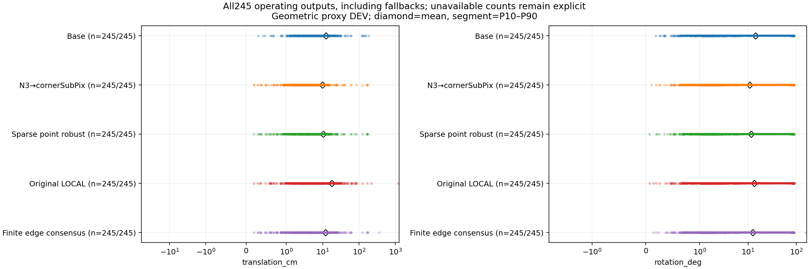
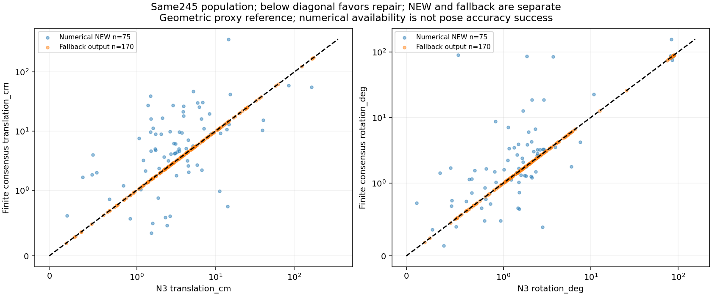
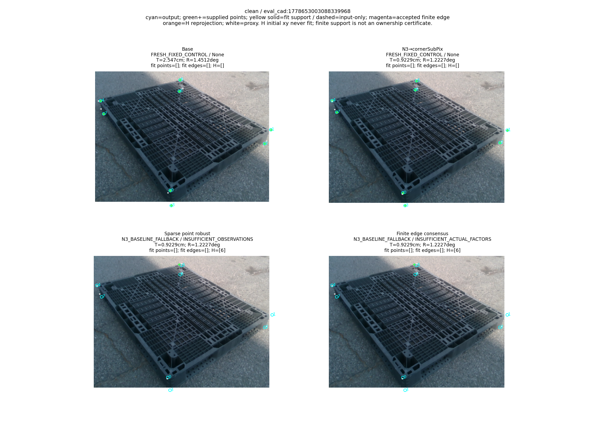
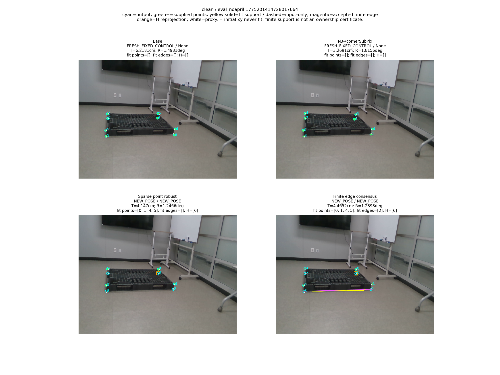
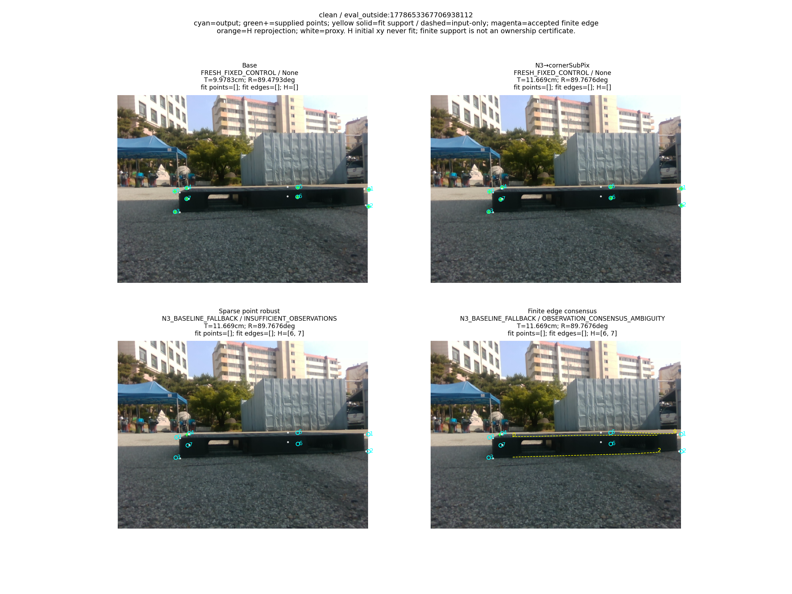
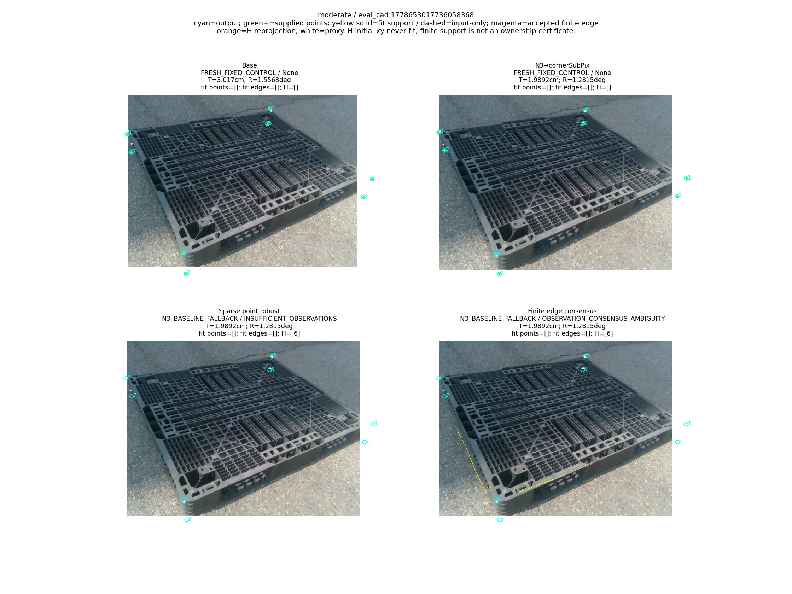
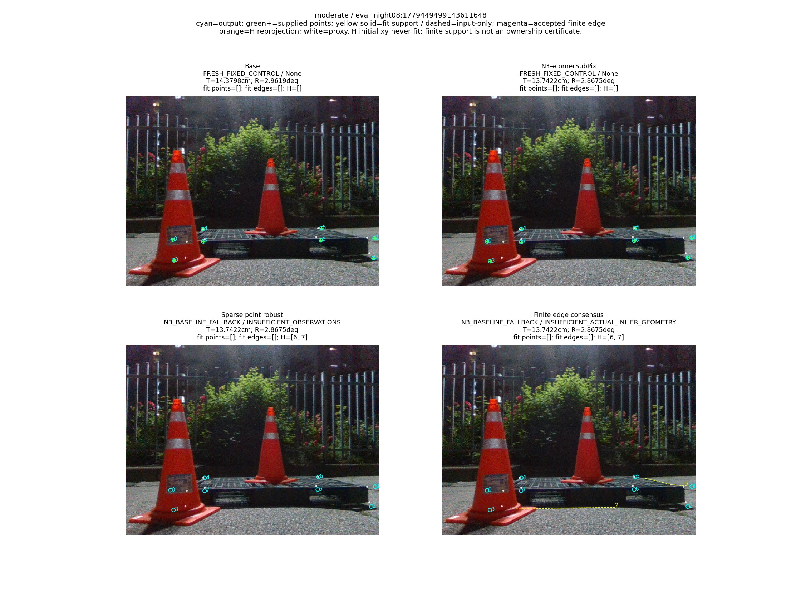
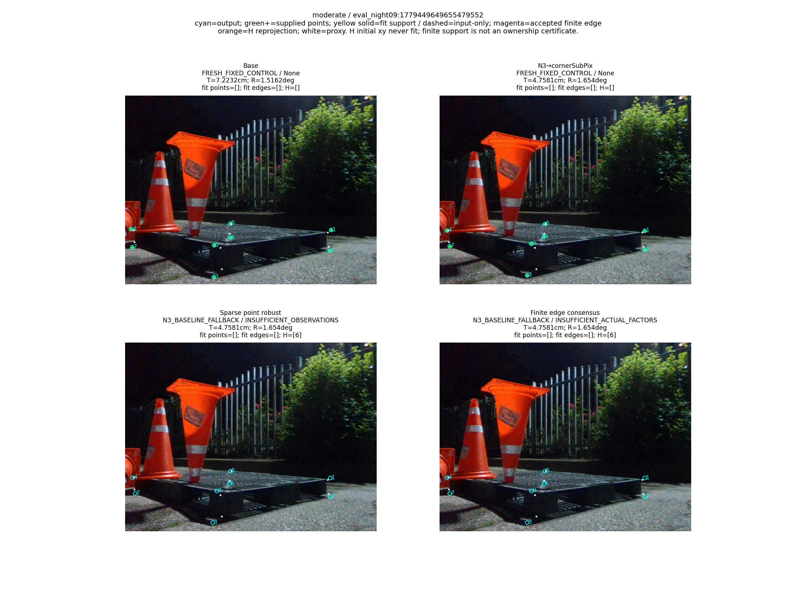

# V13 결과: 유한 물리 경계와 실제 inlier 합의

“가림 판단이 일부 틀려도 다른 유효 대응점으로 자세를 구하고 자기 가림 코너를 재투영했을 때, 기존 단순 대조보다 실제 위치·회전이 좋아졌는가?”

**아직 아니다.** 쉬움153+중간92의 전체245장 FINITE 위치 평균은 11.926597046320317cm, 회전은 12.556904694659371°다. 같은 N3→cornerSubPix의 9.754548028679153cm, 10.914841863166323°보다 둘 다 나쁘다. 기존 LOCAL의 17.87901676799424cm, 13.415258792985208°보다는 두 평균이 낮지만 목표는 미해결이다. NEW75개나 검산 PASS를 자세 개선으로 보고하지 않는다.

위치·회전·ADDsym은 같은 원영상의 N3-phase **GEOMETRIC_PROXY known DEV** 참조에 대한 오차다. 독립적으로 측정한 물리 자세 GT나 unseen test는 없다. Severe74는 사용자 후속 요청대로 이번 평가에서 제외했고, 기존 전체319 실험은 [V9 이력](../pallet_sparse_local_line_20261010_v9/RESULT_KO.md)에 보존했다. 큰 오차나 마스크 오판 때문에245장의 평가 분모를 줄이지 않았다.

## 실제 수정한 부분과 효과

[solver.py](../../../scripts/research/pallet_finite_edge_consensus_repair_20261011_v13/solver.py), [pipeline.py](../../../scripts/research/pallet_finite_edge_consensus_repair_20261011_v13/pipeline.py), [METHOD_CONTRACT](METHOD_CONTRACT_KO.md), [PROTOCOL](PROTOCOL.json)이 실행 전 고정된 방법이다. 같은 frozen IMAGE_ROLE sparse q와 코너에 소비되지 않은 실제 물리/CAL 선을 쓴다. native endpoint LOO는 H와 선 양 끝을 제외한 유한4점 강건 합의를 쓰며, 같은 좌표 bank의 가설을 마스크 사이에서 재사용한다. CONTRADICTED인 선만 제거하고 UNKNOWN은 남긴다. native 좌표로 sparse fit의 누락점을 채우지 않는다.

이전 무한 직선의 법선 잔차에 실제 관측 support가 투영된 물리 선분 밖으로 나가는 longitudinal hinge 잔차를 더했다. 부분 선 관측을 전체 양 끝에 맞추는 감독으로 바꾸지 않았다. 전체 관측으로 proposal을 만든 뒤 실제8px point/edge inlier만 refit하고, 전체 원래 pool에서 다시 점수화한다. query가 여러 개여도 같은 edge는 합의에서1표다. 비동등 후보가 같은 실제 합의를 설명하거나 고정 numerical tie이면 새 자세를 거절한다. threshold·seed·학습량은 성능을 보고 바꾸지 않았다.

|단계|확인한 동작/효과|남은 한계|
|---|---|---|
|가림 판단|마스크 오판을 프레임 전체 실패로 쓰지 않는다. WRONG인데 T/R이 함께 좋아진3장과 MATCH인데 함께 나빠진25장이 실제 있다.|새 가림 분류나 완벽한 mask가 성공 조건이 아니다. mask만 맞으면 pose가 좋아진다고 할 수 없다.|
|관측 선택|동일 endpoint LOO로 모순 unused edge를 제거하고, 실제 finite support와 실제 inlier로 fit한다.|CAL support/역할 특징 일치가 실사 edge ownership을 증명하지 않는다.|
|강건 PnP/finite LOCAL|다른 유효 대응으로 proposal/refit을 만들고75 NEW를 산출했다. LOCAL보다 전체 T/R 평균은 낮다.|FINITE−N3와 FINITE−POINT는 전체 평균이 나쁘다. 선 추가·solver·거절을 묶은 차이이며 선 단독 인과 효과를 분리한 실험이 아니다.|
|관측 충분성/다중해|실제 fit J의 rank/기존 weak gate와 같은 consensus의 비동등 branch를 검사한다.|hinge cusp의 한쪽 J rank6는 안정적인 양쪽 관측 가능성이나 전역 유일해를 보증하지 않는다.|
|재투영|승인 NEW의 최종 R,t로 H 초기 좌표를 교체하고 재fit하지 않는다.|숨은 코너 오차 개선을 최종 자세 개선으로 대신 주장하지 않는다.|

승인 NEW의 실험 fit·합의 점수에는 초기 자기 가림 H의2D 좌표를 넣지 않는다. 승인된 새 R,t가 있으면 H를 재투영으로 대체하며 독립 관측으로 다시 PnP/LOCAL에 넣지 않는다. 같은 선의 점과 선은 중복 factor로 세지 않는다. 초기 N3/available point 자세는 LOCAL 시작값만 제공하며 residual prior가 아니다. 관측 부족·약함·수치 실패·다중해는 typed 원행에 남고 실제 운용에는 N3 fallback을 포함한다. fallback은 앞서 모든8개 N3 대응으로 계산한 기존 기본 자세를 그대로 반환하며, H 제외 실험이 실패한 fallback을 NEW로 세지 않는다. scored 원행의 mask_applied_to_final_fit=True는 H를 제외하는 실험 경로의 계약 표시이며, fallback 기본 자세를 H 제외 조건으로 새로 fit했다는 뜻이 아니다.

가림 없는 강건 PnP 대조는 [V7](../pallet_three_head_observation_20261010_v7/RESULT_KO.md), 같은 sparse의 일반/강건·H/무마스크는 [V8](../pallet_same_observation_controls_20261010_v8/RESULT_KO.md)에 이미 있다. 현재의 sparse U가 H 유무에 같았던 결과를 head/가림 판단기 전체가 불필요하다는 주장으로 확대하지 않는다.

## 산출률과 전체 운용

BASE/N3는 고정 대조, POINT=ROLE_BOUNDARY_H_ROBUST, LOCAL=ROLE_BOUNDARY_LOCAL_POINT_LINE, FINITE=FINITE_EDGE_CONSENSUS다. 고정 대조의 새 자세0은 fallback/실패가 아니다. 수치는 [METRICS](METRICS.json)의 저장 원행 집계 전사다.

|stratum|method|denominator|operational|NEW|fallback|no_pose|fixed|평균T cm|평균R °|평균ADD cm|
|---|---|---:|---:|---:|---:|---:|---:|---:|---:|---:|
|combined|BASE|245|245|0|0|0|245|12.188351368308584|14.232844378136992|22.431945806117554|
|combined|N3|245|245|0|0|0|245|9.754548028679153|10.914841863166323|17.028646667097725|
|combined|POINT|245|245|40|205|0|0|10.461849948586346|11.611525122485201|18.328032940838003|
|combined|LOCAL|245|245|115|130|0|0|17.87901676799424|13.415258792985208|26.64545714508252|
|combined|FINITE|245|245|75|170|0|0|11.926597046320317|12.556904694659371|20.112381623955297|
|easy|BASE|153|153|0|0|0|153|12.846348362759484|10.628204608338502|17.93860487754294|
|easy|N3|153|153|0|0|0|153|10.107072506393136|7.584578376689015|12.915132447282565|
|easy|POINT|153|153|37|116|0|0|11.267164662463289|8.696357041007952|15.024686291366251|
|easy|LOCAL|153|153|76|77|0|0|19.080348190580732|9.337368585359519|23.833929752896903|
|easy|FINITE|153|153|52|101|0|0|10.123410139078349|8.338688342279799|13.162187261009981|
|medium|BASE|92|92|0|0|0|92|11.094073757971767|20.227517038780135|29.904567132986195|
|medium|N3|92|92|0|0|0|92|9.168284495089601|16.45321483524272|23.86959966309468|
|medium|POINT|92|92|3|89|0|0|9.122576565725781|16.45957638842019|23.8216420426769|
|medium|LOCAL|92|92|39|53|0|0|15.881150380431924|20.196967507840974|31.321149438608597|
|medium|FINITE|92|92|23|69|0|0|14.925375272494454|19.57198188937757|31.67085703189697|
모든 방법이245장 모두 pose를 출력했고 no_pose0이다. FINITE의 큰 위치 최대358.5410239761371cm와 회전 최대155.97455229874154°도 전체 분포에 포함된다. 산출 실패를 제외해 평균이 좋아 보이게 만들지 않았다.

## 위치·회전·ADDsym 전체 분포

각 cell은 **평균 / 표본분산(ddof1) / SD / 중앙값 / P90 / 최대값**을 줄바꿈으로 표시한다. T/ADD는 cm, R은 degree이고 분산은 해당 단위의 제곱이다. n은 그 실제 집합의 분모, 빈 집합은 None이다.5방법×3strata×3scope×3지표의135분포/810scalar를 [METRICS.csv](METRICS.csv)와 [실제 독립 REVIEW_VERIFICATION](REVIEW_VERIFICATION.json)이 원행에서 확인했다.

|stratum|method|scope|n|T: mean/var/SD/median/P90/max|R: mean/var/SD/median/P90/max|ADD: mean/var/SD/median/P90/max|
|---|---|---|---:|---|---|---|
|combined|BASE|operational|245|12.188351368308584 538.5790668295168 23.207306324291856 6.010803220063387 23.191871672208148 183.07850477473974|14.232844378136992 851.3841553068099 29.178487885886238 1.839738412238616 82.81063875160255 90.00917492050102|22.431945806117554 1506.0022047443758 38.80724423022557 6.405062242563096 110.03653211262429 188.9915223699912|
|combined|BASE|new_pose|0|None None None None None None|None None None None None None|None None None None None None|
|combined|BASE|fallback|0|None None None None None None|None None None None None None|None None None None None None|
|combined|N3|operational|245|9.754548028679153 575.9360241353828 23.99866713247598 3.5973495042103814 15.085014302122275 174.7568271983788|10.914841863166323 665.1806009914171 25.79109538176727 1.6659926895050734 76.09532476401336 89.77763362360415|17.028646667097725 1298.8108704540255 36.039018722129846 3.9369354820060027 68.43149389306842 180.98844156077627|
|combined|N3|new_pose|0|None None None None None None|None None None None None None|None None None None None None|
|combined|N3|fallback|0|None None None None None None|None None None None None None|None None None None None None|
|combined|POINT|operational|245|10.461849948586346 587.3004341635357 24.234282208547786 4.176239832740652 17.382818033885187 174.7568271983788|11.611525122485201 711.8960908470923 26.681380977136328 1.6333214559488682 81.44737750526065 89.77763362360415|18.328032940838003 1379.54602789238 37.1422404802454 4.3464356418875205 71.971884900335 180.98844156077627|
|combined|POINT|new_pose|40|7.8406135004065005 149.39243027499649 12.222619615900532 4.198278192453509 15.787048160094342 75.86896691888866|5.390289662485843 362.9082709035157 19.05015146668172 0.9151553823740605 2.1612146562459174 88.84530231206573|11.71716153263252 705.5824343702529 26.56280170407958 4.331863071141569 15.848203453156412 131.2087137441212|
|combined|POINT|fallback|205|10.9733107189629 672.2869585782458 25.928497036624506 3.933521588275837 19.076598223013658 174.7568271983788|12.825424724436296 773.0342870860874 27.803494152463777 1.8738873917606569 81.87094598353711 89.77763362360415|19.617959069268338 1504.913086293246 38.79320928066207 4.3464356418875205 79.60585489521766 180.98844156077627|
|combined|LOCAL|operational|245|17.87901676799424 6371.130065221301 79.81935896273097 5.361944784094475 31.280809407982254 1204.8027435564068|13.415258792985208 774.2282019646461 27.824956459348613 1.8176433605042994 83.64724240084382 92.76801898557402|26.64545714508252 7133.570379790449 84.46046637208705 5.503800245804545 83.41437218959408 1206.0840052680007|
|combined|LOCAL|new_pose|115|28.38685794476606 12963.771720476745 113.85856015459156 8.964660636086656 44.52747564179746 1204.8027435564068|16.46926575311549 918.3190135840935 30.303778866406965 2.2344144729398563 84.77716309280791 92.76801898557402|39.27656413349201 13771.678486970253 117.35279496871922 8.997940526274286 116.76622273618204 1206.0840052680007|
|combined|LOCAL|fallback|130|8.583618803926868 408.95729640874407 20.22269261025208 3.114981817036182 14.510347480565105 167.92537200948746|10.713637251331493 637.2238359518152 25.24329289042567 1.6917143454203178 31.16810907943069 88.90488273671434|15.471785578412593 1054.5856132273725 32.474383954547505 3.6041734472556897 67.11097831904885 175.19609981909667|
|combined|FINITE|operational|245|11.926597046320317 978.6819779308247 31.283893266836607 4.289797824008631 23.882818690412755 358.5410239761371|12.556904694659371 789.9452895787331 28.105965373541842 1.7592677191829955 81.4592279688051 155.97455229874154|20.112381623955297 1778.1131105973336 42.167678506141804 4.676131762947054 71.971884900335 368.7723678588993|
|combined|FINITE|new_pose|75|15.336953449568043 1780.9076513164048 42.200801548269254 5.084220729411225 29.032512628021706 358.5410239761371|14.90514678475239 1003.4082122402583 31.676619330986984 1.7864553751512142 83.21869594142558 155.97455229874154|24.8331199331368 2694.2449846904606 51.90611702574621 5.843306115572545 76.09210080430474 368.7723678588993|
|combined|FINITE|fallback|170|10.422028044887497 625.763981469272 25.01527496289561 3.927996679975709 19.997065245138916 174.7568271983788|11.52091553726539 697.6237774087869 26.412568550006394 1.7361783603010013 77.5956755802978 89.76763723821307|18.02970295813993 1373.2348152817458 37.05718304568961 4.320765166155739 71.76995718231605 180.98844156077627|
|easy|BASE|operational|153|12.846348362759484 790.4514324808421 28.114968121640153 4.668213987688899 19.836603231600556 183.07850477473974|10.628204608338502 616.6247942414432 24.83193094065468 1.715555635657884 50.873618630439076 89.4792849588053|17.93860487754294 1268.8858821312092 35.621424482061485 5.5161632734927135 53.33233728654386 188.9915223699912|
|easy|BASE|new_pose|0|None None None None None None|None None None None None None|None None None None None None|
|easy|BASE|fallback|0|None None None None None None|None None None None None None|None None None None None None|
|easy|N3|operational|153|10.107072506393136 859.7174702467877 29.320939109223424 2.6918845473520725 12.762645595341315 174.7568271983788|7.584578376689015 435.5445806846465 20.86970485379816 1.5416520299079417 5.923153455782191 89.76763723821307|12.915132447282565 1130.5845067555638 33.624165517608965 2.966195228583507 14.83116901630595 180.98844156077627|
|easy|N3|new_pose|0|None None None None None None|None None None None None None|None None None None None None|
|easy|N3|fallback|0|None None None None None None|None None None None None None|None None None None None None|
|easy|POINT|operational|153|11.267164662463289 882.6015432595791 29.70861059120031 3.184987415108408 14.525877097511145 174.7568271983788|8.696357041007952 517.599211831631 22.75080683913498 1.5319427498538003 7.363037795221227 89.76763723821307|15.024686291366251 1281.4567014655306 35.79743987306258 3.477928934480887 16.753890137882244 180.98844156077627|
|easy|POINT|new_pose|37|7.333612288238735 157.0024256679746 12.530060880457627 4.176239832740652 11.514123731860055 75.86896691888866|5.711039849322413 391.7191175270057 19.791895248485066 0.8717732935875406 2.145232517619408 88.84530231206573|11.520274817937006 762.5266668730836 27.613885399796306 4.239943742118908 11.58355229665832 131.2087137441212|
|easy|POINT|fallback|116|12.521832230103877 1110.8543153148435 33.32948117380232 2.9160664238545344 14.676581564814143 174.7568271983788|9.648570283183513 557.7240452821483 23.616181852326346 1.7613914001344706 11.730521185282882 89.76763723821307|16.142472709615234 1449.8359089768653 38.07671084766731 3.371502582008442 30.317303469199743 180.98844156077627|
|easy|LOCAL|operational|153|19.080348190580732 10015.419249959697 100.07706655353012 3.704090012694558 22.207926220214617 1204.8027435564068|9.337368585359519 520.04302572518 22.804451883901528 1.5840007670291094 18.030169712372505 89.19567638483429|23.833929752896903 10398.642701755147 101.9737353525659 4.153854029403211 45.61063819304124 1206.0840052680007|
|easy|LOCAL|new_pose|76|29.554358160880437 19444.408601912823 139.44320923556236 6.702009155482294 35.0238931724154 1204.8027435564068|10.757826115848916 602.948353649056 24.555006692099596 1.6066306586686239 20.578097485997645 89.19567638483429|35.85262994032487 19871.913594301826 140.9677750207537 7.1624744390197925 59.3030657627982 1206.0840052680007|
|easy|LOCAL|fallback|77|8.742364323791413 624.2923486592016 24.98584296475109 2.4978545868963478 13.37683866765037 167.92537200948746|7.9353585552660855 441.0620334693783 21.001476935429526 1.5840007670291094 7.00182017006499 88.12951624655447|11.971316580890093 899.8220111528459 29.99703337253279 2.92808114470051 14.58326558549212 175.19609981909667|
|easy|FINITE|operational|153|10.123410139078349 699.0964035378871 26.440431228289132 3.184987415108408 14.525877097511145 174.7568271983788|8.338688342279799 539.1199916920323 23.218957592709287 1.5416520299079417 8.298722266932497 155.97455229874154|13.162187261009981 969.846453341516 31.14235786419384 3.6361720283519916 19.271815493988004 180.98844156077627|
|easy|FINITE|new_pose|52|7.993440548166952 149.3916130753019 12.222586186045158 4.156922034050405 16.407252374575357 58.808570451534315|8.779960375513877 685.3406705471097 26.17901202389253 1.4737980415850345 12.290086423191054 155.97455229874154|11.111921046012197 434.525438130837 20.8452737600358 4.420776899059836 19.515518297429868 114.21176975526856|
|easy|FINITE|fallback|101|11.220028146280256 982.8630933066601 31.350647414473915 2.81709661027893 14.383507373709312 174.7568271983788|8.111498780614728 469.7852592211607 21.674530196088696 1.5694925585083699 5.684191130534222 89.76763723821307|14.217769866751413 1249.2473708412303 35.344693673042784 3.036911512338055 16.872945803182855 180.98844156077627|
|medium|BASE|operational|92|11.094073757971767 121.84908661025794 11.038527375073993 7.851389680650634 26.036088792108245 60.431861873972714|20.227517038780135 1194.6884557987921 34.564265590328866 1.9987798847057285 86.1592126325831 90.00917492050102|29.904567132986195 1828.2143982088248 42.757623860649986 8.14224175976533 116.22280336782391 121.23894804412103|
|medium|BASE|new_pose|0|None None None None None None|None None None None None None|None None None None None None|
|medium|BASE|fallback|0|None None None None None None|None None None None None None|None None None None None None|
|medium|N3|operational|92|9.168284495089601 107.69999682699179 10.377860898421783 5.220474363250011 23.637317402450154 61.92360473915919|16.45321483524272 1006.4005633341411 31.723816972964354 1.981300412332817 85.51015694788309 89.77763362360415|23.86959966309468 1518.31450323667 38.96555534361944 5.436086461145542 112.13137378003826 121.34476566792532|
|medium|N3|new_pose|0|None None None None None None|None None None None None None|None None None None None None|
|medium|N3|fallback|0|None None None None None None|None None None None None None|None None None None None None|
|medium|POINT|operational|92|9.122576565725781 97.60032860408691 9.879287859157001 5.3906640255800795 21.910030971177253 61.92360473915919|16.45957638842019 1006.2088935479889 31.72079591605464 2.0263434498509794 85.51015694788309 89.77763362360415|23.8216420426769 1509.6892841105898 38.85472022947263 5.57461113208822 112.13137378003826 121.34476566792532|
|medium|POINT|new_pose|3|14.093628450475592 23.70300515112484 4.868573215134475 15.735608179346922 17.49025552883261 17.928917366204033|1.434370691501493 0.38993215137805937 0.6244454751041594 1.3718001223174878 1.9445567257241172 2.0877458765757746|14.14543101387722 23.815586493273646 4.88012156541962 15.800485228320483 17.546330836904467 17.982792239050465|
|medium|POINT|fallback|89|8.95501301904882 99.51807864651663 9.9758748311372 5.2413619383596055 22.427971155559224 61.92360473915919|16.966043996181494 1032.5469282943604 32.133268247944535 2.043990600654579 85.78982410123665 89.77763362360415|24.14780645937801 1557.315209025878 39.46283326151175 5.460732046702568 112.70867171184092 121.34476566792532|
|medium|LOCAL|operational|92|15.881150380431924 347.51632418784794 18.641789725985216 8.861720450912603 36.990924955641596 81.81758585102403|20.196967507840974 1132.8533054628865 33.65788622987021 2.4130814960069937 85.98056702319597 92.76801898557402|31.321149438608597 1722.8214499639603 41.50688436830642 8.990367871409887 116.91087117225864 126.88147329691115|
|medium|LOCAL|new_pose|39|26.111729318491886 506.1543809778471 22.497875032496893 20.288142920262302 61.87857232614424 81.81758585102403|27.59925068727599 1372.549835701734 37.04793969577437 3.624330415489985 87.01922661289221 92.76801898557402|45.94884615094592 2025.015807083683 45.0001756339204 27.02333982113271 119.9461307888489 126.88147329691115|
|medium|LOCAL|fallback|53|8.352988520350072 102.0098700091247 10.099993564806104 5.431215734498538 17.255508137387515 61.92360473915919|14.750004413539731 908.1407772614893 30.135374184859383 2.1267952113444473 82.91756694518398 88.90488273671434|20.55737261254905 1256.5542132995984 35.4479084474613 5.842834946270226 83.10254656766051 118.7610894834284|
|medium|FINITE|operational|92|14.925375272494454 1441.8785346895415 37.97207572268787 6.968405679661902 26.48111857634854 358.5410239761371|19.57198188937757 1137.9185621176975 33.73304851503489 2.1816048286278367 85.60810464768034 89.85477655741667|31.67085703189697 2931.441688734417 54.142789812997414 7.127330832033114 117.0098311067468 368.7723678588993|
|medium|FINITE|new_pose|23|31.939678270127025 5228.364528941342 72.30743066200971 16.0486791268118 39.55622135889514 358.5410239761371|28.753394318682947 1497.1864176764261 38.69349322142453 3.8931749401986497 85.14383136962834 89.85477655741667|55.854960895331565 6604.048536177034 81.26529724413142 19.490642687027552 119.1859689145844 368.7723678588993|
|medium|FINITE|fallback|69|9.253940939950269 107.49030618898773 10.367753189046686 5.361944784094475 23.824510144590274 61.92360473915919|16.511511079609114 1000.4020448302106 31.629132849798626 2.0445657190827276 85.78982410123665 89.24640958476445|23.60948907741878 1522.5894936592736 39.02037280266904 5.503800245804545 108.40274213123146 121.34476566792532|
## 같은 영상의 paired 비교

앞−뒤이며 음수가 개선이다. 각 cell은 **평균 차이 /13세션 cluster bootstrap CI95**다. 새 draw0, 기존10,000회 session multiplicity를 그대로 썼다. 전체 common_operational와 candidate_NEW/both_NEW를 따로 비교한다. n/ID/empty-resample은 [METRICS](METRICS.json), 전체81 CI는 독립 검산에서72 nonempty/9 None으로 확인됐다. 빈 집합을 개선으로 해석하지 않는다.

|stratum|contrast|scope|전체분모|공통n|candidateNEW|controlNEW|nonempty/empty|T Δ/CI95|R Δ/CI95|ADD Δ/CI95|
|---|---|---|---:|---:|---:|---:|---:|---|---|---|
|combined|FINITE−N3|common_operational|245|245|75|0|10000/0|2.1720490176411626 [-0.7548289508519253, 6.278611828087189]|1.6420628314930479 [0.5190850648812186, 3.5263632928033295]|3.0837349568575743 [0.15002185184998695, 7.6389854242317075]|
|combined|FINITE−N3|candidate_new_pose|245|75|75|0|10000/0|7.095360124294465 [-2.6036418772948995, 21.180566243086446]|5.364071916210623 [1.7297635656991077, 11.537365823994477]|10.073534192401409 [0.48700294699131724, 25.734481538266824]|
|combined|FINITE−N3|both_new_pose|245|0|0|0|0/10000|None None|None None|None None|
|combined|FINITE−LOCAL|common_operational|245|245|75|115|10000/0|-5.952419721673926 [-13.413786694900033, 2.2921324035901356]|-0.8583540983258355 [-3.7728795927401295, 2.18914054236027]|-6.533075521127223 [-14.196223768812233, 2.999661335304527]|
|combined|FINITE−LOCAL|candidate_new_pose|245|75|75|59|10000/0|4.9884506669539785 [-0.5571652922088886, 16.894188795324403]|3.0558541508479493 [0.13718946479823013, 6.625856176397171]|5.50835382856733 [0.08476135187302243, 17.778857755645475]|
|combined|FINITE−LOCAL|both_new_pose|245|59|59|59|10000/0|-0.848077393503006 [-1.7146507423651287, 0.12390090461046005]|0.87650979300643 [-1.0790620712554604, 3.7981442990680496]|-0.28330337689747337 [-1.4301091867086737, 0.71653045965585]|
|combined|FINITE−POINT|common_operational|245|245|75|40|10000/0|1.4647470977339705 [-1.0210478209829876, 5.884758113435095]|0.9453795721741715 [-0.9220914717324135, 3.45070810718256]|1.7843486831172957 [-1.4981578056872842, 7.174213317974868]|
|combined|FINITE−POINT|candidate_new_pose|245|75|75|28|10000/0|6.697762394943638 [-2.1763828237911893, 20.726023114043716]|5.363549493339591 [1.7157378254339177, 11.553098901101679]|9.70724990081765 [0.6649407504515356, 25.417662373735524]|
|combined|FINITE−POINT|both_new_pose|245|28|28|28|9997/3|0.06982087225024323 [-0.2254518273121959, 0.25913127681778736]|-4.506570666776586e-05 [-0.02916983047291759, 0.04721799487915884]|0.07974664871539974 [-0.18991999255312034, 0.2593066539958425]|
|easy|FINITE−N3|common_operational|153|153|52|0|10000/0|0.016337632685214584 [-1.532982202020968, 1.6161734188284396]|0.7541099655907854 [-0.01641717006834208, 2.053642956780353]|0.24705481372741678 [-1.1432067323669737, 1.712998088518424]|
|easy|FINITE−N3|candidate_new_pose|153|52|52|0|10000/0|0.048070342323804444 [-5.436991567808926, 3.8901164426238624]|2.2188235526036566 [-0.04683882035459122, 5.816170391333517]|0.7269112788518224 [-4.1070194669050695, 4.040595960255176]|
|easy|FINITE−N3|both_new_pose|153|0|0|0|0/10000|None None|None None|None None|
|easy|FINITE−LOCAL|common_operational|153|153|52|76|10000/0|-8.956938051502384 [-19.245366752806802, -0.08234742121993634]|-0.9986802430797191 [-4.03884961178897, 1.2927979942501135]|-10.671742491886926 [-20.468830767197396, -0.180368611245975]|
|easy|FINITE−LOCAL|candidate_new_pose|153|52|52|43|10000/0|0.3631560392738948 [-1.59001056878799, 1.5622946457985856]|3.1875619003984457 [-0.03262781402035007, 6.742726770213273]|1.121848258577675 [-0.8267323808487556, 2.744258003610566]|
|easy|FINITE−LOCAL|both_new_pose|153|43|43|43|10000/0|0.237972213809055 [1.7569053845221134e-08, 0.754669967327142]|1.9999004274171597 [2.744664199914915e-08, 6.708209096838551]|0.8522298949401305 [1.9736810086545825e-08, 2.8245841080423637]|
|easy|FINITE−POINT|common_operational|153|153|52|37|10000/0|-1.1437545233849387 [-2.7188612879302143, 1.201447819664118]|-0.35766869872815243 [-2.873194982628687, 1.992653114247839]|-1.8624990303562698 [-5.02309569576969, 1.4061488177372892]|
|easy|FINITE−POINT|candidate_new_pose|153|52|52|26|10000/0|-0.8694470374651748 [-6.0001278673080956, 2.95146804016414]|2.2292450884569317 [-0.02620372812045492, 5.8460341994553096]|-0.1451467304574842 [-4.6316147920991195, 3.233292772277983]|
|easy|FINITE−POINT|both_new_pose|153|26|26|26|9997/3|0.07857232109173037 [-0.21419167055314478, 0.2631052499537729]|-0.000687166588402048 [-0.031083838897760476, 0.05110020789043962]|0.08921054042834031 [-0.17187208597632292, 0.2624242476028395]|
|medium|FINITE−N3|common_operational|92|92|23|0|10000/0|5.757090777404859 [-0.19671161079315794, 14.6465080156471]|3.118767054134854 [0.5216867370734292, 6.59826302913382]|7.801257368802292 [1.3257019995015755, 17.37735620348764]|
|medium|FINITE−N3|candidate_new_pose|92|23|23|0|10000/0|23.028363109619438 [-0.8454195661585392, 64.76475528268803]|12.475068216539416 [2.129316619835801, 28.237692072901282]|31.20502947520917 [5.444793623016404, 76.37147065593619]|
|medium|FINITE−N3|both_new_pose|92|0|0|0|0/10000|None None|None None|None None|
|medium|FINITE−LOCAL|common_operational|92|92|23|39|10000/0|-0.9557751079374681 [-6.930936470964225, 8.887007378631008]|-0.6249856184633987 [-5.92095010984119, 4.638657384921294]|0.3497075932883703 [-8.625484194790566, 10.874181731691536]|
|medium|FINITE−LOCAL|candidate_new_pose|92|23|23|16|10000/0|15.445638520839383 [-2.3877972926812645, 55.67095951585834]|2.7580801083859576 [-2.4935911481443744, 13.263121109006471]|15.425670769413507 [-2.09643433465022, 56.65790536544833]|
|medium|FINITE−LOCAL|both_new_pose|92|16|16|16|10000/0|-3.7668357131541703 [-8.098647709382472, 0.3274820909996739]|-2.1426025369724058 [-5.608704680015003, 0.4170064295487241]|-3.3350490449610337 [-8.386091279665347, 0.9603887021799135]|
|medium|FINITE−POINT|common_operational|92|92|23|3|10000/0|5.802798706768678 [0.3867026837704022, 14.676348562786853]|3.1124055009573843 [0.5137721906017152, 6.594136001648363]|7.849214989220072 [1.6306001066088687, 17.339732158087475]|
|medium|FINITE−POINT|candidate_new_pose|92|23|23|2|10000/0|23.80623589430269 [1.8747864823616407, 65.17772818610459]|12.449802930465605 [2.094174541591426, 28.237692072901282]|31.982233588917957 [7.350748175087357, 76.89565227881143]|
|medium|FINITE−POINT|both_new_pose|92|2|2|2|8817/1183|-0.043947962689089515 [-0.34505674984575485, 0.2571608244675758]|0.008302245755877902 [-0.003601061120137583, 0.020205552631893386]|-0.04328394355282761 [-0.34458854861316013, 0.2580206615075049]|
FINITE−N3 전체245의 위치 차이는 +2.1720490176411626cm(CI가0을 포함), 회전은 +1.6420628314930479°(CI가0보다 큼), ADD는 +3.0837349568575743cm다. 따라서 목표 개선을 주장하지 않는다. common_NEW만 보고 전체 운용의 나쁜 차이를 숨기지 않는다.

## 가림 오판과 실제 pose를 분리

known visibility는 UNKNOWN/UNANNOTATED를 제외한다. SAME mask 오판과 pose outcome은 독립 분류이며 MIXED에는 unchanged fallback도 포함된다. 아래48그룹은 저장 [POSTHOC_ROWS](POSTHOC_ROWS.jsonl.gz)/METRICS 전사이며 전체 ID 목록은 원자료에 있다. 핵심135 pose분포/81CI의 독립 산술과 이 posthoc 감독/분류의 물리 진위는 별개다.

|stratum|mask|pose_vs_N3|n|NEW|fallback|
|---|---|---|---:|---:|---:|
|combined|WRONG_ON_KNOWN|BOTH_BETTER|3|3|0|
|combined|WRONG_ON_KNOWN|BOTH_WORSE|12|12|0|
|combined|WRONG_ON_KNOWN|MIXED_OR_UNCHANGED|46|7|39|
|combined|WRONG_ON_KNOWN|POSE_UNAVAILABLE|0|0|0|
|combined|MATCHES_ON_KNOWN|BOTH_BETTER|9|9|0|
|combined|MATCHES_ON_KNOWN|BOTH_WORSE|25|25|0|
|combined|MATCHES_ON_KNOWN|MIXED_OR_UNCHANGED|150|19|131|
|combined|MATCHES_ON_KNOWN|POSE_UNAVAILABLE|0|0|0|
|combined|MASK_NOT_APPLIED|BOTH_BETTER|0|0|0|
|combined|MASK_NOT_APPLIED|BOTH_WORSE|0|0|0|
|combined|MASK_NOT_APPLIED|MIXED_OR_UNCHANGED|0|0|0|
|combined|MASK_NOT_APPLIED|POSE_UNAVAILABLE|0|0|0|
|combined|NO_KNOWN_VISIBILITY|BOTH_BETTER|0|0|0|
|combined|NO_KNOWN_VISIBILITY|BOTH_WORSE|0|0|0|
|combined|NO_KNOWN_VISIBILITY|MIXED_OR_UNCHANGED|0|0|0|
|combined|NO_KNOWN_VISIBILITY|POSE_UNAVAILABLE|0|0|0|
|easy|WRONG_ON_KNOWN|BOTH_BETTER|2|2|0|
|easy|WRONG_ON_KNOWN|BOTH_WORSE|10|10|0|
|easy|WRONG_ON_KNOWN|MIXED_OR_UNCHANGED|22|6|16|
|easy|WRONG_ON_KNOWN|POSE_UNAVAILABLE|0|0|0|
|easy|MATCHES_ON_KNOWN|BOTH_BETTER|7|7|0|
|easy|MATCHES_ON_KNOWN|BOTH_WORSE|13|13|0|
|easy|MATCHES_ON_KNOWN|MIXED_OR_UNCHANGED|99|14|85|
|easy|MATCHES_ON_KNOWN|POSE_UNAVAILABLE|0|0|0|
|easy|MASK_NOT_APPLIED|BOTH_BETTER|0|0|0|
|easy|MASK_NOT_APPLIED|BOTH_WORSE|0|0|0|
|easy|MASK_NOT_APPLIED|MIXED_OR_UNCHANGED|0|0|0|
|easy|MASK_NOT_APPLIED|POSE_UNAVAILABLE|0|0|0|
|easy|NO_KNOWN_VISIBILITY|BOTH_BETTER|0|0|0|
|easy|NO_KNOWN_VISIBILITY|BOTH_WORSE|0|0|0|
|easy|NO_KNOWN_VISIBILITY|MIXED_OR_UNCHANGED|0|0|0|
|easy|NO_KNOWN_VISIBILITY|POSE_UNAVAILABLE|0|0|0|
|medium|WRONG_ON_KNOWN|BOTH_BETTER|1|1|0|
|medium|WRONG_ON_KNOWN|BOTH_WORSE|2|2|0|
|medium|WRONG_ON_KNOWN|MIXED_OR_UNCHANGED|24|1|23|
|medium|WRONG_ON_KNOWN|POSE_UNAVAILABLE|0|0|0|
|medium|MATCHES_ON_KNOWN|BOTH_BETTER|2|2|0|
|medium|MATCHES_ON_KNOWN|BOTH_WORSE|12|12|0|
|medium|MATCHES_ON_KNOWN|MIXED_OR_UNCHANGED|51|5|46|
|medium|MATCHES_ON_KNOWN|POSE_UNAVAILABLE|0|0|0|
|medium|MASK_NOT_APPLIED|BOTH_BETTER|0|0|0|
|medium|MASK_NOT_APPLIED|BOTH_WORSE|0|0|0|
|medium|MASK_NOT_APPLIED|MIXED_OR_UNCHANGED|0|0|0|
|medium|MASK_NOT_APPLIED|POSE_UNAVAILABLE|0|0|0|
|medium|NO_KNOWN_VISIBILITY|BOTH_BETTER|0|0|0|
|medium|NO_KNOWN_VISIBILITY|BOTH_WORSE|0|0|0|
|medium|NO_KNOWN_VISIBILITY|MIXED_OR_UNCHANGED|0|0|0|
|medium|NO_KNOWN_VISIBILITY|POSE_UNAVAILABLE|0|0|0|
## 직접 가시점 손상과 숨은 점 재투영

각 cell은 **n; 평균 / 분산 / SD / 중앙 / P90 / 최대**(px)다. 직접 가시점 damage는 N3 error≤5px였으나 출력>10px인 점 수다. 실제 재투영점은 H와 인간 SELF_OCCLUDED 집합이 같다는 가정을 하지 않는다. 자기 가림 prediction 변경7프레임은 기록하며 프레임 전체 실패 조건으로 쓰지 않았다.

|stratum|corner_group|corners|damage_or_unknown|N3 error n; six moments|input error n; six moments|output error n; six moments|
|---|---|---:|---:|---|---|---|
|combined|DIRECT_VISIBLE|1503|3|1503; 19.853023651037 3580.8329182598645 59.84006114853046 4.4280440607544715 21.434210641657124 498.8323321808732|438; 11.426930345210229 1465.9060246732006 38.28715221419844 3.5898567784249114 13.044645675587315 366.09397007771366|1503; 20.10361242180485 3724.1129513352134 61.02551066017566 4.477874407175581 21.434210641657124 587.7727513867972|
|combined|SELF_OCCLUDED|335|0|335; 19.65428204564917 2632.328826817118 51.30622600442482 7.06713621098236 26.523561830776252 470.4854786473229|0; None None None None None None|335; 20.4719277473009 2714.5865262017032 52.10169408187898 6.526619780150418 29.538396752065385 470.4854786473229|
|combined|ACTUALLY_REPROJECTED|100|0|100; 13.29756593938547 1564.8576029760616 39.55828109228283 5.8516584989922595 14.829159449724155 322.557705451249|0; None None None None None None|100; 18.310690007202837 4089.7646867266412 63.951268061912906 3.8526118812376633 24.704932537660785 587.7727513867972|
|easy|DIRECT_VISIBLE|1000|2|1000; 14.523580965933517 2532.2121215206134 50.32109022587461 4.150628867564405 13.752123318850076 445.23623618558383|337; 7.594663825812957 618.4035230290601 24.867720503276132 3.499034596243577 11.487938513202382 337.0879908815907|1000; 14.897515979551347 2765.1107307350812 52.58432019846868 4.227249427692742 14.769580487637521 587.7727513867972|
|easy|SELF_OCCLUDED|222|0|222; 13.997933839192722 1417.1901186420587 37.645585646155894 6.16068742193906 18.463458149490716 371.04296039790614|0; None None None None None None|222; 14.176167250687671 1491.4313219595413 38.61905387188481 5.17159604349856 19.34035875274688 371.04296039790614|
|easy|ACTUALLY_REPROJECTED|74|0|74; 11.755116278349014 1434.620184737559 37.87638030141686 4.5604131705568065 13.280682316404878 322.557705451249|0; None None None None None None|74; 15.873803620070994 4866.601091994993 69.76102846141958 3.42417632005344 15.884188188644652 587.7727513867972|
|medium|DIRECT_VISIBLE|503|1|503; 30.448337140308336 5505.699319764235 74.20039972779281 5.364837354146124 101.99757931314895 498.8323321808732|101; 24.213799820822903 4113.541700450939 64.13689811996632 4.333304443672908 57.495582108862834 366.09397007771366|503; 30.45370475232872 5478.655406127815 74.01793975873562 5.4432051058132105 101.99757931314895 498.8323321808732|
|medium|SELF_OCCLUDED|113|0|113; 30.766753743289268 4865.554007166791 69.75352325988122 8.426180916963826 84.99358277665483 470.4854786473229|0; None None None None None None|113; 32.84058996188618 4919.456092718929 70.1388344123206 8.426180916963826 85.32836045721716 470.4854786473229|
|medium|ACTUALLY_REPROJECTED|26|0|26; 17.68761497464308 1980.6594497660647 44.504600321383236 7.81906448314904 21.852825885935253 233.23322152800213|0; None None None None None None|26; 25.246443570578094 1917.3863970397547 43.78797091713379 7.355229894904966 57.94613166282896 201.06837779067172|
combined DIRECT_VISIBLE 손상3점을 숨기지 않는다. 새 R,t를 fit한 실제 관측과 재투영된 H를 구분한다. 숨은 점 proxy 오차가 낮아진 장면이 있어도 전체 pose T/R이 함께 좋아졌다는 결론은 아니다.

## 실제 전체 경로 비용

[deployment](../../../scripts/research/pallet_finite_edge_consensus_repair_20261011_v13/deployment.py)/[runtime](../../../scripts/research/pallet_finite_edge_consensus_repair_20261011_v13/runtime.py)은 원26장·13세션의20warmup+5×26=150 fresh 호출을 실제 실행했다. detector/N3/초기 pose/Base 역할 특징/head/강건 point PnP/native endpoint LOO/finite proposal·refit/H 재투영/metadata를 synchronized t0–t1 안에 포함한다. 원영상 decode·model loading·로그·반환 후 parity·resource/protection probe는 밖이다. 이전 시간의 합이나 cache replay가 아니다.

공식130회 [RUNTIME_RECEIPT](RUNTIME_RECEIPT.json), [150 원행](RUNTIME_ROWS.jsonl.gz), [독립 RUNTIME_CHECKS](RUNTIME_CHECKS.json)이 권위다. 저장 tick/56scalar/pose·counter 일관성 검사이며 하드웨어 인증이나 독립 physical pose 평가를 뜻하지 않는다.

|stage|n|mean ms|sample_variance|SD|median|P90|maximum|ddof|
|---|---:|---:|---:|---:|---:|---:|---:|---:|
|full|130|136.75885975384614|1198.563457921285|34.62027524329183|140.32050950000001|169.69911470000002|229.280099|1|
|detector|130|11.367481392307694|3.0580971566327677|1.7487415922979495|10.647241000000001|13.4409994|18.365684|1|
|N3_correction|130|4.291814976923076|0.3966701356493405|0.6298175415541715|4.0563905|5.186824600000001|6.335787|1|
|initial_pose|130|1.4347763384615386|0.044896096667047344|0.21188699032042374|1.3388339999999999|1.7961095|2.154847|1|
|boundary_observation|130|9.232945776923078|53.78936060486741|7.334123029024494|7.8817795|10.846174600000001|69.865183|1|
|endpoint_validation_and_filtered_local|130|109.91146151538462|1149.242727405689|33.900482701662064|112.675187|143.9825001|205.012261|1|
|final_pose_reprojection_and_metadata|130|0.11424286923076925|0.005279344593695945|0.07265909849217746|0.0873525|0.18660580000000007|0.525371|1|
|return|130|0.40613688461538466|0.07139620082134318|0.2672006751887861|0.38679549999999996|0.6365833000000002|2.398561|1|
첫 warmup 예측 안의 검출기 내부 준비1회를 포함해 detector151/N3 150이며 loading 직후0/0이다. 추가 dummy/사전 forward는 없다. 초기 pose·강건PnP와 모든 proposal/refit 비용이 포함됐다. 실제 resource snapshot quiet/cleanup PASS는 [RUNTIME_RESOURCES](RUNTIME_RESOURCES.json)/receipt에 있다. probe 사이 순간 경합까지 인증하지 않는다. 독립 저장원행 검산은 37142검사/0실패,150rows/130measured/56summary slots이며 최대 차이 2.842170943040401e-14다.

## 원 실패와 수정된 검산 권위를 보존

|블록|원 기록|별도 완료된 권위|해석|
|---|---|---|---|
|CPU contract|[CPU_CHECKS](CPU_CHECKS.json):15개 중14PASS/1FAIL. 잘못된 point 제거 뒤7개 잔존을 고정 기대했지만 실제6개였다.|[CPU_REVIEW_CHECKS](CPU_REVIEW_CHECKS.json):15PASS, 원 solver/fixture 그대로.|강건 합의는 추가 정상점을 제외할 수 있다. 원 firstFAIL을 삭제하지 않았다.|
|기하 검산|[VALIDATION_CHECKS](VALIDATION_CHECKS.json):complete=True/passed=False,713802검사/74FAIL/exception=None.|[REVIEW_VALIDATION](REVIEW_VALIDATION_CHECKS.json):713803검사/0실패,245전부.|한 query의 u≈−1.391e−14px에서 독립 scalar는 INSIDE, 저장 값은 BEFORE로 분기했다. 이74FAIL은 pose/residual/cost/selection 원행 불일치를 검출한 것이 아니라 cusp 미분/branch 산술 차이였다. 별도 cusp 검산만 한쪽 미분을 재검토했으며 원 실패는 보존했다.|
|통계 adapter|[STATISTICS_FIRST_FAILURE](STATISTICS_FIRST_FAILURE.json)/원[STARTED](STATISTICS_STARTED.json):V9 diagnostic-only schema에서 첫 실패, METRICS/POSTHOC 미생성.|[statistics_review](../../../scripts/research/pallet_finite_edge_consensus_repair_20261011_v13/statistics_review.py)/[실제 REVIEW_STARTED](REVIEW_STATISTICS_STARTED.json)/[AUTHORITY](STATISTICS_AUTHORITY_SUPPLEMENT.json):실제 finite inlier gate/가변 scalar metadata로 기술.|moments·paired/bootstrap·verdict kernel은 그대로. 원 V9 false flags를 흉내 내지 않았다.|
|통계 독립 검산|원 frozen verify.py를 수정하지 않고 실제 REVIEW validation/STARTED 파일에 성공 alias를 연결했다.|[REVIEW_VERIFICATION](REVIEW_VERIFICATION.json):1888 exact/1035 numeric, 최대 차이 2.7284841053187847e-12.|1225rows/135분포/810moment/27group/81CI. 신규 truth·model·fit·SVD·draw0.|

V13 기하는245 solver calls,867 optimizer dispatch(486 proposal+381 refit),867return/0exception,816success-report,440stored proposal/376stored refit이었다. 이는 pose 생성 과정의 실측 계수이며 후보 수를 독립 관측 수로 세지 않는다. accuracy 경로의 PnP/LM/SubPix 호출0은 native endpoint 진단을 이전 봉인 자료에서 읽었기 때문이다. 실제 fresh runtime은 그 endpoint 진단과 point PnP도 새로 실행한다. [CONTROL_RECEIPT](CONTROL_RECEIPT.json)/[245 ledgers](CONTROL_LEDGERS.jsonl.gz)/[245 geometry](GEOMETRY_SEALED.jsonl.gz)가 원행이다.

finite POSTHOC의3개 generic marker는 solver 계약 설명으로 보존되어 있고, point-only 행에서 실제 hinge 존재/old scalar식 불일치/wholepool−fit 차이가 항상 있다는 뜻이 아니다. 개별 truth는 accepted_fit IDs/actual scalar/edge_blocks로 확인한다. [실제 POSTHOC_METADATA_CHECKS](POSTHOC_METADATA_CHECKS.json)의245행 보강은 PASS다. 승인75 NEW 중 실제 accepted hinge row가 있는64행, point-only11행, fullpool과 fit의 factor ID가 다른3행을 분리했다. [245 해석 원행](POSTHOC_METADATA_ROWS.jsonl.gz)은 원 marker와 통계를 고치지 않는다.

## 원 targets 오류와 현재 미해결 원인

초기2164query의 ray 수치 실패→no_match 오류는 별도 새 경계 head의 [old training.py:91](../../../scripts/research/pallet_observation_refiner_20261009_v1/training.py#L91)에 있었다. main N3→cornerSubPix 오류가 아니다. 실제 mesh/wire/depth의 [감독 복구 코드](../../../scripts/research/pallet_kp_supervision_repair_20261010_v1/recover_front_none_v3.py#L109)와 [POSITIVE/NONE/IGNORE·gradient 코드](../../../scripts/research/pallet_kp_supervision_repair_20261010_v1/retrain.py#L132), CPU gradient 준비 후 별도 허가된 [corrected 학습3×3000=9000update](../pallet_kp_corrected_supervision_20261010_v1/RESULT_KO.md)는 후속 이력에서 실제 완료됐다. 이번 V13의 새학습0/새RGB0/새seed0과 구감독 IMAGE_ROLE 실사0/319를 혼동하지 않는다. 수정 후에도0/319라는 주장은 하지 않는다.

코너의 역할 입력은 Base 예측의 표준 초기 pose와 투영 hull로 만든 BOUNDARY/INTERNAL/UNAVAILABLE 특징이다. 이 hull은 실제 물리 팔레트 mask나 정답 경계를 대신하지 않는다. [기존 Source_ROLE 검사](../pallet_sparse_local_line_20261010_v9/SOURCE_ROLE_CHECKS.json)는 CAL128에서 저장 역할 채널과 재생 값의 불일치0을 확인했지만, 과거 초기 pose/hull witness는 미보존이라 동일한 historical pose라는 증명은 없다. 올바른 feature 재생이 실사 대응 ownership이나 pose 개선을 보증하지 않는다.

현재 남은 문제는 실제 대응의 ownership/충분성/안정적인 자세 선택이다. [V12 유한선분 진단](../pallet_finite_segment_support_20261011_v12/RESULT_KO.md)이 무한선의 누락 제약을 보여 V13으로 보완했지만 N3보다 T/R 평균이 나쁘다. [CUSP_OBSERVABILITY_DIAGNOSIS](CUSP_OBSERVABILITY_DIAGNOSIS_KO.md)가 지적한 한쪽 hinge J는 안정적인 관측 가능성을 보증하지 않는다. 기존 약함 threshold로 같은 선택후보의 실제 point+line-normal J를 재검사하는 V14 방향은 V13 GT score 전에 문서화됐다. 이 V13 보고서는 V14의 성능 개선을 검증하지 않는다. 새로운 학습/threshold tuning/대체 후보 탐색으로 실패를 숨기지 않는다.

## 이미지·공개 재현·게시 상태

같은 기존6case와2집계 plot의8PNG와24패널 원행은 실제 생성됐으나 [원 FIGURES_FAILURE](FIGURES_FAILURE.json)의 끝 입력 검증은 FAIL이다. edge의 a,b에서 b가 처음의 byte-binding dict를 가린 source 오류를 보존했다. 원 renderer/8PNG를 고치거나 다시 만들지 않았다. [별도 SUPPLEMENTAL_FIGURE_CHECKS](SUPPLEMENTAL_FIGURE_CHECKS.json)는 전체 frozen 입력/6원RGB/8PNG hash/1225원 score→24display 값의 일치로 완료된 산출물을 실제 PASS 확인했다. 원 FAIL을 원 PASS로 바꾸지 않았다.

[ROOT_VISUAL_REVIEW](ROOT_VISUAL_REVIEW.json)는 실제8개 이미지를 모두 열어24case패널과2집계 plot의 가독성을 확인한 증거다. hash 검사와 실제 시각검토를 구분하며, 이미지의 작은 잔차/맞아 보이는 선을 물리 ownership이나 정확도 보증으로 쓰지 않는다. 흰 점은 GEOMETRIC_PROXY, 녹색 supplied q, 노란 선은 실제 support(실선=fit/점선=input-only), 자홍은 승인된 finite edge, 주황은 승인 R,t의 H 재투영이다.

공개 fresh restore/검토와 전용 research 브랜치의 정상 commit/push·원격SHA 확인은 현재 대기다. [PUBLIC_REVIEW_KO](PUBLIC_REVIEW_KO.md)는 이 결과 snapshot과 구분한 후속 실제 게시 권위로 채울 예정이다. 이 snapshot의 수치를 이후 새 결과로 바꾸지 않는다. 원영상·가중치·사용자 변경·마감 실험·main은 보존하며 자동main병합/force push는 하지 않는다. 목표는 계속 미해결이다.
