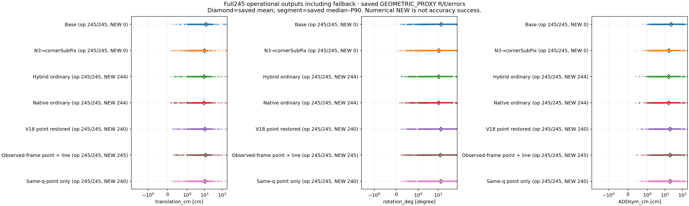
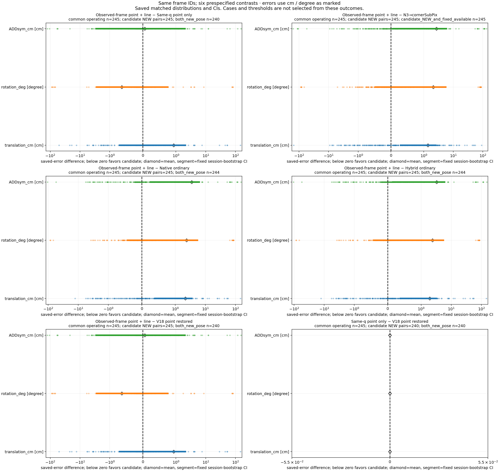
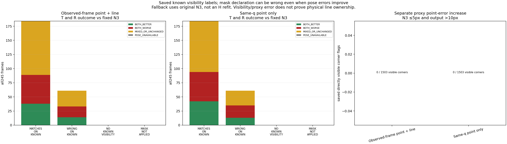
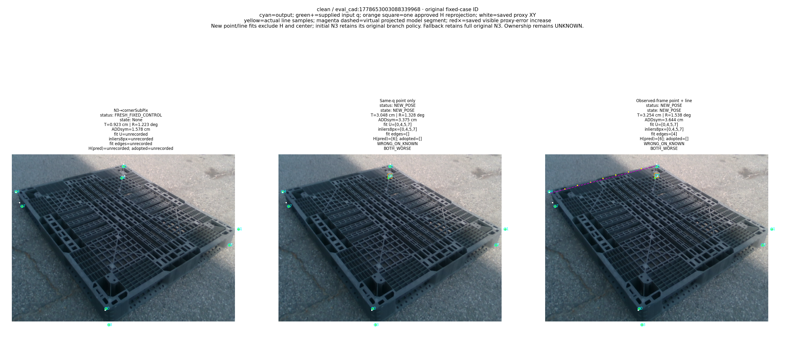
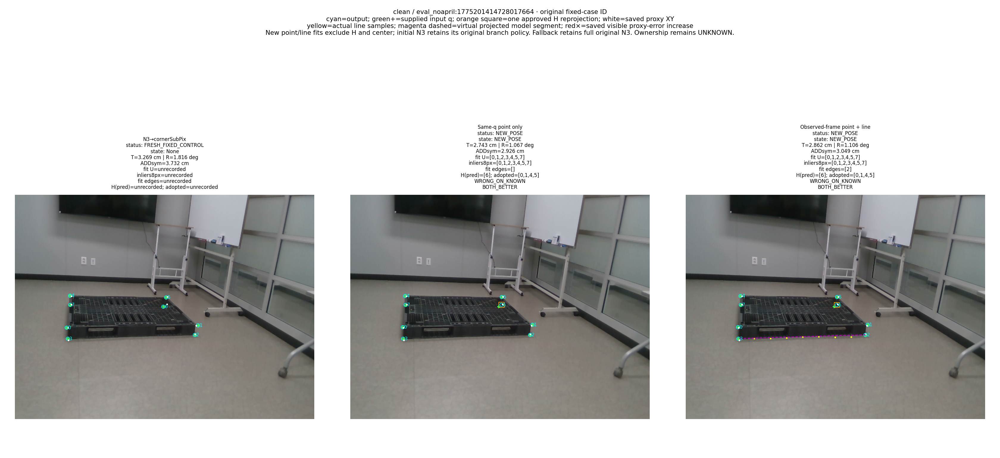
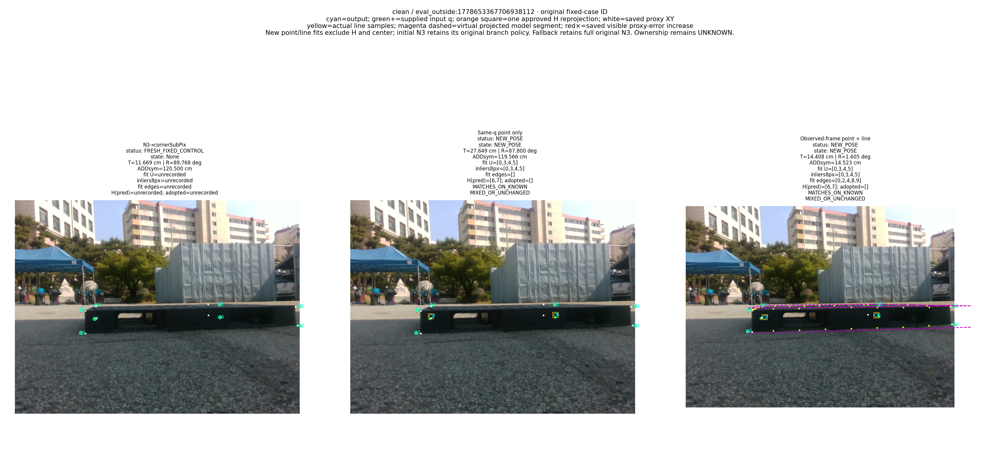
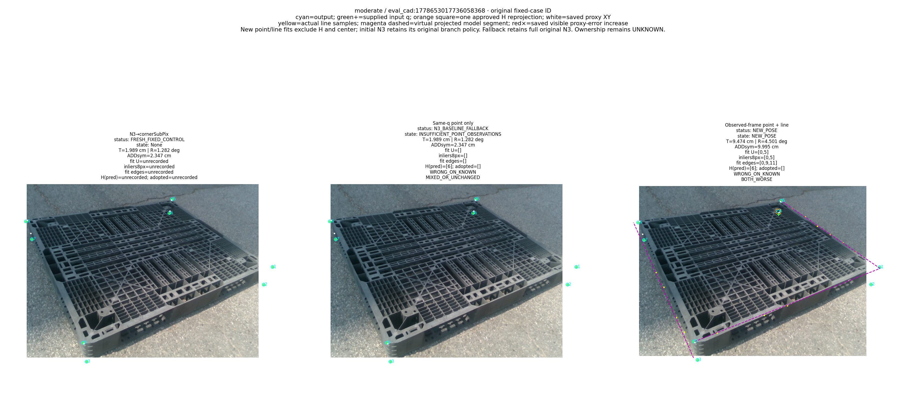
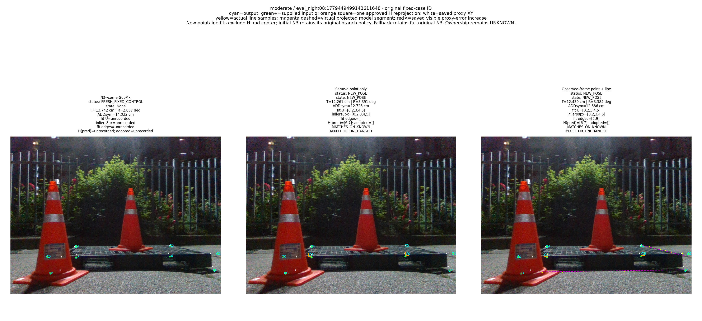
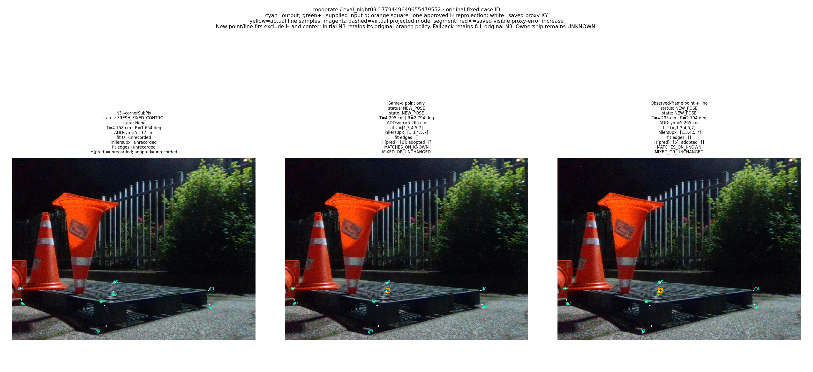
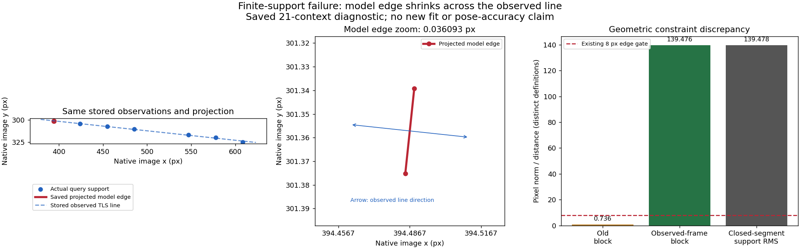

# V19 관측 선분 보정 결과 — 검토용 요약

> 가림 판단이 일부 틀려도 다른 유효 대응점으로 자세를 구하고 자기 가림 코너를 재투영했을 때, 기존 단순 대조보다 실제 위치·회전이 좋아졌는가?

**현재 245장 평가 참조 기준의 N3 대비 운용 평균에서 위치·회전 동시 개선을 확인하지 못했다.** 아래 표는 N3·native ordinary·hybrid ordinary·같은 q 점 전용 대조와의 실제 공통 245장을 따로 보여 준다. 참조는 기존 주석·K·등록 cuboid에서 재구성한 알려진 DEV GEOMETRIC_PROXY다. 독립 실측 자세·물리 edge/corner ownership·미관측 데이터 성능을 인증하지 않는다.

| 대조(새 선−대조) | 공통 n | ΔT cm | ΔR deg | ΔADDsym cm | T 95% CI | R 95% CI |
| --- | --- | --- | --- | --- | --- | --- |
| N3→cornerSubPix | 245 | 1.372722070260142 | 2.0849196174338114 | 2.674082863601998 | [0.2937459263952467,2.523460884786833] | [-0.46496857471324854,5.523244934312135] |
| Native ordinary | 245 | 2.175695924979311 | 2.3821223345010245 | 3.4911816704092433 | [0.39478009940562836,3.5715000612416845] | [-0.42691466146383633,5.442761543007358] |
| Hybrid ordinary | 245 | 1.9201162132028333 | 2.386297531848767 | 3.263043032508877 | [0.3772575207522113,3.2015215491311957] | [-0.4192030765165513,5.442134811447907] |
| V19 같은 q 점 | 245 | 0.9325359099454874 | -0.6395710603777855 | 0.05633850326292845 | [-0.7025123456744373,2.085459533291678] | [-2.7654177365766963,0.7500891974336751] |
| V18 복원 점 | 245 | 0.9325359099454874 | -0.6395710603777855 | 0.05633850326292845 | [-0.7025123456744373,2.085459533291678] | [-2.7654177365766963,0.7500891974336751] |

음수는 새 선 경로에 유리하다. 같은 q 점 경로와는 위치·회전의 방향이 다를 수 있으므로 한 축 개선을 두 축의 성공으로 쓰지 않는다. 전체 mean·분산(ddof0/1)·SD·median·P90·max, NEW/fallback 공통 집합, 모든 162 CI 및 frame ID는 [FULL_AUDIT_KO.md](FULL_AUDIT_KO.md)와 [METRICS.json](evaluation/METRICS.json)에 있다.

## 무엇을 고쳤고 무엇이 남았는가

확정한 오류는 부분선 경로의 longitudinal hinge가 모델 투영 tangent를 써서 매우 짧고 관측선과 직교한 선분에서도 긴 support를 inside로 볼 수 있었던 점이다. 고정 관측 tangent의 interval objective로 바꿨다. 구조 fixture4/미분30 및 저장21context·29line 중 기존 inlier23개가 새 outlier임을 확인했다. 실제 nearest-segment 거리 자체나 물리 ownership을 인증하는 식은 아니다. accepted context5/approved NEW0이므로 이 허점을 V18 점 전용의 나쁜 자세 원인으로 단정하지 않는다.

과거 새 head의 2,164 query 수치 실패→no_match 감독은 wire/depth와 POSITIVE/NONE/IGNORE로 이미 고쳤으며 main N3→cornerSubPix 오류가 아니다. 최초 읽기 전용 인수인계 당시 재학습 없음과, 이후 승인된 수정 감독 3×3,000=9,000 업데이트 완료를 구분한다. 수정 전 IMAGE_ROLE 0/319를 현재 결과로 쓰지 않는다. 이번 새 학습·RGB·seed·설정 sweep은 0이다. [감독 수정](../pallet_kp_supervision_repair_20261010_v1/RESULT_KO.md) · [수정 학습](../pallet_kp_corrected_supervision_20261010_v1/TRAINING_COMPLETION.json).

corner q는 임의 한 ray 대응을 3D corner에 붙인 값이 아니라 incident한 서로 다른 TLS 경계 두 선의 교점이다. 네 hybrid 후단만 같은 H·q를 공유한다. native ordinary는 원 N3 q, fixed Base/N3의 H metadata는 unrecorded다. 코너 LOO는 H∪{k}, unused 선 endpoint LOO는 H∪{a,b}를 제외한다. 충분한 나머지 대응이 있으면 마스크 일부 오판에도 합의로 계산한다. 승인 NEW에서 H 초기 XY를 fit/score에 넣지 않고 최종 R,t로 한 번 교체하며 재투영을 새 관측으로 다시 fit하지 않는다. fallback은 원 N3 전체 출력이다.

기존 V18의 추가 cost veto161개 복원과 이번 선 objective 수정은 다른 변경이다. V16 전체 198,134,007검사 중564 FAIL은 그대로 보존한다. 처음 기하 실행은 실제2solve·46optimizer 후 JSON ndarray 직렬화에서 실패해0행이었다. 별도 driver의 common.finite 두 JSON 호출만 수정해 실행했고 수학·관측·설정은 바꾸지 않았다. 다음 V21 후보 보강의 결과는 이 V19 보고서에 포함되지 않는다.

## 전체 산출과 운용 오차

Clean153·Moderate92, 전체245장을 유지했다. Severe74는 사용자 변경 요청으로 제외했다. Base/N3는 고정 출력이므로 NEW0/fallback0이고 산출은 전체에 존재한다. 큰 오차를 실패로 빼지 않았다. 표본 SD는 ddof1, 모집단 SD는 ddof0이며 None은 빈 집합이다.

| 층 | 방법 | 전체 | 산출 | NEW | fallback | 완전 실패 |
| --- | --- | --- | --- | --- | --- | --- |
| combined | Base | 245 | 245 | 0 | 0 | 0 |
| combined | N3→cornerSubPix | 245 | 245 | 0 | 0 | 0 |
| combined | Hybrid ordinary | 245 | 245 | 244 | 1 | 0 |
| combined | Native ordinary | 245 | 245 | 244 | 1 | 0 |
| combined | V18 복원 점 | 245 | 245 | 240 | 5 | 0 |
| combined | V19 관측선 | 245 | 245 | 245 | 0 | 0 |
| combined | V19 같은 q 점 | 245 | 245 | 240 | 5 | 0 |
| easy | Base | 153 | 153 | 0 | 0 | 0 |
| easy | N3→cornerSubPix | 153 | 153 | 0 | 0 | 0 |
| easy | Hybrid ordinary | 153 | 153 | 153 | 0 | 0 |
| easy | Native ordinary | 153 | 153 | 153 | 0 | 0 |
| easy | V18 복원 점 | 153 | 153 | 152 | 1 | 0 |
| easy | V19 관측선 | 153 | 153 | 153 | 0 | 0 |
| easy | V19 같은 q 점 | 153 | 153 | 152 | 1 | 0 |
| medium | Base | 92 | 92 | 0 | 0 | 0 |
| medium | N3→cornerSubPix | 92 | 92 | 0 | 0 | 0 |
| medium | Hybrid ordinary | 92 | 92 | 91 | 1 | 0 |
| medium | Native ordinary | 92 | 92 | 91 | 1 | 0 |
| medium | V18 복원 점 | 92 | 92 | 88 | 4 | 0 |
| medium | V19 관측선 | 92 | 92 | 92 | 0 | 0 |
| medium | V19 같은 q 점 | 92 | 92 | 88 | 4 | 0 |

| 층 | 방법 | 지표 | n | 평균 | 모집단 SD | 표본 SD | 중앙값 | P90 | 최대 | 단위 |
| --- | --- | --- | --- | --- | --- | --- | --- | --- | --- | --- |
| combined | Base | translation_cm | 245 | 12.188351368308584 | 23.159896047350692 | 23.207306324291856 | 6.010803220063387 | 23.191871672208148 | 183.07850477473974 | cm |
| combined | Base | rotation_deg | 245 | 14.232844378136992 | 29.118879063903037 | 29.178487885886238 | 1.839738412238616 | 82.81063875160255 | 90.00917492050102 | degree |
| combined | Base | ADDsym_cm | 245 | 22.431945806117554 | 38.72796479251019 | 38.80724423022557 | 6.405062242563096 | 110.03653211262429 | 188.9915223699912 | cm |
| combined | N3→cornerSubPix | translation_cm | 245 | 9.754548028679153 | 23.94964018212377 | 23.99866713247598 | 3.5973495042103814 | 15.085014302122275 | 174.7568271983788 | cm |
| combined | N3→cornerSubPix | rotation_deg | 245 | 10.914841863166323 | 25.738406674272355 | 25.79109538176727 | 1.6659926895050734 | 76.09532476401336 | 89.77763362360415 | degree |
| combined | N3→cornerSubPix | ADDsym_cm | 245 | 17.028646667097725 | 35.96539450075627 | 36.039018722129846 | 3.9369354820060027 | 68.43149389306842 | 180.98844156077627 | cm |
| combined | Hybrid ordinary | translation_cm | 245 | 9.207153885736464 | 20.25164686372 | 20.293103707237805 | 3.833791005398134 | 18.961934042295727 | 169.89322333069043 | cm |
| combined | Hybrid ordinary | rotation_deg | 245 | 10.613463948751368 | 25.212431830952884 | 25.26404382320975 | 1.6895907031155688 | 54.711582265606815 | 89.7738646552605 | degree |
| combined | Hybrid ordinary | ADDsym_cm | 245 | 16.43968649819084 | 33.974184871781915 | 34.04373291769405 | 4.01117015219868 | 66.939841321056 | 176.47060504649227 | cm |
| combined | Native ordinary | translation_cm | 245 | 8.951574173959987 | 20.087170118303078 | 20.12829026393439 | 3.833791005398134 | 18.961934042295727 | 169.89322333069043 | cm |
| combined | Native ordinary | rotation_deg | 245 | 10.61763914609911 | 25.211910641293503 | 25.26352156663081 | 1.6251166578679208 | 54.711582265606815 | 89.79172246250954 | degree |
| combined | Native ordinary | ADDsym_cm | 245 | 16.21154786029048 | 33.921249255625696 | 33.990688937829425 | 4.030611805010867 | 66.939841321056 | 176.47060504649227 | cm |
| combined | V18 복원 점 | translation_cm | 245 | 10.19473418899381 | 20.837455351730483 | 20.88011139504583 | 4.022035860009537 | 23.89893802504458 | 169.9482512071582 | cm |
| combined | V18 복원 점 | rotation_deg | 245 | 13.639332540977922 | 28.55557317507577 | 28.614028861995788 | 1.8407813566013058 | 82.4214587475194 | 90.10142903233576 | degree |
| combined | V18 복원 점 | ADDsym_cm | 245 | 19.646391027436795 | 36.50287175587624 | 36.57759623890309 | 4.252522316050203 | 74.0688172324972 | 176.52332591837003 | cm |
| combined | V19 관측선 | translation_cm | 245 | 11.127270098939297 | 23.654334636349784 | 23.702757071134272 | 4.075487426777011 | 23.326045661123015 | 173.88459393857818 | cm |
| combined | V19 관측선 | rotation_deg | 245 | 12.999761480600135 | 27.928185290431845 | 27.985356660993116 | 1.8116524647678964 | 82.46496091493763 | 89.6713516721702 | degree |
| combined | V19 관측선 | ADDsym_cm | 245 | 19.702729530699724 | 37.386479444295794 | 37.463012747411035 | 4.554736029677354 | 79.0513622208983 | 180.3898184787999 | cm |
| combined | V19 같은 q 점 | translation_cm | 245 | 10.19473418899381 | 20.837455351730483 | 20.88011139504583 | 4.022035860009537 | 23.89893802504458 | 169.9482512071582 | cm |
| combined | V19 같은 q 점 | rotation_deg | 245 | 13.639332540977922 | 28.55557317507577 | 28.614028861995788 | 1.8407813566013058 | 82.4214587475194 | 90.10142903233576 | degree |
| combined | V19 같은 q 점 | ADDsym_cm | 245 | 19.646391027436795 | 36.50287175587624 | 36.57759623890309 | 4.252522316050203 | 74.0688172324972 | 176.52332591837003 | cm |
| easy | Base | translation_cm | 153 | 12.846348362759484 | 28.02293851916571 | 28.114968121640153 | 4.668213987688899 | 19.836603231600556 | 183.07850477473974 | cm |
| easy | Base | rotation_deg | 153 | 10.628204608338502 | 24.75064780623126 | 24.83193094065468 | 1.715555635657884 | 50.873618630439076 | 89.4792849588053 | degree |
| easy | Base | ADDsym_cm | 153 | 17.93860487754294 | 35.50482376174502 | 35.621424482061485 | 5.5161632734927135 | 53.33233728654386 | 188.9915223699912 | cm |
| easy | N3→cornerSubPix | translation_cm | 153 | 10.107072506393136 | 29.224961964283242 | 29.320939109223424 | 2.6918845473520725 | 12.762645595341315 | 174.7568271983788 | cm |
| easy | N3→cornerSubPix | rotation_deg | 153 | 7.584578376689015 | 20.801391397665313 | 20.86970485379816 | 1.5416520299079417 | 5.923153455782191 | 89.76763723821307 | degree |
| easy | N3→cornerSubPix | ADDsym_cm | 153 | 12.915132447282565 | 33.5141024873849 | 33.624165517608965 | 2.966195228583507 | 14.83116901630595 | 180.98844156077627 | cm |
| easy | Hybrid ordinary | translation_cm | 153 | 8.429226656804744 | 23.097837148151864 | 23.173692318347886 | 2.7737384667261553 | 13.132737807431784 | 169.89322333069043 | cm |
| easy | Hybrid ordinary | rotation_deg | 153 | 6.468994812647887 | 18.62899941483908 | 18.69017855954126 | 1.4446440987210218 | 5.6585114616544905 | 88.50177257977313 | degree |
| easy | Hybrid ordinary | ADDsym_cm | 153 | 11.008250749784743 | 27.94633833381599 | 28.038116375070246 | 3.0995737745137397 | 14.578469398220822 | 176.47060504649227 | cm |
| easy | Native ordinary | translation_cm | 153 | 8.283471071855557 | 23.1274136653163 | 23.203365967193047 | 2.7636728929599297 | 13.132737807431784 | 169.89322333069043 | cm |
| easy | Native ordinary | rotation_deg | 153 | 6.466523899060526 | 18.62800525788539 | 18.68918113769552 | 1.3906174634895643 | 5.6585114616544905 | 88.50177257977313 | degree |
| easy | Native ordinary | ADDsym_cm | 153 | 10.884012479374642 | 27.976150093087636 | 28.068026038576775 | 3.001498132178273 | 14.578469398220822 | 176.47060504649227 | cm |
| easy | V18 복원 점 | translation_cm | 153 | 9.29150872342711 | 23.604000950697962 | 23.681518403866317 | 3.004470549016578 | 16.159344551876078 | 169.9482512071582 | cm |
| easy | V18 복원 점 | rotation_deg | 153 | 8.177492819401836 | 21.666124280195575 | 21.737277589235763 | 1.662679586451505 | 7.681457945490692 | 89.31805542262327 | degree |
| easy | V18 복원 점 | ADDsym_cm | 153 | 12.58663177800136 | 29.330461708612006 | 29.42678532326753 | 3.358459163043675 | 20.9003199195624 | 176.52332591837003 | cm |
| easy | V19 관측선 | translation_cm | 153 | 10.367104455604135 | 26.80464405563565 | 26.892672680300475 | 3.3654395691986743 | 14.70183694831296 | 173.88459393857818 | cm |
| easy | V19 관측선 | rotation_deg | 153 | 8.571860104230232 | 22.305743038255812 | 22.378996907164094 | 1.6344908812418553 | 7.814294111832614 | 89.31370124675186 | degree |
| easy | V19 관측선 | ADDsym_cm | 153 | 13.36132396775967 | 31.17572160540527 | 31.278105203193814 | 3.6755268041290075 | 19.27362799837066 | 180.3898184787999 | cm |
| easy | V19 같은 q 점 | translation_cm | 153 | 9.29150872342711 | 23.604000950697962 | 23.681518403866317 | 3.004470549016578 | 16.159344551876078 | 169.9482512071582 | cm |
| easy | V19 같은 q 점 | rotation_deg | 153 | 8.177492819401836 | 21.666124280195575 | 21.737277589235763 | 1.662679586451505 | 7.681457945490692 | 89.31805542262327 | degree |
| easy | V19 같은 q 점 | ADDsym_cm | 153 | 12.58663177800136 | 29.330461708612006 | 29.42678532326753 | 3.358459163043675 | 20.9003199195624 | 176.52332591837003 | cm |
| medium | Base | translation_cm | 92 | 11.094073757971767 | 10.978371464687656 | 11.038527375073993 | 7.851389680650634 | 26.036088792108245 | 60.431861873972714 | cm |
| medium | Base | rotation_deg | 92 | 20.227517038780135 | 34.37590306761442 | 34.564265590328866 | 1.9987798847057285 | 86.1592126325831 | 90.00917492050102 | degree |
| medium | Base | ADDsym_cm | 92 | 29.904567132986195 | 42.52461055172781 | 42.757623860649986 | 8.14224175976533 | 116.22280336782391 | 121.23894804412103 | cm |
| medium | N3→cornerSubPix | translation_cm | 92 | 9.168284495089601 | 10.321305377110395 | 10.377860898421783 | 5.220474363250011 | 23.637317402450154 | 61.92360473915919 | cm |
| medium | N3→cornerSubPix | rotation_deg | 92 | 16.45321483524272 | 31.550933849510084 | 31.723816972964354 | 1.981300412332817 | 85.51015694788309 | 89.77763362360415 | degree |
| medium | N3→cornerSubPix | ADDsym_cm | 92 | 23.86959966309468 | 38.753207412074005 | 38.96555534361944 | 5.436086461145542 | 112.13137378003826 | 121.34476566792532 | cm |
| medium | Hybrid ordinary | translation_cm | 92 | 10.500880690372911 | 14.221859165788828 | 14.299787744563572 | 4.9173006906801975 | 24.174339477890623 | 92.07825076302261 | cm |
| medium | Hybrid ordinary | rotation_deg | 92 | 17.50589631640172 | 32.24275170267528 | 32.41942563726328 | 2.014381648042667 | 85.91110941584948 | 89.7738646552605 | degree |
| medium | Hybrid ordinary | ADDsym_cm | 92 | 25.472400297170555 | 40.55023289523427 | 40.7724276154655 | 5.47287559827952 | 113.53662428837377 | 137.23432180464718 | cm |
| medium | Native ordinary | translation_cm | 92 | 10.062658680720613 | 13.528568584776659 | 13.602698282615627 | 4.805310042326136 | 24.03199182662523 | 92.07825076302261 | cm |
| medium | Native ordinary | rotation_deg | 92 | 17.521124285195885 | 32.23883491256851 | 32.41548738513226 | 2.0379616688347344 | 85.91110941584948 | 89.79172246250954 | degree |
| medium | Native ordinary | ADDsym_cm | 92 | 25.0714708307266 | 40.45897149860737 | 40.680666152648016 | 5.461603234484565 | 113.54220078104109 | 137.23432180464718 | cm |
| medium | V18 복원 점 | translation_cm | 92 | 11.696837408903642 | 15.037168501101196 | 15.119564561730597 | 6.159331862182418 | 25.056568678498838 | 92.08306740834603 | cm |
| medium | V18 복원 점 | rotation_deg | 92 | 22.722609469251196 | 35.47839029226706 | 35.67279388609133 | 2.427880773734963 | 86.89031463609365 | 90.10142903233576 | degree |
| medium | V18 복원 점 | ADDsym_cm | 92 | 31.387077605302242 | 43.55446549683696 | 43.79312188879638 | 6.8776635018589225 | 116.02546691042821 | 137.2360523422634 | cm |
| medium | V19 관측선 | translation_cm | 92 | 12.391458614485815 | 17.105808052460876 | 17.199539209181125 | 5.795510572588487 | 24.70954344431566 | 93.90217935597552 | cm |
| medium | V19 관측선 | rotation_deg | 92 | 20.363553986954425 | 34.100697324350854 | 34.28755185910162 | 2.2188543304078143 | 86.80516945898695 | 89.6713516721702 | degree |
| medium | V19 관측선 | ADDsym_cm | 92 | 30.248762695154383 | 43.906900345436384 | 44.14748790170715 | 6.27926862634191 | 117.25417753759004 | 138.00278014020796 | cm |
| medium | V19 같은 q 점 | translation_cm | 92 | 11.696837408903642 | 15.037168501101196 | 15.119564561730597 | 6.159331862182418 | 25.056568678498838 | 92.08306740834603 | cm |
| medium | V19 같은 q 점 | rotation_deg | 92 | 22.722609469251196 | 35.47839029226706 | 35.67279388609133 | 2.427880773734963 | 86.89031463609365 | 90.10142903233576 | degree |
| medium | V19 같은 q 점 | ADDsym_cm | 92 | 31.387077605302242 | 43.55446549683696 | 43.79312188879638 | 6.8776635018589225 | 116.02546691042821 | 137.2360523422634 | cm |

## 마스크 오류와 남은 대응

아래는 저장된 GEOMETRIC_PROXY 품질과 알려진 가시성의 membership/count 진단이다. UNKNOWN/UNANNOTATED는 의미상 known 비교에서 제외하고 UNKNOWN을 NONE으로 바꾸지 않았다. proxy 8px와 DIRECT_VISIBLE proxy 8px도 물리적으로 맞는 대응의 독립 인증은 아니다.

| 방법 | 마스크×N3 대비 T/R | n | NEW | fallback |
| --- | --- | --- | --- | --- |
| V19 관측선 | WRONG_ON_KNOWN__BOTH_BETTER | 14 | 14 | 0 |
| V19 관측선 | WRONG_ON_KNOWN__BOTH_WORSE | 19 | 19 | 0 |
| V19 관측선 | WRONG_ON_KNOWN__MIXED_OR_UNCHANGED | 28 | 28 | 0 |
| V19 관측선 | MATCHES_ON_KNOWN__BOTH_BETTER | 38 | 38 | 0 |
| V19 관측선 | MATCHES_ON_KNOWN__BOTH_WORSE | 51 | 51 | 0 |
| V19 관측선 | MATCHES_ON_KNOWN__MIXED_OR_UNCHANGED | 95 | 95 | 0 |
| V19 같은 q 점 | WRONG_ON_KNOWN__BOTH_BETTER | 13 | 13 | 0 |
| V19 같은 q 점 | WRONG_ON_KNOWN__BOTH_WORSE | 22 | 22 | 0 |
| V19 같은 q 점 | WRONG_ON_KNOWN__MIXED_OR_UNCHANGED | 26 | 24 | 2 |
| V19 같은 q 점 | MATCHES_ON_KNOWN__BOTH_BETTER | 42 | 42 | 0 |
| V19 같은 q 점 | MATCHES_ON_KNOWN__BOTH_WORSE | 52 | 52 | 0 |
| V19 같은 q 점 | MATCHES_ON_KNOWN__MIXED_OR_UNCHANGED | 90 | 87 | 3 |

| 방법 | 관측/배치 진단 집합 | n |
| --- | --- | --- |
| V19 관측선 | accepted_fit_at_least4_proxy_correct_but_pose_both_worse | 40 |
| V19 관측선 | accepted_fit_at_least4_directly_visible_proxy_correct_but_pose_both_worse | 40 |
| V19 관측선 | wrong_coordinate_final_inlier_remaining | 148 |
| V19 관측선 | wrong_selected_head_q_final_inlier_remaining | 13 |
| V19 관측선 | changed_H_set_with_approved_NEW | 10 |
| V19 같은 q 점 | accepted_fit_at_least4_proxy_correct_but_pose_both_worse | 44 |
| V19 같은 q 점 | accepted_fit_at_least4_directly_visible_proxy_correct_but_pose_both_worse | 43 |
| V19 같은 q 점 | wrong_coordinate_final_inlier_remaining | 147 |
| V19 같은 q 점 | wrong_selected_head_q_final_inlier_remaining | 13 |
| V19 같은 q 점 | changed_H_set_with_approved_NEW | 11 |

eligible/solver_used/accepted_fit/final_inlier별 올바른 proxy 점 수·잘못 제외1/2·잘못 남김1/2·동시 오류·fit ID/선 ID·기존 cuboid 부호 배치·저장 rank/spectrum·모든 frame ID는 [FULL_AUDIT_KO.md](FULL_AUDIT_KO.md), [CORRESPONDENCE_SUMMARY.json](correspondence/CORRESPONDENCE_SUMMARY.json), [CORRESPONDENCE_ROWS.jsonl.gz](correspondence/CORRESPONDENCE_ROWS.jsonl.gz)에 있다. rank6나 충분한 proxy 점 수만으로 좋은 conditioning·올바른 ownership·유일해를 인증하지 않는다. 같은 선의 q와 선을 중복 관측으로 세지 않았다.

## 직접 가시점 손상과 숨은 점 재투영

직접 손상 flag는 N3≤5px→output>10px다. hidden 집합의 None은 이 flag가 정의되지 않는다는 뜻이다. 숨은 점 오차나 median만 낮아졌다고 R,t가 개선됐다고 말하지 않는다. ACTUALLY_REPROJECTED는 승인 NEW에서 실제로 교체한 H만 포함한다.

| 방법 | 집합 | 단계 | 코너 수 | 직접 손상 flag | n | 평균 px | 중앙값 px | P90 px |
| --- | --- | --- | --- | --- | --- | --- | --- | --- |
| V19 관측선 | DIRECT_VISIBLE | N3 | 1503 | 0 | 1503 | 19.853023651037 | 4.4280440607544715 | 21.434210641657124 |
| V19 관측선 | DIRECT_VISIBLE | output | 1503 | 0 | 1503 | 19.891854615367887 | 4.400291370331489 | 21.32859221313023 |
| V19 관측선 | SELF_OCCLUDED | N3 | 335 | None | 335 | 19.65428204564917 | 7.06713621098236 | 26.523561830776252 |
| V19 관측선 | SELF_OCCLUDED | output | 335 | None | 335 | 21.080022598635008 | 4.3091396644048965 | 33.42623628009172 |
| V19 관측선 | ACTUALLY_REPROJECTED | N3 | 300 | None | 300 | 19.830538414666158 | 7.075290791042477 | 26.794534766400503 |
| V19 관측선 | ACTUALLY_REPROJECTED | output | 300 | None | 300 | 21.666152181279056 | 4.1752074902264695 | 35.84856134051059 |
| V19 같은 q 점 | DIRECT_VISIBLE | N3 | 1503 | 0 | 1503 | 19.853023651037 | 4.4280440607544715 | 21.434210641657124 |
| V19 같은 q 점 | DIRECT_VISIBLE | output | 1503 | 0 | 1503 | 19.9895715514279 | 4.400291370331489 | 21.32859221313023 |
| V19 같은 q 점 | SELF_OCCLUDED | N3 | 335 | None | 335 | 19.65428204564917 | 7.06713621098236 | 26.523561830776252 |
| V19 같은 q 점 | SELF_OCCLUDED | output | 335 | None | 335 | 20.32929334786957 | 4.566288251342208 | 33.2850097400525 |
| V19 같은 q 점 | ACTUALLY_REPROJECTED | N3 | 293 | None | 293 | 19.031876714653993 | 7.06713621098236 | 26.605056812052325 |
| V19 같은 q 점 | ACTUALLY_REPROJECTED | output | 293 | None | 293 | 20.553713285437453 | 4.352003246826628 | 38.7438127447363 |

## 실제 호출 시간: cleanup 실패로 비공식

**원 runtime은 FAILED_RUNTIME_CLEANUP / complete=False / statistics_official=False / summaries=None이다.** 26영상·13session, warmup20+measured130=150회가 모두 반환·직렬화됐지만 환경 복원이 실패했다. detector151/N3150에는 첫 predict 내부 준비1회가 포함되고 로딩 forward는0이다. 별도 저장 행 검산은 scientific_rows_passed=True/scalar FAIL0이나 overall passed=False/cleanup=False/역사 cleanup 실패1을 유지한다. 재측정하지 않았다.

검출기→N3/cornerSubPix→초기 N3·Base feature 자세→고정 IMAGE_ROLE/CAL→corner LOO/강건 점 PnP→native endpoint LOO→새 선 consensus/refit→H 재투영·metadata의 실제 전체 경로 tick이다. cache replay나 기존 단계 시간의 합산이 아니다. 아래는 같은 저장 tick에서 원 describe 식으로 계산한 비공식·탐색적 통계이며 clean 배포 경로 또는 현재 process의 환경·namespace 복원 인증이 아니다. [실패 원 receipt](runtime/RUNTIME_RECEIPT.json) · [저장 행 검산](runtime_checks_ready/RUNTIME_CHECKS.json).

| 단계 | n | 평균 ms | 표본 SD ms | 중앙값 ms | P90 ms | 최대 ms |
| --- | --- | --- | --- | --- | --- | --- |
| full | 130 | 4374.615479023077 | 3510.97688432409 | 3208.621869 | 10196.521960700002 | 12842.032629 |
| detector | 130 | 15.287191830769231 | 3.776426397646935 | 14.38632 | 20.214954500000005 | 30.916449 |
| N3_correction | 130 | 4.494563523076923 | 0.7512502005802281 | 4.1763485 | 5.6780407 | 7.576237 |
| initial_pose | 130 | 1.4896237230769231 | 0.2089024154056765 | 1.406621 | 1.8769370000000003 | 2.292061 |
| boundary_observation | 130 | 8.569392084615384 | 1.6084142982753797 | 8.145684500000002 | 10.665791200000001 | 14.083294 |
| endpoint_validation_and_filtered_local | 130 | 4317.462525961539 | 3503.6055900650385 | 3168.0867835 | 10096.117074800002 | 12776.303694 |
| final_pose_reprojection_and_metadata | 130 | 0.1796270846153846 | 0.11235175095036544 | 0.12816450000000001 | 0.3098275000000001 | 0.705824 |
| return | 130 | 27.132554815384616 | 20.861903915778882 | 20.9926225 | 63.1015652 | 73.602387 |

## 실제 검산과 실행량

| 권위 | 저장된 확인 범위 |
| --- | --- |
| 완료 기하 | {"frames_started":245,"geometry_rows":490,"ledger_rows":245,"frames_complete":245} |
| 전체 기하 scalar | {"checks":232807611,"failures":0} |
| 저장 자세 통계 | {"saved_error_rows_streamed":1960,"saved_error_rows_selected":1715,"frames":245,"methods":7,"moment_scalars_checked":5400,"moment_distributions_checked":675,"metric_CI_slots_checked":162,"paired_groups_checked":54} |
| 비공식 runtime 행 | {"checks":1765136,"rows":150,"measured":130,"scalar_failures":0,"overall_passed":false} |

원 CV/SciPy/SVD entry·return·exception/callback, 모델·head 횟수와 cleanup의 전체 counter는 [FULL_AUDIT_KO.md](FULL_AUDIT_KO.md)에 있다. 기하 replay elapsed는 초기 RGB 경로 latency가 아니다. 전체 기하 PASS는 식·산술·fit 계약, correspondence PASS는 membership/count, 시각 PASS는 가독성에 한정한다. 물리 GT·전역 유일해·성능 성공으로 확대하지 않는다.

## 고정 그림: 동일한 6사례

결과에 따라 사례를 바꾸지 않았다. 9PNG/18panel을 ROOT가 실제 열어 확인했다. N3의 H(pred)=[] 또는 unrecorded metadata는 실제 가림 없음이나 빈 fit 인증이 아니다. green+=입력q, cyan=출력, orange=NEW H 재투영, white=proxy, yellow=실제 선 support, magenta=virtual model segment다. [실제 시각 검토](render_ready/ROOT_VISUAL_REVIEW.json).

## 공개 원행·한계

원 주석·K·등록 cuboid의 proxy R,t는 N3 예측을 정답으로 되먹인 값이 아니다. N3는 코너 번호 정렬 기준이다. 원 annotation에는 unknown/manual_click/pnp_projected가 섞여 전점 독립 클릭·물리 실측 보장이 없다. CAL128/348 corner의 virtual/native 평균차3.0674443457516407e−05px도 실사 ownership 인증은 아니다. P0의 외부 가림·비가림 방해물·저대비 네 통제 변형은 별도 검증되지 않았다.

상세 원 report는 수정 없이 [FULL_AUDIT_KO.md](FULL_AUDIT_KO.md)로 함께 게시한다. 40MiB 초과 원 gzip은 [ARCHIVE_MANIFEST.json](ARCHIVE_MANIFEST.json)의 ordered parts/원 SHA로 확인하고 FULL_AUDIT의 clone restore-freeze|restore-run 절차로 복원한다. 원 SHA·13문제 query의 source provenance는 물리 ID 승인과 다르다. main 변경·force push·새 촬영·annotation·학습은 수행했다고 주장하지 않는다.

이 요약 생성은 push나 copied portable reader 완료를 뜻하지 않는다. V19 게시 commit/원격 SHA와 공개 복원·replay는 별도 actual receipt가 확인해야 한다. 이전 게시 checkpoint는 [PUSH_V16_V18_RECEIPT.json](../pallet_observation_refiner_status_20261011/PUSH_V16_V18_RECEIPT.json)이다.
