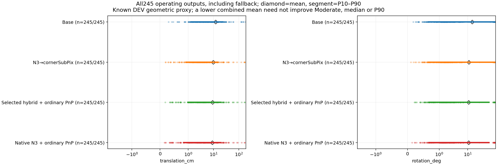
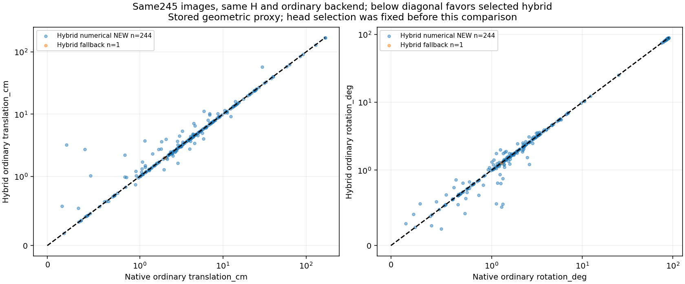
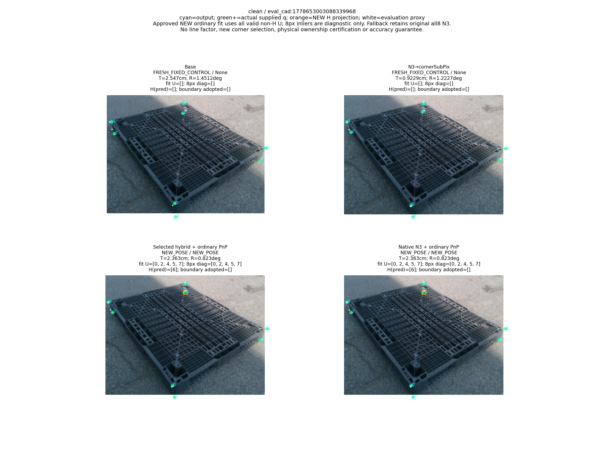
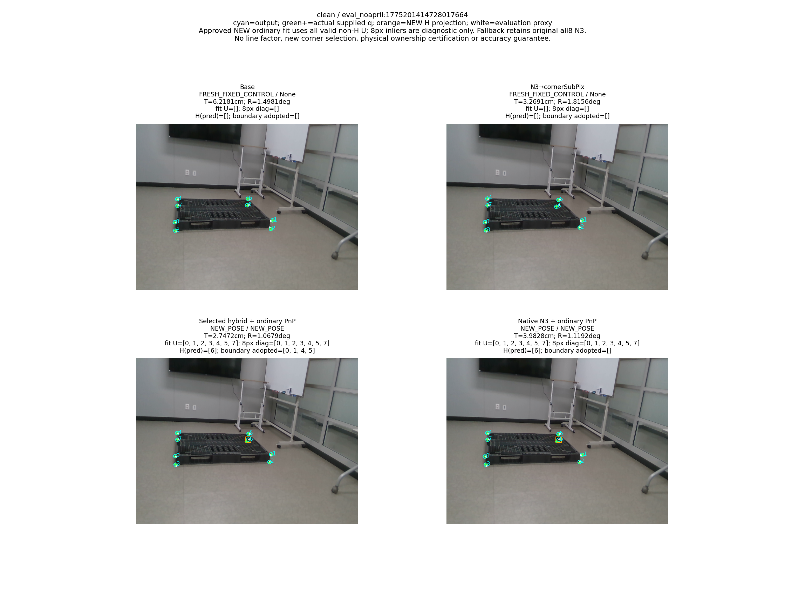
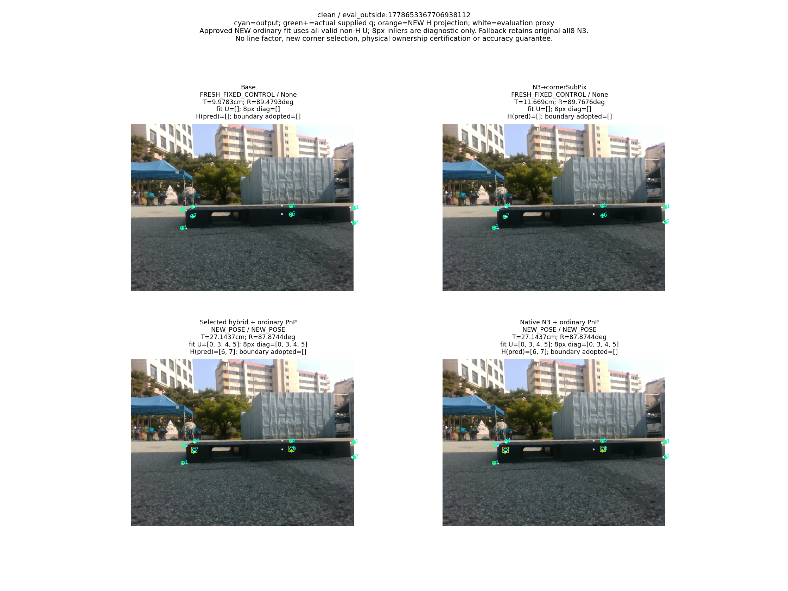
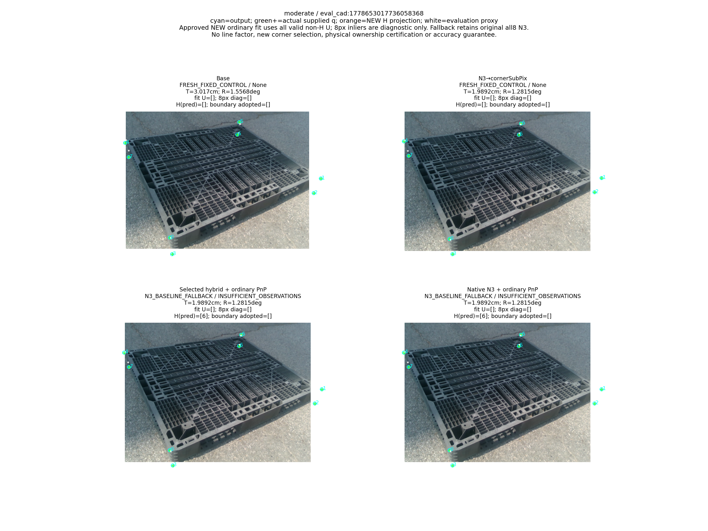
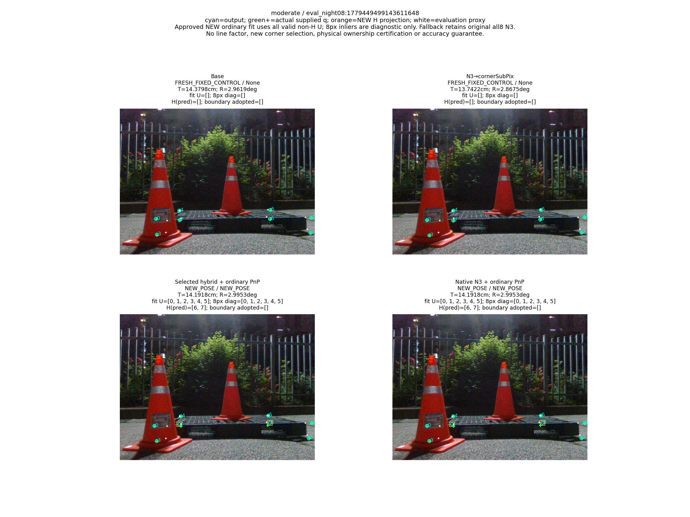
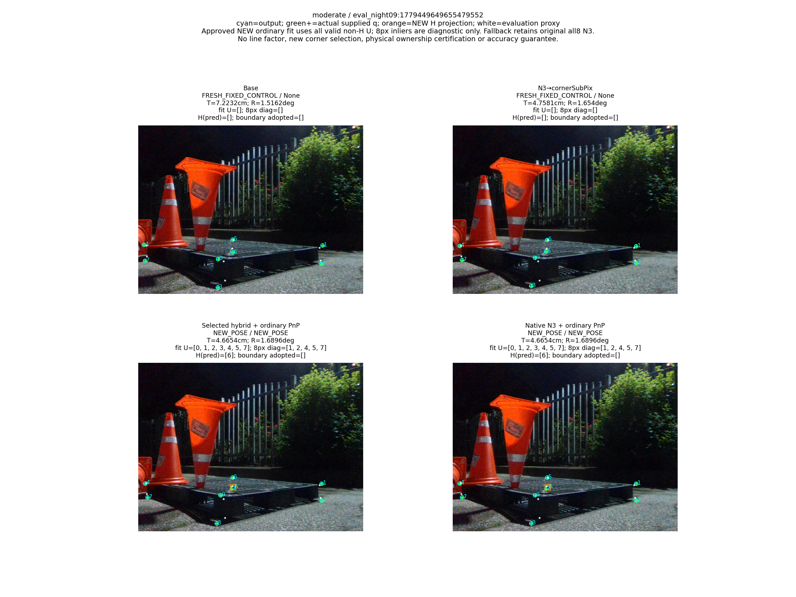

# V17 결과: 같은 일반 PnP에서 native와 고정 hybrid 대응점 비교

“가림 판단이 일부 틀려도 다른 유효 대응점으로 자세를 구하고 자기 가림 코너를 재투영했을 때, 기존 단순 대조보다 실제 위치·회전이 좋아졌는가?”

**알려진 DEV 245장의 기존 주석 기반 기하 reference에서 N3 대비 종합 위치·회전 평균은 낮아졌다. 그러나 학습된 hybrid 관측을 쓰면 같은 일반 PnP를 쓰는 단순 native 대조보다 위치 평균이 나빠졌고, 회전의 작은 차이도 양축 우세를 만들지 못했다. 중간 Moderate92에서는 두 일반 경로 모두 N3보다 위치·회전 평균이 나빠졌다. 목표가 해결됐다고 보고하지 않는다.**

이 결과는 독립 물리 실측에 대한 보증이 아니다. 전체 245장의 운용 평균을 유지하며 큰 오차와 기본 출력 반환을 함께 계산했다. 종합 평균의 개선, 각 난이도·중앙값·P90의 개선, learned head의 필요성, 미관측 실사 성능은 서로 다른 주장이다.

## 1. 이번 대조가 확인한 것

[사전 방법 계약](METHOD_CONTRACT_KO.md)과 [기하 protocol](PROTOCOL.json)은 이미 고정된 V7 `IMAGE_ROLE_CORNERWISE_HYBRID` 좌표와 원래 `OBS.native_N3_points`를 같은 V4 일반 PnP로 비교한다. 새로운 head·좌표 선택·가림 분류·학습·RGB·seed·임계값 탐색·선 관측 fit은 0회다. 현재 사용자 범위는 Clean153와 Moderate92의 245장이다. 과거 전체319와 Severe74 결과는 보존하며 이번 모집단에 넣지 않는다.

| 이름 | 실제 최종 관측 | 이번 역할 |
| --- | --- | --- |
| BASE | 원래 고정 RGB 추정기 좌표 | 기존 고정 출력·점수 |
| N3_SUBPIX | 고정 N3→cornerSubPix 좌표 | 기존 고정 출력·점수 |
| HYBRID_STANDARD_PNP | 봉인된 코너별 native/경계 선택 q | 일반 PnP의 관측 공급 효과 |
| NATIVE_STANDARD_PNP | 원래 N3 native 좌표 | head 없이 같은 일반 PnP |

[pipeline.py](../../../scripts/research/pallet_hybrid_standard_controls_20261011_v17/pipeline.py)에서 두 경로는 같은 H, K, 물리 치수와 `PoseBank.solve(hidden=H, robust=False)`를 쓴다. 최소 4개 실제 대응, 배치·양의 깊이·전체 U Jacobian rank6·변경 없는 다중해 처리를 요구한다. 일반 PnP는 전체 U를 fit한다. 8px inlier 수는 진단이며 강건 솔버의 최소4-inlier 게이트를 추가하지 않았다. H 오판이나 재추정 H 변화만으로 전체 프레임을 실패시키지 않았다.

**승인 NEW의 실험 fit·점수에서는 초기 H의 XY와 중심 ID8을 제외했다.** 새 R,t가 있으면 H를 최종 투영으로 한 번 교체하고 다시 PnP에 넣지 않았다. 새 자세가 없으면 이미 계산된 원래 전체8점 N3 좌표·초기 자세를 기본 출력으로 반환한다. 이 기본 출력은 H를 제외한 새 fit 또는 NEW로 표시하지 않는다. [runner](../../../scripts/research/pallet_hybrid_standard_controls_20261011_v17/runner.py)의 전체 bank ledger와 실제 호출·복구 기록이 두 경로를 구분한다.

코너 대응의 정의도 구분해야 한다. head의 source 정답은 query normal과 실제 소유 semantic mesh wire의 교차 또는 대응 없음이다. 실제 decoder q는 그 코너에 연결된 서로 다른 두 incident edge의 TLS 선 교점이다. 한 광선의 임의 교차를 3D 코너로 바로 넣는 구현이 아니다. 실사 decoder의 edge ID는 query 의미에서 상속되므로, q가 proxy에서 가까운지와 실제 RGB에서 두 선이 올바른 물리 경계인지의 인증은 다르다. 후자는 UNKNOWN이다.

기존 선택은 `H∪{k}`를 제외한 다른 대응점의 강건 LOO 자세에서 native와 boundary q를 비교했다. 이번 대조는 그 선택을 다시 실행하지 않는다. 선택 성공과 최종 일반 PnP의 성공, 올바른 물리 correspondence와 실제 자세 개선도 구분한다. [V7 보고](../pallet_three_head_observation_20261010_v7/RESULT_KO.md), [V14 저장 대응 진단](../pallet_stable_incidence_guard_20261011_v14/CORRESPONDENCE_DIAGNOSTIC_CHECKS.json)을 보존했다.

## 2. 전체 운용 결과와 단순 대조

다음 값은 [METRICS.json](METRICS.json)의 operational 집계 그대로다. T와 ADDsym은 cm, R은 degree다. NEW의 수치 산출은 목표 달성을 뜻하지 않는다.

| 층 | 방법 | 전체 | NEW | N3 기본 반환 | 완전 실패 | 기존 고정 출력 | T 평균 | R 평균 | ADDsym 평균 |
| --- | --- | --- | --- | --- | --- | --- | --- | --- | --- |
| combined | BASE | 245 | 0 | 0 | 0 | 245 | 12.188351368308584 | 14.232844378136992 | 22.431945806117554 |
| combined | N3_SUBPIX | 245 | 0 | 0 | 0 | 245 | 9.754548028679153 | 10.914841863166323 | 17.028646667097725 |
| combined | HYBRID_STANDARD_PNP | 245 | 244 | 1 | 0 | 0 | 9.207153885736464 | 10.613463948751368 | 16.43968649819084 |
| combined | NATIVE_STANDARD_PNP | 245 | 244 | 1 | 0 | 0 | 8.951574173959987 | 10.61763914609911 | 16.21154786029048 |
| easy | BASE | 153 | 0 | 0 | 0 | 153 | 12.846348362759484 | 10.628204608338502 | 17.93860487754294 |
| easy | N3_SUBPIX | 153 | 0 | 0 | 0 | 153 | 10.107072506393136 | 7.584578376689015 | 12.915132447282565 |
| easy | HYBRID_STANDARD_PNP | 153 | 153 | 0 | 0 | 0 | 8.429226656804744 | 6.468994812647887 | 11.008250749784743 |
| easy | NATIVE_STANDARD_PNP | 153 | 153 | 0 | 0 | 0 | 8.283471071855557 | 6.466523899060526 | 10.884012479374642 |
| medium | BASE | 92 | 0 | 0 | 0 | 92 | 11.094073757971767 | 20.227517038780135 | 29.904567132986195 |
| medium | N3_SUBPIX | 92 | 0 | 0 | 0 | 92 | 9.168284495089601 | 16.45321483524272 | 23.86959966309468 |
| medium | HYBRID_STANDARD_PNP | 92 | 91 | 1 | 0 | 0 | 10.500880690372911 | 17.50589631640172 | 25.472400297170555 |
| medium | NATIVE_STANDARD_PNP | 92 | 91 | 1 | 0 | 0 | 10.062658680720613 | 17.521124285195885 | 25.0714708307266 |

양 경로 모두 실제 NEW244, 관측 부족1건의 N3 기본 반환, 완전 실패0이다. Clean153은 전부 NEW이고 Moderate92는 NEW91·기본 반환1이다. 위치·회전 오차가 큰 NEW를 실패로 빼지 않았다. 종합 operational의 native T=8.951574173959987/R=10.61763914609911은 이번 같은 V4 일반 backend로 실제 재계산한 대조다. 역사적 V1의 단순 predicted-H 일반 결과를 V17 원행으로 대체한 인용이 아니다.

종합 hybrid−native의 T 평균 차이는 +0.25557971177647776cm, R은 −0.004175197347742643deg, ADDsym은 +0.22813863790036598cm이다. 세 CI 모두 0을 포함한다. hybrid가 native보다 위치·회전을 모두 개선했다는 저장 판정은 false다. 따라서 이번 대조에서 learned boundary q의 추가 필요성을 입증하지 못했다.

여기서 CI가 0을 포함한다는 설명은 **종합 common_operational** 비교에 한정한다. 모든81 CI가 0을 포함한다는 뜻이 아니다. Moderate의 hybrid−native T CI는 [0.022066625820501232, 1.0722627279013115]로 위치 악화 쪽이고 R CI는 [−0.0275012631386573, −0.003290073027729024]로 회전 개선 쪽이다. 이 상반된 변화도 양축 우세가 아니다.

N3 대비 종합 hybrid의 T/R 평균 차이는 −0.5473941429426912cm/−0.3013779144149557deg지만 두 CI 모두 0을 포함한다. Moderate에서는 hybrid의 T/R 평균 차이가 +1.3325961952833105cm/+1.0526814811590004deg이고 native도 양축 악화다. 종합 T 중앙값은 두 일반 경로3.833791005398134cm가 N3 3.5973495042103814cm보다 높고, T P90도18.961934042295727cm가15.085014302122275cm보다 높다. 평균만 좋아졌다는 이유로 전체 프레임·난이도·분포가 좋아졌다고 결론내리지 않는다.

## 3. T·R·ADDsym의 모든 모집단별 moments

[원 점수490행](PREDICTIONS.jsonl.gz)과 [기존 Base/N3 고정490행](../pallet_sparse_local_line_20261010_v9/FIXED_PREDICTIONS.jsonl.gz)을 유지했다. 아래108분포의 평균·표본분산·표본표준편차·중앙값·P90·최대값648개는 새 통계 커널을 돌리지 않고 저장 값을 전사했다. operational은 NEW와 기본 반환을 합친 실제 운용 출력, new_pose는 NEW만, fallback은 기본 반환만이다. 표본0이면 None이며 표본1의 분산·표준편차도 None이다. BASE/N3의 new_pose=0은 이번 새법의 NEW 분류를 적용하지 않은 기존 고정 대조라는 뜻이다.

| 층 | 방법 | 모집단 | 오차 | n | 평균 | 표본분산 | 표본표준편차 | 중앙값 | P90 | 최대 |
| --- | --- | --- | --- | --- | --- | --- | --- | --- | --- | --- |
| combined | BASE | operational | translation_cm | 245 | 12.188351368308584 | 538.5790668295168 | 23.207306324291856 | 6.010803220063387 | 23.191871672208148 | 183.07850477473974 |
| combined | BASE | operational | rotation_deg | 245 | 14.232844378136992 | 851.3841553068099 | 29.178487885886238 | 1.839738412238616 | 82.81063875160255 | 90.00917492050102 |
| combined | BASE | operational | ADDsym_cm | 245 | 22.431945806117554 | 1506.0022047443758 | 38.80724423022557 | 6.405062242563096 | 110.03653211262429 | 188.9915223699912 |
| combined | BASE | new_pose | translation_cm | 0 | None | None | None | None | None | None |
| combined | BASE | new_pose | rotation_deg | 0 | None | None | None | None | None | None |
| combined | BASE | new_pose | ADDsym_cm | 0 | None | None | None | None | None | None |
| combined | BASE | fallback | translation_cm | 0 | None | None | None | None | None | None |
| combined | BASE | fallback | rotation_deg | 0 | None | None | None | None | None | None |
| combined | BASE | fallback | ADDsym_cm | 0 | None | None | None | None | None | None |
| combined | N3_SUBPIX | operational | translation_cm | 245 | 9.754548028679153 | 575.9360241353828 | 23.99866713247598 | 3.5973495042103814 | 15.085014302122275 | 174.7568271983788 |
| combined | N3_SUBPIX | operational | rotation_deg | 245 | 10.914841863166323 | 665.1806009914171 | 25.79109538176727 | 1.6659926895050734 | 76.09532476401336 | 89.77763362360415 |
| combined | N3_SUBPIX | operational | ADDsym_cm | 245 | 17.028646667097725 | 1298.8108704540255 | 36.039018722129846 | 3.9369354820060027 | 68.43149389306842 | 180.98844156077627 |
| combined | N3_SUBPIX | new_pose | translation_cm | 0 | None | None | None | None | None | None |
| combined | N3_SUBPIX | new_pose | rotation_deg | 0 | None | None | None | None | None | None |
| combined | N3_SUBPIX | new_pose | ADDsym_cm | 0 | None | None | None | None | None | None |
| combined | N3_SUBPIX | fallback | translation_cm | 0 | None | None | None | None | None | None |
| combined | N3_SUBPIX | fallback | rotation_deg | 0 | None | None | None | None | None | None |
| combined | N3_SUBPIX | fallback | ADDsym_cm | 0 | None | None | None | None | None | None |
| combined | HYBRID_STANDARD_PNP | operational | translation_cm | 245 | 9.207153885736464 | 411.8100580727087 | 20.293103707237805 | 3.833791005398134 | 18.961934042295727 | 169.89322333069043 |
| combined | HYBRID_STANDARD_PNP | operational | rotation_deg | 245 | 10.613463948751368 | 638.2719103010627 | 25.26404382320975 | 1.6895907031155688 | 54.711582265606815 | 89.7738646552605 |
| combined | HYBRID_STANDARD_PNP | operational | ADDsym_cm | 245 | 16.43968649819084 | 1158.9757509712856 | 34.04373291769405 | 4.01117015219868 | 66.939841321056 | 176.47060504649227 |
| combined | HYBRID_STANDARD_PNP | new_pose | translation_cm | 244 | 9.23673558901487 | 413.2894734838971 | 20.32952221484551 | 3.8411095519577856 | 19.183412745390072 | 169.89322333069043 |
| combined | HYBRID_STANDARD_PNP | new_pose | rotation_deg | 244 | 10.651709524802452 | 640.5387015123858 | 25.308866065321574 | 1.6937021466307582 | 59.64592634743124 | 89.7738646552605 |
| combined | HYBRID_STANDARD_PNP | new_pose | ADDsym_cm | 244 | 16.497443114966835 | 1162.9245576625558 | 34.10167968975364 | 4.018225526693788 | 66.99358335928339 | 176.47060504649227 |
| combined | HYBRID_STANDARD_PNP | fallback | translation_cm | 1 | 1.9892182858052287 | None | None | 1.9892182858052287 | 1.9892182858052287 | 1.9892182858052287 |
| combined | HYBRID_STANDARD_PNP | fallback | rotation_deg | 1 | 1.2815433922869333 | None | None | 1.2815433922869333 | 1.2815433922869333 | 1.2815433922869333 |
| combined | HYBRID_STANDARD_PNP | fallback | ADDsym_cm | 1 | 2.3470720048489007 | None | None | 2.3470720048489007 | 2.3470720048489007 | 2.3470720048489007 |
| combined | NATIVE_STANDARD_PNP | operational | translation_cm | 245 | 8.951574173959987 | 405.1480689491959 | 20.12829026393439 | 3.833791005398134 | 18.961934042295727 | 169.89322333069043 |
| combined | NATIVE_STANDARD_PNP | operational | rotation_deg | 245 | 10.61763914609911 | 638.2455219476201 | 25.26352156663081 | 1.6251166578679208 | 54.711582265606815 | 89.79172246250954 |
| combined | NATIVE_STANDARD_PNP | operational | ADDsym_cm | 245 | 16.21154786029048 | 1155.3669344682799 | 33.990688937829425 | 4.030611805010867 | 66.939841321056 | 176.47060504649227 |
| combined | NATIVE_STANDARD_PNP | new_pose | translation_cm | 244 | 8.980108419403244 | 406.61504427373944 | 20.16469797129973 | 3.8411095519577856 | 19.183412745390072 | 169.89322333069043 |
| combined | NATIVE_STANDARD_PNP | new_pose | rotation_deg | 244 | 10.655901833614735 | 640.5118824986852 | 25.308336225415633 | 1.640135543146926 | 59.64592634743124 | 89.79172246250954 |
| combined | NATIVE_STANDARD_PNP | new_pose | ADDsym_cm | 244 | 16.268369482648847 | 1159.3272449279955 | 34.04889491493073 | 4.033399559723552 | 66.99358335928339 | 176.47060504649227 |
| combined | NATIVE_STANDARD_PNP | fallback | translation_cm | 1 | 1.9892182858052287 | None | None | 1.9892182858052287 | 1.9892182858052287 | 1.9892182858052287 |
| combined | NATIVE_STANDARD_PNP | fallback | rotation_deg | 1 | 1.2815433922869333 | None | None | 1.2815433922869333 | 1.2815433922869333 | 1.2815433922869333 |
| combined | NATIVE_STANDARD_PNP | fallback | ADDsym_cm | 1 | 2.3470720048489007 | None | None | 2.3470720048489007 | 2.3470720048489007 | 2.3470720048489007 |
| easy | BASE | operational | translation_cm | 153 | 12.846348362759484 | 790.4514324808421 | 28.114968121640153 | 4.668213987688899 | 19.836603231600556 | 183.07850477473974 |
| easy | BASE | operational | rotation_deg | 153 | 10.628204608338502 | 616.6247942414432 | 24.83193094065468 | 1.715555635657884 | 50.873618630439076 | 89.4792849588053 |
| easy | BASE | operational | ADDsym_cm | 153 | 17.93860487754294 | 1268.8858821312092 | 35.621424482061485 | 5.5161632734927135 | 53.33233728654386 | 188.9915223699912 |
| easy | BASE | new_pose | translation_cm | 0 | None | None | None | None | None | None |
| easy | BASE | new_pose | rotation_deg | 0 | None | None | None | None | None | None |
| easy | BASE | new_pose | ADDsym_cm | 0 | None | None | None | None | None | None |
| easy | BASE | fallback | translation_cm | 0 | None | None | None | None | None | None |
| easy | BASE | fallback | rotation_deg | 0 | None | None | None | None | None | None |
| easy | BASE | fallback | ADDsym_cm | 0 | None | None | None | None | None | None |
| easy | N3_SUBPIX | operational | translation_cm | 153 | 10.107072506393136 | 859.7174702467877 | 29.320939109223424 | 2.6918845473520725 | 12.762645595341315 | 174.7568271983788 |
| easy | N3_SUBPIX | operational | rotation_deg | 153 | 7.584578376689015 | 435.5445806846465 | 20.86970485379816 | 1.5416520299079417 | 5.923153455782191 | 89.76763723821307 |
| easy | N3_SUBPIX | operational | ADDsym_cm | 153 | 12.915132447282565 | 1130.5845067555638 | 33.624165517608965 | 2.966195228583507 | 14.83116901630595 | 180.98844156077627 |
| easy | N3_SUBPIX | new_pose | translation_cm | 0 | None | None | None | None | None | None |
| easy | N3_SUBPIX | new_pose | rotation_deg | 0 | None | None | None | None | None | None |
| easy | N3_SUBPIX | new_pose | ADDsym_cm | 0 | None | None | None | None | None | None |
| easy | N3_SUBPIX | fallback | translation_cm | 0 | None | None | None | None | None | None |
| easy | N3_SUBPIX | fallback | rotation_deg | 0 | None | None | None | None | None | None |
| easy | N3_SUBPIX | fallback | ADDsym_cm | 0 | None | None | None | None | None | None |
| easy | HYBRID_STANDARD_PNP | operational | translation_cm | 153 | 8.429226656804744 | 537.0200156654557 | 23.173692318347886 | 2.7737384667261553 | 13.132737807431784 | 169.89322333069043 |
| easy | HYBRID_STANDARD_PNP | operational | rotation_deg | 153 | 6.468994812647887 | 349.3227745875358 | 18.69017855954126 | 1.4446440987210218 | 5.6585114616544905 | 88.50177257977313 |
| easy | HYBRID_STANDARD_PNP | operational | ADDsym_cm | 153 | 11.008250749784743 | 786.1359698619823 | 28.038116375070246 | 3.0995737745137397 | 14.578469398220822 | 176.47060504649227 |
| easy | HYBRID_STANDARD_PNP | new_pose | translation_cm | 153 | 8.429226656804744 | 537.0200156654557 | 23.173692318347886 | 2.7737384667261553 | 13.132737807431784 | 169.89322333069043 |
| easy | HYBRID_STANDARD_PNP | new_pose | rotation_deg | 153 | 6.468994812647887 | 349.3227745875358 | 18.69017855954126 | 1.4446440987210218 | 5.6585114616544905 | 88.50177257977313 |
| easy | HYBRID_STANDARD_PNP | new_pose | ADDsym_cm | 153 | 11.008250749784743 | 786.1359698619823 | 28.038116375070246 | 3.0995737745137397 | 14.578469398220822 | 176.47060504649227 |
| easy | HYBRID_STANDARD_PNP | fallback | translation_cm | 0 | None | None | None | None | None | None |
| easy | HYBRID_STANDARD_PNP | fallback | rotation_deg | 0 | None | None | None | None | None | None |
| easy | HYBRID_STANDARD_PNP | fallback | ADDsym_cm | 0 | None | None | None | None | None | None |
| easy | NATIVE_STANDARD_PNP | operational | translation_cm | 153 | 8.283471071855557 | 538.3961922074925 | 23.203365967193047 | 2.7636728929599297 | 13.132737807431784 | 169.89322333069043 |
| easy | NATIVE_STANDARD_PNP | operational | rotation_deg | 153 | 6.466523899060526 | 349.285491597594 | 18.68918113769552 | 1.3906174634895643 | 5.6585114616544905 | 88.50177257977313 |
| easy | NATIVE_STANDARD_PNP | operational | ADDsym_cm | 153 | 10.884012479374642 | 787.8140857022238 | 28.068026038576775 | 3.001498132178273 | 14.578469398220822 | 176.47060504649227 |
| easy | NATIVE_STANDARD_PNP | new_pose | translation_cm | 153 | 8.283471071855557 | 538.3961922074925 | 23.203365967193047 | 2.7636728929599297 | 13.132737807431784 | 169.89322333069043 |
| easy | NATIVE_STANDARD_PNP | new_pose | rotation_deg | 153 | 6.466523899060526 | 349.285491597594 | 18.68918113769552 | 1.3906174634895643 | 5.6585114616544905 | 88.50177257977313 |
| easy | NATIVE_STANDARD_PNP | new_pose | ADDsym_cm | 153 | 10.884012479374642 | 787.8140857022238 | 28.068026038576775 | 3.001498132178273 | 14.578469398220822 | 176.47060504649227 |
| easy | NATIVE_STANDARD_PNP | fallback | translation_cm | 0 | None | None | None | None | None | None |
| easy | NATIVE_STANDARD_PNP | fallback | rotation_deg | 0 | None | None | None | None | None | None |
| easy | NATIVE_STANDARD_PNP | fallback | ADDsym_cm | 0 | None | None | None | None | None | None |
| medium | BASE | operational | translation_cm | 92 | 11.094073757971767 | 121.84908661025794 | 11.038527375073993 | 7.851389680650634 | 26.036088792108245 | 60.431861873972714 |
| medium | BASE | operational | rotation_deg | 92 | 20.227517038780135 | 1194.6884557987921 | 34.564265590328866 | 1.9987798847057285 | 86.1592126325831 | 90.00917492050102 |
| medium | BASE | operational | ADDsym_cm | 92 | 29.904567132986195 | 1828.2143982088248 | 42.757623860649986 | 8.14224175976533 | 116.22280336782391 | 121.23894804412103 |
| medium | BASE | new_pose | translation_cm | 0 | None | None | None | None | None | None |
| medium | BASE | new_pose | rotation_deg | 0 | None | None | None | None | None | None |
| medium | BASE | new_pose | ADDsym_cm | 0 | None | None | None | None | None | None |
| medium | BASE | fallback | translation_cm | 0 | None | None | None | None | None | None |
| medium | BASE | fallback | rotation_deg | 0 | None | None | None | None | None | None |
| medium | BASE | fallback | ADDsym_cm | 0 | None | None | None | None | None | None |
| medium | N3_SUBPIX | operational | translation_cm | 92 | 9.168284495089601 | 107.69999682699179 | 10.377860898421783 | 5.220474363250011 | 23.637317402450154 | 61.92360473915919 |
| medium | N3_SUBPIX | operational | rotation_deg | 92 | 16.45321483524272 | 1006.4005633341411 | 31.723816972964354 | 1.981300412332817 | 85.51015694788309 | 89.77763362360415 |
| medium | N3_SUBPIX | operational | ADDsym_cm | 92 | 23.86959966309468 | 1518.31450323667 | 38.96555534361944 | 5.436086461145542 | 112.13137378003826 | 121.34476566792532 |
| medium | N3_SUBPIX | new_pose | translation_cm | 0 | None | None | None | None | None | None |
| medium | N3_SUBPIX | new_pose | rotation_deg | 0 | None | None | None | None | None | None |
| medium | N3_SUBPIX | new_pose | ADDsym_cm | 0 | None | None | None | None | None | None |
| medium | N3_SUBPIX | fallback | translation_cm | 0 | None | None | None | None | None | None |
| medium | N3_SUBPIX | fallback | rotation_deg | 0 | None | None | None | None | None | None |
| medium | N3_SUBPIX | fallback | ADDsym_cm | 0 | None | None | None | None | None | None |
| medium | HYBRID_STANDARD_PNP | operational | translation_cm | 92 | 10.500880690372911 | 204.4839295395705 | 14.299787744563572 | 4.9173006906801975 | 24.174339477890623 | 92.07825076302261 |
| medium | HYBRID_STANDARD_PNP | operational | rotation_deg | 92 | 17.50589631640172 | 1051.019158650044 | 32.41942563726328 | 2.014381648042667 | 85.91110941584948 | 89.7738646552605 |
| medium | HYBRID_STANDARD_PNP | operational | ADDsym_cm | 92 | 25.472400297170555 | 1662.3908536583738 | 40.7724276154655 | 5.47287559827952 | 113.53662428837377 | 137.23432180464718 |
| medium | HYBRID_STANDARD_PNP | new_pose | translation_cm | 91 | 10.594415442071456 | 205.94214505535598 | 14.35068448037779 | 4.992123399407588 | 24.206686782018874 | 92.07825076302261 |
| medium | HYBRID_STANDARD_PNP | new_pose | rotation_deg | 91 | 17.68418590897441 | 1059.740235289724 | 32.553651642937446 | 2.0163977839045706 | 86.01392110786547 | 89.7738646552605 |
| medium | HYBRID_STANDARD_PNP | new_pose | ADDsym_cm | 91 | 25.726524783899368 | 1674.8545573566853 | 40.9249869560967 | 5.5524643428900164 | 114.03769585859496 | 137.23432180464718 |
| medium | HYBRID_STANDARD_PNP | fallback | translation_cm | 1 | 1.9892182858052287 | None | None | 1.9892182858052287 | 1.9892182858052287 | 1.9892182858052287 |
| medium | HYBRID_STANDARD_PNP | fallback | rotation_deg | 1 | 1.2815433922869333 | None | None | 1.2815433922869333 | 1.2815433922869333 | 1.2815433922869333 |
| medium | HYBRID_STANDARD_PNP | fallback | ADDsym_cm | 1 | 2.3470720048489007 | None | None | 2.3470720048489007 | 2.3470720048489007 | 2.3470720048489007 |
| medium | NATIVE_STANDARD_PNP | operational | translation_cm | 92 | 10.062658680720613 | 185.0334005678741 | 13.602698282615627 | 4.805310042326136 | 24.03199182662523 | 92.07825076302261 |
| medium | NATIVE_STANDARD_PNP | operational | rotation_deg | 92 | 17.521124285195885 | 1050.7638224156685 | 32.41548738513226 | 2.0379616688347344 | 85.91110941584948 | 89.79172246250954 |
| medium | NATIVE_STANDARD_PNP | operational | ADDsym_cm | 92 | 25.0714708307266 | 1654.9165986232017 | 40.680666152648016 | 5.461603234484565 | 113.54220078104109 | 137.23432180464718 |
| medium | NATIVE_STANDARD_PNP | new_pose | translation_cm | 91 | 10.151377805939463 | 186.3571415921883 | 13.651268863815858 | 4.842477981952807 | 24.048522725057328 | 92.07825076302261 |
| medium | NATIVE_STANDARD_PNP | new_pose | rotation_deg | 91 | 17.699581218084997 | 1059.4765087383435 | 32.54960074622027 | 2.0595255537648978 | 86.01392110786547 | 89.79172246250954 |
| medium | NATIVE_STANDARD_PNP | new_pose | ADDsym_cm | 91 | 25.321189499142843 | 1667.5037496233158 | 40.835079890007755 | 5.5299196153001065 | 114.03769585859496 | 137.23432180464718 |
| medium | NATIVE_STANDARD_PNP | fallback | translation_cm | 1 | 1.9892182858052287 | None | None | 1.9892182858052287 | 1.9892182858052287 | 1.9892182858052287 |
| medium | NATIVE_STANDARD_PNP | fallback | rotation_deg | 1 | 1.2815433922869333 | None | None | 1.2815433922869333 | 1.2815433922869333 | 1.2815433922869333 |
| medium | NATIVE_STANDARD_PNP | fallback | ADDsym_cm | 1 | 2.3470720048489007 | None | None | 2.3470720048489007 | 2.3470720048489007 | 2.3470720048489007 |

## 4. 같은 프레임의 paired 차이와 81개 CI

앞−뒤 방향이며 음수가 개선이다. common_operational은 두 출력이 모두 있는 전체 운용 공통집합, candidate_new_pose는 앞 방법이 NEW인 공통집합, both_new_pose는 두 방법 모두 이번 새법의 NEW인 집합이다. 고정 N3는 fixed_control이므로 N3와의 both_new_pose는0이며 18개 CI 슬롯이 None이다. 0이나 유리한 CI로 대신하지 않았다. 기존 13 session의 사전10000 draws를 재사용했고 새 seed·draw는0이다. 모든27 paired 그룹의 pair_ids와 resample 빈 분모는 METRICS 원문에 있다.

아래 각 오차 셀은 `평균Δ [CI95 하한, 상한]`이다. 같은 집합에서도 일반 PnP는 남은 전체 U를 쓰며 diagnostic8px inlier만 골라 재fit한 값이 아니다.

| 층 | 앞−뒤 | 집합 | 전체 분모 | 공통n | 앞NEW | 뒤NEW | 유효draw | 빈draw | T Δ·CI95 | R Δ·CI95 | ADDsym Δ·CI95 |
| --- | --- | --- | --- | --- | --- | --- | --- | --- | --- | --- | --- |
| combined | HYBRID_STANDARD_PNP_minus_NATIVE_STANDARD_PNP | common_operational | 245 | 245 | 244 | 244 | 10000 | 0 | 0.25557971177647776 [-0.022125613531548387, 0.45829593996147217] | -0.004175197347742643 [-0.029953372461390494, 0.018024616358268103] | 0.22813863790036598 [-0.021126803076850244, 0.4186543083057862] |
| combined | HYBRID_STANDARD_PNP_minus_NATIVE_STANDARD_PNP | candidate_new_pose | 245 | 244 | 244 | 244 | 10000 | 0 | 0.25662716961162724 [-0.022190646804189678, 0.4591609685056034] | -0.0041923088122825716 [-0.03002189050226047, 0.01820032607015563] | 0.2290736323179904 [-0.021327811758756577, 0.41984826215593873] |
| combined | HYBRID_STANDARD_PNP_minus_NATIVE_STANDARD_PNP | both_new_pose | 245 | 244 | 244 | 244 | 10000 | 0 | 0.25662716961162724 [-0.022190646804189678, 0.4591609685056034] | -0.0041923088122825716 [-0.03002189050226047, 0.01820032607015563] | 0.2290736323179904 [-0.021327811758756577, 0.41984826215593873] |
| combined | HYBRID_STANDARD_PNP_minus_N3_SUBPIX | common_operational | 245 | 245 | 244 | 0 | 10000 | 0 | -0.5473941429426912 [-2.453470006251804, 1.2247679297717988] | -0.3013779144149557 [-1.5559322163243352, 1.1616901249587774] | -0.5889601689068795 [-2.6287186011653514, 1.623197150770107] |
| combined | HYBRID_STANDARD_PNP_minus_N3_SUBPIX | candidate_new_pose | 245 | 244 | 244 | 0 | 10000 | 0 | -0.5496375615613088 [-2.4606042528039445, 1.2332469911370223] | -0.3026130698019023 [-1.5592759750105258, 1.166616515328501] | -0.5913739400909241 [-2.634370123770665, 1.6304151132112525] |
| combined | HYBRID_STANDARD_PNP_minus_N3_SUBPIX | both_new_pose | 245 | 0 | 0 | 0 | 0 | 10000 | None None | None None | None None |
| combined | NATIVE_STANDARD_PNP_minus_N3_SUBPIX | common_operational | 245 | 245 | 244 | 0 | 10000 | 0 | -0.802973854719169 [-2.8639197189933125, 1.1459670273906595] | -0.297202717067213 [-1.558620791823783, 1.1740255846758134] | -0.8170988068072456 [-3.0120840455708486, 1.5877864968448485] |
| combined | NATIVE_STANDARD_PNP_minus_N3_SUBPIX | candidate_new_pose | 245 | 244 | 244 | 0 | 10000 | 0 | -0.8062647311729361 [-2.870407612849827, 1.1535959379741256] | -0.2984207609896196 [-1.5644574600014989, 1.176862537290308] | -0.8204475724089145 [-3.0159246505007267, 1.594512386976514] |
| combined | NATIVE_STANDARD_PNP_minus_N3_SUBPIX | both_new_pose | 245 | 0 | 0 | 0 | 0 | 10000 | None None | None None | None None |
| easy | HYBRID_STANDARD_PNP_minus_NATIVE_STANDARD_PNP | common_operational | 153 | 153 | 153 | 153 | 10000 | 0 | 0.1457555849491874 [-0.08576463131176389, 0.38006619695507066] | 0.002470913587362023 [-0.03544001280308557, 0.038527342450757306] | 0.1242382704101025 [-0.08297426538669221, 0.3303930739708117] |
| easy | HYBRID_STANDARD_PNP_minus_NATIVE_STANDARD_PNP | candidate_new_pose | 153 | 153 | 153 | 153 | 10000 | 0 | 0.1457555849491874 [-0.08576463131176389, 0.38006619695507066] | 0.002470913587362023 [-0.03544001280308557, 0.038527342450757306] | 0.1242382704101025 [-0.08297426538669221, 0.3303930739708117] |
| easy | HYBRID_STANDARD_PNP_minus_NATIVE_STANDARD_PNP | both_new_pose | 153 | 153 | 153 | 153 | 10000 | 0 | 0.1457555849491874 [-0.08576463131176389, 0.38006619695507066] | 0.002470913587362023 [-0.03544001280308557, 0.038527342450757306] | 0.1242382704101025 [-0.08297426538669221, 0.3303930739708117] |
| easy | HYBRID_STANDARD_PNP_minus_N3_SUBPIX | common_operational | 153 | 153 | 153 | 0 | 10000 | 0 | -1.6778458495883917 [-4.392291436347121, 0.47096209712218656] | -1.1155835640411254 [-2.67614027410836, 0.019441847291919608] | -1.9068816974978204 [-4.755935514589691, 0.1703277875048545] |
| easy | HYBRID_STANDARD_PNP_minus_N3_SUBPIX | candidate_new_pose | 153 | 153 | 153 | 0 | 10000 | 0 | -1.6778458495883917 [-4.392291436347121, 0.47096209712218656] | -1.1155835640411254 [-2.67614027410836, 0.019441847291919608] | -1.9068816974978204 [-4.755935514589691, 0.1703277875048545] |
| easy | HYBRID_STANDARD_PNP_minus_N3_SUBPIX | both_new_pose | 153 | 0 | 0 | 0 | 0 | 10000 | None None | None None | None None |
| easy | NATIVE_STANDARD_PNP_minus_N3_SUBPIX | common_operational | 153 | 153 | 153 | 0 | 10000 | 0 | -1.8236014345375788 [-4.4888045056237145, 0.3208530644022369] | -1.1180544776284873 [-2.693049219476158, 0.0220195000565345] | -2.031119967907923 [-4.813772244781224, -0.030489288097526664] |
| easy | NATIVE_STANDARD_PNP_minus_N3_SUBPIX | candidate_new_pose | 153 | 153 | 153 | 0 | 10000 | 0 | -1.8236014345375788 [-4.4888045056237145, 0.3208530644022369] | -1.1180544776284873 [-2.693049219476158, 0.0220195000565345] | -2.031119967907923 [-4.813772244781224, -0.030489288097526664] |
| easy | NATIVE_STANDARD_PNP_minus_N3_SUBPIX | both_new_pose | 153 | 0 | 0 | 0 | 0 | 10000 | None None | None None | None None |
| medium | HYBRID_STANDARD_PNP_minus_NATIVE_STANDARD_PNP | common_operational | 92 | 92 | 91 | 91 | 10000 | 0 | 0.4382220096522976 [0.022066625820501232, 1.0722627279013115] | -0.015227968794166706 [-0.0275012631386573, -0.003290073027729024] | 0.4009294664439563 [0.018777932077296413, 1.054864459506767] |
| medium | HYBRID_STANDARD_PNP_minus_NATIVE_STANDARD_PNP | candidate_new_pose | 92 | 91 | 91 | 91 | 10000 | 0 | 0.44303763613199315 [0.022181012357243336, 1.0851235188269956] | -0.01539530911058612 [-0.027803463366606943, -0.0033269468971040845] | 0.4053352847565272 [0.018982895527364645, 1.0672056449205258] |
| medium | HYBRID_STANDARD_PNP_minus_NATIVE_STANDARD_PNP | both_new_pose | 92 | 91 | 91 | 91 | 10000 | 0 | 0.44303763613199315 [0.022181012357243336, 1.0851235188269956] | -0.01539530911058612 [-0.027803463366606943, -0.0033269468971040845] | 0.4053352847565272 [0.018982895527364645, 1.0672056449205258] |
| medium | HYBRID_STANDARD_PNP_minus_N3_SUBPIX | common_operational | 92 | 92 | 91 | 0 | 10000 | 0 | 1.3325961952833105 [-0.07742820650698881, 3.5380680972263123] | 1.0526814811590004 [-0.015999214054103587, 3.183559992572453] | 1.6028006340758807 [-0.23075342635995413, 4.969669968135261] |
| medium | HYBRID_STANDARD_PNP_minus_N3_SUBPIX | candidate_new_pose | 92 | 91 | 91 | 0 | 10000 | 0 | 1.347240109517193 [-0.07851127745557136, 3.6074331772137507] | 1.0642494095233852 [-0.016086059669801353, 3.2236438433104637] | 1.6204138278569344 [-0.23226759936894895, 5.038338426718094] |
| medium | HYBRID_STANDARD_PNP_minus_N3_SUBPIX | both_new_pose | 92 | 0 | 0 | 0 | 0 | 10000 | None None | None None | None None |
| medium | NATIVE_STANDARD_PNP_minus_N3_SUBPIX | common_operational | 92 | 92 | 91 | 0 | 10000 | 0 | 0.8943741856310128 [-0.39921280522370034, 3.1769685973650397] | 1.0679094499531672 [0.007365383254766487, 3.1942038606627543] | 1.2018711676319247 [-0.4874057592723886, 4.631076620092588] |
| medium | NATIVE_STANDARD_PNP_minus_N3_SUBPIX | candidate_new_pose | 92 | 91 | 91 | 0 | 10000 | 0 | 0.9042024733851998 [-0.40045305608765897, 3.2403406208204193] | 1.079644718633971 [0.007365383254766487, 3.2298230757642936] | 1.2150785431004072 [-0.48842485310905237, 4.715963047841602] |
| medium | NATIVE_STANDARD_PNP_minus_N3_SUBPIX | both_new_pose | 92 | 0 | 0 | 0 | 0 | 10000 | None None | None None | None None |

## 5. 가림 오판과 최종 자세를 별도로 본다

[POSTHOC_ROWS490행](POSTHOC_ROWS.jsonl.gz)의 저장 가시성·N3 단계 번호정렬에 조건부인 진단이다. `WRONG_ON_KNOWN`과 `MATCHES_ON_KNOWN`은 저장된 known 집합에서 초기 H와 사람 자기 가림의 비교이며, 독립적인 실제 물리 visibility 인증이 아니다. 이 표는 기존 V7 posthoc의 legacy known 정의를 유지해 UNKNOWN이 포함될 수 있다. UNKNOWN/UNANNOTATED를 제외한 새 의미상 known 비교를 계산한 표가 아니며, UNKNOWN을 확실한 가시점으로 인증하지 않는다. 아래 BOTH_BETTER/BOTH_WORSE는 fixed N3보다 T와 R이 모두 낮음/높음이다. 마스크 오류 수만으로 NEW를 거절하지 않았다.

종합 hybrid에서는 마스크 불일치여도 양축 개선12건이 있고, known 집합에서 마스크가 맞아도 양축 악화48건이 있다. native에서도 각각11건과47건이다. 마스크 완벽 분류를 성공의 필요조건으로 삼을 근거가 없다. 반대로 NEW와 rank6만으로 정확한 대응·자세를 보증할 수도 없다.

| 층 | 방법 | 저장 마스크·자세 범주 | n | NEW | 기본 반환 |
| --- | --- | --- | --- | --- | --- |
| combined | HYBRID_STANDARD_PNP | WRONG_ON_KNOWN__BOTH_BETTER | 12 | 12 | 0 |
| combined | HYBRID_STANDARD_PNP | WRONG_ON_KNOWN__BOTH_WORSE | 21 | 21 | 0 |
| combined | HYBRID_STANDARD_PNP | WRONG_ON_KNOWN__MIXED_OR_UNCHANGED | 28 | 27 | 1 |
| combined | HYBRID_STANDARD_PNP | WRONG_ON_KNOWN__POSE_UNAVAILABLE | 0 | 0 | 0 |
| combined | HYBRID_STANDARD_PNP | MATCHES_ON_KNOWN__BOTH_BETTER | 51 | 51 | 0 |
| combined | HYBRID_STANDARD_PNP | MATCHES_ON_KNOWN__BOTH_WORSE | 48 | 48 | 0 |
| combined | HYBRID_STANDARD_PNP | MATCHES_ON_KNOWN__MIXED_OR_UNCHANGED | 85 | 85 | 0 |
| combined | HYBRID_STANDARD_PNP | MATCHES_ON_KNOWN__POSE_UNAVAILABLE | 0 | 0 | 0 |
| combined | NATIVE_STANDARD_PNP | WRONG_ON_KNOWN__BOTH_BETTER | 11 | 11 | 0 |
| combined | NATIVE_STANDARD_PNP | WRONG_ON_KNOWN__BOTH_WORSE | 21 | 21 | 0 |
| combined | NATIVE_STANDARD_PNP | WRONG_ON_KNOWN__MIXED_OR_UNCHANGED | 29 | 28 | 1 |
| combined | NATIVE_STANDARD_PNP | WRONG_ON_KNOWN__POSE_UNAVAILABLE | 0 | 0 | 0 |
| combined | NATIVE_STANDARD_PNP | MATCHES_ON_KNOWN__BOTH_BETTER | 58 | 58 | 0 |
| combined | NATIVE_STANDARD_PNP | MATCHES_ON_KNOWN__BOTH_WORSE | 47 | 47 | 0 |
| combined | NATIVE_STANDARD_PNP | MATCHES_ON_KNOWN__MIXED_OR_UNCHANGED | 79 | 79 | 0 |
| combined | NATIVE_STANDARD_PNP | MATCHES_ON_KNOWN__POSE_UNAVAILABLE | 0 | 0 | 0 |
| easy | HYBRID_STANDARD_PNP | WRONG_ON_KNOWN__BOTH_BETTER | 5 | 5 | 0 |
| easy | HYBRID_STANDARD_PNP | WRONG_ON_KNOWN__BOTH_WORSE | 12 | 12 | 0 |
| easy | HYBRID_STANDARD_PNP | WRONG_ON_KNOWN__MIXED_OR_UNCHANGED | 17 | 17 | 0 |
| easy | HYBRID_STANDARD_PNP | WRONG_ON_KNOWN__POSE_UNAVAILABLE | 0 | 0 | 0 |
| easy | HYBRID_STANDARD_PNP | MATCHES_ON_KNOWN__BOTH_BETTER | 33 | 33 | 0 |
| easy | HYBRID_STANDARD_PNP | MATCHES_ON_KNOWN__BOTH_WORSE | 28 | 28 | 0 |
| easy | HYBRID_STANDARD_PNP | MATCHES_ON_KNOWN__MIXED_OR_UNCHANGED | 58 | 58 | 0 |
| easy | HYBRID_STANDARD_PNP | MATCHES_ON_KNOWN__POSE_UNAVAILABLE | 0 | 0 | 0 |
| easy | NATIVE_STANDARD_PNP | WRONG_ON_KNOWN__BOTH_BETTER | 4 | 4 | 0 |
| easy | NATIVE_STANDARD_PNP | WRONG_ON_KNOWN__BOTH_WORSE | 11 | 11 | 0 |
| easy | NATIVE_STANDARD_PNP | WRONG_ON_KNOWN__MIXED_OR_UNCHANGED | 19 | 19 | 0 |
| easy | NATIVE_STANDARD_PNP | WRONG_ON_KNOWN__POSE_UNAVAILABLE | 0 | 0 | 0 |
| easy | NATIVE_STANDARD_PNP | MATCHES_ON_KNOWN__BOTH_BETTER | 40 | 40 | 0 |
| easy | NATIVE_STANDARD_PNP | MATCHES_ON_KNOWN__BOTH_WORSE | 28 | 28 | 0 |
| easy | NATIVE_STANDARD_PNP | MATCHES_ON_KNOWN__MIXED_OR_UNCHANGED | 51 | 51 | 0 |
| easy | NATIVE_STANDARD_PNP | MATCHES_ON_KNOWN__POSE_UNAVAILABLE | 0 | 0 | 0 |
| medium | HYBRID_STANDARD_PNP | WRONG_ON_KNOWN__BOTH_BETTER | 7 | 7 | 0 |
| medium | HYBRID_STANDARD_PNP | WRONG_ON_KNOWN__BOTH_WORSE | 9 | 9 | 0 |
| medium | HYBRID_STANDARD_PNP | WRONG_ON_KNOWN__MIXED_OR_UNCHANGED | 11 | 10 | 1 |
| medium | HYBRID_STANDARD_PNP | WRONG_ON_KNOWN__POSE_UNAVAILABLE | 0 | 0 | 0 |
| medium | HYBRID_STANDARD_PNP | MATCHES_ON_KNOWN__BOTH_BETTER | 18 | 18 | 0 |
| medium | HYBRID_STANDARD_PNP | MATCHES_ON_KNOWN__BOTH_WORSE | 20 | 20 | 0 |
| medium | HYBRID_STANDARD_PNP | MATCHES_ON_KNOWN__MIXED_OR_UNCHANGED | 27 | 27 | 0 |
| medium | HYBRID_STANDARD_PNP | MATCHES_ON_KNOWN__POSE_UNAVAILABLE | 0 | 0 | 0 |
| medium | NATIVE_STANDARD_PNP | WRONG_ON_KNOWN__BOTH_BETTER | 7 | 7 | 0 |
| medium | NATIVE_STANDARD_PNP | WRONG_ON_KNOWN__BOTH_WORSE | 10 | 10 | 0 |
| medium | NATIVE_STANDARD_PNP | WRONG_ON_KNOWN__MIXED_OR_UNCHANGED | 10 | 9 | 1 |
| medium | NATIVE_STANDARD_PNP | WRONG_ON_KNOWN__POSE_UNAVAILABLE | 0 | 0 | 0 |
| medium | NATIVE_STANDARD_PNP | MATCHES_ON_KNOWN__BOTH_BETTER | 18 | 18 | 0 |
| medium | NATIVE_STANDARD_PNP | MATCHES_ON_KNOWN__BOTH_WORSE | 19 | 19 | 0 |
| medium | NATIVE_STANDARD_PNP | MATCHES_ON_KNOWN__MIXED_OR_UNCHANGED | 28 | 28 | 0 |
| medium | NATIVE_STANDARD_PNP | MATCHES_ON_KNOWN__POSE_UNAVAILABLE | 0 | 0 | 0 |

나머지 저장 MASK_NOT_APPLIED/NO_KNOWN_VISIBILITY 범주의 모든 자세 그룹은 이번 METRICS에서0이다. 그룹별 전체 ID는 JSON에 보존했다. H 재추정 차이는 hybrid6프레임/native4프레임으로 기록되며 자동 실패조건이 아니다. 이는 source 검사나 실제 ownership의 참·거짓을 결정하는 수치가 아니다.

## 6. 직접 가시 코너 손상과 숨은 코너 투영

모든 아래 값은 저장 후단 producer의 코너 단위 proxy 오차이며 독립 pose moments648/CI81 검산 범위와 구분한다. 단위px. DIRECT_VISIBLE의 원 N3오차≤5px에서 출력>10px로 넘어간 손상은 두 방법·세 층 모두0이다. 이 제한된 손상 지표가 모든 가시점의 불변 또는 전체 pose 개선을 뜻하지 않는다. SELF_OCCLUDED와 실제 ACTUALLY_REPROJECTED는 서로 다른 집합이다. hidden 평균 오차만 낮아졌다는 이유로 최종 pose가 좋아졌다고 주장하지 않는다.

| 층 | 방법 | 코너 집합 | 좌표 | n | 평균px | 표본분산 | 표본표준편차 | 중앙값 | P90 | 최대 |
| --- | --- | --- | --- | --- | --- | --- | --- | --- | --- | --- |
| combined | HYBRID_STANDARD_PNP | DIRECT_VISIBLE | N3 | 1503 | 19.853023651037 | 3580.8329182598645 | 59.84006114853046 | 4.4280440607544715 | 21.434210641657124 | 498.8323321808732 |
| combined | HYBRID_STANDARD_PNP | DIRECT_VISIBLE | input | 1503 | 19.83352887417372 | 3581.5587159500883 | 59.846125321110705 | 4.401487285451598 | 21.32859221313023 | 498.8323321808732 |
| combined | HYBRID_STANDARD_PNP | DIRECT_VISIBLE | output | 1503 | 19.822925934638164 | 3576.1105734185744 | 59.80059007583934 | 4.401487285451598 | 21.32859221313023 | 498.8323321808732 |
| combined | HYBRID_STANDARD_PNP | SELF_OCCLUDED | N3 | 335 | 19.65428204564917 | 2632.328826817118 | 51.30622600442482 | 7.06713621098236 | 26.523561830776252 | 470.4854786473229 |
| combined | HYBRID_STANDARD_PNP | SELF_OCCLUDED | input | 335 | 19.65428204564917 | 2632.328826817118 | 51.30622600442482 | 7.06713621098236 | 26.523561830776252 | 470.4854786473229 |
| combined | HYBRID_STANDARD_PNP | SELF_OCCLUDED | output | 335 | 17.592126113956823 | 2681.3116451934993 | 51.78138319119623 | 4.456278245022988 | 24.985111692863832 | 470.4854786473229 |
| combined | HYBRID_STANDARD_PNP | ACTUALLY_REPROJECTED | N3 | 299 | 19.87758536467337 | 2387.950939114146 | 48.866664906806825 | 7.083445371102594 | 26.902517739472547 | 350.0842996932899 |
| combined | HYBRID_STANDARD_PNP | ACTUALLY_REPROJECTED | input | 299 | 19.87758536467337 | 2387.950939114146 | 48.866664906806825 | 7.083445371102594 | 26.902517739472547 | 350.0842996932899 |
| combined | HYBRID_STANDARD_PNP | ACTUALLY_REPROJECTED | output | 299 | 17.46456304214702 | 2413.881266116335 | 49.13126566776329 | 4.336144555190604 | 25.40467900643649 | 340.58299247049183 |
| combined | NATIVE_STANDARD_PNP | DIRECT_VISIBLE | N3 | 1503 | 19.853023651037 | 3580.8329182598645 | 59.84006114853046 | 4.4280440607544715 | 21.434210641657124 | 498.8323321808732 |
| combined | NATIVE_STANDARD_PNP | DIRECT_VISIBLE | input | 1503 | 19.853023651037 | 3580.8329182598645 | 59.84006114853046 | 4.4280440607544715 | 21.434210641657124 | 498.8323321808732 |
| combined | NATIVE_STANDARD_PNP | DIRECT_VISIBLE | output | 1503 | 19.842420711501443 | 3575.3851894074664 | 59.79452474438999 | 4.4280440607544715 | 21.434210641657124 | 498.8323321808732 |
| combined | NATIVE_STANDARD_PNP | SELF_OCCLUDED | N3 | 335 | 19.65428204564917 | 2632.328826817118 | 51.30622600442482 | 7.06713621098236 | 26.523561830776252 | 470.4854786473229 |
| combined | NATIVE_STANDARD_PNP | SELF_OCCLUDED | input | 335 | 19.65428204564917 | 2632.328826817118 | 51.30622600442482 | 7.06713621098236 | 26.523561830776252 | 470.4854786473229 |
| combined | NATIVE_STANDARD_PNP | SELF_OCCLUDED | output | 335 | 17.5787744695792 | 2681.714845950692 | 51.78527634328789 | 4.358226035913463 | 24.985111692863832 | 470.4854786473229 |
| combined | NATIVE_STANDARD_PNP | ACTUALLY_REPROJECTED | N3 | 299 | 19.87758536467337 | 2387.950939114146 | 48.866664906806825 | 7.083445371102594 | 26.902517739472547 | 350.0842996932899 |
| combined | NATIVE_STANDARD_PNP | ACTUALLY_REPROJECTED | input | 299 | 19.87758536467337 | 2387.950939114146 | 48.866664906806825 | 7.083445371102594 | 26.902517739472547 | 350.0842996932899 |
| combined | NATIVE_STANDARD_PNP | ACTUALLY_REPROJECTED | output | 299 | 17.452896842827833 | 2414.235598613928 | 49.134871513151715 | 4.306564531467384 | 25.40467900643649 | 340.58299247049183 |
| easy | HYBRID_STANDARD_PNP | DIRECT_VISIBLE | N3 | 1000 | 14.523580965933517 | 2532.2121215206134 | 50.32109022587461 | 4.150628867564405 | 13.752123318850076 | 445.23623618558383 |
| easy | HYBRID_STANDARD_PNP | DIRECT_VISIBLE | input | 1000 | 14.49505020400264 | 2533.084433533687 | 50.32975693894902 | 4.0606693519383725 | 13.930303515007306 | 445.23623618558383 |
| easy | HYBRID_STANDARD_PNP | DIRECT_VISIBLE | output | 1000 | 14.485513793437018 | 2530.282384118379 | 50.301912330629925 | 4.0606693519383725 | 13.886827051429469 | 445.23623618558383 |
| easy | HYBRID_STANDARD_PNP | SELF_OCCLUDED | N3 | 222 | 13.997933839192722 | 1417.1901186420587 | 37.645585646155894 | 6.16068742193906 | 18.463458149490716 | 371.04296039790614 |
| easy | HYBRID_STANDARD_PNP | SELF_OCCLUDED | input | 222 | 13.997933839192722 | 1417.1901186420587 | 37.645585646155894 | 6.16068742193906 | 18.463458149490716 | 371.04296039790614 |
| easy | HYBRID_STANDARD_PNP | SELF_OCCLUDED | output | 222 | 11.816479104840619 | 1452.4245770065365 | 38.11068848770036 | 3.741629680656958 | 15.197726887271834 | 371.04296039790614 |
| easy | HYBRID_STANDARD_PNP | ACTUALLY_REPROJECTED | N3 | 197 | 13.97334287125408 | 1363.4411983186928 | 36.92480464834842 | 6.3414347130310045 | 18.155478985434645 | 322.557705451249 |
| easy | HYBRID_STANDARD_PNP | ACTUALLY_REPROJECTED | input | 197 | 13.97334287125408 | 1363.4411983186928 | 36.92480464834842 | 6.3414347130310045 | 18.155478985434645 | 322.557705451249 |
| easy | HYBRID_STANDARD_PNP | ACTUALLY_REPROJECTED | output | 197 | 11.466645604290681 | 1387.790566503923 | 37.25306116957267 | 3.7417887705588595 | 10.542041270365827 | 315.50875242010187 |
| easy | NATIVE_STANDARD_PNP | DIRECT_VISIBLE | N3 | 1000 | 14.523580965933517 | 2532.2121215206134 | 50.32109022587461 | 4.150628867564405 | 13.752123318850076 | 445.23623618558383 |
| easy | NATIVE_STANDARD_PNP | DIRECT_VISIBLE | input | 1000 | 14.523580965933517 | 2532.2121215206134 | 50.32109022587461 | 4.150628867564405 | 13.752123318850076 | 445.23623618558383 |
| easy | NATIVE_STANDARD_PNP | DIRECT_VISIBLE | output | 1000 | 14.514044555367892 | 2529.4106168121307 | 50.29324623458035 | 4.150628867564405 | 13.737316340910855 | 445.23623618558383 |
| easy | NATIVE_STANDARD_PNP | SELF_OCCLUDED | N3 | 222 | 13.997933839192722 | 1417.1901186420587 | 37.645585646155894 | 6.16068742193906 | 18.463458149490716 | 371.04296039790614 |
| easy | NATIVE_STANDARD_PNP | SELF_OCCLUDED | input | 222 | 13.997933839192722 | 1417.1901186420587 | 37.645585646155894 | 6.16068742193906 | 18.463458149490716 | 371.04296039790614 |
| easy | NATIVE_STANDARD_PNP | SELF_OCCLUDED | output | 222 | 11.807941394381663 | 1452.5415484727462 | 38.11222308489425 | 3.9384406696836587 | 15.197726887271834 | 371.04296039790614 |
| easy | NATIVE_STANDARD_PNP | ACTUALLY_REPROJECTED | N3 | 197 | 13.97334287125408 | 1363.4411983186928 | 36.92480464834842 | 6.3414347130310045 | 18.155478985434645 | 322.557705451249 |
| easy | NATIVE_STANDARD_PNP | ACTUALLY_REPROJECTED | input | 197 | 13.97334287125408 | 1363.4411983186928 | 36.92480464834842 | 6.3414347130310045 | 18.155478985434645 | 322.557705451249 |
| easy | NATIVE_STANDARD_PNP | ACTUALLY_REPROJECTED | output | 197 | 11.457024428037439 | 1387.9156813580728 | 37.25474038774224 | 3.944487710838699 | 10.542041270365827 | 315.50875242010187 |
| medium | HYBRID_STANDARD_PNP | DIRECT_VISIBLE | N3 | 503 | 30.448337140308336 | 5505.699319764235 | 74.20039972779281 | 5.364837354146124 | 101.99757931314895 | 498.8323321808732 |
| medium | HYBRID_STANDARD_PNP | DIRECT_VISIBLE | input | 503 | 30.446806548470107 | 5505.561217649747 | 74.19946911972987 | 5.330588287688782 | 101.99757931314895 | 498.8323321808732 |
| medium | HYBRID_STANDARD_PNP | DIRECT_VISIBLE | output | 503 | 30.43408327301023 | 5494.904165668074 | 74.12762080134553 | 5.330588287688782 | 102.49096582018804 | 498.8323321808732 |
| medium | HYBRID_STANDARD_PNP | SELF_OCCLUDED | N3 | 113 | 30.766753743289268 | 4865.554007166791 | 69.75352325988122 | 8.426180916963826 | 84.99358277665483 | 470.4854786473229 |
| medium | HYBRID_STANDARD_PNP | SELF_OCCLUDED | input | 113 | 30.766753743289268 | 4865.554007166791 | 69.75352325988122 | 8.426180916963826 | 84.99358277665483 | 470.4854786473229 |
| medium | HYBRID_STANDARD_PNP | SELF_OCCLUDED | output | 113 | 28.9389724504506 | 4934.088446210567 | 70.2430668906944 | 5.530663836635569 | 83.55254831001841 | 470.4854786473229 |
| medium | HYBRID_STANDARD_PNP | ACTUALLY_REPROJECTED | N3 | 102 | 31.280877239218462 | 4200.434580701354 | 64.81075976025396 | 8.442163938645571 | 84.43224949739238 | 350.0842996932899 |
| medium | HYBRID_STANDARD_PNP | ACTUALLY_REPROJECTED | input | 102 | 31.280877239218462 | 4200.434580701354 | 64.81075976025396 | 8.442163938645571 | 84.43224949739238 | 350.0842996932899 |
| medium | HYBRID_STANDARD_PNP | ACTUALLY_REPROJECTED | output | 102 | 29.04877613290877 | 4223.314864468542 | 64.98703612620399 | 5.318649159426073 | 79.00520674580264 | 340.58299247049183 |
| medium | NATIVE_STANDARD_PNP | DIRECT_VISIBLE | N3 | 503 | 30.448337140308336 | 5505.699319764235 | 74.20039972779281 | 5.364837354146124 | 101.99757931314895 | 498.8323321808732 |
| medium | NATIVE_STANDARD_PNP | DIRECT_VISIBLE | input | 503 | 30.448337140308336 | 5505.699319764235 | 74.20039972779281 | 5.364837354146124 | 101.99757931314895 | 498.8323321808732 |
| medium | NATIVE_STANDARD_PNP | DIRECT_VISIBLE | output | 503 | 30.43561386484846 | 5495.042306808431 | 74.12855257462155 | 5.364837354146124 | 102.49096582018804 | 498.8323321808732 |
| medium | NATIVE_STANDARD_PNP | SELF_OCCLUDED | N3 | 113 | 30.766753743289268 | 4865.554007166791 | 69.75352325988122 | 8.426180916963826 | 84.99358277665483 | 470.4854786473229 |
| medium | NATIVE_STANDARD_PNP | SELF_OCCLUDED | input | 113 | 30.766753743289268 | 4865.554007166791 | 69.75352325988122 | 8.426180916963826 | 84.99358277665483 | 470.4854786473229 |
| medium | NATIVE_STANDARD_PNP | SELF_OCCLUDED | output | 113 | 28.916163342976134 | 4935.386664924708 | 70.25230718577653 | 5.530663836635569 | 83.55254831001841 | 470.4854786473229 |
| medium | NATIVE_STANDARD_PNP | ACTUALLY_REPROJECTED | N3 | 102 | 31.280877239218462 | 4200.434580701354 | 64.81075976025396 | 8.442163938645571 | 84.43224949739238 | 350.0842996932899 |
| medium | NATIVE_STANDARD_PNP | ACTUALLY_REPROJECTED | input | 102 | 31.280877239218462 | 4200.434580701354 | 64.81075976025396 | 8.442163938645571 | 84.43224949739238 | 350.0842996932899 |
| medium | NATIVE_STANDARD_PNP | ACTUALLY_REPROJECTED | output | 102 | 29.033160232177913 | 4224.257763157595 | 64.99429023504753 | 5.31383614765002 | 79.00520674580264 | 340.58299247049183 |

hybrid가 실제 채택한 boundary q133개 중 proxy8px 이내120·초과13이며, native 대비 코너 proxy오차 개선80·악화53이다. q의 평균 코너 오차 변화−0.2497538495852746px가 같은 PnP의 T/R 양축 개선으로 이어지지 않았다. source role 입력의 기존 CAL128 replay 일치와 source mesh 경계 감독의 유효성은 실사 edge ownership 정확성을 보증하지 않는다. 공급 q의 CAL covariance도 실제 pose 불확실성 추정이 아니다.

## 7. 실제 fresh 전체 경로 비용

[RUNTIME_CONTRACT](RUNTIME_CONTRACT_KO.md)·[own protocol](RUNTIME_PROTOCOL.json)·[quiet preflight](RUNTIME_PREFLIGHT.json) 뒤 실제 HYBRID_STANDARD_PNP 경로150호출(20warmup+고정26장×5회=공식130회)을 완료했다. Native ordinary 경로의 latency를 측정했다고 주장하지 않는다. 고정 RGB26장의 decode와 model loading·logging·반환 후 parity·자원 probe는 시간 밖이고, CUDA 동기화·perf_counter_ns 사이에 detector/N3·초기 pose·Base 기반 feature/head·fresh H∪{k} LOO/hybrid 선택·강건 point control·ordinary PnP·H 최종 교체·metadata 반환을 포함했다. 저장 accuracy pose를 clock 안에 재생한 값이 아니다.

다음8구간/56값은 [RUNTIME_RECEIPT](RUNTIME_RECEIPT.json)에서 그대로 전사했다. stage `hybrid_selection_and_standard_PnP`는 LOO/point control/ordinary를 포함하며 순수 ordinary solver 비용이 아니다. full은 실제 전체 clock이고 단계별 평균을 합산해서 만든 값이 아니다. warmup20은 공식 요약에서 제외했다.

| 구간 | n | 평균ms | 표본분산 | 표본표준편차 | 중앙값ms | P90ms | 최대ms |
| --- | --- | --- | --- | --- | --- | --- | --- |
| full | 130 | 153.62873134615384 | 9881.147785436127 | 99.40396262441517 | 120.50701649999999 | 316.1121162 | 442.424296 |
| detector | 130 | 11.612859646153845 | 3.3699110668897503 | 1.8357317524327323 | 11.227325 | 14.072961500000002 | 18.833494 |
| N3_correction | 130 | 4.327715100000001 | 0.39165299581609075 | 0.6258218562946574 | 4.121098 | 5.1994017 | 6.389684 |
| initial_pose | 130 | 1.4310616692307692 | 0.032479344350967256 | 0.1802202662049062 | 1.367583 | 1.7594432 | 2.165939 |
| boundary_observation | 130 | 8.390320084615384 | 3.434923622804233 | 1.8533546942785217 | 7.865028 | 10.699800200000002 | 15.283084 |
| hybrid_selection_and_standard_PnP | 130 | 126.3997145846154 | 9687.282740780534 | 98.42399474102102 | 92.87928600000001 | 290.7701303 | 413.922772 |
| final_pose_reprojection_and_metadata | 130 | 0.15816376153846157 | 0.0068218046870977345 | 0.08259421703181001 | 0.1161485 | 0.2900416 | 0.481316 |
| return | 130 | 1.3088965 | 1.0254819457755542 | 1.012660824647401 | 0.9297065 | 2.6590589000000002 | 5.559825 |

actual fresh predict150/return150·head150·N3 forward150·detector151을 확인했다. Loading 직후 forward는 detector0/N30이고 첫 predict 호출의 내부 준비1이 detector151에 포함된다. 실제 corner LOO197, fresh point 경로150, fresh ordinary150, ordinary Generic191/LM150과 bank cache hit109를 기록했다. 전체 primitive는 Generic26076/LM1761/PnP450/SubPix1171/project1091/Rodrigues226954로, 초기 pose·LOO·강건 point 경로까지 포함한다. LOCAL optimizer는0이다. 초기·후단의 계산을 비용에서 빼거나 기존 시간을 더하지 않았다.

원 [RUNTIME_ROWS150행](RUNTIME_ROWS.jsonl.gz)·[resource snapshots](RUNTIME_RESOURCES.json)은 실제 clock·출력·후보·model/head/primitive/SVD 계보를 유지한다. 모든 기록된 자원 snapshot은 quiet=true이고 cleanup error는0, hooks·primitive·OpenCV thread·environment 복구를 완료했다. Snapshot 사이의 순간 경합이나 저장 receipt만으로 hardware 진위를 독립 인증하는 것은 아니다. 별도 [RUNTIME_CHECKS](RUNTIME_CHECKS.json)의 실제49993검사/0FAIL은 저장150행·공식130회·56slot의 clock/출력/counter 일관성 PASS이며 새 hardware 측정·model·PnP·GT score는0이다.

## 8. 같은 사전 case의 실제 이미지와 열람 기록

[FIGURE_PROTOCOL](FIGURE_PROTOCOL.json)·[실제 시작](FIGURES_STARTED.json) 뒤 8PNG와 고정6case24panel을 완료했다. [FIGURE_BINDINGS](FIGURE_BINDINGS.json)은 980 saved score의 표시와 입력 bytes를, [FIGURE_CASE_ROWS](FIGURE_CASE_ROWS.jsonl.gz)는 실제24panel 표시값을 보존한다. [ROOT_VISUAL_REVIEW](ROOT_VISUAL_REVIEW.json)는 root가 8개를 실제 `view_image`로 열어 본 기록이다. 이번 그림은 새 case 선택·GT 클릭·pose fit·model·학습 없이 동일한 기존 RGB와 저장 결과를 표시했다.

**Base/N3 패널의 `H(pred)=[]`와 `fit U=[]`는 기존 고정 score packet에 해당 진단 필드가 없다는 표시다.** 초기 N3가 가림을 하나도 예측하지 않았거나 Base/N3가 빈 관측으로 실제 fit했다는 뜻이 아니다. 두 새 control 패널의 실제 initial H와 승인 fit ID를 따로 읽어야 한다. 주황색 H 좌표는 승인 NEW의 최종 재투영 표시이며 추가 fit 관측이 아니다. 기본 출력 반환에는 이미 계산된 원래 전체8점 N3가 유지된다.

종합 그래프는 전체245 운용 결과를 포함한다. Pair 그래프는 같은 프레임에서 native를 x축, hybrid를 y축으로 비교한다. 값이 보이거나 NEW로 산출됐다는 이유만으로 물리 정확성·목표 해결을 인증하지 않는다.

고정 case01–06에는 Clean3장과 Moderate3장이 있다. case02의 채택 boundary4개가 해당 영상에서 보이는 변화와 전체 난이도 개선은 별개다. case03은 약90° proxy 회전 오차와 NEW 후 위치 악화를 그대로 보여 준다. case04는 실제 관측 부족과 N3 기본 반환을 표시한다. 나머지 그림에서도 채택 q가 없으면 native와 hybrid가 같을 수 있다. 이 사례는 새 score를 보고 선택한 성공 예시가 아니다.

## 9. 실제 실행·검산과 아직 남은 단계

| 단계 | 확인된 실제 완료 | 근거 |
| --- | --- | --- |
| 두 일반 PnP 기하 실행 | 245프레임·490행·245ledger, entry490/return490/exception0, cleanup 완료 | [실행](CONTROL_RECEIPT.json), [seal](GEOMETRY_SEAL.json), [기하 원행](GEOMETRY_SEALED.jsonl.gz), [ledger](CONTROL_LEDGERS.jsonl.gz) |
| 독립 기하 scalar | complete true·PASS394552·fail0 | [own protocol](VALIDATION_PROTOCOL.json), [STARTED](VALIDATION_STARTED.json), [실제 checks](VALIDATION_CHECKS.json) |
| 후단 실제 proxy score | 두 방법490행, 완성 seal/cleanup/독립PASS 이후 GT접근 | [평가 protocol](EVALUATION_PROTOCOL.json), [score 권위](SCORING_AUTHORITY.json), [score receipt](SCORING_RECEIPT.json) |
| 원행 통계 | fixed490+새490=980,108분포/648값,27paired/81CI, 새draw0 | [METRICS](METRICS.json), [CSV](METRICS.csv), [통계 STARTED](STATISTICS_STARTED.json) |
| 독립 통계 검산 | PASS980행/648값/108분포/81CI(유효63·None18),27그룹 | [protocol](STATISTICS_VERIFICATION_PROTOCOL.json), [STARTED](STATISTICS_VERIFICATION_STARTED.json), [검산](VERIFICATION.json), [stdlib 코드](../../../scripts/research/pallet_hybrid_standard_controls_20261011_v17/verify.py) |
| 전체 경로 fresh 시간 | 실제 hybrid150/공식130회·quiet/cleanup 완료, 전체8구간56값 | [RUNTIME_RECEIPT](RUNTIME_RECEIPT.json), [RUNTIME_CHECKS](RUNTIME_CHECKS.json): 실제49993/0FAIL |
| 새8PNG·고정6case24panel | 실제 render 완료·root 실제8개 열람·24panel, 새fit/GT클릭0 | [FIGURE_BINDINGS](FIGURE_BINDINGS.json), [열람 기록](ROOT_VISUAL_REVIEW.json), [renderer](../../../scripts/research/pallet_hybrid_standard_controls_20261011_v17/render.py) |
| 공개 bytebundle·게시 | 이번 V17은 아직 미완료 | 과거 V10–15 게시 및 V15 공개 saved-math 검산과 구분 |

V16의 geometry245/490은 완료했지만 독립 scalar 원환경 오류(NameError ast)와 별도 READY198134007검사 중564FAIL을 보존했다. first100은 retained prefix이며 전체 실패 목록이 아니다. V17은 V16 추정 R,t·선 미분·LOCAL 후보를 쓰지 않고 V7의 기존 점 공급만 쓰는 독립 대조다. V16의 FAIL을 성공으로 바꾸어 후단 평가한 것이 아니다. [V16 계약](../pallet_hybrid_factor_subset_consensus_20261011_v16/METHOD_CONTRACT_KO.md), [원 실패](../pallet_hybrid_factor_subset_consensus_20261011_v16/FIRST_SCALAR_ENVIRONMENT_FAILURE.json), [실제 READY FAIL](../pallet_hybrid_factor_subset_consensus_20261011_v16/VALIDATION_READY_CHECKS.json)을 그대로 남겼다.

기존 no_match2164 오류는 별도 브랜치 head의 training.targets에서 실제 물리 경계 ray intersection의 수치 실패를 대응 없음으로 잘못 감독한 것이다. main의 고정 N3→cornerSubPix 오류가 아니다. 실제 mesh/depth 증거로 POSITIVE/NONE/IGNORE를 수정하고 CPU gradient를 확인한 뒤, 이후 별도 승인된 수정감독3×3000 학습9000을 완료했다. 이전 readonly 감사 시점에는 수정 후 학습 결과가 없었다. 수정 전 IMAGE_ROLE 실사0/319를 수정 후 결과로 인용하지 않는다. 현재 V17의 학습·새 RGB·seed는0이며 역사적 원감독9000과 수정감독9000은 별개의 실행이다. [오류·수정·미검증 인수인계](../pallet_three_head_observation_20261010_v7/METHOD_CAUSAL_AUDIT_KO.md), [수정감독 후 보고](../pallet_three_head_observation_20261010_v7/RESULT_KO.md)를 참조한다.

reference R,t는 N3 예측을 정답으로 되먹인 값이 아니다. 기존 annotation XY+K+등록 치수에서 ideal cuboid를 맞춰 재구성한 GEOMETRIC_PROXY다. annotation에는 projection으로 보충된 점이 있을 수 있고 생성 경로는 독립 클릭/직접 가시성 source를 모두 보존·선별하지 않는다. N3-phase의 고정 permutation/human-mask/8px 코너 진단은 그 번호정렬에 조건부이며 reference R,t의 생성과 별개다. 독립 물리 실측·전점 독립 클릭·미관측 실사 일반화는 미검증이다.

**확인된 효과와 남은 문제:** 원래 N3의 일부 H를 제외한 일반 관측 기반 자세 경로는 종합 proxy 평균을 낮췄지만 Moderate와 위치 중앙값·P90을 개선하지 않았다. 같은 backend의 learned hybrid는 단순 native보다 위치·회전 양축 우세를 보이지 않았다. 이번 ordinary 대조에는 강건 합의·선 관측 효과가 없으며 H 제외, 일반 fit, H 투영 각각의 단독 인과를 새로 분리한 실험도 아니다. 가림 판단 완벽성을 더 강하게 요구하는 대신, 실제 유효 대응 선택·배치·다중해와 난이도별 실패를 해결해야 한다. V16의 검산564FAIL 원인과 별도 성능은 아직 미확정이며 이 보고의 개선으로 덮지 않는다.
