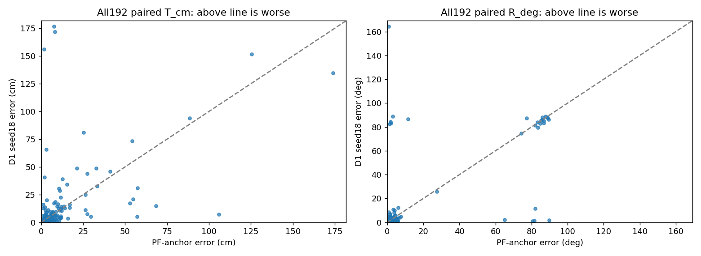
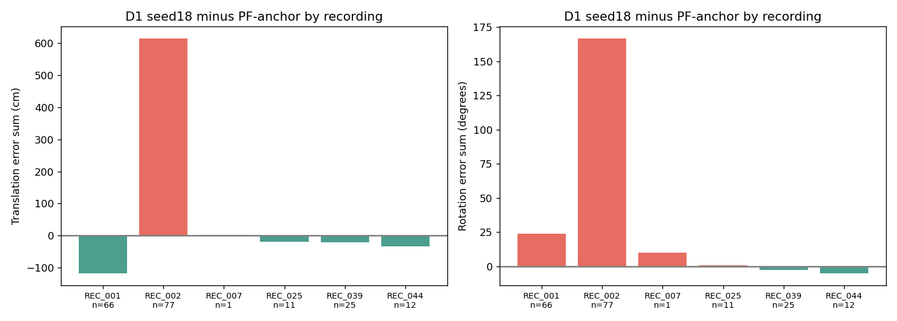

# PRIMARY192 평균 격차 분해와 소규모 개입 판단 (2026-10-20)

**목표한 평균 우위는 확보하지 못했다.** D1의 위치 평균은 세 seed 모두 두 PoseFix+SubPix 경로보다 높다. seed20의 회전 평균은 두 경로보다 낮지만 같은 최종 자세의 위치 평균이 높으므로 양 평균 개선 성공이 아니다. 이번 작업은 저장 예측의 독립 재평가·원인 진단을 완료했고, 근거 없는 새 보정·학습은 실행하지 않았다. 기존 원고·슬라이드·숫자 원장·운영 기본값은 보존했다.

## 1. 검증한 평균 격차

동일 image ID/hash·원녹화 recording·카메라 K·알려진 물리 치수·기존 physical 축·같은 고정 참조를 사용한다. PRIMARY192=TEST49+REMAINDER143, CAL46은 별도다. 성공은 **한 최종 자세**의 T≤5cm AND C2 회전≤5°다. C2는 I/Y180°만 허용하며90°는 동치가 아니다. 참조는 기존 기하 재구성값이며 **독립 물리 GT가 아니다**. 실사는 모두 반복 개발 자료이고 독립 신규 test는0장이다.

아래5경로는 전체192/산출192/no-pose0/오차결측0이다. 따라서 이번5경로에서 available-only 평균과 공통 산출192 paired 평균의 분모가 우연히 같으며, 이를 일반적인 no-pose 처리 규칙으로 확대하지 않는다. [영상별 계약](tables/identity_contract.csv), [전체74경로×4집합](tables/all_saved_methods_summary.csv).

| 경로 | 성공 | T/R 산출 | T 평균 cm | R 평균 ° | 중앙 T/R | P90 T/R | P95 T/R | T>50/>100/R>45 |
|---|---|---|---|---|---|---|---|---|
| POSEFIX_SUBPIX_PF_ANCHOR | 112/192 | 192/192 | 9.848271 | 10.538719 | 3.463/1.528 | 20.907/61.246 | 46.417/84.978 | 10/3/20 |
| POSEFIX_SUBPIX_YOLO_ANCHOR | 111/192 | 192/192 | 9.377412 | 10.593944 | 3.520/1.566 | 16.948/69.538 | 36.818/84.932 | 9/2/20 |
| D1_H1_MLP_s20261018 | 120/192 | 192/192 | 12.072574 | 11.548887 | 3.070/1.496 | 28.043/79.055 | 48.804/85.917 | 9/5/21 |
| D1_H1_MLP_s20261019 | 117/192 | 192/192 | 12.251478 | 12.454362 | 3.218/1.523 | 28.043/82.301 | 47.211/86.266 | 9/5/23 |
| D1_H1_MLP_s20261020 | 121/192 | 192/192 | 11.406796 | 10.233225 | 3.231/1.443 | 24.808/24.469 | 44.874/85.418 | 7/5/19 |

[6개 seed×비교군 paired 요약](tables/paired_seed_summary.csv): Δ는 D1−비교군, 양수는 악화. 회복/손상은 비교군→D1이다.

| seed | 비교군 | 공통 산출 | ΔT cm | ΔR ° | 회복/손상 | 공동성공/공동실패 |
|---|---|---|---|---|---|---|
| 20261018 | POSEFIX_SUBPIX_PF_ANCHOR | 192 | +2.224303 | +1.010167 | 23/15 | 97/57 |
| 20261018 | POSEFIX_SUBPIX_YOLO_ANCHOR | 192 | +2.695162 | +0.954943 | 24/15 | 96/57 |
| 20261019 | POSEFIX_SUBPIX_PF_ANCHOR | 192 | +2.403207 | +1.915642 | 23/18 | 94/57 |
| 20261019 | POSEFIX_SUBPIX_YOLO_ANCHOR | 192 | +2.874067 | +1.860417 | 24/18 | 93/57 |
| 20261020 | POSEFIX_SUBPIX_PF_ANCHOR | 192 | +1.558525 | -0.305495 | 24/15 | 97/56 |
| 20261020 | POSEFIX_SUBPIX_YOLO_ANCHOR | 192 | +2.029384 | -0.360719 | 25/15 | 96/56 |

**재현 검산:** 238개 ID/hash 모두 고유, 중복·누락0. 저장 scalar29,988개를 원 scorer import 없이 반환 R/t에서 다시 계산하여 T/R 최대차0, 성공 불일치0. 공식40군×4집합의3,200개 값도 최대차0이다. 서로 다른 저장 평가 간12,376개 중복 경로 값도 차0이다. [검산 JSON](tables/VALIDATION.json), [공식 값 대조 CSV](tables/baseline_official_checks.csv). 원 float 행렬을 정규직교화하거나 단위를 조정하지 않았다.

## 2. 원인 근거와 평균 기여

대표 seed18/PF-anchor 대비 위치 양의 악화 합은1031.496918cm, 개선 합은−604.430753cm, 순차는427.066165cm(192로 나누면+2.224303cm)다. 회전은+680.951416°−486.999284°=+193.952132°(+1.010167°). net을 분모로 한 기여율은 상쇄 때문에100%를 넘을 수 있어 **양의 악화 총합 대비 비율**도 별도로 표시했다.

| 항목 | 상위 k | 양의 악화 기여율 | net 대비 기여율 | 나머지 영상의 signed 합 |
|---|---|---|---|---|
| T | 5 | 58.72% | 141.83% | -178.658324 |
| T | 10 | 72.18% | 174.33% | -317.450214 |
| T | 20 | 87.06% | 210.27% | -470.930679 |
| R | 5 | 72.59% | 254.87% | -300.367285 |
| R | 10 | 88.24% | 309.80% | -406.907892 |
| R | 20 | 94.05% | 330.21% | -446.501617 |

상위10%는 ceil(192×0.1)=20장이다. **위치85장, 회전83장에서 악화**하므로 모든 문제가5장에만 있다는 설명은 틀리다. 동시에 상위5장의 양의 기여가 위치58.72%/회전72.59%, 상위20장은87.06%/94.05%로 tail이 평균 격차를 강하게 지배한다. 중앙 오차는 D1이 더 낮고, 나머지 signed 합은 음수다. 이는 사후 기술적 분해이며 어떤 영상도 평가에서 제거하지 않았다. 순수한 균일 전역 오차보다 **촬영군에 집중된 큰 손상과 광범위한 소오차 변화가 섞인 상태**로 해석한다.

REC_002의77장은 위치 차합+614.437798cm/회전+166.839937°이며 나머지 촬영군의 개선과 상쇄된다. REC_001의66장은 위치−117.675934cm이면서 회전+23.971057°다. 단일 촬영군이나 단일 지표로 전체 결론을 대체하지 않는다. [recording별 전량](tables/recording_summary.csv), [session별](tables/session_summary.csv), [성공/실패 층별](tables/success_failure_strata.csv).

**동일 원 D1 은행의 성공 가능151/192**를 재확인했다. 대표 seed18은151 중120 성공/31 미선택, 나머지41은 은행에 공동 성공 후보가 없다. seed19/20의 선택손실은34/30이다. 원 generated bank와 eligible HEAD bank에서 각각151이고, PF 두 완성 pose를 준입 전 단순 union하면154다. union154는 원 D1의 상한이나 실현된 성능이 아니다. [정확 은행별 coverage](tables/exact_bank_coverage.csv), [원인별 같은-pose minimax oracle](tables/oracle_by_cause.csv). oracle은 같은 한 후보의 T/R를 쓰며 두 독립 최저값을 결합하지 않았다.

| 대표 seed18/PF-anchor 층 | n | ΔT 합 cm | ΔR 합 ° |
|---|---|---|---|
| GOOD_CANDIDATE_NOT_SELECTED | 31 | +142.183283 | +53.290452 |
| NO_SUCCESS_CANDIDATE_IN_EXACT_BANK | 41 | +423.038171 | +168.826542 |
| SUCCESS_CONTROL | 120 | -138.155289 | -28.164862 |

상위 위치 악화5장은 다음과 같다. depth 비중은 번역오차 제곱에서 카메라 z축 성분이 차지하는 비율이며 원인 확정이나 개입 문턱이 아니다.

| 영상/그림 | ΔT cm | D1 T/R | PF T/R | 은행 진단 | depth 제곱 비중 | signed Δz cm |
|---|---|---|---|---|---|---|
| [wood_night_01:031426](figures/cases/case_01.jpg) | +168.926 | 176.535/86.697 | 7.609/11.402 | NO_SUCCESS_CANDIDATE_IN_EXACT_BANK | 94.2% | -171.340 |
| [wood_night_01:031671](figures/cases/case_02.jpg) | +163.859 | 171.880/88.794 | 8.022/2.957 | NO_SUCCESS_CANDIDATE_IN_EXACT_BANK | 98.1% | +170.211 |
| [wood_night_01:031571](figures/cases/case_03.jpg) | +154.470 | 156.064/83.341 | 1.595/2.059 | GOOD_CANDIDATE_NOT_SELECTED | 96.0% | +152.916 |
| [wood_day_01:005249](figures/cases/case_04.jpg) | +62.856 | 65.751/164.209 | 2.894/0.816 | NO_SUCCESS_CANDIDATE_IN_EXACT_BANK | 92.4% | -63.194 |
| [wood_night_01:031298](figures/cases/case_05.jpg) | +55.614 | 80.829/8.172 | 25.216/3.668 | NO_SUCCESS_CANDIDATE_IN_EXACT_BANK | 97.1% | -79.653 |

상위5장 중4장은 후보 부재, `031571`은 성공 후보 미선택이다. `031571`의 E0는0.671cm/1.872°인데 H1은156.064cm/83.341°를 반환했다. `031426`은176.535cm/86.697°, `031671`은171.880cm/88.794°로 depth와 orientation이 함께 틀린다. 단지 회전이90° 근처라는 이유만으로 순수 W/D 전환 오류라 부르지 않았다. `005249`는164.209°여서90° 전환만으로 설명되지 않는다. [영상별 전체 분류](tables/failure_coverage.csv)의 `rotation90_compatible_diagnostic`은 C4를 진단용으로 적용했을 때5° 이내가 되는지 표시하며 공식 C2 점수에는 영향을 주지 않는다. 대표 seed18은 이 엄격 조건4장뿐이다. 나머지는 원 수치와 UNKNOWN을 유지한다.

physical owner mismatch와 참조 정확성은 **UNKNOWN**이다. saved B/I 관측·선과 투영이 충돌할 수 있어도 mask 오류, 실제 재료 edge 불일치, 등록 축/치수, 재구성 참조 한계를 현재 자료로 인과 분리하지 못했다. 원 비용 진단은 G13 같은-family22장에서 outline이22/22 잘못된 선택을 지지했지만 성공114장에서는114/114 올바른 선택을 보호했다. 그 원장과 이번 D1의31/41 집합은 서로 다른 정확 은행/단계이므로 합치지 않았다. 기존 [선택 점수 진단](../pallet_selection_score_diagnosis_v1/RESULTS_KO.md)을 따른다.

## 3. 이미 한 것과 구분되는 개입 검토

두 가설만 검토했다. 기존 순위/연속손실·F1 기하·RGB·guarded switch·outline 제외·후보 union·covariance·image/contour/PL은 새 아이디어로 반복하지 않았다. 새 실행 대신74개 경로를 동일 scalar 계약에서 재집계했다. [기존 trial 재집계](tables/prior_trials_reaggregated.csv)에 불리한 seed와 미채택 trial도 유지했다.

1. **전역 scale/depth 보정 — 근거 부족으로 미실행.** 상위5장의 z오차는 양2/음3으로 갈린다. CAL46의 seed18도 양16/음30, signed depth 평균−1.506cm/중앙−0.392cm다. 이 사실만으로 전역 scale 오류를 식별하지 못하고 회전 오류도 고칠 수 없다. 이 가설은 실패 영상만 맞추는 문턱을 만들지 않고 중단했다. [CAL 진단](tables/calibration_bias_diagnostic.csv).
2. **물리 owner에 묶인 유한 관측 검색 — BLOCKED.** 원인에 맞는 최소 개입 후보는 실제 대응 edge/owner가 확인된 범위에서만 관측을 질의하는 것이다. 기존 finite guard/outline 삭제와 구별되는 핵심은 독립적인 물리 대응 근거다. 그러나 해당 실사 레이블은 없고 신규 수작업 레이블·수집은 이번 범위에서 금지되어 있다. 재구성 참조의 투영을 가짜 대응 정답으로 만들지 않았다. 잘못된 owner guard가 성공 후보와 보호 관측까지 제거할 부작용도 있다.

[최소 개입 검토/중단표](MINIMAL_INTERVENTIONS.csv). 이번 작업의 새 fitting/학습/selector forward/PnP/자세 최적화/영상 모델 호출은 모두0이다. 실사 GT를 추론 입력으로 사용하거나 frame별 방법을 선택하지 않았다. 개선이 확인되지 않았으므로 새 개입의 세 seed 확대 실행도0이다. GPU가 없어서 중단한 것이 아니라 과학적 근거·독립 대응이 부족해서 중단했다.

## 4. 실제 결과와 trade-off

기존 방법 중 작은 선택기 변경으로 평균이 내려간 예는 있다. 대표 `D1_H1_PAIR_MLP`는117/192, T10.391721cm/R8.891290°로 원 D1보다 평균이 낮지만 PF 두 경로의 위치 평균보다 높고 성공3장을 잃는다. 기존 `R_CONT_F0`는117/119/120성공, T≈10.97–10.98cm로 역시 위치 평균 격차를 닫지 못한다. 기존 guarded seed18은116/192,11.385cm/10.246°이며 원120보다4장 감소한다. PL123/123/122는 별도 확장이고 T11.488cm로 평균 우위가 아니다. F_BI109/117/107도 원 D1과 다른 방법이며 대표11.733cm/9.605°다.

74경로 중 두 PF보다 T/R 평균이 동시에 낮은 경로는0개다. 이 표에서 유리한 회전 seed와 유리한 위치 변형을 합쳐 하나의 출력이라고 보고하지 않았다. 두 PF 설정도 결과에 따라 하나로 대표 선정하지 않았다. 이번 결과로 성공률만 높여 평균 목표를 달성했다고 주장하지 않는다.

## 5. 남은 한계와 다음 행동

우선순위는 REC_002의 후보 부재41집합과 선택손실31집합을 분리해 물리 대응·등록 축/instance geometry를 독립적으로 확인하는 것이다. 현재 범위에서는 레이블을 만들거나 새 대규모 학습을 시작하지 않는다. 독립 증거가 확보되기 전에는 물리 owner 교정의 성능을 약속할 수 없다. 허용 train/calibration/synthetic validation에만 선택·튜닝하고 실제 평균·성공·tail 비악화를 보인 최소 pilot만 향후 세 seed로 확대해야 한다. 독립 신규 실사 확인은 별도 범위 결정이 필요하다.

이 보고서는 연구 실험 handoff이며 논문/발표자료를 수정하지 않는다. 추론 성능은 세션 안내상 GPT-6 기반 Codex이며 실제 Pro 옵션·정확한 런타임 모델/추론 등급은 확인할 수 없다. high/xhigh를 ChatGPT Pro라고 부르지 않았다. 추가 유료 API/서비스 구매는0이다.

## 시각화 읽는 법

[23개 사례 HTML](figures/index.html), [선정 기준/ID](figures/CASE_SELECTION.csv), [그림 표기 원수치69개](figures/PANEL_VALUES.csv). 위쪽은 원본 RGB/빨강 D1/보라 PF-anchor, 아래쪽은 파랑 YOLO-anchor/초록 점선 GRef/저장 관측이다. GRef는 **기하 재구성 참조의 모델 투영**이다. 영상 좌표는 원해상도 왼쪽 위 원점, x오른쪽/y아래, 패널별 동일 축척이다. B주황/I청록 원은 저장 이미지 측정이며 fallback이 포함될 수 있다. 자홍 선은 저장된 실제 inlier 지지 구간이다. 철회된 full2D와 S를 이미지 측정으로 그리지 않았다. cuboid 선은 예측·참조 투영이며 실제 material edge의 인증이 아니다. 개인정보 redaction은 display 복사본에만 적용된 기존 검토 픽셀을 재사용했고 원추론·수치·참조는 바꾸지 않았다.

23개 source 화면 contact sheet와 대표 오류/성공/비식별 패널5개 및 전체 산점도/기여 그래프3개를 실제 픽셀로 확인했다. 나머지 패널은 생성·수치/해시 검산 대상이며 전량 pixel/물리 owner 검토를 했다고 주장하지 않는다. 공개 범위는 기존 연구 결과 패널 권한과 이번 사용자 게시 승인이다. 원 RGB bulk/전체 영상·체크포인트·후보은행·참조 R/t·개인정보·논문은 게시하지 않는다.
