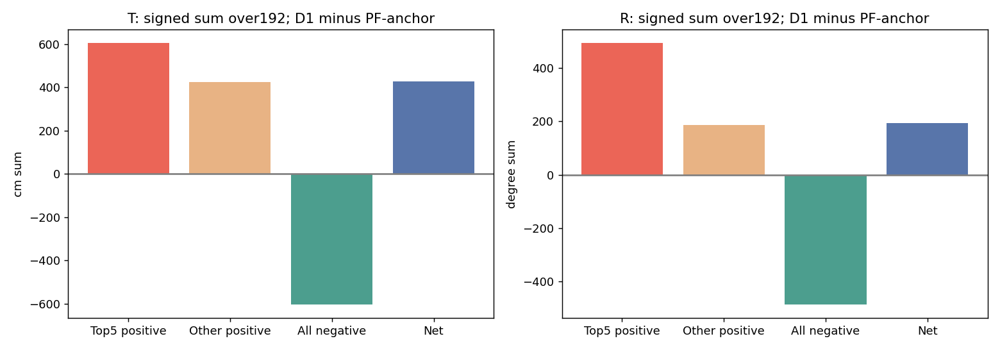
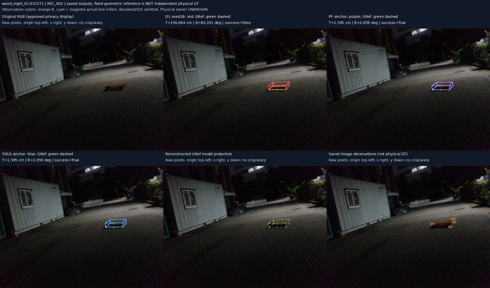

# 팔레트 평균 오차 격차 감사 — 2026-10-20

**평균 우위 확보 실패.** PRIMARY192에서 D1 seed18은12.072574cm/11.548887°, PF-anchor는9.848271cm/10.538719°, YOLO-anchor는9.377412cm/10.593944°다. 모든 경로192산출이며 누락 제외로 만든 차이가 아니다. 상위 tail, recording 분포와 후보 부재/선택손실을 분리했고 근거 없는 새 보정은 중단했다.

- [한국어 최종 보고서](FINAL_REPORT_KO.md): 평균 격차 → 원인 → 개입 구분 → 실제 결과 → 한계
- [baseline 독립 검산](tables/VALIDATION.json), [공식 수치 대조3,200개](tables/baseline_official_checks.csv)
- [영상별 paired1152행](tables/image_paired.csv), [seed별](tables/paired_seed_summary.csv), [recording별](tables/recording_summary.csv)
- [원인 분류714행](tables/failure_coverage.csv), [정확 은행coverage](tables/exact_bank_coverage.csv), [top20 진단](tables/top_error_diagnosis.csv)
- [기존74경로×4집합](tables/all_saved_methods_summary.csv), [기존 trial 재집계](tables/prior_trials_reaggregated.csv), [두 개입 검토/미실행](MINIMAL_INTERVENTIONS.csv)
- [대표6패널 이미지23개](figures/index.html), [입력/출력 SHA](tables/SOURCE_MANIFEST.json), [재현 명령](REPRODUCE.md)

그림은 빨강 D1/보라 PF-anchor/파랑 YOLO-anchor/초록 점선 기하 참조다. 같은 RGB·K·물리 치수와 기존 physical C2 계약이다. 참조는 독립 물리 GT가 아니다. 전체192 평가는 유지하며 위 사례를 제외하거나 정답으로 방법을 선택하지 않았다. HTML은 내려받아 열면 되고 GitHub에서는 각 JPEG를 직접 볼 수 있다.

소스 기준 commit `93c24d143fa3901de1fa127b3156e8250d81dba8`. 원 사용자 checkout `7e92fdcefb0a37bdee0aef95d3e86c572e23b967`의 dirty 상태는 보존했다. 새 학습/forward/PnP0; 원고·슬라이드 수정0. 최종 게시 commit은 이 파일을 포함한 GitHub commit permalink로 고정한다.

추가 요청: [논문 대화용7종 검증 표/누락 셀/읽는 법](paper_tables/README_KO.md). 원고는 수정하지 않았다.
