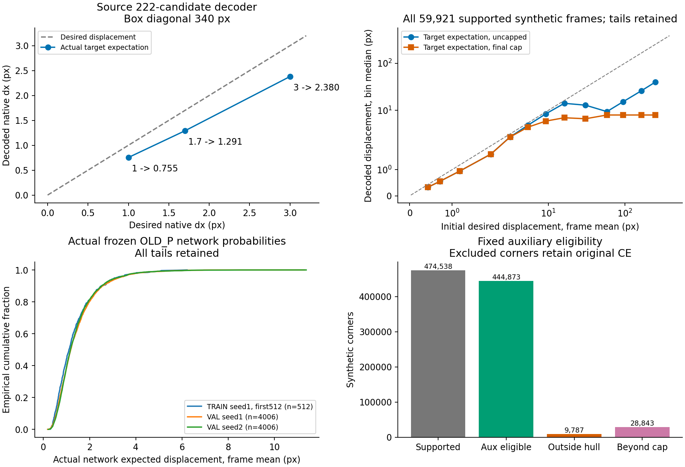
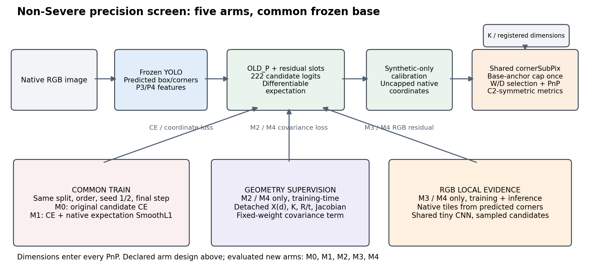
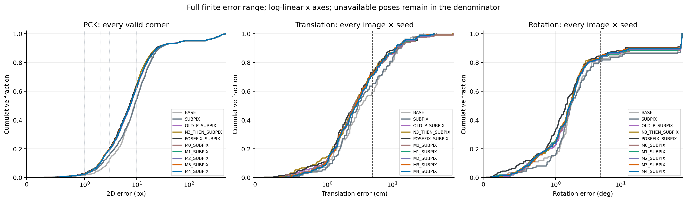
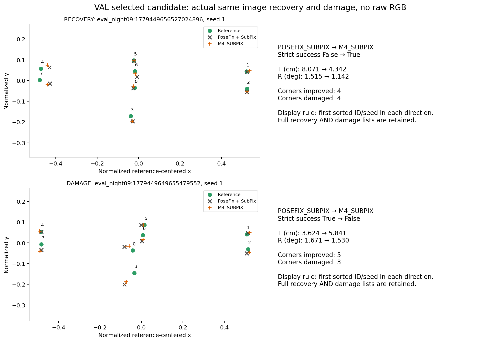
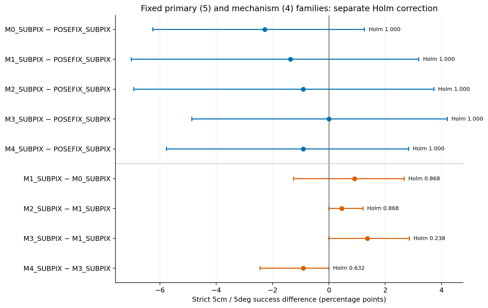

Synthetic VAL로 선택한 M4+SubPix는 PoseFix-style+SubPix를 이기지 못했다(성공률 차이 -0.909%p).

[확인] 주평가는 Severe 및 물리 보호 구간을 제외한 **110장, 9개 세션**, 공통 seed 1·2다([DATA_CONTRACT.json](DATA_CONTRACT.json), [ROW_METRICS.jsonl.gz](ROW_METRICS.jsonl.gz)). Severe 제외는 사용자 지정 범위이며 자동 가림 판별의 성능 주장이 아니다.

[확인] 참조 자세는 수동 코너 기반 기하 재구성이다. 아래 수치는 같은 참조에 대한 차이이며 직접 계측한 물리 정확도의 독립 검증으로 해석하지 않는다. 기존 RECT245와 분모·보호/노출 계약이 달라 수치를 합치지 않는다.

[확인] 5cm·5°는 **T<5cm AND R<5°**다. 자세 미산출은 성공률 분모에 남는다. 연속 오차는 산출된 값의 seed 평균을 먼저 영상 안에서 계산한 뒤 영상별 평균·표본 SD·중앙값·P90·P95를 구한다. PCK는 영상 안 참조 코너의 고정 분모로 계산하며 PnP 실패와 별개인 원래 2D 지표다.

[확인] 첫 synthetic calibration/selection 프로세스는 미검출 row의 NaN box를 native RGB tile 정수 반경으로 바꾸다 실패했다(60.986초). 이후 source Generic의 [0,0,1,1] fallback을 미사용 RGB tile allocation에만 적용했다. 원래 model boxes/support/points/masks와 782장 분모를 보존했으며 재학습·조건 탐색·실패 row 제거는 없다. 실패/수선 프로세스 시간은 모두 예산에 포함한다([SELECTION_INVALID_BOX_ADAPTER_AMENDMENT.json](SELECTION_INVALID_BOX_ADAPTER_AMENDMENT.json), [STAGE_selection.json](STAGE_selection.json)).

[확인] 모든 완료 arm은 seed 1·2에서 동일 마지막 **3000 updates/arm/seed**, batch 16으로 학습했다. 총 추가 optimizer updates는 30000이며 상태는 DONE다. 원래 OLD_P의 같은-seed checkpoint에서 출발하고 기반 모델은 고정했다([TRAIN_RECEIPTS.json](TRAIN_RECEIPTS.json)).

[확인] 새 보정기의 동일 용량은 24387 parameters(기존 18962, 추가 5425)다. PoseFix-style 정본의 보정기 68,661,641 parameters 및 6,000 updates/seed와 학습 자원이 같다고 주장하지 않는다. M0/M1/M2에서는 RGB CNN의 2,768 parameters 실행을 건너뛰지만, RGB 입력 열 512 parameters를 포함한 81차원 scorer matmul은 그대로 실행하며 해당 입력은 0이다([SOURCE_BINDINGS.json](SOURCE_BINDINGS.json), [LATENCY.json](LATENCY.json)).

[확인] native coordinate SmoothL1 및 covariance 감독 가중치는 고정 TRAIN 32 minibatch의 actual-logit gradient norm으로 한 번 정했다: {"COORD": 0.15214983019356332, "GEO": 7.475295249738178}. 실사 결과로 바꾸지 않았다. 후보 hull의 outer radius는 box diagonal×0.08이며 context sampling의 stencil_fraction과 구분한다([AUX_WEIGHT_LOCK.json](AUX_WEIGHT_LOCK.json), [DECODER_AUDIT.json](DECODER_AUDIT.json)).

동일 non-Severe 최종 정확도 (공통 seed 1·2)

| 방법 | 성공/220 | 성공률 % | T cm 평균±SD | T 중앙/P90/P95 | R ° 평균±SD | R 중앙/P90/P95 | 미산출 |
|---|---:|---:|---:|---:|---:|---:|---:|
| BASE | 128/220 | 58.18 | 5.577±5.448 | 3.278/12.682/14.900 | 12.943±28.490 | 1.730/84.048/88.389 | 0 |
| SUBPIX | 140/220 | 63.64 | 5.660±6.632 | 2.977/12.159/16.998 | 13.723±29.284 | 1.711/85.939/87.984 | 0 |
| OLD_P | 148/220 | 67.27 | 5.036±5.458 | 3.202/11.382/14.345 | 10.585±25.265 | 1.652/42.956/88.346 | 0 |
| OLD_P_SUBPIX | 155/220 | 70.45 | 5.623±9.730 | 2.636/11.839/19.345 | 11.654±26.959 | 1.705/83.996/88.137 | 0 |
| N3_DIM_SYM | 150/220 | 68.18 | 4.929±5.538 | 3.147/10.979/14.923 | 10.057±24.297 | 1.607/41.268/87.886 | 0 |
| N3_THEN_SUBPIX | 156/220 | 70.91 | 5.362±9.480 | 2.662/11.239/17.052 | 11.547±26.948 | 1.673/84.013/88.067 | 0 |
| POSEFIX | 144/220 | 65.45 | 5.325±6.692 | 2.980/12.091/14.826 | 10.423±25.231 | 1.540/41.867/87.577 | 0 |
| POSEFIX_SUBPIX | 157/220 | 71.36 | 4.894±6.767 | 2.569/10.813/14.816 | 10.047±25.044 | 1.418/14.857/87.616 | 0 |
| M4_SUBPIX | 155/220 | 70.45 | 4.951±5.991 | 2.690/11.578/15.317 | 10.955±26.023 | 1.622/48.647/88.106 | 0 |

[확인] 위 분모 220은 동일 110장×2seed의 예측 수다. 독립 영상 수는 110이며 bootstrap은 실제 세션 단위를 재표집하고 영상 내 두 seed를 묶는다. 기존 seed3 및 seed별 수치는 [METRICS.json](METRICS.json)에 별도로 보존한다.

[확인] 직접 축 오류는 사전 축 참조와 선택 W/D 가설의 불일치다. 기존 W/D confusion은 available R>45° AND |yaw|≥60°인 별도 기술 지표이며 두 값을 섞지 않는다. 직접 축 참조가 불명확한 1장은 축 오류 분모에서만 제외하고 최종 정확도 110장 분모에는 그대로 둔다.

| 방법 | 직접 축 오류/평가 가능 예측 | 기존 W/D confusion % | ADDsym m 평균±SD | IoU3D 평균±SD |
|---|---:|---:|---:|---:|
| BASE | 34/218 | 12.73 | 0.179±0.353 | 0.693±0.174 |
| SUBPIX | 36/218 | 13.64 | 0.186±0.368 | 0.698±0.179 |
| OLD_P | 28/218 | 10.00 | 0.145±0.306 | 0.721±0.167 |
| OLD_P_SUBPIX | 31/218 | 11.36 | 0.157±0.337 | 0.729±0.176 |
| N3_DIM_SYM | 28/218 | 9.55 | 0.138±0.293 | 0.730±0.166 |
| N3_THEN_SUBPIX | 31/218 | 11.36 | 0.155±0.338 | 0.738±0.173 |
| POSEFIX | 28/218 | 10.00 | 0.144±0.307 | 0.704±0.179 |
| POSEFIX_SUBPIX | 29/218 | 9.55 | 0.135±0.305 | 0.730±0.182 |
| M4_SUBPIX | 29/218 | 10.45 | 0.147±0.319 | 0.732±0.165 |

[확인] 실제 source target을 그대로 expected-decode한 box diagonal 340px, T=1/λ=1/cap 없음의 수식 예시는 1px → 0.755px, 1.7px → 1.291px, 3px → 2.380px다. 이는 정확한 target 분포도 작은 이동에서 축소될 수 있음을 보인 것이며 실제 checkpoint 모두에 같은 비율이 있다는 뜻은 아니다. 60,000장 진단의 support 코너 474,538개 중 auxiliary eligible은 444,873개이고 hull 밖 9,787개, native cap 밖 28,843개를 각각 기록했다. 두 제외 조건은 중첩될 수 있다([DECODER_AUDIT.json](DECODER_AUDIT.json)).

[확인] 유한 후보의 확률평균은 연속 좌표다. 후보 간격을 최소 가능한 좌표 오차라고 하지 않으며 임의 1.33 배율 보정은 적용하지 않았다. source feature-center와 native pixel-center 검사, 실제 TRAIN logits의 기대좌표 gradient/finite difference를 통과한 뒤 학습했다.

학습 메커니즘 절제 (모든 완료 arm, 최종 SubPix 포함)

| 방법 | 성공/220 | 성공률 % | T cm 평균±SD | T 중앙/P90/P95 | R ° 평균±SD | R 중앙/P90/P95 | 미산출 |
|---|---:|---:|---:|---:|---:|---:|---:|
| M0_SUBPIX | 152/220 | 69.09 | 5.814±10.419 | 2.507/12.178/19.556 | 11.983±27.081 | 1.735/83.976/87.738 | 0 |
| M1_SUBPIX | 154/220 | 70.00 | 5.119±6.862 | 2.585/11.576/15.292 | 11.667±26.981 | 1.695/83.985/88.103 | 0 |
| M2_SUBPIX | 155/220 | 70.45 | 5.108±6.849 | 2.598/11.558/15.217 | 11.343±26.848 | 1.696/84.062/88.128 | 0 |
| M3_SUBPIX | 157/220 | 71.36 | 4.873±5.878 | 2.569/11.061/15.230 | 10.579±25.246 | 1.624/43.083/88.105 | 0 |
| M4_SUBPIX | 155/220 | 70.45 | 4.951±5.991 | 2.690/11.578/15.317 | 10.955±26.023 | 1.622/48.647/88.106 | 0 |

[확인] M0는 기존 후보 CE 추가 학습 대조, M1은 기대좌표 직접 감독, M2는 고정 가중 covariance 기하 감독, M3는 native RGB 분기, M4는 RGB+기하 감독이다. 치수는 M2/M4의 TRAIN 감독과 모든 방법의 inference PnP에 사용되며, 치수를 새 추론 scorer 입력으로 넣은 효과와 구분한다.

[확인] 최종 후보는 synthetic VAL의 마지막 공통 checkpoint로만 정한다. REAL 최고 행으로 후보를 재선택하지 않는다. 선택 기준 및 완료·차단 상태는 선택/학습 receipt에 기록한다.

[확인] 추가 학습과 auxiliary 가중치 산출은 TRAIN만 쓴다. 최종 후보 선택은 고정 selection 1,031장 중 사전 C2 물리회전 조건을 만족한 782장으로만 수행한다. 반면 decoder/geometry의 수학적 검사는 synthetic source 60,000장 전체(heldout 1,985장 포함)를 열람했고 기존 frozen OLD_P 확률의 calibration+selection+heldout 진단 cohort는 seed별 4,020장(지원 4,006장)이다. 이 analytical exposure를 숨기지 않으며 synthetic heldout을 미열람 독립 TEST라고 부르지 않는다. 새 M0–M4의 heldout 성능 추론·선택은 수행하지 않았다([DECODER_AUDIT.json](DECODER_AUDIT.json), [SYNTHETIC_SELECTION_LOCK.json](SYNTHETIC_SELECTION_LOCK.json)).

고정된 짝 검정

| Family | 대비 | 효과 %p | 95% CI | raw p | Holm p | 상태 |
|---|---|---:|---:|---:|---:|---|
| primary | M0_SUBPIX − POSEFIX_SUBPIX | -2.273 | [-6.250, 1.266] | 0.249575 | 1.000000 | CALCULATED |
| primary | M1_SUBPIX − POSEFIX_SUBPIX | -1.364 | [-7.018, 3.191] | 0.606839 | 1.000000 | CALCULATED |
| primary | M2_SUBPIX − POSEFIX_SUBPIX | -0.909 | [-6.931, 3.731] | 0.764924 | 1.000000 | CALCULATED |
| primary | M3_SUBPIX − POSEFIX_SUBPIX | 0.000 | [-4.868, 4.206] | 1.000000 | 1.000000 | CALCULATED |
| primary | M4_SUBPIX − POSEFIX_SUBPIX | -0.909 | [-5.769, 2.830] | 0.760624 | 1.000000 | CALCULATED |
| mechanism | M1_SUBPIX − M0_SUBPIX | 0.909 | [-1.250, 2.672] | 0.433857 | 0.867713 | CALCULATED |
| mechanism | M2_SUBPIX − M1_SUBPIX | 0.455 | [0.000, 1.210] | 0.458754 | 0.867713 | CALCULATED |
| mechanism | M3_SUBPIX − M1_SUBPIX | 1.364 | [0.000, 2.857] | 0.059394 | 0.237576 | CALCULATED |
| mechanism | M4_SUBPIX − M3_SUBPIX | -0.909 | [-2.439, 0.000] | 0.210679 | 0.632037 | CALCULATED |

[확인] 구성의 증분은 최종 성공률뿐 아니라 같은 영상의 T/R 꼬리와 실제 비용을 함께 읽는다. 아래 기술적 차이는 새 가설검정 family를 만들지 않는다.

[확인] M1_SUBPIX − M0_SUBPIX: 이 설정에서 Holm 보정 후 성공률 증분을 확인하지 못했다. 성공률 0.909%p, T 중앙/P95 차이 0.077/-4.264cm, R 중앙/P95 차이 -0.040/0.365°, 전체 latency 중앙값 차이 -0.241ms다.

[확인] M2_SUBPIX − M1_SUBPIX: 이 설정에서 Holm 보정 후 성공률 증분을 확인하지 못했다. 성공률 0.455%p, T 중앙/P95 차이 0.014/-0.076cm, R 중앙/P95 차이 0.000/0.025°, 전체 latency 중앙값 차이 0.118ms다.

[확인] M3_SUBPIX − M1_SUBPIX: 이 설정에서 Holm 보정 후 성공률 증분을 확인하지 못했다. 성공률 1.364%p, T 중앙/P95 차이 -0.016/-0.062cm, R 중앙/P95 차이 -0.072/0.002°, 전체 latency 중앙값 차이 1.834ms다.

[확인] M4_SUBPIX − M3_SUBPIX: 이 설정에서 Holm 보정 후 성공률 증분을 확인하지 못했다. 성공률 -0.909%p, T 중앙/P95 차이 0.121/0.086cm, R 중앙/P95 차이 -0.002/0.000°, 전체 latency 중앙값 차이 0.463ms다.

[확인] Synthetic VAL에서 고정한 실험 후보는 **M4 (기대좌표+RGB+기하 감독)**다. 이 선택은 정확도 개선 제품으로 채택했다는 뜻이 아니다. 완료된 모든 arm과 구성은 표·원행·실패 사례에 남기고 실사 최고 행으로 후보를 갈아타거나 다시 학습하지 않는다([SYNTHETIC_SELECTION.json](SYNTHETIC_SELECTION.json)).

[확인] 이번 screen은 PoseFix+SubPix 대비 정확도 개선을 확보하지 못했으므로 새 후보의 운영 채택을 권고하지 않는다. 기하 항은 M2−M1 및 M4−M3, RGB 분기는 M3−M1의 실제 증분·꼬리·추가 비용을 기준으로 읽는다. 아래 대비에서 증분을 확인하지 못한 구성은 개선된 핵심 기여 또는 운영 추가 기능에서 제외한다. 무차이는 동등성 증명이 아니며, 기하·RGB 일반의 불가능성을 뜻하지 않는다.

[확인] 선택 후보와 PoseFix+SubPix가 성공 여부에서 달라진 동일 영상×seed는 복구 9건, 손상 11건이다. 이 건수는 성공률 순증가와 구별하며 양쪽 전체 ID·T/R·2D 오류를 남긴다.

[확인] seed 1: M4+SubPix 79/110, PoseFix+SubPix 77/110; 복구 7건, 손상 5건이다. 동일 참조에서의 관측 결과이며 seed별 변동의 원인이나 새로운 감독의 일반적 실패 메커니즘을 인과적으로 입증한 것은 아니다.

[확인] seed 2: M4+SubPix 76/110, PoseFix+SubPix 80/110; 복구 2건, 손상 6건이다. 동일 참조에서의 관측 결과이며 seed별 변동의 원인이나 새로운 감독의 일반적 실패 메커니즘을 인과적으로 입증한 것은 아니다.

학습 중 감독 gradient 비율 (actual logits 기준)

| seed | arm | step | 좌표/CE | 기하/CE |
|---:|---|---:|---:|---:|
| 1 | M0 | 100 | 0.0000 | 0.0000 |
| 1 | M1 | 100 | 0.2874 | 0.0000 |
| 1 | M2 | 100 | 0.2879 | 0.3993 |
| 1 | M3 | 100 | 0.2872 | 0.0000 |
| 1 | M4 | 100 | 0.2879 | 0.3994 |
| 1 | M0 | 1000 | 0.0000 | 0.0000 |
| 1 | M1 | 1000 | 0.2204 | 0.0000 |
| 1 | M2 | 1000 | 0.2234 | 0.2061 |
| 1 | M3 | 1000 | 0.2201 | 0.0000 |
| 1 | M4 | 1000 | 0.2218 | 0.2063 |
| 1 | M0 | 3000 | 0.0000 | 0.0000 |
| 1 | M1 | 3000 | 0.1732 | 0.0000 |
| 1 | M2 | 3000 | 0.1742 | 0.2546 |
| 1 | M3 | 3000 | 0.1736 | 0.0000 |
| 1 | M4 | 3000 | 0.1734 | 0.2605 |
| 2 | M0 | 100 | 0.0000 | 0.0000 |
| 2 | M1 | 100 | 0.2205 | 0.0000 |
| 2 | M2 | 100 | 0.2171 | 0.2612 |
| 2 | M3 | 100 | 0.2205 | 0.0000 |
| 2 | M4 | 100 | 0.2171 | 0.2613 |
| 2 | M0 | 1000 | 0.0000 | 0.0000 |
| 2 | M1 | 1000 | 0.2249 | 0.0000 |
| 2 | M2 | 1000 | 0.2249 | 0.1457 |
| 2 | M3 | 1000 | 0.2246 | 0.0000 |
| 2 | M4 | 1000 | 0.2233 | 0.1417 |
| 2 | M0 | 3000 | 0.0000 | 0.0000 |
| 2 | M1 | 3000 | 0.1566 | 0.0000 |
| 2 | M2 | 3000 | 0.1580 | 0.1348 |
| 2 | M3 | 3000 | 0.1561 | 0.0000 |
| 2 | M4 | 3000 | 0.1572 | 0.1345 |

[확인] 위 표는 해당 arm에 실제 적용되는 항의 비율이다. M0 좌표/기하 항과 M1/M3 기하 항은 0이다. 마지막 step의 비율이 기록되지 않았으면 NA로 남긴다. covariance 항은 고정 가중 local surrogate이며 LC 전체 Eq17 재현 또는 실제 T/R 손실이라고 하지 않는다.

[확인] primary는 다섯 새 arm+SubPix−PoseFix+SubPix의 strict 성공률 5검정, mechanism은 M1−M0/M2−M1/M3−M1/M4−M3 최종 SubPix의 strict 성공률 4검정이다. 두 family의 Holm 보정은 별개다. 세션 bootstrap 10,000회(seed 20260917), 중심화한 양측 검정과 exact 정수 동률을 사용한다([PAIRED_RESULTS.json](PAIRED_RESULTS.json)). 다른 지표는 기술통계이며 같은 family에 사후 추가하지 않는다.

2D 코너 정확도 (고정 참조 코너 분모, %)

| 방법 | PCK@1px | @2px | @3px | @5px | @10px |
|---|---:|---:|---:|---:|---:|
| BASE | 1.52 | 5.49 | 12.62 | 23.13 | 55.02 |
| SUBPIX | 2.22 | 8.41 | 15.89 | 26.87 | 54.56 |
| OLD_P | 1.81 | 8.12 | 15.19 | 31.13 | 63.73 |
| OLD_P_SUBPIX | 2.80 | 10.46 | 19.39 | 34.35 | 62.44 |
| N3_DIM_SYM | 2.51 | 8.59 | 15.60 | 32.42 | 65.60 |
| N3_THEN_SUBPIX | 2.86 | 10.86 | 19.86 | 35.57 | 64.66 |
| POSEFIX | 2.22 | 7.54 | 15.25 | 33.35 | 65.83 |
| POSEFIX_SUBPIX | 2.98 | 10.57 | 20.21 | 36.62 | 64.25 |
| M4_SUBPIX | 2.39 | 10.05 | 19.45 | 35.34 | 63.03 |
| M0_SUBPIX | 2.63 | 10.57 | 19.33 | 34.29 | 62.56 |
| M1_SUBPIX | 2.51 | 10.57 | 19.45 | 35.22 | 62.97 |
| M2_SUBPIX | 2.57 | 10.16 | 19.22 | 34.52 | 62.85 |
| M3_SUBPIX | 2.51 | 10.46 | 19.86 | 35.40 | 62.73 |

[확인] 평균·표본 분산·SD·중앙값·P90·P95 및 세션 bootstrap 평균 95% CI, ADDsym/IoU와 직접 축 오류·기존 W/D 지표의 분리 수치는 [METRICS.json](METRICS.json)과 [ACCURACY_TABLE.csv](ACCURACY_TABLE.csv)에 있다. 아래 T/R 누적 분포는 220개 영상×seed 원행의 전체 유한 오차 범위를 표시하며 자세 실패도 분모에 남긴다. 표의 연속 요약은 110개 영상 안 seed 평균이므로 CDF와 요약 단위를 구별한다.

[확인] 복구·손상과 좌표 오류 증가를 모두 남긴다. 전체 영상×seed 전이는 [ALL_PAIRED_TRANSITIONS.csv](ALL_PAIRED_TRANSITIONS.csv), 성공이 달라진 모든 행은 [CHANGED_SUCCESS_CASES.json](CHANGED_SUCCESS_CASES.json), 자세 미산출 ID는 [FAILURES.json](FAILURES.json)에 있다. 공개 사례 그림은 원본 RGB를 포함하지 않는 수치/코너 도식이다.

동일 정밀도 설정의 비용

| 방법 | 전체/추가 파라미터 | 전체 latency ms 중앙/P90 | peak memory MiB | 측정 상태 |
|---|---:|---:|---:|---|
| BASE | 2615142/0 | 10.706/12.507 | 64.507 | COMPLETE |
| SUBPIX | 2615142/0 | 11.812/14.630 | 64.507 | COMPLETE |
| OLD_P | 2634104/18962 | 13.701/15.837 | 64.586 | COMPLETE |
| OLD_P_SUBPIX | 2634104/18962 | 13.832/15.959 | 64.586 | COMPLETE |
| N3_DIM_SYM | 2635401/20259 | 14.348/16.070 | 64.594 | COMPLETE |
| N3_THEN_SUBPIX | 2635401/20259 | 15.689/17.816 | 64.594 | COMPLETE |
| POSEFIX | 71276783/68661641 | 25.113/27.576 | 357.129 | COMPLETE |
| POSEFIX_SUBPIX | 71276783/68661641 | 25.623/27.699 | 357.129 | COMPLETE |
| M0 | 2639529/24387 | 14.368/16.366 | 64.610 | COMPLETE |
| M0_SUBPIX | 2639529/24387 | 14.457/16.863 | 64.610 | COMPLETE |
| M1 | 2639529/24387 | 13.644/15.604 | 64.610 | COMPLETE |
| M1_SUBPIX | 2639529/24387 | 14.216/15.969 | 64.610 | COMPLETE |
| M2 | 2639529/24387 | 13.779/15.547 | 64.610 | COMPLETE |
| M2_SUBPIX | 2639529/24387 | 14.334/16.156 | 64.610 | COMPLETE |
| M3 | 2639529/24387 | 15.565/17.661 | 67.197 | COMPLETE |
| M3_SUBPIX | 2639529/24387 | 16.050/17.651 | 67.197 | COMPLETE |
| M4 | 2639529/24387 | 15.338/17.625 | 67.197 | COMPLETE |
| M4_SUBPIX | 2639529/24387 | 16.513/18.518 | 67.197 | COMPLETE |

[확인] 비용은 실제 완료한 독립 프로세스 측정만 쓴다. 미측정 항목은 NA이며 일부 accuracy-speed 점으로 전역 최적성을 주장하지 않는다. RGB를 쓰지 않는 대조 arm의 유지된 슬롯과 실제 실행 분기 비용은 runtime receipt로 구분한다.

[확인] 18개 독립 latency 프로세스의 동일 영상·seed 1 정확도 좌표 대조에서 16개 경로는 최대 차이 0px이었다. PoseFix 단독은 최대 0.0001348px, PoseFix+SubPix는 최대 0.940033px 차이가 있었다. 같은 FP32/TF32-off 설정을 사용했지만 정확도와 latency 실행의 좌표가 모두 bitwise 같다고 주장하지 않는다. 이 차이는 PoseFix+SubPix 비용 패널의 정확도 대응에 남는 제한이다. 새 F·학습·GPU 재실행으로 유리한 결과를 고르지 않았다([LATENCY_POSEFIX.json](LATENCY_POSEFIX.json), [LATENCY_POSEFIX_SUBPIX.json](LATENCY_POSEFIX_SUBPIX.json)).

[확인] CPU에서 동일 좌표를 넣은 runtime/evaluator SubPix+cap 경로는 90건 모두 차이 0px이었다. 저장된 latency PoseFix 단독 좌표의 작은 차이를 동일 source SubPix에 넣으면 최대 0.940033px로 확대되어 실제 기록과 일치했다. SubPix가 작은 입력 차이를 확대하는 현상은 재현했지만 정확한 PoseFix+SubPix 실행의 pre-SubPix tensor는 보존하지 않아 CUDA 발생 원인을 특정하지 않는다. 이 진단의 새 CNN/F/update는 0이다([RUNTIME_SUBPIX_PARITY_PROBE.json](RUNTIME_SUBPIX_PARITY_PROBE.json)).

[확인] model 연산은 FP32이고 AMP 및 TF32는 끈다. 기존 frozen feature capture는 p3/p4를 FP16으로 반올림해 저장한 뒤 GenericPointRefiner가 features.float()로 사용한다. 이 중간 반올림은 모든 feature 기반 비교 경로에 공통이며 모든 중간 tensor가 FP32라는 뜻은 아니다. PoseFix native RGB 입력·연산은 FP32다([ENVIRONMENT.json](ENVIRONMENT.json), [NEW_EVALUATION_RECEIPT.json](NEW_EVALUATION_RECEIPT.json)).

[확인] M1의 후보 확률 기대좌표는 미분 가능한 weighted sum으로 계산한다. 이는 [Integral Human Pose Regression](https://arxiv.org/abs/1711.08229)의 expectation 개념을 이산 후보에 적용한 것이다. M2/M4는 reference 위치에서 캐시한 pose Jacobian A를 detach하고 residual만 미분하여 24차원 box-corner covariance trace의 제곱근 평균을 감독한다. [Linear-Covariance Loss](https://arxiv.org/html/2303.11516v2)의 E_cov를 고정 가중 local surrogate로 쓰며 E_prior/E_linear를 포함한 전체 Eq17 구현이 아니다. RGB 후보 분기는 [Deep ChArUco](https://arxiv.org/abs/1812.03247)의 이미지 기반 subpixel refinement와 목적상 관련되지만 marker 전용 네트워크를 재현하거나 팔레트에서 같은 효과를 보장하지 않는다.

[추정] 짧은 2seed screen에서 실패하거나 개선되지 않은 arm은 이 설정의 증분 가치가 확인되지 않은 것이다. 방법의 영구 기각 또는 무차이의 동등성 증명으로 해석하지 않는다. geometry/RGB 제거 판단은 synthetic VAL 선택과 실제 accuracy·꼬리·비용을 연결해 적는다.

[확인] 실행 상태: {"status": "DONE", "executed_arms": ["M0", "M1", "M2", "M3", "M4"], "blocked_arms": [], "common_steps": 3000, "total_updates": 30000, "seeds": [1, 2]}. 실제 완료한 학습량·gradient·calibration·자료 노출 및 실패 원인은 TRAIN_RECEIPTS/DECODER_AUDIT/COMPUTE_RECEIPT에 남긴다. 새 실험은 개발 자료를 재사용하므로 독립 최종 검증이 아니다.

재현 및 검산: [REPRODUCE.md](REPRODUCE.md), [STATISTICS_RECEIPT.json](STATISTICS_RECEIPT.json), [INDEPENDENT_VERIFICATION.json](INDEPENDENT_VERIFICATION.json). 기존 checkpoint/원고/과거 결과는 덮어쓰지 않는다.
