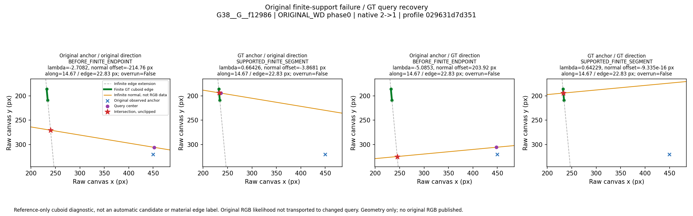
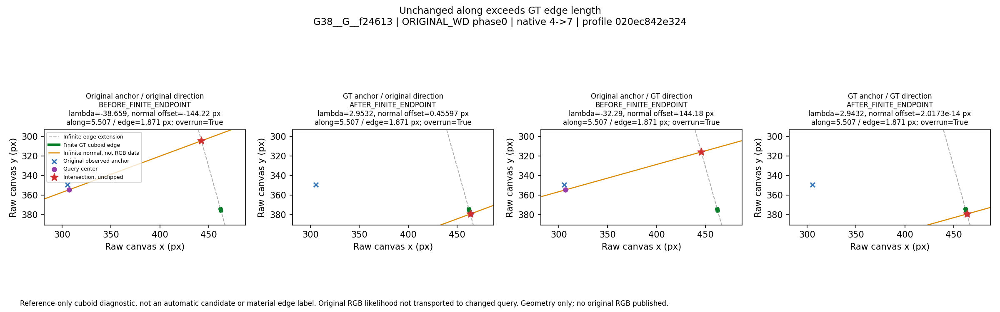
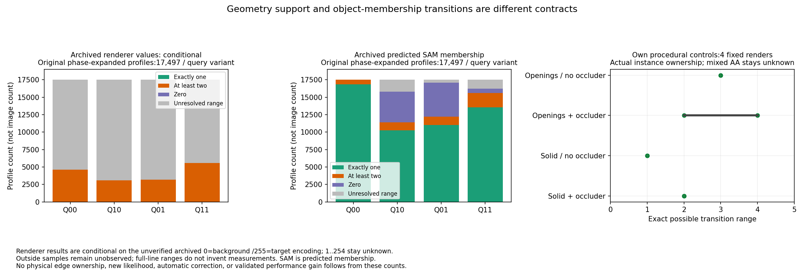
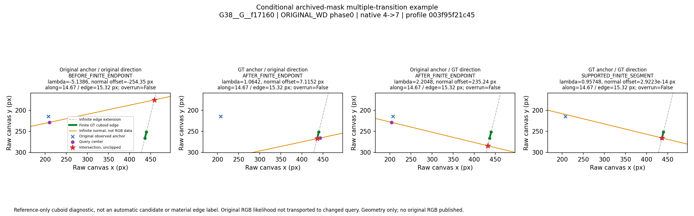
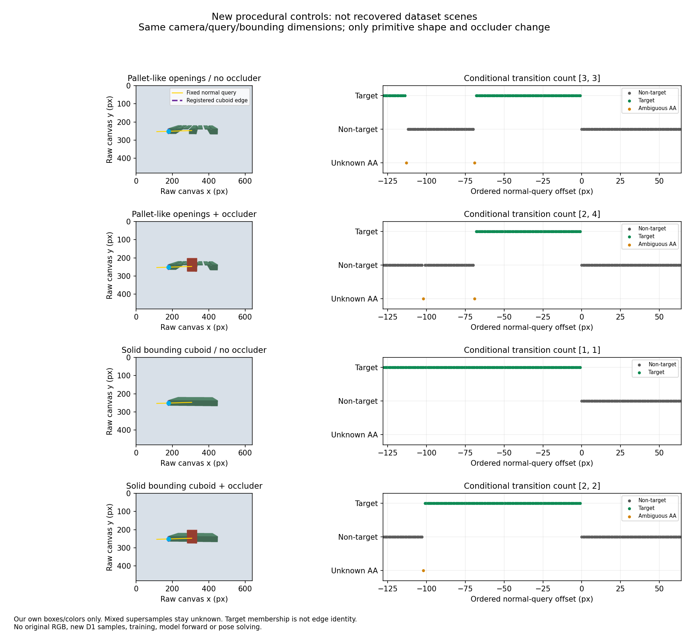

# B 관측 계약: 질의 위치, 유한 모서리, 물체 소속을 분리한 결과

원 관측 앵커와 초기 모서리 방향을 함께 GT로 바꾸면 ORIGINAL_WD의 모든 profile 동시 유한 지지가 **377→643/673장**으로 회복된다. 그러나 이것은 GT를 넣은 기하 진단이다. 실제 재료 경계 대응, 새 RGB 분포, 자동 보정 성능을 확보했다는 뜻은 아니다. 자체 생성한 고정 통제 장면에서는 구멍이나 가림만으로 한 질의선에 여러 물체 소속 전환이 생겼다. 따라서 **가상 직육면체의 변, 실제 물리 모서리, 대상 영역 소속을 같은 관측으로 처리하면 안 된다.**

P2는 새 후보·PnP·최적화·모델 forward·학습을 실행하지 않았다. 원 후보·관측·GT·허용오차·운영 기본값은 유지했다. 이 진단을 자동 성능표나 후보 bank에 넣지 않았다. 전체 선택기 성능과 채택 판단은 캠페인 본 보고서의 별도 결과다.

## 1. 같은 원 관측에서 무엇을 바꾸었나

| 진단 | 앵커 | 모서리 방향 | 광학 비용 |
|---|---|---|---|
| Q00 | 원 관측 | 원 초기 추정 | 원 질의 위치와만 연결; 새 평가 없음 |
| Q10 | GT 가상 코너 | 원 초기 추정 | 새 위치의 RGB 비용 계산 없음 |
| Q01 | 원 관측 | GT의 같은 native 모서리 | 새 위치의 RGB 비용 계산 없음 |
| Q11 | GT 가상 코너 | GT의 같은 native 모서리 | 새 위치의 RGB 비용 계산 없음 |

원 profile ID·native corner/neighbor·along·상태·존재 여부를 유지했다. 방향을 바꾸면 법선과 외향 부호도 해당 기하에서 계산했다. 원 along이 GT 모서리 길이를 초과하면 `QUERY_DOMAIN_OVERRUN`으로 남겼다. 선분 λ와 법선 offset은 자르지 않았다.

| 입력 분모 | 전체 | B 있음 | B 없음 |
|---|---:|---:|---:|
| 원 합성 전체 | 1,003 | 673 | 330 |
| 원 train | 768 | 507 | 261 |
| 원 validation | 235 | 166 | 69 |

모든 원 C1/C2 표현과 두 native family를 평가했다. 네 질의의 총 행 수는 **139,976**이다. profile·corner 통계는 허용 phase를 펼친 단위이며 독립 영상 수가 아니다. 프레임 통과는 **한 허용 phase 안에서 모든 profile이 동시에** 통과해야 한다. 서로 다른 phase의 유리한 코너를 섞지 않았다. B가 없는 330장은 미관측이며 빈 관측의 성공으로 세지 않았다.

## 2. 기하 결과

전체 673장 기준이다. profile 분모는 family·질의마다 17,497, corner 묶음 분모는 3,298이다. `영역까지`는 유한 지지에 원 along 구간과 query center의 canvas 조건도 함께 요구한다. 원 비용 package의 feasible 판정과는 별개다.

| Family | 질의 | 유한 profile | 모든 profile 유한인 corner | phase0 프레임 | 허용 whole-phase 프레임 | 영역까지 프레임 | Q00 대비 프레임 회복 / 손상 |
|---|---|---:|---:|---:|---:|---:|---:|
| ORIGINAL_WD | Q00 | 12,938 | 1,832 | 273 | 377 | 374 | 0 / 0 |
| ORIGINAL_WD | Q10 | 9,778 | 1,640 | 312 | 456 | 434 | 91 / 12 |
| ORIGINAL_WD | Q01 | 10,646 | 1,542 | 242 | 370 | 363 | 6 / 13 |
| ORIGINAL_WD | Q11 | 17,350 | 3,162 | 627 | 643 | 548 | 266 / 0 |
| SWAPPED_WD | Q00 | 3,410 | 228 | 32 | 40 | 40 | 0 / 0 |
| SWAPPED_WD | Q10 | 7,267 | 683 | 78 | 101 | 89 | 66 / 5 |
| SWAPPED_WD | Q01 | 5,583 | 277 | 38 | 52 | 45 | 17 / 5 |
| SWAPPED_WD | Q11 | 17,204 | 3,019 | 569 | 591 | 427 | 551 / 0 |

Q11의 남은 유한 지지 실패 profile은 ORIGINAL_WD 147개, SWAPPED_WD 293개로, 각각 unchanged along의 GT 모서리 길이 초과와 일치했다. 그렇다고 643장이 모두 사용할 수 있는 새 관측을 가진 것은 아니다. canvas·along까지 요구하면 ORIGINAL_WD는 548장이다. Q10은 프레임 통과가 늘면서 profile 통과는 줄었다. 집계 단위와 phase의 영향을 구분해야 한다.

| 분할 | Family | Q00 / Q10 / Q01 / Q11 whole-phase 유한 프레임 |
|---|---|---|
| train B507 | ORIGINAL_WD | 316 / 383 / 314 / 492 |
| train B507 | SWAPPED_WD | 32 / 81 / 44 / 452 |
| validation B166 | ORIGINAL_WD | 61 / 73 / 56 / 151 |
| validation B166 | SWAPPED_WD | 8 / 20 / 8 / 139 |

[전체 profile·corner·frame 집계 CSV](B_QUERY_AGGREGATES.csv), [원 요약 JSON](B_QUERY_FACTORIAL_SUMMARY.json)에 분할·family·질의·실패를 모두 남겼다. raw GT 회전과 원 backend 회전벡터 표현의 차이 및 기존 엄격 roundtrip 실패 이력을 보존했다. 이를 통과시키려고 GT를 직교화하거나 허용오차를 바꾸지 않았다.

독립 코드는 생산 helper를 가져오지 않고 2×2 선형식을 다시 풀어 1,439,190개 검사를 수행했다. 분류 불일치 0, λ 차이 최대 3.12×10⁻¹⁰, offset 차이 최대 1.10×10⁻⁷px였다. 이 검산은 수식·입력·집계를 확인하며 실제 물리 모서리 소속을 인증하지 않는다.

위 예시는 각각 고정된 기하 실패 수 및 along/길이 비율로 선택했고 동률은 ID SHA256·profile ID 순서로 정했다. 선분은 초록, 무한 연장은 회색 점선, 법선은 주황, unclipped 교차점은 빨간 별이다. [선택 규칙·원 좌표·표현 차이](p2_queries/QUERY_EXAMPLE_RECORDS.json)를 함께 보존했다. 원 합성 RGB companion 3개는 권리 미확정으로 private에만 남겼다.

## 3. 원 마스크의 조건부 전환 진단

원 visible/amodal 마스크 각 1,003개와 저장 SAM 마스크 1,003개를 읽었다. 원 canvas와 저장 B bundle의 SAM mask SHA가 모두 일치했다. 원 renderer 파일은 실제 **L PNG**였으며 값은 0·1·2·254·255였다. 전체 visible pixel 중 값 1이 270,483,041개로 넓은 배경에도 존재한다. 이를 경계 AA라고 단정할 수 없다. 원 compositor/encoding source를 복구하지 못했다.

따라서 renderer에서 **0=background·255=target이라고 해석하는 미인증 계약을 조건으로만** 1..254를 미확정으로 두었다. 임계값을 선택하지 않았다. 첫 진단에서 모든 원 Q00 renderer 선에 미확정 값이 있어 전부 UNRESOLVED가 된 결과도 그대로 보존했다.

추가 진단은 미확정 값을 어느 쪽에도 귀속하지 않고 가능한 모든 binary completion의 전환 수 최솟값·최댓값을 2상태 DP로 계산했다. canvas 밖은 별도 미관측이다. whole-line completion 범위와 canvas 안에서 연속된 sampled-index 구간의 범위를 따로 기록하며, canvas 밖 구간을 가로지르는 가짜 측정이나 보간을 만들지 않았다. 길이 1..6의 모든 0/1/unknown 조합을 실제 binary completion 전열거와 대조했다.

| ORIGINAL_WD, phase를 펼친 17,497 profile / 질의 | Q00 | Q10 | Q01 | Q11 |
|---|---:|---:|---:|---:|
| Renderer visible: 조건부 min≥2 | 4,634 | 3,088 | 3,168 | 5,583 |
| Renderer visible: 미확정 범위 | 12,863 | 14,409 | 14,329 | 11,914 |
| SAM: whole-line 정확히 한 전환 | 16,838 | 10,234 | 11,018 | 13,561 |
| SAM: whole-line min≥2 | 659 | 1,144 | 1,194 | 2,035 |

**4,634/17,497은 실제 물리 target의 다중 전환 인증이 아니다.** 원 0/255 의미가 맞다는 조건하에서 한 전환 가정과 양립하지 않는 sampled sequence다. SAM은 예측 소속이며 물리 정답이 아니다. Q11의 SAM min≥2 2,035개는 전체 미관측 completion 범위 기준이고, 모든 샘플이 canvas 안인 완전 관측 다중 전환은 기존 진단의 1,862개다. 기준을 섞지 않았다. 연속 좌표 canvas 검사와 원 nearest-pixel 반올림은 137개 선에서 달라 이를 별도 기록했다.

[모든 분할·family·mask 집계 CSV](B_MASK_BOUNDS_AGGREGATES.csv), [조건과 전량 요약](B_MASK_TRANSITION_BOUNDS.json)은 원 139,976 query union×3 mask, 총 419,928행의 private 원장과 연결된다. mode/channel·256-bin histogram·PNG source 메타데이터·원 SHA 전량은 private에 남겼다. Windows 절대 경로 및 원 마스크/RGB는 공개하지 않았다.

## 4. 실제 원 장면과 별도 절차적 통제

원 PNG 메타데이터에는 `synth_data_scene_portable_stage2c2.blend`라는 source basename이 있다. 그러나 이 파일·production40k 생성/초기화/compositor 코드·전체 외부 자산·원 Blender/bpy 실행 환경을 복구하지 못했다. 일부 USD·원 annotation·seed·material variant·visibility 정보가 존재하는 것과 원 scene의 재현은 다르다. 상태는 **EXACT_SCENE_UNAVAILABLE**, 실제 원 장면 replay는 0회다.

| 입력 | 확인한 상태 | 남은 공백 |
|---|---|---|
| 원 B_REFERENCE_SUPPORT_ROWS / DIAGNOSTIC_SEAL | 1,003행 원 GT 진단과 raw/backend 표현 기록 재사용 | 실제 edge/pixel 소속 인증 아님 |
| 원 BOUNDARY_BUNDLE / E_RUN | profile·along·초기 투영·native 규약 유지 | 자동 물리 대응 공급기 없음 |
| mask_visible / mask_amodal / 저장 MASK | 각 1,003개·canvas·hash 확인 | 원 0/255 encoding/compositor 미복구 |
| 원 annotation / records | K·등록 자세·seed·asset·material/visibility 정보 존재 | 완전 scene 상태·reset 의미·mesh edge ID 불충분 |
| scene*.usd | 일부 native 자산 존재 | production scene 전체 자산과 동일성 미확인 |
| synth_data_scene_portable_stage2c2.blend | PNG source basename 확인 | 실제 파일 미복구 |
| 원 production generator / Blender/bpy | 인증된 실행 환경 없음 | 동일 generator 신규 train scene 생성 불가 |
| 원 합성 RGB 권리 | 일부 외부 자산 권리 미해결 | 공개하지 않음 |

부모 승인 범위에서 외부 자산 없는 자체 box·색상으로 고정된 **1개 scene configuration×두 형상×가림 유무=4개 software render**를 수행했다. 원 장면 4개를 복구한 것이 아니다. camera·light·bounding dimensions·query를 고정하고 형상과 occluder만 바꾸었다. 2× supersampling의 네 subpixel instance가 모두 일치할 때만 소속을 정했고 섞인 pixel은 unknown으로 두었다. 원 허용 상한 32회 안에서 실제 4회다.

| 새 자체 장면 | 가능한 전환 수 | 의미 |
|---|---|---|
| 홈이 있는 pallet-like 구조, 가림 없음 | [3,3] | 구멍만으로 단일 전환 반례 |
| 같은 구조, occluder 있음 | [2,4] | 미확정 AA를 유지해도 최소 두 전환 |
| 같은 bounding dimensions의 solid, 가림 없음 | [1,1] | 이 고정 질의에서 단일 전환 |
| solid, occluder 있음 | [2,2] | 가림만으로 단일 전환 반례 |

[기계 CSV](p2_controls/PROCEDURAL_TRANSITION_BOUNDS.csv)와 [그림 seal](p2_controls/FIGURE_SEAL.json)을 제공한다. 이 통제는 원 마스크 encoding을 인증하지 않는다. 새 D1·학습자료로 사용하지 않았고 새 모델 forward나 자세 solve도 없다.

## 5. Typed evaluator가 허용하는 의미

| 타입 | 입력 계약 | 진단 관계 |
|---|---|---|
| KNOWN_PHYSICAL_EDGE | caller의 명시적 소속 근거, edge ID·instance·고정 후보 pose binding을 갖는 별도 candidate edge | 그 후보의 유한 실제 모서리 지지 |
| TARGET_MEMBERSHIP_ONLY | target 소속 근거·정면 깊이·등록 cuboid가 실제 geometry를 포함한다는 조건 | 투영 안의 포함 관계; 구멍·가림 경계를 외곽변에 붙이지 않음 |
| UNRESOLVED | 소속/대응 불명 | 정밀 모서리 대응을 만들지 않음 |

evaluator는 caller 근거의 구조적 계약만 확인한다. `contract_eligible_input`은 물리 인증이라는 뜻이 아니며 `evidence_authenticated_by_evaluator=false`, `independent_physical_ownership_verified=false`다. observation 안의 오래된 edge 좌표를 후보 edge로 사용하지 않는다. 별도 candidate-edge binding이 없거나 깊이를 모르면 정밀 변 대응으로 통과시키지 않는다. SAM 예측·B 상태·작은 재투영 오차만으로 KNOWN으로 승격시키지 않는다.

여섯 필수 반례(같은 무한 직선/다른 유한 선분, 가상 코너/실재 경계 부재, 내부 구멍·가림 포함, 콘 혼입, 삭제/큰 투영 퇴화, 인증 관측 없음)를 포함한 생산 측 12개 구성 시험과 root 독립 9개 시험(175개 해석 교차 fixture 포함)이 통과했다. 고정 관측 ID universe를 지키므로 삭제를 0비용 개선으로 바꾸지 않는다. 포함만 만족하는 거대한 투영도 식별된 정확한 pose라고 반환하지 않는다. 인증 관측이 없으면 새 보정 적용0이며 이를 새 보정기의 안전 성과로 세지 않는다.

**아직 없는 것:** 자동 실사 physical-edge/type 공급기, 복구된 원 renderer edge ownership, 새 typed B solver의 실제 보정 효과. 이번 필수 범위인 evaluator·반례·원인 분리까지 구현했고, 이를 통과하지 않은 solver를 주평가에 붙이지 않았다.

## 6. 출처·검토·재현 범위

SRT3D §2.1–2.2는 고정 correspondence line과 한 foreground/background 전환을 가정한다. §4.1·4.3은 실제 model silhouette의 연속 foreground/background 길이로 부적절한 선을 제외하며, §5.4는 정확한 rigid 3D model·구별 가능한 배경·가림과 silhouette 모호성의 한계를 설명한다. 따라서 임의 cuboid 변을 실제 팔레트 silhouette처럼 취급하는 것은 별도 검증이 필요하다. 이번 기하/절차적 결과는 그 필요성을 지지하며 SRT3D 성능을 재현한 실험은 아니다. [SRT3D 원문](https://link.springer.com/article/10.1007/s11263-022-01579-8)

Blender 공식 문서는 Object Index와 Material Index를 구분하고, index/depth pass의 AA 및 opacity 조건도 명시한다. material ID는 mesh edge ID를 제공하지 않는다. 이 문서가 원 PNG의 실제 compositor를 증명하지는 않는다. 직접 페이지 요청 실패를 보존했고 공식 4.4 문서의 검색 제공 본문을 열람했다. [Blender 4.4 Passes](https://docs.blender.org/manual/en/4.4/render/layers/passes.html)

새 공개 PNG 5개를 실제 `view_image`로 확인했다. 이는 모델의 시각 검토이며 사람 검토나 독립 물리 GT 인증이 아니다. 원 RGB private companion 3개와 원 mask 3개도 별도 private 검토 기록으로 남겼다. 기하 그림의 첫 RGB basename 오류와 후속 짧은 선 표시 결함을 보존했고, 마지막 표시 수리 전후 사례·좌표 JSON의 SHA는 같다. [실제 실행·실패·비용](B_P2_EXECUTION.json), [입력·증거 hash·남은 공백](B_DIAGNOSTIC_INPUTS.json)을 제공한다.

재현 코드는 [새 B namespace](../../../scripts/research/pallet_observation_contract_h1_v1/)의 `b_factorial_batch.py`, `b_mask_diagnostic.py`, `b_mask_bounds.py`, `typed_observation.py`, `b_shape_control.py`, `b_p2_figures.py`다. 원 private cache·seal·원 마스크와 고정 lock이 필요하다. 공개 요약만으로 원 production scene이나 전체 실험을 새로 재생할 수 있다고 주장하지 않는다.

다음 관측 수정은 **가상 변 대응을 자동 인증하지 않고, 실제 target 소속만 확인된 관측과 특정 물리 모서리 대응이 확인된 관측을 분리하는 공급 계약**부터 검증하는 것이다. 여기서 얻은 GT 질의·조건부 mask 범위를 실사 추론 입력으로 넣거나, 운영 기본값을 자동 교체하지 않는다.
