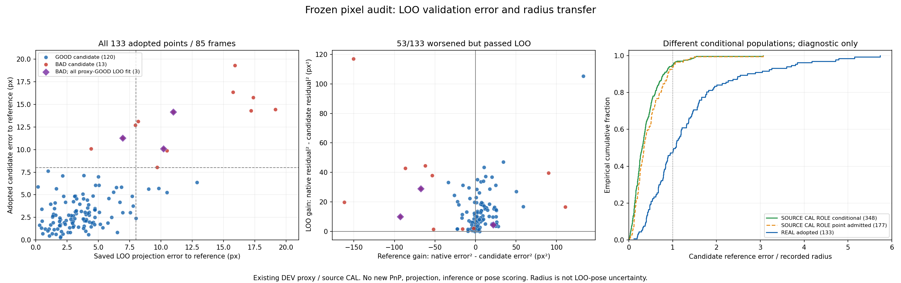
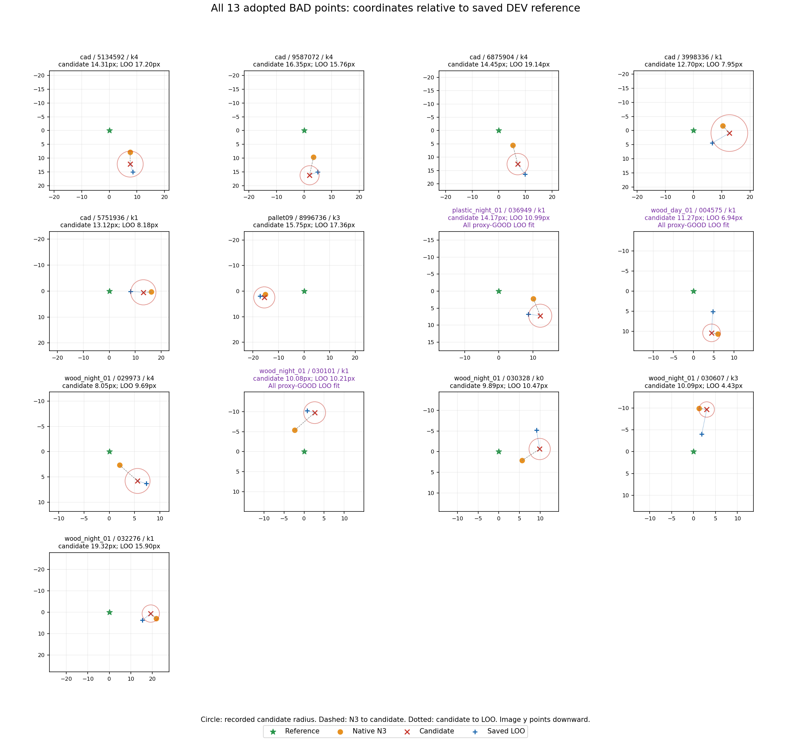

가림 판단이 일부 틀려도 다른 유효 대응점으로 자세를 구하고 자기 가림 코너를 재투영했을 때, 기존 단순 대조보다 실제 위치·회전이 좋아졌는가?

**아직 전체 쉬움·중간245장에서 단순 대조보다 위치·회전이 개선됐다는 결론은 내릴 수 없다. 이번에는 LOO 채택 검사의 실패 위치를 저장 좌표로 정확히 확인했다.** 채택133점 중53점은 초기 N3보다 참조 코너 오차가 커졌지만 LOO gain은 모두 양수였다. 8px 초과 BAD 후보13점 중10점은 LOO 재투영도 참조에서8px 넘게 틀렸다. 자기 가림 점을 fit에 다시 넣은 오류는 없었다. 문제는 제외 조건을 지킨 뒤에도 부정확한 LOO 자세를 정확한 기준처럼 사용했다는 점이다.

**코너의 특성을 정의하는 부분과 보정 좌표를 채택하는 부분을 구분한다.** 실제 partial edge의 연장 교차로 virtual cuboid corner를 얻는 정의는 검사한 source CAL573 pair에서 같은 canonical ID와 최대0.000033px 이내였다([V26](../pallet_source_corner_semantics_20261011_v26/RESULT_KO.md)). 이 정의 차이가8~19px 오차의 원인이라는 근거는 없다. 실제 경계 예측에는 함께 치우친 support/line과 교차·외삽 오차가 있고([V25](../pallet_point_admission_mechanism_20261011_v25/RESULT_KO.md)), 이를 걸러야 하는 LOO의 기준점도 틀릴 수 있다. 현재 코드에서 고칠 검토 대상은 이 채택 검사의 검증 불확실성이다. 참조나 ID를 임의 변경하지 않는다.

이번 작업은 저장된 좌표 사이 거리와 대수적 항등식의 읽기 전용 감사다. detector/head 실행·선 fitting·새 PnP·순방향 projection·새 R,t 채점·학습·새 RGB·threshold 변경은 모두0이다. 현재 쉬움 Clean153/중간 Moderate92 전체245를 join하고, 그중 채택85프레임의133점 모두를 분석했다. Severe74와 역사적319 자료는 변경하지 않았다. source는 기존 CAL128장×3 arm에서 참조가 존재한573 pair 전부다.

**LOO가 왜 나쁜 보정을 통과시켰는지.** 초기 N3 좌표를 n, 후보를 c, 저장된 LOO 재투영을 v, 기존 참조 코너를 g라고 하면 다음 식이 성립한다.

```text
G_LOO = ||n-v||² - ||c-v||²
G_REF = ||n-g||² - ||c-g||²
G_LOO = G_REF - 2 (n-c) · (v-g)
```

현재 [V4 selection](../../../scripts/research/pallet_cornerwise_independent_20261010_v4/selection.py#L149)은 LOO ambiguity/available 검사 후 candidate residual≤8px, G_LOO>1e−8만으로 채택한다. 53개 악화점은 G_REF<0인데 마지막 내적 항이 이를 뒤집어 G_LOO>0이 됐다. 이 식은 픽셀 gain 차이의 정확한 대수적 분해이며, 전체 최종 R,t 악화의 인과 분해나 독립 노이즈 분산 추정은 아니다. GT는 이 사후 검산에만 사용됐고 원 채택에 사용되지 않았다.

g는 [V8 evaluator](../../../scripts/research/pallet_same_observation_controls_20261010_v8/evaluator.py#L166)의 기존 target.gt를 고정 초기 N3 branch permutation으로 정렬한 값이다. N3 예측 자세를 GT로 사용한 값이 아니다. matched, valid_native_ids, finite XY, 원 N3 배열 동일성, frame/corner ID를 모두 확인했다. 실사 참조는 **기존 DEV GEOMETRIC_PROXY**이고 독립 실측 물리 R,t·경계 ownership은 UNKNOWN이다.



왼쪽은 모든 채택133점의 참조 기준 후보 오차와 저장 LOO 오차다. 가운데의 왼쪽 반평면53점은 참조 기준으로 악화됐지만 LOO gain이 양수다. 보라색3점은 LOO fit이 전부 기존8px proxy GOOD인 BAD 후보다. 오른쪽은 서로 다른 조건부 집합의 오차/반경 CDF이며 independent coverage 평가로 읽으면 안 된다.

아래는 **픽셀 진단 분포**다. 분산은 모집단 분산, P90은 선형 보간이다. 위치·회전·ADDsym 성능은 새로 채점하지 않았다.

| 집합 | 점 수 | LOO 참조오차 mean px | variance px² | std px | median px | P90 px | max px | LOO 오차>8px |
|---|---:|---:|---:|---:|---:|---:|---:|---:|
| 모든 채택 | 133 | 4.379420 | 12.360294 | 3.515721 | 3.776015 | 8.142366 | 19.139033 | 15 |
| GOOD 후보 | 120 | 3.568552 | 4.791528 | 2.188956 | 3.220017 | 6.440045 | 12.870364 | 5 |
| BAD 후보 | 13 | 11.864353 | 20.132310 | 4.486904 | 10.469296 | 17.330828 | 19.139033 | 10 |
| BAD·LOO fit 전부 GOOD | 3 | 9.382258 | 3.077450 | 1.754266 | 10.212035 | 10.836136 | 10.992161 | 2 |

**반경이 LOO 검증의 정확도를 나타내지는 않는다.** [V2 observations](../../../scripts/research/pallet_boundary_corner_refiner_20261010_v2/observations.py#L50)는 query 반경을 TLS 가중치와 local covariance에 사용하고, 두 선의 covariance를 교점 반경으로 전달한다. source CAL에서 fitted empirical scale을 사용한다. 이는 후보 위치의 local surrogate이며 LOO 자세의 predictive covariance가 아니다. 현재 LOO gain은 후보/LOO covariance로 whitening하거나 표준화하지 않는다. rank6·inlier≥4는 이 오차가 작다는 보증도 아니다.

| 조건부 집합 | 점 수 | 참조오차≤저장 반경 | error/radius median | P90 | max |
|---|---:|---:|---:|---:|---:|
| GEOMETRY_ONLY / source CAL 참조존재 | 125 | 121/125 (96.80%) | 0.289324 | 0.671394 | 1.784676 |
| GEOMETRY_ONLY / source CAL 기존 point admission | 61 | 59/61 (96.72%) | 0.391633 | 0.761576 | 1.784676 |
| IMAGE_NO_ROLE / source CAL 참조존재 | 100 | 98/100 (98.00%) | 0.262165 | 0.653907 | 1.067562 |
| IMAGE_NO_ROLE / source CAL 기존 point admission | 30 | 29/30 (96.67%) | 0.382692 | 0.770079 | 1.043674 |
| IMAGE_ROLE / source CAL 참조존재 | 348 | 331/348 (95.11%) | 0.301471 | 0.785526 | 3.061671 |
| IMAGE_ROLE / source CAL 기존 point admission | 177 | 166/177 (93.79%) | 0.338669 | 0.885921 | 3.061671 |
| IMAGE_ROLE / real 최종 채택 | 133 | 64/133 (48.12%) | 1.056895 | 2.670123 | 5.733714 |

source CAL는 반경 scale을 맞춘 동일 CAL이며, 실사는 최종 LOO 채택에 조건부인 DEV다. 집합·처리 단계가 다르므로 표의 수치를 독립95% coverage나 일반화 성능으로 주장하지 않는다. 관찰된 실사 반경이 충분하지 않은 사례가 많다는 진단까지만 가능하다. BAD13점이 반경 밖인 것은 기존 radius≤8px와 BAD>8px 조건에서도 따라오므로 그 개수만 새 발견이라고 주장하지 않는다. 실제 문제를 구분하는 추가 증거는 정확한 LOO 오차와 gain 부호 분해다. 실사 GT로 반경을 다시 맞추거나 threshold를 바꾸지 않았다.



원 영상/RGB를 새로 처리한 그림이 아니다. 각 panel은 기존 참조를 원점으로 이동한 저장 XY다. 초록 참조, 주황 N3, 빨강 후보, 파랑 LOO이며 빨간 원은 후보 반경이다. image y 방향을 유지했다. 같은 숫자를 원행으로 검산할 수 있다.

**13개 BAD 후보 전부**를 아래에 남긴다. 모두 기존 NEW final fit/inlier에 남았다. 위치·회전 Δ는 기존 V25에 저장된 NEW−N3 값이고 음수는 개선이다. GOOD은 기존8px annotation proxy이며 무오차를 의미하지 않는다.

| frame/corner | 후보오차 px | LOO 오차 px | 후보반경 px | G_REF px² | G_LOO px² | LOO fit 전부 GOOD | 기존 ΔT cm | 기존 ΔR deg |
|---|---:|---:|---:|---:|---:|---|---:|---:|
| eval_cad:1778653029965134592 / k4 | 14.306876 | 17.199125 | 4.701559 | -86.781672 | 42.910203 | NO | +1.291240 | +0.280353 |
| eval_cad:1778653030099587072 / k4 | 16.354684 | 15.764918 | 3.468762 | -161.927664 | 19.772101 | NO | +1.653615 | -0.068610 |
| eval_cad:1778653030166875904 / k4 | 14.453639 | 19.139033 | 4.012314 | -150.379714 | 117.060440 | NO | +1.249838 | +0.140289 |
| eval_cad:1778653030233998336 / k1 | 12.702796 | 7.952026 | 6.501055 | -51.758433 | 1.373710 | NO | +0.757754 | +0.070554 |
| eval_cad:1778653031275751936 / k1 | 13.122491 | 8.177856 | 4.853984 | 89.912177 | 39.690001 | NO | +0.234828 | +0.256948 |
| eval_pallet09:1778653730458996736 / k3 | 15.748400 | 17.363754 | 4.142062 | -16.100994 | 1.627883 | NO | -0.046504 | -0.003769 |
| plastic_night_01:036949 / k1 | 14.170149 | 10.992161 | 3.393544 | -92.896274 | 9.968951 | YES | +0.263215 | +0.360372 |
| wood_day_01:004575 / k1 | 11.272249 | 6.942579 | 2.187413 | 21.973770 | 4.488962 | YES | +0.531571 | -0.331441 |
| wood_night_01:029973 / k4 | 8.049325 | 9.690064 | 2.469844 | -53.464536 | 37.975692 | NO | +1.438494 | +0.064351 |
| wood_night_01:030101 / k1 | 10.080669 | 10.212035 | 2.719483 | -67.512326 | 28.930732 | YES | +1.030342 | +0.260682 |
| wood_night_01:030328 / k0 | 9.888465 | 10.469296 | 2.572279 | -61.893752 | 44.607522 | NO | +1.297095 | +0.187359 |
| wood_night_01:030607 / k3 | 10.088433 | 4.429558 | 1.759494 | -2.324738 | 2.054631 | NO | +0.110570 | -0.152975 |
| wood_night_01:032276 / k1 | 19.322211 | 15.904188 | 4.037008 | 110.772728 | 16.654036 | NO | +1.347682 | -0.643100 |

LOO fit 전부 GOOD인3사례에서도 정확한 LOO 오차는 plastic_night_01:036949/k1=10.992161px, wood_day_01:004575/k1=6.942579px, wood_night_01:030101/k1=10.212035px였다. 앞뒤 두 점은 초기 N3보다 악화됐고 가운데는 후보 좌표가 조금 좋아져도 최종 위치는 나빠졌다. 관측점의8px 분류만으로 heldout prediction이나 최종 자세 정확도를 보증할 수 없다는 구체적 사례다.

**가림 처리와 최종 자세 선택은 별도 문제다.** 모든133점에서 LOO H∪{k} 제외와 NEW final fit의 H/center8 제외를 검산했다. NEW R,t가 나오면 H 초기좌표를 재투영으로 대체하고 재투영을 독립 관측처럼 refit하지 않는 계약은 유지한다. 마스크 일부 오류로 전체 frame을 실패시키는 정책으로 바꾸지 않는다. [V23](../pallet_consensus_cause_audit_20261011_v23/RESULT_KO.md)에는 boundary 채택0에서도 BAD 대응을 포함한 더 큰 합의가 선택된 실패가 있다. 따라서 이번53점 LOO 문제를 고친다고 전체 robust PnP 문제가 자동 해결된다고 말할 수 없다.

**이미 고친 것 / 이번에 확인한 것 / 아직 미검증을 구분한다.** 2164개 numerical ray miss를 NONE으로 잘못 감독한 separate-head targets 오류는 실제 mesh/depth/wire POSITIVE/NONE/IGNORE로 이미 수정됐다. 감사 당시 준비·CPU gradient만 완료했던 상태와 이후 승인된 고정3×3000 학습은 구분한다. 이번 추가학습0이며 수정 전 IMAGE_ROLE0/319를 수정 후 결과로 주장하지 않는다. main N3→cornerSubPix 오류로 보고하지도 않는다. 이번 확인은 저장 LOO 오차·gain 및 후보 반경의 조건부 진단이다. 실사 실제 경계 ownership, P0 네 통제변형, LOO predictive uncertainty calibration, 새 채택 정책의 전체 자세 성능은 미검증이다.

**방법을 실제로 고치기 위한 최소 다음 검증.** [현재 LOO PoseBank](../../../scripts/research/pallet_cornerwise_independent_20261010_v4/pose.py#L203)는 여러 raw/refit/LM root의 projected8과 fit/inlier ID·score를 남기지만 [채택기](../../../scripts/research/pallet_cornerwise_independent_20261010_v4/selection.py#L154)는 선택한 하나의 projection으로 비교한다. 우선 저장된 같은 H∪{k}의 유효 root들 사이에서 candidate preference가 유지되는지 전수 감사하면, single-root 검증의 불안정성과 모든 root가 함께 틀린 경우를 분리할 수 있다. GT는 사후 분류에만 쓰고 root pool 선택/threshold에는 쓰지 않아야 한다. 실제 raw에 전체 root가 보존됐는지는 별도로 확인해야 하며 runtime 객체에 있었다는 이유로 보존됐다고 단정하지 않는다. 이 읽기 전용 감사는 새 학습·PnP·projection 없이 가능할 때 진행할 작업이며, 그 자체가 새 배포 정책의 성능 결과는 아니다.

만약 참조오차 ||v−g||≤B를 독립적으로 보장할 수 있다면 G_LOO > 2||n−c||B가 참조 기준 개선의 충분조건이다(Cauchy–Schwarz). 그러나 현재 저장 실사 GT로 계산한 LOO 오차를 배포용 B로 쓰면 누설이다. root spread나 rank 조건도 그 B의 보증이 아니다. 충분한 독립 근거 없이 임의 반경·가중치를 바꾸지 않는다. 새 정책을 검증할 때는 같은245장·공통 산출집합·전체 운용·NEW/fallback/fail·전체 경로 시간을 함께 확인해야 하고, 새 학습을 전제할 필요는 없다. 이번 요청의 읽기 전용 범위에서는 그 성능 재실험을 시작하지 않았다.

**현재 전체245 자세 결과는 변경하지 않았다.** [V21 전체 원 보고서](../pallet_whole_u_closure_20261011_v21/RESULT_KO.md)의 mean T/R/ADDsym=9.745696cm/12.622492deg/18.580216cm, NEW240/fallback5/완전실패0다. N3=9.754548cm/10.914842deg/17.028647cm, 단순 HYBRID ordinary=9.207154cm/10.613464deg/16.439686cm다. 전체 분포·공통 산출집합·운용·full path 시간은 V21 자료를 유지하며 이번에 새로 계산하지 않았다. 숨은 코너 오차만 좋아졌다고 자세가 좋아졌다고 말하지 않는다. no-mask robust 대조도 기존 보고서에 보존돼 있으며 다른 backend 결과를 현재 head 필요성의 인과 대조로 취급하지 않는다.

검산 자료: [133개 좌표·gain 항등식 원행](REAL_ROWS.jsonl.gz), [85개 원 reference frame 추출](REFERENCE_FRAMES.jsonl.gz), [573개 source 오차/반경 원행](SOURCE_ROWS.jsonl.gz), [모든 그룹 분포·전체13사례](SUMMARY.json), [실행 전 입력·코드 봉인](PROTOCOL.json), [원본 불변·245 ID join](CHECKS.json). V21 원 prediction144,291,955bytes의 SHA179e2906…을 기존 published archive manifest와 대조했다. primary runner에서 추출85frame을 원 gzip과 독립 reader로 다시 대조했고378개 distribution cell과 모든 gain 식을 재계산했다.

독립 compact reader(원 repo 파일을 갖춘 checkout; sparse checkout은 명시된 parent files를 먼저 materialize):

```bash
python3 -I -S -B scripts/research/pallet_observation_uncertainty_20261011_v27/check_public.py _docs/experiments/pallet_observation_uncertainty_20261011_v27 --checkout .
```

V21 archive를 기존 [archive 복원 안내](../pallet_whole_u_closure_20261011_v21/PUBLIC_READER_KO.md)로 복원한 뒤 `--predictions RESTORED/evaluation/PREDICTIONS.jsonl.gz`를 추가하면85frame 추출도 원245행과 다시 대조한다. 이 옵션 없이 compact reader가 PASS해도 raw 추출 검증을 새로 수행한 것은 아니다. 원 생산자의 실제 raw 검산 receipt와 reader 범위를 구분한다.

실행된 코드와 새 숫자가 포함된 과학 결과이며 계획만 남긴 상태는 아니다. 다만 정확도 목표는 아직 미달이다. 불확실성/여러 해의 검증과 전체 운용 자세 비교를 통과하기 전까지 방법이 해결됐다고 표시하지 않는다.
