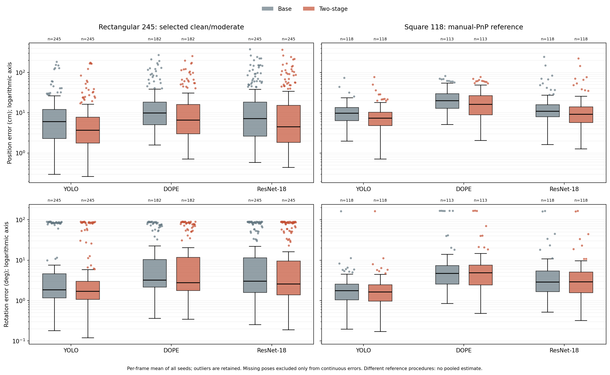
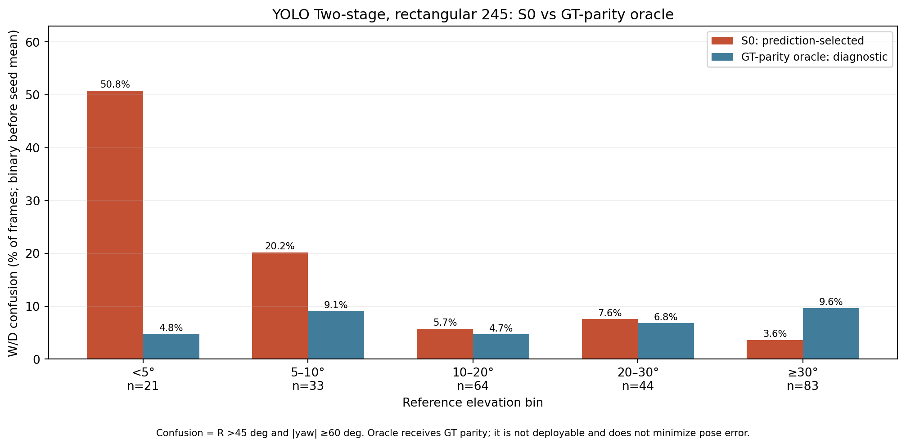
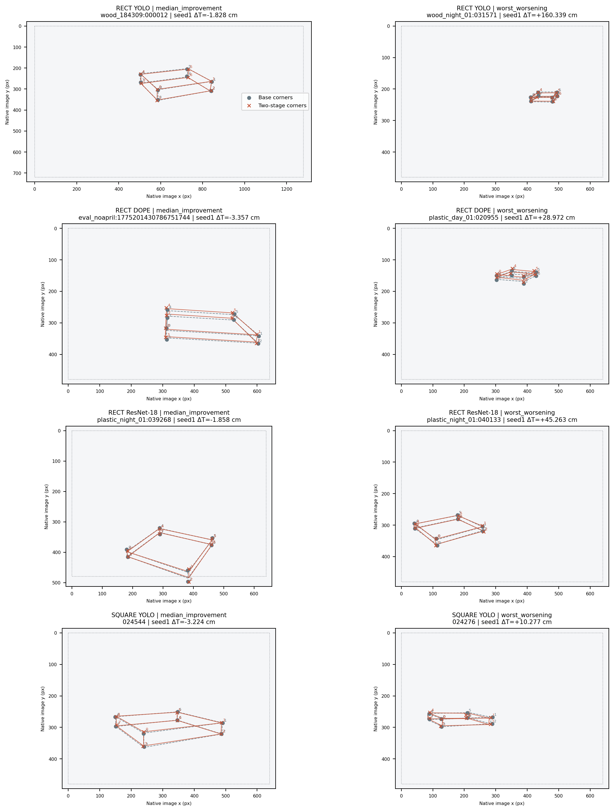
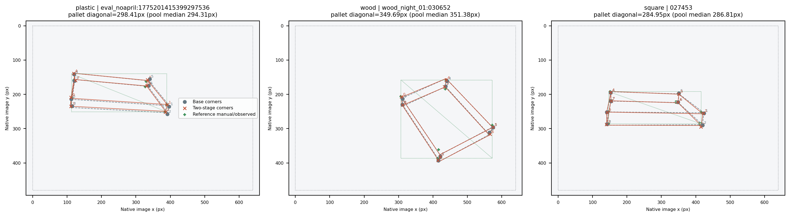

[확인] 직사각형 245장과 정사각형 118장의 논문용 표·그림 재집계를 완료했다; 직사각형 Base→Two-stage 성공률은 YOLO 41.22%→59.32%, DOPE 16.73%→27.76%, ResNet-18 38.78%→50.61%다.

# 논문용 표·그림 재집계: 직사각형 245장 / 정사각형 118장

[확인] 직사각형 주범위는 REAL_DEV319 중 주석 등급 clean153+moderate92=245장, 13세션이다. severe74장을 제외하는 범위는 **개발 결과를 검토한 뒤 정한 범위**이므로 독립 시험자료가 아니다. grade는 주석 범주이며 물리적 가림률을 나타내지 않는다. 전체319장도 같은 정의로 보충 표에 남겼다. [ID 목록·SHA](RECT_245_IDS.json), [고정 계약](METHOD_LOCK.json), [입력 감사](INPUT_AUDIT.json).

[확인] 정사각형은 GREEN0918의 118장·1세션이며 직접 수동 코너≥4의 SQPnP→RefineLM 참조를 사용한다. 직사각형은 참조 생성 절차가 다르므로 두 모집단을 합산하거나 직접 우열을 비교하지 않는다. 정사각형 수치는 **FEASIBILITY_ONLY, 단일 세션의 기술 결과**다. 90° W/D 교환은 proper C4 대칭이어서 정사각형 뒤바뀜 열은 NA다. [기존 정사각형 참조 보고서](../pallet_square6d_manualpnp_20261010/REPORT_KO.md).

## 반올림 충돌 해결과 실제 재현

[확인] 이전 중단 사유는 문서의 반올림 표 값과 절대차≤1e−6 검산을 동시에 적용한 데 있었다. 사용자 ‘해결할수있게 해줘’에 따라 T/R은 소수3자리, 비율·분산은 소수1자리로 표시한 값과 대조했다. 원래24개 원시 비교 실패와 실제 전체 정밀도 값을 지우지 않았으며, 기존 F의 **≤0.01cm·≤0.01° 기준은 유지**했다. [TABLE_DISPLAY_PARITY.json](TABLE_DISPLAY_PARITY.json), [METHOD_LOCK.json:user_clarification](METHOD_LOCK.json).

[확인] 모든 고정 seed1·2·3을 사용했다. 새 학습·새 모델 선택·새 합성 생성·주석 수정은 하지 않았다. 새 좌표 생성기에는 예측·RGB·K·등록 치수의 추론용 whitelist만 전달했고 참조나 GT를 입력하지 않았다. 단계별 좌표/F 출력을 SHA로 봉인한 뒤 그 단계의 오차를 채점했다. 기존 좌표의 Stage0/PoseFix parity에서는 별도로 참조를 읽지만 이 값을 새 좌표 생성기나 F에 전달하지 않는다. cornerSubPix는 (5,5), zeroZone(−1,−1), EPS|COUNT40/0.001이며 원래 Base에서 원영상 대각선1% 상한을 마지막에 한 번 적용한다. 표의 팔레트 대각선과 이 **원영상 대각선**은 서로 다른 값이다. [평가 코드](../../../scripts/research/pallet_paper_tables_245_20261011/evaluate.py).

## 표 1: 기반별 주결과

[확인] 영상별 seed 평균을 만든 뒤 영상 통계를 계산했다. 성공은 seed별 strict T<5cm·R<5°를 먼저 판정하고 평균했다. T/R/ADD/IoU는 산출된 값만 사용하고 n을 적었으며, 미산출은 성공률과 PCK의 전체 분모에서 실패로 계산했다. PCK@10px는 기존 대칭 대응과 전체 참조 코너 분모를 유지한다. SD는 영상 간 표본산포(ddof=1)이며 seed를 독립 영상으로 취급하지 않는다.

Table 1. Base and Two-stage across backbones; rectangle and square references remain separate.

| Scope | Backbone | Method | n / N | Seeds | PCK@10px (%) | Translation (cm) | Rotation (°) | 5cm·5° (%) | W/D confusion (%) | T med / P90 | R med / P90 | ADDsym AUC | IoU3D |
|---|---|---|---|---|---|---|---|---|---|---|---|---|---|
| RECT245 | YOLO | Base | 245 / 245 | 1,2,3 | 69.68 | 12.19 ± 23.21 | 14.23 ± 29.18 | 41.22 | 14.69 | 6.01 / 23.19 | 1.84 / 82.81 | 0.4528 | 0.6012 |
| RECT245 | YOLO | Two-stage (ours) | 245 / 245 | 1,2,3 | 74.38 | 10.13 ± 24.04 | 11.39 ± 25.68 | 59.32 | 11.16 | 3.71 / 17.74 | 1.70 / 58.44 | 0.5746 | 0.6718 |
| RECT245 | DOPE | Base | 182 / 245 | 1,2,3 | 24.07 | 22.72 ± 38.98 | 17.92 ± 29.34 | 16.73 | 11.84 | 9.90 / 54.67 | 3.23 / 79.19 | 0.2156 | 0.4383 |
| RECT245 | DOPE | Two-stage (ours) | 182 / 245 | 1,2,3 | 44.54 | 19.35 ± 35.92 | 18.69 ± 30.37 | 27.76 | 12.93 | 6.54 / 54.01 | 2.77 / 81.14 | 0.3000 | 0.5281 |
| RECT245 | ResNet-18 | Base | 245 / 245 | 1,2,3 | 59.25 | 24.14 ± 48.33 | 19.63 ± 31.94 | 38.78 | 17.55 | 7.15 / 60.79 | 3.02 / 85.59 | 0.4088 | 0.5129 |
| RECT245 | ResNet-18 | Two-stage (ours) | 245 / 245 | 1,2,3 | 63.74 | 21.09 ± 45.60 | 18.91 ± 31.49 | 50.61 | 17.01 | 4.47 / 55.72 | 2.57 / 85.34 | 0.4774 | 0.5652 |
| SQUARE118 | YOLO | Base | 118 / 118 | 1,2,3 | 85.26 | 11.31 ± 8.55 | 3.49 ± 14.89 | 15.25 | — | 9.79 / 17.99 | 1.76 / 4.04 | 0.3435 | 0.6434 |
| SQUARE118 | YOLO | Two-stage (ours) | 118 / 118 | 1,2,3 | 88.16 | 9.45 ± 9.30 | 3.34 ± 14.95 | 25.99 | — | 7.38 / 16.10 | 1.63 / 3.72 | 0.4696 | 0.6887 |
| SQUARE118 | DOPE | Base | 113 / 118 | 1,2,3 | 36.68 | 25.10 ± 16.62 | 14.50 ± 36.65 | 0.00 | — | 19.92 / 51.00 | 4.74 / 13.93 | 0.0725 | 0.4192 |
| SQUARE118 | DOPE | Two-stage (ours) | 113 / 118 | 1,2,3 | 63.15 | 21.78 ± 16.95 | 10.89 ± 27.28 | 3.11 | — | 16.26 / 48.68 | 4.90 / 14.07 | 0.1450 | 0.4988 |
| SQUARE118 | ResNet-18 | Base | 118 / 118 | 1,2,3 | 72.19 | 17.38 ± 27.56 | 7.17 ± 21.35 | 8.47 | — | 10.90 / 27.64 | 2.88 / 8.61 | 0.2696 | 0.5717 |
| SQUARE118 | ResNet-18 | Two-stage (ours) | 118 / 118 | 1,2,3 | 76.77 | 15.52 ± 26.05 | 7.08 ± 21.37 | 19.49 | — | 9.13 / 24.66 | 2.90 / 8.48 | 0.3434 | 0.5998 |

평균±표본 SD는 영상별 seed 평균의 분포다. `n`은 자세가 한 seed 이상 산출된 영상 수이며, 이진 지표와 PCK는 전체 고정 분모를 사용한다. PCK는 자세 미산출 영상의 성공 코너를 0으로 센다. 정사각형의 가로·깊이 교환은 C4 대칭이므로 W/D confusion을 산출하지 않는다.

[확인] 평균이 낮아져도 분산·꼬리 오차가 낮아졌다는 뜻은 아니다. 다음 표는 모든 기반의 Base→Two-stage 분산과 P90을 그대로 나란히 놓는다.

| 범위 | 기반 | T 분산 cm² Base→Two-stage | R 분산 °² Base→Two-stage | T P90 cm Base→Two-stage | R P90 ° Base→Two-stage |
| --- | --- | --- | --- | --- | --- |
| RECT245 | YOLO | 538.5791→578.0781 | 851.3842→659.2690 | 23.1919→17.7440 | 82.8106→58.4439 |
| RECT245 | DOPE | 1519.5698→1290.3680 | 860.6868→922.2089 | 54.6719→54.0112 | 79.1875→81.1444 |
| RECT245 | ResNet-18 | 2335.4418→2079.6475 | 1020.3684→991.9040 | 60.7867→55.7249 | 85.5899→85.3436 |
| SQUARE118 | YOLO | 73.0818→86.4446 | 221.7587→223.4630 | 17.9880→16.1035 | 4.0359→3.7194 |
| SQUARE118 | DOPE | 276.2043→287.1884 | 1343.2962→743.9414 | 51.0033→48.6827 | 13.9349→14.0679 |
| SQUARE118 | ResNet-18 | 759.5268→678.6579 | 455.8818→456.7052 | 27.6415→24.6647 | 8.6094→8.4816 |

[확인] YOLO245의 Two-stage 회전 평균은 11.3910°이며 Stage1 단독 10.8775°보다 높다. T 분산은 Base 538.5791cm²→Two-stage 578.0781cm²이다. 평균 위치 오차·성공률의 변화와 이 산포 악화를 함께 보고한다.

[확인] DOPE245의 Two-stage R 평균은 Base 17.9202°→18.6871°, W/D 뒤바뀜은 11.8367%→12.9252%로 악화됐다. 자세 산출 n=182/245를 연속 오차 분모에 명시하고, 성공률·PCK는245장 전체 분모를 유지한다.

[확인] 그림 A는 두 참조 모집단을 별도 패널로 놓고 로그 y축을 사용한다. 모든 유한 이상치를 점으로 남겼으며 미산출 n을 표시했다. 0 오차는 epsilon으로 바꾸지 않고 발생 ID·수를 [FIGURE_INDEX.json](FIGURE_INDEX.json)에 별도로 기록한다.

## 표 2: 외부 비교와 처리 시간

Table 2. YOLO external comparisons on RECT245.

| Scope | Backbone | Method | n / N | Seeds | PCK@10px (%) | Translation (cm) | Rotation (°) | 5cm·5° (%) | W/D confusion (%) | Time (ms) | T med / P90 | R med / P90 | ADDsym AUC | IoU3D |
|---|---|---|---|---|---|---|---|---|---|---|---|---|---|---|
| RECT245 | YOLO | Base | 245 / 245 | 1,2,3 | 69.68 | 12.19 ± 23.21 | 14.23 ± 29.18 | 41.22 | 14.69 | 11.34 ± 1.36 | 6.01 / 23.19 | 1.84 / 82.81 | 0.4528 | 0.6012 |
| RECT245 | YOLO | cornerSubPix only | 245 / 245 | 1,2,3 | 68.54 | 10.90 ± 23.28 | 13.53 ± 28.44 | 55.10 | 13.47 | 11.95 ± 1.50 | 4.42 / 21.37 | 1.90 / 82.07 | 0.5236 | 0.6373 |
| RECT245 | YOLO | PoseFix-style | 245 / 245 | 1,2,3 | 75.50 | 11.00 ± 23.55 | 10.86 ± 25.09 | 48.71 | 10.61 | 25.36 ± 1.87 | 5.04 / 19.72 | 1.59 / 55.81 | 0.5144 | 0.6353 |
| RECT245 | YOLO | PoseFix-style + cornerSubPix | 245 / 245 | 1,2,3 | 73.79 | 8.18 ± 16.00 | 9.97 ± 23.64 | 62.72 | 9.39 | 25.67 ± 1.15 | 3.22 / 16.36 | 1.59 / 29.45 | 0.5966 | 0.6850 |
| RECT245 | YOLO | Two-stage (ours) | 245 / 245 | 1,2,3 | 74.38 | 10.13 ± 24.04 | 11.39 ± 25.68 | 59.32 | 11.16 | 15.50 ± 1.62 | 3.71 / 17.74 | 1.70 / 58.44 | 0.5746 | 0.6718 |

평균±표본 SD는 영상별 seed 평균의 분포다. `n`은 자세가 한 seed 이상 산출된 영상 수이며, 이진 지표와 PCK는 전체 고정 분모를 사용한다. PCK는 자세 미산출 영상의 성공 코너를 0으로 센다. 정사각형의 가로·깊이 교환은 C4 대칭이므로 W/D confusion을 산출하지 않는다.

[확인] PoseFix-style은 기존 첫 RAW chain/pass1의 `points[:,0,1]`를 그대로 사용하며 checkpoint·pass를 고르지 않았다. 다른 시점의 원고 latency25.24ms를 이번 측정값과 섞지 않았다. Base/Stage1/Stage2/Two-stage/PoseFix/PoseFix+Stage2를 같은 GPU·환경에서 batch1, 준비20회/경로, 13세션26프레임×5회로 측정했다. 전처리부터 최종 PnP까지 포함하고 디코딩·모델 로딩은 제외했다. [LATENCY.json](LATENCY.json).

[확인] PoseFix-style+cornerSubPix의 T/R/성공률은 8.1789cm /9.9721° /62.7211%로, Two-stage의 10.1265cm /11.3910° /59.3197%보다 정확도가 좋다. 처리 시간은 25.6654ms 대 15.4997ms로 Two-stage가 짧다. 이 결과는 모든 방법·지표에서 제안법이 우세하다는 주장을 뒷받침하지 않는다.

## 표 3: 절제와 공동 보정 비교

Table 3. YOLO fixed ablations on RECT245.

| Scope | Backbone | Method | n / N | Seeds | PCK@10px (%) | Translation (cm) | Rotation (°) | 5cm·5° (%) | W/D confusion (%) | T med / P90 | R med / P90 | ADDsym AUC | IoU3D |
|---|---|---|---|---|---|---|---|---|---|---|---|---|---|
| RECT245 | YOLO | Image only | 245 / 245 | 1,2,3 | 74.45 | 11.16 ± 22.15 | 11.18 ± 25.03 | 46.67 | 10.88 | 5.45 / 20.35 | 1.70 / 55.70 | 0.4960 | 0.6320 |
| RECT245 | YOLO | + symmetry | 245 / 245 | 1,2,3 | 74.38 | 11.35 ± 22.58 | 11.62 ± 25.34 | 46.53 | 11.43 | 5.36 / 20.83 | 1.74 / 57.94 | 0.4954 | 0.6308 |
| RECT245 | YOLO | + dimensions | 245 / 245 | 1,2,3 | 75.48 | 10.83 ± 21.77 | 10.88 ± 24.94 | 46.80 | 10.61 | 5.43 / 19.91 | 1.61 / 54.07 | 0.5012 | 0.6353 |
| RECT245 | YOLO | Stage 1 full | 245 / 245 | 1,2,3 | 75.50 | 10.83 ± 21.72 | 10.88 ± 24.93 | 46.94 | 10.61 | 5.41 / 19.79 | 1.62 / 55.14 | 0.5015 | 0.6351 |
| RECT245 | YOLO | cornerSubPix only | 245 / 245 | 1,2,3 | 68.54 | 10.90 ± 23.28 | 13.53 ± 28.44 | 55.10 | 13.47 | 4.42 / 21.37 | 1.90 / 82.07 | 0.5236 | 0.6373 |
| RECT245 | YOLO | Two-stage (ours) | 245 / 245 | 1,2,3 | 74.38 | 10.13 ± 24.04 | 11.39 ± 25.68 | 59.32 | 11.16 | 3.71 / 17.74 | 1.70 / 58.44 | 0.5746 | 0.6718 |
| RECT245 | YOLO | Joint–isotropic | 245 / 245 | 1,2,3 | 75.72 | 10.30 ± 22.27 | 11.12 ± 25.37 | 51.70 | 10.88 | 4.70 / 17.75 | 1.61 / 55.69 | 0.5305 | 0.6554 |
| RECT245 | YOLO | Joint–learned covariance | 245 / 245 | 1,2,3 | 75.76 | 10.78 ± 22.17 | 11.33 ± 25.39 | 49.80 | 11.16 | 4.83 / 19.84 | 1.62 / 55.89 | 0.5140 | 0.6433 |

평균±표본 SD는 영상별 seed 평균의 분포다. `n`은 자세가 한 seed 이상 산출된 영상 수이며, 이진 지표와 PCK는 전체 고정 분모를 사용한다. PCK는 자세 미산출 영상의 성공 코너를 0으로 센다. 정사각형의 가로·깊이 교환은 C4 대칭이므로 W/D confusion을 산출하지 않는다.

[확인] N0/N1/N2 영상별 seed 예측의 존재 여부를 입력 감사에서 확인했고, 존재하는 고정 예측을 같은 F로 평가했다. 표에서 결과가 나쁜 경로·seed도 남겼다. [P/D/L·등급별 보충 표](SUPP.md), [모든 seed](SEED_TABLES.csv), [319장 표1](SUPPLEMENT_319_TABLE_1.md), [319장 표2](SUPPLEMENT_319_TABLE_2.md)에 같은 정의로 남겼다. severe74장도319장 보충에서 제외하지 않았다.

## 같은 실행에서 측정한 여섯 경로의 처리 시간

| 경로 | 평균±SD ms | 측정 n |
| --- | --- | --- |
| Base | 11.3386 ± 1.3632 | 130 |
| Stage 1 only | 14.8192 ± 1.6700 | 130 |
| Stage 2 only | 11.9492 ± 1.4957 | 130 |
| Two-stage | 15.4997 ± 1.6232 | 130 |
| PoseFix-style | 25.3593 ± 1.8716 | 130 |
| PoseFix-style + Stage 2 | 25.6654 ± 1.1549 | 130 |

[확인] 각 경로 준비20회는 위 n에서 제외했다. GPU 동기화 벽시계 시간을 사용했고6경로 모두 동일 고정26프레임을5회 측정했다. 캐시의 평가실행 시간이나 이전 보고서의 다른 시점 latency를 여기에 대입하지 않았다.

[확인] 최초 latency 로딩은 집계용 `pallet-pose` 환경의 오래된 Ultralytics가 기존 YOLO checkpoint의 C3k2를 지원하지 않아 실패했다. 실패 시 실제 forward/F/측정 호출은0이었다. 기존 원 runtime 환경인 `pallet-yolo26`(Torch2.1.1+cu118, Ultralytics8.4.60, OpenCV4.9.0)으로 같은 checkpoint·프로토콜을 실행했다. 모델/설정을 바꾸거나 수치를 보고 환경을 고른 것은 아니다. 이 환경 선택 오류와0호출을 [LATENCY_PREFLIGHT_REPAIR.json](LATENCY_PREFLIGHT_REPAIR.json)에 남겼다.

[확인] 이어진 첫 Base 준비 호출에서 Ultralytics의 내부 최초 초기화 forward를 계측 guard가 두 번째 영상 호출로 잘못 셌다. 이 시도는 F1회·detector hook2회 이후 중단됐고 measured 호출은0이었다. 실패한 source lock·journal·로그를 보존하고 명시적900개 파이프라인과 내부 초기화 forward1개를 구분하도록 계측만 고쳤다. 최종 측정과 별도로 실패 준비 호출1회를 남겼으며 예측·모델·수치 기준은 바꾸지 않았다. [LATENCY_INSTRUMENTATION_REPAIR.json](LATENCY_INSTRUMENTATION_REPAIR.json).

## 짝 비교, p값과 해석

[확인] 직사각형은 기존319장/13세션 paired cluster draw10,000회(seed20260917, SHA `63e288a51d7b0612616beefac28fcc625e76e8c5d7b5a0ecc5e8b85c73048fa5`)에서 고정245장 ID만 취했다. 새 draw나 좋은 seed를 고르지 않았다. t-검정은 동일13세션의 평균 차이를 같은 가중치로 사용(df12)하고, CI/bootstrap 양측 p는 영상 가중 효과를 대상으로 하므로 추정 대상이 다르다. 정사각형은 기존118장 frame draw와 영상 단위 paired t-검정을 기술용으로 사용한다.

[확인] 표마다 사전 정의한 비교·지표 전체를 한 family로 묶어 t와 bootstrap p에 Holm 보정을 각각 적용했다. 표1은 직사각형과 정사각형의 선언 검정을 함께 보정하며 정사각형 W/D NA는 제외한다. 표3의 중복/역방향 비교도 삭제하지 않았다. 개발 후 선정·다중 비교·단일 정사각형 세션 때문에 p값을 독립 확증으로 해석하지 않는다. [PAIRED.json](PAIRED.json).

| 표 | 범위 | 기반 | 비교 | Δ성공 %p [95% CI] | t p / Holm p | bootstrap p / Holm p |
| --- | --- | --- | --- | --- | --- | --- |
| TABLE_1 | RECT245 | YOLO | N3_THEN_SUBPIX − BASE | 18.0952 [7.5991, 30.8841] | 0.003621 / 0.072417 | 0.001900 / 0.028797 |
| TABLE_1 | RECT245 | DOPE | N3_THEN_SUBPIX − BASE | 11.0204 [4.7872, 18.0077] | 0.059076 / 0.590762 | 0.001800 / 0.028797 |
| TABLE_1 | RECT245 | ResNet-18 | N3_THEN_SUBPIX − BASE | 11.8367 [1.7600, 24.9323] | 0.060522 / 0.590762 | 0.037096 / 0.296770 |
| TABLE_1 | SQUARE118 | YOLO | N3_THEN_SUBPIX − BASE | 10.7345 [3.9548, 17.7966] | 0.003969 / 0.075403 | — / — |
| TABLE_1 | SQUARE118 | DOPE | N3_THEN_SUBPIX − BASE | 3.1073 [0.5650, 6.2147] | 0.040566 / 0.486790 | — / — |
| TABLE_1 | SQUARE118 | ResNet-18 | N3_THEN_SUBPIX − BASE | 11.0169 [5.6497, 16.9492] | 0.000257 / 0.006437 | — / — |
| TABLE_2 | RECT245 | YOLO | N3_THEN_SUBPIX − BASE | 18.0952 [7.5991, 30.8841] | 0.003621 / 0.090522 | 0.001900 / 0.047495 |
| TABLE_2 | RECT245 | YOLO | N3_THEN_SUBPIX − SUBPIX | 4.2177 [1.4018, 7.4205] | 0.016638 / 0.349404 | 0.010499 / 0.230977 |
| TABLE_2 | RECT245 | YOLO | N3_THEN_SUBPIX − POSEFIX | 10.6122 [-1.7701, 27.2644] | 0.135498 / 1.000000 | 0.197680 / 1.000000 |
| TABLE_2 | RECT245 | YOLO | N3_THEN_SUBPIX − POSEFIX_SUBPIX | -3.4014 [-5.2356, -1.6787] | 0.268557 / 1.000000 | 0.001300 / 0.033797 |
| TABLE_3 | RECT245 | YOLO | N1 − N0 | -0.1361 [-1.1429, 0.5348] | 0.171812 / 1.000000 | 0.822018 / 1.000000 |
| TABLE_3 | RECT245 | YOLO | N2 − N1 | 0.2721 [-0.8304, 2.0833] | 0.270466 / 1.000000 | 0.724028 / 1.000000 |
| TABLE_3 | RECT245 | YOLO | N3_DIM_SYM − N2 | 0.1361 [-1.1328, 0.9423] | 0.892858 / 1.000000 | 0.842216 / 1.000000 |
| TABLE_3 | RECT245 | YOLO | SUBPIX − N3_DIM_SYM | 8.1633 [-2.9631, 22.1810] | 0.920282 / 1.000000 | 0.283772 / 1.000000 |
| TABLE_3 | RECT245 | YOLO | N3_THEN_SUBPIX − SUBPIX | 4.2177 [1.4018, 7.4205] | 0.016638 / 0.931743 | 0.010499 / 0.566943 |
| TABLE_3 | RECT245 | YOLO | JOINT_FIXED_ISOTROPIC − N3_THEN_SUBPIX | -7.6190 [-19.6080, 1.6517] | 0.853295 / 1.000000 | 0.224378 / 1.000000 |
| TABLE_3 | RECT245 | YOLO | FG_JOINT_POSTERIOR − JOINT_FIXED_ISOTROPIC | -1.9048 [-3.4723, -0.4866] | 0.031494 / 1.000000 | 0.010099 / 0.559944 |
| TABLE_3 | RECT245 | YOLO | N3_THEN_SUBPIX − JOINT_FIXED_ISOTROPIC | 7.6190 [-1.6517, 19.6080] | 0.853295 / 1.000000 | 0.224378 / 1.000000 |
| TABLE_3 | RECT245 | YOLO | N3_THEN_SUBPIX − FG_JOINT_POSTERIOR | 9.5238 [-0.0000, 22.6323] | 0.567116 / 1.000000 | 0.100690 / 1.000000 |

[확인] 원래 p와 Holm p, 모든 지표의 CI와 유효 짝 n은 [PAIRED_TABLE_1.md](PAIRED_TABLE_1.md), [PAIRED_TABLE_2.md](PAIRED_TABLE_2.md), [PAIRED_TABLE_3.md](PAIRED_TABLE_3.md)에 나란히 기재했다. 표본분산·SD·중앙값·P90·최댓값·95%CI와 raw seed별 값은 [METRICS.json](METRICS.json), 실패·손상·회복 ID 전체는 [FAILURES.json](FAILURES.json)에서 확인할 수 있다.

[확인] DOPE의 직사각형 연속 오차는 eval_night09에서 공통 산출 자세가0개이므로 해당 T/R/IoU 세션 t-검정3개를 NA로 남겼다. df12 조건을 유지하며13번째 세션을 임의로 빼거나 df11 p값으로 대신하지 않았다. Holm은 실제 계산 가능한 원래 family의 p에만 적용했다.

## 그림 B: 고도와 가로·깊이 뒤바뀜

[확인] YOLO Two-stage의 직사각형245장, 고도<5/5–10/10–20/20–30/≥30°에서 seed별 R>45° 및 |yaw|≥60°를 먼저 판정했다. 구간의 장수를 막대 아래 표시했다. GT-parity oracle은 참조 긴 축에 맞는 가설을 공급하는 **진단용 경로**이며 오차가 가장 작은 가설을 선택한 것이 아니다. 결과가 악화된 구간도 표시했다. [구간별 수치·출처](PAPER_NUMBERS.json)의 `altitude_confusion_bins`.

## 그림 C·D: 고정 사례와 공개 범위

[확인] 그림 C는 고정seed1에서 각 기반의 ΔT<0 개선 사례 중 개선량 중앙값에 가장 가까운 영상과 ΔT>0 최대 악화 영상이다. 동률은 ID 사전순이다. 직사각형 사례 풀은245장 중 final-test4세션27장을 제외한218장이고, 정사각형 YOLO는118장이다. 자세가 둘 다 산출된 짝에서만 사례를 고르며 미산출 ID도 기록했다. **그림 규칙을 결과에 맞춰 바꾸지 않았다.** [CASE_SELECTION.json](CASE_SELECTION.json).

| 모집단 | 기반 | 선택 규칙 | ID | ΔT cm |
| --- | --- | --- | --- | --- |
| RECT | YOLO | median_improvement | wood_184309:000012 | -1.8283 |
| RECT | YOLO | worst_worsening | wood_night_01:031571 | 160.3389 |
| RECT | DOPE | median_improvement | eval_noapril:1775201430786751744 | -3.3566 |
| RECT | DOPE | worst_worsening | plastic_day_01:020955 | 28.9723 |
| RECT | ResNet-18 | median_improvement | plastic_night_01:039268 | -1.8581 |
| RECT | ResNet-18 | worst_worsening | plastic_night_01:040133 | 45.2633 |
| SQUARE | YOLO | median_improvement | 024544 | -3.2243 |
| SQUARE | YOLO | worst_worsening | 024276 | 10.2765 |

[확인] 그림 D는 plastic/wood의 적격218장 풀과 square118장 풀에서 형태별 팔레트 대각선 중앙값에 가장 가까운 ID다. 대각선은 native pixel에서 참조 코너0–7의 축 정렬 bounding box의 `hypot(ptpX,ptpY)`이며 화면 경계로 clipping하지 않는다. 기존 투영·외삽 코너를 이 영상 크기 진단에 포함했다. Square의 보조 투영 코너를 수동 PnP 참조 생성에 새로 넣지는 않았다. 원고 인용용 대각선 중앙값은 이 사례 풀과 별도로 **전체245장**에서 계산했다.

[확인] RGB 버전은 저장소 밖 지정 `--private-dir`에만8개 C와3개 D를 저장했다. 저장소에는 같은 ID의 코너·투영 상자 좌표 버전만 게시했다. 로컬 파일명·SHA는 [PRIVATE_FIGURES_RECEIPT.json](PRIVATE_FIGURES_RECEIPT.json)에 있고 실제 로컬 경로는 비공개 `FIGURE_INPUTS.json`에 기록된다. 공개 PNG에 RGB·배경 texture를 포함하지 않았다.

## 원고 인용 수치와 한계

| 항목 | 값 | 출처 |
| --- | --- | --- |
| YOLO Stage1 PCK@10px 증가 | 5.8196%p | PAPER_NUMBERS.json:N3_PCK10_increase_percentage_points |
| DOPE Stage1 PCK@10px 증가 | 21.2810%p | PAPER_NUMBERS.json:N3_PCK10_increase_percentage_points |
| ResNet-18 Stage1 PCK@10px 증가 | 5.1997%p | PAPER_NUMBERS.json:N3_PCK10_increase_percentage_points |
| YOLO BASE 5cm·5° | 41.2245% | TABLE_2.csv |
| YOLO SUBPIX 5cm·5° | 55.1020% | TABLE_2.csv |
| YOLO N3_THEN_SUBPIX 5cm·5° | 59.3197% | TABLE_2.csv |
| 245장 팔레트 대각선 중앙값 /10px 비율 | 341.0394px /2.9322% | PAPER_NUMBERS.json:RECT245_pallet_diagonal_px |
| Square YOLO Base→Two-stage | 15.2542%→25.9887% | TABLE_1.csv |
| Square DOPE Base→Two-stage | 0.0000%→3.1073% | TABLE_1.csv |
| Square ResNet-18 Base→Two-stage | 8.4746%→19.4915% | TABLE_1.csv |
| YOLO::BASE R>45° 중 W/D 뒤바뀜 비율 | 100.0000% | PAPER_NUMBERS.json:confusion_share_among_R_gt45_percent |
| YOLO::N3_THEN_SUBPIX R>45° 중 W/D 뒤바뀜 비율 | 100.0000% | PAPER_NUMBERS.json:confusion_share_among_R_gt45_percent |

[확인] 모든 인용 값에 원본 표의 칸 또는 METRICS 키를 연결한 [PAPER_NUMBERS.json](PAPER_NUMBERS.json)을 만들었다. 유한 큰 오차와 악화·미산출을 제거하지 않았고 모든 seed를 보충 파일에 남겼다. 원고·LaTeX·PDF와 기존 실험 폴더는 수정하지 않았다.

[추정] seed 간 공유 학습 자료, 13세션의 제한된 환경, 개발 결과를 본 뒤 severe를 제외한 범위 선택이 외부 일반화에 영향을 줄 수 있다. 이 분석만으로 물리적 가림 강도에 따른 인과 효과나 독립 시험 성능을 주장할 수 없다. 정사각형 수동 PnP 참조 자체의 불확실성은 이전 보고서의 잔차·LOO·4점/≥5점 분석과 함께 해석한다.

## 검산·보존·재현

[확인] 기존 입력·checkpoint·결과 파일은 읽기 전용으로 사용했고 작업 전후 SHA를 대조했다. 실제 재현·독립 검산·원 작업트리 보존·원격 게시 증거는 아래 실행 receipt에 기록한다. [재현 방법](REPRODUCE.md).
[확인] [STATISTICS_VERIFICATION.json](STATISTICS_VERIFICATION.json)의 독립 검산은 PASS, 수치 비교 368,370개, 최대 절대차 7.28e-12다.
[확인] [REPLAY_VERIFICATION.json](REPLAY_VERIFICATION.json)의 독립 검산은 PASS, 수치 비교 1,197,318개, 최대 절대차 1.14e-13다.
[확인] [VERIFICATION.json](VERIFICATION.json)의 독립 검산은 PASS다.

[확인] 독립 검산에서 bootstrap p의 이산 동일값을 부동소수점 차이로 서로 다르게 센 경계 비교를 발견했다. 초기 PAIRED와 source를 보존하고 동률 처리의 수치 구현을 고쳤다. 원래 bootstrap p 22개 칸과 Δ의 부동소수점 마지막 자리 50개 칸을 수정했다. 원본 좌표·오차·METRICS·평균·분산·CI·t p와19개 집계·표 파일은 그대로이며 수치 동률 처리를 saved 결과에서 다시 검산했다. [NUMERICAL_AMENDMENT.json](NUMERICAL_AMENDMENT.json).

- [STAGE0_F_PARITY.json](STAGE0_F_PARITY.json)
- [POSEFIX_319_PARITY.json](POSEFIX_319_PARITY.json)
- [COORDINATE_EXECUTION.json](COORDINATE_EXECUTION.json)
- [EVALUATION_EXECUTION.json](EVALUATION_EXECUTION.json)
- [STATISTICS_EXECUTION.json](STATISTICS_EXECUTION.json)
- [TABLES_EXECUTION.json](TABLES_EXECUTION.json)
- [REPLAY_VERIFICATION.json](REPLAY_VERIFICATION.json)
- [VERIFICATION.json](VERIFICATION.json)
- [STATISTICS_VERIFICATION.json](STATISTICS_VERIFICATION.json)
- [WORKSPACE_PRESERVATION.json](WORKSPACE_PRESERVATION.json)
- [PUBLIC_CONTENT_CHECK.json](PUBLIC_CONTENT_CHECK.json)
- [PUBLICATION.json](PUBLICATION.json)
