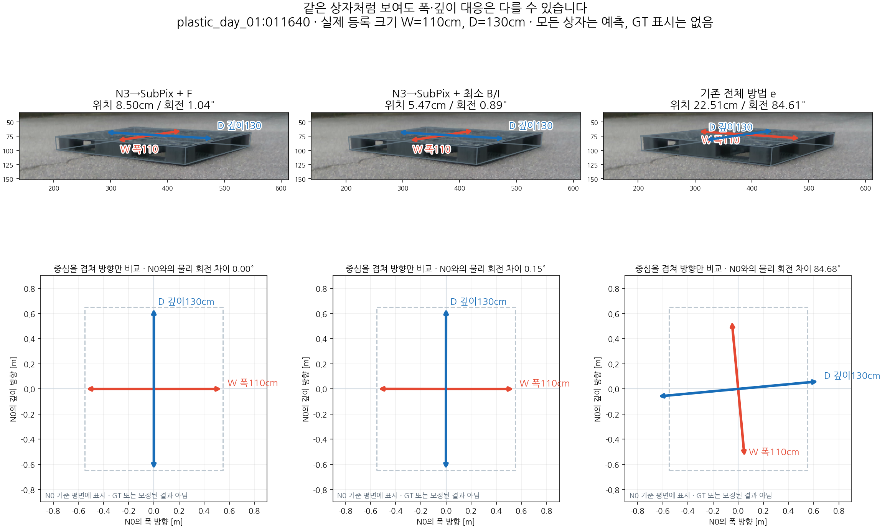

# 011640 물리 폭·깊이 대응 비교

빨강은 등록 폭W=110cm, 파랑은 깊이D=130cm다. 위는 같은 실제영상·같은ROI에 저장된 예측모델과 물리축을 투영했다. 아래는 중심을 겹치고 N0의 W/D평면에서 방향만 비교하며 GT가 아니다. 기존e는 N0와 native CF회전이약5.59°만다르지만 폭·깊이 모델가족/기저등록이다르므로 물리C2회전차는약84.68°다. 직사각형에서90°는평가대칭이아니다. 표시오차는기존고정참조에대한값이며 원주석의독립적물리축GT를새로확정한것이아니다.
