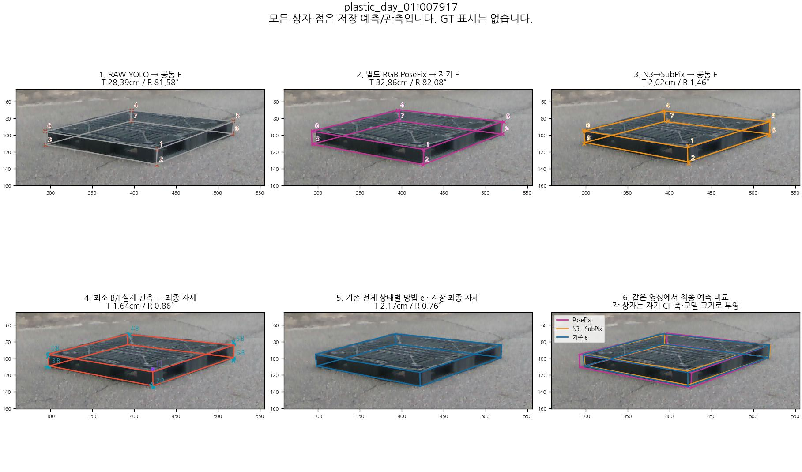
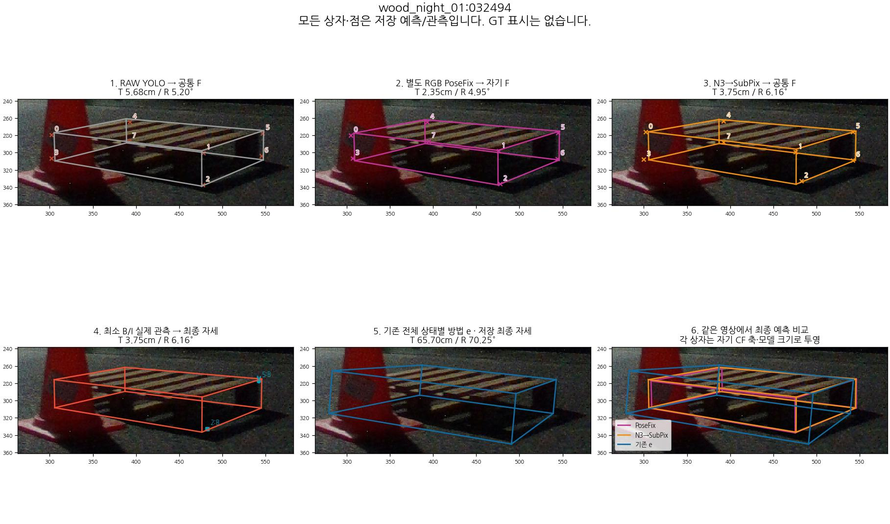
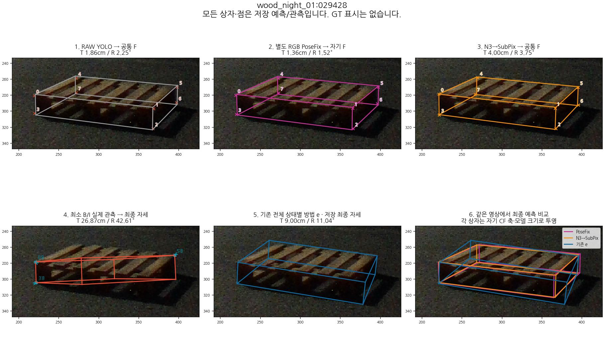
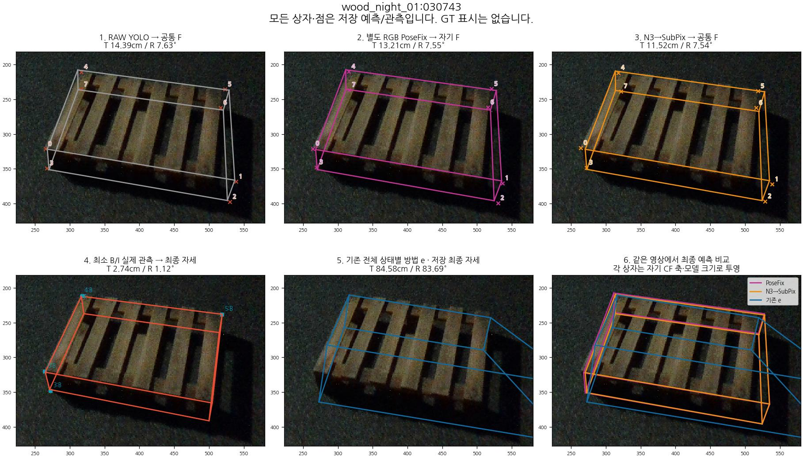
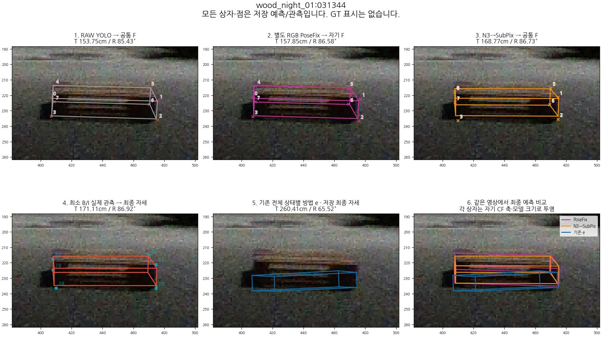
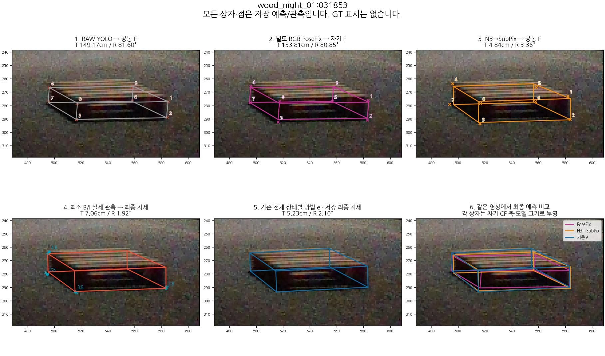

# 실제 이미지의 저장 단계 비교

공통 영상의 저장된 실제 단계입니다. e는 비교 예측이며 GT가 아닙니다. 4번은 최소 B/I 관측이고 5번은 기존 전체 e의 최종 자세로 서로 다른 경로입니다. e의 저장되지 않은 중간 과정을 만들어 연결하지 않았습니다. S는 B/I 관측에 넣지 않으며 최종 모델에서 투영합니다. 0–7 번호는 각 경로의 native 코너 번호입니다.

사례 선택은 점수를 확인한 뒤의 진단용이며 추론이나 방법 선택에 영향을 주지 않았다. 전체 분모와 모든 승패는 상위 보고서와 CSV에 보존한다.

## plastic_day_01:007917

PoseFix 실패 → 기존 e 성공 · 위치 개선 최대

## wood_night_01:032494

PoseFix 성공 → 기존 e 실패 · 위치 손상 최대

## wood_night_01:029428

N3→SubPix 성공 → 최소 BI 실패 · 위치 손상 최대

## wood_night_01:030743

N3→SubPix 실패 → 최소 BI 성공 · 위치 개선 최대

## wood_night_01:031344

기존 e의 최대 위치 오차

## wood_night_01:031853

PoseFix 실패 → N3→SubPix 성공 · 위치 개선 최대

