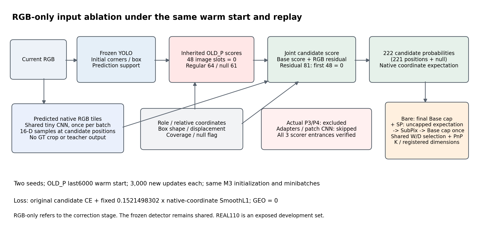
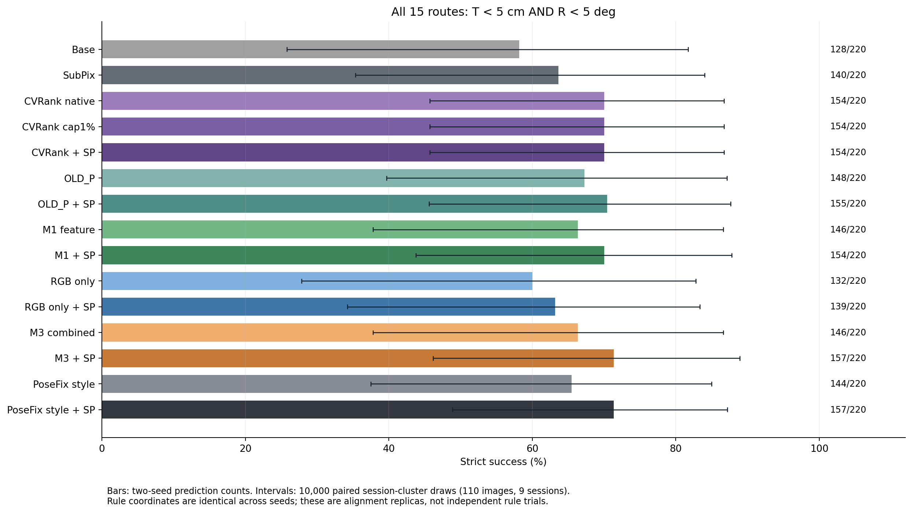
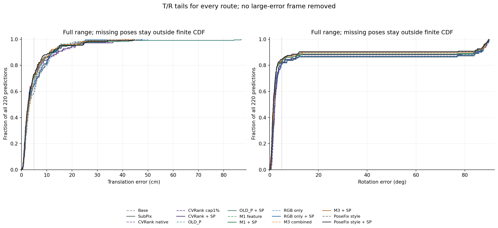
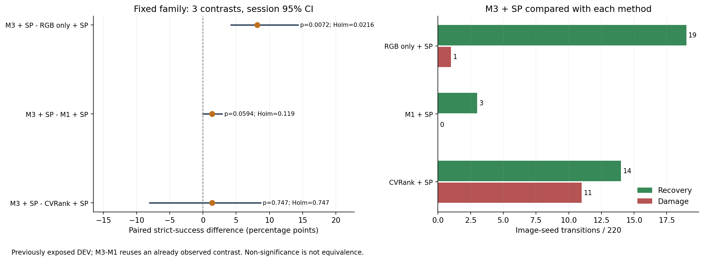
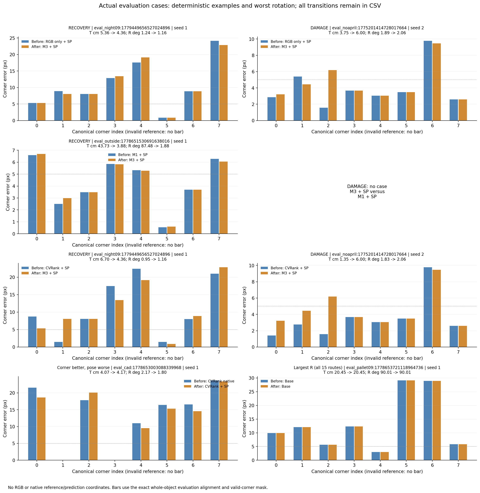

RGB_ONLY 두 시드 총 6,000 updates와 CVRANK 동일 110장 재평가를 완료했으며, 특징·RGB 결합의 두 단독 입력 대비 증분을 입증하지 못해 결합의 필수성 주장을 제외한다.

문제는 기존 특징과 원영상 RGB를 함께 쓰는 M3가 각 단독 입력보다 실제 6D에서 나은지, 동일 후처리를 허용한 비학습 보정과 비교해 추가 복잡성을 남길 근거가 있는지다. 이 문서는 고정된 입력 절제와 비교 조건에서 그 두 질문에 답한다.

[확인] 사용자 범위대로 Severe를 제외한 **Clean 68 + Moderate 42 = 110장, 9세션**만 평가했다. 동일 두 seed의 220개 예측을 독립 영상 220장으로 세지 않는다. 수동 2D 코너로 재구성한 기하 참조를 사용했으며 독립 물리 센서 참조가 아니다. 이전 245장/319장 평가와 합치지 않는다([PLAN_AND_CONTRACT.json](PLAN_AND_CONTRACT.json), [입력 대조](INPUT_REUSE_CONTRACT.json)).

[확인] 기존 FP32/TF32-off Base의 초기 코너·예측 상자·선택 객체·support·K·등록 치수를 모든 방법에 공통 사용한다. 구형 TF32 캐시의 q0를 새 입력으로 쓰지 않았다. 기존 완료 결과 2,200행은 byte contract를 검산해 재사용했고, RGB_ONLY 440행과 CVRANK 660행을 추가해 **15경로 × 110장 × 2seed = 3,300행**을 공개한다([원행](ROW_METRICS.jsonl.gz), [재사용 검산](EVALUATION_REUSE_VERIFICATION.json)).

[확인] RGB_ONLY는 후단에 p3/p4를 넣지 않는 입력 절제다. frozen YOLO가 준 초기점·상자·support와 role/context/변위/coverage는 유지한다. OLD_P의 동일 seed last6000에서 warm-start하며 M3와 공통 초기 파라미터 값 및 RNG 생성 순서를 맞췄다. 동일 TRAIN 배치 순서, AdamW, batch16, 각 3,000 updates, CE + native 기대좌표 SmoothL1(beta1), COORD=0.15214983019356332, GEO=0이다. 기존 모델 재학습·새 geometry cache·추가 이미지·추가 seed·성능 기반 설정 변경은 0이다([학습 영수증](RGB_ONLY_TRAIN_RECEIPTS.json)).

[확인] base regular(64), base null(61), RGB residual(81) 입력의 앞 48차원을 모두 명시적 0으로 만들고 adapt3/adapt4/patch_body 호출을 생략했다. pre/post-fit 실제 TRAIN probe에서 원본·0·다른 영상 특징·특징 누락에 대해 base/residual/final logits·확률·decode 좌표가 불변이었다. 학습 후 RGB 변경 반응, 실제 좌표 gradient와 유한차분도 확인했다([FEATURE_EXCLUSION_AUDIT.json](FEATURE_EXCLUSION_AUDIT.json), [구현](../../../scripts/research/pallet_rgb_only_cvrank_20261011/rgb_model.py#L32)). 단순 zero-image adapter나 M3 logits 재사용이 아니다. probe의 decode 좌표는 network pixel frame이며 실사 native 좌표/6D 지표와 구분한다.

[확인] 공통 가중치 초기값은 일치하지만 특징을 제거한 step0 logits는 원래 full-feature 출력과 같지 않다. 동일 가중치 control 대비 최대 logits 차이는 seed1 15.7368, seed2 12.6822다. 특징 치환 불변 검산은 RGB_ONLY 내부의 독립성을 뜻한다.

[확인] 파라미터는 serialized 24,387, 실행되지 않는 전체 특징 모듈 10,640, 학습/실행 tensor 원소 13,747, 0 입력 scorer 열 7,680, 입력에 반응하는 원소 6,067로 구분한다. 0 입력 열도 같은 Linear tensor에 남고 AdamW decay로 값이 바뀔 수 있다. 같은 serialized shape를 같은 유효 표현력이라고 주장하지 않는다. 검출기 전체와 기존 특징 capture는 그대로이며 후단 특징 사용만 제거했다.

[확인] calibration 1,004장에 기존 fixed-index Gaussian CE와 T∈{0.5,1,2,4}를 적용했다. RGB_ONLY 선택 T는 seed1=1.0, seed2=1.0다. 고정 C2 selection 782장×2seed에서 좁은 후보 M1/M3/RGB_ONLY 중 **RGB_ONLY**를 실사 RGB_ONLY 추론 전에 선택했다. signed-front C1 249장 제외 계약은 그대로이며 새 solver 수선/기하 캐시를 만들지 않았다. 이전 전체 screen의 사전 선택 M4 기록은 유지한다([합성 선택](SYNTHETIC_SELECTION.json)).

| 합성 후보 | 성공/1564 | T 중앙값 cm | 활성 원소 | 결과 출처 |
|---|---:|---:|---:|---|
| M1 | 897 | 3.690 | 21107 | REUSED_EXACT_PRIOR_ROWS |
| M3 | 903 | 3.654 | 24387 | REUSED_EXACT_PRIOR_ROWS |
| RGB_ONLY | 919 | 3.563 | 6067 | NEW_RGB_ONLY |

[확인] CVRANK는 기존 반경12px와 source calibration 설정을 유지했다. Shi–Tomasi/Harris/선분 교점/기울기 교점 후보를 하나의 selector로 합친 한 방법이며 독립 방법 4개로 세지 않는다. 과거 native 좌표는 현재 q0와 **0/110 exact, 최대 0.28955078125px 차이**여서 재사용하지 않았다. 현재 Base에서 110장을 CPU로 한 번씩 재계산하고 동일한 두 seed에 정렬했다. GT나 참조 가시성으로 후보를 고르지 않았다([CVRANK 영수증](CVRANK_COMPUTE_RECEIPT.json), [cap/순서 검산](CVRANK_COORDINATE_VERIFICATION.json)).

[확인] 학습형 최종 경로는 **uncapped 기대좌표 → SubPix → 원래 Base 기준 1% 영상 대각선 cap 한 번**이다. CVRANK_NATIVE 무상한, CVRANK_CAP1 최종 cap, CVRANK_THEN_SUBPIX 무상한 → SubPix → 최종 cap을 모두 남긴다. SubPix는 win(5,5), zeroZone(-1,-1), EPS|COUNT 40, 0.001이며 자세는 동일 production F/SQPnP→RefineLM이다. K·등록 치수는 RGB_ONLY에서도 PnP에 계속 필요하다.

[확인] 성공은 T<5cm **AND** R<5°이며 미산출은 실패로 분모 유지한다. 연속 수치는 각 영상 안 산출된 두 seed 값을 평균한 뒤 110개 영상의 평균·표본 SD(ddof1)·중앙값·P90·P95를 계산한다. seed별 수치도 METRICS에 모두 있다. 아래 CDF는 220개 예측 원행을 쓰므로 요약 표와 단위를 구분한다.

| 방법 | 성공/220 (%) | T cm 평균±SD | T 중앙/P90/P95 | R ° 평균±SD | R 중앙/P90/P95 | 미산출 |
|---|---:|---:|---:|---:|---:|---:|
| BASE | 128/220 (58.18) | 5.577±5.448 | 3.278/12.682/14.900 | 12.943±28.490 | 1.730/84.048/88.389 | 0 |
| SUBPIX | 140/220 (63.64) | 5.660±6.632 | 2.977/12.159/16.998 | 13.723±29.284 | 1.711/85.939/87.984 | 0 |
| CVRANK_NATIVE | 154/220 (70.00) | 5.625±7.615 | 2.756/14.656/21.351 | 12.568±27.544 | 2.157/83.770/88.327 | 0 |
| CVRANK_CAP1 | 154/220 (70.00) | 5.594±7.649 | 2.625/13.841/21.202 | 12.521±27.558 | 2.085/83.770/88.308 | 0 |
| CVRANK_THEN_SUBPIX | 154/220 (70.00) | 5.521±7.608 | 2.533/14.169/20.596 | 12.497±27.571 | 2.154/83.892/88.680 | 0 |
| OLD_P | 148/220 (67.27) | 5.036±5.458 | 3.202/11.382/14.345 | 10.585±25.265 | 1.652/42.956/88.346 | 0 |
| OLD_P_SUBPIX | 155/220 (70.45) | 5.623±9.730 | 2.636/11.839/19.345 | 11.654±26.959 | 1.705/83.996/88.137 | 0 |
| M1 | 146/220 (66.36) | 5.227±5.774 | 3.177/11.644/15.224 | 10.898±25.440 | 1.683/42.975/88.386 | 0 |
| M1_SUBPIX | 154/220 (70.00) | 5.119±6.862 | 2.585/11.576/15.292 | 11.667±26.981 | 1.695/83.985/88.103 | 0 |
| RGB_ONLY | 132/220 (60.00) | 5.591±5.971 | 2.965/12.534/15.119 | 13.318±28.612 | 1.772/84.238/88.169 | 0 |
| RGB_ONLY_SUBPIX | 139/220 (63.18) | 5.357±5.743 | 2.833/13.133/15.743 | 13.304±28.576 | 1.708/84.331/87.890 | 0 |
| M3 | 146/220 (66.36) | 5.223±5.755 | 3.201/11.606/15.074 | 10.895±25.433 | 1.669/43.004/88.352 | 0 |
| M3_SUBPIX | 157/220 (71.36) | 4.873±5.878 | 2.569/11.061/15.230 | 10.579±25.246 | 1.624/43.083/88.105 | 0 |
| POSEFIX | 144/220 (65.45) | 5.325±6.692 | 2.980/12.091/14.826 | 10.423±25.231 | 1.540/41.867/87.577 | 0 |
| POSEFIX_SUBPIX | 157/220 (71.36) | 4.894±6.767 | 2.569/10.813/14.816 | 10.047±25.044 | 1.418/14.857/87.616 | 0 |

[확인] 모든 평균·분산·SD·중앙값·P90·P95·세션 bootstrap 평균 95% CI는 [METRICS.json](METRICS.json)와 [ACCURACY_TABLE.csv](ACCURACY_TABLE.csv)에 있다. ADDsym 및 IoU3D도 기존 구현을 유지했다. 직접 long/short 축 오류의 참조는 109장(UNCLEAR 1장 제외)이며 실제 산출된 selected hypothesis 분모를 별도로 기록한다. 이 제외는 전체 성공 분모 110장에 적용하지 않는다. 기존 R>45°·|yaw|≥60° confusion과 직접 축 오류를 다른 열로 보고한다.

| 방법 | 직접 축 오류/실제 분모 | 기존 R/yaw W/D % | ADDsym m 평균±SD | IoU3D 평균±SD | PCK@1/2/3/5/10 px % |
|---|---:|---:|---:|---:|---|
| BASE | 34/218 | 12.73 | 0.179±0.353 | 0.693±0.174 | 1.52/5.49/12.62/23.13/55.02 |
| SUBPIX | 36/218 | 13.64 | 0.186±0.368 | 0.698±0.179 | 2.22/8.41/15.89/26.87/54.56 |
| CVRANK_NATIVE | 32/218 | 11.82 | 0.167±0.345 | 0.688±0.194 | 1.99/6.66/14.14/28.97/51.64 |
| CVRANK_CAP1 | 32/218 | 11.82 | 0.167±0.346 | 0.695±0.192 | 1.99/6.66/14.49/29.32/52.34 |
| CVRANK_THEN_SUBPIX | 32/218 | 11.82 | 0.166±0.346 | 0.700±0.191 | 2.69/10.28/17.76/30.61/51.75 |
| OLD_P | 28/218 | 10.00 | 0.145±0.306 | 0.721±0.167 | 1.81/8.12/15.19/31.13/63.73 |
| OLD_P_SUBPIX | 31/218 | 11.36 | 0.157±0.337 | 0.729±0.176 | 2.80/10.46/19.39/34.35/62.44 |
| M1 | 29/218 | 10.45 | 0.149±0.309 | 0.718±0.169 | 2.10/7.83/14.66/32.54/64.37 |
| M1_SUBPIX | 31/218 | 11.36 | 0.156±0.335 | 0.730±0.173 | 2.51/10.57/19.45/35.22/62.97 |
| RGB_ONLY | 35/218 | 13.18 | 0.182±0.357 | 0.702±0.178 | 1.05/5.84/12.03/23.95/56.19 |
| RGB_ONLY_SUBPIX | 35/218 | 13.18 | 0.179±0.357 | 0.709±0.176 | 2.10/9.58/17.23/28.91/55.55 |
| M3 | 29/218 | 10.45 | 0.149±0.309 | 0.717±0.169 | 2.22/8.00/14.72/32.48/64.14 |
| M3_SUBPIX | 28/218 | 10.00 | 0.141±0.307 | 0.734±0.166 | 2.51/10.46/19.86/35.40/62.73 |
| POSEFIX | 28/218 | 10.00 | 0.144±0.307 | 0.704±0.179 | 2.22/7.54/15.25/33.35/65.83 |
| POSEFIX_SUBPIX | 29/218 | 9.55 | 0.135±0.305 | 0.730±0.182 | 2.98/10.57/20.21/36.62/64.25 |

[확인] PCK는 동일 고정 참조 코너 분모에 대한 native 2D 오류이며 PnP 실패 때문에 0으로 바꾸지 않는다. 정확도 회복과 손상은 각각 세며 순효과만 제시하지 않는다.

| after − before | 회복 | 손상 | 코너 개선·자세 악화 | 손상 코너 수 | 개선 코너 수 |
|---|---:|---:|---:|---:|---:|
| M3_SUBPIX − RGB_ONLY_SUBPIX | 19 | 1 | 92 | 595 | 1070 |
| M3_SUBPIX − M1_SUBPIX | 3 | 0 | 76 | 752 | 750 |
| M3_SUBPIX − CVRANK_THEN_SUBPIX | 14 | 11 | 111 | 651 | 1035 |
| RGB_ONLY_SUBPIX − M1_SUBPIX | 1 | 16 | 21 | 1063 | 606 |
| RGB_ONLY_SUBPIX − CVRANK_THEN_SUBPIX | 4 | 19 | 95 | 778 | 908 |
| M1_SUBPIX − CVRANK_THEN_SUBPIX | 12 | 12 | 116 | 666 | 1023 |
| RGB_ONLY − M1 | 1 | 15 | 19 | 1138 | 574 |
| M3 − RGB_ONLY | 15 | 1 | 95 | 562 | 1150 |
| M3 − CVRANK_CAP1 | 14 | 22 | 116 | 654 | 1058 |
| RGB_ONLY − CVRANK_CAP1 | 6 | 28 | 85 | 779 | 933 |
| OLD_P_SUBPIX − OLD_P | 10 | 3 | 71 | 820 | 844 |
| M1_SUBPIX − M1 | 10 | 2 | 75 | 788 | 874 |
| RGB_ONLY_SUBPIX − RGB_ONLY | 13 | 6 | 88 | 818 | 845 |
| M3_SUBPIX − M3 | 11 | 0 | 77 | 786 | 883 |
| POSEFIX_SUBPIX − POSEFIX | 13 | 0 | 70 | 810 | 866 |
| CVRANK_THEN_SUBPIX − CVRANK_NATIVE | 2 | 2 | 84 | 542 | 742 |

[확인] 위 손상/회복은 각 대비 220개 정렬 예측에서 센다. 단독→SubPix의 모든 전이도 포함했다. 전체 3,520 전이는 [ALL_PAIRED_TRANSITIONS.csv](ALL_PAIRED_TRANSITIONS.csv), 모든 성공·미산출 전환 및 코너 개선·자세 악화 ID와 seed·T/R은 [CHANGED_CASES.csv](CHANGED_CASES.csv)에 남긴다. 손상과 큰 회전 꼬리를 숨기지 않는다.

| 사전 고정 strict 성공률 대비 | 효과 %p | 세션 95% CI %p | 원 p | Holm p (3검정) |
|---|---:|---:|---:|---:|
| M3_SUBPIX − RGB_ONLY_SUBPIX | 8.182 | [4.237, 14.286] | 0.007199 | 0.021598 |
| M3_SUBPIX − M1_SUBPIX | 1.364 | [0.000, 2.857] | 0.059394 | 0.118788 |
| M3_SUBPIX − CVRANK_THEN_SUBPIX | 1.364 | [-8.025, 8.667] | 0.746525 | 0.746525 |

[확인] 합성 선택에서는 RGB_ONLY 919/1564가 M3 903/1564보다 높았으나, 실사 +SubPix 성공은 RGB_ONLY 139/220와 M3 157/220로 순서가 바뀌었다. 좁은 합성 선택은 실사 개선을 보장하지 않았다. 같은 실사에서 M3의 RGB_ONLY 대비 증분은 관측됐지만 M1 대비 증분은 family3 기준으로 입증되지 않았다.

[추정] 이 차이는 합성에서 학습한 RGB 반응과 실사 정보 사이의 차이, 특징을 제거한 공통 warm-start 조건, 공통 PnP의 축 선택에 대한 국소 좌표 민감성 등으로 설명될 수 있다. 이번 실험은 그 원인을 각각 분리하지 않았으므로 어느 하나를 확정 원인으로 단정하지 않는다. 설정을 바꾸거나 추가 fit을 수행하지 않았다.

[확인] 실제 9세션 단위 paired cluster bootstrap 10,000회(seed20260917), 같은 영상의 두 seed와 두 방법을 함께 재표집했다. 기존 draw의 ID/세션 순서·SHA가 일치해 그대로 사용했다. 원 p는 중심화한 양측 bootstrap의 exact integer 동률 및 plus-one 규칙이며 CI로 역산하지 않는다. M3−M1은 이미 관측한 개발 대비의 재사용이다. 새 family3는 이전 family5/4를 덮어쓰지 않으며 다른 비교는 기술 통계다. **비유의는 동등성/비열등성 증명이 아니다**([PAIRED_RESULTS.json](PAIRED_RESULTS.json)).

[확인] 합성 사전 선택은 RGB_ONLY로 고정한다. 아래 논문 구성 추천 **M1+SubPix**는 공개된 개발 결과를 보고 하는 사후 구성 판단이며 합성 선택 결과를 바꾸지 않는다. 지금까지 반복 노출된 110장이므로 독립 최종 시험이나 신규 검증 집합이라고 표현하지 않는다.

| 구성/주장 | 과학적 관찰 | 이번 논문 구성 결정 |
|---|---|---|
| frozen Base, 등록 K·치수, 동일 PnP | 모든 경로가 공통 사용 | 유지 |
| 순정 SubPix와 각 +SubPix 절제 | 단독/결합의 성공·손상 모두 공개 | 유지: 후처리와 필수 비교군 |
| M1 기존 특징 보정 | 최종 154/220 | 유지: 단순 구성 후보 |
| RGB_ONLY native RGB 보정 | 최종 139/220; 동일 OLD_P warm-start 조건의 실제 두 학습 | 비교군으로 보존; 핵심 구성에서 제외 |
| M3 특징+RGB 결합 | 최종 157/220; 양 단독 정보 대비 family3 | 결합의 필수성·상보성 핵심 주장 제외; 전체 실험 보존 |
| CVRANK + 동일 SubPix | 154/220; 기존 calibration된 비학습 대조 | 유지: 학습 없는 비교군; 모든 고전법의 최적법으로 일반화 금지 |
| PoseFix-style +SubPix | 157/220; 같은 성공률도 동등성 증명 아님 | 유지: 외부 스타일 비교군; 이기지 못한 결과 그대로 |
| 기존 N3/M0/M2/M4 | 이전 완료 결과 및 M4 선택 이력 보존 | 이번 주표에서 제외; 이전 기록/보충 자료로 연결 |
| Efficient/Pareto-optimal·새 치수/여러 backbone·독립 실사 시험 | 이 실험이 검증하지 않음 | 주장 제외 |

[확인] 논문에 쓸 문장: “동일 frozen 기반 검출기와 공통 warm-start/replay 조건에서 특징-only, RGB-only, 결합 및 calibration된 고전 보정을 동일 비가림/중간가림 개발 집단과 PnP로 비교하였다. 전체 회복·손상과 paired session 불확실성을 공개하였다.”

[확인] 논문에서 뺄 문장: “기존 특징 재사용과 RGB 결합이 반드시 필요하다”, “두 정보를 합쳤기 때문에 상보성이 입증됐다”. 관측된 작은 성공률 차이만으로 필수성을 주장하지 않는다.

[확인] 학습형의 필수성, 처음부터 학습한 모든 RGB-only의 불가능성, 모든 고전법 대비 우월, 독립 최종 정확도·비열등성, 효율/Pareto 주장은 쓰지 않는다. 비용을 주된 연구 목표로 바꾸지 않는다. 큰 회전은 raw RGB 정확도만의 원인이라고 단정하지 않으며 축 오류·국소 보정·공통 solver의 관측 자료 범위로 제한한다.

[확인] 공개 사례는 실제 평가 행의 T/R 및 코너 오류 그래프다. 원본 RGB와 정답 원좌표는 공개하지 않는다. 사례 선택 규칙·모든 ID·그림 해시는 [FIGURE_RECEIPT.json](FIGURE_RECEIPT.json)에 있다.

| 경로 | 전체/추가 params | 전체 latency 중앙/P90 ms | peak allocated/reserved MiB | 출처 |
|---|---:|---:|---:|---|
| BASE | 2615142/0 | 10.706/12.507 | 64.507/90.000 | REUSED_PRIOR_18_ROUTE_BENCHMARK |
| SUBPIX | 2615142/0 | 11.812/14.630 | 64.507/90.000 | REUSED_PRIOR_18_ROUTE_BENCHMARK |
| OLD_P | 2634104/18962 | 13.701/15.837 | 64.586/90.000 | REUSED_PRIOR_18_ROUTE_BENCHMARK |
| OLD_P_SUBPIX | 2634104/18962 | 13.832/15.959 | 64.586/90.000 | REUSED_PRIOR_18_ROUTE_BENCHMARK |
| M1 | 2639529/24387 | 13.644/15.604 | 64.610/90.000 | REUSED_PRIOR_18_ROUTE_BENCHMARK |
| M1_SUBPIX | 2639529/24387 | 14.216/15.969 | 64.610/90.000 | REUSED_PRIOR_18_ROUTE_BENCHMARK |
| M3 | 2639529/24387 | 15.565/17.661 | 67.197/90.000 | REUSED_PRIOR_18_ROUTE_BENCHMARK |
| M3_SUBPIX | 2639529/24387 | 16.050/17.651 | 67.197/90.000 | REUSED_PRIOR_18_ROUTE_BENCHMARK |
| POSEFIX | 71276783/68661641 | 25.113/27.576 | 357.129/390.000 | REUSED_PRIOR_18_ROUTE_BENCHMARK |
| POSEFIX_SUBPIX | 71276783/68661641 | 25.623/27.699 | 357.129/390.000 | REUSED_PRIOR_18_ROUTE_BENCHMARK |
| RGB_ONLY | 2639529/24387 | 14.667/16.627 | 67.597/90.000 | NEW_INDEPENDENT_PROCESS |
| RGB_ONLY_SUBPIX | 2639529/24387 | 15.133/17.021 | 67.597/90.000 | NEW_INDEPENDENT_PROCESS |
| CVRANK_NATIVE | 2615142/0 | 25.212/29.356 | 64.507/90.000 | NEW_INDEPENDENT_PROCESS |
| CVRANK_CAP1 | 2615142/0 | 25.037/28.756 | 64.507/90.000 | NEW_INDEPENDENT_PROCESS |
| CVRANK_THEN_SUBPIX | 2615142/0 | 27.145/32.356 | 64.507/90.000 | NEW_INDEPENDENT_PROCESS |

[확인] 비용은 같은 18장 패널, batch1, 준비20회, 영상당5회, 경로별 독립 프로세스다. 새 RGB_ONLY 2경로·CVRANK 3경로만 측정하고 이전 18경로 결과 중 필요한 10경로를 재사용했다. native ndarray→검출·tile·보정·SubPix·PnP 전체를 동기화해 측정하고 파일 decode/모델 load는 latency에서 제외한다. serialized·active·추가 파라미터와 실제 상주 메모리를 구분한다([LATENCY.json](LATENCY.json)).

[확인] model 연산 FP32, AMP/TF32 off를 유지한다. 기존 p3/p4 FP16 capture 반올림은 reused feature 경로에 남으며 RGB_ONLY 후단은 이를 읽지 않는다. 이전 PoseFix+SubPix 독립 실행의 최대 약 **0.94px** accuracy 좌표 차이는 잔여 제한으로 유지한다. 새 경로의 실측 parity도 각 비용 영수증에 남기며 유리한 재실행을 고르지 않는다.

[확인] 새 GPU 예약 wall은 1206.17초/2700초, 계측된 CPU 분석 wall은 40.47초다. 계측하지 못한 준비 오류와 병행 CPU 분석까지 포함하기 위해 초기화보다 이른 시작부터 전체 경과 시간에 계측 CPU 시간을 더한 보수적 상한 2570.53초/3600초도 기록했다. 최종 독립 검산 시간은 별도 영수증에 기록해 이 상한에 합산 확인한다. GPU 숫자는 실제 kernel occupancy가 아닌 imports/load/CPU 준비를 포함한 process wall이다. 첫 입력 복원 및 비용 패널 준비 실패를 숨기지 않고 별도 stage와 수정 전후 소스 해시를 보존했다([COMPUTE_RECEIPT.json](COMPUTE_RECEIPT.json), [구현 오류 복구](IMPLEMENTATION_REPAIRS.json)).

[확인] 기존 dirty Git 변경·기존 실험·입력/checkpoint·원고/LaTeX/PDF를 보존했다([SOURCE_PRESERVATION.json](SOURCE_PRESERVATION.json)). 공개물은 새 namespace의 코드·작은 파생 결과뿐이다. 독립 계산·공개 필드·문서 링크 검산은 [INDEPENDENT_VERIFICATION.json](INDEPENDENT_VERIFICATION.json), 실제 실행 기록과 별도 clean 재현 recipe는 [REPRODUCE.md](REPRODUCE.md)에 있다.

[확인] 영상과 초기점을 쓰는 후단 보정의 선례는 [PoseFix CVPR2019](https://openaccess.thecvf.com/content_CVPR_2019/html/Moon_PoseFix_Model-Agnostic_General_Human_Pose_Refinement_Network_CVPR_2019_paper.html)다. 여기서는 팔레트용 입력 절제와 PoseFix-style 비교군을 사용하며 원 논문 전체를 재현한 것으로 쓰지 않는다. Shi–Tomasi/Harris와 cornerSubPix의 API 의미는 [OpenCV 공식 문서](https://docs.opencv.org/4.11.0/dd/d1a/group__imgproc__feature.html)로 확인했고 실제 실험 설정은 기존 저장소 설정을 유지했다.
