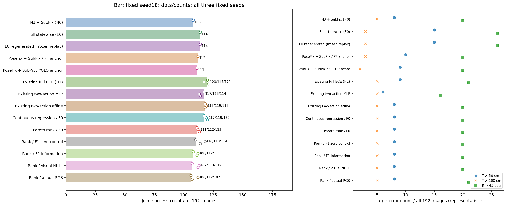
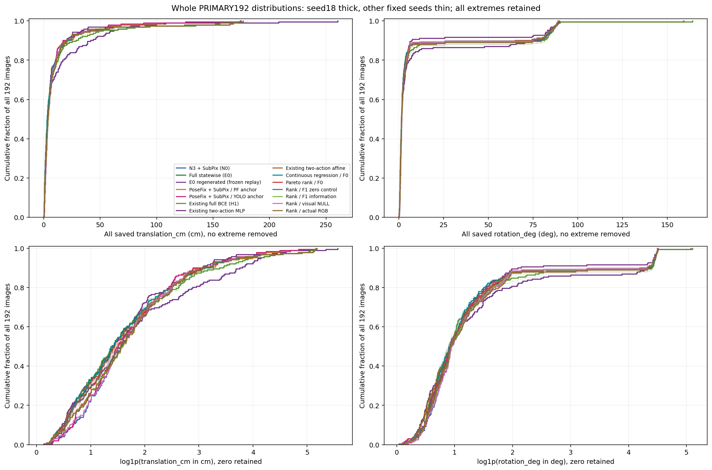
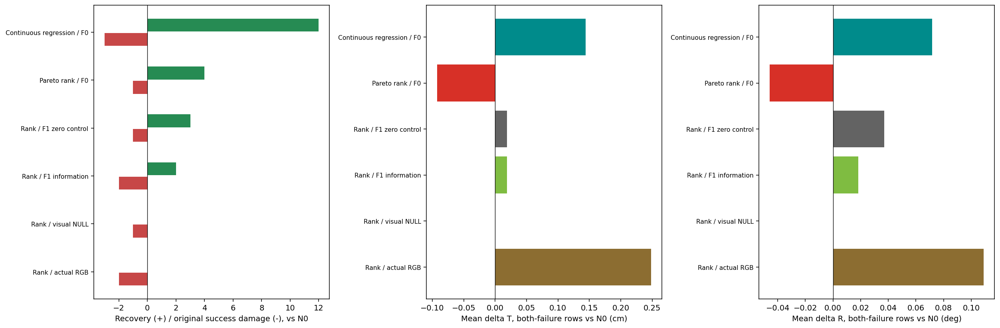
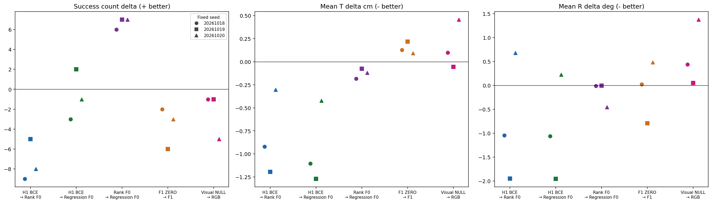
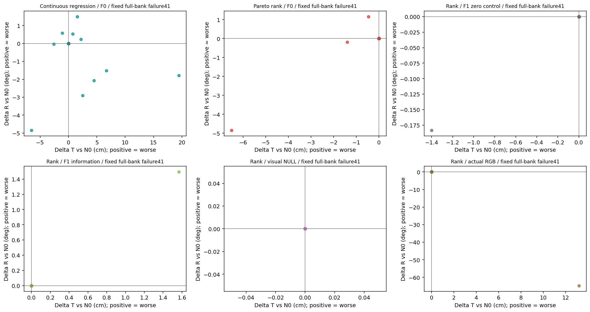
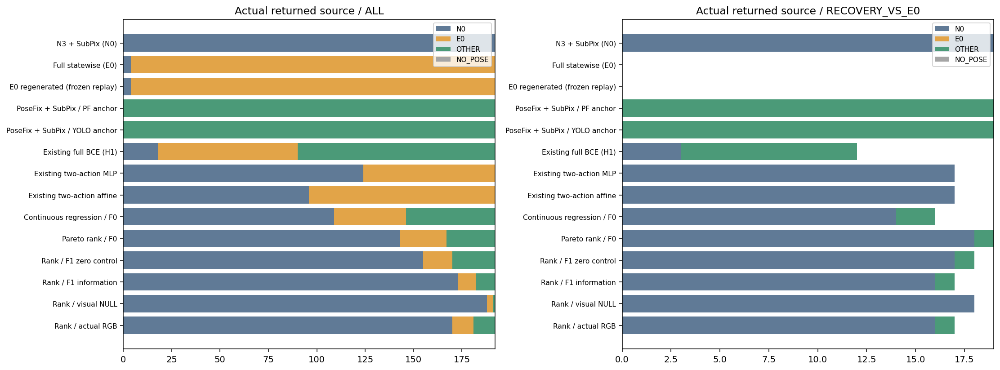
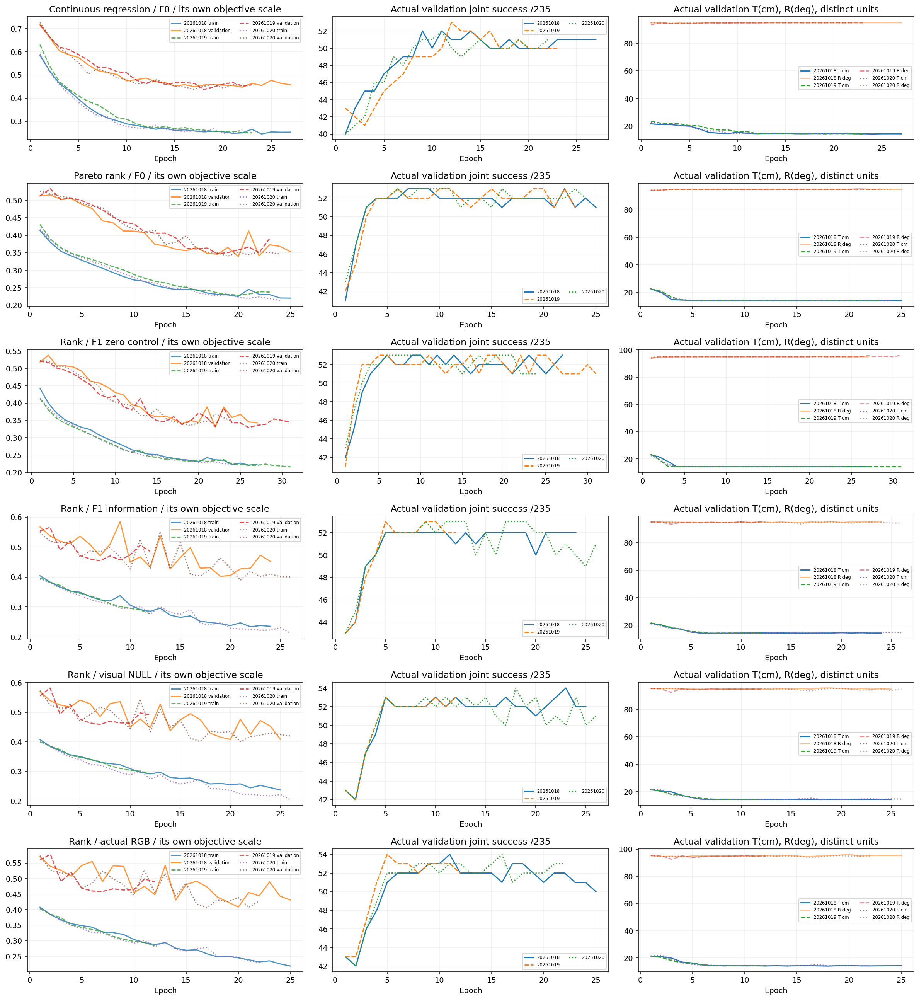

# 고정 후보에서 위험 감독·양쪽 family 정보·국소 RGB의 효과

운영 기본값과 논문은 변경하지 않았다. 이 결과는 반복 개발에 사용한 실사 자료에 대한 연구 비교이며, 새 독립 실사 test는 **0장**이다. 기존 H1의120/192와 full bank 전부실패41장이라는 과거 정보는 설계 배경으로 이미 알려져 있었다. 이번 출력 봉인은 새 실사 결과를 본 뒤 튜닝하지 않았다는 증거이며 미관측 test를 만든 것이 아니다.

## 실제 실행과 비교 계약

새 optimizer fit 시도 **18회**, 완료 **18회**. 동일한 원 D1 full bank만 선택했고 새 PnP·수치 자세 최적화·후보 생성·본체 forward/재학습은 0회다. F1 고정 자세 비용 재평가와 작은 선택기 forward는 별도 수행했다.

| 항목 | 실제 상태 |
|---|---|
| 원 D1/F0/기준 | 실사238·합성1003 재사용; F0 188와 원 normalizer·alias·물리 pose 순서 보존 |
| R_CONT_F0 / R_ORDER_F0 | 각3seed; 회귀 minimax / 성공 우선·실패 Pareto 순위 |
| R_ORDER_F1_ZERO / R_ORDER_F1 | 각3seed; 동일476입력 구조·초기값·공통 epoch의 순서·쌍; 추가288블록만 ZERO |
| F1 | 두 family 각각72scalar+72validity; 총144+144 추가; train768 valid-only 정규화 |
| B | 합성1003 별도 GT 진단; 후보/모델 특징/훈련에 GT 주입0 |
| V | 각3seed 실행; RGB3+validity1의20지역. NULL은 RGB3만0 |
| 모델 고정 | 각자 합성 validation loss 최저 checkpoint; 대표seed20261018 고정 |
| 실사 평가 | 모든238행×등록군 출력 봉인 후 참조 decode; PRIMARY192=49+143, CAL46 별도 |
| 자료 보존 | 기존 후보·모델·모든 실패 기록·사용자 작업·운영 설정·논문 보존 |

기술 오류도 보존했다. R_CONT 첫 fit 완료 뒤 다음 seed 진입 전 interop thread 재설정으로 CLI가 abort했고, idempotent 설정만 고쳐 완료 checkpoint를 재학습하지 않고 나머지 seed를 실행했다. F1 smoke의 잘못된 interpreter/cv2 import 실패와 SciPy 임시파일 guard 충돌·segfault, B/독립 감독 export의 NumPy scalar JSON 오류도 원시 로그와 source version을 private에 남겼다. B의 엄격 roundtrip FAIL은 표현 차이 진단과 별도로 유지했다. CLI/포맷 오류를 나쁜 성능이나 실패 optimizer fit과 혼동하지 않는다.

성공은 **한 개의 실제 반환 pose**의 위치≤5cm와 회전≤5°를 동시에 만족하는 경우다. 실사 대칭은 기존 I/Y(π), 합성은 원행 C1/C2를 유지했다. 정사각형 90° 대칭이나 GT 회전 직교화를 새로 넣지 않았다. 상태/CAL을 사용한 시스템과 합성 학습 PoseFix는 사용 정보가 같지 않으며, 같은 구조의 대조에서만 추가 정보 효과를 해석한다.

## PRIMARY192 전체 결과

각 군의 대표는 사전에 고정한 첫 seed다. 아래 전체표와 CSV에는 나머지 seed·실패·극단값을 모두 남겼다. 평균은 꼬리 영향을 포함하고, 표본 SD·분산은 ddof=1이다.

| 군 / seed | 성공/분모 | 위치 평균 ± SD cm | 위치 분산 cm² | 위치 P90/P95/최대 cm | 회전 평균 ± SD ° | 회전 분산 °² | 회전 P90/P95/최대 ° | T>50/100cm · R>45° | no-pose |
|---|---|---|---|---|---|---|---|---|---|
| N0 | 108/192 | 11.306 ± 26.877 | 722.358 | 20.210/37.201/174.758 | 10.631 ± 25.131 | 631.556 | 69.549/84.228/88.905 | 8/5 · 20 | 0 |
| E0 | 114/192 | 14.112 ± 30.077 | 904.618 | 41.325/60.282/260.412 | 13.001 ± 28.388 | 805.864 | 74.442/84.159/159.137 | 15/3 · 26 | 0 |
| E0_REGENERATED | 114/192 | 14.112 ± 30.077 | 904.618 | 41.325/60.282/260.412 | 13.001 ± 28.388 | 805.864 | 74.442/84.159/159.137 | 15/3 · 26 | 0 |
| POSEFIX_SUBPIX_PF_ANCHOR | 112/192 | 9.848 ± 20.592 | 424.030 | 20.907/46.417/173.997 | 10.539 ± 25.128 | 631.398 | 61.246/84.978/89.649 | 10/3 · 20 | 0 |
| POSEFIX_SUBPIX_YOLO_ANCHOR | 111/192 | 9.377 ± 19.375 | 375.398 | 16.948/36.818/173.997 | 10.594 ± 25.247 | 637.400 | 69.538/84.932/89.649 | 9/2 · 20 | 0 |
| D1_H1_MLP_s20261018 | 120/192 | 12.073 ± 27.865 | 776.469 | 28.043/48.804/176.535 | 11.549 ± 27.760 | 770.606 | 79.055/85.917/164.209 | 9/5 · 21 | 0 |
| D1_H1_MLP_s20261019 | 117/192 | 12.251 ± 28.111 | 790.250 | 28.043/47.211/180.248 | 12.454 ± 28.730 | 825.397 | 82.301/86.266/164.209 | 9/5 · 23 | 0 |
| D1_H1_MLP_s20261020 | 121/192 | 11.407 ± 27.152 | 737.204 | 24.808/44.874/176.535 | 10.233 ± 24.999 | 624.952 | 24.469/85.418/88.872 | 7/5 · 19 | 0 |
| D1_H1_PAIR_MLP_s20261018 | 117/192 | 10.392 ± 26.544 | 704.579 | 20.149/33.080/174.758 | 8.891 ± 22.901 | 524.449 | 6.972/83.041/88.905 | 6/5 · 16 | 0 |
| D1_H1_PAIR_MLP_s20261019 | 113/192 | 11.050 ± 26.975 | 727.627 | 20.405/37.027/174.758 | 10.133 ± 24.561 | 603.224 | 24.198/83.098/88.905 | 8/5 · 19 | 0 |
| D1_H1_PAIR_MLP_s20261020 | 114/192 | 11.075 ± 26.976 | 727.731 | 20.405/37.027/174.758 | 10.103 ± 24.569 | 603.615 | 24.198/83.098/88.905 | 8/5 · 19 | 0 |
| D1_H1_PAIR_ROLE_AFFINE_s20261018 | 118/192 | 11.049 ± 27.003 | 729.144 | 20.405/37.201/174.758 | 10.465 ± 25.191 | 634.604 | 69.549/84.228/88.905 | 8/5 · 20 | 0 |
| D1_H1_PAIR_ROLE_AFFINE_s20261019 | 119/192 | 11.031 ± 27.001 | 729.043 | 20.405/37.201/174.758 | 10.508 ± 25.178 | 633.957 | 69.549/84.228/88.905 | 8/5 · 20 | 0 |
| D1_H1_PAIR_ROLE_AFFINE_s20261020 | 118/192 | 11.009 ± 26.997 | 728.845 | 20.405/37.201/174.758 | 10.543 ± 25.170 | 633.516 | 69.549/84.228/88.905 | 8/5 · 20 | 0 |
| R_CONT_F0_s20261018 | 117/192 | 10.967 ± 27.088 | 733.766 | 20.405/37.989/174.758 | 10.489 ± 25.381 | 644.211 | 69.549/85.370/88.905 | 8/5 · 20 | 0 |
| R_CONT_F0_s20261019 | 119/192 | 10.981 ± 27.152 | 737.211 | 20.405/37.989/174.758 | 10.497 ± 25.403 | 645.299 | 69.549/85.370/88.905 | 8/5 · 20 | 0 |
| R_CONT_F0_s20261020 | 120/192 | 10.983 ± 27.163 | 737.825 | 20.405/37.989/174.758 | 10.454 ± 25.409 | 645.617 | 69.549/85.370/88.905 | 8/5 · 20 | 0 |
| R_ORDER_F0_s20261018 | 111/192 | 11.153 ± 26.936 | 725.543 | 20.210/37.027/174.758 | 10.503 ± 25.171 | 633.594 | 69.549/84.228/88.905 | 8/5 · 20 | 0 |
| R_ORDER_F0_s20261019 | 112/192 | 11.058 ± 26.957 | 726.702 | 20.210/37.027/174.758 | 10.504 ± 25.226 | 636.373 | 69.549/84.909/88.905 | 8/5 · 20 | 0 |
| R_ORDER_F0_s20261020 | 113/192 | 11.105 ± 27.050 | 731.694 | 20.210/39.004/174.758 | 10.910 ± 26.972 | 727.471 | 69.549/84.909/163.462 | 8/5 · 20 | 0 |
| R_ORDER_F1_ZERO_s20261018 | 110/192 | 11.126 ± 26.930 | 725.222 | 20.210/37.027/174.758 | 10.570 ± 25.206 | 635.348 | 69.549/84.909/88.905 | 8/5 · 20 | 0 |
| R_ORDER_F1_ZERO_s20261019 | 118/192 | 10.961 ± 26.982 | 728.050 | 20.210/37.027/174.758 | 11.323 ± 26.353 | 694.493 | 77.012/85.596/88.905 | 8/5 · 22 | 0 |
| R_ORDER_F1_ZERO_s20261020 | 114/192 | 11.019 ± 26.983 | 728.079 | 20.210/37.201/174.758 | 10.481 ± 25.231 | 636.603 | 69.549/84.909/88.905 | 8/5 · 20 | 0 |
| R_ORDER_F1_s20261018 | 108/192 | 11.253 ± 26.905 | 723.855 | 20.210/37.201/174.758 | 10.593 ± 25.143 | 632.155 | 69.549/84.228/88.905 | 8/5 · 20 | 0 |
| R_ORDER_F1_s20261019 | 112/192 | 11.180 ± 26.980 | 727.920 | 20.210/37.201/174.758 | 10.530 ± 25.191 | 634.574 | 69.549/84.108/88.905 | 8/5 · 20 | 0 |
| R_ORDER_F1_s20261020 | 111/192 | 11.110 ± 26.945 | 726.046 | 20.210/37.201/174.758 | 10.965 ± 25.714 | 661.202 | 75.192/84.909/88.905 | 8/5 · 21 | 0 |
| V_ORDER_NULL_s20261018 | 107/192 | 11.297 ± 26.881 | 722.575 | 20.210/37.201/174.758 | 10.628 ± 25.132 | 631.620 | 69.549/84.228/88.905 | 8/5 · 20 | 0 |
| V_ORDER_NULL_s20261019 | 113/192 | 11.130 ± 26.994 | 728.665 | 20.210/37.201/174.758 | 10.509 ± 25.198 | 634.958 | 69.549/84.108/88.905 | 8/5 · 20 | 0 |
| V_ORDER_NULL_s20261020 | 112/192 | 11.009 ± 26.964 | 727.052 | 20.210/37.201/174.758 | 10.498 ± 25.228 | 636.462 | 69.549/84.909/88.905 | 8/5 · 20 | 0 |
| V_ORDER_RGB_s20261018 | 106/192 | 11.396 ± 26.975 | 727.668 | 20.210/39.674/174.758 | 11.067 ± 25.555 | 653.037 | 75.128/83.903/88.905 | 8/5 · 21 | 0 |
| V_ORDER_RGB_s20261019 | 112/192 | 11.076 ± 26.951 | 726.338 | 19.784/37.201/174.758 | 10.560 ± 25.191 | 634.606 | 69.549/84.228/88.905 | 8/5 · 20 | 0 |
| V_ORDER_RGB_s20261020 | 107/192 | 11.466 ± 26.947 | 726.116 | 23.408/37.201/174.758 | 11.874 ± 26.887 | 722.887 | 81.251/85.596/88.905 | 8/5 · 23 | 0 |

## 회복·손상과 목표/정보의 대조

회복/손상은 동일 영상의 공동성공 여부 전이다. 연속 Δ는 이후−이전으로 양수면 오차 악화다. 서로 다른 목적함수의 loss 숫자를 직접 비교하지 않았다.

| 비교 | 회복 | 손상 | 공동성공 | 공동실패 | 전체 ΔT cm | 전체 ΔR ° | 공동실패 n: ΔT/ΔR |
|---|---|---|---|---|---|---|---|
| N0 → R_CONT_F0_s20261018 | 12 | 3 | 105 | 72 | -0.338 | -0.142 | 72: 0.144 / 0.072 |
| E0 → R_CONT_F0_s20261018 | 16 | 13 | 101 | 62 | -3.145 | -2.513 | 62: -7.931 / -6.585 |
| D1_H1_MLP_s20261018 → R_CONT_F0_s20261018 | 6 | 9 | 111 | 66 | -1.105 | -1.060 | 66: -2.612 / -1.869 |
| D1_H1_PAIR_ROLE_AFFINE_s20261018 → R_CONT_F0_s20261018 | 5 | 6 | 112 | 69 | -0.082 | 0.023 | 69: -0.084 / 0.105 |
| N0 → R_ORDER_F0_s20261018 | 4 | 1 | 107 | 80 | -0.153 | -0.128 | 80: -0.092 / -0.046 |
| E0 → R_ORDER_F0_s20261018 | 19 | 22 | 92 | 59 | -2.960 | -2.498 | 59: -8.196 / -4.007 |
| D1_H1_MLP_s20261018 → R_ORDER_F0_s20261018 | 8 | 17 | 103 | 64 | -0.920 | -1.046 | 64: -2.972 / -2.066 |
| D1_H1_PAIR_ROLE_AFFINE_s20261018 → R_ORDER_F0_s20261018 | 3 | 10 | 108 | 71 | 0.103 | 0.038 | 71: -0.332 / -0.022 |
| N0 → R_ORDER_F1_ZERO_s20261018 | 3 | 1 | 107 | 81 | -0.180 | -0.061 | 81: 0.019 / 0.037 |
| E0 → R_ORDER_F1_ZERO_s20261018 | 18 | 22 | 92 | 60 | -2.986 | -2.431 | 60: -8.374 / -5.301 |
| D1_H1_MLP_s20261018 → R_ORDER_F1_ZERO_s20261018 | 8 | 18 | 102 | 64 | -0.947 | -0.979 | 64: -3.015 / -1.978 |
| D1_H1_PAIR_ROLE_AFFINE_s20261018 → R_ORDER_F1_ZERO_s20261018 | 2 | 10 | 108 | 72 | 0.077 | 0.104 | 72: -0.366 / 0.056 |
| N0 → R_ORDER_F1_s20261018 | 2 | 2 | 106 | 82 | -0.053 | -0.038 | 82: 0.019 / 0.018 |
| E0 → R_ORDER_F1_s20261018 | 17 | 23 | 91 | 61 | -2.859 | -2.408 | 61: -8.348 / -6.525 |
| D1_H1_MLP_s20261018 → R_ORDER_F1_s20261018 | 7 | 19 | 101 | 65 | -0.820 | -0.956 | 65: -2.788 / -1.954 |
| D1_H1_PAIR_ROLE_AFFINE_s20261018 → R_ORDER_F1_s20261018 | 1 | 11 | 107 | 73 | 0.204 | 0.128 | 73: -0.202 / 0.048 |
| N0 → V_ORDER_NULL_s20261018 | 0 | 1 | 107 | 84 | -0.008 | -0.003 | 84: 0.000 / 0.000 |
| E0 → V_ORDER_NULL_s20261018 | 18 | 25 | 89 | 60 | -2.815 | -2.373 | 60: -8.158 / -5.282 |
| D1_H1_MLP_s20261018 → V_ORDER_NULL_s20261018 | 8 | 21 | 99 | 64 | -0.775 | -0.921 | 64: -2.856 / -2.008 |
| D1_H1_PAIR_ROLE_AFFINE_s20261018 → V_ORDER_NULL_s20261018 | 1 | 12 | 106 | 73 | 0.248 | 0.162 | 73: -0.224 / 0.028 |
| N0 → V_ORDER_RGB_s20261018 | 0 | 2 | 106 | 84 | 0.091 | 0.436 | 84: 0.249 / 0.109 |
| E0 → V_ORDER_RGB_s20261018 | 17 | 25 | 89 | 61 | -2.716 | -1.934 | 61: -7.698 / -5.046 |
| D1_H1_MLP_s20261018 → V_ORDER_RGB_s20261018 | 8 | 22 | 98 | 64 | -0.676 | -0.482 | 64: -2.530 / -1.865 |
| D1_H1_PAIR_ROLE_AFFINE_s20261018 → V_ORDER_RGB_s20261018 | 1 | 13 | 105 | 73 | 0.347 | 0.602 | 73: 0.062 / 0.153 |

같은 seed의 F1_ZERO→F1은 추가 정보의 효과, V_NULL→V_RGB는 실제 RGB 추가 효과를 비교한다. R_ORDER_F0→F1_ZERO는 용량 대조이며 정보 추가 효과로 세지 않는다.

| 비교 | 회복 | 손상 | 공동성공 | 공동실패 | 전체 ΔT cm | 전체 ΔR ° | 공동실패 n: ΔT/ΔR |
|---|---|---|---|---|---|---|---|
| R_ORDER_F0_s20261018 → R_CONT_F0_s20261018 | 10 | 4 | 107 | 71 | -0.185 | -0.014 | 71: 0.250 / 0.124 |
| R_ORDER_F0_s20261018 → R_ORDER_F1_ZERO_s20261018 | 1 | 2 | 109 | 80 | -0.026 | 0.067 | 80: -0.035 / 0.070 |
| R_ORDER_F1_ZERO_s20261018 → R_ORDER_F1_s20261018 | 1 | 3 | 107 | 81 | 0.127 | 0.024 | 81: 0.001 / -0.019 |
| R_ORDER_F1_s20261018 → V_ORDER_NULL_s20261018 | 1 | 2 | 106 | 83 | 0.044 | 0.035 | 83: -0.019 / -0.018 |
| V_ORDER_NULL_s20261018 → V_ORDER_RGB_s20261018 | 0 | 1 | 106 | 85 | 0.099 | 0.439 | 85: 0.246 / 0.108 |
| R_ORDER_F0_s20261019 → R_CONT_F0_s20261019 | 9 | 2 | 110 | 71 | -0.077 | -0.007 | 71: 0.293 / 0.134 |
| R_ORDER_F0_s20261019 → R_ORDER_F1_ZERO_s20261019 | 7 | 1 | 111 | 73 | -0.096 | 0.819 | 73: 0.003 / 1.103 |
| R_ORDER_F1_ZERO_s20261019 → R_ORDER_F1_s20261019 | 3 | 9 | 109 | 71 | 0.219 | -0.793 | 71: 0.119 / -1.195 |
| R_ORDER_F1_s20261019 → V_ORDER_NULL_s20261019 | 1 | 0 | 112 | 79 | -0.050 | -0.021 | 79: -0.016 / 0.012 |
| V_ORDER_NULL_s20261019 → V_ORDER_RGB_s20261019 | 0 | 1 | 112 | 79 | -0.055 | 0.052 | 79: -0.214 / 0.039 |
| R_ORDER_F0_s20261020 → R_CONT_F0_s20261020 | 9 | 2 | 111 | 70 | -0.121 | -0.456 | 70: 0.143 / -1.035 |
| R_ORDER_F0_s20261020 → R_ORDER_F1_ZERO_s20261020 | 2 | 1 | 112 | 77 | -0.086 | -0.429 | 77: -0.101 / -1.048 |
| R_ORDER_F1_ZERO_s20261020 → R_ORDER_F1_s20261020 | 2 | 5 | 109 | 76 | 0.092 | 0.484 | 76: 0.159 / 1.169 |
| R_ORDER_F1_s20261020 → V_ORDER_NULL_s20261020 | 4 | 3 | 108 | 77 | -0.102 | -0.467 | 77: -0.196 / -1.143 |
| V_ORDER_NULL_s20261020 → V_ORDER_RGB_s20261020 | 0 | 5 | 107 | 80 | 0.457 | 1.376 | 80: 0.497 / 2.183 |

## 좋은 후보가 없는 실패의 연속 손상

원 full bank에서 성공 가능한 영상은 **151/192**, 전부 실패는 **41장**이다. pair는133/192와59장으로 서로 다른 고정 집합이다. 이번에는 새 후보를 만들지 않아 full41장을 새로 성공시킬 수 없다. 이 집합은 출력 봉인 후 참조로 확인했고 추론·훈련 입력으로 쓰지 않았다.

| 고정 집합 | 군 | n | N0 대비 ΔT 합/평균 cm | T 개선/악화/동일 | N0 대비 ΔR 합/평균 ° | R 개선/악화/동일 |
|---|---|---|---|---|---|---|
| FULL_FIXED_ACTION_BANK | N0 | 41 | 0.0/0.0 | 0/0/41 | 0.0/0.0 | 0/0/41 |
| PAIR_FIXED_ACTION_BANK | N0 | 59 | 0.0/0.0 | 0/0/59 | 0.0/0.0 | 0/0/59 |
| FULL_FIXED_ACTION_BANK | E0 | 41 | 306.33708181299517/7.47163614178037 | 12/25/4 | 63.266568462699894/1.5430870356756066 | 19/19/3 |
| PAIR_FIXED_ACTION_BANK | E0 | 59 | 489.4800182924312/8.296271496481886 | 18/37/4 | 316.9065331241144/5.371297171595158 | 23/33/3 |
| FULL_FIXED_ACTION_BANK | E0_REGENERATED | 41 | 306.33708181299517/7.47163614178037 | 12/25/4 | 63.266568462699894/1.5430870356756066 | 19/19/3 |
| PAIR_FIXED_ACTION_BANK | E0_REGENERATED | 59 | 489.4800182924312/8.296271496481886 | 18/37/4 | 316.9065331241144/5.371297171595158 | 23/33/3 |
| FULL_FIXED_ACTION_BANK | POSEFIX_SUBPIX_PF_ANCHOR | 41 | -218.17253173468708/-5.321281261821635 | 23/18/0 | -76.55238496525993/-1.8671313406160952 | 21/20/0 |
| PAIR_FIXED_ACTION_BANK | POSEFIX_SUBPIX_PF_ANCHOR | 59 | -99.55549484780542/-1.6873812686068705 | 34/25/0 | 160.8501550077482/2.7262738136906477 | 31/28/0 |
| FULL_FIXED_ACTION_BANK | POSEFIX_SUBPIX_YOLO_ANCHOR | 41 | -307.1424061802716/-7.491278199518817 | 24/17/0 | -66.53285981413333/-1.6227526783934951 | 22/19/0 |
| PAIR_FIXED_ACTION_BANK | POSEFIX_SUBPIX_YOLO_ANCHOR | 59 | -190.92038891968588/-3.2359387952489143 | 36/23/0 | 170.84207759539783/2.8956284338203035 | 32/27/0 |
| FULL_FIXED_ACTION_BANK | D1_H1_MLP_s20261018 | 41 | 204.8656396904099/4.996722919278289 | 15/21/5 | 92.27415676046198/2.25058918927956 | 17/19/5 |
| PAIR_FIXED_ACTION_BANK | D1_H1_MLP_s20261018 | 59 | 192.24172500089557/3.2583343220490764 | 23/29/7 | 107.61507270040559/1.8239842830577215 | 23/29/7 |
| FULL_FIXED_ACTION_BANK | D1_H1_PAIR_MLP_s20261018 | 41 | -95.27401227051108/-2.323756396841733 | 4/3/34 | -89.91284295081104/-2.192996169531977 | 6/1/34 |
| PAIR_FIXED_ACTION_BANK | D1_H1_PAIR_MLP_s20261018 | 59 | -78.31309375531993/-1.3273405721240665 | 5/6/48 | -78.2373660016919/-1.3260570508761338 | 6/5/48 |
| FULL_FIXED_ACTION_BANK | D1_H1_PAIR_ROLE_AFFINE_s20261018 | 41 | 2.9873177817483993/0.0728614093109366 | 2/4/35 | -7.629841888993197/-0.18609370460959018 | 4/2/35 |
| PAIR_FIXED_ACTION_BANK | D1_H1_PAIR_ROLE_AFFINE_s20261018 | 59 | 16.32946136226262/0.2767705315637732 | 4/8/47 | -2.0236793117894596/-0.034299649352363716 | 6/6/47 |
| FULL_FIXED_ACTION_BANK | R_CONT_F0_s20261018 | 41 | 27.38537464738568/0.6679359670094068 | 3/7/31 | -10.307318553922332/-0.2513980135103008 | 6/4/31 |
| PAIR_FIXED_ACTION_BANK | R_CONT_F0_s20261018 | 59 | 18.959698531078793/0.3213508225606575 | 5/7/47 | -8.784360605205528/-0.14888746788483945 | 6/6/47 |
| FULL_FIXED_ACTION_BANK | R_ORDER_F0_s20261018 | 41 | -8.381597836733091/-0.2044292155300754 | 3/0/38 | -3.873645682669517/-0.09447916299193944 | 2/1/38 |
| PAIR_FIXED_ACTION_BANK | R_ORDER_F0_s20261018 | 59 | -9.500048375314087/-0.16101776907312013 | 4/2/53 | -3.3317249654642787/-0.05646991466888608 | 3/3/53 |
| FULL_FIXED_ACTION_BANK | R_ORDER_F1_ZERO_s20261018 | 41 | -1.4015986333193666/-0.034185332519984554 | 1/0/40 | -0.18338224867956132/-0.0044727377726722275 | 1/0/40 |
| PAIR_FIXED_ACTION_BANK | R_ORDER_F1_ZERO_s20261018 | 59 | -1.4015986333193666/-0.0237559090393113 | 1/0/58 | -0.18338224867956132/-0.0031081737064332427 | 1/0/58 |
| FULL_FIXED_ACTION_BANK | R_ORDER_F1_s20261018 | 41 | 1.568311111637497/0.03825149052774383 | 0/1/40 | 1.4943391725903457/0.03644729689244745 | 0/1/40 |
| PAIR_FIXED_ACTION_BANK | R_ORDER_F1_s20261018 | 59 | 1.568311111637497/0.026581544265042324 | 0/1/58 | 1.4943391725903457/0.025327782586277044 | 0/1/58 |
| FULL_FIXED_ACTION_BANK | V_ORDER_NULL_s20261018 | 41 | 0.0/0.0 | 0/0/41 | 0.0/0.0 | 0/0/41 |
| PAIR_FIXED_ACTION_BANK | V_ORDER_NULL_s20261018 | 59 | 0.0/0.0 | 0/0/59 | 0.0/0.0 | 0/0/59 |
| FULL_FIXED_ACTION_BANK | V_ORDER_RGB_s20261018 | 41 | 13.17730952922544/0.3213977933957424 | 0/1/40 | -64.68681782558761/-1.577727264038722 | 1/0/40 |
| PAIR_FIXED_ACTION_BANK | V_ORDER_RGB_s20261018 | 59 | 20.877679278680244/0.3538589708250889 | 0/2/57 | 9.16342065193868/0.15531221443963864 | 1/1/57 |

## 실제 선택과 회복 출처

N0/E0 출처는 각각 원 fallback과 bank의 e0_regenerated 물리 pose와 수치적으로 같은지 비교하며, 둘과 같으면 기존 우선순위대로 N0로 센다. 비교 기준 E0는 별도로 보존한 historical 출력이고 E0_REGENERATED와의 동일성도 검사했다. OTHER는 기존 bank의 다른 후보이며 새로운 B 생성 성과가 아니다. PoseFix 기준의 OTHER는 full bank 소속을 의미하지 않는다. 신규 선택군은 모두 원 full bank 행동에 정확히 포함됨을 별도 검사했다. SELECTION_DIAGNOSIS의 FULL 표시는 baseline까지 같은 진단 열에 놓은 것이며151상한은 원 bank를 고르는 신규 선택군에 적용한다.

전체 선택 출처는 [ACTION_SOURCE_COUNTS.csv](ACTION_SOURCE_COUNTS.csv), 회복/손상별 출처는 [GAIN_DAMAGE_ACTUAL_SOURCE.csv](GAIN_DAMAGE_ACTUAL_SOURCE.csv), 정확한8칸 교차는 [THREE_WAY_SUCCESS.csv](THREE_WAY_SUCCESS.csv)에 있다.

## 감독과 B 기하 계약에서 확인한 공백

F1 추가 정보의 전달 자체도 점검했다. 저장한 train25,613/validation7,973/PRIMARY6,518/CAL2,181 행동에서144scalar의 validity와 값 변동을 집계했다. train에서 지지가0인4개 partial pose-projection count/fraction 채널은 실사에서도 모두 invalid였다. 네 집단에서 집단 내 값이 변하는 scalar는114/114/114/112개, 같은 frame의 행동 간에 한 번이라도 값이 달랐던 scalar는74/74/74/72개다. 나머지66/66/66/68개의 유효 채널에는 상태·관측 수 같은 frame 공유 정보가 있어 무용하다는 뜻은 아니다. 이 가용성 집계는 실사 정답 없이 수행했고 성능 기여의 인과 증거로 사용하지 않는다. [채널별 원수치](F1_INFORMATION_AVAILABILITY.csv)를 남겼다.

순위 감독은 성공→실패와 실패 간 두 축 Pareto 우열만 사용한다. 두 성공, 실패 tradeoff, 수치 우열 불일치는 쌍을 만들지 않는다. train768 중465장, validation235 중152장이 순위 loss에 기여했다. train 전부실패416장 중215장은 Pareto 쌍이 있으나201장은 구별할 우열이 없다. validation은171장 중104/67이다. 회귀는 두 축이 유효한 전체768/235를 사용했다. 실제 수치 우열 불일치는0쌍이며 원 라벨을 수정하지 않았다.

6cm와100cm 실패도 다른 축이 반대로 좋아지는 tradeoff라면 R_ORDER는 어느 쪽이 우월한지 감독하지 않는다. R_CONT는 log1p(T/5), log1p(R/5)를 학습하고 두 예측축의 최대값이 작은 후보를 고르므로 연속 크기를 구분할 수 있지만, 성공률 최적화와 동일하지 않다.

합성1003 중 B관측은673장, B없음은330장이다. ORIGINAL_WD에서 허용 GT phase를 모두 시도해도 유한 지지를 통과하지 못한 영상은296/673장이다. 같은 fixed G13 package에서 허용 GT와 실패 E0가 모두 feasible인325장 중203장에서는 실패 E0의 비용이 최선 feasible GT phase보다도 낮았다. 이는 원 관측·비용과 GT의 충돌 진단이며 실제 E0의 계층적 G10→G13 선택을 재현했다는 뜻이 아니다. G10/G13의 목적함수 값을 서로 비교하지 않았다.

원 저장 float32 회전과 backend parameterized 회전의 엄격1e−10 roundtrip assertion FAIL660/3010은 지우지 않았다. 독립 기하 검사에서는 원 GT와 parameterized 표현을 나누어 추적했고 finite 판정 차이는0이었다. 원 solver feasibility tolerance1e−7은 그대로다. 원 annotation에 material variant와 scene visibility metadata는 있으나, 관측별 실제 mesh-face/pixel owner는 **미검증**이다. cuboid 선이 재료 경계라는 보장은 없다. [B 진단 상세](B_REFERENCE_RESULTS.md)를 함께 봐야 한다.

## 불확실성과 비용

짝지은 bootstrap은 원6 recording-cluster를 단위로10000회(seed20260917), 원8 named-session은 민감도로 별도 계산했다. 원 저장 draw 행렬은 없어서 같은 고정 helper/seed의 일정을 재생성했다. seed3개를 독립576장으로 늘리지 않았다. 0을 포함하는 CI는 동등성 증명이 아니며, 포함하지 않아도 반복 개발·작은 군집 수·여러 비교의 한계가 남는다. 원수치와 두 CI는 [EVALUATION.json](EVALUATION.json)에 있다.

실제 비용은 [COST_AND_EXECUTION.json](COST_AND_EXECUTION.json)에 parent wall, CPU, 각 fit, F1/patch I/O, 작은 head inference를 나누었다. 원 cache 생산비와 계측이 없는 시간은 unknown이며0으로 적지 않았다. RTX3080의 cached 실험 시간을 Jetson FPS나 배포 지연으로 바꾸지 않았다.

## 독립 검사와 실제 영상

검사 수준은 입력 일치, 실행 완료, 수치 재현, 감독 정의, 기하 표현, 모델의 실제 pixel 검토, 독립 물리 정답, 원격 게시를 분리했다. Python audit hook은 OS sandbox가 아니며 native I/O·사전 로드 객체를 완전히 증명하지 못한다. 새 predictor는 입력 decode 전 whitelist를 설치했다. P0 감사는 명시한 허용 입력/체크포인트를 로드한 뒤 hook을 설치했으므로 그 범위를 구별한다.

[VERIFICATION.json](VERIFICATION.json), [PIXEL_REVIEW.json](PIXEL_REVIEW.json), [실행 검토표](EXECUTION_REVIEW_CHECKLIST.md), [공개 파일 검사](PUBLIC_PACK_AUDIT.json)를 확인할 수 있다. 모델 pixel 검토는 사람 검토나 독립 물리 정답 인증이 아니다.

[전체192장 갤러리](gallery/index.html)는 회복·손상·최대 위치/회전 악화·각 축 최대 개선을 사전 규칙대로 함께 보여준다. [사례 선택](gallery/GALLERY_MANIFEST.json)에는 결합/중복 규칙이 있다. 원관측·추정 pose·참조는 별도 표시하고, F1은 같은 pose의 양쪽 family, V는 같은 선택 pose의20지역 RGB/NULL을 보여준다. 표시 사본의 기존 privacy redaction은 측정 입력을 바꾸지 않았다. GitHub에서는 HTML이 실행되지 않으므로 저장소를 내려받아 로컬 서버로 열어야 한다.

## 남는 판단

최종 수치 해석과 다음 수정 한 가지는 [DECISION_KO.md](DECISION_KO.md)에 기록했다. 운영 기본값과 논문은 자동 교체하지 않았다. 후보가 없는41장, 구별되지 않는 실패 tradeoff, B 관측의 실제 재료 지지 미확정, 합성→실사 차이는 계속 남는다.

## TEST49 — 모든 기준·모든 seed

| 군 / seed | 성공/분모 | 위치 평균 ± SD cm | 위치 분산 cm² | 위치 P90/P95/최대 cm | 회전 평균 ± SD ° | 회전 분산 °² | 회전 P90/P95/최대 ° | T>50/100cm · R>45° | no-pose |
|---|---|---|---|---|---|---|---|---|---|
| N0 | 40/49 | 3.363 ± 3.487 | 12.162 | 7.021/8.956/19.957 | 6.527 ± 20.003 | 400.137 | 4.181/48.777/88.164 | 0/0 · 3 | 0 |
| E0 | 49/49 | 1.299 ± 1.082 | 1.172 | 2.921/3.773/4.339 | 1.110 ± 0.773 | 0.598 | 1.873/2.586/3.950 | 0/0 · 0 | 0 |
| E0_REGENERATED | 49/49 | 1.299 ± 1.082 | 1.172 | 2.921/3.773/4.339 | 1.110 ± 0.773 | 0.598 | 1.873/2.586/3.950 | 0/0 · 0 | 0 |
| POSEFIX_SUBPIX_PF_ANCHOR | 39/49 | 3.216 ± 2.751 | 7.566 | 6.907/8.954/11.865 | 6.350 ± 20.017 | 400.694 | 4.148/48.354/87.787 | 0/0 · 3 | 0 |
| POSEFIX_SUBPIX_YOLO_ANCHOR | 38/49 | 3.243 ± 2.771 | 7.681 | 7.023/8.954/11.865 | 6.355 ± 20.016 | 400.631 | 4.148/48.368/87.787 | 0/0 · 3 | 0 |
| D1_H1_MLP_s20261018 | 46/49 | 1.794 ± 2.424 | 5.876 | 3.003/7.313/12.191 | 6.414 ± 21.073 | 444.086 | 2.603/53.883/88.872 | 0/0 · 3 | 0 |
| D1_H1_MLP_s20261019 | 46/49 | 1.795 ± 2.425 | 5.883 | 3.003/7.315/12.191 | 6.410 ± 21.074 | 444.126 | 2.603/53.884/88.872 | 0/0 · 3 | 0 |
| D1_H1_MLP_s20261020 | 46/49 | 1.807 ± 2.431 | 5.911 | 3.364/7.313/12.191 | 6.409 ± 21.075 | 444.143 | 2.603/53.883/88.872 | 0/0 · 3 | 0 |
| D1_H1_PAIR_MLP_s20261018 | 46/49 | 1.856 ± 2.174 | 4.727 | 4.100/4.852/13.195 | 2.974 ± 12.448 | 154.957 | 2.033/3.285/88.164 | 0/0 · 1 | 0 |
| D1_H1_PAIR_MLP_s20261019 | 44/49 | 2.484 ± 3.486 | 12.149 | 4.626/7.812/19.957 | 4.502 ± 16.348 | 267.272 | 2.033/3.580/88.164 | 0/0 · 2 | 0 |
| D1_H1_PAIR_MLP_s20261020 | 44/49 | 2.478 ± 3.489 | 12.175 | 4.626/7.812/19.957 | 4.495 ± 16.350 | 267.314 | 2.033/3.580/88.164 | 0/0 · 2 | 0 |
| D1_H1_PAIR_ROLE_AFFINE_s20261018 | 45/49 | 2.134 ± 3.526 | 12.436 | 4.158/8.380/19.957 | 6.147 ± 20.086 | 403.457 | 2.148/48.246/88.164 | 0/0 · 3 | 0 |
| D1_H1_PAIR_ROLE_AFFINE_s20261019 | 45/49 | 2.166 ± 3.535 | 12.497 | 4.158/8.380/19.957 | 6.197 ± 20.074 | 402.981 | 2.726/48.246/88.164 | 0/0 · 3 | 0 |
| D1_H1_PAIR_ROLE_AFFINE_s20261020 | 45/49 | 2.161 ± 3.531 | 12.470 | 4.158/8.380/19.957 | 6.175 ± 20.080 | 403.214 | 2.726/48.246/88.164 | 0/0 · 3 | 0 |
| R_CONT_F0_s20261018 | 44/49 | 2.054 ± 2.684 | 7.206 | 4.080/9.133/12.191 | 6.471 ± 21.059 | 443.482 | 2.603/53.883/88.872 | 0/0 · 3 | 0 |
| R_CONT_F0_s20261019 | 46/49 | 1.856 ± 2.439 | 5.949 | 3.426/7.313/12.191 | 6.406 ± 21.075 | 444.166 | 2.603/53.883/88.872 | 0/0 · 3 | 0 |
| R_CONT_F0_s20261020 | 44/49 | 1.983 ± 2.611 | 6.815 | 4.080/8.533/12.191 | 6.425 ± 21.070 | 443.962 | 2.562/53.883/88.872 | 0/0 · 3 | 0 |
| R_ORDER_F0_s20261018 | 41/49 | 2.754 ± 3.729 | 13.908 | 7.021/8.956/19.957 | 6.247 ± 20.063 | 402.523 | 2.671/48.246/88.164 | 0/0 · 3 | 0 |
| R_ORDER_F0_s20261019 | 43/49 | 2.549 ± 3.638 | 13.233 | 5.383/9.224/19.957 | 6.140 ± 20.255 | 410.265 | 2.462/47.523/88.164 | 0/0 · 3 | 0 |
| R_ORDER_F0_s20261020 | 43/49 | 2.552 ± 3.680 | 13.543 | 6.679/9.224/19.957 | 6.267 ± 20.228 | 409.153 | 2.800/47.847/88.164 | 0/0 · 3 | 0 |
| R_ORDER_F1_ZERO_s20261018 | 42/49 | 2.729 ± 3.685 | 13.577 | 6.679/9.224/19.957 | 6.219 ± 20.237 | 409.516 | 2.553/47.523/88.164 | 0/0 · 3 | 0 |
| R_ORDER_F1_ZERO_s20261019 | 44/49 | 2.182 ± 3.522 | 12.405 | 4.699/8.624/19.957 | 6.162 ± 20.313 | 412.617 | 2.462/47.523/88.872 | 0/0 · 3 | 0 |
| R_ORDER_F1_ZERO_s20261020 | 43/49 | 2.472 ± 3.652 | 13.337 | 5.383/9.224/19.957 | 6.183 ± 20.244 | 409.825 | 2.462/47.523/88.164 | 0/0 · 3 | 0 |
| R_ORDER_F1_s20261018 | 41/49 | 3.012 ± 3.661 | 13.403 | 7.021/8.956/19.957 | 6.387 ± 20.029 | 401.143 | 3.005/48.246/88.164 | 0/0 · 3 | 0 |
| R_ORDER_F1_s20261019 | 43/49 | 2.816 ± 3.573 | 12.766 | 5.383/9.224/19.957 | 6.253 ± 20.228 | 409.160 | 2.353/47.932/88.164 | 0/0 · 3 | 0 |
| R_ORDER_F1_s20261020 | 44/49 | 2.430 ± 3.628 | 13.161 | 4.932/9.224/19.957 | 6.186 ± 20.247 | 409.927 | 2.562/47.932/88.164 | 0/0 · 3 | 0 |
| V_ORDER_NULL_s20261018 | 40/49 | 3.296 ± 3.525 | 12.426 | 7.021/8.956/19.957 | 6.526 ± 20.004 | 400.155 | 4.181/48.777/88.164 | 0/0 · 3 | 0 |
| V_ORDER_NULL_s20261019 | 43/49 | 2.803 ± 3.581 | 12.825 | 5.383/9.224/19.957 | 6.245 ± 20.229 | 409.230 | 2.353/47.932/88.164 | 0/0 · 3 | 0 |
| V_ORDER_NULL_s20261020 | 44/49 | 2.396 ± 3.575 | 12.777 | 4.700/8.574/19.957 | 6.205 ± 20.239 | 409.611 | 3.163/47.932/88.164 | 0/0 · 3 | 0 |
| V_ORDER_RGB_s20261018 | 40/49 | 3.046 ± 3.650 | 13.322 | 7.021/8.956/19.957 | 6.436 ± 20.028 | 401.137 | 4.181/48.777/88.164 | 0/0 · 3 | 0 |
| V_ORDER_RGB_s20261019 | 42/49 | 2.860 ± 3.558 | 12.659 | 5.383/9.224/19.957 | 6.322 ± 20.222 | 408.947 | 2.766/48.777/88.164 | 0/0 · 3 | 0 |
| V_ORDER_RGB_s20261020 | 42/49 | 2.961 ± 3.662 | 13.414 | 6.984/8.956/19.957 | 6.335 ± 20.208 | 408.368 | 2.926/48.246/88.164 | 0/0 · 3 | 0 |

## REMAINDER143 — 모든 기준·모든 seed

| 군 / seed | 성공/분모 | 위치 평균 ± SD cm | 위치 분산 cm² | 위치 P90/P95/최대 cm | 회전 평균 ± SD ° | 회전 분산 °² | 회전 P90/P95/최대 ° | T>50/100cm · R>45° | no-pose |
|---|---|---|---|---|---|---|---|---|---|
| N0 | 68/143 | 14.027 ± 30.631 | 938.282 | 25.349/56.247/174.758 | 12.037 ± 26.579 | 706.427 | 79.949/85.308/88.905 | 8/5 · 17 | 0 |
| E0 | 65/143 | 18.502 ± 33.769 | 1140.318 | 52.088/72.654/260.412 | 17.076 ± 31.910 | 1018.233 | 82.367/84.607/159.137 | 15/3 · 26 | 0 |
| E0_REGENERATED | 65/143 | 18.502 ± 33.769 | 1140.318 | 52.088/72.654/260.412 | 17.076 ± 31.910 | 1018.233 | 82.367/84.607/159.137 | 15/3 · 26 | 0 |
| POSEFIX_SUBPIX_PF_ANCHOR | 73/143 | 12.121 ± 23.397 | 547.414 | 27.417/54.723/173.997 | 11.974 ± 26.565 | 705.699 | 79.228/85.257/89.649 | 10/3 · 17 | 0 |
| POSEFIX_SUBPIX_YOLO_ANCHOR | 73/143 | 11.479 ± 22.021 | 484.907 | 27.165/54.168/173.997 | 12.046 ± 26.713 | 713.600 | 79.369/85.249/89.649 | 9/2 · 17 | 0 |
| D1_H1_MLP_s20261018 | 74/143 | 15.595 ± 31.519 | 993.468 | 37.938/72.660/176.535 | 13.309 ± 29.567 | 874.187 | 82.207/85.612/164.209 | 9/5 · 18 | 0 |
| D1_H1_MLP_s20261019 | 71/143 | 15.834 ± 31.785 | 1010.296 | 38.635/72.660/180.248 | 14.525 ± 30.711 | 943.166 | 83.279/86.136/164.209 | 9/5 · 20 | 0 |
| D1_H1_MLP_s20261020 | 75/143 | 14.696 ± 30.772 | 946.893 | 33.418/48.838/176.535 | 11.544 ± 26.148 | 683.694 | 80.048/85.140/88.262 | 7/5 · 16 | 0 |
| D1_H1_PAIR_MLP_s20261018 | 71/143 | 13.317 ± 30.205 | 912.352 | 24.714/38.502/174.758 | 10.919 ± 25.235 | 636.818 | 64.667/84.453/88.905 | 6/5 · 15 | 0 |
| D1_H1_PAIR_MLP_s20261019 | 69/143 | 13.985 ± 30.669 | 940.608 | 25.349/56.145/174.758 | 12.063 ± 26.577 | 706.340 | 79.949/85.308/88.905 | 8/5 · 17 | 0 |
| D1_H1_PAIR_MLP_s20261020 | 70/143 | 14.021 ± 30.667 | 940.492 | 25.349/56.145/174.758 | 12.024 ± 26.589 | 706.975 | 79.949/85.308/88.905 | 8/5 · 17 | 0 |
| D1_H1_PAIR_ROLE_AFFINE_s20261018 | 73/143 | 14.104 ± 30.655 | 939.720 | 25.349/56.247/174.758 | 11.945 ± 26.619 | 708.568 | 79.949/85.308/88.905 | 8/5 · 17 | 0 |
| D1_H1_PAIR_ROLE_AFFINE_s20261019 | 74/143 | 14.069 ± 30.659 | 939.973 | 25.349/56.247/174.758 | 11.986 ± 26.606 | 707.884 | 79.949/85.308/88.905 | 8/5 · 17 | 0 |
| D1_H1_PAIR_ROLE_AFFINE_s20261020 | 73/143 | 14.041 ± 30.657 | 939.862 | 25.349/56.247/174.758 | 12.039 ± 26.589 | 706.988 | 79.949/85.308/88.905 | 8/5 · 17 | 0 |
| R_CONT_F0_s20261018 | 73/143 | 14.022 ± 30.785 | 947.719 | 25.522/56.811/174.758 | 11.865 ± 26.629 | 709.120 | 79.949/85.140/88.905 | 8/5 · 17 | 0 |
| R_CONT_F0_s20261019 | 73/143 | 14.107 ± 30.839 | 951.017 | 25.522/56.811/174.758 | 11.898 ± 26.647 | 710.079 | 79.949/85.140/88.905 | 8/5 · 17 | 0 |
| R_CONT_F0_s20261020 | 76/143 | 14.067 ± 30.864 | 952.590 | 25.522/56.811/174.758 | 11.834 ± 26.661 | 710.807 | 79.949/85.140/88.905 | 8/5 · 17 | 0 |
| R_ORDER_F0_s20261018 | 70/143 | 14.030 ± 30.635 | 938.522 | 25.349/56.145/174.758 | 11.961 ± 26.604 | 707.775 | 79.949/85.308/88.905 | 8/5 · 17 | 0 |
| R_ORDER_F0_s20261019 | 69/143 | 13.974 ± 30.650 | 939.446 | 25.349/56.145/174.758 | 11.999 ± 26.617 | 708.463 | 79.949/85.432/88.905 | 8/5 · 17 | 0 |
| R_ORDER_F0_s20261020 | 70/143 | 14.035 ± 30.752 | 945.711 | 25.349/57.004/174.758 | 12.501 ± 28.813 | 830.207 | 79.949/85.432/163.462 | 8/5 · 17 | 0 |
| R_ORDER_F1_ZERO_s20261018 | 68/143 | 14.003 ± 30.630 | 938.215 | 25.349/56.145/174.758 | 12.061 ± 26.597 | 707.390 | 79.949/85.432/88.905 | 8/5 · 17 | 0 |
| R_ORDER_F1_ZERO_s20261019 | 74/143 | 13.970 ± 30.649 | 939.378 | 25.349/56.145/174.758 | 13.091 ± 27.970 | 782.326 | 81.683/85.644/88.905 | 8/5 · 19 | 0 |
| R_ORDER_F1_ZERO_s20261020 | 71/143 | 13.947 ± 30.675 | 940.963 | 25.349/56.247/174.758 | 11.954 ± 26.630 | 709.182 | 79.949/85.432/88.905 | 8/5 · 17 | 0 |
| R_ORDER_F1_s20261018 | 67/143 | 14.077 ± 30.621 | 937.637 | 25.349/56.247/174.758 | 12.035 ± 26.580 | 706.499 | 79.949/85.308/88.905 | 8/5 · 17 | 0 |
| R_ORDER_F1_s20261019 | 69/143 | 14.046 ± 30.698 | 942.375 | 25.522/58.700/174.758 | 11.995 ± 26.585 | 706.764 | 79.949/85.067/88.905 | 8/5 · 17 | 0 |
| R_ORDER_F1_s20261020 | 67/143 | 14.084 ± 30.614 | 937.228 | 25.349/56.247/174.758 | 12.603 ± 27.207 | 740.212 | 81.213/85.432/88.905 | 8/5 · 18 | 0 |
| V_ORDER_NULL_s20261018 | 67/143 | 14.039 ± 30.628 | 938.050 | 25.349/56.247/174.758 | 12.033 ± 26.580 | 706.514 | 79.949/85.308/88.905 | 8/5 · 17 | 0 |
| V_ORDER_NULL_s20261019 | 70/143 | 13.984 ± 30.719 | 943.641 | 25.522/58.700/174.758 | 11.969 ± 26.595 | 707.311 | 79.949/85.067/88.905 | 8/5 · 17 | 0 |
| V_ORDER_NULL_s20261020 | 68/143 | 13.960 ± 30.647 | 939.253 | 25.349/56.247/174.758 | 11.970 ± 26.629 | 709.085 | 79.949/85.432/88.905 | 8/5 · 17 | 0 |
| V_ORDER_RGB_s20261018 | 66/143 | 14.258 ± 30.691 | 941.951 | 25.349/56.806/174.758 | 12.654 ± 27.071 | 732.851 | 79.949/84.657/88.905 | 8/5 · 18 | 0 |
| V_ORDER_RGB_s20261019 | 70/143 | 13.891 ± 30.683 | 941.426 | 25.522/56.247/174.758 | 12.012 ± 26.590 | 707.033 | 79.949/85.308/88.905 | 8/5 · 17 | 0 |
| V_ORDER_RGB_s20261020 | 65/143 | 14.380 ± 30.637 | 938.629 | 25.522/56.247/174.758 | 13.772 ± 28.637 | 820.082 | 81.945/85.644/88.905 | 8/5 · 20 | 0 |

## CAL46 — 모든 기준·모든 seed

| 군 / seed | 성공/분모 | 위치 평균 ± SD cm | 위치 분산 cm² | 위치 P90/P95/최대 cm | 회전 평균 ± SD ° | 회전 분산 °² | 회전 P90/P95/최대 ° | T>50/100cm · R>45° | no-pose |
|---|---|---|---|---|---|---|---|---|---|
| N0 | 34/46 | 3.982 ± 4.302 | 18.510 | 9.975/14.357/17.766 | 7.805 ± 20.905 | 437.025 | 8.729/66.027/87.868 | 0/0 · 3 | 0 |
| E0 | 37/46 | 5.379 ± 11.288 | 127.427 | 14.135/34.523/51.978 | 10.599 ± 26.024 | 677.240 | 42.631/83.593/89.658 | 1/0 · 5 | 0 |
| E0_REGENERATED | 37/46 | 5.379 ± 11.288 | 127.427 | 14.135/34.523/51.978 | 10.599 ± 26.024 | 677.240 | 42.631/83.593/89.658 | 1/0 · 5 | 0 |
| POSEFIX_SUBPIX_PF_ANCHOR | 32/46 | 5.022 ± 7.369 | 54.300 | 12.717/15.001/44.472 | 9.766 ± 24.091 | 580.354 | 11.834/84.869/89.174 | 0/0 · 4 | 0 |
| POSEFIX_SUBPIX_YOLO_ANCHOR | 32/46 | 5.025 ± 7.369 | 54.300 | 12.717/14.996/44.472 | 9.772 ± 24.086 | 580.140 | 11.815/84.862/89.174 | 0/0 · 4 | 0 |
| D1_H1_MLP_s20261018 | 39/46 | 2.551 ± 3.891 | 15.138 | 7.771/13.587/14.489 | 3.445 ± 12.303 | 151.374 | 3.890/6.646/84.116 | 0/0 · 1 | 0 |
| D1_H1_MLP_s20261019 | 39/46 | 2.665 ± 4.540 | 20.613 | 7.771/12.364/24.250 | 3.406 ± 12.052 | 145.239 | 3.995/6.646/82.374 | 0/0 · 1 | 0 |
| D1_H1_MLP_s20261020 | 39/46 | 2.584 ± 4.046 | 16.373 | 7.771/13.107/17.766 | 5.242 ± 17.504 | 306.384 | 3.937/9.608/87.868 | 0/0 · 2 | 0 |
| D1_H1_PAIR_MLP_s20261018 | 35/46 | 4.463 ± 8.429 | 71.053 | 12.473/14.734/51.978 | 9.087 ± 23.202 | 538.350 | 11.731/81.579/87.868 | 1/0 · 4 | 0 |
| D1_H1_PAIR_MLP_s20261019 | 35/46 | 3.527 ± 4.486 | 20.122 | 9.975/14.357/17.766 | 7.475 ± 21.002 | 441.067 | 8.729/66.027/87.868 | 0/0 · 3 | 0 |
| D1_H1_PAIR_MLP_s20261020 | 36/46 | 3.366 ± 4.459 | 19.885 | 9.975/14.357/17.766 | 7.427 ± 21.015 | 441.643 | 8.729/66.027/87.868 | 0/0 · 3 | 0 |
| D1_H1_PAIR_ROLE_AFFINE_s20261018 | 36/46 | 3.429 ± 4.544 | 20.647 | 10.767/14.357/17.766 | 5.606 ± 17.131 | 293.487 | 5.158/10.716/85.029 | 0/0 · 2 | 0 |
| D1_H1_PAIR_ROLE_AFFINE_s20261019 | 35/46 | 3.571 ± 4.581 | 20.984 | 10.767/14.357/17.766 | 5.689 ± 17.127 | 293.331 | 5.975/10.716/85.029 | 0/0 · 2 | 0 |
| D1_H1_PAIR_ROLE_AFFINE_s20261020 | 35/46 | 3.448 ± 4.533 | 20.547 | 9.975/14.357/17.766 | 7.490 ± 21.000 | 441.007 | 8.729/66.027/87.868 | 0/0 · 3 | 0 |
| R_CONT_F0_s20261018 | 38/46 | 2.907 ± 4.429 | 19.619 | 9.705/14.357/17.766 | 7.141 ± 21.032 | 442.344 | 6.050/65.478/87.868 | 0/0 · 3 | 0 |
| R_CONT_F0_s20261019 | 36/46 | 3.039 ± 4.455 | 19.845 | 9.705/14.357/17.766 | 7.143 ± 21.029 | 442.233 | 6.050/65.478/87.868 | 0/0 · 3 | 0 |
| R_CONT_F0_s20261020 | 38/46 | 2.885 ± 4.436 | 19.682 | 9.705/14.357/17.766 | 7.084 ± 21.047 | 442.957 | 6.050/65.478/87.868 | 0/0 · 3 | 0 |
| R_ORDER_F0_s20261018 | 37/46 | 3.069 ± 4.349 | 18.917 | 9.451/14.357/17.766 | 7.189 ± 21.012 | 441.497 | 6.050/65.478/87.868 | 0/0 · 3 | 0 |
| R_ORDER_F0_s20261019 | 37/46 | 3.119 ± 4.327 | 18.719 | 9.451/14.357/17.766 | 7.180 ± 21.014 | 441.600 | 6.050/65.478/87.868 | 0/0 · 3 | 0 |
| R_ORDER_F0_s20261020 | 37/46 | 3.001 ± 4.368 | 19.083 | 9.451/14.357/17.766 | 7.070 ± 21.046 | 442.941 | 6.050/65.478/87.868 | 0/0 · 3 | 0 |
| R_ORDER_F1_ZERO_s20261018 | 36/46 | 3.228 ± 4.425 | 19.584 | 9.975/14.357/17.766 | 7.257 ± 21.016 | 441.674 | 6.050/66.027/87.868 | 0/0 · 3 | 0 |
| R_ORDER_F1_ZERO_s20261019 | 38/46 | 2.873 ± 4.421 | 19.546 | 9.705/14.302/17.766 | 7.107 ± 21.066 | 443.757 | 6.050/65.699/87.868 | 0/0 · 3 | 0 |
| R_ORDER_F1_ZERO_s20261020 | 36/46 | 3.248 ± 4.497 | 20.222 | 9.975/14.357/17.766 | 7.280 ± 21.040 | 442.682 | 7.912/66.027/87.868 | 0/0 · 3 | 0 |
| R_ORDER_F1_s20261018 | 36/46 | 3.154 ± 4.037 | 16.296 | 8.563/13.107/17.766 | 5.609 ± 17.415 | 303.283 | 3.954/11.256/87.868 | 0/0 · 2 | 0 |
| R_ORDER_F1_s20261019 | 34/46 | 3.807 ± 4.387 | 19.246 | 9.975/14.357/17.766 | 7.640 ± 20.956 | 439.141 | 8.729/66.027/87.868 | 0/0 · 3 | 0 |
| R_ORDER_F1_s20261020 | 38/46 | 2.818 ± 4.016 | 16.128 | 6.995/13.107/17.766 | 5.443 ± 17.455 | 304.678 | 3.954/11.256/87.868 | 0/0 · 2 | 0 |
| V_ORDER_NULL_s20261018 | 33/46 | 4.207 ± 4.465 | 19.940 | 11.788/14.357/17.766 | 8.853 ± 21.885 | 478.974 | 11.731/75.854/87.868 | 0/0 · 4 | 0 |
| V_ORDER_NULL_s20261019 | 34/46 | 3.807 ± 4.387 | 19.246 | 9.975/14.357/17.766 | 7.640 ± 20.956 | 439.141 | 8.729/66.027/87.868 | 0/0 · 3 | 0 |
| V_ORDER_NULL_s20261020 | 36/46 | 4.038 ± 6.958 | 48.415 | 13.210/14.734/38.713 | 11.102 ± 26.992 | 728.585 | 48.233/87.158/90.315 | 0/0 · 5 | 0 |
| V_ORDER_RGB_s20261018 | 35/46 | 3.632 ± 4.484 | 20.109 | 11.788/14.357/17.766 | 8.487 ± 21.960 | 482.260 | 9.868/75.854/87.868 | 0/0 · 4 | 0 |
| V_ORDER_RGB_s20261019 | 34/46 | 3.816 ± 4.382 | 19.201 | 9.975/14.357/17.766 | 7.644 ± 20.955 | 439.122 | 8.729/66.027/87.868 | 0/0 · 3 | 0 |
| V_ORDER_RGB_s20261020 | 36/46 | 3.331 ± 4.185 | 17.518 | 9.975/13.400/17.766 | 6.716 ± 18.691 | 349.365 | 6.050/42.122/87.868 | 0/0 · 3 | 0 |
