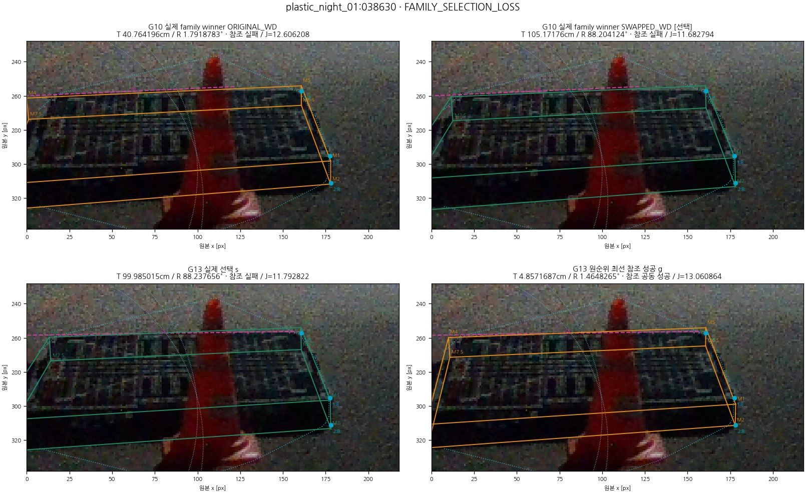
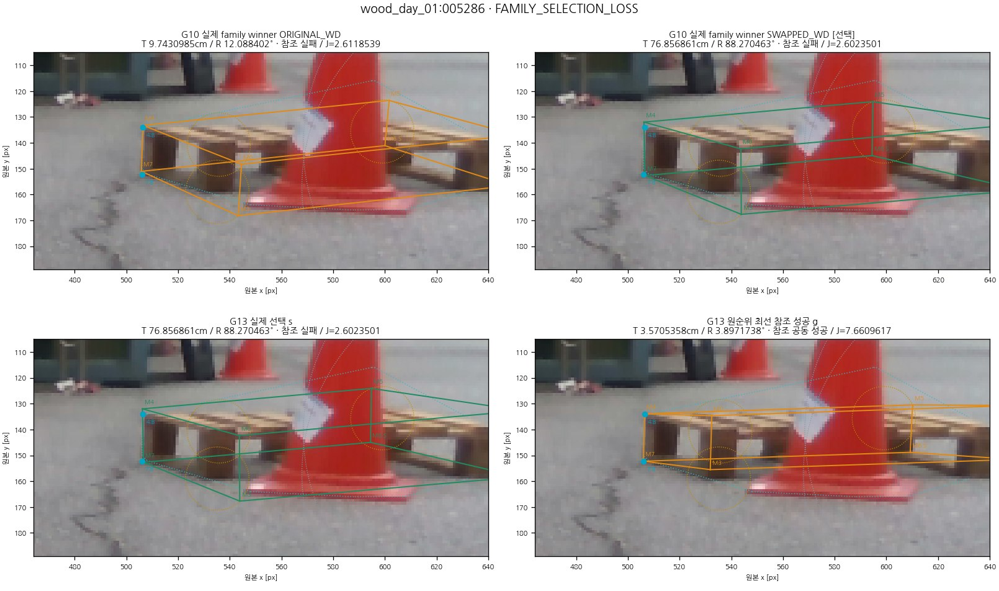
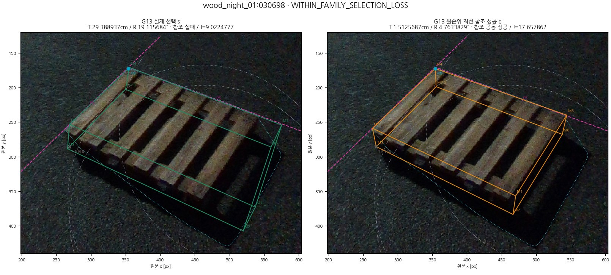
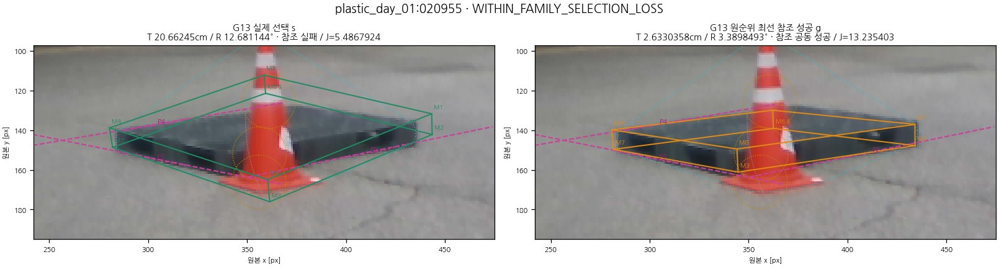
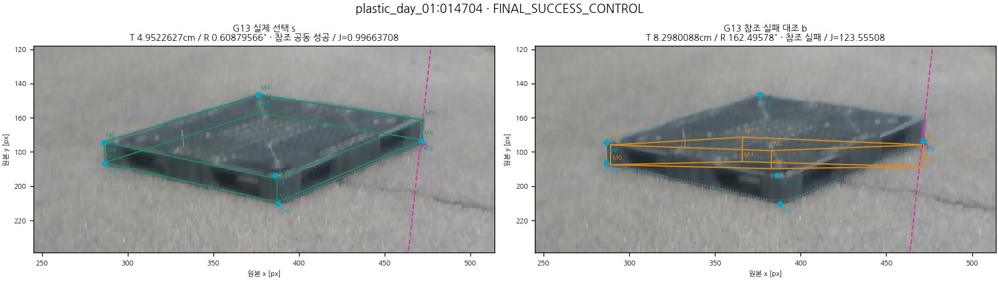
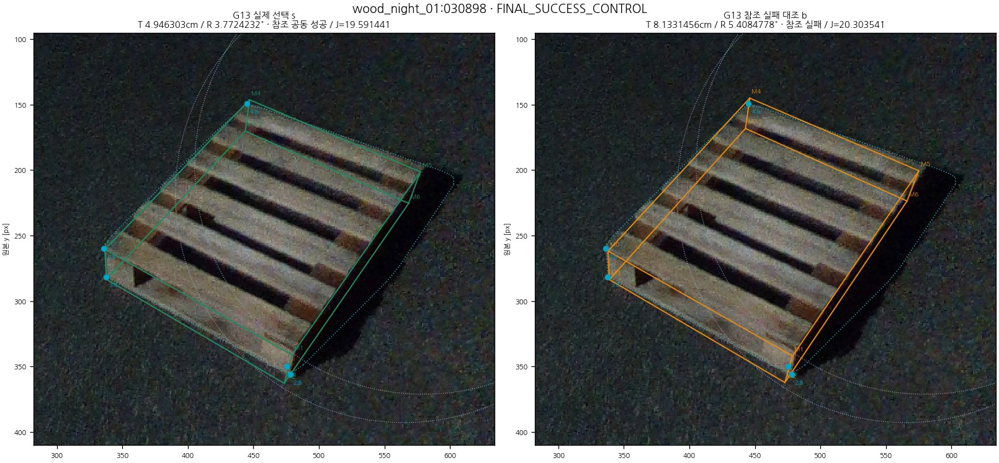

# 기존 e의 후보 선택 비용 진단 — 원결과407de865

**결론: 원 selector 구현 불일치는 없었다. 실패32장은 실제 원비용의 선택 손실이고, 후보부재46장은 따로 남는다. 다음 우선순위는 외곽선 표본과 등록 cuboid의 물리 외곽 대응을 확인하는 최소 검토 한 가지다. 항 삭제·가중치 변경·새 선택기 채택은 하지 않았다.**

## 1. 새 계산 범위와 재현

원결과 `407de865445e4987614f50f893d2ccea78d507b6`, 실행 base `2fe1969b7a999d9a8d460703be4bfd11317e7f07`, 별도 연구 브랜치 `research/selection-score-diag-20261016-v1`다. [SOURCE_BINDINGS](SOURCE_BINDINGS.json)는 원 공개129개 산출물·수치 의존779개 소스·관측/mask 관련250개 소스·annotation143개 및 원 봉인을 확인한다. 현재 main의 새 결과로 원407 결과를 대체하지 않았다.

238/238 영상의 원 G10/G13 family winner·수락/위임/중복 제거·후보 순서·e 최종 R/t/Q/역할을 재현했다. unresolved **0**. stage/family winner952개와 비제외 e 정책476개는 별도 독립 tuple 비교로도 일치했다. 실제 원비용을 고정 R/t에서 평가한 retained11,603개(G10 5,861 / G13 5,742)가 모두 복원됐다. 원 저장 total과 최대차 7.96e-13, `atol=1e-9, rtol=0` 그대로다. 자세 solve·forward·학습·새 관측/후보는 모두0회다.

| 분할 | 성공 | family 손실 | 같은-family 손실 | 후보부재 | 합계 |
| --- | --- | --- | --- | --- | --- |
| PRIMARY | 114 | 10 | 22 | 46 | 192 |
| TEST | 49 | 0 | 0 | 0 | 49 |
| REMAINDER | 65 | 10 | 22 | 46 | 143 |
| CAL | 37 | 3 | 0 | 6 | 46 |

PRIMARY는 TEST49+추가143이며 독립 신설 test가 아니다. 선택손실32장은 모두 추가143. CAL46은 교정에 사용된 집합이며 같은-family 손실0장이라 22장의 선택 개선을 CAL로 검증할 수 없다. 성공은 **동일 후보**의 T≤5cm AND physical/C2 R≤5°; 90° W/D 혼동은 C2로 지우지 않는다. 참조는 기존 기하 재구성값이며 독립 물리 정답/semantic owner 정답이 아니다.

## 2. family10 / 내부22에서 실패한 실제 결정

family10은 G10 좋은 retained 후보가 **10/10**에 이미 있었다. G13에서만 처음 좋은 후보가 생긴 사례는0이다. G10 반대-family **실제 winner**가 성공한 것은6/10, G13 반대-family winner는5/10이다. 나머지는 family를 바꿔도 내부 순위 문제가 남는다. G13 자체 family 재선택은 **10/10 실패**했다. 원 G10 family 고정 정책만 풀면 해결된다는 근거가 없다. CAL family3도 G10 좋은 후보3/3, 반대 winner2/3, G13 자체 재선택 실패3/3이다.

G10 실제 두 accepted winner의 같은 목적함수 비교는 [선택쌍 표](SELECTION_PAIR_TABLE.csv)의 `G10/accepted_family_winner_comparison`, G13 선택/성공 후보는 [FAMILY10_CASES](FAMILY10_CASES.csv)로 분리했다. [원 stage/family 결정952행](FAMILY_STAGE_DECISIONS.csv)에 R/t/Q·수락/위임·winner ID·index·tie-break를 보존했다. 두 단계의 cost를 서로 빼지 않았다. G10 실제 winner 차이에서 가장 큰 양의 항은 outline6/full3/partial1장이다. G13 실제 e 대 comparator-first 성공 후보 비교는 outline7/full1/partial2장이다.

같은-family22는 위치만 실패12, 회전만 실패1, 둘 다 실패9다. 회전 최대19.116°로 이22장을 W/D swap이라고 부를 수 없다. 성공 후보 전체 ID·원순위·cost 범위는 [WITHIN22_CASES](WITHIN22_CASES.csv)에 남겼으며 최소 GT 오차 후보를 골라 제시하지 않았다.

## 3. 비용 항에서 원관측까지의 근거와 반례

아래 Delta는 같은 G13·같은 family에서 `J(g)−J(s)`다. 양수는 원래 잘못 선택된 s를 선호한다. 비용은 무단위 정규화/가중 후 값이며 px/cm와 섞지 않는다.

| G13 같은-family 22장, g−s | 평균 ± 표본SD | 최소 ~ 최대 | s 선호 / g 선호 / 동률 |
| --- | --- | --- | --- |
| full_BI | -0.473548 ± 0.835644 | -3.361408 ~ 0.385048 | 6 / 15 / 1 |
| partial_normal | 1.002161 ± 2.682865 | -0.341961 ~ 12.007828 | 13 / 6 / 3 |
| outline | 2.844732 ± 2.832439 | 0.014353 ~ 9.657273 | 22 / 0 / 0 |
| prior | 0.000000 ± 0.000000 | 0.000000 ~ 0.000000 | 0 / 0 / 22 |

outline은22/22에서 s 선호, 가장 큰 양의 항은15/22였다(partial5/full2). full BI는15/22에서 g를 오히려 선호했다. full fallback Delta 평균−0.094139±0.261947, 범위[−0.958200,+0.288223]로 fallback 하나가22장을 공통으로 망쳤다고 설명할 수 없다. full B_TARGET_BACKGROUND_LINES는21장에 있고 g선호14/s선호7이었다. partial은19장; actual line normal/offset까지 일치하는 기록 source-ray link가18장, 해당 매칭 근거가 없는1장은 명시적으로 미연결이다. partial의 상속 `measurement_source`만 보고 실제 RGB normal을 backbone fallback 측정이라고 해석하지 않았다.

대표 `wood_night_01:030698`에서 [`statewise_partial_BI_outline_solver_v4_13._outline_value`](../../../scripts/research/pallet_visibility_curriculum_20261013_v1/statewise_partial_BI_outline_solver_v4_13.py#L112)가 사용하는 저장 전역 mask outline은, 실제 s(29.388937cm/19.115684°)보다 참조성공 g(1.512569cm/4.763383°)에 큰 거리를 부여했다. observed→model 동일854표본의 평균 원 px 잔차는 **7.4999→17.3307**, 가중 비용4.13649→10.26530(Delta **+6.128810**); model→observed는90표본·각 자세 원 arc 정규화833.595/739.068px에서 Delta **+3.528464**다. full BI−0.969840과 partial−0.052049가 g를 지지해도 outline **+9.657273**이 상쇄해 J9.022478인 s가 J17.657862인 g보다 앞섰다. [표본 그림](gallery/outline_witness/witness_03.jpg)은 양쪽에서 동일한 저장 observed 표본만 대응시킨다.

관측이 reference-success pose와 충돌한다는 것은 확인됐다. **mask가 틀렸는지, 등록 cuboid의 projected silhouette가 실제 팔레트 경계를 대표하지 못하는지, 기하 참조/축 가정의 한계인지 아직 분리되지 않았다.** 높은 비용만으로 weight 오류나 참조 오류를 확정하지 않는다. 모든32장의 semantic owner는 미검증이며 의사결정 기여를 확인한32장과 물리 원인을 확정한 장수를 구분한다.

정확한 sample source group의 공유는 좁은 조건부 linkage로 기록했다. active nonfallback 관측 간 같은 group이 확인된 영상은 within22=0/family10=0/controls114=2였지만, 같은 RGB edge/mask의 근접 표본 상관이나 통계적 독립성 검증은 아니다. 미연결을 '독립' 또는 '중복 없음'으로 바꾸지 않았다. [전체 관측별 장부](PER_OBSERVATION_PAIR_LEDGER.csv.gz)와 [쌍별 원 provenance](PAIR_LEDGER.jsonl.gz)를 보존했다.

### 1. plastic_night_01:038630 · FAMILY_SELECTION_LOSS

실제 선택 s: 99.985015cm / 88.237656°, 대조: 4.857169cm / 1.464827°. G13 J는 11.79282208 → 13.06086447; Delta=1.26804239.

| 실제 가중 항 | s | 대조 | Delta |
| --- | --- | --- | --- |
| full_BI | 1.27585174 | 1.72880284 | +0.45295110 |
| partial_normal | 0.06892666 | 0.08752832 | +0.01860166 |
| outline | 10.44804369 | 11.24453331 | +0.79648962 |
| prior | 0.00000000 | 0.00000000 | +0.00000000 |

[전체 관측/출처/원 px/정규화 비용](gallery/case_13/cost_and_observations.json) · [원 observed outline 표본별 비용차](gallery/outline_witness/witness_01.jpg)
### 2. wood_day_01:005286 · FAMILY_SELECTION_LOSS

실제 선택 s: 76.856861cm / 88.270463°, 대조: 3.570536cm / 3.897174°. G13 J는 2.60235005 → 7.66096165; Delta=5.05861160.

| 실제 가중 항 | s | 대조 | Delta |
| --- | --- | --- | --- |
| full_BI | 0.34008281 | 0.00000000 | -0.34008281 |
| partial_normal | 0.00000000 | 0.00000000 | +0.00000000 |
| outline | 2.26226725 | 7.66096165 | +5.39869441 |
| prior | 0.00000000 | 0.00000000 | +0.00000000 |

[전체 관측/출처/원 px/정규화 비용](gallery/case_19/cost_and_observations.json) · [원 observed outline 표본별 비용차](gallery/outline_witness/witness_02.jpg)
### 3. wood_night_01:030698 · WITHIN_FAMILY_SELECTION_LOSS

실제 선택 s: 29.388937cm / 19.115684°, 대조: 1.512569cm / 4.763383°. G13 J는 9.02247773 → 17.65786206; Delta=8.63538433.

| 실제 가중 항 | s | 대조 | Delta |
| --- | --- | --- | --- |
| full_BI | 0.97099277 | 0.00115247 | -0.96984029 |
| partial_normal | 0.08387372 | 0.03182485 | -0.05204887 |
| outline | 7.96761125 | 17.62488474 | +9.65727349 |
| prior | 0.00000000 | 0.00000000 | +0.00000000 |

[전체 관측/출처/원 px/정규화 비용](gallery/case_27/cost_and_observations.json) · [원 observed outline 표본별 비용차](gallery/outline_witness/witness_03.jpg)
### 4. plastic_day_01:020955 · WITHIN_FAMILY_SELECTION_LOSS

실제 선택 s: 20.662450cm / 12.681144°, 대조: 2.633036cm / 3.389849°. G13 J는 5.48679240 → 13.23540329; Delta=7.74861089.

| 실제 가중 항 | s | 대조 | Delta |
| --- | --- | --- | --- |
| full_BI | 0.00000000 | 0.00000000 | +0.00000000 |
| partial_normal | 0.46930071 | 0.12733927 | -0.34196144 |
| outline | 5.01749169 | 13.10806402 | +8.09057233 |
| prior | 0.00000000 | 0.00000000 | +0.00000000 |

[전체 관측/출처/원 px/정규화 비용](gallery/case_09/cost_and_observations.json) · [원 observed outline 표본별 비용차](gallery/outline_witness/witness_04.jpg)
### 5. plastic_day_01:014704 · FINAL_SUCCESS_CONTROL

실제 선택 s: 4.952263cm / 0.608796°, 대조: 8.298009cm / 162.495779°. G13 J는 0.99663708 → 123.55508319; Delta=122.55844611.

| 실제 가중 항 | s | 대조 | Delta |
| --- | --- | --- | --- |
| full_BI | 0.69473594 | 109.74575678 | +109.05102084 |
| partial_normal | 0.00082157 | 0.35114176 | +0.35032019 |
| outline | 0.30107957 | 13.45818465 | +13.15710507 |
| prior | 0.00000000 | 0.00000000 | +0.00000000 |

[전체 관측/출처/원 px/정규화 비용](gallery/case_33/cost_and_observations.json) · [원 observed outline 표본별 비용차](gallery/outline_witness/witness_05.jpg)
### 6. wood_night_01:030898 · FINAL_SUCCESS_CONTROL

실제 선택 s: 4.946303cm / 3.772423°, 대조: 8.133146cm / 5.408478°. G13 J는 19.59144070 → 20.30354096; Delta=0.71210026.

| 실제 가중 항 | s | 대조 | Delta |
| --- | --- | --- | --- |
| full_BI | 12.40933621 | 12.34685245 | -0.06248376 |
| partial_normal | 0.00000000 | 0.00000000 | +0.00000000 |
| outline | 7.18210450 | 7.95668852 | +0.77458402 |
| prior | 0.00000000 | 0.00000000 | +0.00000000 |

[전체 관측/출처/원 px/정규화 비용](gallery/case_34/cost_and_observations.json) · [원 observed outline 표본별 비용차](gallery/outline_witness/witness_06.jpg)

## 4. 성공114장과 CAL46의 반례, 전체 순위 영향

성공114장 모두 같은-family의 원순위상 최선 참조실패 후보 b가 있었다. outline은 **114/114**에서 올바른 s를 선호했다. Delta outline 평균31.547848±33.083359, 최소+0.011905. 가장 큰 양의 항은 full80/outline21/partial13이다. CAL 성공37장 중 b가 있는36장만 쌍비교 가능하며1장은 NA와 이유를 유지했다. CAL 같은-family 손실0장을 검증 성능으로 꾸미지 않았다.

특히 `wood_night_01:030898`에서는 full BI가 b를 −0.062484 지지해도 outline +0.774584가 성공 s를 보호했다. observed→model +0.443872, model→observed +0.330712다. 실패 사례의 같은 항을 일괄 삭제하면 이 보호 근거도 사라진다.

소스/선택/가산 복원을 통과한 뒤, 성과표를 만들기 전에 [고정한6개 규칙](INFLUENCE_PROTOCOL.json)만 적용했다. G10만 변경하거나 원 G10 family를 고정한 G13 내부만 변경했다. original eligible·hard guards·dedup·tie-break와 기존 G13 family 출력은 고정했다. prior는 실제0이라 제외 실험을 만들지 않았다.

| 독립 변경 단계 | 단일 제외 항 | 성공/192 | 회복 | 손상 | 양쪽 실패 | 위치 평균±SD cm | 회전 평균±SD ° |
| --- | --- | --- | --- | --- | --- | --- | --- |
| G10_ONLY | full_BI | 107 | 1 | 8 | 77 | 15.386 ± 31.054 | 18.173 ± 33.321 |
| G10_ONLY | partial_normal | 112 | 1 | 3 | 77 | 14.600 ± 30.384 | 13.797 ± 29.140 |
| G10_ONLY | outline | 114 | 3 | 3 | 75 | 11.530 ± 25.729 | 12.161 ± 27.639 |
| G13_INTERNAL_ONLY | full_BI | 114 | 0 | 0 | 78 | 14.038 ± 29.621 | 13.010 ± 28.412 |
| G13_INTERNAL_ONLY | partial_normal | 113 | 1 | 2 | 77 | 13.680 ± 27.616 | 12.120 ± 26.384 |
| G13_INTERNAL_ONLY | outline | 112 | 9 | 11 | 69 | 12.579 ± 26.967 | 13.738 ± 29.461 |

기존 e는114/192, T평균14.112±30.077cm / R13.001±28.388°였다. 단순 항 삭제로 PRIMARY 공동 성공을 늘린 경로는 **0/6**이다. G13 outline 제외는 선택손실 일부를 회복하지만 **9회복/11손상**, 원114 성공 중103만 보존한다. G10 outline 제외는3/3이며 전체 성공수 동률도 연속오차 무변화가 아니다.

| 진단 | TEST49 성공(회복/손상) | 추가143 성공(회복/손상) | CAL46 성공(회복/손상) |
| --- | --- | --- | --- |
| G10_ONLY__without_full_BI | 45 (0/4) | 62 (1/4) | 36 (0/1) |
| G10_ONLY__without_partial_normal | 48 (0/1) | 64 (1/2) | 37 (0/0) |
| G10_ONLY__without_outline | 47 (0/2) | 67 (3/1) | 39 (2/0) |
| G13_INTERNAL_ONLY__without_full_BI | 49 (0/0) | 65 (0/0) | 37 (0/0) |
| G13_INTERNAL_ONLY__without_partial_normal | 49 (0/0) | 64 (1/2) | 37 (0/0) |
| G13_INTERNAL_ONLY__without_outline | 45 (0/4) | 67 (9/7) | 32 (0/5) |

> 원 목적함수로 생성한 고정 후보 은행 위의 사후 순위 영향 진단이다. 항을 제거한 목적함수로 후보를 새로 생성·최적화한 방법의 성능이 아니며, 새 선택기로 채택하지 않았다.

[24개 전체 집계](SCORE_INFLUENCE_DIAGNOSTIC.csv), [1428행 선택/회복/손상 원장](SCORE_INFLUENCE_ROWS.jsonl.gz), [연속오차의 전이군별 합·분산·최대](INFLUENCE_SUMMARY.json)에 유리하지 않은 결과도 전량 남겼다. 원192·49·143·CAL46 분모를 줄이지 않았다. 별도 구현이1428개 선택과24집계의 `회복−손상=성공수 차이`, 모든 전이군 연속오차 합을 정확 유리수 산술로 검산했다.

## 5. 후보부재46장의 확인된 범위와 공백

46장 중 **4장은 실제 admission/no-generation**, 42장은 G13 consumer 후보가 있지만 동일 후보 공동 성공이 없다. 이46장은 원 G13 소비자 은행의 한계이며 모든 역사적/미래 후보의 부재를 뜻하지 않는다. 생성 전 버린 WD/P1 후보나 후속 V15/V17/V33/SINGLE·외부 pose를 은행에 합치지 않았다.

위치≤5cm 후보가 있는14장, 회전≤5° 후보가 있는36장, 두 조건을 각기 다른 후보로만 만족하는13장을 분리했다. 위치 최소와 회전 최소를 합친 가상 성공은0이다. 원 시작점→끝점652쌍의 시작점 공동 성공은0이지만, `wood_night_01:033421`에는 **G10 성공 winner3.244cm/4.596°**가 있었고 G13 은행에는 성공 후보가 없었다(최종12.707cm/3.669°). 원 G13은 그 G10 winner를 start로 쓰지 않았다. 이 사례를 모든 초기 단계가 나쁜 사례로 분류하지 않았다.

모든46장 outline 지원 기록은True이나 활성 full fallback은35장에 없었다. T 관측0으로 이번 자료에서 truncation 기여를 검증할 수 없다. endpoint의 음의 slack을 전체 제약의 모순이라고 부르지 않았다. **46/46은 OBSERVATION_VS_PROPOSAL_NOT_ISOLATED와 SEMANTIC_OWNER_UNVERIFIED**가 남는다. 원 source 연결 미해결은0이지만 semantic owner/물리 축/독립 참조 정확성 공백은 그대로다. [46장별 사실·경쟁 설명·부족 증거·최소 확인](NO_CANDIDATE46_CASES.csv), [CAL6](NO_CANDIDATE_CAL6_CASES.csv), [실제 RGB 링크](NO_CANDIDATE_INDEX_KO.md)를 제공한다.

## 6. N0/PoseFix RAW의 같은 집합 비교

N0는 기존 **N3→SubPix+F**, PoseFix는 **POSEFIX_RAW**다. PF+SubPix와 섞지 않았고 외부 pose를 e bank에 추가하거나 재추론하지 않았다.

| PRIMARY 그룹 | 장수 | N0 성공 | PoseFix RAW 성공 | 둘 중 하나 성공 | 둘 다 실패 | e 성공 |
| --- | --- | --- | --- | --- | --- | --- |
| FAMILY_SELECTION_LOSS | 10 | 6 | 4 | 6 | 4 | 0 |
| FINAL_SUCCESS_CONTROL | 114 | 89 | 65 | 95 | 19 | 114 |
| NO_SUCCESS_CANDIDATE | 46 | 4 | 5 | 7 | 39 | 0 |
| WITHIN_FAMILY_SELECTION_LOSS | 22 | 9 | 6 | 9 | 13 | 0 |

후보부재46장 중7장은 외부 모델 출력에는 성공 pose가 있다. e 정보/시작/대응이 본질적으로 해결 불가능하다는 설명의 반례다. 나머지39장은 세 경로 모두 실패하므로 점수 변경만으로 회복을 기대할 근거가 없다. 반면 e 성공114장 중19장은 N0/PoseFix 모두 실패했다. e의 상태/관측 경로가 지킨 성공을 버리는 결론도 맞지 않는다.

PRIMARY192 전체 원 저장 결과:

| 경로 | 공동 성공/N | 위치 평균 ± 표본SD (cm) | 위치 분산 (cm²) | 위치 최대 | 회전 평균 ± 표본SD (°) | 회전 분산 (°²) | 회전 최대 |
| --- | --- | --- | --- | --- | --- | --- | --- |
| N0 | 108/192 | 11.306 ± 26.877 | 722.358 | 174.758 | 10.631 ± 25.131 | 631.556 | 88.905 |
| POSEFIX_RAW | 80/192 | 13.836 ± 27.578 | 760.559 | 185.783 | 11.640 ± 26.525 | 703.564 | 88.945 |
| E0 | 114/192 | 14.112 ± 30.077 | 904.618 | 260.412 | 13.001 ± 28.388 | 805.864 | 159.137 |

별도 CAL46:

| 경로 | 공동 성공/N | 위치 평균 ± 표본SD (cm) | 위치 분산 (cm²) | 위치 최대 | 회전 평균 ± 표본SD (°) | 회전 분산 (°²) | 회전 최대 |
| --- | --- | --- | --- | --- | --- | --- | --- |
| N0 | 34/46 | 3.982 ± 4.302 | 18.510 | 17.766 | 7.805 ± 20.905 | 437.025 | 87.868 |
| POSEFIX_RAW | 32/46 | 5.249 ± 7.636 | 58.306 | 46.482 | 9.759 ± 24.066 | 579.168 | 89.057 |
| E0 | 37/46 | 5.379 ± 11.288 | 127.427 | 51.978 | 10.599 ± 26.024 | 677.240 | 89.658 |

기존 TEST49/추가143 및 그룹별 평균·표본SD·표본분산·최대·N은 [BASELINE_CROSS_TABLE](BASELINE_CROSS_TABLE.csv)에 있다. [기존 PF transfer 감사](../pallet_statewise_correspondence_diagnosis_v1/POSEFIX_TRANSFER_AUDIT.md)의 공통95장 분석은 참고일 뿐 전체192 PF+SubPix 단일 규칙 검증으로 확대하지 않았다.

## 7. 판정과 검산 한계

| 구분 | 이번 판정 | 남은 공백 |
| --- | --- | --- |
| 선택/비용 구현 오류 | 238 selector 일치, 11603 total/components 복원; 확인된 구현 불일치0 | 별도 독립 semantic correctness를 의미하지 않음 |
| 관측·가중치 모델 | 32장의 원 비용 기여는 전량 확인; 내부22 outline s선호 | 잘못된 관측/모델 불일치/불확실성 보정의 인과 원인32/32 미확정 |
| 이산 선택 정책 | G10 family10 손실; 10장 모두 G10에도 좋은 후보 존재 | G13 자체 재선택10/10 실패하므로 family lock 해제 단독 해결 불가 |
| 정보 부족·제안 한계 | 46=진입4+G13 후보존재42, pruning loss0 유지 | 관측 대 proposal 인과분리46/46 미해결 |

원 full2D 철회는 모든 partial native ID에서 실제로0기여이며 원 legacy partial72·V47 correction 계보를 유지했다. partialnormal은 corner내 radial robust 합이라 선별로 가산하지 않았다. S는 양의 depth 같은 모델 guard/투영으로만 쓰고 측정점으로 넣지 않았다. O/T/U·finite tangent는 원 hard constraint이며 soft cost에 더하지 않았다. prior는 실제0이었다. [OBJECTIVE_MAP](OBJECTIVE_MAP.md), [SELECTION_RULE_MAP](SELECTION_RULE_MAP.md), [독립 dense 검산](evidence/cost_v1/DENSE_ARRAY_VALIDATION.json)에 상세가 있다.

11,603 후보의 참조 성공 ID는 원 오라클과 전량 일치했다. 극도로 먼48개 저장 후보에서 cm float ULP가1e-9보다 커서 최초 독립 metric 절대차 검사는 실패했다(최대1.52587890625e-5cm). 원 metric 값·비용/선택의1e-9 기준은 바꾸지 않았다. 실패 `metrics_v1`을 보존했고, v2에서80자리 Decimal norm과 IEEE 연산별 반올림 경계로 수치 표현을 검증했다. 이48개 최초 절대 검사 실패를 PASS로 지우지 않았으며 [두 영수증](evidence/metrics_v2/METRIC_CHECK.json)에 명시했다. 회전 독립차 최대5.70e-12°, 원 success 불일치0이다.

기존 실패/중간 시도, 원 source·weights·prediction·annotation·사용자 dirty6개를 보존했다. [VALIDATION](VALIDATION.json)과 [COST](COST.json)는 독립 검산/실제 측정·결측 시간을 구분한다. 분석은2 worker, GPU0이며 이 시간은 영상추론 latency/FPS가 아니다.

## 8. 다음 우선순위 한 가지

**외곽선 비용의 결정적 표본이 등록 cuboid의 물리 외곽에 실제로 대응하는지 확인하는 최소 검토**를 우선한다. [구체 제안](NEXT_CHANGE_PROPOSAL_KO.md)은 성공/실패 모두에 같은 절차를 적용하고, 확인 전 어떤 loss·weight·threshold도 바꾸지 않도록 한다. 새 학습은 필요하지 않다. 효과는 미검증이며32장 전부 회복 또는146/192를 약속하지 않는다. N3·SubPix·e·상태별 처리·운영 기본값·논문은 유지했다.

[전체 비교 갤러리](gallery/index.html) · [재현 명령](REPRODUCE.md) · [고정 계약](PLAN_AND_CONTRACT.md)
