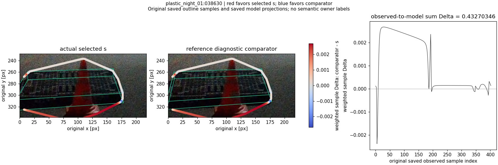
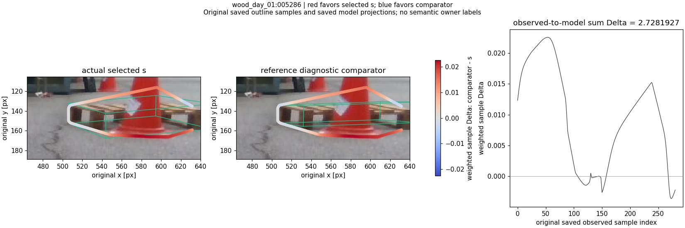
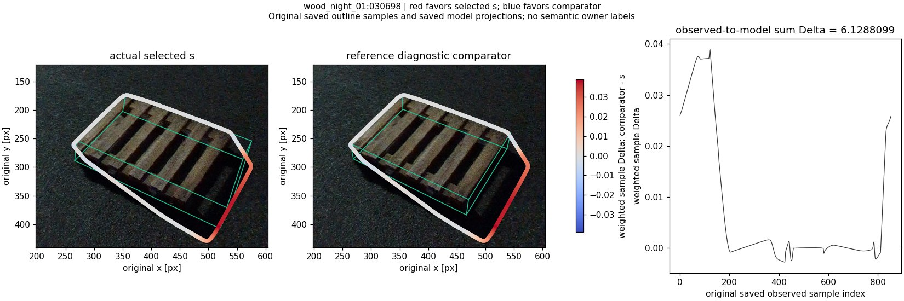
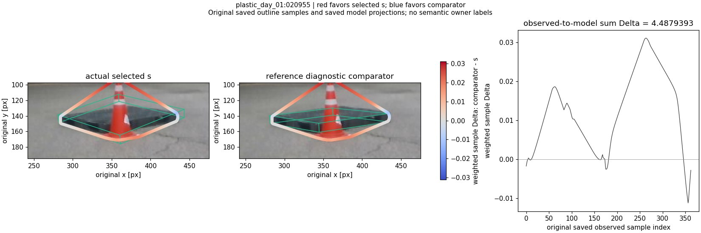
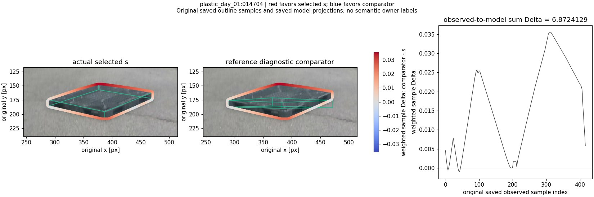
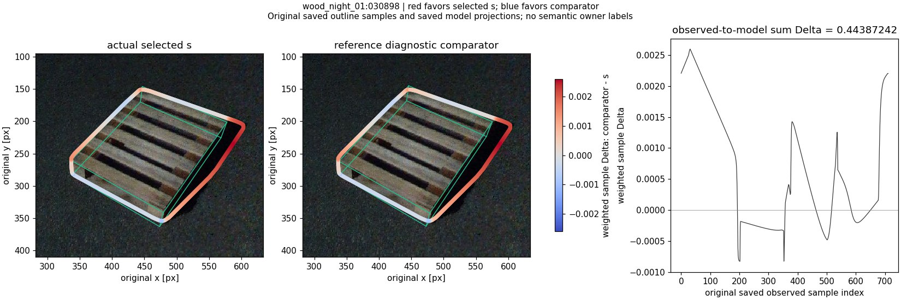

# 저장 외곽선 표본의 후보 선택 비용 기여

각 점은 원 packet의 동일한 observed outline 표본입니다. 빨강은 실제 선택을, 파랑은 참조 대조 후보를 선호합니다. 모델의 자세마다 달라지는 model-to-observed 표본 인덱스는 서로 빼지 않았습니다. 표본 비용은 저장 dense 장부에서 읽었고 새 선·mask·자세는 생성하지 않았습니다. 이 그림만으로 어느 픽셀이 물리적 코너/외곽선의 정답인지 판정하지 않습니다.

## plastic_night_01:038630

관측→모델 비용차: 0.432703465. [전체 표본](witness_01_samples.csv.gz)

## wood_day_01:005286

관측→모델 비용차: 2.72819271. [전체 표본](witness_02_samples.csv.gz)

## wood_night_01:030698

관측→모델 비용차: 6.12880988. [전체 표본](witness_03_samples.csv.gz)

## plastic_day_01:020955

관측→모델 비용차: 4.48793934. [전체 표본](witness_04_samples.csv.gz)

## plastic_day_01:014704

관측→모델 비용차: 6.87241289. [전체 표본](witness_05_samples.csv.gz)

## wood_night_01:030898

관측→모델 비용차: 0.443872423. [전체 표본](witness_06_samples.csv.gz)
