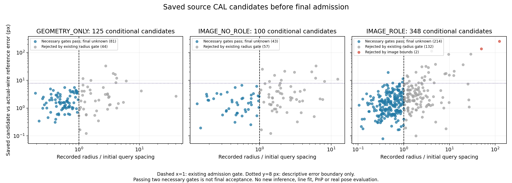

가림 판단이 일부 틀려도 다른 유효 대응점으로 자세를 구하고 자기 가림 코너를 재투영했을 때, 기존 단순 대조보다 실제 위치·회전이 좋아졌는가?

**아직 방법 전체의 개선을 확인하지 못했다.** 고정 H의 LOO 제외와 최종 재투영 계약은 지켰지만, 최신 쉬움153+중간92=245 실사 결과는 단순 대조보다 위치·회전 평균이 나쁘다. 이번에는 저장된 합성 경계 출력의 마지막 승인 단계까지 실제 검산해, 코너 정의 문제·관측 오차·PnP 해 선택 문제를 구분했다. 새 학습·영상·모델 추론·PnP·자세 성능 재실험은 시작하지 않았다.

**지금 확인된 문제는 두 단계다.** 첫째, query의 경계 위치가 정확해도 두 선의 교점으로 만든 코너는 충분히 정확하지 않을 수 있고, 기존 uncertainty/extrapolation 승인 조건이 일부 큰 오차를 통과시킨다. 둘째, 실사에서는 보정점을 전혀 쓰지 않아도 잘못된 대응을 포함한 더 큰 consensus가 최종 PnP 순위에서 이겨 자세가 악화된다. self-occ를 초기 좌표로 되돌리거나 모든 가림을 완벽히 분류하는 것이 해결책이라는 근거는 없다.

**계획으로 끝내지 않고 마지막 decoder까지 확인했다.** 먼저 기존 세 모델의 CAL128 geometry573행에서 영상 범위와 `radius/initial_query_spacing<=1`만 산술 검산했다. IMAGE_ROLE >8px 후보33개 중29개는 그 선쌍의 필수조건 위반으로 확실히 거절되고4개는 원행만으로 최종 승인이 미확정이었다. 이어 이미 저장된84×66 logits를 기존 decoder·동일 CAL threshold·동일 원 좌표·동일 NumPy1.26.4로 검산했다. **그4개는 모두 source decoder에서 코너 관측으로 실제 선택된다.** line/TLS와 intersection은 이전 출력의 고정 계산을 재현했으며 calibration이나 threshold를 바꾸지 않았다. 실사 LOO/최종 자세에 이4개가 들어갔다고 주장하지 않는다.

| 모델 | 기존 CAL 프레임 | 모두 POS support인 조건부 참조 후보 | 그중 decoder 선택 | 그중 오차 >8px 선택 | 전체 decoder 코너 선택 | 코너4개 이상 프레임 |
|---|---:|---:|---:|---:|---:|---:|
| GEOMETRY_ONLY | 128 | 125 | 79 | 0 | 108 | 0 |
| IMAGE_NO_ROLE | 128 | 100 | 43 | 0 | 44 | 0 |
| IMAGE_ROLE | 128 | 348 | 214 | 4 | 231 | 22 |

세 arm의 source confidence cutoff와 조건부 후보 모집단은 서로 다르다. 이 표를 실사 위치·회전의 모델 우열로 치환하지 않았다. >8px는 기존 진단 집계 구간일 뿐이며 실제 admission을 8px로 바꾸지 않았다. 선택231 중 certified reference가 있는214만 위치 오차를 확인했다. 나머지17을 BAD·NONE으로 처리하거나 전체 source 코너 정확도를 추정하지 않는다. 전체 source 코너4개 이상22프레임도 새 pose 산출을 뜻하지 않는다.



이 그림은 첫 단계의 저장행 감사다. 가로축은 반경/초기 query 간격, 세로축은 actual-wire support의 참조 교점과 후보의 오차다. x=1은 기존 gate, y=8px는 설명용이다. 파란색은 두 필수조건을 통과했음을 표시하며 그림의 `final unknown`은 첫 단계의 한계를 보존한 표시다. 후속 decoder 검산은 그 상태를 아래 원행으로 확정했다. 모든573행을 넣었고 새 실사 영상이나 미실행 결과는 넣지 않았다.

**통과한4개 원행:** 각 후보는 geometry enable·원영상 범위·예측 교점의 외삽 cap·불확실성/간격 조건을 통과했고 같은 corner의 최종 decoder 후보로 선택됐다. support 최대오차가0.885px와1.114px인 두 사례에서도 코너 오차가8.661px와11.449px다. 다른 두 사례는 query 오차도4px 이상이다. 이것은 모든 잔여 오류가 교차각만의 문제라는 증거가 아니다.

| source ID | corner | 참조 교점 오차 px | support query 최대오차 px | 두 법선의 절대det | 반경 px | 초기 간격 px | 예측 외삽률 | 최종 decoder |
|---|---:|---:|---:|---:|---:|---:|---:|---|
| P0__shard_06_f0585 | 1 | 8.661354 | 0.885302 | 0.201131 | 8.661354 | 9.347328 | 0.158495 | selected |
| P0__shard_06_f0700 | 5 | 19.295842 | 4.559754 | 0.237689 | 13.138760 | 28.884742 | 0.386368 | selected |
| P0__shard_03_f0494 | 0 | 11.449058 | 1.114131 | 0.088358 | 24.964100 | 26.120333 | 0.255465 | selected |
| P0__shard_07_f0942 | 1 | 8.144162 | 4.404142 | 0.999935 | 2.660038 | 4.639386 | 0.898345 | selected |

가장 큰258.055898px 중간 후보는 영상 밖이어서 실제 decoder가 거절한다. 그 후보의 반경1342.919435px도 초기 간격을 크게 넘는다. `참조오차<=recorded_radius`라는 사후 비교는 admission 자체가 아니다. 원행의 `true_corner_support_extrapolation_ratio`는 참조 교점의 외삽률이며, 이번 실제 decoder의 예측 교점 외삽률과 구분했다. 기존 uncertainty gate가 큰 증폭을 상당수 걸러낸 효과와 위4개를 통과시키는 한계가 동시에 있다.

**코너의 특성 정의 자체에 새 확정 오류를 찾지는 못했다.** 모델은8코너나 가림 종류를 직접 출력하지 않고12edge×7query 각각에 rawpixel ±32의65 후보 또는 NONE을 출력한다. 선3개를 요구하는 것이 아니라 서로 다른 query3개 이상으로 하나의 semantic edge를 만들고, 같은 native corner에 incident한 두 선의 교점을 만든다. 기존 actual-wire 가상 교점과 native projected-cuboid의 CAL348 차이는 평균0.0000306744px/최대0.0002457794px였다. 이 조건부 지원 선쌍에서는 edge ordering·bin·axis·코너 ID 정의 불일치가 확인되지 않았다. physical mesh vertex 존재 또는 실사 경계 ownership까지 입증한 것은 아니다. unsupported는 source 모델 지원 부족이고 physical edge 부재를 뜻하지 않는다.

**오류 수정과 학습의 시점을 분리한다.** 수정 전 별도 브랜치 `training.py.targets()`의 numerical ray miss를 no_match로 감독한 것은 실제 오류다. 대응이 있는2164 query를 잘못 NONE 처리했고, 실제 mesh·depth·wire 증거로 POSITIVE/NONE/IGNORE를 수정했다. 당시 감사 시점에는 준비·CPU gradient만 완료됐지만, 이후 승인된 고정3×3000 업데이트는 실제 완료됐다. 이번 추가 학습은0회다. 기존 IMAGE_ROLE0/319는 수정 전 모델의 실패 기록으로 보존하며 수정 후에도0/319라고 재표기하지 않는다. main N3→cornerSubPix의 학습 오류로 부르지도 않는다.

다음은 이미 저장된 마지막step3000의 source TEST128 query probe다. 공통 POS4497/NONE1966/IGNORE4289 중 raw66-way argmax를 평가했다. POS 조건부 평균 bin 오차에 TLS·교점·LOO·PnP가 포함되지 않아0.806732px를 코너 또는 자세 정확도로 읽을 수 없다. TEST는 P0 내부 분할이고 이전 감독 오류 진단에서 이미 열람했으므로 독립 실사 일반화 시험도 아니다.

| 모델 | 채택 POS | POS 채택률 | 채택POS 평균 query 오차 | NONE 오채택률 |
|---|---:|---:|---:|---:|
| GEOMETRY_ONLY | 3987/4497 | 88.659% | 1.036899px | 3.967% |
| IMAGE_NO_ROLE | 4271/4497 | 94.974% | 0.884172px | 3.103% |
| IMAGE_ROLE | 4370/4497 | 97.176% | 0.806732px | 1.628% |

GEOMETRY_ONLY는 기존 구현상 image0:19를 없애며 geometry와ROLE25:28을 유지한다. IMAGE_NO_ROLE는ROLE만 없애고 IMAGE_ROLE은28채널 모두 사용한다. ROLE은 hull의 BOUNDARY/INTERNAL/UNAVAILABLE 입력이며 별도 가림 정답 출력이 아니다. 이 입력 정의를 바꾸거나 세 모델을 더 학습하지 않았다. P0 외부 가림·비가림 방해물·저대비의 네 통제 변형은 여전히 별도 검증되지 않았다.

**실사 관측 선택의 실패:** 기존245 원행에서는85프레임/133코너가 실제 보정점으로 채택됐다. reference 오차가 N3보다 줄어든80점과 커진53점이 함께 있으며, 기존8px point proxy의 GOOD120/BAD13이다. 고정 H∪{k}를 뺀 LOO pose에서 q 잔차가 native보다 작아졌다고 q 위치가 실제로 더 정확하다는 보장은 없다. remaining 대응이 일부 잘못됐거나 LOO pose가 모호하면 그 비교 자체가 잘못된 관측을 선택할 수 있다. 이번 source4개를 이 실사53점과 동일 사례로 연결하지 않았다.

**실사 강건 PnP 선택의 실패:** 기존 전체-U 기본 해법이 모두 거절된59프레임 중 known-GOOD4 이상24프레임은 모두 그4점 조합과 유효 root를 가졌고22프레임은 그 root에서 승인된 refit도 있었다. 위치·회전이 모두 나빠진8프레임 중7프레임은 경계 보정점 채택0개였다. `eval_pallet07:1778652138515809024`의 선택 해는 BAD2,4까지 포함한6 inlier로 GOOD4 출발 가설의5 inlier보다 개수/SSE 순위가 앞섰다. N3 2.188809cm/0.454581°에서 새 출력10.716346cm/86.942401°로 악화됐다. GOOD4는 기존 annotation의8px proxy이고 정확한 무오차 대응이 아니다. 다른 root의 실제 T/R가 더 낫다고 새로 채점하지 않았으며, 단순히 GOOD4가 있었다는 것만으로 선택 해가 좋아야 한다고 단정하지 않는다.

**LOO는 self-occ 초기 좌표를 무시하는 것이 맞다.** corner LOO는 고정 predicted-H와 검사점 k를 함께 제외한 H∪{k}, endpoint LOO는 H∪{a,b}다. 새 최종 pose의 fit/score에는 H 초기 좌표와 center8을 넣지 않는다. 남은 실제 관측으로 강건 PnP를 구하고 새 R,t가 있으면 H 코너를 한 번 재투영해 교체한다. 재투영 좌표를 독립 관측으로 다시 fit하지 않는다. 예측 마스크와 사람 마스크가 다르다는 이유로 프레임을 실패시키지 않고, 충분한 유효 대응·배치·수치 안정성과 다중해 여부를 별도 기록한다. 새 pose가 없을 때 반환하는 기존 N3는 별도 fallback이다. 이 계약 준수는 위치·회전 개선의 증거와 구분한다.

기존 전체 245장 운용 결과는 최신 경로 240 NEW/5 fallback/0 완전 실패다. mean(T cm/R deg/ADDsym cm)은 N3 9.754548/10.914842/17.028647, 단순 HYBRID ordinary 9.207154/10.613464/16.439686, 최신 강건 경로 9.745696/12.622492/18.580216이다. ordinary 대조는 최종 H 제외 계약이 같지 않으므로 그대로 요구 방법의 성공으로 대체할 수 없다. 모든 실사 자세 수치는 기존 annotation/K/cuboid로 만든 DEV GEOMETRIC_PROXY이며 독립 physical R,t가 아니다. 전체 분포·평균/분산/표준편차/중앙값/P90·공통 산출집합·운용 결과·실제 RGB 사례는 [전체 245장 보고서](../pallet_whole_u_closure_20261011_v21/RESULT_KO.md), [가설/LOO 원행 감사](../pallet_consensus_cause_audit_20261011_v23/RESULT_KO.md)에 보존했다. Severe 74장은 이번 245장에서 제외했으며 역사적 319장 결과를 삭제하지 않았다. 이번 감사 시간을 기존 실제 전체 경로 timing으로 대신하지 않았다.

**남은 최소 검증:** source 4개 후보의 최종 decoder 여부를 확인하는 작업은 이번에 완료했다. 남은 핵심은 같은 관측·K·치수·H·finite4 roots를 고정하고, LOO 관측 선택과 PnP 해 선택의 기준을 사전에 명시해 별도 허용된 자세 평가에서 확인하는 것이다. 테스트 오차를 보고 threshold를 바꿔 반복하거나 GOOD proxy를 배포판 선택기에 넣지 않는다. 독립 physical pose/ownership 진실값 부재도 남아 있다. source 4개 오차만 줄여놓고 실사 목표가 해결됐다고 보고할 수 없다. **정확도 목표는 아직 완료 아님**이다.

코드 위치는 [query/line/intersection/admission](../../../scripts/research/pallet_boundary_corner_refiner_20261010_v2/observations.py#L117), [조건부 source 참조](../../../scripts/research/pallet_boundary_corner_refiner_20261010_v2/calibration.py#L140), [native 코너 계약](../../../scripts/research/pallet_corner_mechanism_audit_20261010_v1/cal_corner_contract.py#L138), [query TEST probe](../../../scripts/research/pallet_kp_supervision_repair_20261010_v1/retrain.py#L288), [고정 H의 LOO](../../../scripts/research/pallet_cornerwise_independent_20261010_v4/selection.py#L135)다. 이번 추가 코드는 [저장행 감사](../../../scripts/research/pallet_source_corner_admission_20261011_v24/saved_admission_audit.py), [동일 decoder 검산](../../../scripts/research/pallet_source_corner_admission_20261011_v24/replay_saved_decoder.py)에서 확인할 수 있다.

원자료는 [첫 단계 573행](ROWS.jsonl.gz), [첫 단계 통계](SUMMARY.json), [decoder 573결정행](decoder/DECISIONS.jsonl.gz), [decoder 384프레임](decoder/DECODED_FRAMES.jsonl.gz), [최종 4행과 실행량](decoder/SUMMARY.json), [원 logits/좌표/코드 SHA 결속](decoder/PROTOCOL.json), [실제 검산 결과](decoder/CHECKS.json)다. decoder의 모든 573후보 좌표·σ는 기존 저장값과 일치했고, IMAGE_ROLE의 selected_queries 3757/lines 606/accepted_corners 231/frames_ge4 22/line-pair hypotheses 9656/unknown_IGNORE 49의 여섯 집계는 이전 검산과 일치했다. UNKNOWN을 NONE으로 변경하지 않았다.

실제 추가 실행량은 첫 단계 저장 573행과, source decoder 384프레임·TLS dispatch 2620회·교점 dispatch 707회다. 이는 이미 평가된 고정 logits에 대한 검산이다. 새 detector/head/pose-fit/pose-score/학습/ray/RGB는 모두 0이다. 독립 stdlib 검산은 저장 선 1302개의 공분산과 교점 707개의 교점·공분산·영상 범위·외삽·uncertainty gate·코너별 최소 선택을 확인했다. NumPy decoder를 단순 다시 호출한 검사로 대체하지 않았다.

게시된 파생행과 decoder 산술의 검산 명령은 아래와 같다. 상류 supervision 전체·새 모델·실사 ownership·물리 정답을 재실행했다고 주장하지 않는다.

```bash
python3 -I -S -B scripts/research/pallet_source_corner_admission_20261011_v24/check_saved_public.py _docs/experiments/pallet_source_corner_admission_20261011_v24
python3 -I -S -B scripts/research/pallet_source_corner_admission_20261011_v24/check_decoder_public.py _docs/experiments/pallet_source_corner_admission_20261011_v24/decoder
```

상류 파일이 복원된 checkout에서는 `saved_admission_audit.py --source CHECKOUT --output NEW_OUTPUT`과 `replay_saved_decoder.py --source CHECKOUT --output NEW_DECODER_OUTPUT --necessary-rows NEW_OUTPUT/ROWS.jsonl`로 같은 join과 decoder 검산을 재실행할 수 있다. 후자는 기존 NumPy 1.26.4를 필요로 하며 torch/OpenCV/SciPy/영상 모듈 import를 막는다. 모든 원본 inputs와 코드 SHA는 실행 전에 봉인했고 실행 후 입력 hash가 동일했다. branch 전용 정상 commit/push와 main 보존은 PUBLICATION_PROTOCOL/REMOTE_CONFIRMATION에 기록한다.
