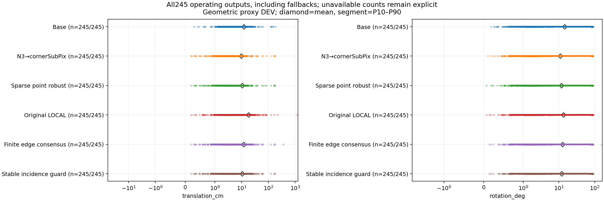
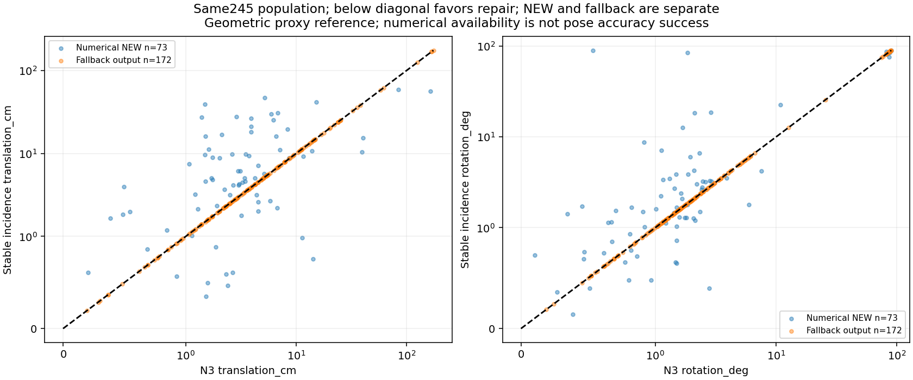
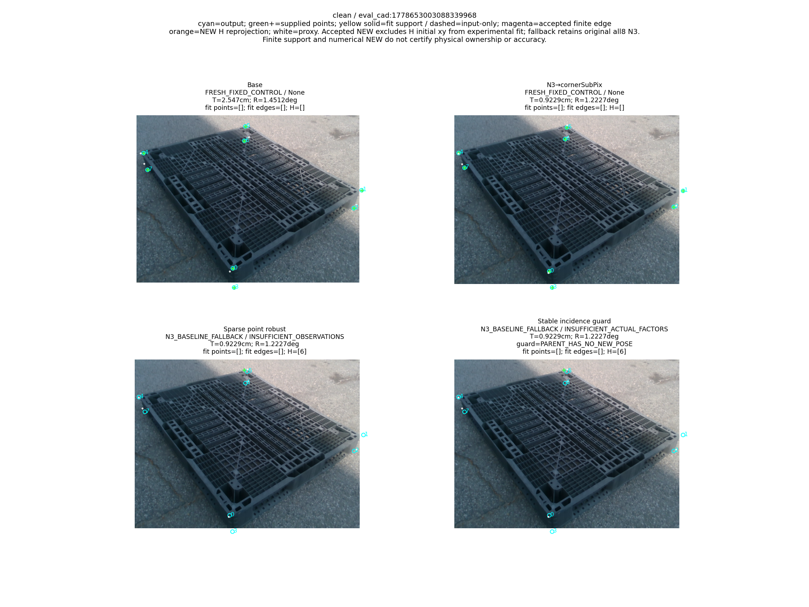
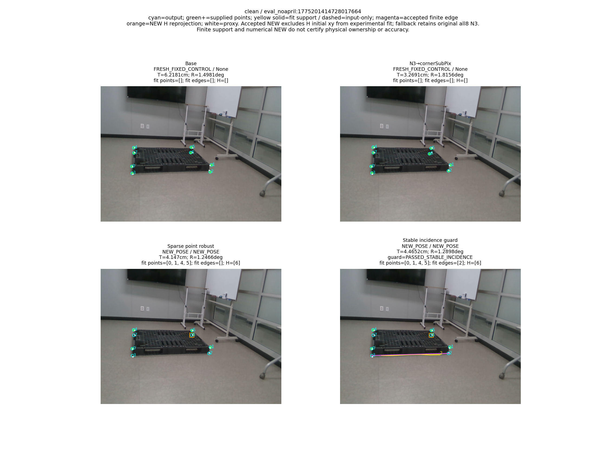
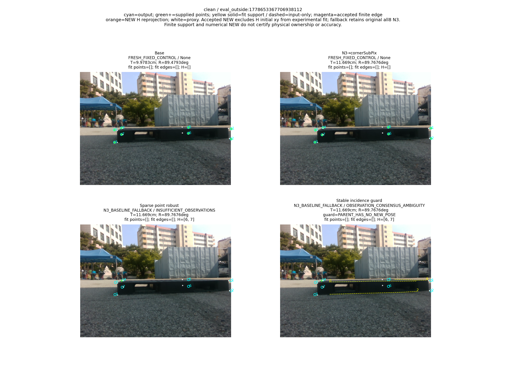
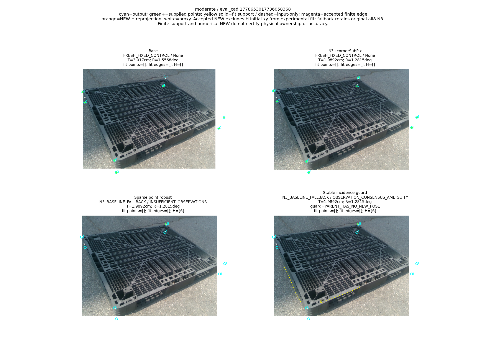
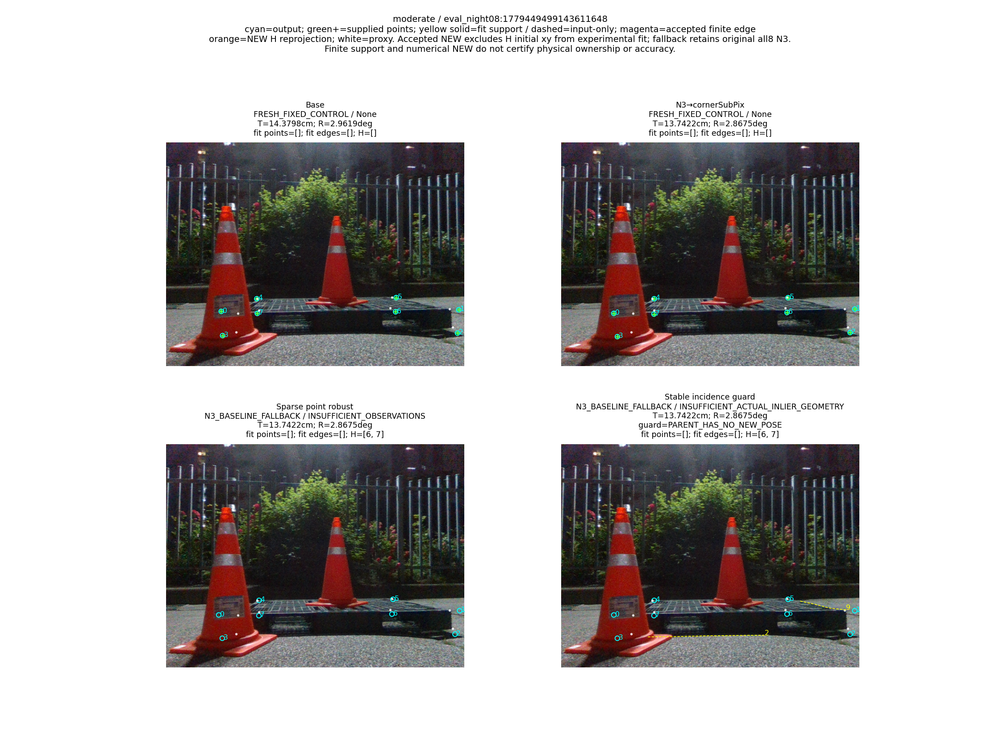
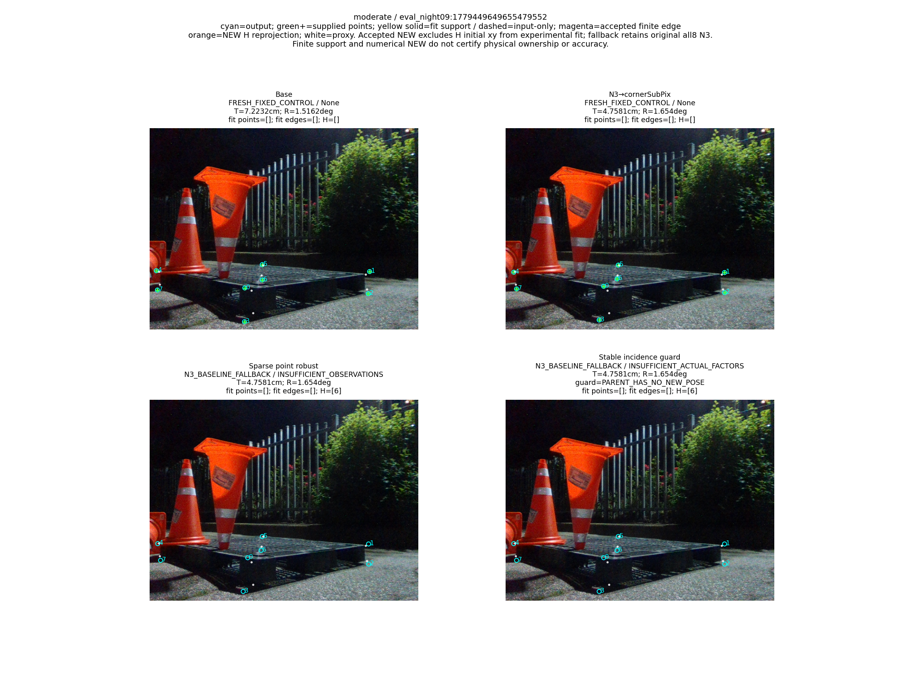

# V14 실제 결과: hinge fit과 안정적 관측 충분성의 분리

“가림 판단이 일부 틀려도 다른 유효 대응점으로 자세를 구하고 자기 가림 코너를 재투영했을 때, 기존 단순 대조보다 실제 위치·회전이 좋아졌는가?”

**아직 아니다.** 쉬움153+중간92의 전체245장에서 STABLE의 위치 평균은 10.529132872230429cm, 회전은 11.934935026928532°이며, 같은 N3→cornerSubPix의 9.754548028679153cm, 10.914841863166323°보다 둘 다 나쁘다. ADDsym 평균도 18.68400203211673cm로 N3의 17.028646667097725cm보다 나쁘다. V13 FINITE보다 평균이 낮아진 것은 관측성이 부족한 두 새 자세를 N3 fallback으로 돌린 결과다. 남은73개 자세를 더 정확한 새 R,t로 보정한 결과가 아니다. 목표는 미해결이다.

수치는 저장된 N3-phase **GEOMETRIC_PROXY known DEV** 자세 기준의 실제 원행 평가다. 독립 물리 실측 자세나 unseen 성능을 인증하지 않는다. 사용자의 변경에 따라 Severe74는 이번 새 평가에서 제외했으며 기존 전체319장 실험은 보존했다. 원행·표·검산이 완료되었다는 사실과 실제 자세 개선 여부를 구분한다.

## 실제 문제가 있었던 부분과 V14의 변경

[V13의 cusp 진단](../pallet_finite_edge_consensus_repair_20261011_v13/CUSP_OBSERVABILITY_DIAGNOSIS_KO.md)과 [METHOD_CONTRACT](METHOD_CONTRACT_KO.md)은 V13 GT 채점 전에 원인을 정했다. 점0개·선2개의 normal 등식은4개인데, 자유로운 edge 방향 위치의 longitudinal hinge를 관측성 등식 행으로 세면서 cusp의 한쪽 미분에 rank6가 의존할 수 있었다. 유한선분 support 제약이 fit에 필요한 것과 안정적인 자세 결정 정보가 충분한 것은 별개다.

[pipeline.py](../../../scripts/research/pallet_stable_incidence_guard_20261011_v14/pipeline.py#L52)는 V13이 이미 승인한 같은 후보의 실제 fit q와 소비되지 않은 선의 endpoint-normal J만으로 관측성을 다시 검사한다. 모든 longitudinal hinge 행은 **관측성 J에서만 제외**한다. 기존 finite optimizer 잔차·실제8px inlier/refit·fullpool 점수에는 남긴다. 관측성의 rank 상대1e−10, column-L2 정규화와 weak 상대1e−4는 기존 값 그대로다. pixel epsilon·threshold·seed를 새로 고르지 않았다.

V13 NEW75개 중73개는 같은 R,t·같은 출력으로 유지하고2개는 거절했다. 기존 V13의170 fallback은 그대로 유지했다. 다른 후보 선택·새 optimizer/refit/PnP는0이다. 승인 NEW의 실험 fit/합의 점수에는 H 초기2D 좌표를 넣지 않으며, 기존 승인 R,t의 H 재투영 출력을 그대로 인수하고 재fit/재할당하지 않는다. fallback172개는 앞서 모든8개 N3 대응으로 계산한 기본 자세와 좌표를 그대로 반환한다. H 제외 경로가 실패한 fallback을 NEW로 세지 않는다. 초기 pose는 시작값이며 residual prior가 아니다.

|요소|실제 확인된 효과|남은 한계|
|---|---|---|
|가림 판단|마스크 오판3장에서도 N3보다 T/R이 함께 낮아졌다. mask가 맞아도 함께 나빠진24장이 있다.|완벽한 mask를 성공 조건으로 쓰지 않는다. 오판 수만으로 frame을 거절하지 않는다.|
|관측 선택/강건 합의|V13의 endpoint LOO·CONTRADICTED 선 제외·UNKNOWN 보존·실제8px inlier를 그대로 쓴다.|유효한 수치 합의가 실제 물리 edge ownership을 증명하지 않는다.|
|관측 충분성 guard|한쪽 hinge 미분으로 충분하다고 보던2개 새 자세를 거절했다.|73개 통과 자세도 N3보다 전체 T/R 평균이 나쁘다. rank/weak 통과는 정확도·전역 유일해의 보증이 아니다.|
|재투영|승인된73개는 기존 승인 R,t의 H 좌표 교체를 유지하고 독립 관측으로 다시 넣지 않는다.|hidden pixel 오차만으로 pose 개선을 대신 주장하지 않는다.|

가림 없는 강건 PnP 대조는 [V7](../pallet_three_head_observation_20261010_v7/RESULT_KO.md), 같은 sparse의 일반/강건·H/무마스크는 [V8](../pallet_same_observation_controls_20261010_v8/RESULT_KO.md)에 있다. 이 대조를 빼고 새 가림 판단기나 학습의 필요성을 주장하지 않는다. V14는 같은 선택 후보의 관측성 절제이며 새로운 대응 모델이나 선 단독 효과 실험이 아니다.

## 전체 운용 결과와 같은 frame 비교

BASE/N3는 고정 대조, POINT=ROLE_BOUNDARY_H_ROBUST, LOCAL=ROLE_BOUNDARY_LOCAL_POINT_LINE, FINITE=FINITE_EDGE_CONSENSUS, STABLE=FINITE_EDGE_CONSENSUS_STABLE_INCIDENCE다. 고정 대조의 NEW0은 실패가 아니다. [METRICS](METRICS.json), [METRICS.csv](METRICS.csv), [새245 score 원행](PREDICTIONS.jsonl.gz), [같은 source cohort](../pallet_kp_corrected_supervision_20261010_v1/COHORT.json)가 수치 근거다.

|stratum|method|denominator|operational|NEW|fallback|no_pose|fixed|평균T cm|평균R °|평균ADD cm|
|---|---|---:|---:|---:|---:|---:|---:|---:|---:|---:|
|combined|BASE|245|245|0|0|0|245|12.188351368308584|14.232844378136992|22.431945806117554|
|combined|N3|245|245|0|0|0|245|9.754548028679153|10.914841863166323|17.028646667097725|
|combined|POINT|245|245|40|205|0|0|10.461849948586346|11.611525122485201|18.328032940838003|
|combined|LOCAL|245|245|115|130|0|0|17.87901676799424|13.415258792985208|26.64545714508252|
|combined|FINITE|245|245|75|170|0|0|11.926597046320317|12.556904694659371|20.112381623955297|
|combined|STABLE|245|245|73|172|0|0|10.529132872230429|11.934935026928532|18.68400203211673|
|easy|BASE|153|153|0|0|0|153|12.846348362759484|10.628204608338502|17.93860487754294|
|easy|N3|153|153|0|0|0|153|10.107072506393136|7.584578376689015|12.915132447282565|
|easy|POINT|153|153|37|116|0|0|11.267164662463289|8.696357041007952|15.024686291366251|
|easy|LOCAL|153|153|76|77|0|0|19.080348190580732|9.337368585359519|23.833929752896903|
|easy|FINITE|153|153|52|101|0|0|10.123410139078349|8.338688342279799|13.162187261009981|
|easy|STABLE|153|153|51|102|0|0|10.134244348693345|7.867103499873267|13.187470284591923|
|medium|BASE|92|92|0|0|0|92|11.094073757971767|20.227517038780135|29.904567132986195|
|medium|N3|92|92|0|0|0|92|9.168284495089601|16.45321483524272|23.86959966309468|
|medium|POINT|92|92|3|89|0|0|9.122576565725781|16.45957638842019|23.8216420426769|
|medium|LOCAL|92|92|39|53|0|0|15.881150380431924|20.196967507840974|31.321149438608597|
|medium|FINITE|92|92|23|69|0|0|14.925375272494454|19.57198188937757|31.67085703189697|
|medium|STABLE|92|92|22|70|0|0|11.185849655938851|18.699915718661742|27.824973307891685|

전체245장을 모두 남겼으며 산출 실패로 큰 오차 영상을 평균에서 빼지 않았다. STABLE 최대 위치 오차174.7568271983788cm·회전89.85477655741667°·ADD180.98844156077627cm도 남는다. 아래에는 전체 operational, NEW만, fallback만의 각 평균·표본 분산·표본 표준편차·중앙값·P90·최대를 모두 전사했다. 분산/표준편차는 ddof=1이며 n<2는 None이다.

|stratum|method|population|n|T: 평균/분산/SD/중앙/P90/max cm|R: 같은 순서 degree|ADD: 같은 순서 cm|
|---|---|---|---:|---|---|---|
|combined|BASE|operational|245|12.188351368308584 538.5790668295168 23.207306324291856 6.010803220063387 23.191871672208148 183.07850477473974|14.232844378136992 851.3841553068099 29.178487885886238 1.839738412238616 82.81063875160255 90.00917492050102|22.431945806117554 1506.0022047443758 38.80724423022557 6.405062242563096 110.03653211262429 188.9915223699912|
|combined|BASE|new_pose|0|None None None None None None|None None None None None None|None None None None None None|
|combined|BASE|fallback|0|None None None None None None|None None None None None None|None None None None None None|
|combined|N3|operational|245|9.754548028679153 575.9360241353828 23.99866713247598 3.5973495042103814 15.085014302122275 174.7568271983788|10.914841863166323 665.1806009914171 25.79109538176727 1.6659926895050734 76.09532476401336 89.77763362360415|17.028646667097725 1298.8108704540255 36.039018722129846 3.9369354820060027 68.43149389306842 180.98844156077627|
|combined|N3|new_pose|0|None None None None None None|None None None None None None|None None None None None None|
|combined|N3|fallback|0|None None None None None None|None None None None None None|None None None None None None|
|combined|POINT|operational|245|10.461849948586346 587.3004341635357 24.234282208547786 4.176239832740652 17.382818033885187 174.7568271983788|11.611525122485201 711.8960908470923 26.681380977136328 1.6333214559488682 81.44737750526065 89.77763362360415|18.328032940838003 1379.54602789238 37.1422404802454 4.3464356418875205 71.971884900335 180.98844156077627|
|combined|POINT|new_pose|40|7.8406135004065005 149.39243027499649 12.222619615900532 4.198278192453509 15.787048160094342 75.86896691888866|5.390289662485843 362.9082709035157 19.05015146668172 0.9151553823740605 2.1612146562459174 88.84530231206573|11.71716153263252 705.5824343702529 26.56280170407958 4.331863071141569 15.848203453156412 131.2087137441212|
|combined|POINT|fallback|205|10.9733107189629 672.2869585782458 25.928497036624506 3.933521588275837 19.076598223013658 174.7568271983788|12.825424724436296 773.0342870860874 27.803494152463777 1.8738873917606569 81.87094598353711 89.77763362360415|19.617959069268338 1504.913086293246 38.79320928066207 4.3464356418875205 79.60585489521766 180.98844156077627|
|combined|LOCAL|operational|245|17.87901676799424 6371.130065221301 79.81935896273097 5.361944784094475 31.280809407982254 1204.8027435564068|13.415258792985208 774.2282019646461 27.824956459348613 1.8176433605042994 83.64724240084382 92.76801898557402|26.64545714508252 7133.570379790449 84.46046637208705 5.503800245804545 83.41437218959408 1206.0840052680007|
|combined|LOCAL|new_pose|115|28.38685794476606 12963.771720476745 113.85856015459156 8.964660636086656 44.52747564179746 1204.8027435564068|16.46926575311549 918.3190135840935 30.303778866406965 2.2344144729398563 84.77716309280791 92.76801898557402|39.27656413349201 13771.678486970253 117.35279496871922 8.997940526274286 116.76622273618204 1206.0840052680007|
|combined|LOCAL|fallback|130|8.583618803926868 408.95729640874407 20.22269261025208 3.114981817036182 14.510347480565105 167.92537200948746|10.713637251331493 637.2238359518152 25.24329289042567 1.6917143454203178 31.16810907943069 88.90488273671434|15.471785578412593 1054.5856132273725 32.474383954547505 3.6041734472556897 67.11097831904885 175.19609981909667|
|combined|FINITE|operational|245|11.926597046320317 978.6819779308247 31.283893266836607 4.289797824008631 23.882818690412755 358.5410239761371|12.556904694659371 789.9452895787331 28.105965373541842 1.7592677191829955 81.4592279688051 155.97455229874154|20.112381623955297 1778.1131105973336 42.167678506141804 4.676131762947054 71.971884900335 368.7723678588993|
|combined|FINITE|new_pose|75|15.336953449568043 1780.9076513164048 42.200801548269254 5.084220729411225 29.032512628021706 358.5410239761371|14.90514678475239 1003.4082122402583 31.676619330986984 1.7864553751512142 83.21869594142558 155.97455229874154|24.8331199331368 2694.2449846904606 51.90611702574621 5.843306115572545 76.09210080430474 368.7723678588993|
|combined|FINITE|fallback|170|10.422028044887497 625.763981469272 25.01527496289561 3.927996679975709 19.997065245138916 174.7568271983788|11.52091553726539 697.6237774087869 26.412568550006394 1.7361783603010013 77.5956755802978 89.76763723821307|18.02970295813993 1373.2348152817458 37.05718304568961 4.320765166155739 71.76995718231605 180.98844156077627|
|combined|STABLE|operational|245|10.529132872230429 484.3925283564288 22.008919290969942 4.289797824008631 23.853368129758834 174.7568271983788|11.934935026928532 705.5163459132011 26.561557671062914 1.7592677191829955 79.55212757973612 89.85477655741667|18.68400203211673 1279.389658218392 35.76855683723334 4.676131762947054 70.71418838584906 180.98844156077627|
|combined|STABLE|new_pose|73|10.665704454950596 172.22747258886153 13.123546494330773 5.0524242865889395 27.477160440640574 58.808570451534315|12.0271163621272 680.309249760572 26.082738540279315 1.7166125837978385 64.89852254612617 89.85477655741667|19.595740713686343 1077.8301885702924 32.83032422274097 5.327351682116227 63.41346772739715 121.26173934829643|
|combined|STABLE|fallback|172|10.471169351657338 618.6518095379134 24.872712146806858 3.967202394543679 19.736844193057138 174.7568271983788|11.895811553268633 720.250519525264 26.837483479739006 1.765474046544484 80.72599877939918 89.76763723821307|18.297043173078464 1371.2331328364685 37.03016517430713 4.338557332457684 71.47572582549648 180.98844156077627|
|easy|BASE|operational|153|12.846348362759484 790.4514324808421 28.114968121640153 4.668213987688899 19.836603231600556 183.07850477473974|10.628204608338502 616.6247942414432 24.83193094065468 1.715555635657884 50.873618630439076 89.4792849588053|17.93860487754294 1268.8858821312092 35.621424482061485 5.5161632734927135 53.33233728654386 188.9915223699912|
|easy|BASE|new_pose|0|None None None None None None|None None None None None None|None None None None None None|
|easy|BASE|fallback|0|None None None None None None|None None None None None None|None None None None None None|
|easy|N3|operational|153|10.107072506393136 859.7174702467877 29.320939109223424 2.6918845473520725 12.762645595341315 174.7568271983788|7.584578376689015 435.5445806846465 20.86970485379816 1.5416520299079417 5.923153455782191 89.76763723821307|12.915132447282565 1130.5845067555638 33.624165517608965 2.966195228583507 14.83116901630595 180.98844156077627|
|easy|N3|new_pose|0|None None None None None None|None None None None None None|None None None None None None|
|easy|N3|fallback|0|None None None None None None|None None None None None None|None None None None None None|
|easy|POINT|operational|153|11.267164662463289 882.6015432595791 29.70861059120031 3.184987415108408 14.525877097511145 174.7568271983788|8.696357041007952 517.599211831631 22.75080683913498 1.5319427498538003 7.363037795221227 89.76763723821307|15.024686291366251 1281.4567014655306 35.79743987306258 3.477928934480887 16.753890137882244 180.98844156077627|
|easy|POINT|new_pose|37|7.333612288238735 157.0024256679746 12.530060880457627 4.176239832740652 11.514123731860055 75.86896691888866|5.711039849322413 391.7191175270057 19.791895248485066 0.8717732935875406 2.145232517619408 88.84530231206573|11.520274817937006 762.5266668730836 27.613885399796306 4.239943742118908 11.58355229665832 131.2087137441212|
|easy|POINT|fallback|116|12.521832230103877 1110.8543153148435 33.32948117380232 2.9160664238545344 14.676581564814143 174.7568271983788|9.648570283183513 557.7240452821483 23.616181852326346 1.7613914001344706 11.730521185282882 89.76763723821307|16.142472709615234 1449.8359089768653 38.07671084766731 3.371502582008442 30.317303469199743 180.98844156077627|
|easy|LOCAL|operational|153|19.080348190580732 10015.419249959697 100.07706655353012 3.704090012694558 22.207926220214617 1204.8027435564068|9.337368585359519 520.04302572518 22.804451883901528 1.5840007670291094 18.030169712372505 89.19567638483429|23.833929752896903 10398.642701755147 101.9737353525659 4.153854029403211 45.61063819304124 1206.0840052680007|
|easy|LOCAL|new_pose|76|29.554358160880437 19444.408601912823 139.44320923556236 6.702009155482294 35.0238931724154 1204.8027435564068|10.757826115848916 602.948353649056 24.555006692099596 1.6066306586686239 20.578097485997645 89.19567638483429|35.85262994032487 19871.913594301826 140.9677750207537 7.1624744390197925 59.3030657627982 1206.0840052680007|
|easy|LOCAL|fallback|77|8.742364323791413 624.2923486592016 24.98584296475109 2.4978545868963478 13.37683866765037 167.92537200948746|7.9353585552660855 441.0620334693783 21.001476935429526 1.5840007670291094 7.00182017006499 88.12951624655447|11.971316580890093 899.8220111528459 29.99703337253279 2.92808114470051 14.58326558549212 175.19609981909667|
|easy|FINITE|operational|153|10.123410139078349 699.0964035378871 26.440431228289132 3.184987415108408 14.525877097511145 174.7568271983788|8.338688342279799 539.1199916920323 23.218957592709287 1.5416520299079417 8.298722266932497 155.97455229874154|13.162187261009981 969.846453341516 31.14235786419384 3.6361720283519916 19.271815493988004 180.98844156077627|
|easy|FINITE|new_pose|52|7.993440548166952 149.3916130753019 12.222586186045158 4.156922034050405 16.407252374575357 58.808570451534315|8.779960375513877 685.3406705471097 26.17901202389253 1.4737980415850345 12.290086423191054 155.97455229874154|11.111921046012197 434.525438130837 20.8452737600358 4.420776899059836 19.515518297429868 114.21176975526856|
|easy|FINITE|fallback|101|11.220028146280256 982.8630933066601 31.350647414473915 2.81709661027893 14.383507373709312 174.7568271983788|8.111498780614728 469.7852592211607 21.674530196088696 1.5694925585083699 5.684191130534222 89.76763723821307|14.217769866751413 1249.2473708412303 35.344693673042784 3.036911512338055 16.872945803182855 180.98844156077627|
|easy|STABLE|operational|153|10.134244348693345 699.1800278903338 26.442012553705776 3.184987415108408 14.745648786625669 174.7568271983788|7.867103499873267 432.98424680341554 20.808273518084473 1.5416520299079417 8.298722266932497 89.76763723821307|13.187470284591923 972.4922642958596 31.184808229262202 3.6361720283519916 19.271815493988004 180.98844156077627|
|easy|STABLE|new_pose|51|7.8926440975413525 151.84056294351748 12.322360282978154 4.133976018438608 16.770940468409005 58.808570451534315|5.893791906430985 257.2259583285745 16.03826544014578 1.4558053460607492 8.708510469976485 87.4508730206245|10.090143909125038 387.8406743270931 19.693670920554478 4.227952731093996 17.322193066452822 114.21176975526856|
|easy|STABLE|fallback|102|11.255044474269338 973.256842160184 31.197064640125742 2.859373890043633 14.543673312986373 174.7568271983788|8.85375929659441 521.3308887263582 22.83267151969647 1.5767466627687396 6.544961403471305 89.76763723821307|14.736133472325363 1264.2860694048468 35.55680060698441 3.2372155434655987 24.223884861557114 180.98844156077627|
|medium|BASE|operational|92|11.094073757971767 121.84908661025794 11.038527375073993 7.851389680650634 26.036088792108245 60.431861873972714|20.227517038780135 1194.6884557987921 34.564265590328866 1.9987798847057285 86.1592126325831 90.00917492050102|29.904567132986195 1828.2143982088248 42.757623860649986 8.14224175976533 116.22280336782391 121.23894804412103|
|medium|BASE|new_pose|0|None None None None None None|None None None None None None|None None None None None None|
|medium|BASE|fallback|0|None None None None None None|None None None None None None|None None None None None None|
|medium|N3|operational|92|9.168284495089601 107.69999682699179 10.377860898421783 5.220474363250011 23.637317402450154 61.92360473915919|16.45321483524272 1006.4005633341411 31.723816972964354 1.981300412332817 85.51015694788309 89.77763362360415|23.86959966309468 1518.31450323667 38.96555534361944 5.436086461145542 112.13137378003826 121.34476566792532|
|medium|N3|new_pose|0|None None None None None None|None None None None None None|None None None None None None|
|medium|N3|fallback|0|None None None None None None|None None None None None None|None None None None None None|
|medium|POINT|operational|92|9.122576565725781 97.60032860408691 9.879287859157001 5.3906640255800795 21.910030971177253 61.92360473915919|16.45957638842019 1006.2088935479889 31.72079591605464 2.0263434498509794 85.51015694788309 89.77763362360415|23.8216420426769 1509.6892841105898 38.85472022947263 5.57461113208822 112.13137378003826 121.34476566792532|
|medium|POINT|new_pose|3|14.093628450475592 23.70300515112484 4.868573215134475 15.735608179346922 17.49025552883261 17.928917366204033|1.434370691501493 0.38993215137805937 0.6244454751041594 1.3718001223174878 1.9445567257241172 2.0877458765757746|14.14543101387722 23.815586493273646 4.88012156541962 15.800485228320483 17.546330836904467 17.982792239050465|
|medium|POINT|fallback|89|8.95501301904882 99.51807864651663 9.9758748311372 5.2413619383596055 22.427971155559224 61.92360473915919|16.966043996181494 1032.5469282943604 32.133268247944535 2.043990600654579 85.78982410123665 89.77763362360415|24.14780645937801 1557.315209025878 39.46283326151175 5.460732046702568 112.70867171184092 121.34476566792532|
|medium|LOCAL|operational|92|15.881150380431924 347.51632418784794 18.641789725985216 8.861720450912603 36.990924955641596 81.81758585102403|20.196967507840974 1132.8533054628865 33.65788622987021 2.4130814960069937 85.98056702319597 92.76801898557402|31.321149438608597 1722.8214499639603 41.50688436830642 8.990367871409887 116.91087117225864 126.88147329691115|
|medium|LOCAL|new_pose|39|26.111729318491886 506.1543809778471 22.497875032496893 20.288142920262302 61.87857232614424 81.81758585102403|27.59925068727599 1372.549835701734 37.04793969577437 3.624330415489985 87.01922661289221 92.76801898557402|45.94884615094592 2025.015807083683 45.0001756339204 27.02333982113271 119.9461307888489 126.88147329691115|
|medium|LOCAL|fallback|53|8.352988520350072 102.0098700091247 10.099993564806104 5.431215734498538 17.255508137387515 61.92360473915919|14.750004413539731 908.1407772614893 30.135374184859383 2.1267952113444473 82.91756694518398 88.90488273671434|20.55737261254905 1256.5542132995984 35.4479084474613 5.842834946270226 83.10254656766051 118.7610894834284|
|medium|FINITE|operational|92|14.925375272494454 1441.8785346895415 37.97207572268787 6.968405679661902 26.48111857634854 358.5410239761371|19.57198188937757 1137.9185621176975 33.73304851503489 2.1816048286278367 85.60810464768034 89.85477655741667|31.67085703189697 2931.441688734417 54.142789812997414 7.127330832033114 117.0098311067468 368.7723678588993|
|medium|FINITE|new_pose|23|31.939678270127025 5228.364528941342 72.30743066200971 16.0486791268118 39.55622135889514 358.5410239761371|28.753394318682947 1497.1864176764261 38.69349322142453 3.8931749401986497 85.14383136962834 89.85477655741667|55.854960895331565 6604.048536177034 81.26529724413142 19.490642687027552 119.1859689145844 368.7723678588993|
|medium|FINITE|fallback|69|9.253940939950269 107.49030618898773 10.367753189046686 5.361944784094475 23.824510144590274 61.92360473915919|16.511511079609114 1000.4020448302106 31.629132849798626 2.0445657190827276 85.78982410123665 89.24640958476445|23.60948907741878 1522.5894936592736 39.02037280266904 5.503800245804545 108.40274213123146 121.34476566792532|
|medium|STABLE|operational|92|11.185849655938851 130.25139394470594 11.412773280176292 6.968405679661902 25.47180764141698 61.92360473915919|18.699915718661742 1094.3986424500276 33.081696486879686 2.1816048286278367 85.60810464768034 89.85477655741667|27.824973307891685 1670.7973727614533 40.87538834997722 7.127330832033114 116.57392997450592 121.34476566792532|
|medium|STABLE|new_pose|22|17.094162556217476 167.0007242795345 12.922876006506234 15.719615278156482 30.828692923689516 46.81144825213606|26.245277600332063 1416.906312171836 37.641816005233274 3.8869878733376355 85.16596163109497 89.85477655741667|41.631442396987545 2043.8560804138792 45.20902653689724 19.052532550602862 117.02491586665015 121.26173934829643|
|medium|STABLE|fallback|70|9.32895131585128 106.32633461900642 10.311466172131217 5.3906640255800795 23.81729564829813 61.92360473915919|16.32851627013678 988.2475614909199 31.436405034464737 2.064073513475077 85.72229841640953 89.24640958476445|23.485797308461557 1501.5939550179583 38.750405869073916 5.57461113208822 107.87008046711621 121.34476566792532|

## 공통 산출집합의 paired 차이와 CI

각 셀은 평균차;95% CI다. 앞 STABLE−뒤 대조이며 음수일 때 오차가 낮다. 기존13세션10,000개 session-bootstrap draw를 그대로 재사용했다. common_operational은 두 방법 모두 pose를 반환한 frame, candidate_new_pose는 그 중 STABLE이 NEW인 frame, both_new_pose는 둘 모두 NEW인 frame이다. 같은 frame끼리 비교하며 empty resample/None을 성공 결과로 채우지 않는다.

|stratum|contrast|scope|전체분모|paired n|STABLE NEW|대조 NEW|비어 있지 않은 resample|빈 resample|T Δ;CI cm|R Δ;CI °|ADD Δ;CI cm|
|---|---|---|---:|---:|---:|---:|---:|---:|---|---|---|
|combined|STABLE−N3|common_operational|245|245|73|0|10000|0|0.7745848435512772; [-1.0905318616088004, 2.5305633397829297]|1.0200931637622077; [0.20953515355758479, 2.600454512141166]|1.6553553650190076; [-0.2297668761090688, 4.313232316326005]|
|combined|STABLE−N3|candidate_new_pose|245|73|73|0|10000|0|2.5996340639734647; [-4.011556649996236, 8.024904670377882]|3.423600344133437; [0.7262304005901705, 8.522360846991742]|5.555644718214477; [-0.8490670821460797, 13.93350600637394]|
|combined|STABLE−N3|both_new_pose|245|0|0|0|0|10000|None; None|None; None|None; None|
|combined|STABLE−FINITE|common_operational|245|245|73|75|10000|0|-1.3974641740898857; [-4.860619981595537, 0.019503496753574837]|-0.6219696677308402; [-1.6563607665611877, 0.0]|-1.4283795918385667; [-4.98865851517651, 0.045513921723325315]|
|combined|STABLE−FINITE|candidate_new_pose|245|73|73|73|10000|0|0.0; [0.0, 0.0]|0.0; [0.0, 0.0]|0.0; [0.0, 0.0]|
|combined|STABLE−FINITE|both_new_pose|245|73|73|73|10000|0|0.0; [0.0, 0.0]|0.0; [0.0, 0.0]|0.0; [0.0, 0.0]|
|combined|STABLE−POINT|common_operational|245|245|73|40|10000|0|0.06728292364408496; [-1.2188828265384577, 1.8897565225364146]|0.32340990444333134; [-1.2671979472920665, 2.483706564758698]|0.3559690912787291; [-1.7967154432815917, 3.795260526517729]|
|combined|STABLE−POINT|candidate_new_pose|245|73|73|28|10000|0|2.191143246147272; [-3.3973158372429997, 6.641748745862891]|3.4230636083070345; [0.7203937239908819, 8.54945225235883]|5.179325240559932; [-0.44755598727760487, 13.285825669230531]|
|combined|STABLE−POINT|both_new_pose|245|28|28|28|9997|3|0.06982087225024323; [-0.2254518273121959, 0.25913127681778736]|-4.506570666776586e-05; [-0.02916983047291759, 0.04721799487915884]|0.07974664871539974; [-0.18991999255312034, 0.2593066539958425]|
|easy|STABLE−N3|common_operational|153|153|51|0|10000|0|0.027171842300208762; [-1.5235254663993316, 1.6223789896227592]|0.28252512318425377; [-0.053106176880699234, 0.6850659746577986]|0.27233783730935784; [-1.1235769483810227, 1.7283485517741743]|
|easy|STABLE−N3|candidate_new_pose|153|51|51|0|10000|0|0.08151552690062629; [-5.4778726995891684, 3.933316561666008]|0.8475753695527612; [-0.18027376603269, 1.6993883168620412]|0.8170135119280735; [-4.108674408094222, 4.1005822659466284]|
|easy|STABLE−N3|both_new_pose|153|0|0|0|0|10000|None; None|None; None|None; None|
|easy|STABLE−FINITE|common_operational|153|153|51|52|10000|0|0.010834209614994183; [0.0, 0.03711121054688306]|-0.47158484240653153; [-1.6153540497358059, 0.0]|0.025283023581941073; [0.0, 0.08660378973217128]|
|easy|STABLE−FINITE|candidate_new_pose|153|51|51|51|10000|0|0.0; [0.0, 0.0]|0.0; [0.0, 0.0]|0.0; [0.0, 0.0]|
|easy|STABLE−FINITE|both_new_pose|153|51|51|51|10000|0|0.0; [0.0, 0.0]|0.0; [0.0, 0.0]|0.0; [0.0, 0.0]|
|easy|STABLE−POINT|common_operational|153|153|51|37|10000|0|-1.1329203137699446; [-2.7094382540901556, 1.2260705483234111]|-0.8292535411346839; [-3.003606817574138, 0.6990822686784741]|-1.8372160067743288; [-5.008382136440636, 1.4394021139055766]|
|easy|STABLE−POINT|candidate_new_pose|153|51|51|26|10000|0|-0.8539923897469603; [-6.074038054232051, 3.0170439755547807]|0.8582012492462967; [-0.17326630692584025, 1.700707661070873]|-0.07214367403435673; [-4.650460303931892, 3.3630401724482724]|
|easy|STABLE−POINT|both_new_pose|153|26|26|26|9997|3|0.07857232109173037; [-0.21419167055314478, 0.2631052499537729]|-0.000687166588402048; [-0.031083838897760476, 0.05110020789043962]|0.08921054042834031; [-0.17187208597632292, 0.2624242476028395]|
|medium|STABLE−N3|common_operational|92|92|22|0|10000|0|2.01756516084925; [-0.6947596688523003, 4.3125789183111145]|2.2467008834190225; [0.2376825152918956, 5.50359077676863]|3.9553736447970116; [0.6379527905266588, 8.387142982559473]|
|medium|STABLE−N3|candidate_new_pose|92|22|22|0|10000|0|8.437090672642318; [-3.248760807791007, 18.10932725713241]|9.395294603388638; [1.068372182708688, 23.382298909093407]|16.540653423696593; [2.876062485959763, 34.976012144224576]|
|medium|STABLE−N3|both_new_pose|92|0|0|0|0|10000|None; None|None; None|None; None|
|medium|STABLE−FINITE|common_operational|92|92|22|23|10000|0|-3.7395256165556092; [-12.287012740111287, 0.0]|-0.8720661707158319; [-2.865360275209162, 0.0]|-3.8458837240052803; [-12.636475093160206, 0.0]|
|medium|STABLE−FINITE|candidate_new_pose|92|22|22|22|10000|0|0.0; [0.0, 0.0]|0.0; [0.0, 0.0]|0.0; [0.0, 0.0]|
|medium|STABLE−FINITE|both_new_pose|92|22|22|22|10000|0|0.0; [0.0, 0.0]|0.0; [0.0, 0.0]|0.0; [0.0, 0.0]|
|medium|STABLE−POINT|common_operational|92|92|22|3|10000|0|2.0632730902130687; [0.016848038815460764, 3.773503065695108]|2.2403393302415524; [0.23217156016206975, 5.500875069236225]|4.0033312652147925; [1.039406871158208, 8.22101321579195]|
|medium|STABLE−POINT|candidate_new_pose|92|22|22|2|10000|0|9.250321311174812; [0.21518879961685616, 17.373481126124304]|9.368880895220563; [1.0456461084347686, 23.362462712148982]|17.35318499711942; [5.173094624594175, 35.07366438439473]|
|medium|STABLE−POINT|both_new_pose|92|2|2|2|8817|1183|-0.043947962689089515; [-0.34505674984575485, 0.2571608244675758]|0.008302245755877902; [-0.003601061120137583, 0.020205552631893386]|-0.04328394355282761; [-0.34458854861316013, 0.2580206615075049]|

전체 STABLE−N3 위치 Δ0.7745848435512772cm의 CI는[−1.0905318616088004,2.5305633397829297], 회전 Δ1.0200931637622077°의 CI는[0.20953515355758479,2.600454512141166]이다. 전체 두 평균 개선 판정은 False다. STABLE−FINITE 차이는 거절한2개 frame의 N3 복귀 효과이며, 나머지 같은 자세73개를 보정해 얻은 차이라고 해석하지 않는다.

## 가림 오판과 코너 손상

사람 visibility의 UNKNOWN/UNANNOTATED는 known으로 취급하지 않는다. mask 그룹은 H 제외를 시도한 실험 계약과 기록된 실제 N3 대비 pose outcome을 조인한 진단이며, fallback 기본 pose를 H 제외 조건으로 새로 fit했다는 뜻이 아니다. 원행별 IDs는 [POSTHOC_ROWS](POSTHOC_ROWS.jsonl.gz)와 METRICS의 각 group에 있다.

|stratum|mask|pose vs N3|n|NEW|fallback|
|---|---|---|---:|---:|---:|
|combined|WRONG_ON_KNOWN|BOTH_BETTER|3|3|0|
|combined|WRONG_ON_KNOWN|BOTH_WORSE|12|12|0|
|combined|WRONG_ON_KNOWN|MIXED_OR_UNCHANGED|46|6|40|
|combined|WRONG_ON_KNOWN|POSE_UNAVAILABLE|0|0|0|
|combined|MATCHES_ON_KNOWN|BOTH_BETTER|9|9|0|
|combined|MATCHES_ON_KNOWN|BOTH_WORSE|24|24|0|
|combined|MATCHES_ON_KNOWN|MIXED_OR_UNCHANGED|151|19|132|
|combined|MATCHES_ON_KNOWN|POSE_UNAVAILABLE|0|0|0|
|combined|MASK_NOT_APPLIED|BOTH_BETTER|0|0|0|
|combined|MASK_NOT_APPLIED|BOTH_WORSE|0|0|0|
|combined|MASK_NOT_APPLIED|MIXED_OR_UNCHANGED|0|0|0|
|combined|MASK_NOT_APPLIED|POSE_UNAVAILABLE|0|0|0|
|combined|NO_KNOWN_VISIBILITY|BOTH_BETTER|0|0|0|
|combined|NO_KNOWN_VISIBILITY|BOTH_WORSE|0|0|0|
|combined|NO_KNOWN_VISIBILITY|MIXED_OR_UNCHANGED|0|0|0|
|combined|NO_KNOWN_VISIBILITY|POSE_UNAVAILABLE|0|0|0|
|easy|WRONG_ON_KNOWN|BOTH_BETTER|2|2|0|
|easy|WRONG_ON_KNOWN|BOTH_WORSE|10|10|0|
|easy|WRONG_ON_KNOWN|MIXED_OR_UNCHANGED|22|5|17|
|easy|WRONG_ON_KNOWN|POSE_UNAVAILABLE|0|0|0|
|easy|MATCHES_ON_KNOWN|BOTH_BETTER|7|7|0|
|easy|MATCHES_ON_KNOWN|BOTH_WORSE|13|13|0|
|easy|MATCHES_ON_KNOWN|MIXED_OR_UNCHANGED|99|14|85|
|easy|MATCHES_ON_KNOWN|POSE_UNAVAILABLE|0|0|0|
|easy|MASK_NOT_APPLIED|BOTH_BETTER|0|0|0|
|easy|MASK_NOT_APPLIED|BOTH_WORSE|0|0|0|
|easy|MASK_NOT_APPLIED|MIXED_OR_UNCHANGED|0|0|0|
|easy|MASK_NOT_APPLIED|POSE_UNAVAILABLE|0|0|0|
|easy|NO_KNOWN_VISIBILITY|BOTH_BETTER|0|0|0|
|easy|NO_KNOWN_VISIBILITY|BOTH_WORSE|0|0|0|
|easy|NO_KNOWN_VISIBILITY|MIXED_OR_UNCHANGED|0|0|0|
|easy|NO_KNOWN_VISIBILITY|POSE_UNAVAILABLE|0|0|0|
|medium|WRONG_ON_KNOWN|BOTH_BETTER|1|1|0|
|medium|WRONG_ON_KNOWN|BOTH_WORSE|2|2|0|
|medium|WRONG_ON_KNOWN|MIXED_OR_UNCHANGED|24|1|23|
|medium|WRONG_ON_KNOWN|POSE_UNAVAILABLE|0|0|0|
|medium|MATCHES_ON_KNOWN|BOTH_BETTER|2|2|0|
|medium|MATCHES_ON_KNOWN|BOTH_WORSE|11|11|0|
|medium|MATCHES_ON_KNOWN|MIXED_OR_UNCHANGED|52|5|47|
|medium|MATCHES_ON_KNOWN|POSE_UNAVAILABLE|0|0|0|
|medium|MASK_NOT_APPLIED|BOTH_BETTER|0|0|0|
|medium|MASK_NOT_APPLIED|BOTH_WORSE|0|0|0|
|medium|MASK_NOT_APPLIED|MIXED_OR_UNCHANGED|0|0|0|
|medium|MASK_NOT_APPLIED|POSE_UNAVAILABLE|0|0|0|
|medium|NO_KNOWN_VISIBILITY|BOTH_BETTER|0|0|0|
|medium|NO_KNOWN_VISIBILITY|BOTH_WORSE|0|0|0|
|medium|NO_KNOWN_VISIBILITY|MIXED_OR_UNCHANGED|0|0|0|
|medium|NO_KNOWN_VISIBILITY|POSE_UNAVAILABLE|0|0|0|

WRONG인데 BOTH_BETTER3장, MATCH인데 BOTH_WORSE24장을 분리한다. mask 정확성과 실제 자세 정확도를 같은 성공 조건으로 묶지 않는다. 아래 pixel 오차는 같은 proxy corner 기준이며, input n과 output n이 다른 집합을 단순 paired 개선으로 읽지 않는다. DIRECT_VISIBLE 손상은 N3 오차≤5px에서 output>10px가 된 점이다. ACTUALLY_REPROJECTED는 실제 예측 H가 재투영된 집합이며 사람 SELF_OCCLUDED 전체와 구분한다.

|stratum|corner group|corners|직접 손상|N3 n;평균/분산/SD/중앙/P90/max px|input: 같은 순서|output: 같은 순서|
|---|---|---:|---:|---|---|---|
|combined|DIRECT_VISIBLE|1503|3|1503; 19.853023651037 3580.8329182598645 59.84006114853046 4.4280440607544715 21.434210641657124 498.8323321808732|438; 11.426930345210229 1465.9060246732006 38.28715221419844 3.5898567784249114 13.044645675587315 366.09397007771366|1503; 19.927155305413937 3570.4401337418567 59.75316003143145 4.477874407175581 21.434210641657124 498.8323321808732|
|combined|SELF_OCCLUDED|335|0|335; 19.65428204564917 2632.328826817118 51.30622600442482 7.06713621098236 26.523561830776252 470.4854786473229|0; None None None None None None|335; 20.173417500693038 2691.956649928285 51.88406932699367 6.526619780150418 27.40554300839994 470.4854786473229|
|combined|ACTUALLY_REPROJECTED|98|0|98; 10.194746339209916 601.1206480339465 24.51776188876029 5.42781100575058 13.691469178274316 233.23322152800213|0; None None None None None None|98; 11.583485402807424 702.0607260483815 26.496428552700863 3.8454680040094105 20.77815227372726 201.06837779067172|
|easy|DIRECT_VISIBLE|1000|2|1000; 14.523580965933517 2532.2121215206134 50.32109022587461 4.150628867564405 13.752123318850076 445.23623618558383|337; 7.594663825812957 618.4035230290601 24.867720503276132 3.499034596243577 11.487938513202382 337.0879908815907|1000; 14.632300933615799 2531.275313139749 50.31178105712169 4.227249427692742 14.769580487637521 445.23623618558383|
|easy|SELF_OCCLUDED|222|0|222; 13.997933839192722 1417.1901186420587 37.645585646155894 6.16068742193906 18.463458149490716 371.04296039790614|0; None None None None None None|222; 14.176167250687671 1491.4313219595413 38.61905387188481 5.17159604349856 19.34035875274688 371.04296039790614|
|easy|ACTUALLY_REPROJECTED|73|0|73; 7.497546563651754 94.52444942154635 9.722368508832934 4.551296750342228 13.102865015109032 65.2007913022628|0; None None None None None None|73; 8.039571458882962 329.348390686144 18.14795830627082 3.4143969718517506 15.166194890200368 135.6374062968746|
|medium|DIRECT_VISIBLE|503|1|503; 30.448337140308336 5505.699319764235 74.20039972779281 5.364837354146124 101.99757931314895 498.8323321808732|101; 24.213799820822903 4113.541700450939 64.13689811996632 4.333304443672908 57.495582108862834 366.09397007771366|503; 30.45370475232872 5478.655406127815 74.01793975873562 5.4432051058132105 101.99757931314895 498.8323321808732|
|medium|SELF_OCCLUDED|113|0|113; 30.766753743289268 4865.554007166791 69.75352325988122 8.426180916963826 84.99358277665483 470.4854786473229|0; None None None None None None|113; 31.955625956455794 4873.534047318432 69.81070152432528 8.425600454253365 84.99358277665483 470.4854786473229|
|medium|ACTUALLY_REPROJECTED|25|0|25; 18.07056968383975 2059.21503929622 45.378574672373965 7.524381721571761 22.819571067413897 233.23322152800213|0; None None None None None None|25; 21.931714119066847 1699.7012315470186 41.22743299730191 7.275752269689408 48.26921749055342 201.06837779067172|

combined의 직접 가시1503점 중 손상3점, 숨은 집합 변경5frame을 기록했다. 실제 재투영98점의 output 평균11.583485402807424px는 같은 N3 평균10.194746339209916px보다 높지만 median3.8454680040094105px는 N3의5.42781100575058px보다 낮다. 이런 서로 다른 통계나 숨은 점만의 개선을 전체 T/R 개선으로 대신 말하지 않는다.

## 실제 실행·검산과 보존한 첫 실패

|블록|실제 완료/원 기록|수정 또는 제한|
|---|---|---|
|245 geometry|[CONTROL_RECEIPT](CONTROL_RECEIPT.json)/[GEOMETRY_SEAL](GEOMETRY_SEAL.json):245 geometry+245 ledger, parent NEW75/accept73/no-op170. cleanup 완료 후 봉인.|새 optimizer/PnP0. 실제 projection150, SVD346entry/346return/0exception. replay wall은 latency가 아니다.|
|독립 geometry|[VALIDATION_CHECKS](VALIDATION_CHECKS.json):42715검사/0FAIL/245frame, 최대 차이7.531752999057062e−13.|독립 scalar projection/incidence J와 저장 spectrum recount다. 새 SVD·PnP·GT0, physical ownership·전역 유일해 인증이 아니다.|
|CPU 첫 실행|[CPU_CHECKS](CPU_CHECKS.json):7test/3error, 모두 KeyError PALLET_SOURCE_ROOT.|[환경 review](REVIEW_CPU_CHECKS.json)는0test/relative-import ImportError였다. 두 실패를 보존했다.|
|CPU package review|[PACKAGE_CPU_CHECKS](PACKAGE_CPU_CHECKS.json):정상 원 package+declared ENV에서 동일7test PASS.|원 fixture/guard·threshold 변경0. controlled fixture가 자연 optimizer 수렴의 증거는 아니다.|
|score 첫 dispatch|[SCORING_DISPATCH_FIRST_FAILURE](SCORING_DISPATCH_FIRST_FAILURE.json):parent METHOD globals 변경으로 frozen gate에서 실패.|SCORING_STARTED/GT kernel 전, GT_score_calls0/scored_rows0. 원 source/globals를 복구·보존했다.|
|score dispatch review|[evaluation_review](../../../scripts/research/pallet_stable_incidence_guard_20261011_v14/evaluation_review.py)/[SCORING_AUTHORITY_SUPPLEMENT](SCORING_AUTHORITY_SUPPLEMENT.json):local method import AST1개만 isolated dispatch.|parent globals 변경0, reference/score formula AST 변경0. [실제 SCORING_RECEIPT](SCORING_RECEIPT.json)245완료 후 같은 통계 body로6methods1470원행을 집계했다.|
|통계|[STATISTICS_STARTED](STATISTICS_STARTED.json)/[STATISTICS_AUTHORITY_SUPPLEMENT](STATISTICS_AUTHORITY_SUPPLEMENT.json)/[METRICS](METRICS.json):actual complete,162분포/972moment/27group/81CI.|새 seed/draw/GT/model/fit0. 원 body의 scalar·pairing·bootstrap 판정은 유지했다.|
|통계 독립 검산|[VERIFICATION](VERIFICATION.json):실제 PASS,1470원행/162분포/972moment/27group/81CI(72nonempty/9None).|2183exact/1197numeric, 최대 차이2.7284841053187847e−12.6330paired delta/716433resampled means/270000denominators. 새 draw/GT/fit0이며 저장 proxy 산술의 검산이다.|

역할 순서 진단의 [첫 실패](ROLE_ORDER_AUDIT_FIRST_FAILURE.json)는 tuple/list JSON 동등성 비교 때문에 STARTED/비교 전 발생했다. [실제 REVIEW_ROLE_ORDER_AUDIT_CHECKS](REVIEW_ROLE_ORDER_AUDIT_CHECKS.json)는245frame의 저장376 candidate-record에서30 invalid를 기록했다. parent NEW75개 중73valid/2invalid였고, 그2개는 이미 incidence guard가 거절한2개였다. 남은 STABLE73개는 이 역할 규칙상 valid다. 원 pose/운용 정책을 바꾸거나 역할 순서를 hard gate로 추가하지 않았다. camera-facing 순서는 annotation convention이며 모든3D 회전에서 보편적인 물리 법칙이 아니다. baseline도 soft penalty다. valid라고 실제 edge ownership·정답 pose가 증명되지는 않는다.

## 저장 대응점 진단: 맞는 점 수와 자세 정확도를 구분

[CORRESPONDENCE_DIAGNOSTIC_CHECKS](CORRESPONDENCE_DIAGNOSTIC_CHECKS.json)의 실제 별도 실행은245장 PASS였고, [frame별 ID·대응·선 증거](CORRESPONDENCE_DIAGNOSTIC_ROWS.jsonl.gz)를 보존했다. 새 GT/오차 scorer/PnP/optimizer/J/SVD/model/draw 호출은0이다. 아래 ‘correct/bad’는 저장 N3 phase GEOMETRIC_PROXY에 대한 기존8px 기준이다. 실제 물리 edge ownership이나 독립 정답 pose를 인증하는 표현이 아니다. 집합은 서로 겹치므로 합쳐245장으로 읽지 않는다.

|저장 조건|frame 수|
|---|---:|
|NEW|73|
|기본 N3 반환|172|
|최종 inlier에 bad q 1개|13|
|최종 inlier에 bad q 2개|5|
|최종 inlier에 bad q 3개 이상|4|
|실제 fit에 correct q 4개 이상|24|
|correct q 4개 이상인데 N3보다 T/R 모두 나쁨|9|
|비어 있지 않은 fit q가 전부 correct|46|
|fit q가 전부 correct인데 N3보다 T/R 모두 나쁨|22|
|fit 점 4개 미만+선|41|
|correct fit 점 4개 미만+선|43|
|점 없이 선만으로 NEW|5|
|선 없이 점만으로 NEW|11|

actual fit line96개 모두 source CAL surrogate covariance가 저장돼 있었다. 이는 실사 line ownership이나 calibrated pose uncertainty의 증거가 아니다. correct q가 충분한24장 중9장, fit q가 모두 correct인46장 중22장에서 T/R이 모두 나빠졌으므로, 단순히 가림 마스크 또는 맞는 점의 수 하나로 남은 오류를 설명할 수 없다. 실제 fit 배치·선의 물리 ID·모델 대응·branch 선택을 별도로 확인해야 한다. 임의 마스크 오판 실험이나 새로운 solver 성공을 이 저장 진단으로 대신했다고 주장하지 않는다. 다음 구조적 후보 생성 검사는 별도 버전 작업이며 아직 이 보고서의 성능 결과가 아니다.

## 원 감독 오류와 여전히 미해결인 부분

2164query의 ray 수치 실패→no_match 오류는 main의 N3가 아니라 별도 경계 head의 [old training.py:91](../../../scripts/research/pallet_observation_refiner_20261009_v1/training.py#L91)에 있었다. 실제 mesh/wire/depth 감독 복구·POSITIVE/NONE/IGNORE·CPU gradient 준비 후, 별도 후속 허가된 [corrected3×3000=9000 학습](../pallet_kp_corrected_supervision_20261010_v1/RESULT_KO.md)은 이미 완료된 역사다. 초기 읽기 전용 감사 시점에는 그 재학습 결과가 없었다. 이번 V14 새학습/합성/RGB/seed는0이며, 구감독 IMAGE_ROLE의0/319를 수정 후 결과라고 주장하지 않는다.

Base 초기 pose의 projected hull에서 만든 BOUNDARY/INTERNAL/UNAVAILABLE 역할 특징이 source CAL과 일치한다는 검사와 실제 물리 mask/edge ownership은 별개다. hull을 팔레트 mask 정답으로 쓰지 않는다. 학습 감독의 과거 수치 오류, 관측 부족 승인 오류, 대응 선택·conditioning·전역 branch 문제를 구분한다. V14는 관측 부족한2개 승인을 바로잡았지만, 남은73개의 실제 대응/선택이 N3보다 전체 T/R을 낮추지 못했다. 실패를 숨기려고 새 seed·threshold·학습을 반복한 결과가 아니다.

대응 정의도 구분한다. head 감독은 query normal과 의도한 semantic physical edge의 실제 wire 교차이고, 이를 곧바로3D corner 대응 q로 넣는 경로가 아니다. [관측 decoder](../../../scripts/research/pallet_boundary_corner_refiner_20261010_v2/observations.py#L147)는 corner를 공유하는 서로 다른 incident edge 두개의 TLS line 교점으로 q를 만든다. edge별 query 수·span, nonparallel·외삽·CAL uncertainty를 검사한다. [source 감독](../../../scripts/research/pallet_kp_supervision_gate_20261010_v1/actual_wire_proposal.py#L102)도 의도한 semantic segment와 실제 owned-wire 증거를 요구한다. 따라서 임의 ray 교점을 corner로 직접 잘못 조립했다거나 arbitrary inset을 hull corner 정답으로 강제했다는 설명은 현재 source 근거가 없다. 남은 미검증은 실사에서 그 line에 상속된 semantic edge ID가 실제 RGB의 올바른 물리 edge인지, 두 선의 교점이 해당3D corner와 맞는지다. 선 위 위치·역할 순서·수치 합의와 실제 ownership을 별도로 본다.

## 처리시간·이미지·게시 상태

[runtime.py](../../../scripts/research/pallet_stable_incidence_guard_20261011_v14/runtime.py)/[deployment.py](../../../scripts/research/pallet_stable_incidence_guard_20261011_v14/deployment.py)과 [RUNTIME_CONTRACT](RUNTIME_CONTRACT_KO.md)의 같은26장·13세션20warmup+5×26=150 fresh 호출을 실제 완료했다. detector/N3/초기 pose/Base 역할 feature/head/강건 point PnP/native endpoint LOO/finite proposal·refit/stable incidence guard/H 재투영·metadata가 GPU sync t0–t1 안에 있다. 원영상 decode·model loading·로그·반환 후26saved geometry parity·resource/protection probe는 밖이다. cache replay나 이전 측정의 합이 아니다.

[RUNTIME_RECEIPT](RUNTIME_RECEIPT.json)/[150 timing 원행](RUNTIME_ROWS.jsonl.gz)/[RUNTIME_RESOURCES](RUNTIME_RESOURCES.json)이 actual150 COMPLETE·공식130회·quiet snapshot/cleanup 완료의 권위다. [독립 RUNTIME_CHECKS](RUNTIME_CHECKS.json)의 별도 own freeze/run은 실제 PASS였다: 51778검사/0FAIL·150호출/공식130회·56timing slot, 최대 차이1.8189894035458565e-12. 저장 tick·counter·출력/pose 일관성의 검산이며 실제 측정이나 하드웨어 독립 인증을 다시 수행한 것은 아니다.

|stage|n|평균ms|표본 분산|SD|중앙|P90|최대|ddof|
|---|---:|---:|---:|---:|---:|---:|---:|---:|
|full|130|277.66035302307694|8412.992716451092|91.72236759074141|275.210064|400.4057953000001|486.658436|1|
|detector|130|11.883072046153847|4.107972795408354|2.0268134584633963|11.5049265|14.032421600000001|24.46452|1|
|N3_correction|130|4.245957623076923|0.3598242658006863|0.5998535369577196|4.0131835|5.1088877|7.332148|1|
|initial_pose|130|1.426393046153846|0.06055969697534669|0.2460887989635991|1.3491119999999999|1.6316672000000019|2.992833|1|
|boundary_observation|130|8.738336761538461|33.44651842279907|5.783296501373509|7.7447535|10.479760600000002|71.310705|1|
|endpoint_validation_and_filtered_local|130|112.62544327692308|1453.4773979704378|38.124498658611074|115.7886575|157.06137140000013|207.752568|1|
|final_pose_reprojection_and_metadata|130|138.36014934615386|4186.017711993356|64.69944135766055|135.6871825|230.05370150000005|292.272068|1|
|return|130|0.3810009230769231|0.06099139373475373|0.24696435721527454|0.34255599999999997|0.5643232|1.57198|1|

full 평균277.66035302307694ms·P90400.4057953000001ms이며, incidence 검사와 최종 metadata 비용도 포함한다. 같은 수치를 통계 단계 시간을 단순 합산해서 만든 것이 아니다. loading 직후 model forward0/0, 첫 warmup 안의 검출기 내부 준비1회를 포함하여 detector151/N3 150/head150이었다. 실제 optimizer505entry/505return/0exception(278proposal+227refit), native Generic17500/LM760이 기록됐다. quiet snapshot 사이 순간 경합까지 인증하지 않는다.

새 V14 그림은 실제8PNG·고정6case24panel·전체6방법1470표시 원행으로 완료됐다. [FIGURE_BINDINGS](FIGURE_BINDINGS.json)와 [24 panel 원행](FIGURE_CASE_ROWS.jsonl.gz)이 score/원영상/그림 SHA를 잇고, [ROOT_VISUAL_REVIEW](ROOT_VISUAL_REVIEW.json)는 root가 실제 view_image로8개 전부 열어 글자·NEW/fallback·T/R·fit point/edge·H·guard state를 확인한 증거다. 이 검토는 가독성 확인이며 자세 정확도·물리 edge ownership을 인증하지 않는다. 공개 fresh restore/검토·최종 보호/정상 commit·push·원격SHA 확인은 아직 이 초안의 완료 항목이 아니다. 기존 V13의[실제 이미지](../pallet_finite_edge_consensus_repair_20261011_v13/RESULT_KO.md)는 원 관측과 finite 후보의 기존 사례 설명이며 V14 새 성능 그림으로 읽지 않는다. 새 receipt가 생기면 후단 권위를 분리해 반영한다. 원본 영상·가중치·사용자 변경·기존 실험은 보존한다. main 변경·자동 병합·force push는 하지 않는다. 전용 research 브랜치 게시가 완료되기 전에는 게시 완료라고 쓰지 않는다.

## 같은 고정 사례와 전체 운용 그림

사례는 새 오차를 보고 고르지 않은 원래3Clean+3Moderate다. 각 사례는 Base/N3/point robust/STABLE의 같은 이미지4panel이다. cyan은 출력 좌표, green+는 공급 q, yellow 실선은 실제 fit 선·점선은 입력만 남은 선, magenta는 승인된 finite edge, orange는 NEW에서 교체한 H 재투영, white는 proxy 기준이다. fallback에는 새 fit가 없고 원 all8 N3 출력이 남는다. 아래 그림에서 NEW로 표시된다고 T/R 개선을 뜻하지 않는다.

전체245장 운용 출력과 같은 frame의 N3 비교:

