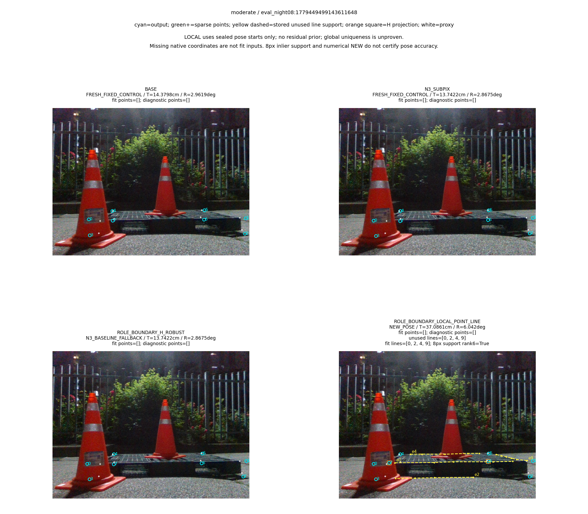

“가림 판단이 일부 틀려도 다른 유효 대응점으로 자세를 구하고 자기 가림 코너를 재투영했을 때, 기존 단순 대조보다 실제 위치·회전이 좋아졌는가?”

**이전 V9에서는 좋아지지 않았다. 이번 V10은 그 실패의 원인을 확인하는 대응 근거 감사이며, 새 최종 자세의 성능 실험이 아니다.** [V9의 전체245장 결과](../pallet_sparse_local_line_20261010_v9/RESULT_KO.md)는 LOCAL 위치 평균17.87901676799424cm·회전13.415258792985208°, N3는9.754548028679153cm·10.914841863166323°였다. 수치 NEW115장과 H 재투영은 실제 동작했지만 전체 정확도 목표는 해결되지 않았다. V10은 전체245frame/370unused edge를 실제 감사했고 독립441191검사를 PASS했다.265개 선은 native validator와 일치,67개는 모순,38개는 검증 불가였다. 기존 최종 자세는 바꾸지 않았고 새 T/R 평가도 수행하지 않았으므로, 이것을 정확도 개선 완료로 보고하지 않는다.

# V10: 기존 V9 unused line의 native endpoint-heldout 독립 감사

## 1. 무엇을 확인하고 무엇이 아직 없는가

최신 쉬움153+중간92, 총245장의 기존 IMAGE_ROLE sparse 관측만 감사한다. Severe74를 새 실행에서 제외하고 이전 전체319장의 기록은 보존한다. 실제 점을 만든 데 이미 소비된 edge는 별도의 선 관측으로 세지 않는다. V9가 실제 fit에 쓴 고유 unused physical/CAL 선을 대상으로, 그 선과 두 endpoint를 보지 않은 다른 native 대응의 자세가 해당 선과 일치하는지 확인한다.

이 질문은 같은 관측에 대한 residual이 낮고 Jacobian rank6이라는 기존 검사와 다르다. 같은 잘못된 관측이 서로 일관될 수도 있고 native validator 자체도 잘못된 합의일 수 있다. 독립 실사 edge/corner ownership 정답이 없으므로 physical ownership은 UNKNOWN으로 남긴다. 가림·선의 진단 label과 실제 T/R 정확도 성공을 구분한다.

**실제 감사와 독립 검산은 완료했다.** 전체245장의 unscored packet과370개 고유 unused line을 한 번 처리했고, observed edge의 source·native mask·candidate·RMS·decision 및 실제 bank/primitive counts를 보존했다. 새 모델·학습·RGB·GT score·LOCAL optimizer·최종 pose 산출·배포 runtime 측정은0이다. postseal 조건별 요약도 별도 고정 뒤 완료했고 공개 검토·게시 권위는 별도 artifact로 확인한다.

## 2. LOO와 자기 가림 제외를 어떻게 적용하는가

[고정 감사 계약](AUDIT_CONTRACT_KO.md)과 [재현 명령](REPRODUCE.md)을 따른다. [audit.py](../../../scripts/research/pallet_unused_line_endpoint_audit_20261011_v10/audit.py)의 입력은 같은 ID/session의 기존 V9 unscored sealed geometry와 기존 GT-free observation packet이다. scored pose/reference/human mask는 감사 입력으로 거절한다.

각 frame의 original `OBS.native_N3_points`/K/등록 치수/영상 크기로 native point bank 하나를 만든다. 검사할 edge의 두 endpoint가 a,b이면 validation fit에서 **H∪{a,b}를 제외**한다. 임시 endpoint 제외와 실제 자기 가림 H를 따로 기록한다. 검사 중인 선, V9 선택 pose, 초기 R,t, projection 또는 치수 branch prior는 validation solver에 들어가지 않는다.

기존 V4의 유한4-ID 부분집합 강건 PnP·표준해·LM·rank·다중해 처리를 그대로 사용한다. 같은 native 좌표/K/치수/4-ID 가설은 edge/mask 사이에서 공유한다. 각 실제 고유 unused edge에 solve request1을 기록하며,4점 미만·수치 실패·다중해는 typed unavailable 결과로 남긴다. sparse q를 native로 채우지 않고, endpoint projection을 새2D 관측으로 다시 fit하지 않는다.

V6의 고정8px signed endpoint RMS를 그대로 사용한다. `SUPPORTED_RETAIN`은 available native validator와 일치, `CONTRADICTED_REJECT`는 그 validator와 모순, `UNVERIFIED_RETAIN`은 독립 validator가 없거나 ambiguous/uncheckable인 경우다. **REJECT는 이 감사의 진단 이름일 뿐 실제 V9 관측을 제거하지 않는다.** UNKNOWN을 NONE 감독이나 전체 frame 실패로 바꾸지 않는다. 자기 가림 초기2D를 최종 fit에서 제외하고 새 R,t 후 재투영으로 교체하는 기존 V9 정책도 그대로 보존한다.

기존 V4 corner LOO·V6 native hybrid/최소4점 선 경로·V7 세 head×두 공급·V8 같은 sparse solver/mask 대조·V9 sparse LOCAL은 이미 실행한 이력이다. 이들을 새 미실행 경로로 다시 세지 않는다. V10은 최신 V9의 실제 unused pool에 대한 독립 진단 하나다.

## 3. 사전 고정·보호·실제 실행 권위

[PARENT_V9_PUBLICATION_RECEIPT](PARENT_V9_PUBLICATION_RECEIPT.json)의 정상 게시 commit/remote SHA `ee065aa9db0fc7b62f97e4d43ea6d0c2cdb99e07` 일치를 확인한 뒤 최신 HEAD를 기반으로 새 [PROTECTION_BEFORE](PROTECTION_BEFORE.json)을 만들었다. main은 `f565418e6a63acd5fb920a5741308d84eb7c131f`로 유지됐으며 main push/merge/force push는 없었다. 오래된 V8 HEAD를 요구하는 보호 verifier를 현재 게시 HEAD에 재사용하지 않는다. [runner.py](../../../scripts/research/pallet_unused_line_endpoint_audit_20261011_v10/runner.py)는 기존 input SHA·V6 CPU 성공·V9 전체 geometry/ledger/cleanup seal/독립 geometry PASS·parent population을 먼저 확인한다.

자체 protocol SHA256은 `6d07de373370b4308f77d8ecd6c81bafb6aacf82d2f77bf507c64d9c3c26aa72`다. 전체 원 parent population 순서·ID·source references를 먼저 확인하고 quiet/온도 preflight를 PASS한 뒤 native PnP를 실행했다. 성공 시245 audit/245ledger stream을 close/fsync하고 환경·OpenCV thread·native J/SVD dispatch·file guard/monkeypatch를 복구한 뒤 seal했다. 부모17454 tracked 파일과 원 source checkout 상태/사용자 변경을 보호했다.

|실제 완료 항목|결과|권위|
|---|---|---|
|자체 protocol 고정 / quiet preflight|각1회 / PASS|[AUDIT_PROTOCOL](AUDIT_PROTOCOL.json), [PREFLIGHT](AUDIT_PREFLIGHT.json)|
|전체frame / audit행 / ledger행|245 / 245 / 245|[AUDIT_ROWS](AUDIT_ROWS.jsonl.gz), [AUDIT_LEDGERS](AUDIT_LEDGERS.jsonl.gz)|
|native endpoint solve request / return / exception|370 / 370 / 0|[AUDIT_RECEIPT](AUDIT_RECEIPT.json)|
|독립 native pose로 검사 가능|332|[VALIDATION_CHECKS](VALIDATION_CHECKS.json)|
|SUPPORTED / CONTRADICTED / UNVERIFIED|265 / 67 / 38|[AUDIT_RECEIPT](AUDIT_RECEIPT.json)|
|OpenCV Generic / subset Generic / refit Generic|24313 / 24060 / 253|[AUDIT_RECEIPT](AUDIT_RECEIPT.json)|
|LM / projectPoints / Rodrigues|887 / 332 / 114658|[AUDIT_RECEIPT](AUDIT_RECEIPT.json)|
|native Jacobian / scoped numpy SVD entry|332 / 74669|[AUDIT_RECEIPT](AUDIT_RECEIPT.json)|
|generic cache hit / miss|634 / 24313|[AUDIT_LEDGERS](AUDIT_LEDGERS.jsonl.gz)|
|독립 scalar 검사 / 실패|441191 / 0|[VALIDATION_CHECKS](VALIDATION_CHECKS.json)|
|저장candidate scalar / 선택 결과재검사|4814 / 348|[VALIDATION_CHECKS](VALIDATION_CHECKS.json)|
|scalar 함수 총호출(고유pose수 아님)|5162|[VALIDATION_CHECKS](VALIDATION_CHECKS.json)|
|stream/cleanup/보호 및 seal|PASS / error0|[AUDIT_SEAL](AUDIT_SEAL.json)|
|새 모델/RGB/LOCAL fit/최종 pose/GT score|모두0|[AUDIT_RECEIPT](AUDIT_RECEIPT.json)|

[독립 own protocol](VALIDATION_PROTOCOL.json)은 main audit 후 별도로 고정하고 stdlib checker를 실제1회 실행했다. native 후보 R,t·투영·residual/합의·endpoint RMS·decision·H∪endpoints 제외·shared bank/cache·실제 진입 계수·driver 전달·copied V9 witness/원본 보존을 대조했다. 최대 scalar 차는7.450580596923828e−9로 사전 허용 범위 안이다. 새 production PnP/J/SVD/모델/RGB/GT/LOCAL fit은 checker에서0이다. 총5162회는 저장4814후보+선택된348재검사로, 고유 solution 수라고 말하지 않는다.

actual audit wall39.87021069601178초와 독립 checker wall21.332637784071267초는 실행량 기록이며 배포 latency가 아니다. audit는 실제 native point solver의 J332/SVD74669을 수행했다. SVD count가 모두 Jacobian SVD였다는 주장은 하지 않는다. V9 LOCAL conditioning을 복사하는 부분의 새 LOCAL/J/SVD/objective 계산은0이다.

실패나 외부 작업 경쟁이 생기면 partial prefix·active packet·실제 bank/primitive counts·cleanup 상태를 보존한다. 같은 output을 덮어쓰거나 자동 재시도하지 않는다. 감사 replay wall을 deployment latency라고 쓰지 않는다. native audit가 실제 수행한 Jacobian/SVD 진입과, V9 저장 condition witness를 복사하면서 새 J/SVD를 계산하지 않은 작업을 구분한다.

## 4. 독립 대응과 저장된 정확도를 연결한 postseal 진단

독립 endpoint 감사와 scalar PASS 뒤 별도 [DIAGNOSTIC_SUMMARY_PROTOCOL](DIAGNOSTIC_SUMMARY_PROTOCOL.json)을 고정하고 [DIAGNOSTIC_SUMMARY](DIAGNOSTIC_SUMMARY.json)를 실제1회 실행했다. [diagnostic_summary.py](../../../scripts/research/pallet_unused_line_endpoint_audit_20261011_v10/diagnostic_summary.py)는245 source outcome을 방문/복사했고370 endpoint와440 저장 LOCAL candidate witness를 복사했다. 새 모델/RGB/GT score/PnP/LOCAL/J/SVD/moment/CI 실행0, 원 V9 관측·NEW/fallback·T/R 점수 변경0이다. saved scored980과 POSTHOC245를 구분한 join은 이 supplement의 고정 전에 올바른 schema로 고정했다. 초기 미고정 초안의 stream schema 수정은 실험 재실행이 아니다.

[고정 postseal 계약](POSTSEAL_DIAGNOSTICS_CONTRACT_KO.md)은15개 중첩 group×combined/easy/medium을 사전 고정했다. weak은 기존 [V1 solver.py:208](../../../scripts/research/pallet_observation_refiner_20261009_v1/solver.py#L208)의 `s_min < s_max * 1e-4`를 stored singular 값에 적용한 진단이다. 새 threshold나 성공 gate가 아니며 condition/J/SVD를 재계산하지 않았다. best witness가 없는 frame은 NO_BEST_CANDIDATE이며 weak=False의 성공 증거가 아니다.

group의 status는 원래 V9 NEW/fallback, T/R outcome은 이미 저장된 V9 대 N3/point category를 복사한 것이다. 아래 표는 추가 GT 정확도 평가가 아니다. BOTH_BETTER/BOTH_WORSE는 T/R 모두 개선/악화, MIXED는 한쪽만 개선·동률·fallback 불변을 포함한다. 조건 group은 중첩되므로 합산하지 않는다. 전체 ID 목록은 [summary](DIAGNOSTIC_SUMMARY.json)의 groups[층][조건].ids, 개별 endpoint/RMS/H/조건값/저장 delta는 [245진단원행](DIAGNOSTIC_FRAME_ROWS.jsonl.gz)에서 확인한다. 다른 구현으로 이 추가45집계를 재계수했다고 주장하지 않는다.

|stratum|condition|frames|V9NEW|V9fallback|SUPPORTEDedges|CONTRADICTEDedges|UNKNOWNedges|N3bothbetter|N3bothworse|N3mixed|POINTbothbetter|POINTbothworse|POINTmixed|
|---|---|---|---|---|---|---|---|---|---|---|---|---|---|
|combined|ALL|245|115|130|265|67|38|16|58|171|21|50|174|
|combined|V9_NUMERIC_NEW|115|115|0|187|35|13|16|58|41|21|50|44|
|combined|V9_BASELINE_FALLBACK|130|0|130|78|32|25|0|0|130|0|0|130|
|combined|HAS_UNUSED_LINES|198|100|98|265|67|38|13|51|134|16|49|133|
|combined|NO_UNUSED_LINES|47|15|32|0|0|0|3|7|37|5|1|41|
|combined|UNDER4_POINTS_WITH_LINES|170|73|97|239|66|37|10|42|118|10|42|118|
|combined|ANY_CHECKABLE_ENDPOINT|180|95|85|265|67|14|12|48|120|14|46|120|
|combined|ANY_CONTRADICTED_ENDPOINT|54|23|31|37|67|9|2|12|40|2|12|40|
|combined|ALL_ENDPOINTS_SUPPORTED|122|71|51|224|0|0|10|36|76|12|34|76|
|combined|ANY_UNKNOWN_ENDPOINT|30|9|21|7|11|38|1|5|24|2|5|23|
|combined|ALL_ENDPOINTS_UNKNOWN|18|5|13|0|0|24|1|3|14|2|3|13|
|combined|BEST_OBSERVED_WEAK_EXISTING_V1|3|3|0|5|1|0|0|3|0|0|3|0|
|combined|BEST_MODELED_WEAK_EXISTING_V1|2|2|0|3|0|0|0|2|0|0|2|0|
|combined|BEST_OBSERVED_RANK6_WEAK_EXISTING_V1|3|3|0|5|1|0|0|3|0|0|3|0|
|combined|NO_BEST_CANDIDATE|63|0|63|33|15|10|0|0|63|0|0|63|
|easy|ALL|153|76|77|147|34|14|13|37|103|16|30|107|
|easy|V9_NUMERIC_NEW|76|76|0|105|12|6|13|37|26|16|30|30|
|easy|V9_BASELINE_FALLBACK|77|0|77|42|22|8|0|0|77|0|0|77|
|easy|HAS_UNUSED_LINES|120|64|56|147|34|14|10|32|78|12|30|78|
|easy|NO_UNUSED_LINES|33|12|21|0|0|0|3|5|25|4|0|29|
|easy|UNDER4_POINTS_WITH_LINES|93|38|55|121|33|14|7|23|63|7|23|63|
|easy|ANY_CHECKABLE_ENDPOINT|113|61|52|147|34|5|9|30|74|11|28|74|
|easy|ANY_CONTRADICTED_ENDPOINT|31|10|21|14|34|5|1|6|24|1|6|24|
|easy|ALL_ENDPOINTS_SUPPORTED|82|51|31|133|0|0|8|24|50|10|22|50|
|easy|ANY_UNKNOWN_ENDPOINT|11|4|7|2|4|14|1|3|7|1|3|7|
|easy|ALL_ENDPOINTS_UNKNOWN|7|3|4|0|0|9|1|2|4|1|2|4|
|easy|BEST_OBSERVED_WEAK_EXISTING_V1|1|1|0|2|1|0|0|1|0|0|1|0|
|easy|BEST_MODELED_WEAK_EXISTING_V1|0|0|0|0|0|0|0|0|0|0|0|0|
|easy|BEST_OBSERVED_RANK6_WEAK_EXISTING_V1|1|1|0|2|1|0|0|1|0|0|1|0|
|easy|NO_BEST_CANDIDATE|35|0|35|16|12|3|0|0|35|0|0|35|
|medium|ALL|92|39|53|118|33|24|3|21|68|5|20|67|
|medium|V9_NUMERIC_NEW|39|39|0|82|23|7|3|21|15|5|20|14|
|medium|V9_BASELINE_FALLBACK|53|0|53|36|10|17|0|0|53|0|0|53|
|medium|HAS_UNUSED_LINES|78|36|42|118|33|24|3|19|56|4|19|55|
|medium|NO_UNUSED_LINES|14|3|11|0|0|0|0|2|12|1|1|12|
|medium|UNDER4_POINTS_WITH_LINES|77|35|42|118|33|23|3|19|55|3|19|55|
|medium|ANY_CHECKABLE_ENDPOINT|67|34|33|118|33|9|3|18|46|3|18|46|
|medium|ANY_CONTRADICTED_ENDPOINT|23|13|10|23|33|4|1|6|16|1|6|16|
|medium|ALL_ENDPOINTS_SUPPORTED|40|20|20|91|0|0|2|12|26|2|12|26|
|medium|ANY_UNKNOWN_ENDPOINT|19|5|14|5|7|24|0|2|17|1|2|16|
|medium|ALL_ENDPOINTS_UNKNOWN|11|2|9|0|0|15|0|1|10|1|1|9|
|medium|BEST_OBSERVED_WEAK_EXISTING_V1|2|2|0|3|0|0|0|2|0|0|2|0|
|medium|BEST_MODELED_WEAK_EXISTING_V1|2|2|0|3|0|0|0|2|0|0|2|0|
|medium|BEST_OBSERVED_RANK6_WEAK_EXISTING_V1|2|2|0|3|0|0|0|2|0|0|2|0|
|medium|NO_BEST_CANDIDATE|28|0|28|17|3|7|0|0|28|0|0|28|

하나 이상 모순인54frame은31 fallback/23 NEW이며 저장 N3 outcome은2개 모두 개선·12개 모두 악화·40혼합이다. 모든 endpoint가 supported인122frame도51fallback/71NEW이고10개 모두 개선·36개 모두 악화·76혼합이다. **독립 native validator와 일치하는 선만으로도 실제 pose가 나빠질 수 있다.** 67개 모순 진단을 전체 ownership 오답의 수로 해석하거나, 그것을 제거하면 나머지 실패까지 해결된다고 주장하지 않는다.

best observed weak3개는 모두 V9 NEW이고 N3/point 양쪽에 T/R 모두 악화했다. modeled weak2개 역시 모두 악화했지만 observed 집합과 겹치므로 합산하지 않는다. observed rank6+weak도3개다. 이3개는 기존 저장 rank6이 충분한 수치 관측성을 보였어도 같은 기존 기준의 conditioning은 약할 수 있음을 구분한다. 관측 semantic ownership·validator 자체의 오류·실제 자세 branch의 기여를 이 상관 집계만으로 인과 분해하지 않는다.

UNKNOWN38개를 NONE이나 일괄 실패로 만들지 않았다. UNKNOWN이 있는 frame30개는9NEW/21fallback이고, 전부 UNKNOWN인18frame도5NEW/13fallback이다. independent validation이 없다는 사실과 다른 남은 관측에서 local 수치 pose를 얻었다는 사실을 함께 기록한다. 원 source wire/role cache 일치는 실사 선의 물리 소유권 인증으로 확대하지 않는다.

## 5. V9의 큰 실패에서 보존한 증거

[V9 공개 원행](../pallet_sparse_local_line_20261010_v9/PUBLIC_FRAME_METRICS.csv)의 `wood_night_01:031426`은 실제 point0개·unused line fit[2,4,9]·H[6,7]로 LOCAL NEW를 만들었지만 위치1204.8027435564068cm·회전84.79819202965425°·ADD1206.0840052680007cm였다. 큰 오차를 실패로 빼지 않았고115 NEW의 운용 분모에 유지했다.

이 행의 기존 V9 `solver.best_candidate`는 `all_candidate_solutions`의 candidate index1/dimension index1이며, 다음 값은 [V9 원 geometry](../pallet_sparse_local_line_20261010_v9/GEOMETRY_SEALED.jsonl.gz)에 이미 저장된 witness다. V10의 새 endpoint 결과가 아니며 새 J/SVD/objective를 계산한 값도 아니다.

|기존 V9 witness 경로|저장값|
|---|---|
|point_line_geometry.observed_normal_joint.condition_number|47816625.59283317|
|observed_normal_joint.singular_values[-1]|3.015666039609041e−8|
|point_line_geometry.modeled_normal_joint.condition_number|1393.017775954631|
|line_residual_RMS_px, edges[2,4,9]|[0.16261319500476623,0.15804948822446013,0.006376200539163698]|
|soft_l1_cost|0.025730381080066422|
|centroid|[5.472516137180852,−0.39597285550734107,18.847628667369122]|
|alternative candidate0 objective gap|0.052706596593381505|
|alternative numerical_objective_tie / numerically_equivalent_to_selected|False / False|
|solver.multiple_solutions / unresolved_ambiguity|True / False|

[기존 solver.py:330–333](../../../scripts/research/pallet_sparse_local_line_20261010_v9/solver.py#L330)의 rank 수락과 [340–368의 지역 후보 선택](../../../scripts/research/pallet_sparse_local_line_20261010_v9/solver.py#L340)을 함께 읽는다. 이 사례는 낮은 같은-pool residual·full rank·수치상 동률이 아닌 지역 선택에도 큰 실제 pose 오차가 남음을 보여 준다. 큰 condition과 여러 지역 branch의 저장 증거는 대응 정확도와 구분해야 한다. 최약 singular 방향이 어떤 pose 자유도에 해당하는지는 이 표만으로 특정하지 않는다. 낮은 residual만으로 physical ownership이 맞다고 단정하거나, 큰 condition만으로 특정 선의 ownership이 틀렸다고 단정하지 않는다. V10에서 이 저장 witness를 복사할 때의 byte/identity 검산은 별도 실제 receipt로 확인한다.

기존 V9 고정 case05도 point0개+실제 unused line4개로 수치 NEW를 만들었지만 N3보다 T/R이 모두 악화한 영상이다. 아래는 [이미 실제 검토한 V9 그림](../pallet_sparse_local_line_20261010_v9/VISUAL_LAYOUT_REVIEW.json)을 재사용한 것으로, 최대오차 `wood_night_01:031426`의 영상이나 새 V10 결과 그림은 아니다. 선 관측·fit/inlier IDs·H projection의 표시와 수치 성공을 실제 성능 성공으로 구분하는 예다.

## 6. 과거 오류와 이번 감사의 구분

[원 training.targets():91–94](../../../scripts/research/pallet_observation_refiner_20261009_v1/training.py#L91)의 ray 수치 실패→no_match 오류는 별도 새 경계 head 감독에서 실제 대응2164query를 잘못 제외한 문제였다. main N3→cornerSubPix의 오류가 아니다. 실제 mesh/wire/depth 감독과 POSITIVE/NONE/IGNORE 준비를 이미 고쳤고, 최초 읽기전용 인수인계 후 후속 사용자 지시에 따라 [수정 감독3조건의 실제9000update](../pallet_kp_corrected_supervision_20261010_v1/RESULT_KO.md)도 완료했다. 잘못된 감독의 옛 IMAGE_ROLE0/319를 수정 head 결과로 쓰지 않는다. 이번 V10의 새 학습/RGB/seed는0이다.

V9 보고용 mask registry label 오류와 runtime checker의 Base anchor literal 오류도 [원 실패와 별도 보완](../pallet_sparse_local_line_20261010_v9/RESULT_KO.md)으로 보존했다. 실제 fit·pose score와 보고 진단 label을 구분하며 frozen core나 결과를 다시 수정하지 않는다.

## 7. 검토자가 확인할 자료와 남은 문제

사전 계약·driver·auditor·독립 [validation_checks.py](../../../scripts/research/pallet_unused_line_endpoint_audit_20261011_v10/validation_checks.py)를 먼저 읽고, 실제 [원행](AUDIT_ROWS.jsonl.gz)/[ledger](AUDIT_LEDGERS.jsonl.gz)/[seal](AUDIT_SEAL.json)/[operation receipt](AUDIT_RECEIPT.json)를 frame/edge IDs로 대조한다. [BUILD_LEDGER](BUILD_LEDGER.json)는 완료된245감사·독립441191검산과 후단 공개 요약/게시를 구분한다. 독립 scalar의 stored SVD rank 재계수는 새 SVD가 아니며, external dependency declarations는 protocol에 bind된 선언이지 모든 외부 raw를 다시 hash한 것으로 과장하지 않는다.

남은 전체 목표는 실제 위치·회전 개선이다. 이 감사만으로 새 downstream 방식이 성공했다고 말하지 않는다. endpoint audit 결과로 얻을 수 있는 것은 기존 unused line의 독립 일치·모순·검증 불가 근거와 기존 conditioning/start/지역 branch의 구분이다. 최소 후속 수정은 같은 ROLE sparse 관측에서 CONTRADICTED_REJECT 선만 제외하고 UNKNOWN은 유지하며, 기존1e−4 weak 기준은 새로운 방법의 typed fallback으로 사전 명시하는 좁은 별도 경로다. 원 V9의 성공 gate를 사후 변경하는 것이 아니다. 남은 실제 point/unused line으로 한 번 새 pose를 구하고 H를 재투영으로 교체하되 재투영점을 다시 fit하지 않아야 한다. 현재 후속 V11은 코드 준비 단계이며 실제 filtered fit·245 GT score·정확도 개선 결과는 없다. 기존8px/head/학습/seed를 성능에 맞춰 탐색하지 않는 별도 사전 계약과 실행량으로 검증해야 한다. 이 진단만으로 선 제거가 성능을 개선했다고 말하지 않는다. main 변경/push·자동 merge·force push는 하지 않는다.

V10의 정의된245 endpoint 감사·독립 scalar 검사·postseal 저장 진단 집계는 완료했다. 정상 전용 브랜치 게시와 최종 공개 byte/원격 SHA witness는 별도 이후 artifact가 권위다. 원문 사전 고정 hash와 게시 commit을 혼동하지 않는다. 사용자의 전체 정확도 개선 목표는 여전히 미해결이다.
