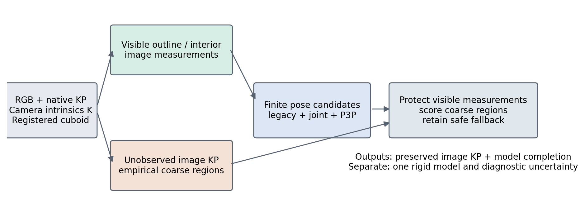
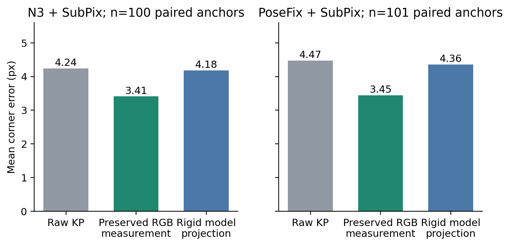
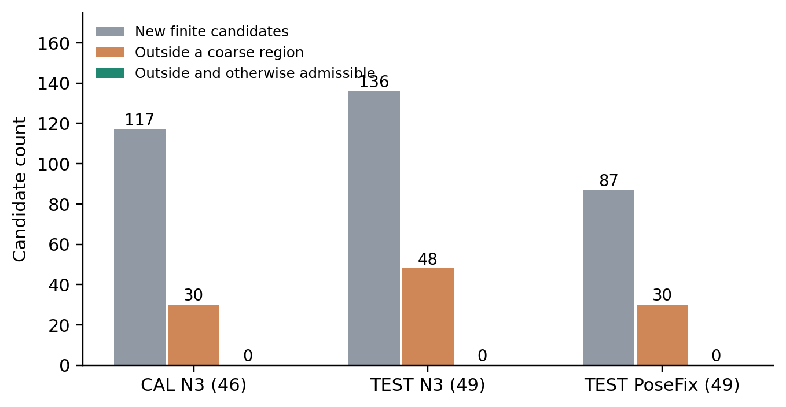
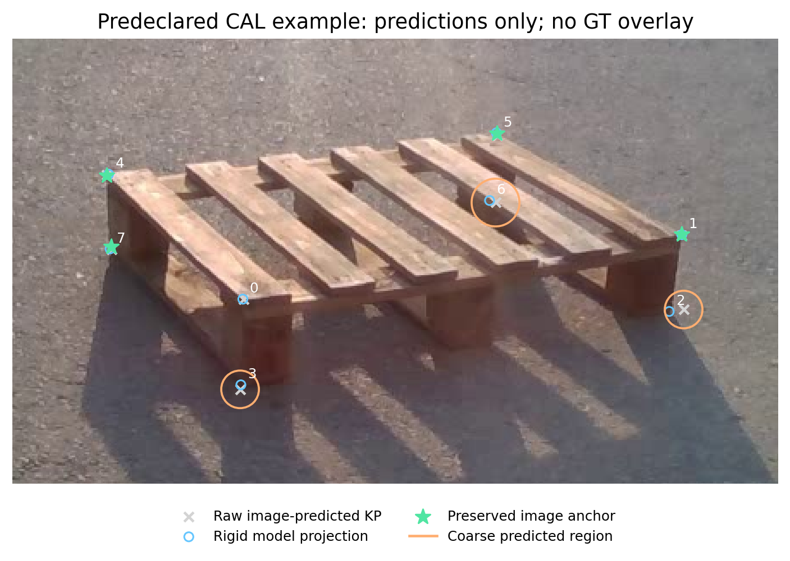

# State-aware keypoint correction, protected rigid completion, and coarse-region pose ranking

This study implements a state-dependent policy for pallet keypoints: retain image-supported outline corrections, supplement the pose with eligible visible observations, and complete unmeasured corners from a registered rigid model. A separate extension evaluates image-regressed coarse regions when ranking a fixed finite pose pool. On the present clean/moderate cohort, the coarse-region term changes **no selected pose** relative to the identical candidate pool without that term. The implementation provides observation provenance and protection properties; these results do not establish superior hidden-point recovery or state-of-the-art pose accuracy.

The frozen V1 algorithm and its full objective, pseudocode, and uncertainty definitions are documented in [METHOD_DRAFT_EN.md](../anchored_completion_v1/METHOD_DRAFT_EN.md). This extension reports both the implemented state policy and the completed finite-region experiment. It leaves all frozen V1 sources and predictions unchanged.

## 1. Model, evidence, and states

Let $X_i\in\mathbb R^3$, $i=0,\ldots,7$, be registered cuboid corners in their original native order, $q_i\in\mathbb R^2$ the upstream RGB-regressed predictions, $K$ the camera matrix, and $T_0=(R_0,t_0)$ the upstream pose. For any candidate pose $T=(R,t)$, define

$$u_i(T)=\pi\!\left(K(RX_i+t)\right).$$

The optional ninth array slot carries the original centre prediction; it is not a cuboid correspondence, a region constraint, or an extra pose observation. Model dimensions, native identities, the model-to-physical basis, original predictions, and initial geometric exclusions remain fixed. Pose hypotheses cannot relabel corners or change the dimension family.

We distinguish three kinds of information. **Image measurements** are raw predictions or coordinates localized from current image lines. **Image-regressed coarse regions** express tolerances around raw predictions and are used collectively as a soft candidate score. **Pose-derived projections and covariance regions** are model/prior outputs; they supply no new image correspondence, independent support, or region likelihood. Image-derived observations can share the same RGB, detector, incident edge, or upstream initializer, so “independent” here means not generated by the candidate pose, rather than statistical independence.

| Runtime situation | Available evidence and action | Reported 2D output |
|---|---|---|
| Visible expected outline, sufficient probability and two verified incident image lines | Create an image boundary anchor; use its bounded corrected coordinate for the seed and protect its fixed reference thereafter | Preserve the actual anchor measurement, including when pose support is insufficient |
| Visible expected model interior | Admit a detector coordinate only with the frozen visibility/coordinate gates, or admit a separately validated current-RGB junction | Preserve the measurement only when retained in the final pose support; otherwise use rigid completion |
| Visible expected outline without strong line support | It is not a strong anchor. The declared `all_visible` policy may admit it as a weaker detector observation | As above; unsupported lines do not certify invisibility |
| Initially predicted self-hidden | Exclude from precise pose fitting; optionally score its raw image-regressed coarse region | Complete from the selected rigid pose |
| Unobserved or low-confidence corner without confirmed ownership | Do not assert external occlusion; exclude from precise fitting if admission fails and optionally retain a coarse region | Complete from the selected rigid pose |
| Independently supplied different-instance/foreground evidence | Exclude under the explicitly supplied ownership contract; requested-point depth ordering is needed to confirm occlusion | Complete from the selected rigid pose |
| Initial model projection outside the canvas | Conditional geometric truncation exclusion; an outside raw prediction alone is not physical truncation proof | Complete the model, permitting an off-screen projection |
| Missing original prediction | No query-centred region or image correspondence is fabricated | Complete from the selected rigid pose |

“Expected outline” means the outline of the initial registered projection. It does not certify physical background contact. Holes, rounded corners, virtual cuboid corners, shadows, background texture, another similarly colored pallet, and coordinate error can all invalidate a palette or line interpretation. There is no production instance/depth occlusion producer in this experiment, and **zero corners are automatically confirmed as externally occluded**. Human occlusion annotations are used only in post-seal evaluation.

| State-specific theoretical constraint | Implemented evidence/policy | Unavailable or unproved in this study |
|---|---|---|
| Accurately localized visible corners constrain pose | Current-image line/junction measurements with identity checks and fixed-reference protection | Correct physical/virtual corner ownership is not certified |
| Coarse hidden-image location can distinguish finite poses | Raw RGB-regressed centre plus frozen CAL circle; soft excess-distance score | No calibrated heatmap/ellipse estimator, joint spatial guarantee, or measured benefit from the region term |
| Self-hidden corners obey registered rigid geometry | Initial model-normal visibility exclusion and final rigid completion | Initial self-hidden flags can disagree with human states |
| A known foreground instance can occlude the requested point | Typed caller hooks for separately bound ownership/depth facts | No actual independent foreground/depth producer; palette negatives do not install a hard occluder-region constraint |
| A truly truncated physical point lies outside the canvas | Initial projected-outside flags exclude precise fitting; off-screen rigid completion remains possible | No independently verified physical-truncation producer or hard outside-canvas inequality for unknown true states |
| Pose uncertainty propagates to hidden projections | Conditional local information/covariance diagnostics | These are not hidden image observations or calibrated spatial prediction sets |

## 2. Protected visible observations and separate completion

The current-image outline observer uses a frozen MobileSAM box-prompted material mask and retains actual sampled boundary transitions. Two distinct incident lines must pass the frozen support, coverage, direction, residual, angle, canvas, and identity checks. Conditional line resampling supplies an intersection covariance $C_i$, not a calibrated semantic-corner confidence. The fixed bounded blend is

$$z_i=q_i+\alpha_i(c_i-q_i),\qquad
\alpha_i=\min\left(\tfrac12,\frac{4}{4+\lambda_{\max}(C_i)}\right).$$

An admitted intersection moves by at most 6 px. The assumed detector variance is $4\ \mathrm{px}^2$; this formula is a conservative heuristic fusion rule, not a calibrated Bayesian posterior. The optional interior observer searches actual RGB gradient lines along initial incident-direction guides. Projected directions guide a search but never become measured coordinates. Typed records bind native identity, original query, camera, model, actual decoded BGR image hash/canvas, retained samples, intersection, covariance, and blend.

Let $A$ denote strong image anchors and $V$ the immutable eligible precise-observation pool. The fixed-initial robust objective is

$$F_S(T)=\frac{\sum_{i\in S}w_i\rho_8(\|u_i(T)-z_i\|)+P(T)}{\sum_{i\in S}w_i},$$

where $\rho_8(r)=r^2$ for $r\le8$ px and $16r-64$ otherwise. Frozen $w_i$ depend on the original visibility and coordinate scores and original RGB patch role, not candidate residuals or pose covariance. $P(T)$ is the frozen V1 rotation/translation prior around $T_0$. Comparisons use the same precise pool, weights, and prior.

Frozen V1 seeds use full local pose fitting with at least five anchors, seven rotational starts and an ambiguity check with exactly four, and translation-only fitting with three while preserving $R_0$ exactly. Two or fewer strong anchors cannot manufacture missing constraints. Eligible real observations may supplement the pool and establish a measured-point bootstrap. Count is insufficient without image spread, required Jacobian rank, positive depth, conditioning, and trust checks.

After a fixed accepted reference $T_A$ exists, a subsequent accepted pose must satisfy each anchor separately:

$$\|u_i(T)-u_i(T_A)\|\le2\ \mathrm{px},\qquad
\rho_8(\|u_i(T)-z_i\|)-\rho_8(\|u_i(T_A)-z_i\|)\le1\ \mathrm{px}^2.$$

The reference does not advance with each stage. Better anchors cannot compensate for a degraded anchor. This protects a conditional observation/reference, not ground-truth accuracy. Exact locking to all noisy pixels is avoided: eight or more scalar constraints from four anchors generally need not be compatible with six rigid-pose parameters. The V1 `anchor_priority` fallback may retain an independently accepted boundary seed despite a weaker full-pool veto; it records that exception instead of claiming full-pool improvement.

The extension's **mixed 2D readout** preserves anchor coordinates and final-retained interior/detector coordinates, while supplying model projections for other slots. A separate `rigid_model_corners` output always consists of all eight projections of one pose. The mixed array is not one rigid model and is never recycled into PnP as eight observations. This separation prevents a corrected measured anchor from being overwritten solely to obtain a rigid output, while making the provenance of hidden completion explicit.

## 3. Coarse image regions and finite pose candidates

### 3.1 Empirical CAL circles

Only finite, non-missing raw predictions outside the precise pool receive coarse regions. The runtime categories are `INITIAL_MODEL_SELF` when the fixed initial self-hidden flag is true and `OTHER_UNOBSERVED` otherwise. These categories are not oracle visibility or externally occluded labels.

Let $d(q)$ be the diagonal of the finite raw eight-point bounding box, lower-bounded by 16 px. For a calibration point with a locked-compatible reference coordinate $y_i$, fit normalized errors $e_i=\|q_i-y_i\|/d(q)$. A predeclared 90% empirical order statistic, $\lceil(n+1)0.90\rceil$ capped at $n$, determines a category radius multiplier. The fitted values are:

| Predicted category | CAL samples | Recording sessions | Radius multiplier |
|---|---:|---:|---:|
| `INITIAL_MODEL_SELF` | 65 | 4 | 0.0379333, or 3.793% of $d(q)$ |
| `OTHER_UNOBSERVED` | 158 | 4 | 0.0298819, or 2.988% of $d(q)$ |

The pooled fallback multiplier is 0.0308178. The current region is the raw-query-centred circle $\mathcal R_i=\{v:\|v-q_i\|\le r_i\}$ with $r_i=d(q)s_{c(i)}$. This is an in-sample CAL tolerance: CAL has already contributed to upstream heads and method selection, corners/frames share sessions, and no independent calibration partition or exchangeability claim is supplied. The reference itself depends on registered geometry, reconstructed pose, and locked native/body correspondence. **The target 90% statistic is not joint coverage, image-conditional coverage, or a calibrated pose probability.**

Radius fitting uses valid registered reference coordinates rather than requiring a known human visibility label. Of the 65 predicted-self samples, 64 are human-self-occluded and one human-visible. The 158 other-unobserved samples comprise 132 human-visible, eight self-occluded, nine externally occluded, and nine unannotated points. Thus `OTHER_UNOBSERVED` chiefly means insufficient precise-fit evidence, not external occlusion. Unannotated reference coordinates can inform this exploratory geometric tolerance but supply no certified semantic-state label.

The pure typed module additionally supports axis-aligned ellipses/boxes, but they are not experimental variants here. Records bind the full original native query, actual image, optional camera/model, frozen radius rule, and model checksum. Missing predictions produce no region. An out-of-frame raw query can produce a coarse region but does not certify physical truncation. `POSE_PRIOR` records remain diagnostic-only. Hard pruning requires a separate explicit joint-calibration or independently specified semantic-region contract; this experiment uses none.

### 3.2 Soft score and the three-point extension

For the fixed finite candidate pool, define

$$L_{\mathcal R}(T)=\frac{1}{|U|}\sum_{i\in U}
\left[\max\left(\frac{\|u_i(T)-q_i\|}{r_i}-1,0\right)\right]^2,$$

where $U$ contains the available coarse image regions. Empty $U$ contributes zero. This is a collective score for shared coarse evidence; it adds **zero precise correspondences**. The selected candidate minimizes the guarded finite score

$$J(T)=F_V(T)+\beta\,8^2 L_{\mathcal R}(T),\qquad\beta\in\{0,0.10\},$$

and must improve this score over the retained baseline by more than $10^{-7}\ \mathrm{px}^2$. The current circle implementation also reports actual squared pixel distance to the region. For future ellipses, Euclidean nearest-region distance and the normalized directional surrogate are reported separately.

The pool consists of BASE, fixed same-image legacy progressive and eligible frozen joint proposals, and at most four P3P roots from one image/object-spread-maximizing actual anchor triple. Pose proposals preserve the original dimension family and native basis. Three real 2D–3D correspondences can generate multiple full-pose P3P solutions; this optional finite-root policy is explicitly distinct from frozen V1's conservative three-point fixed-rotation translation policy. Full local data rank six and normalized condition at most 15 do not prove global uniqueness. [OpenCV PnP documentation](https://docs.opencv.org/4.9.0/d5/d1f/calib3d_solvePnP.html).

Candidates retain the original depth/trust/conditioning gates and the 2 px/1 px² anchor guard. If no accepted reference exists, this extension explicitly fixes the initial pose as that reference, including its two-pixel cap. The full precise-pool objective must be at most $F_V(T_{\mathrm{BASE}})+0.10$ and $F_V(T_0)+0.10\ \mathrm{px}^2$. This tolerance is reported separately from strict initial-pool gain. Hidden coordinates are never supplied to P3P. The finite pool is not guaranteed to contain the true pose, and the retained BASE is a conservative fallback rather than a certified hard-region solution.

## 4. Fixed study and evaluation scope

[PROTOCOL.json](PROTOCOL.json) fixed five arms before the empirical fit and new inference: INITIAL; BASE; PROPOSALS with unchanged V1 support/DOF and strict initial/current objective gain; FINITE_VISIBLE with the finite P3P pool and $\beta=0$; and FINITE_REGION with the identical finite pool/guards and $\beta=0.10$. No outcome-selected winner, new neural training, TEST radius/weight/native-order tuning, or per-frame annotation-selected stage was used.

The population contains CAL46 and reused TEST49 clean/moderate frames; severe frames and unused FINAL labels are excluded. TEST_N3 and TEST_PF use the same 49 images with different upstream predictions/initializers. N3 is the learned N3 head followed by SubPix, not PoseFix. TEST_PF uses the explicitly recomputed cached PoseFix → SubPix pipeline with its natural PoseFix-relative cap. The different upstream prior prevents interpreting this transfer comparison as a pure postprocessor ablation.

All 46/49 frames, including exact fallbacks and ambiguous initial families, remain in physical pose metrics. Coordinate analysis uses only the fixed-compatible native/body model subset: CAL44/46 and TEST42/49, with the previously registered mapping and no best permutation or new annotation-derived remapping. Raw, initial rigid, mixed, and final rigid errors are compared on exactly the same valid corner slots. Unannotated slots remain separate; no valid human-truncated coordinates occur in this scope.

All new predictions were sealed before scoring: 230 CAL_N3, 245 TEST_N3, and 245 TEST_PF rows. Gzip, protocol, and region-model hashes were independently checked before reading the result files. The experiment reuses sealed current-image observations and frozen head outputs; it fits one CAL region model and performs no new neural training. TEST_PF also computes the prescribed same-image progressive pose proposals.

## Reproducible inference procedure

```text
Input: RGB image I, native predictions q[0:8] (+ optional centre), K,
       fixed registered cuboid X, original pose T0 and physical basis,
       frozen visible observer, frozen CAL empirical radius model
1. Observe image boundary transitions; validate typed visible RGB junctions.
2. Solve frozen V1 using immutable measured coordinates and weights.
   Preserve its independently accepted seed exception when applicable.
3. Keep raw, non-missing predictions outside the precise pool as coarse
   circles. Bind query, actual RGB pixels, K, X and CAL model checksum.
4. Construct a fixed candidate pool: V1 pose, native-compatible legacy/joint
   pose proposals, <=4 roots from one maximum-spread image-anchor P3P triple.
5. Check candidates against precise support, local geometry/depth/trust,
   immutable visible-pool tolerance and each fixed-reference anchor budget.
   A three-anchor P3P root is an explicit full6DOF finite-root policy;
   inherited three-DOF proposals keep the original rotation exactly.
6. Among candidates that pass, minimize F_visible + 0.10 * 64 * L_region.
   Keep V1 if no candidate improves the score; no GT or correspondence search.
7. Return mixed2D: preserve image anchors and retained real measurements;
   use selected-pose projections for unmeasured slots; retain centre metadata.
   Separately return all eight rigid projections and conditional diagnostics.
```

The implementation and all numerical inputs are hash-bound. The independent
inference audit checked 720 outputs and 36,660 invariants with zero failures.
The full software suite passed 255 tests and 199 subtests. Fresh RGB inference
on the predeclared CAL example matched the sealed cached study exactly in both
pose and reported coordinates. These checks establish software consistency;
they do not establish calibrated region coverage or superior pose accuracy.

## 5. Results

### 5.1 Whole-population pose accuracy

Translation and rotation are mean physical errors; success requires both error $<5$ cm and $<5^\circ$. Every row retains the complete group population.

| Group | Fixed arm | Translation (cm) | Rotation (°) | Success |
|---|---|---:|---:|---:|
| CAL N3, 46 frames | INITIAL | 3.9821 | 7.8049 | 34/46 |
| CAL N3 | BASE | 3.5937 | 7.7686 | 37/46 |
| CAL N3 | PROPOSALS | 3.5937 | 7.7686 | 37/46 |
| CAL N3 | FINITE_VISIBLE | 3.6093 | 7.7668 | 37/46 |
| CAL N3 | FINITE_REGION | 3.6093 | 7.7668 | 37/46 |
| TEST N3, 49 frames | INITIAL | 3.3630 | 6.5271 | 40/49 |
| TEST N3 | BASE | 3.0384 | 6.4876 | 40/49 |
| TEST N3 | PROPOSALS | 3.0384 | 6.4876 | 40/49 |
| TEST N3 | FINITE_VISIBLE | 3.0384 | 6.4876 | 40/49 |
| TEST N3 | FINITE_REGION | 3.0384 | 6.4876 | 40/49 |
| TEST PoseFix+Sub, 49 frames | INITIAL | 3.2161 | 6.3495 | 39/49 |
| TEST PoseFix+Sub | BASE | 2.9493 | 6.3134 | 42/49 |
| TEST PoseFix+Sub | PROPOSALS | 2.9493 | 6.3134 | 42/49 |
| TEST PoseFix+Sub | FINITE_VISIBLE | 2.9474 | 6.3172 | 42/49 |
| TEST PoseFix+Sub | FINITE_REGION | 2.9474 | 6.3172 | 42/49 |

**The region contribution is exactly zero:** FINITE_REGION and FINITE_VISIBLE select identical poses on all 46+49+49 cases. Their paired translation, rotation, symmetric ADD, and success differences are zero, with the recorded session-bootstrap intervals $[0,0]$. Those intervals describe exact equality on these observations, not certainty about future efficacy. Two CAL and one PoseFix TEST P3P root replacements occur in both arms; no N3 TEST replacement occurs. Their small pose changes belong to the finite-root/tolerance policy, not to the coarse-region term.

### 5.2 Why the present region score did not alter selection

| Group | Generated P3P roots | Non-BASE candidate records | Admissible non-BASE candidates | Admissible candidates with nonzero region loss |
|---|---:|---:|---:|---:|
| CAL N3 | 25 | 117 | 3 | 0 |
| TEST N3 | 38 | 136 | 2 | 0 |
| TEST PoseFix+Sub | 38 | 87 | 3 | 0 |

Nonzero region losses do occur among generated candidates—30, 48, and 30 non-BASE records respectively—but none among admissible alternatives. Anchor, visible-pool, trust, geometry, or precise-support gates reject most candidates. The surviving alternative poses lie inside the broad coarse circles. This observed interaction explains why regions did not distinguish the allowed alternatives; it does not demonstrate that a tighter region or relaxed protection would help. No radius, weight, or guard was changed after examining these results.

On model-compatible reference points, empirical circle coverage is CAL 60/65 for the predicted-self category and 144/158 for other unobserved points; N3 TEST 56/57 and 127/142; PoseFix TEST 56/57 and 131/140. These predicted-state subsets differ from human self/external subsets. Their mean radii are approximately 21–26 px. Coverage is descriptive, correlated, reference-dependent, and neither a joint nor unseen-sample guarantee.

### 5.3 Statewise coordinates and mixed versus rigid output

The following are mean pixel errors for the same valid human-state corners in the 42 locked-compatible TEST frames. The rigid column remains the correct quantity for evaluating one-pose hidden completion; the mixed column is the separate state-dependent user readout.

| Upstream / human state | Points | Raw prediction | Initial rigid | FINITE_REGION mixed | FINITE_REGION rigid |
|---|---:|---:|---:|---:|---:|
| N3 / directly visible | 250 | 6.491 | 6.097 | 5.884 | 6.190 |
| N3 / self-occluded | 65 | 8.634 | 5.071 | 5.006 | 5.020 |
| N3 / externally occluded | 8 | 12.388 | 9.551 | 10.259 | 10.259 |
| PoseFix+Sub / directly visible | 250 | 6.006 | 5.726 | 5.528 | 5.896 |
| PoseFix+Sub / self-occluded | 65 | 8.693 | 4.793 | 4.872 | 4.862 |
| PoseFix+Sub / externally occluded | 8 | 12.667 | 10.413 | 11.173 | 11.173 |

The same source-supported boundary-anchor slots show the local measurement/readout benefit directly:

| Group / anchor slots with valid locked reference | Points | Raw prediction | Preserved measured coordinate | Final finite rigid projection |
|---|---:|---:|---:|---:|
| CAL N3 | 87 | 9.420 | 7.713 | 9.469 |
| TEST N3 | 100 | 4.236 | 3.408 | 4.178 |
| TEST PoseFix+Sub | 101 | 4.473 | 3.447 | 4.355 |

These are prediction-defined anchors, not oracle-selected visible physical corners; the CAL count includes two human-self-occluded slots. The table uses exactly the same slots for each column. A measured correction can improve a reported image coordinate even when a rigid model/prior cannot retain that improvement in its projection. It does not create an extra independent measurement or guarantee the pose is better.

Preserving image-supported coordinates improves the visible mixed readout relative to the final rigid projection. Most self-occluded improvement over raw prediction already exists in initial rigid completion: N3 changes only 5.071 → 5.020 px, while PoseFix changes 4.793 → 4.862 px. External completion worsens relative to initial rigid output for both initializers; all eight externally occluded points belong to one recording session. No truncation-performance conclusion is available.

The readout remains conditional on predicted states. Of the 65 human self-occluded corners, two N3 and four PoseFix outputs preserve detector measurements because initial self-hidden/visibility admission did not identify their human state. They must not be described as successful exclusion of every true hidden correspondence. No human external point is in the retained selected precise fit, but this is not evidence of automatic external-object recognition.

For comparison with older methods on the same reused N3 TEST population, the frozen progressive control has 3.004 cm / 6.524° / 43 successes, and the fixed-family joint control has 2.619 cm / 6.592° / 42 successes. The current protected method is not uniformly best. The prior statewise audit reports old progressive self-completion at 3.987 px, compared with 5.020 px here. PoseFix boundary-only fitting has 2.797 cm / 6.317° / 42 successes, whereas the protected extension has slightly lower mean rotation but higher translation. These are metric-specific exploratory tradeoffs, not a reason to select an annotation-based winner per frame. See [PER_STATE_FINDINGS_V1.json](../anchored_completion_v1/PER_STATE_FINDINGS_V1.json) for the earlier paired state diagnostics and conditional covariance limits.

## 6. Positioning and conclusions supported by the evidence

Image-context prediction of hidden/truncated keypoints and uncertainty-aware PnP are established directions. PVNet uses visible-pixel direction voting to localize such keypoints and supplies localization uncertainty to pose estimation. Our work therefore does not claim to invent hidden-keypoint inference or uncertainty-aware PnP. [PVNet, CVPR 2019](https://openaccess.thecvf.com/content_CVPR_2019/html/Peng_PVNet_Pixel-Wise_Voting_Network_for_6DoF_Pose_Estimation_CVPR_2019_paper.html).

Yang and Pavone construct jointly calibrated keypoint sets and propagate their constraints to a continuous pose uncertainty set under exchangeability assumptions. Their guarantees require a proper training/calibration division and concern coverage, rather than the truth being present in an arbitrary finite pool. The present empirical circles, reused CAL, soft score, and finite P3P ranking do not satisfy or inherit those guarantees. A pose-propagated Gaussian ellipse around the initializer would remain a prior diagnostic, not an independent hidden image region. [Conformal keypoint detection and geometric uncertainty propagation, CVPR 2023](https://arxiv.org/html/2303.12246).

DeepIM refines poses by matching rendered and input images. This implementation instead protects explicit image measurements and evaluates guarded pose proposals; it does not implement DeepIM or claim to outperform it. No matched external benchmark or SOTA comparison is included. [DeepIM, ECCV 2018](https://openaccess.thecvf.com/content_ECCV_2018/html/Yi_Li_DeepIM_Deep_Iterative_ECCV_2018_paper.html).

The defensible methodological contribution is the explicit evidence hierarchy, immutable measured/model separation, count/rank-dependent pose policy, fixed-reference per-anchor protection, transparent exclusions/fallbacks, and a controlled soft-region interface. The observed local outline corrections and useful PoseFix transfer justify these as practical, reproducible mechanisms. They do not prove that stronger state definitions necessarily improve pose, that the coarse region term currently helps, or that hidden completion is more accurate than initial rigid geometry.

A future hard-region extension requires genuinely held-out, suitably exchangeable calibration with joint keypoint coverage and an explicit ownership/geometry contract. A future performance claim requires physically disjoint unseen clean/moderate recordings, adequate external-occlusion/truncation examples, locked native geometry, and the same-pool region ablation. These needs delimit the scientific claims; the current implementation, frozen experiment, null region result, regressions, and user-facing provenance are complete and reportable without an unsupported guarantee.

Evidence: [CAL_N3 results](CAL_N3/RESULTS.json), [TEST_N3 results](TEST_N3/RESULTS.json), [TEST_PF results](TEST_PF/RESULTS.json), [REGION_MODEL.json](REGION_MODEL.json), [derived statewise evidence and input hashes](STATEWISE_EXTENSION_EVIDENCE_V1.json), and the adjacent prediction seals, coordinate rows, region diagnostics, and frozen source snapshot.

## Standalone figures



The method keeps measured image coordinates, coarse predicted regions and
pose-derived outputs separate. [Vector PDF](figures/statewise_method.pdf).



Same-corner reused TEST means: raw coordinates, preserved image measurements
and rigid model projections. The model-compatible subset and reconstructed
reference qualifications stated above apply. [Vector PDF](figures/boundary_measurement_preservation.pdf).



Every non-BASE candidate with positive region penalty already failed the other fixed
guards; the term changed zero selected poses. [Vector PDF](figures/region_constraint_redundancy.pdf).



The first predeclared CAL example uses actual RGB and no GT overlay. Circles
show empirical image-prediction tolerances, not certified physical visibility.
[PDF](figures/statewise_CAL_example.pdf).
