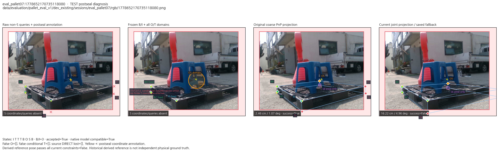

# S/B/I/O/T 방법의 동일 입력 비교와 실패 원인

현재 구현은 기존 RGB 보정과 경계 보정보다 좋지 않았다. 다만 B/I 보정과 O/T 공동 영역 제약은 통제 비교에서 효과가 있었다. 문제는 그 효과가 실제 관측 오차와 적은 B/I 점으로 자세를 선택하는 과정의 손실을 상쇄하지 못했다는 데 있다. 따라서 상태 정의나 공동 기하 제약을 버릴 근거는 없지만, 현재 구현을 우수한 방법이라고 주장할 근거도 없다.

S는 초기 자세의 기하에서 정하고 직접 영상 추론하지 않으며 최종 PnP 자세의 투영으로만 채운다. B는 물체와 배경의 경계에서 보이는 점, I는 주변이 팔레트인 내부에서 보이는 점, O는 외부 물체에 가린 점, T는 영상 밖의 점이다. U는 내부 보류 상태다. 이번 비교에서도 이 계약을 유지했다. 초기 자세에 따른 S/T 판정이 실제 상태와 항상 일치한다는 보장은 별도 문제다.

Severe를 제외한 동일 CAL46/TEST49, 동일 N3_SUBPIX 입력, K, 팔레트 모델과 크기, 동일 physical pose/C2 대칭 지표를 사용했다. 실패와 fallback도 전부 남겼다. 아래 성공은 위치 <5cm와 회전 <5°를 동시에 만족한 수이며 crop은 주 평가에 넣지 않았다.

| 방법, TEST49 | 평균 위치 오차 cm | 평균 회전 오차 ° | 성공 /49 |
|---|---:|---:|---:|
| 원 N3+SubPix PnP | 3.363 | 6.527 | 40 |
| 현재 보정 B/I만 PnP | 4.692 | 8.285 | 38 |
| **현재 B/I + 모든 O/T 공동 제약** | **3.514** | **6.568** | **39** |
| 기존 RGB 신뢰도·보정, 모델 family 유지 | 2.619 | 6.592 | 42 |
| 기존 경계 융합·진행 보정 | 3.004 | 6.524 | 43 |
| 기존 count rule, fused | 3.065 | 6.498 | 40 |

기존 RGB 대비 현재 위치 오차는 평균 0.895cm 더 크고 성공은 3장 적다. 회전 평균은 0.025° 작지만 전체적으로 우월하지 않다. TEST의 4개 세션 모두 현재 위치 평균이 기존 RGB보다 나빴다. 경계 보정 대비 위치는 0.510cm 더 크고 성공은 4장 적다. 동일 저장 R/t를 현재 지표로 다시 계산했으며, 독립 산술 검사가 1,575개의 자세 행과 짝비교를 확인했다. [전체 19개 방법 비교](comparator/BENCHMARK_KO.md)에서 입력이 다른 YOLO/PoseFix 파이프라인을 구분한다.

DOPE와 ResNet도 캐시를 조사했다. 현재와 동일한 reference/C2 scalar 지표가 검증된 DOPE는 전체49장 중 성공 9장, ResNet18 CONSTANT는 21장으로 현재39장보다 낮았다. DOPE는 20장에 자세가 없어 실패로 유지했다. 이것은 저장 점수의 재집계이고, 현재 보정법을 DOPE/ResNet에 새로 적용한 실험이 아니다. 다른 계약의 FULL/SHAPE/epoch60 결과나 외부 논문 수치를 같은 표에 섞지 않았다. 비교표의 당시 “DOPE pose artifact 없음”은 R/t 벡터 재계산이 가능한 산출물이 없다는 뜻으로 제한해서 읽어야 한다. [백본 비교 가능 범위](backbone_inventory/README_KO.md)에 검증된 scalar 캐시와 보류한 범위를 적었다.

제약으로 자세 후보를 줄이는 논리는 맞다. 다만 올바른 자세가 제약 안에 남아 있어야 하고, 남은 자세 중 선택 기준도 실제 자세 오차와 맞아야 한다. 현재는 이 두 전제가 충분히 성립하지 않았다. 이를 구분하기 위해 원 결과를 봉인한 뒤 11개 입력 개입과 2개 저장 후보 선택 실험을 실행했다. 선언 입력 1,045개 중 같은 수학 입력은 재사용했고 새로운 순수 자세 풀이는 682회였다. 기존3조건을 포함해 1,520개 결과 행을 저장·독립 검사했다. 원 영상 모델·가중치·주 평가 예측은 바꾸지 않았다.

| 통제 개입, TEST49 | 위치 cm | 성공 /49 | 확인한 의미 |
|---|---:|---:|---|
| 현재 보정 B/I, O/T 제거 | 4.692 | 38 | 현재 공동 O/T가 3.514cm/39장으로 개선 |
| 보정 좌표를 raw로 되돌리고 상태·공분산·O/T 유지 | 3.797 | 38 | B/I 보정도 현재 공동 방법에 도움 |
| 현재 상태, raw B/I, B2px/I3px 표준 공분산 | 3.790 | 39 | 아래 human 상태 개입의 대응 control |
| full human 상태, raw B/I, B2px/I3px 공분산 | 3.838 | 38 | 상태만 바꾸어 전체 격차가 해결되지는 않음 |
| 알려진 잘못된 O/T만 제거 | 3.537 | 38 | 잘못된 O/T 제거만으로 개선되지 않음 |
| 현재 B/I 허용 budget만 3→6 | 3.530 | 37 | 범위 확대만으로 개선되지 않음 |
| human 상태 + raw 표준 공분산 + budget6 | 3.707 | 38 | 이 조합도 기존 방법보다 좋지 않음 |
| O 중심을 reference 모델 투영으로 교체, 폭·나머지는 고정 | 3.605 | 38 | O 중심 오차만 제거해도 해결되지 않음 |
| reference 자세를 추가 초기값으로 제공 | 3.514 | 39 | 현재 결과와 동일 |
| 현재 feasible 후보 중 초기 자세 투영에 가장 가까운 것 선택 | 3.326 | 39 | 위치 평균은 개선, 회전 평균은 6.647°로 악화 |
| 현재 후보 중 평가 reference의 위치 오차가 최소인 것 선택 | 3.092 | 39 | GT를 써도 이 후보 풀에서는 기존 RGB의 2.619cm에 못 미침 |
| 관측을 현재 등록 모델의 정확한 reference 투영으로 구성 | ≈0 | 49 | 이상적 기하 입력에서 solver는 복원 가능 |

Raw 비교의 공분산은 보정된 조건의 값을 그대로 유지해서 좌표 변경의 효과를 분리했다. O/T에 따른 평균 위치 개선1.178cm 중 약1.057cm(89.7%)는 `eval_pallet09:1778653661653195264` 한 건의 개선에서 나왔다. 효과가 여러 영상에 고르게 나타났다는 주장은 하지 않는다. Human 상태 개입은 실제 visible/external/self label을 사용하며 UNANNOTATED는 U로 보류한다. Binary oracle도 초기 S/T를 유지하고 기타 미확인 점을 U로 바꾸므로 순수 이진 분류기만의 실험으로 해석하지 않는다. T에는 독립 자연영상 label이 없다. Native 모델 대응이 맞는86장(CAL44/TEST42)에서만 해당 pixel oracle을 사용하고 비호환9장은 대응 control을 유지했다.

모델의 정확한 투영은 실제 이미지에서 얻은 KP가 아니다. 모든95장에서 현재 제약을 만족하는 구성 자세가 발견됐고 수치 오차 수준으로 복원됐다. 이 결과는 이상적 입력에서의 기하 구현 점검이며 O/T가 다른 방법보다 우월하다는 증명은 아니다. Reference 초기값 실험의 결과가 같았다는 사실도 전역 탐색의 완전성 증명은 아니다. 단일 상태·budget·영역 개입이 성능을 개선하지 않았다는 사실로 해당 요인이 중요하지 않다고 결론 내리지 않는다. 다른 오차나 제약이 동시에 남아 있다. [모든 개입의 정의와 결과](counterfactual/README_KO.md)를 함께 봐야 한다.

가장 구체적인 문제는 B/I 관측 오차를 지나치게 확신하는 제약과 적은 관측으로 자세를 선택하는 과정이다. 현재 공분산은 B2px/I3px fallback과 조건부 선 교차 bootstrap에 기반하며 semantic corner의 bias, 실제 형상과 등록 모델의 차이, KP 사이의 공유 오차를 보정한 확률 모델이 아니다. “3σ”는 확률적으로 검증된 99% 영역이 아니다. 모델 대응이 맞는86장 중 역사적 reference 자세가 모든 현재 제약을 통과한 것은 12장(CAL4/TEST8)이었다. B/I budget만 보면 TEST42장 중10장만 통과했다. 허용 대칭의 다른 자세도 별도로 검사했으며 reference-init의 통과 수는 동일했다. Budget6은 전체 통과 수를36장(CAL13/TEST23)으로 늘렸지만 성공은 오히려 줄었다. 참조를 살리는 범위와 최종 자세를 고르는 목적함수를 함께 다뤄야 한다. [공분산 분석과 실제 포함률](uncertainty_diagnostic/README_LATEST_KO.md)을 보존했다.

실제 주 평가에서 원 성공→현재 실패가 된 4건은 모두 B/I가 세 점이었다. Jacobian rank는 모두6이므로 네 사례 전부를 연속적으로 미결정인 자세라고 부르지는 않는다. P3P의 여러 해와 관측 잡음에 따른 민감도는 잔차0만으로 해소되지 않는다. 현재의 ambiguity=False도 실제 자세의 유일성을 보장하지 않는다.

아래는 외부 가림이 있는 실제 TEST 사진이다. `eval_pallet07:1778652170735118080`에서 B7의 사람 주석 대비 픽셀 오차는 보정 후 **5.75→3.29px**로 줄었지만 자세 위치 오차는 **2.46→16.22cm**로 커졌다. 세 B/I 점을 거의 잔차0으로 맞추는 자세가 선택됐다. 현재 결과는 B/I-only와 같으므로 이 사례의 악화를 O/T 추가의 효과라고 부를 수 없다. B7에서 역사적 reference 자세의 투영은 보정점에서 Mahalanobis4.01만큼 떨어져 budget3 밖이었다. 주석점과 reference 자세 투영도 서로 다르다. 점 보정이 좋아진 것과 전체 자세가 좋아진 것을 구분해야 한다.

현재 O/T는 이 사례의 잘못된 B/I 해를 여전히 허용했다. 영역에 들어간다는 조건은 위치를 하나로 정하는 관측보다 정보량이 적으며, T의 영상 밖 union은 깊이나 거리까지 좁게 묶지 않는다. 현재 O 원은 raw KP 중심과 CAL의7개 실제 가림점 최대 오차에서 정한 폭을 쓰므로, 가림물의 실제 경계에서 추출한 공간 증거나 향후 포함률 보장은 없다. True-O annotation을 포함한18개 영역과 reference 투영을 포함하는 영역도 구분했다. 다른 실제 실패에서는 잘못된 O/T, 보정 악화, 물리 모델 대응 불일치가 함께 발생했다. [실제6사진의 원인별 비교](failure_audit/index.html)와 [프레임별 진단](failure_audit/README_KO.md)을 제공한다.

후보 선택도 일부 손실을 만들었다. 초기 자세에 가까운 후보를 고르는 고정 선택기는 현재 위치 평균을 3.514→3.326cm로 낮췄지만 성공 수를 늘리지 못했고 회전은 악화했다. GT로 현재 후보 중 위치가 가장 좋은 자세를 고르는 비배포용 선택기도 3.092cm에 그쳤다. 따라서 현재 발견된 후보 안에서 선택 규칙 하나만 바꾸어 기존 RGB와의 위치 격차를 전부 없앨 수는 없다. 이 진단은 다른 feasible 자세가 존재하지 않는다는 증명은 아니다.

다음 수정은 B/I와 O/T의 실제 오차를 CAL에서 함께 보정하고, hard exclusion이 좋은 자세를 먼저 버리지 않게 하는 관측 likelihood를 구성하는 데 우선순위를 둔다. B/I가 세 점 정도로 줄어드는 경우 원 coarse 자세가 가진 정보와 KP 사이의 공유 오차를 목적함수에 반영하고 여러 PnP 해를 유지하는 선택이 필요하다. Native/physical 모델 대응이 어긋난9장의 원인도 정리해야 한다. 그 뒤 O 영역을 실제 가림 경계나 별도 공간 관측으로 좁히는 개입을 구분해 평가할 수 있다. 이는 이번 결과에서 나온 후속 가설이며 아직 성능 개선을 입증한 변경이 아니다. TEST로 budget6이나 선택기를 골라 production에 적용하지 않았다.

평가 reference는 기존 주석에서 만든 역사적 자세로, 독립 측정한 물리 GT가 아니다. 주석 DIRECT 점과 reference 재투영 사이에도 평균 약2.6px의 차이가 있으며 원인을 형상·주석·카메라 중 하나로 확정하지 않았다. TEST49는 이미 반복 관찰한 탐색 평가다. 이번 결과는 이 데이터에서 현재 구현의 열세와 관련 원인을 확인한 것이며 새 holdout 일반화나 외부 SOTA 비교가 아니다.

새 진단 결과는 별도 폴더에 보존했다. 원19개 소스와 예측·모델 바인딩, 새 실행21개 소스와 snapshot, 사용자 작업6개는 불변 검사를 통과했다. 원 파이프라인95개 검증에 더해 새 진단4개 fixture, 독립1,575개 comparator 자세 재계산, 1,520개 진단 행의 입력·개별 제약·fallback 검사가 완료됐다. [기계 판독 최종 결과](FINAL_FINDINGS.json), [진단 완료 기록](counterfactual/COMPLETION_RECEIPT.json), [독립 계약 검사](counterfactual/INDEPENDENT_CONTRACT_CHECK.json)에 근거를 연결했다.
