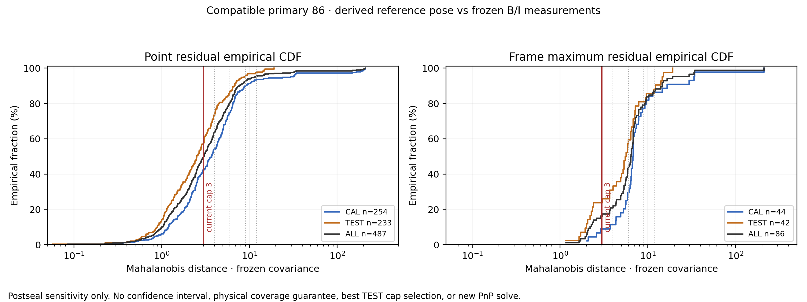
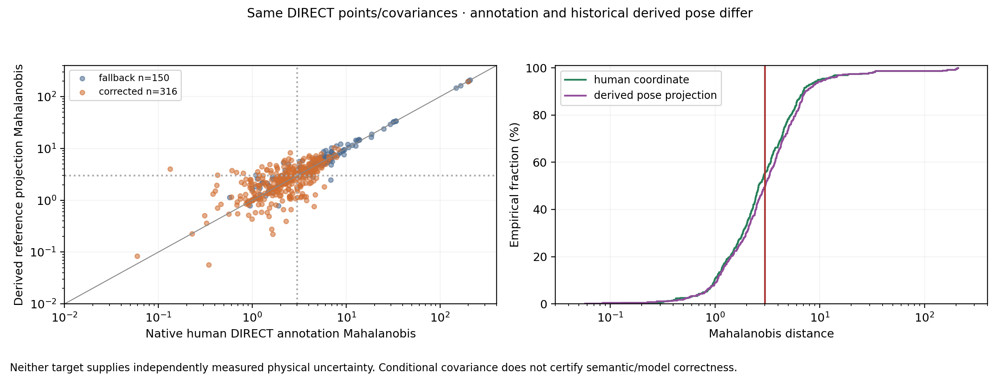

# Frozen B/I covariance budget 사후 민감도

현재 방식의 모델 대응이 호환되는 primary 86프레임(CAL44/TEST42)만 검사했습니다. 앞서 봉인한 failure_audit와 source19/모델/예측은 변경하지 않았습니다. 모든 수치는 사후 원인 민감도이며 TEST 기준으로 cap을 선택하거나 새 PnP를 fit하지 않았습니다. 경험 CDF는 신뢰구간, bootstrap CI, 미래 물리 coverage 보증이 아닙니다.

현재 cap3의 Mahalanobis budget과 O/T 영역 안에 역사적 derived reference pose가 들어가는지 검사했습니다. 아래 BI는 covariance budget만 뜻합니다. geometry/canvas/depth는 따로 집계한 뒤 마지막 열에서 함께 적용합니다. O/T가 없는 프레임도 OT 통과에 포함되는 자명한 경우를 JSON에 별도 표기했습니다.

| 분할 | cap | BI·OT 둘 다 | BI만 | OT만 | 둘 다 실패 | geometry/canvas/depth 포함 전체 통과 |
|---|---:|---:|---:|---:|---:|---:|
| CAL | 3 | 4 | 0 | 37 | 3 | 4 |
| CAL | 4 | 5 | 0 | 36 | 3 | 5 |
| CAL | 6 | 13 | 0 | 28 | 3 | 13 |
| CAL | 9 | 32 | 2 | 9 | 1 | 32 |
| CAL | 12 | 35 | 3 | 6 | 0 | 35 |
| TEST | 3 | 8 | 2 | 30 | 2 | 8 |
| TEST | 4 | 11 | 2 | 27 | 2 | 11 |
| TEST | 6 | 23 | 2 | 15 | 2 | 23 |
| TEST | 9 | 30 | 4 | 8 | 0 | 30 |
| TEST | 12 | 33 | 4 | 5 | 0 | 33 |
| ALL | 3 | 12 | 2 | 67 | 5 | 12 |
| ALL | 4 | 16 | 2 | 63 | 5 | 16 |
| ALL | 6 | 36 | 2 | 43 | 5 | 36 |
| ALL | 9 | 62 | 6 | 17 | 1 | 62 |
| ALL | 12 | 68 | 7 | 11 | 0 | 68 |

별도 geometry/canvas/depth 통과: CAL 42/44, 44/44, 44/44, TEST 42/42, 42/42, 42/42.

실제 covariance는 fallback B σ=2px, I σ=3px를 가정합니다. 보정된 점은 retained image-line의 moving-block resampling 64회와 normal offset 1px floor로 conditional line-intersection Σ를 얻고, α=min(.5,4/(4+λmax(Σconditional))), Σfinal=(1−α)^2·4I+α²Σconditional+I를 씁니다. semantic/model/systematic 오차 항이나 detector–line 상관, 여러 corner가 공유하는 line의 joint covariance는 현재 식에 없습니다. source provenance는 conditional_covariance_is_calibrated=False를 명시합니다.

따라서 σ3/Mah≤3는 조건부 입력 budget 통과이지 물리 정답을 99% 포함한다는 증명이 아닙니다. q의 평균 pixel error가 작아져도 작은 Σ로 나누면 reference pose가 budget 밖에 있을 수 있습니다. 주석과 그로부터 얻은 derived pose projection도 서로 다릅니다.

| 전체 point group | N | Reference Mah 평균 / P90 | cap3 point fraction |
|---|---:|---:|---:|
| B | 445 | 6.692 / 7.796 | 48.8% |
| I | 42 | 6.281 / 5.436 | 59.5% |
| CORRECTED | 318 | 3.980 / 5.551 | 61.6% |
| FALLBACK | 169 | 11.694 / 14.539 | 27.2% |
| HUMAN_DIRECT | 466 | 6.338 / 7.275 | 49.8% |
| HUMAN_SELF | 21 | 13.719 / 9.481 | 47.6% |

3개 B/I의 baseline-success→current-failure 사례에서 frozen normalized6D Jacobian을 평가했습니다. parameter는 Rodrigues rotation-vector(rad), translation/native cuboid diagonal입니다. Singular value는 source와 같은 per-point covariance whitening을 사용합니다. 같은 residual 0인 서로 다른 P3P branch가 있을 수 있으므로 local condition만으로 global branch 선택을 설명하거나 인과 효과를 확정하지 않았습니다.

| 사례 | Current J singular values (큰→작은) | condition | 최소 singular 방향의 unit whitened residual translation response cm |
|---|---|---:|---:|
| eval_cad:1778653018878592768 | 1105, 1046, 240.1, 220.2, 48.85, 24.28 | 45.50 | 1.03 |
| eval_night08:1779449501478488320 | 809.3, 748.1, 138.7, 119.6, 33.23, 18.6 | 43.50 | 3.36 |
| eval_pallet07:1778652170735118080 | 691.4, 630.2, 267.5, 237.2, 15.73, 9.957 | 69.44 | 16.20 |
| wood_183705:000706 | 697, 655.4, 283.5, 212.8, 38.7, 21.32 | 32.69 | 0.92 |

위 response는 unit whitened residual의 **국소 선형 반응**입니다. 확률적 pose 표준편차나 물리 error bound가 아닙니다. 초기·current·registered reference의 whitened/unwhitened J와 최소 singular 방향을 모두 JSON에 보존했습니다. BI2 프레임은 6D nullity가 남는 것도 명시합니다.

[전체 JSON](UNCERTAINTY_DIAGNOSTIC.json) · [Source 근거](SOURCE_FACTS.json) · [Protocol](PROTOCOL.json) · [봉인](DIAGNOSTIC_SEAL.json)

원본 숫자·진단 봉인을 보존하고 과학 그림의 폰트만 별도 위치에서 재렌더했습니다.
