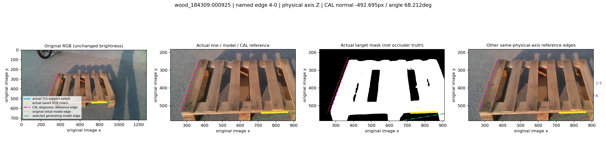
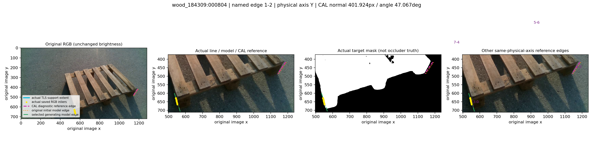
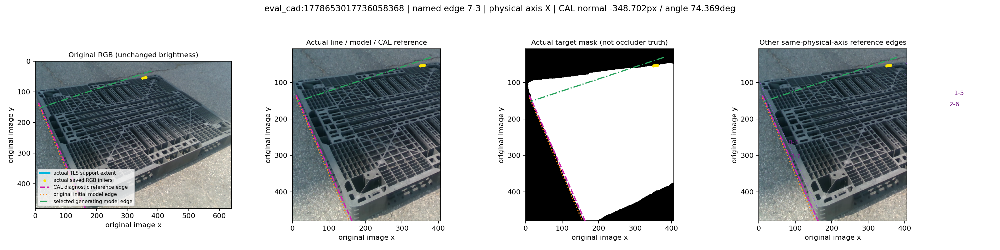

# v29 선 σ가 31/41px로 커진 이유: 고정 CAL 상위 잔차 진단

**작은 TLS 오차와 올바른 native 변 대응은 다르다.** 두 정책의 호환 CAL44에서 절대 법선 잔차 상위3개를 사전 고정했으며, 두 정책의 top3가 같은 선이라 실제 그림은 세 개다. 모두 실제 target-mask 외곽에 있고 TLS RMS<0.5px이나, 지정된 native 3D 변의 고정 CAL 투영과는 349–493px 떨어져 있다. 초기 모델 변은 이 고정 기준과 비교적 가깝고, 다른 `SWAPPED_WD/CACHED_*` guide의 같은 native 변이 다른 물리 위치/축의 실제 외곽으로 이동해 선택됐다.

## 1. 실제 픽셀과 TLS는 존재하지만 named-edge 대응은 별도 문제

| CAL 사례/선 | 고정 CAL normal 잔차(px) | 각도 차(°) | 실제 지지점 | TLS RMS(px) | anchor 정사영 이동(px) |
|---|---:|---:|---:|---:|---:|
| wood_184309:000925 [4, 0] | -492.695 | 68.212 | 148 | 0.3441 | 0.0010 |
| wood_184309:000804 [1, 2] | 401.924 | 47.067 | 44 | 0.4035 | 0.0148 |
| eval_cad:1778653017736058368 [7, 3] | -348.702 | 74.369 | 12 | 0.0550 | 0.0020 |

세 선의 global-external 지지 비율과 동일 target component 비율은 모두1이다. 따라서 이 표본의 큰 잔차는 ‘실제 RGB 선이 없음’이나 TLS 계수 자체의 수백 px 오차로 설명되지 않는다. 패널에서는 목재 앞면/지지부의 실제 외곽 또는 플라스틱 상단 외곽을 다른 named cuboid 변으로 연결한 형태가 보인다. hole 경계나 별도 가림 물체로 확정할 근거는 없으며, target 마스크만으로 물리 native identity가 인증되지는 않는다.

support anchor는 **unweighted 실제 inlier 평균을 저장된 weighted-IRLS TLS 선 위에 정사영**한 통계다. 이 조정은0.001–0.015px로 작아 수백 px 잔차를 설명하지 못한다. calibration normal 잔차는 이 통계에서 지정 native 변의 무한 투영선까지의 거리다. 새 잡음 σ는 이 native 대응 오차까지 포함한 total-error 규모이며, 실제 RGB 측정 자체가31/41px로 흐릿하다는 뜻이 아니다.

## 2. 43px 탐색 폭이 원 q와의43px 연결 제약은 아니다

| 사례/선 | source q→실제 TLS 절대 법선 거리(px) | mate q 거리(px) | 실제 search anchor→TLS 거리(px) | source q→모델 search anchor 2D 이동(px) |
|---|---:|---:|---:|---:|
| wood_184309:000925 [4, 0] | 322.780 | 14.187 | 9.723 | 614.395 |
| wood_184309:000804 [1, 2] | 667.033 | 627.632 | 2.368 | 670.358 |
| eval_cad:1778653017736058368 [7, 3] | 48.037 | 비BI: 점 미조회 | 18.711 | 384.390 |

세 선 모두 `MODEL_PROJECTION_SEARCH_ONLY_BAND`에서 나왔다. 설정43px는 **그 모델 anchor 주변**의 normal reach다. 원 source q에서 해당 anchor까지는614/670/384px 이동했다. 실제 search anchor는 선택 TLS에 약10/2/19px로 가깝지만, 원 source q는 모두43px 밖이다. CAD에서는 q→모델 anchor 이동이 seed 선 방향으로 거의 평행이므로 seed-normal 이동은0에 가깝지만, 최종 실제 TLS에는48px 떨어진다. 따라서 전체 2D 이동과 실제 측정선에 대한 normal 거리를 구분해야 한다.

기존 graph의 q displacement 비용은 incident 선택선 두 개 이상이 교점을 만들 때만 계산된다. 단독 선이 넓은 모델 guide를 통해 다른 쪽 외곽에 도달해도 native-point 연결을 직접 제한하는 항은 없다. 일부 다른 B/I q가 그 선 가까이 있어도 그것을 골라 native 라벨을 바꾸지 않았다. 전체 q 거리 원장은 아래 링크에 남겼다.

## 3. 하나의 coherent C2 기준 차이만으로는 설명되지 않는다

원 고정 기준과 같은 중심·같은 무순서 cuboid인 physical C2 변환을 모든 활성선에 동일하게 적용해 비교했다. 선마다 좋은 기준을 섞지 않았다. ALL 정책의 평균 절대 normal 잔차는 다음과 같다.

| 프레임 | 활성선 수 | 고정 기준 평균/최대(px) | 단일 C2 기준 평균/최대(px) |
|---|---:|---:|---:|
| wood_184309:000925 | 4 | 126.455/492.695 | 433.361/548.941 |
| wood_184309:000804 | 3 | 138.138/401.924 | 343.774/665.048 |
| eval_cad:1778653017736058368 | 3 | 123.656/348.702 | 276.973/435.950 |

큰 잔차선 하나가 C2 쪽에서 가까워지는 사례는 있지만, 원 기준에서1–20px였던 다른 선들이 C2에서는 수백 px로 나빠진다. 세 프레임의 두 정책 모두 C2 평균 절대 잔차가 증가한다. 즉 ‘모든 선이 한 C2 branch에 맞는데 기준만 반대’라는 일관된 패턴이 아니다. 서로 다른 물리 변/대응의 선이 한 graph에 섞이는 설명과 부합하지만, 이 세 표본만으로 전체 잡음 증가의 원인 비율을 추정하지 않는다.

## 4. 이번 진단의 경계와 다음 판단

현재 v29 관측·graph·source 정책·CAL 기준·모델·선정/평가 설정은 그대로 유지한다. 새 threshold·q gate·정밀 키포인트·pose 적합이나 재교정은 하지 않았다. 원 source q와의 연결을 보존하면서 실제 선을 사용하는 별도 association 설계는 다음 버전의 가설이며, 이번 자료는 그 검토 근거다. S/U 관측 점은 조회하지 않았고 TEST/추가143 라벨도 읽지 않았다. 마젠타는 **CAL 진단 기준**이지 runtime 측정/guide가 아니다.

- [고정 top3 실제 패널/원장](../CAL_geometry_guided_noise_diagnosis_v4_29/REPORT_KO.md)
- [모든 eligible B/I q 거리/anchor provenance](../CAL_geometry_guided_anchor_association_diagnosis_v4_29/REPORT_KO.md)
- [모든 활성선의 coherent C2 잔차](../CAL_geometry_guided_C2_identity_diagnosis_v4_29/REPORT_KO.md)

### wood_184309:000925

### wood_184309:000804

### eval_cad:1778653017736058368

