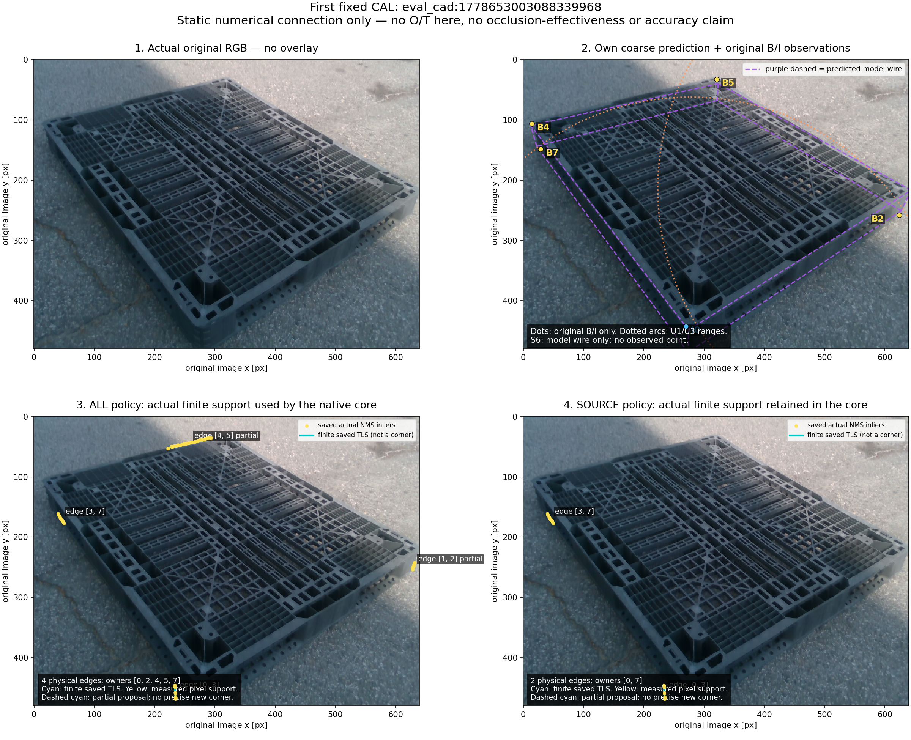
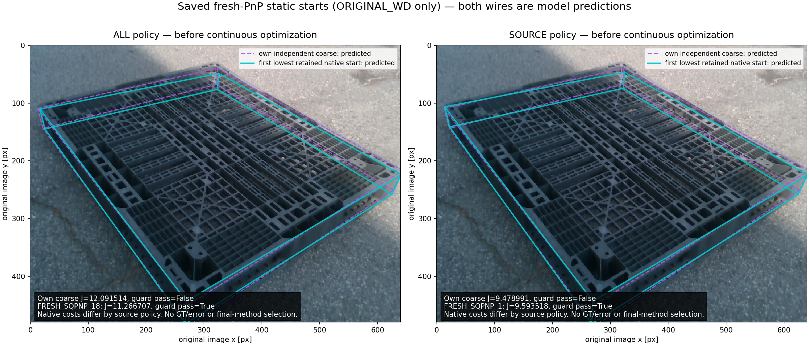

# 첫 CAL 프레임: 실제 영상과 정지 PnP 연결 확인

`eval_cad:1778653003088339968` — 상태: `I0, U1, B2, U3, B4, B5, S6, B7`.

보라색 점선은 독립 초기 coarse 자세가 예측한 모델이다. B/I 점은 봉인된 영상 관측이며, U1/U3는 넓은 불확실 타원 범위만 표시했다. U 중심점과 S6 관측점은 그리지 않았다. S6에 연결된 모델 wire는 예측이다.

청록색 선과 노란 표본은 저장된 실제 NMS/TLS 관측의 유한 지지다. 선을 무한 연장하지 않았고 새 교점이나 정밀 KP를 만들지 않았다. 청록 점선은 partial 제안이다. ALL은 4개 물리변·5개 owner, SOURCE는 원 RGB 관측을 보존하면서 fallback owner에 걸린 2개 물리변·2개 owner를 사용한다.

| 정책 | own coarse native J / guard | 첫 최저 retained native start J / guard |
|---|---:|---:|
| ALL_BI_REPLACE | 12.09151394 / False | `FRESH_SQPNP_18` 11.26670680 / True |
| RGB_NONFALLBACK_PRESERVE | 9.47899096 / False | `FRESH_SQPNP_1` 9.59351833 / True |

두 wire 모두 모델 예측이다. 표시한 fresh PnP 시작 자세는 ORIGINAL_WD의 보존된 native 시작집합 중 첫 최저 비용 항목이며, 연속 최적화나 최종 방법 선택 결과가 아니다. SOURCE의 coarse 비용이 더 낮아도 guard를 통과하지 않는다. 정책마다 목적함수가 다르므로 정책 간 비용으로 우열을 정하지 않는다.

이 사진에는 외부 O/T 상태가 없다. 실제 수치 연결을 확인하는 CAL 진단이며, 가림처리 효과·정확도 개선·정답 일치를 증명하지 않는다. GT wire, e 자세, 새 추론·특징 질의·선 적합·PnP·최적화는 사용하지 않았다.

자세의 `native_t`와 모델 중심은 구분한다: `center = R_cf @ mean(native_xyz) + native_t`, `R_physical = R_cf @ Q`. 전체 원본 사진을 유지하며, `PROCESS_DATA.json`에는 원 BI archive, 유한 실제 지지, 전체 core plan, ORIGINAL family, 저장된 pose vector/scale/native_t를 보존했다.

[원본 RGB](source_rgb.png) · [수치와 provenance](PROCESS_DATA.json) · [입력·소스 계획](SOURCE_PLAN_V1.json) · [렌더 봉인](RENDER_SEAL.json)
