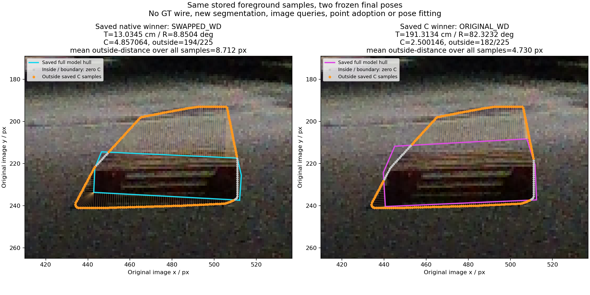

# 031426: 같은 저장 전경 표본에서 C 비용이 줄어드는 위치

같은 저장 최종 결과를 비교하면 native는 **13.0345cm / 8.8504°**, C는 **191.3134cm / 82.3232°**다. C는 더 나쁜 3D 결과를 선택하면서도 보관된 영상 전경 포함 비용을 **4.857064→2.500146**으로 낮췄다. 이 사례는 새 활성 native edge가 0개이며 B2의 complete q와 B0/B4의 기존 partial normal·T4는 남아 있다. “아무 선 정보도 없다”는 뜻이 아니다.

왼쪽 청록색은 native의 SWAPPED_WD 최종 hull, 오른쪽 자홍색은 C의 ORIGINAL_WD 최종 hull이다. 회색 점은 해당 hull 안/경계의 저장 표본(비용 0), 주황색 점은 밖의 저장 표본이다. 가는 선은 표본에서 가장 가까운 유한 hull 변까지의 거리다. 같은 원 RGB 밝기와 같은 ROI를 사용했다. 정답 wire·S/U 영상 점·새 마스크·관측·자세 적합은 없다.

| 저장 값 | native 최종 | C 최종 |
|---|---:|---:|
| 전체 표본 | 225 | 225 |
| hull 밖 표본 | 194 | 182 |
| 전체 표본 평균 밖거리, 내부 0 포함 (px) | 8.711704 | 4.730011 |
| 최대 밖거리 (px) | 24.124497 | 16.114619 |
| 투영 convex hull 넓이 (px²) | 1348.496133 | 2017.511160 |
| hull 최소 y (px) | 214.456111 | 208.283908 |
| 가중 C | 4.857063613 | 2.500146381 |

194개 표본의 C 기여가 감소하고 1개가 증가했으며 30개는 같았다. native에서 밖이던 13개가 C hull 안으로 들어가고, 반대는 1개다. 가장 큰 비용 감소 10개 표본은 저장 index183–192 부근이며 x506.481–508.212 / y195.404–204.058에 있다(정확한 순서·좌표는 JSON). 그림의 우상부 표본들과 hull 위쪽 사이의 거리가 줄어드는 것이 보인다. 전체 표본의 값과 가까운 foot를 모두 저장했으므로 이 열 개만 보고 비용을 다시 선정한 것은 아니다.

사용한 기존 수식은 **C = λ × 0.5/N × Σ ρ(d/σ)** 이다. 내부 표본은 d=0, 외부 표본의 d는 투영된 full model convex hull의 가장 가까운 유한 변까지 거리다. 저장 설정 λ=1, σ=1px, pseudo-Huber δ=1.25를 그대로 사용했다. model→observed 항은 0이며 큰 hull이나 다른 orientation/depth가 유일한 3D 자세인지 판정하는 항이 아니다. 두 pose는 family와 자세가 함께 다르므로 이 비교만으로 depth 하나의 인과 효과를 분리하지 않는다.

| C 후보 | N | O | S | C | J |
|---|---:|---:|---:|---:|---:|
| 보존된 native endpoint | 0.095279 | 0 | 0.837634 | 4.857064 | 5.789976 |
| C 선택 endpoint | 0.664359 | 0 | 0.933739 | 2.500146 | 4.098244 |

C 감소 2.356917이 N+S 증가 0.665185를 넘어서 J가 1.691732 줄었다. 보존 native endpoint가 후보군에서 사라져 생긴 현상이 아니다. 저장 C 표본은 원 `outline_observation`의 mask 기반 envelope 표본이며 `convex_envelope_is_not_actual_complete_surface` 표시도 보존했다. 주황 점 전부를 실제 RGB 물리 경계로 부르지 않는다. 그림자/배경 포함 또는 물체 소유권 오류는 이 자료만으로 확정하지 않았고, 새 targetmask 배열도 열지 않았다.

ROI [410,169,537,265]는 원 ORIGINAL initial projection, eligible B/I q archive 및 저장 C 표본 범위의 합집합에 사전 선언된 24px 여백을 더해 정했다. 최종 hull/GT/오차를 ROI 선택에 쓰지 않았다. 원 initial은 ROI에만 쓰였고 새 guide나 후보를 생성하지 않았다.

최초 attempt는 image_hw를 clean_input에서 읽어 KeyError로 종료됐다. 실제 위치인 physics.image_hw로 **한 필드만** 고친 별도 r2 source/PLAN을 봉인한 뒤 완료했다. 원 실패 source·PLAN·영수증은 보존했다. 커널·관측·모델·ROI 규칙·가중치는 바꾸지 않았다.

- [PLAN](PLAN.json), [PLAN seal](PLAN_SEAL.json), [실행 source](render_stored_containment.py)
- [표본별 거리·비용·두 hull 전체 좌표](EVIDENCE.json), [요약](SUMMARY.json), [공간 요약](SPATIAL_SUMMARY_V1.json)
- [단일 필드 교정](SOURCE_CORRECTION_V1.json), [교정/실패 바인딩](CORRECTION_PLAN_SEAL_V1.json), [보존한 최초 실패](../clean_fresh_BI_containment_pixel_diagnosis_v4_32_v1/FAILED_ATTEMPT_V1.json)
- [원 저장 후보 진단](../clean_fresh_BI_fixed_failure_diagnosis_v4_32_v1/REPORT_KO.md), [실제 QA](EXECUTION_RECEIPT_V1.json)

현재 방법·기준·모델·default e를 변경하거나 새 학습·threshold/grid 조정·추론을 하지 않았다. 이 한 장은 저장 목적함수의 영상상 선호를 설명하는 사후 진단이며 성능 채택 근거가 아니다.
