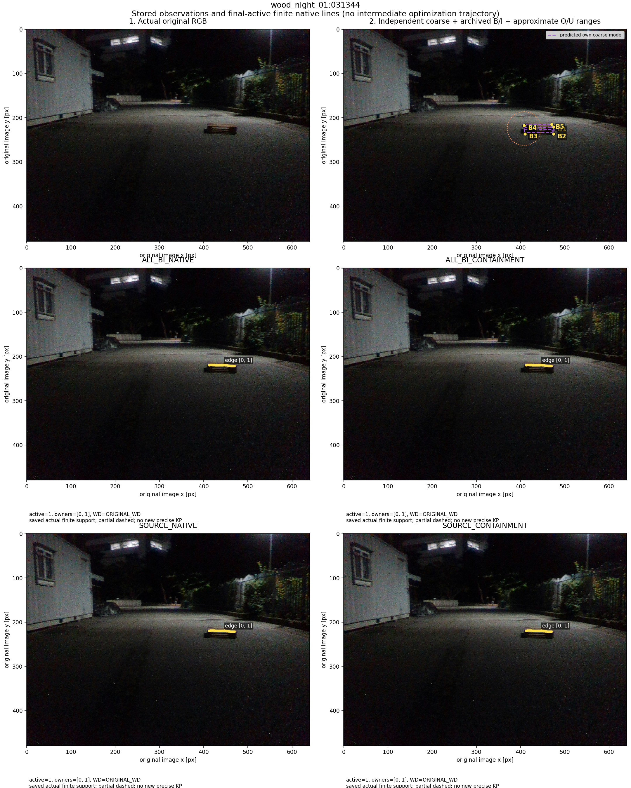
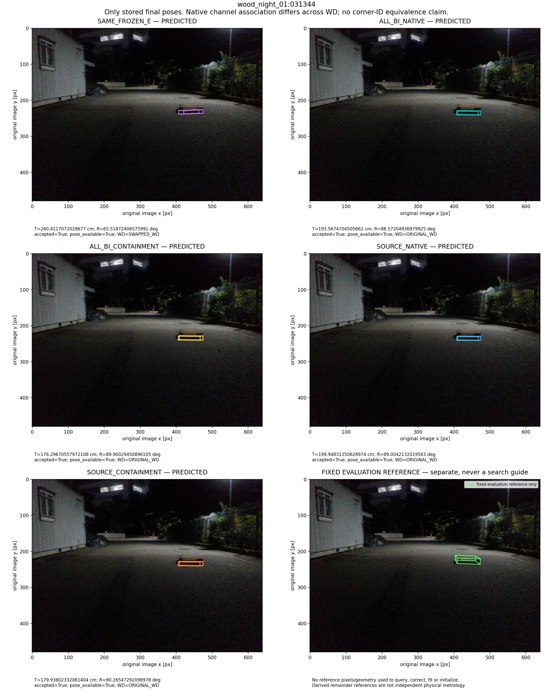
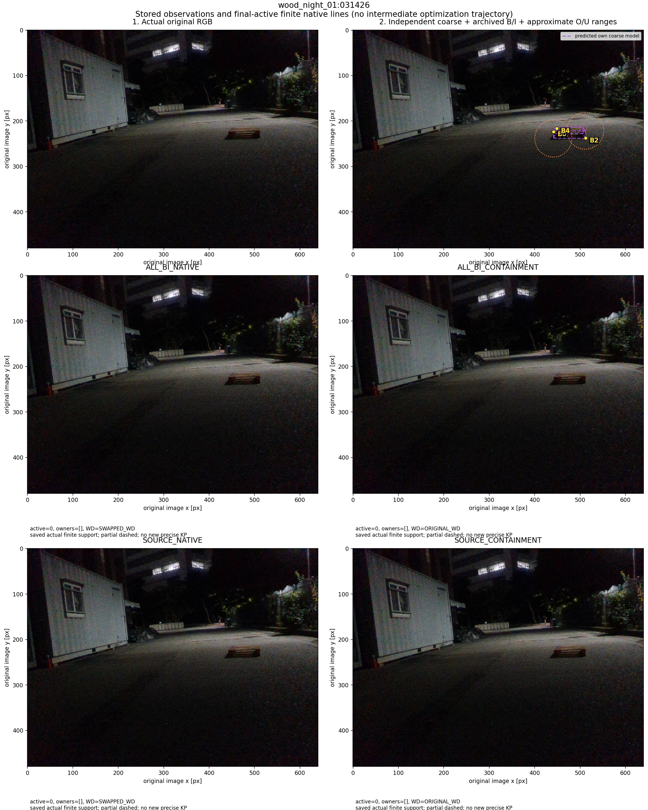
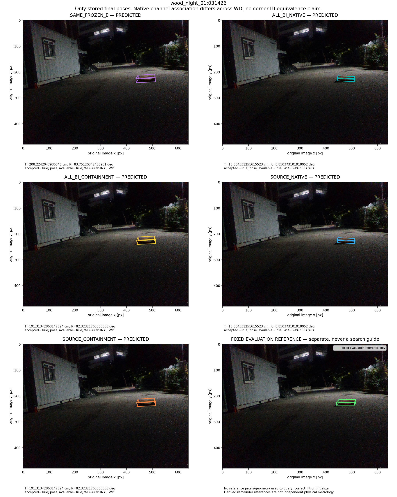
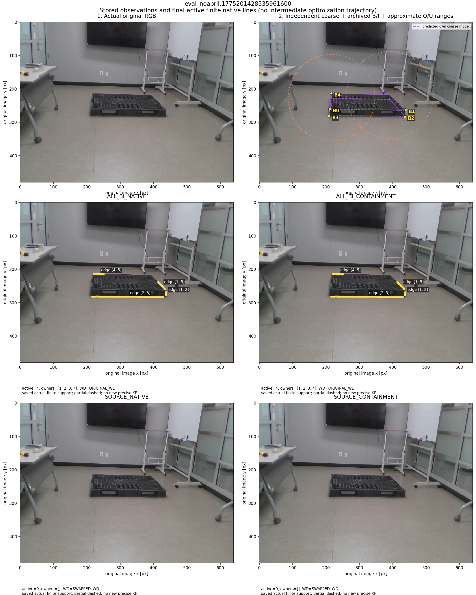
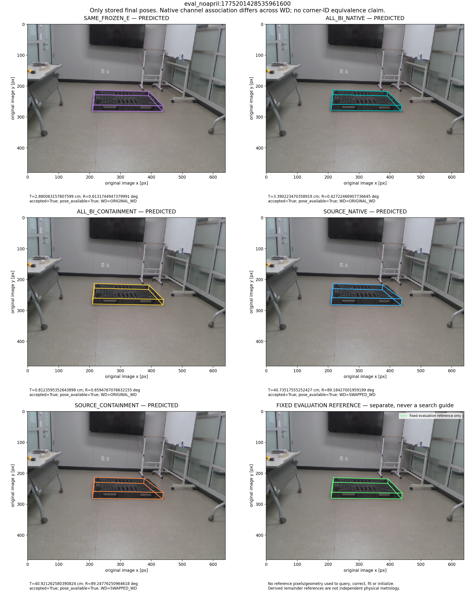

# R2 전체 결과: 고정 최대 이동오차 사례의 보관된 과정

PRIMARY192의 새 네 방법별 최대 이동오차 사례와 TEST49 SOURCE_CONTAINMENT 최대 사례를 합쳐 설명한다. 오차를 본 뒤 고른 진단 사례이며 대표 성공률 표본·방법 선택 기준이 아니다. 기본값은 SAME_FROZEN_E다.

초기 점은 raw YOLO가 아니라 N3/SubPix/BI 보정 archive다. 실제로 저장된 coarse·관측·유한 선 지지·최종 자세만 그렸다. 전체 예측에 보관되지 않은 native-start 자세나 연속 최적화 중간 궤적을 재계산하거나 만들지 않았다. S는 모델 wire만, O/U는 대략 범위만 사용한다. 고정 참조는 마지막 별도 패널의 평가용이며 탐색·보정·fit·시작점으로 쓰지 않았다.

## wood_night_01:031344

선택 이유: PRIMARY/ALL_BI_NATIVE, PRIMARY/SOURCE_NATIVE

| 방법 | 저장 T [cm] | 저장 R [°] | accepted |
|---|---:|---:|---|
| SAME_FROZEN_E | 260.4117072028677 | 65.51872406575991 | True |
| CLEAN_FRESH_BI_ALL_BI_NATIVE | 193.5674704505662 | 88.57204936979925 | True |
| CLEAN_FRESH_BI_ALL_BI_CONTAINMENT | 176.29670557972108 | 89.90029450896105 | True |
| CLEAN_FRESH_BI_SOURCE_NATIVE | 199.94831350628974 | 89.0042132019563 | True |
| CLEAN_FRESH_BI_SOURCE_CONTAINMENT | 179.93802332061404 | 90.26547292098978 | True |

[보관 값·원천·표시 단계](case0/PROCESS_DATA.json) · [원본 RGB](case0/source_rgb.png)

## wood_night_01:031426

선택 이유: PRIMARY/ALL_BI_CONTAINMENT, PRIMARY/SOURCE_CONTAINMENT

| 방법 | 저장 T [cm] | 저장 R [°] | accepted |
|---|---:|---:|---|
| SAME_FROZEN_E | 208.2242047986846 | 83.75120342488951 | True |
| CLEAN_FRESH_BI_ALL_BI_NATIVE | 13.034531251615523 | 8.850373101918052 | True |
| CLEAN_FRESH_BI_ALL_BI_CONTAINMENT | 191.31342868147024 | 82.32321765505058 | True |
| CLEAN_FRESH_BI_SOURCE_NATIVE | 13.034531251615523 | 8.850373101918052 | True |
| CLEAN_FRESH_BI_SOURCE_CONTAINMENT | 191.31342868147024 | 82.32321765505058 | True |

[보관 값·원천·표시 단계](case1/PROCESS_DATA.json) · [원본 RGB](case1/source_rgb.png)

## eval_noapril:1775201428535961600

선택 이유: TEST/SOURCE_CONTAINMENT

| 방법 | 저장 T [cm] | 저장 R [°] | accepted |
|---|---:|---:|---|
| SAME_FROZEN_E | 2.880063157807599 | 0.6131744947379991 | True |
| CLEAN_FRESH_BI_ALL_BI_NATIVE | 3.390223470358919 | 0.42722466907736645 | True |
| CLEAN_FRESH_BI_ALL_BI_CONTAINMENT | 0.8123595352643898 | 0.6594767076632155 | True |
| CLEAN_FRESH_BI_SOURCE_NATIVE | 40.73517555252427 | 89.18427001959199 | True |
| CLEAN_FRESH_BI_SOURCE_CONTAINMENT | 40.921262580390824 | 89.24776250964618 | True |

[보관 값·원천·표시 단계](case2/PROCESS_DATA.json) · [원본 RGB](case2/source_rgb.png)
