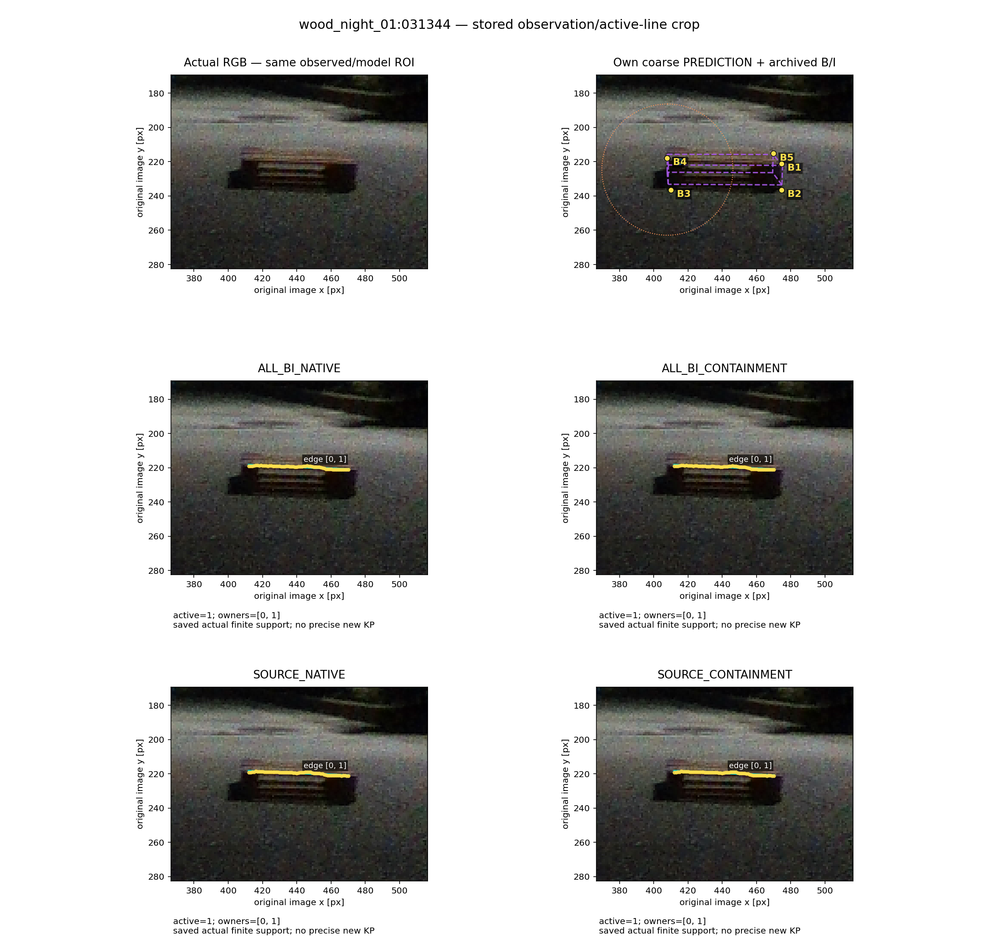
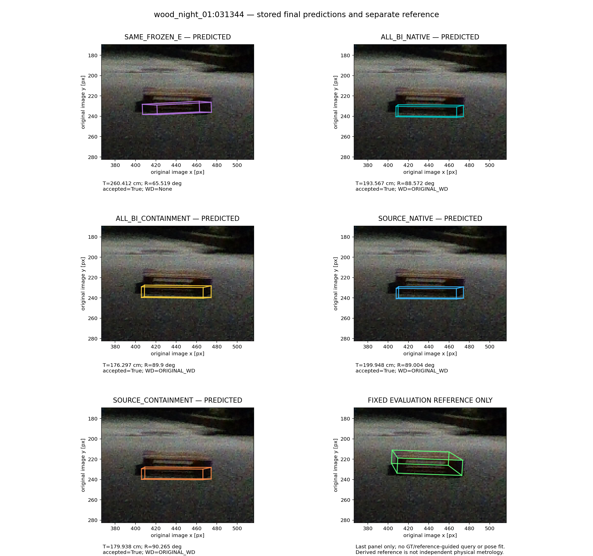
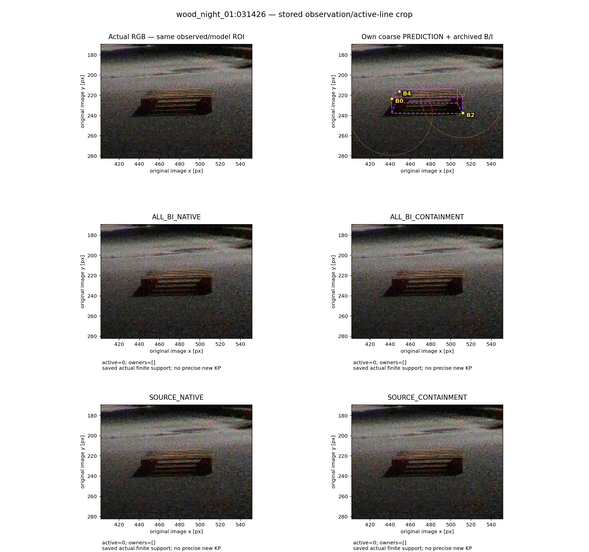
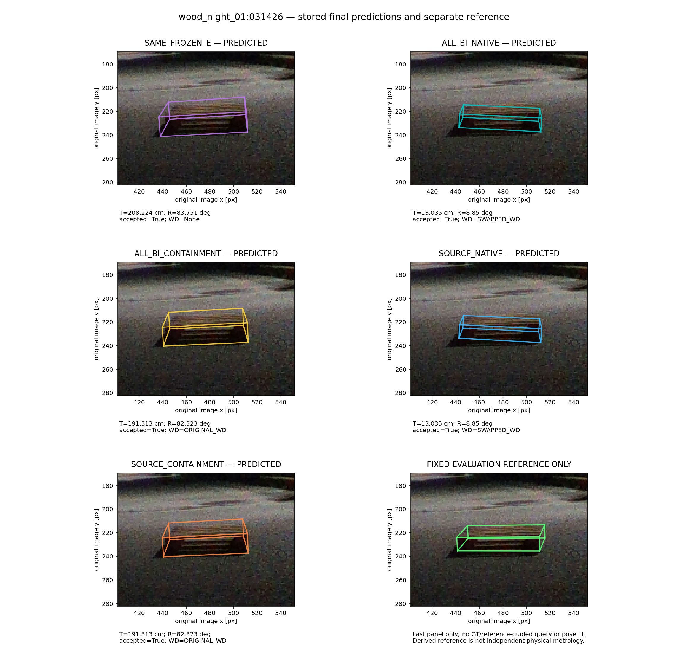
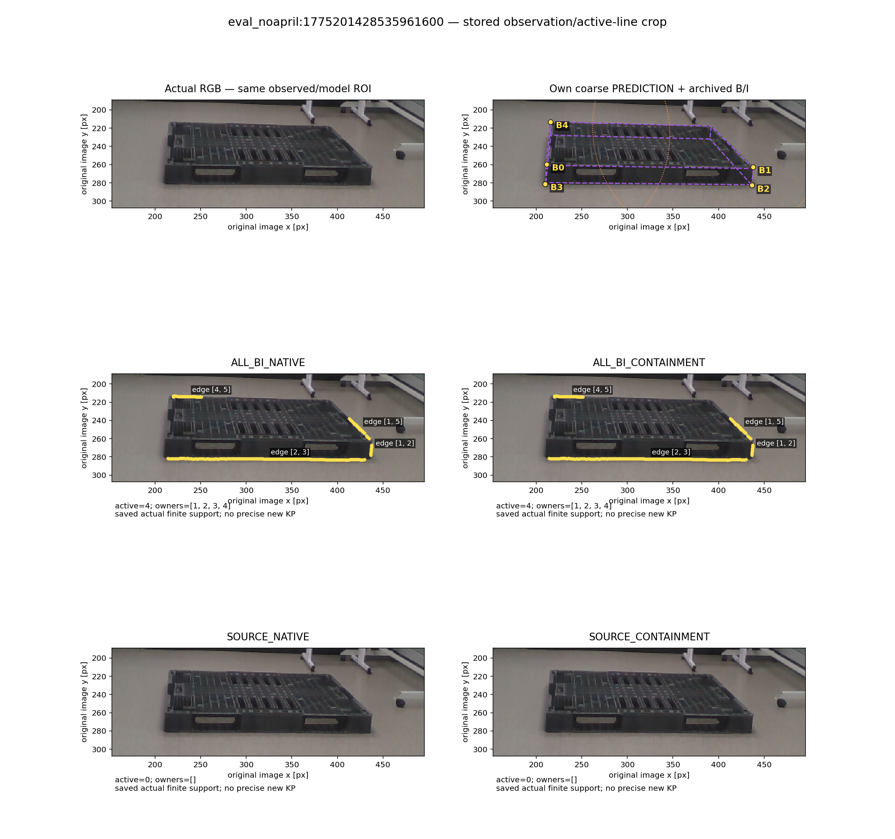
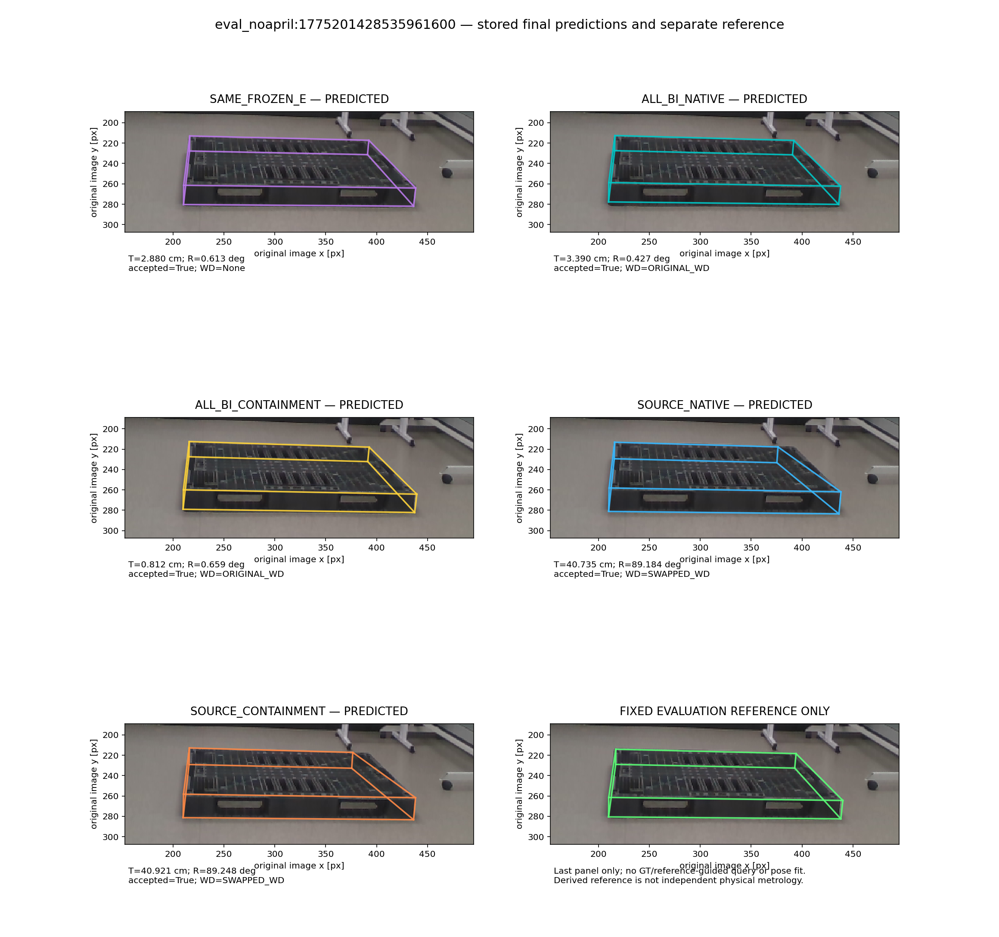

# 확대 보기: 저장된 전체 결과 과정

원본 전체 프레임과 최초 렌더는 보존했다. 이 확대는 보관된 B/I 점·초기 coarse 모델·실제 선 지지만으로 정한 동일 ROI를 사용하며 참조·최종오차·선택된 최종 자세로 ROI를 고르지 않았다. 좌표는 원본 px다.

점은 raw YOLO가 아니라 기존 N3/SubPix/BI 보정 archive다. 보라선은 예측이다. O/U는 영역만, S는 모델만 사용한다. 선0인 패널은 비워 두고 active=0을 표시했다. 마지막 초록 패널만 고정 평가 참조이며 탐색·보정·fit과 무관하다. 저장되지 않은 시작 자세·연속 중간 궤적은 만들지 않았다.

## wood_night_01:031344

[전체 원본/보관값](../case0/PROCESS_DATA.json) · [원본 사진](../case0/source_rgb.png)

## wood_night_01:031426

[전체 원본/보관값](../case1/PROCESS_DATA.json) · [원본 사진](../case1/source_rgb.png)

## eval_noapril:1775201428535961600

[전체 원본/보관값](../case2/PROCESS_DATA.json) · [원본 사진](../case2/source_rgb.png)
