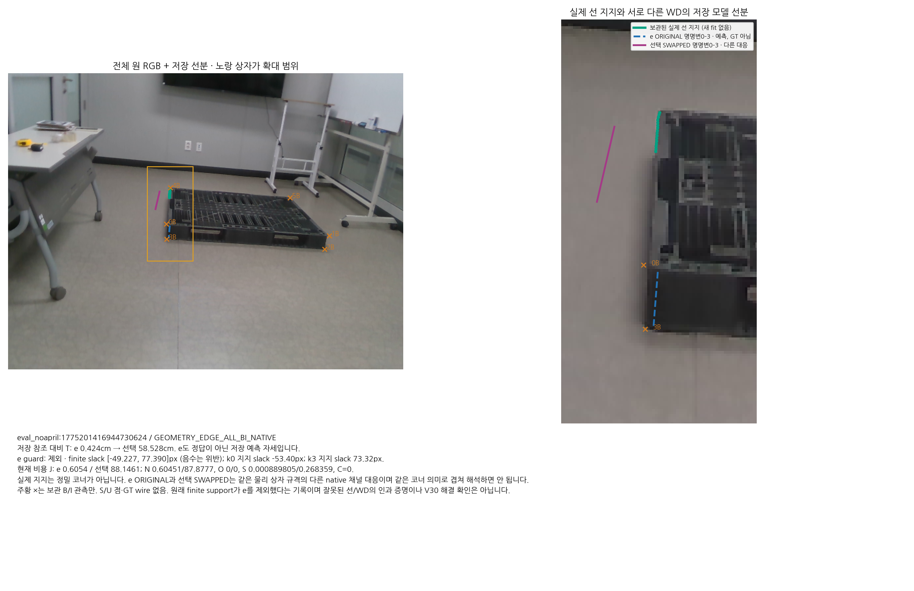

# 저장된 실제 선 지지가 e를 제외한 사례

eval_noapril:1775201416944730624 / GEOMETRY_EDGE_ALL_BI_NATIVE

저장 참조 대비 T: e 0.424cm → 선택 58.528cm. e도 정답이 아닌 저장 예측 자세입니다.

e guard: 제외 · finite slack [-49.227, 77.390]px (음수는 위반); k0 지지 slack -53.40px; k3 지지 slack 73.32px.

현재 비용 J: e 0.6054 / 선택 88.1461; N 0.60451/87.8777, O 0/0, S 0.000889805/0.268359, C=0.

실제 지지는 정밀 코너가 아닙니다. e ORIGINAL과 선택 SWAPPED는 같은 물리 상자 규격의 다른 native 채널 대응이며 같은 코너 의미로 겹쳐 해석하면 안 됩니다.

주황 ×는 보관 B/I 관측만. S/U 점·GT wire 없음. 원래 finite support가 e를 제외했다는 기록이며 잘못된 선/WD의 인과 증명이나 V30 해결 확인은 아닙니다.

[정확한 좌표·slack·비용·봉인 출처](PROCESS_DATA.json)

