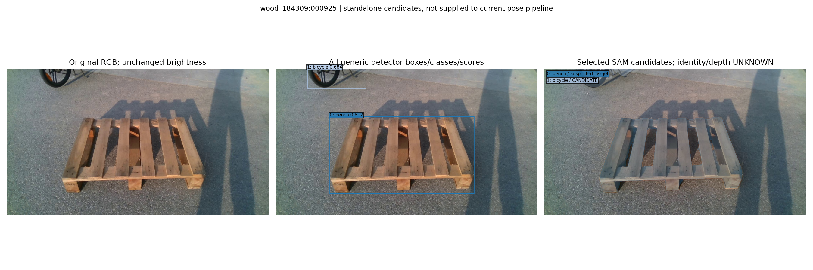
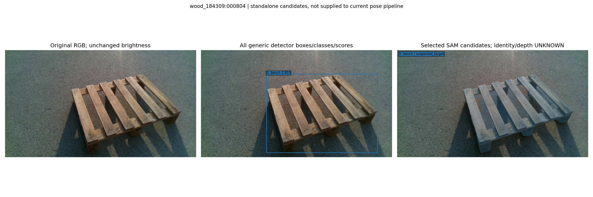
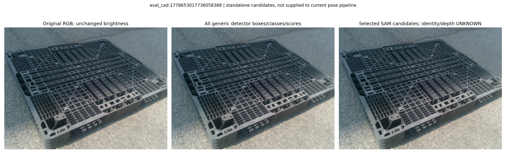

# 고정 CAL3 자동 instance 후보

Generic COCO80 detector와 별도 box-prompt MobileSAM 후보입니다. other object/앞가림/물리 O 확정이 아니며 기존 pose pipeline에 공급하지 않았습니다. target 겹침은 진단일 뿐입니다. 모든 box·SAM3대안·0/unknown 행은 RESULTS에 보존했습니다. GT·KP/S/U/O point prompt·포즈/잡음 적합은 없습니다.

## wood_184309:000925

2 detections; CANDIDATES_AVAILABLE.

## wood_184309:000804

1 detections; CANDIDATES_AVAILABLE.

## eval_cad:1778653017736058368

0 detections; UNAVAILABLE.

