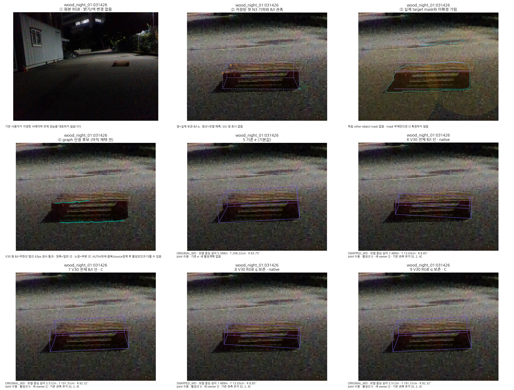
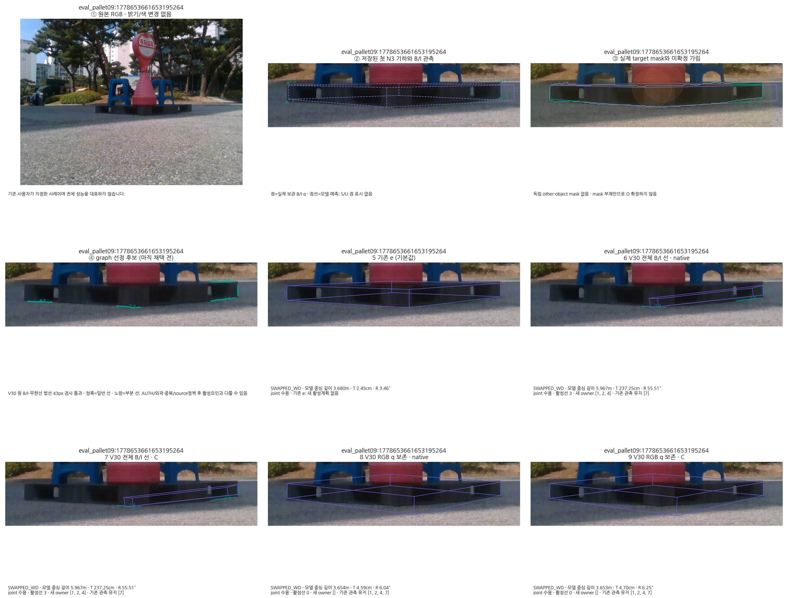

# V30 전체 평가: 법선 거리 검사만으로 잘못된 변 연결을 해결하지 못함

V30은 전체 238장·5개 방법의 예측을 먼저 봉인하고, 독립 검산을 통과한 뒤 동일한 고정 참조로 평가했다. 새 방법은 모두 목표를 만족하지 못해 **채택하지 않는다**. 기본값은 `SAME_FROZEN_E`다.

CAL46은 보정용이고 주 평가는 TEST49+추가143=192장이다. severe는 0장이다. 대응 불일치·관측 없음·fallback을 포함해 모든 행을 유지했다. 성공은 팔레트 중심의 이동 오차 ≤5cm이며, 동시 성공은 이동 ≤5cm·회전 ≤5°다.

| 동일 적용 방법 | TEST49 성공/동시 | 추가143 성공/동시 | 주192 성공/동시 | 주192 이동 평균/최대(cm) | 주192 회전 평균/최대(°) | 주192 fallback |
|---|---:|---:|---:|---:|---:|---:|
| 기존 e | 49/49 | 66/65 | 115/114 | 14.1121/260.4117 | 13.0011/159.1366 | 4 |
| 전체 B/I · native | 37/34 | 62/58 | 99/92 | 18.2379/244.3000 | 17.9784/90.1770 | 9 |
| 전체 B/I · containment | 37/37 | 61/58 | 98/95 | 21.1861/247.8790 | 17.1657/103.5222 | 6 |
| RGB q 보존 · native | 36/34 | 74/68 | 110/102 | 24.4420/1103.7211 | 16.2113/122.8425 | 0 |
| RGB q 보존 · containment | 38/37 | 78/75 | 116/112 | 19.1772/296.5358 | 14.8320/122.8425 | 0 |

RGB q 보존·containment의 중심 성공 수는 e보다 한 장 많지만, 기존49 성공은 49→38장이고 동시 성공은 전체114→112장이다. 최대 중심 오차도 260.4117→296.5358cm다. 이를 개선된 기본 방법으로 선택하지 않는다. RGB q 보존·native의 최악 사례 `eval_noapril:1775201421043401984`는 1103.7211cm이며 accepted 결과다. 큰 오차나 fallback을 평균에서 빼지 않았다.

[37개 방법의 전체 비교표](../../../../remainder_after_test49_v1/repair_campaign_20261015_v1/RESULTS_V11_V30.html)에는 이전33개 방법을 그대로 보존했다. [독립 집계 검산](../independent_campaign_accounting_review_v4_30/v1/ACCOUNTING_REVIEW_V1.json)은 10,148검사·실패 0이다.

## 실제 이미지에서 확인한 과정

[고정 두 사례의 9단계 보고서](../geometry_guided_process_v4_30_v1/REPORT_KO.md)는 공통 관측 네 단계와 다섯 방법의 독립 최종 자세를 보여 준다. 최적화가 차례로 아래 그림처럼 움직였다는 뜻이 아니다. 청록색은 실제 선 후보이고 보라색은 모델 투영이다. GT 투영은 그리지 않았다.

목재 사례는 선택 후보3개가 있어도 최종 새 활성 선은0개다. native의 208.22→13.03cm 변화를 새 선의 효과로 해석하지 않는다. 파란 의자 사례는 전체 B/I에서 실제 활성 선3개와 joint 수용이 있어도 2.45→237.25cm로 악화됐다. 관측 인증·수학 검산 통과와 대응 정답·정확도는 구분해야 한다.

## 바뀐 부분과 검증 범위

V30은 저장된 실제 V29 NMS/TLS 후보에서, 같은 native 변의 원래 B/I 관측점과 실제 무한 직선 사이 법선 거리가 기존 43px 이내인지 검사한다. 양끝이 B/I이면 둘 다 검사한다. 원 RGB·q·공분산·상태·마스크·후보와 raw 인덱스는 바꾸지 않았다. 새 선택 모집단의 법선·각도·접선 잡음은 CAL46만으로 별도 적합했다. V29와의 비교에는 선택 검사와 새 CAL 보정값의 효과가 함께 들어 있으므로 검사 하나의 인과 효과로 표현하지 않는다.

[예측 봉인](PREDICTION_SEAL.json), [고정 점수 봉인](SCORE_SEAL.json), [CAL46](CAL_SCORE.json), [TEST49](TEST_SCORE.json), [추가143](REMAINDER_SCORE.json), [주192 재집계](PRIMARY192_READOUT_V1.json)를 남겼다. 독립 검산은 [AUDIT.json](independent_root_audit_v1/AUDIT.json) 기준 238장·99,385검사·실패 0, 최대 스칼라 차 1.7053e−13이다. 이는 선택된 자세의 비용·미분·지지 검사 및 저장 후보 최솟값의 일치를 확인한 것이고, 선택선이 실제 해당 모서리인지 또는 모든 graph 후보의 전역 최적해인지를 증명하지 않는다.

## 왜 거리 검사만으로 부족한가

[실제 실패 사진과 선 지지 구간](../frozen_e_geometry_guided_objective_diagnosis_v4_29b/actual_failure_noapril_1775201416944730624_v1/REPORT_KO.md)에서는 잘못 연결된 선도 원래 B0/B3에 대한 법선 거리가 약 0.86/1.83px였다. 43px 검사는 통과하지만 실제 선 지지 구간과 원래 코너 구간은 선 방향으로 약 43.28px 떨어져 있었다. 이 진단은 V29의 저장 사례를 재계산한 것으로, 그 후보가 V30에서도 선택됐다는 주장은 아니다. 같은 사례의 guide 출처 검사에서는 실제 탐색 기준점이 원 q에서 41.08px 이동했고, query 방향이 native 변의 예상 방향과 반대였다. 무한 직선 거리만으로 이 차이를 분별할 수 없다.

[V29 전체49 목적함수 진단](../frozen_e_geometry_guided_objective_diagnosis_v4_29b/SUMMARY_KO_V1.md)에서는 저장된 e보다 낮은 에너지의 나쁜 자세, e를 제외한 지지 검사, fallback이 실제로 확인됐다. 단순히 초기값을 더 늘리면 해결된다고 결론낼 수 없다. 이 진단과 V30의 전체 성능 실패는 별개의 증거다.

## 마스크와 상태 사용의 현재 한계

원 마스크는 경계·내부 선 후보 추출과 초기 탐색 제외에 사용한다. 예상 선의 가시성 분류도 저장하지만, 그 분류 결과는 현재 graph 점수나 최종 자세 비용에 연결되지 않았다. 마스크가 없다는 이유로 외부 물체에 가렸다고 단정하지 않는다. 독립 occluder mask가 없으면 가림 여부는 미확정이다. 자세 초기 오차 때문에 예상 선이 마스크에서 벗어날 수도 있다.

S는 영상·2D 점·국소 영역 질의에 쓰지 않고 모델/PnP로 취급한다. 기존 coarse에서 나온 bounded S 항은 남아 있다. U는 대략적인 범위만 사용한다. 이 보고서는 가시성 분류가 최종 비용에 이미 연결됐다고 표현하지 않는다. [지지 검사와 마스크 사용의 소스 감사](../frozen_actual_support_guard_source_audit_v4_30_v1/REPORT_KO.md)를 함께 보관했다.

## 이어서 진행할 방법

V31은 실제로 기록된 query 기준점이 원 B/I q인지, query 방향이 고정한 native 변 방향과 같은 반구인지 추가 검사하는 별도 모집단이다. 모델 기준점에서 뽑은 선을 원 q에서 뽑은 선처럼 옮겨 쓰지 않는다. 두 B/I q가 충분히 분리되면 그 방향을 쓰고, 이웃이 O/T/U면 초기 ORIGINAL 모델의 고정 ray를 쓴다. 불명확하면 선을 채택하지 않는다. 이 조건도 실제 유한 모서리의 정체성을 보장하지 않는다.

[중앙 방법 선언](../observed_anchor_native_ray_method_plan_v4_31/PREDECLARATION.json)과 [고정 CAL3의 metadata 연결 검사](../geometry_guided_native_metadata_smoke_v4_31/RESULT.json)를 작성했다. CAL3 연결 성공이나 후보 감소는 정확도 개선의 증거가 아니다. CAL46의 새 선택·새 보정값·전체238 예측·독립 검산·주192 평가가 필요하며, V30 결과와 소스는 그대로 보존한다.

추가143의 참조는 기존 파생 annotation/PnP 참조 계약이며 독립 실측 GT가 아니다. 반복 사용한 탐색적 데이터의 결과다. 현재 목표는 미달이다.
