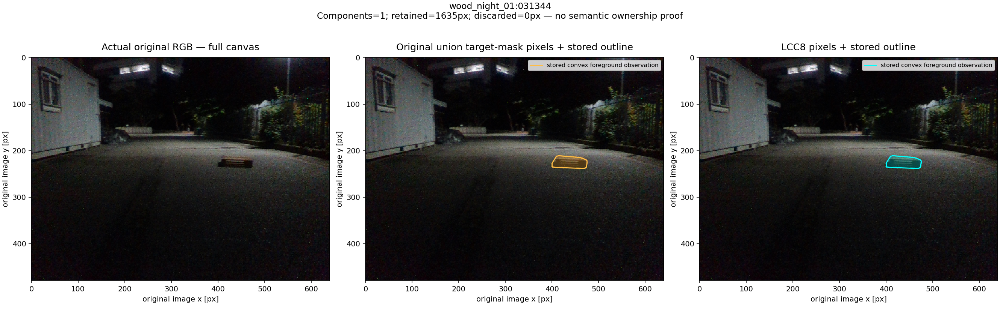
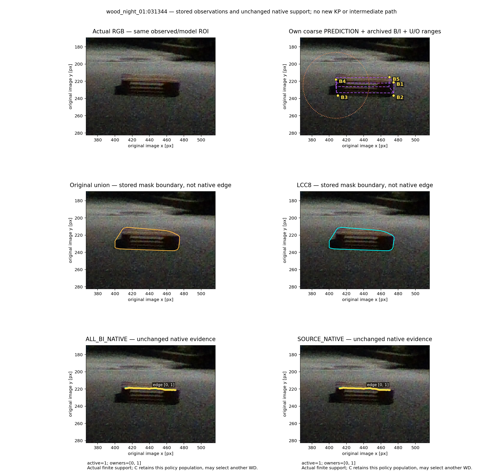
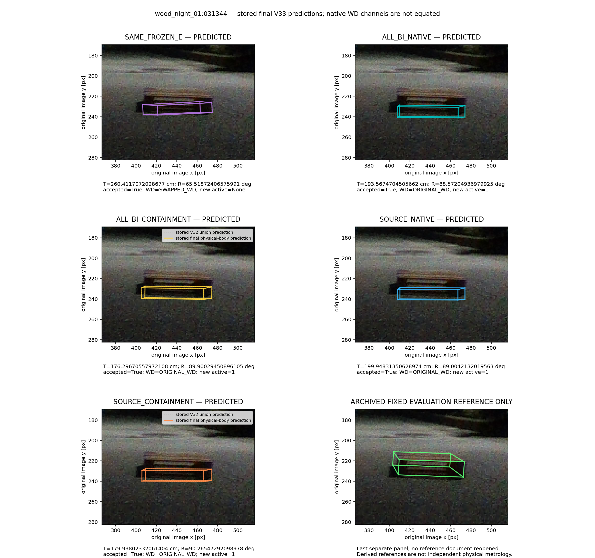
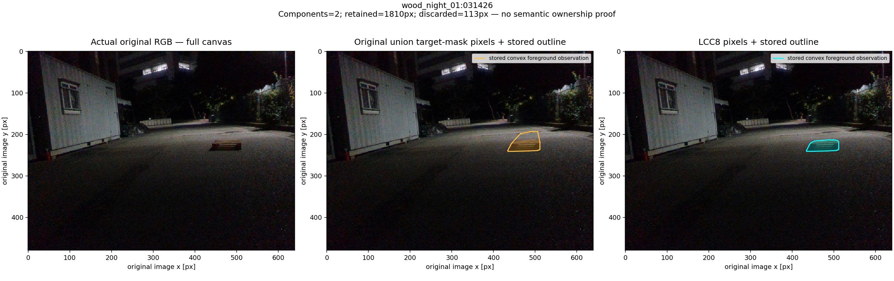
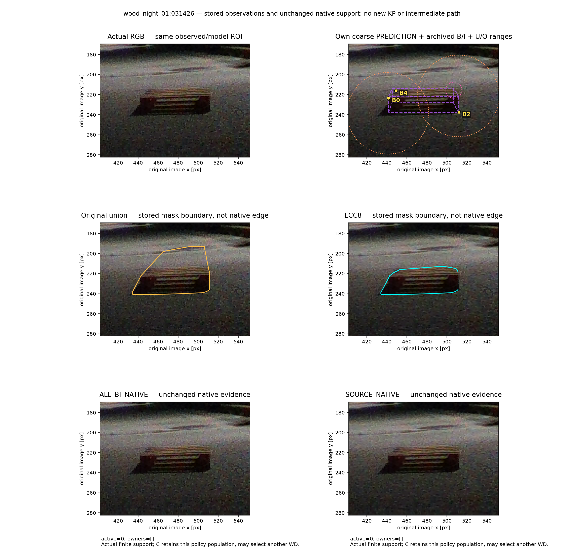
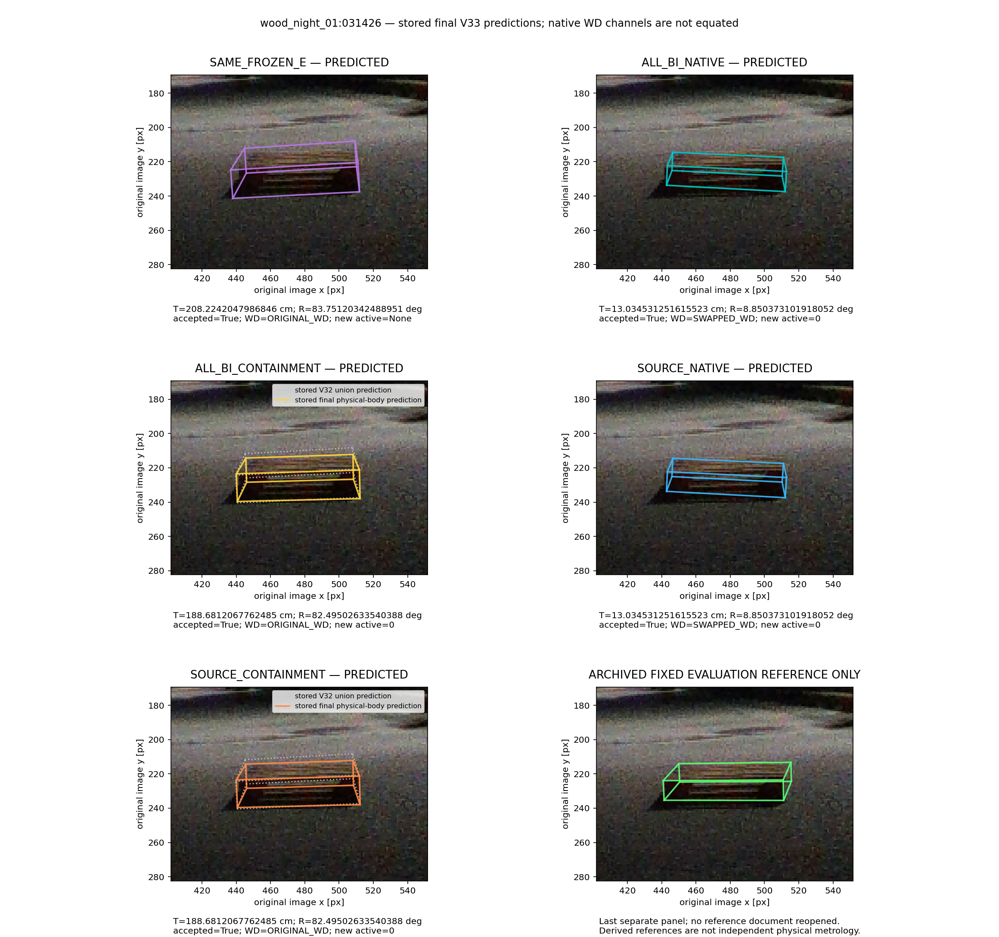
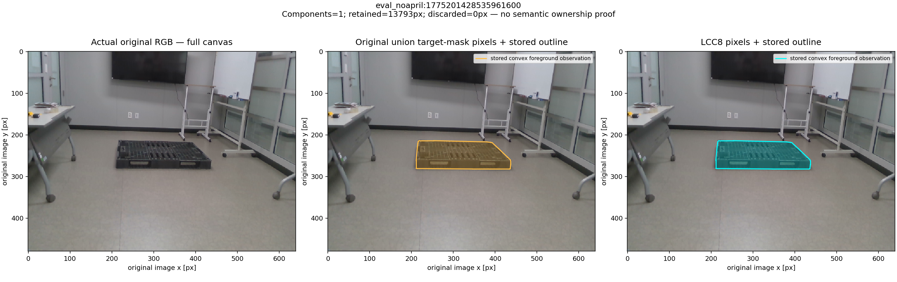
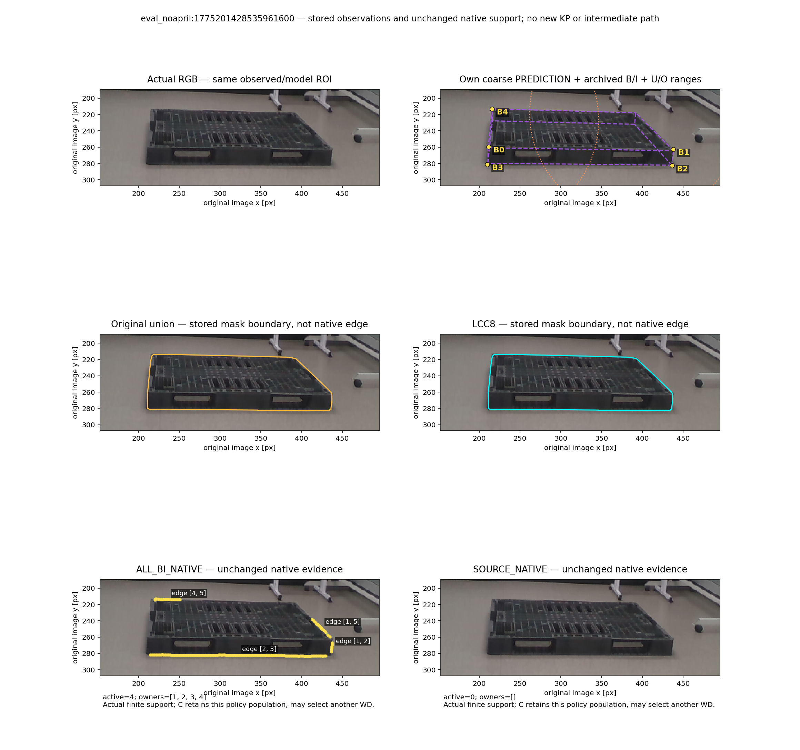
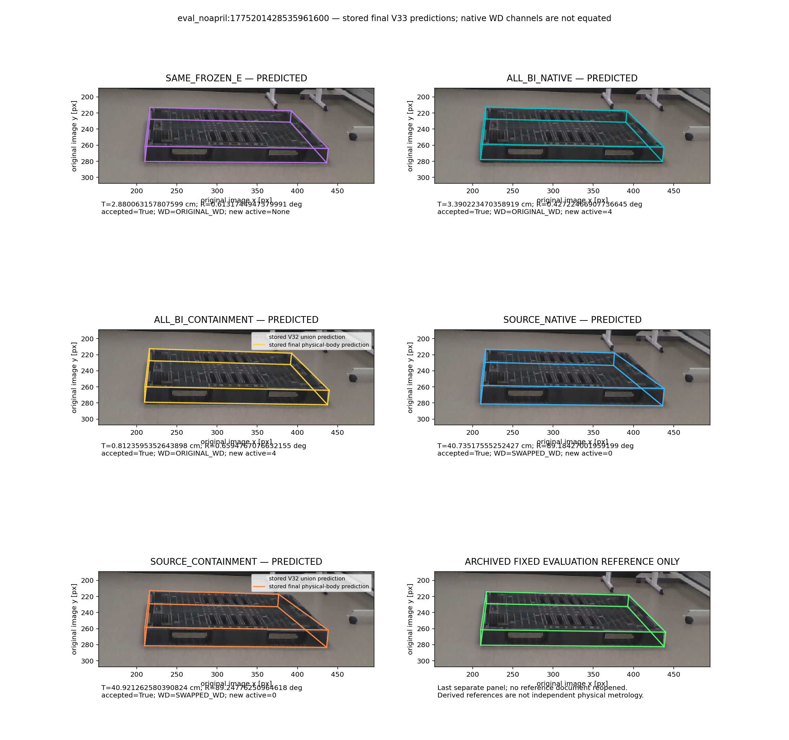

# 고정 세 사례: union과 LCC8 전경 포함 비용 비교

기존 V32 설명에 쓴 세 사례를 그대로 고정했다. V33 오차를 보고 다시 고르지 않았으며 이 그림은 전수 성공률·방법 선택의 근거가 아니다. 기본값은 SAME_FROZEN_E다.

원래 union과 LCC8은 같은 캐시 마스크에서 나온다. LCC8은 가장 큰 8연결 성분만 남긴 고정 규칙이다. 큰 성분이 파렛트라는 증명은 없으며, 가림으로 분리된 진짜 파렛트 조각을 버릴 수도 있다. 다른 물체·가림의 정답 마스크로 해석하지 않는다.

보라 모델선은 예측이고 B/I 점은 N3/SubPix/BI 보정 archive다. S는 모델만, U/O는 대략 범위만 표시하며 중심을 관측점으로 그리지 않았다. 실제 native 유한 선 지지와 전경 마스크 경계는 구분했다. native 선·noise32는 그대로이며 active=0은 빈 채로 표시했다.

최종 패널의 실선은 저장된 V33 예측이다. C 패널의 회색 점선은 기존 V32 union 예측이며 보정 전후의 중간 자세가 아니다. native 두 방법과 e는 원 결과와 정확히 같아야 하는 대조다. 마지막 초록 패널만 기존 봉인 PROCESS_DATA에 이미 있던 평가 참조다. 새 참조 문서를 열거나 참조로 ROI·탐색·보정·fit을 하지 않았다. 보관되지 않은 native 시작 자세와 연속 최적화 중간 궤적은 새로 계산하거나 만들지 않았다.

## wood_night_01:031344

[보관 값·출처](case0/PROCESS_DATA.json) · [원본 RGB](case0/source_rgb.png)

## wood_night_01:031426

[보관 값·출처](case1/PROCESS_DATA.json) · [원본 RGB](case1/source_rgb.png)

## eval_noapril:1775201428535961600

[보관 값·출처](case2/PROCESS_DATA.json) · [원본 RGB](case2/source_rgb.png)
